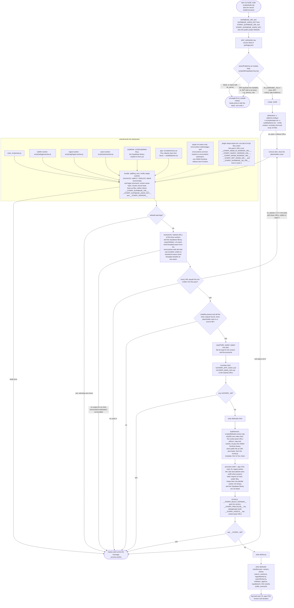
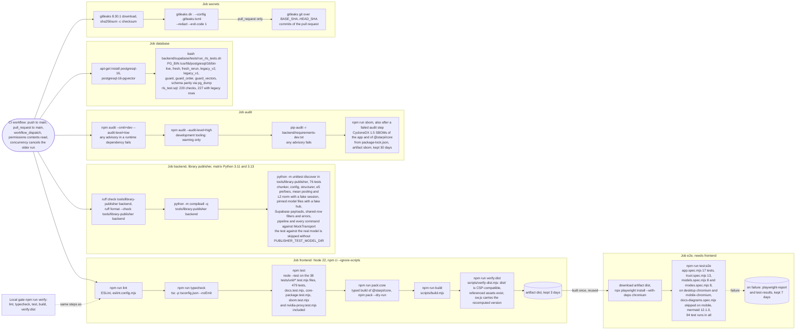
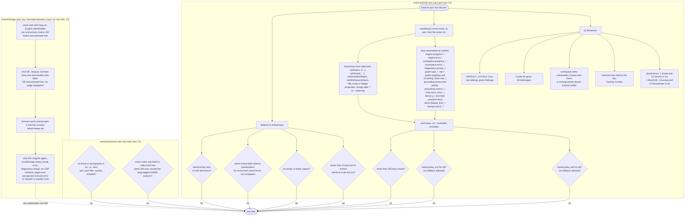
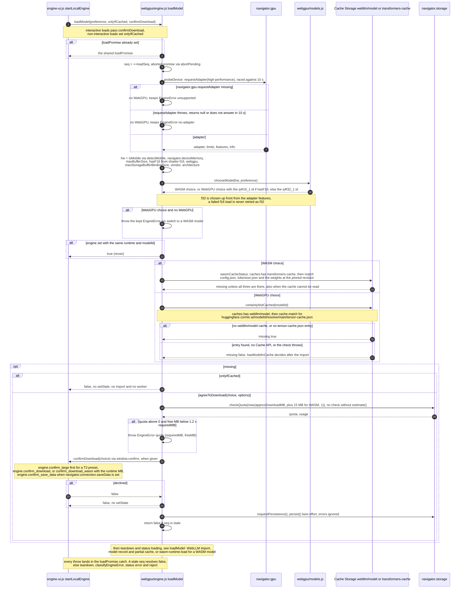

# Contributing to Starpi

Thanks for helping improve Starpi. This guide covers the local setup, the checks every change
must pass and the conventions the codebase relies on.

## Development setup

```bash
npm ci --ignore-scripts   # Node.js 22.13+ (see .nvmrc); no install scripts, as in CI and on Vercel
npm run dev               # watch build + local server with production headers on :3000
```

`npm run dev` and `npm run preview` also serve the NVIDIA routes from `api/`
(`scripts/serve.mjs --functions`) for `localhost` and IP addresses; set
`NVIDIA_API_KEYS=nvapi-<64 characters>` in the environment to use them. The end-to-end tests run
without the functions and mock `/api/*`, so they never reach NVIDIA.

Library publisher (optional, Python 3.11+):

```bash
cd tools/library-publisher && python -m pip install -r requirements-dev.txt
```

Database tests need PostgreSQL 16 and pgvector
(`apt-get install postgresql-16 postgresql-16-pgvector` on Debian/Ubuntu).

Before changing a subsystem, read its section in the
[architecture atlas](docs/ARCHITECTURE.md). What `npm run build` does:

<!-- diagram: build-pipeline-build -->


## Checks before opening a pull request

| Area | Command |
| --- | --- |
| Frontend | `npm run verify` (lint, typecheck, unit tests, build, output verification) |
| `@starpi/core` | `npm run pack:core` (typed build, lists the files the package would publish) |
| End-to-end | `npm run build && npm run test:e2e` (first run: `npx playwright install chromium`) |
| Library publisher | `ruff check tools/library-publisher backend && ruff format --check tools/library-publisher backend`, then `python -m unittest discover` in `tools/library-publisher` |
| Database | `bash backend/supabase/tests/run_rls_tests.sh` |
| Dependencies | `npm audit --omit=dev`, `pip-audit -r backend/requirements-dev.txt` and `npm run sbom` (CycloneDX SBOMs into `sbom/`) |

CI runs all of them, plus gitleaks.
`npm run nvidia:ping` checks the NVIDIA list against the live API with real keys and quota; run it
before changing the list, never in CI. The library publisher's test against the real model runs only when
`PUBLISHER_TEST_MODEL_DIR` points at the files `python -m publisher fetch-model` wrote.

When the NVIDIA list changes, change `src/js/models/nvidia-catalog.js` and update the T4 table in
the README; the unit tests fail until both agree.

<!-- diagram: test-strategy-ci-gates -->


**Diagrams** live in [docs/ARCHITECTURE.md](docs/ARCHITECTURE.md), the only place they are edited.
Update the diagram of any behaviour you change in the same pull request. Other Markdown files
may embed a diagram only as an exact copy under the same `<!-- diagram: <id> -->` marker
(`npm run docs:sync` refreshes the copies, `tests/unit/docs.test.mjs` enforces it), and every
Mermaid block must render with the pinned Mermaid release (`tests/e2e/docs-diagrams.spec.mjs`).
Stick to `flowchart`, `sequenceDiagram`, `stateDiagram-v2`, `erDiagram` and `classDiagram`, quote
every flowchart label and keep colours and `init` directives out.

## Frontend conventions

- **ES modules only**, bundled by esbuild. The production CSP forbids inline scripts, inline
  event handlers and inline styles:
  - interactive elements use `data-action="name"` (click) or `data-change="name"`, registered
    with `onAction()` / `onChange()` in `src/js/dom.js`. `tests/unit/actions.test.mjs` fails on
    unregistered or unused actions;
  - set styles through CSSOM (`el.style.x = …`) or Tailwind classes, never `style="…"`.
- **HTML construction:** interpolate untrusted values with `escapeHtml()`. Render Markdown only
  with `renderMarkdown()`. Values embedded in generated Markdown go through `escapeMarkdown()`.
  Never assign unsanitized strings to `innerHTML`.
- **Supabase access** goes through `src/js/supabase.js`, which returns `{ ok, data | error }`
  results and never throws. Handle every error kind in the UI; no silent failures.
- **Types:** modules carry `// @ts-check` and JSDoc types, and `tsconfig.json` must list every one
  of them (a unit test checks this). `npm run typecheck` runs in strict mode and `any` is not
  accepted.
- **Pure core:** `src/js/core/` (citation labels, sentences, facts, the source check with its
  negation and binding rules, receipts with their Merkle tree and signatures, documents and SARIF)
  uses no DOM, network or storage APIs, so it runs in the browser, in workers and in Node. Keep
  it that way; the ESLint configuration only allows globals available in all three. The same
  holds for `src/js/models/` (device classes, the model menu's choices, the WASM presets and the
  NVIDIA allowlist), `chat-stream.js` and `chat-export.js`.
- **Server functions:** `api/` holds the Vercel Functions of the NVIDIA proxy. They use Web
  `Request` and `Response` only, and ESLint forbids `process`, `Buffer` and `require` there;
  `api/_lib/env.js` is the one module that reads the environment, through `globalThis`. Keys never
  appear in a log line, a response or a test fixture: tests build fake keys at runtime.
- **Versioned rules:** answer receipts record the version of the text extraction, chunking and
  source-check rules. The golden tests (`tests/unit/golden.test.mjs`) fail when a change alters
  the extracted text or chunks of the sample files, or any verdict or reason of either version of
  the source-check rules on the labelled answers in `tests/fixtures/grounding/`; then bump
  `EXTRACTOR`, `CHUNKER` or `GROUNDING` and update the pin, so older receipts are reported as made
  with other rules instead of as a mismatch. A new source-check version keeps the previous ones
  runnable (`GROUNDING_VERSIONS`), so receipts made with them are recomputed with their own rules.
  A change the pins do not cover needs the bump all the same. Measure a rule change on the
  development sets (`npm run eval:source-check`); the held-out sets are measured once per release
  of new rules ([protocol](docs/eval/v2-protocol.md)).
- **Tailwind** is pinned to v3 to keep the current design; class names must be complete strings
  so the compiler can find them.
- **User-facing text** lives in `src/locales/en.json` (default) and `src/locales/de.json`, never
  inline. Use `data-i18n` / `data-i18n-placeholder` / `data-i18n-title` / `data-i18n-aria` in
  markup and `t()` or `setText()` (which re-translates on a language switch) in code. Add every
  key to both files with the same `{placeholders}`; `npm test` fails on missing keys. Code,
  comments and docs are English. Do not claim capabilities the code does not have (privacy,
  locality, hosting region).
- **Icons** are Lucide icons registered in `src/js/icons.js` (esbuild bundles only those
  imports); the tests fail on unregistered or unused icons and on emoji anywhere in `src/`.
  Icon-only buttons need an `aria-label` with a `data-i18n-aria` key.
- **Styling** uses the component classes in `src/styles/app.css` (`card`, `btn-*`, `badge-*`,
  `field`) before adding new one-off class combinations.

How the tests keep the dictionaries and keys consistent:

<!-- diagram: i18n-test-guards -->


## WebGPU and WebLLM

- The engine runs in `src/js/webgpu/worker.js`; `src/js/webgpu/engine.js` owns its lifecycle.
  Every load has a sequence number, and every exit path ends in `worker.terminate()`, which
  releases GPU memory deterministically.
- New models must exist in the pinned WebLLM prebuilt catalog, have a `q4f32_1` fallback, and
  get a catalog entry in `src/js/webgpu/models.js` with its tier, plus a row in the README table
  (the unit tests enforce this).
- Upgrading `@mlc-ai/web-llm`: re-run the unit tests (model ids) and confirm that the bundle
  still needs no `unsafe-eval` (`npm run verify:dist` checks for `eval`/`new Function`).
- Processor (WASM) presets live in `src/js/models/wasm-catalog.js`: a Hugging Face repository
  pinned to a commit and every downloaded file with its size, and a row in the README table. The
  worker in `src/js/wasm/` loads only those files. After upgrading `@huggingface/transformers`,
  check `npm run verify:dist` and load a WASM model in a browser without WebGPU under the production
  CSP (`npm run preview`).

<!-- diagram: webgpu-lifecycle-load-prepare -->


## Database changes

- Add a new timestamped file under `backend/supabase/migrations/` and update
  `full_schema.sql`, so fresh installs and upgraded databases stay identical. The test suite
  compares both with `pg_dump`.
- Every table needs RLS with explicit policies per role. Functions default to
  `SECURITY INVOKER` with `set search_path = ''`.
- Extend `backend/supabase/tests/rls_test.sql` for every new policy.

```mermaid
flowchart TD
    target{"Which database?"}
    tool["apply_migration.py, DATABASE_URL from the environment<br/>no file argument: full_schema.sql, otherwise the given files in order<br/>--migrations: sorted migrations/*.sql, stops at the first failed file<br/>--dry-run: prints target and files, exit 0 without connecting<br/>client: psycopg, else psycopg2, else psql"]
    toolErr["exit 2: DATABASE_URL unset or not postgresql://,<br/>files together with --migrations, SQL file not found,<br/>no Postgres client, or psql meta-commands in a file<br/>sent through psycopg or psycopg2"]
    toolFail["exit 1: SQL or connection error,<br/>nothing from that file committed, later files not run"]
    target -->|"new Supabase project"| fs0
    target -->|"live project or install from an earlier<br/>schema.sql / full_schema.sql"| m1a
    tool -.->|"default"| fs0
    tool -.->|"--migrations"| m1a
    tool -.-> toolErr
    tool -.-> toolFail

    subgraph sg_fs["full_schema.sql, one transaction"]
        fs0["create extension if not exists vector with schema public"]
        fs1{"vector in schema public and<br/>auth.users, auth.uid() present?"}
        fs2{"knowledge_documents, knowledge_entities,<br/>knowledge_relations or chat_history<br/>exists without owner_id?"}
        fs3["create table if not exists, 16 size CHECKs NOT VALID<br/>only if the name is new, create index if not exists,<br/>drop every policy, create the 19 policies,<br/>drop every RPC overload and recreate SECURITY INVOKER,<br/>search_knowledge as in 20260924120000,<br/>embedding_384, its index and match_knowledge_vector_384<br/>as in 20261101000000, revoke all, then grant per role"]
    end
    fs0 --> fs1
    fs1 -->|"yes"| fs2
    fs2 -->|"no"| fs3

    subgraph sg_m1["20260923000000_harden_rls_anonymous_auth.sql, one transaction, lock_timeout 15s"]
        m1a{"vector in schema public and<br/>auth.users, auth.uid() present?"}
        m1b{"knowledge_documents, knowledge_sections<br/>and chat_history exist?"}
        m1c["create missing brain_settings, knowledge_entities, knowledge_relations<br/>add columns if not exists, is_public added with default true<br/>only when the column is new, then default false"]
        m1d["delete chat_history rows without owner_id,<br/>owner_id NOT NULL default auth.uid(), chat CHECKs"]
        m1e["drop every policy on the six tables, including unexpected ones,<br/>create 19 owner-based policies plus brain_settings_select_all,<br/>drop every RPC overload, recreate SECURITY INVOKER<br/>with search_path empty and the full-match-only search_knowledge,<br/>revoke all then grant per role"]
    end
    m1a -->|"yes"| m1b
    m1b -->|"yes"| m1c
    m1c --> m1d --> m1e

    subgraph sg_m2["20260924000000_lock_published_rows.sql, one transaction, lock_timeout 15s"]
        m2a{"knowledge_documents, knowledge_entities,<br/>knowledge_relations have owner_id and is_public,<br/>knowledge_sections, chat_history, brain_settings exist?"}
        m2b["recreate update / delete policies with not is_public,<br/>section writes only for an own, private parent document"]
        m2c["brain_settings: drop every policy,<br/>revoke all from public, anon, authenticated"]
        m2d["16 size CHECKs NOT VALID,<br/>added only when the constraint name does not exist"]
    end
    m1e -->|"notify pgrst, commit,<br/>then the next file in file-name order"| m2a
    m2a -->|"yes"| m2b --> m2c --> m2d

    subgraph sg_m3["20260924120000_search_knowledge_shared_terms.sql, one transaction, lock_timeout 15s"]
        m3a{"search_knowledge(text, integer),<br/>knowledge_sections and<br/>knowledge_documents exist?"}
        m3b["create or replace search_knowledge, same signature:<br/>full matches first, else rows sharing terms,<br/>revoke all, grant execute to anon, authenticated, service_role"]
    end
    m2d -->|"notify pgrst, commit,<br/>then the next file in file-name order"| m3a
    m3a -->|"yes"| m3b

    subgraph sg_m4["20261101000000_embedding_384.sql, optional, one transaction, lock_timeout 15s"]
        m4a{"knowledge tables with owner_id and is_public,<br/>search_knowledge and<br/>ingest_document_atomic exist?"}
        m4b["add column if not exists embedding_384 vector(384),<br/>column comment, HNSW cosine index if not exists,<br/>create or replace match_knowledge_vector_384,<br/>EXECUTE for anon, authenticated, service_role,<br/>create or replace ingest_document_atomic with embedding_384"]
    end
    m3b -->|"commit, then the next file in file-name order"| m4a
    m4a -->|"yes"| m4b

    abortVec["raise exception: vector extension not in public<br/>or not a Supabase database"]
    abortOld["raise exception: older Starpi schema,<br/>apply migrations/ in file-name order instead"]
    abortFresh["raise exception: Starpi tables not found,<br/>use full_schema.sql for a fresh install"]
    abortOrder["raise exception: apply<br/>20260923000000_harden_rls_anonymous_auth.sql first"]
    abortSearch["raise exception: public.search_knowledge not found,<br/>apply 20260923000000 and 20260924000000 first"]
    abortSchema["raise exception: Starpi knowledge schema not found,<br/>apply the three earlier migrations first"]
    rollback(["That file's transaction is rolled back: nothing from it<br/>is committed, files applied before it stay committed"])
    fs1 -->|"no"| abortVec
    m1a -->|"no"| abortVec
    fs2 -->|"yes"| abortOld
    m1b -->|"no"| abortFresh
    m2a -->|"no"| abortOrder
    m3a -->|"no"| abortSearch
    m4a -->|"no"| abortSchema
    abortVec --> rollback
    abortOld --> rollback
    abortFresh --> rollback
    abortOrder --> rollback
    abortSearch --> rollback
    abortSchema --> rollback

    fsDone(["notify pgrst, reload schema, then commit<br/>running all migrations afterwards changes nothing"])
    m3Done(["commit, this file sends no notify pgrst"])
    fs3 --> fsDone
    m3b --> m3Done
    m4Done(["notify pgrst, reload schema, then commit"])
    m4b --> m4Done
    rerun["Re-running 20260923000000 alone drops the 20260924000000 policies,<br/>restores brain_settings_select_all with the SELECT grant to anon<br/>and authenticated, and the full-match-only search_knowledge:<br/>always re-run the whole set"]
    rerun -.- m1e
```

<!-- diagram: migrations-tests-apply-order -->


## Pull requests

- Branch from `main`, keep changes focused, and use [Conventional Commits](https://www.conventionalcommits.org/)
  (`fix(chat): …`, `feat(webgpu): …`, `docs: …`).
- Fill in the pull request template. Include benchmark numbers (tokens per second, time to
  first token, memory) when a change affects inference performance.
- Report security problems privately (see [SECURITY.md](SECURITY.md)), not in public issues.

Parts of the code were written with AI assistance and reviewed by the maintainer. Contributions
made with AI tools are welcome under the same rules as any other: you understand the change, it
follows these conventions, and it passes the checks.

## Releases

The app, `@starpi/core` and `@starpi/companion` are released together and share one version
number.

0. **Set new environment variables and secrets first.** Set any new Vercel environment variable
   (keys as type Sensitive) for Production and Preview before the release deploys: Vercel reads
   them when it creates a deployment, so a deployment created earlier does not see them until it
   is redeployed. For the release workflow: `NPM_TOKEN` (a granular npm token with publish rights
   on the `@starpi` scope; only needed until trusted publishing is set up for both packages on
   npmjs.com) as a secret of the environment `npm`, and optionally `STARPI_RELEASE_SIGNING_KEY`
   (an Ed25519 private key, `node scripts/sign-release.mjs keygen --out <dir>`) as a secret of the
   environment `release`.
1. **Prepare the release commit.**
   - Set the version in `package.json`, `packages/core/package.json` and
     `packages/companion/package.json` (and the companion's `@starpi/core` dependency), then run
     `npm install --package-lock-only --ignore-scripts --no-audit --no-fund` so the lockfile
     records them.
   - Update `version` and `date-released` in `CITATION.cff`.
   - Move the `[Unreleased]` entries of `CHANGELOG.md` into a section for the version and add its
     compare link.
   - Write `docs/releases/vX.Y.Z.md`; the release workflow publishes it as the release notes. Work
     through its "Before tagging" list.
2. **Get it onto `main`.** Push the commit with an annotated tag `vX.Y.Z`. The tag must point at
   the commit that ends up on `main`, so fast-forward `main` to it instead of merging with a
   merge or squash commit, and push nothing else to `main` until the release exists: a newer push
   cancels the CI run of the tagged commit. If that run was cancelled or failed, re-run it; a
   manual run of the release workflow only works while the tagged commit is the head of `main`.
   Or merge the release pull request with **Rebase and merge** and push no tag: `release.yml`
   creates the tag `vX.Y.Z` at the commit CI tested. Here too, push nothing else to `main` until
   the release exists.
3. **CI and the release workflow.** Once CI has passed on `main`, `release.yml`:
   - builds, without write access and without secrets, the tarballs of both packages, the
     CycloneDX SBOMs, the companion's offline bundle and `SHA256SUMS`, and smoke-tests the
     `@starpi/core` tarball;
   - attests every asset (`actions/attest-build-provenance`), signs `SHA256SUMS` and the offline
     bundle keyless with cosign, and signs `SHA256SUMS` with the Ed25519 release key when that
     secret exists, in a job that installs nothing;
   - creates the release with `starpi-core-X.Y.Z.tgz`, `starpi-companion-X.Y.Z.tgz`,
     `starpi-X.Y.Z.cdx.json`, `starpi-core-X.Y.Z.cdx.json`, `starpi-companion-X.Y.Z.tar.gz`,
     `SHA256SUMS`, the `.sigstore.json` bundles and `SHA256SUMS.sig`;
   - publishes the two tarballs of the release to npm with `--provenance`, the core first; a version
     npm already has is skipped.
   If an interrupted upload left a draft release, the release job stops with an error; delete the
   draft (`gh release delete vX.Y.Z --yes`) and re-run it. If publishing fails after the release
   was created, re-run the failed publish job (its artifacts are kept for 7 days); publishing by
   hand (`npm publish ./starpi-core-X.Y.Z.tgz --access public` from the release asset, after
   `sha256sum -c --ignore-missing SHA256SUMS`) works too, but carries no provenance.
4. **Check what was published.**

   ```bash
   npm view @starpi/core@X.Y.Z dist.integrity
   npm view @starpi/companion@X.Y.Z dist.integrity
   gh attestation verify starpi-core-X.Y.Z.tgz --repo umutcantezgel-cpu/Starpi
   cosign verify-blob --bundle SHA256SUMS.sigstore.json \
     --certificate-identity https://github.com/umutcantezgel-cpu/Starpi/.github/workflows/release.yml@refs/heads/main \
     --certificate-oidc-issuer https://token.actions.githubusercontent.com SHA256SUMS
   ```

## Reporting bugs

Use the issue templates. For WebGPU problems, include the browser version, the output of
`chrome://gpu` or `about:support`, and the adapter information
(`(await navigator.gpu.requestAdapter()).info`).
