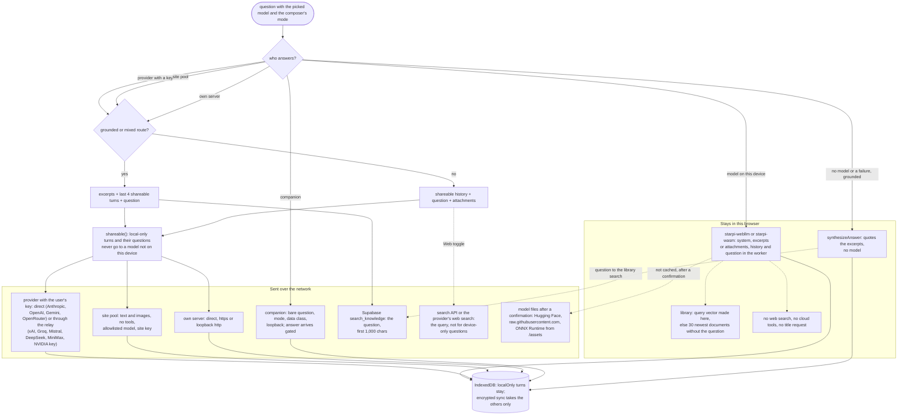
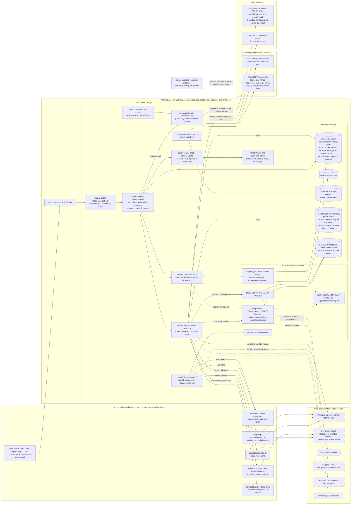

# Starpi

<p align="center">
  <a href="https://github.com/umutcantezgel-cpu/Starpi/actions/workflows/ci.yml"></a>
  <a href="https://github.com/umutcantezgel-cpu/Starpi/releases/latest"></a>
  <a href="https://www.npmjs.com/package/@starpi/core"></a>
  <a href="LICENSE"></a>
  <a href="https://www.starpi.app"></a>
</p>

**A knowledge assistant in the browser that shows how far each answer can be trusted.** Starpi
answers with the model you choose: Anthropic, OpenAI, Gemini, xAI, Groq, Mistral, DeepSeek, MiniMax,
OpenRouter or NVIDIA with your own key, free models from the site's key pools without any key, your
own server, a model in the browser (WebGPU, or WebAssembly on the processor), or Starpi Core, the
local companion on your own machine. **Auto** decides for each question whether your files can
answer it. Grounded answers cite every passage, a deterministic source check compares every
statement with the passages it cites, and a receipt signed on your device lets anyone verify them
against the original files; free answers are marked as not checked. Whatever is read aloud, spoken
in a Live conversation or written into a research report passes a sentence gate first. Your files
and conversations stay on your device, and sync is end-to-end encrypted and off until you turn it
on. The app is a static site with stateless server functions: no account, no API key and no server
of your own are needed. In English, German, French, Spanish, Italian and Turkish.

<p align="center">
  
</p>

**Live:** [www.starpi.app](https://www.starpi.app) · **New in 3.0:** [overview](#whats-new-in-30),
[migration guide](docs/MIGRATION-3.md) · **Tour of the code:** [walkthrough](docs/WALKTHROUGH.md) ·
**How it works in detail:** [architecture atlas](docs/ARCHITECTURE.md) · **The checks as a library:**
[`@starpi/core`](packages/core/README.md) · **The local companion:**
[`@starpi/companion`](packages/companion/README.md) · [Changelog](CHANGELOG.md)

## What's new in 3.0

- **Every provider in one chat.** One AI layer for Anthropic, OpenAI, Gemini, xAI, Groq, Mistral,
  DeepSeek, MiniMax, OpenRouter, NVIDIA, your own server and the models on your device, with extended
  thinking and web search per answer. MiniMax M3.1 Flash is the cloud base model: Auto reaches it
  first whenever it is set up. Your key goes to the provider directly, or through Starpi's
  stateless relay when a provider blocks browsers; without a key, the site's pools offer free models.
- **Auto · Free · Grounded.** Auto routes each question without an extra model call: to your sources
  when it points at them, to a free conversation otherwise, or mixed. Every answer carries a label
  that says which it was.
- **A chat thread with branches:** edit a question, regenerate with another model, continue after
  the length limit, attach images, PDFs and Office files, use tools with approvals and MCP servers
  with pinned tool definitions, open answers in a canvas, compare models side by side or ask a
  council; projects, assistants and an opt-in memory.
- **Voice, Live and research.** Dictation with a fallback chain of speech services; read-aloud and
  Live conversations that speak only what the sentence gate released; research jobs that search your
  documents and the web in the background and survive a reload.
- **Stronger checks:** source check version 3 (relations between values and events), the sentence
  gate (also as `starpi-gate`), receipts v3 signed with a key of your device, six languages.
- **On your device:** conversations in IndexedDB, workspace files kept across reloads, Word, Excel,
  PowerPoint and HTML files, opt-in search by meaning, model files checked against SHA-256 pins, and
  a benchmark history that informs the model recommendation.
- **A knowledge graph from your files.** **Find in my files** names the people, organizations and
  things in the files on this device and how they relate. A model's relation stays only when the
  passage it cites names both ends; without a model, names that appear in the same sentence are
  linked. A long file is continued where the last run stopped, and the results stay on the device
  with their files and go when a file is removed. What was found is drawn dashed next to the entries
  added by hand, with the passages it comes from.
- **End-to-end encrypted sync**, off until you turn it on.
- **Starpi Core, the local companion** (`@starpi/companion`): a sealed vault, a signed audit chain and
  zero network egress by default on your own machine; paired with the app it is a source and a model
  of the chat.
- **Signed releases:** npm provenance for both packages, build attestations for every asset, and
  Sigstore signatures for the checksums and the companion's offline bundle.

Coming from 2.x? A browser moves its chats, remembered keys and settings once, on the first start.
Operators, forks and users of `@starpi/core` find the breaking changes in the
[migration guide](docs/MIGRATION-3.md); every change is in the [changelog](CHANGELOG.md).

## Try it in 20 seconds

1. Open [www.starpi.app](https://www.starpi.app). No account, no API key, nothing to install.
2. Click **Try with sample files**. A plan (Markdown), a risk register (CSV) and kickoff notes (PDF)
   of a fictitious project are read into the on-device workspace.
3. Ask one of the suggested questions. Every citation opens the exact passage, highlighted in its
   file, and the **Source check** under the answer shows how many statements match their excerpts.
4. Click **See the source check catch an error**: a prepared answer with one wrong number (labelled
   as written for the demo) is flagged, with the reason.
5. Open **Receipt** under an answer, download it, and verify it against the sample files, in the
   dialog or on the command line with `npm run verify:receipt`.

The model menu offers the free models of the site's pools under **Free (via Starpi)**; **Auto**
takes the best model that is set up, and without any model Starpi answers grounded questions by
quoting the sources, and says so. Switch the composer between **Auto**, **Free** and **Grounded**:
Free talks with the model without sources and marks every answer as not checked. Add a key under
**Settings › Model providers and keys**, point Starpi at your own server, load a model on this
device or pair the local companion, and the same checks apply.

## What is different

Retrieval-augmented assistants cite sources, but a citation does not tell you whether the sentence
next to it says what the source says. Starpi makes that visible and checkable:

- **Source check on every grounded answer.** Each statement is compared with the excerpts it cites:
  numbers (480,000 = 480.000 = 480k), dates, times, weekdays, codes, version numbers, quotations and
  wording; whether it reverses a negation of the excerpt ("is supported" where the excerpt says "is
  not supported"); whether it puts a name or a value next to something else than the excerpt does;
  and, since version 3, whether it gives a change, a comparison or an order in time the other way
  round ("costs rose from 420,000 to 210,000 EUR"). A value that is not in the cited excerpt is
  named ("520,000 is not in [Doc: plan.md, Chunk: 1]"), the statement is highlighted and its
  citation marked; a reversed or misplaced statement is listed for review with the passage that says
  otherwise. It runs in the browser, is deterministic and needs no second model. On labelled test
  answers held out from its development it flagged every changed value, about three in four
  reversed statements, wrong names and misplaced values, 23 of 24 reversed relations, and no
  statement of a faithful answer as unsupported ([how well it works](#how-well-it-works)).
- **Answer receipts.** A JSON file per answer with SHA-256 fingerprints of the source files, the
  exact offsets of each cited passage, the source-check verdicts, what the sentence gate released
  and withheld, and a Merkle tree (RFC 6962) over the citations, so one cited passage can be shown
  with its inclusion proof without the others. Anyone with the same files can reproduce every
  passage, in the app or with a command-line verifier. The app signs the receipts it exports with a
  key of the device (Ed25519, or ECDSA P-256), on by default; a v3 receipt names its signer inside
  its id, so a removed or swapped signature is detected, and **Settings › Trust** hands out the
  public key. The format is specified in [`docs/spec/receipts.md`](docs/spec/receipts.md).
- **What is spoken is checked.** Read-aloud, Live, research reports and the companion's answers
  carry only units the sentence gate released: in a grounded answer a number is spoken only when a
  passage the sentence cites holds that number ([the gate's trust model](#what-is-spoken-is-checked-the-sentence-gate)).
- **A check for CI.** `starpi-ground` checks release notes, generated documentation or any Markdown
  document against source files and writes SARIF 2.1.0, so a pull request shows an unsupported
  statement in GitHub code scanning ([CI snippet](#check-documents-in-ci)); `starpi-gate` gates a
  streamed answer the way the app does.
- **Citations the model cannot forge.** Only labels the app registered for the excerpts it sent
  become clickable, and the drawer shows the cited chunk inside its source text.
- **Auto, Free or Grounded.** Auto routes each question without asking a model: to your sources
  when it points at them (an attached document, "according to my notes", a file name, a strong match
  in the workspace), to a free conversation otherwise, or mixed, where the answer marks which parts
  the sources hold. Grounded always retrieves, cites and checks. Free sends the conversation to the
  model without retrieval, citations, source check or receipt and marks every answer as not checked.
  Suggested questions and questions about a graph entity always run grounded; an entity found in
  your files is looked up in those files.
- **A model for every situation.** The model menu groups the choices: recommended for this device,
  on this device (WebGPU, or WebAssembly on the processor), the local companion, the free models of
  the site's pools, the providers you have a key for and your own server, each with a status from
  the site's health check ([models and providers](#models-and-providers)). Nothing is downloaded
  without confirmation, and the site's keys stay on the server.
- **Files are read on the device.** PDF, Markdown, text, JSON, CSV, Word, Excel, PowerPoint and HTML
  files are parsed, chunked and indexed in a Web Worker (BM25, and on request by meaning with an
  embedding model on the device) and kept on the device until you forget them; they are never
  uploaded. Only the excerpts an answer needs go to the model you chose (none on this device). A turn
  that used your files is never sent to another model as history and never synced; a question
  answered on this device also gets no web search and no cloud tools.
- **A privacy statement per answer.** The footer under the composer says where the current question
  goes with the chosen model and mode; on this device it does not leave the browser.

Both checks have limits, and the app says so where it shows them. The source check compares text;
a match does not prove a statement true, and a flag means "open the source and look". The sentence
gate guards numbers, identifiers, links and characters, not meaning. Receipts show that the
excerpts are reproducible from the same files, not what a model read. A signature shows who signed
only when it is checked with a public key obtained from the signer, not with the key inside the
receipt.

<table>
  <tr>
    <td width="62%"></td>
    <td width="38%"></td>
  </tr>
  <tr>
    <td>Verifying a receipt against the original files</td>
    <td>On a phone</td>
  </tr>
</table>

## How the source check works

The check reads the rendered answer, not the raw text, so it knows exactly which citation belongs
to which sentence (also for lists, tables and a "Sources:" line). For each statement it extracts the
facts and looks them up in the cited excerpts, then compares the remaining wording:

| Verdict | When |
| --- | --- |
| **Supported** | Every fact is in a cited excerpt and at least half of the content words appear there. |
| **Weak** | A value is rounded or approximate, appears only in another excerpt or in the question, or stands in the excerpt next to something else than the statement says; a name stands in the excerpt in another place, or an English statement names someone or something the excerpt does not; the statement reverses a negation of the passage it matches; the wording overlaps little; or a statement without a citation states a value that one of the excerpts contains. |
| **Unsupported** | A number, date, time, weekday, code or quotation appears in none of the excerpts, a cited label was not one of the excerpts, or the cited excerpt did not fit into the model's context. |
| **Unchecked** | The statement and its excerpt are in different languages, so only facts are compared, and the statement has none. |

Headings, short fragments, and statements with neither a citation nor a fact are not counted.

Version 2 of the rules (Starpi 2.0) looks for three ways in which a statement uses the excerpt's
own words and still says something else, in English and German:

- **Negations.** "Power over Ethernet is supported" against "Power over Ethernet is not
  supported", "USB-Datenträger sind erlaubt" against "… sind verboten", "gestiegen" against
  "gesunken". The check reads negations by their meaning, so "is unsupported", "no … without" or
  "darf … nicht" match their excerpts, and "no later than", "not … until", "only after" and
  questions are not read as reversals. A reversal is marked weak, never unsupported: a reading of
  negations by words cannot tell every restatement of a negated rule from its reversal. The panel
  quotes the passage.
- **Names in the wrong place.** "Marcus Hale owns the specification" when the excerpt says
  "Priya Raman owns this specification; Marcus Hale maintains the network configuration" is
  marked weak, with the passage that names someone else; so is a statement that matches a passage
  but names someone or something the passage does not ("the Munich depot" when it says Hamburg).
- **Values next to something else.** "75,000 EUR for infrastructure" when the excerpt says "95,000
  EUR for infrastructure and 75,000 EUR for training" is marked weak, with the passage where the
  value stands. Version 1 checked this too; version 2 compares the passage around each value and
  no longer counts a section heading as the context of every value below it.

Each statement is checked on its own, and version 3 also compares it with the statement directly
before it, so a receipt can recompute it; a wrong relation spread over more statements is not seen.
In English answers, a name that none of the cited excerpts contains ("the Munich depot" when the
plan says Hamburg) is marked weak as before. When the answer and the excerpt are in different
languages, only the facts are compared. The checks read English, German, French, Spanish, Italian
and Turkish (the last four from language packs loaded after the first paint). The rules live in
[`src/js/core/facts.js`](src/js/core/facts.js), [`src/js/core/polarity.js`](src/js/core/polarity.js),
[`src/js/core/binding.js`](src/js/core/binding.js),
[`src/js/core/relations.js`](src/js/core/relations.js) and
[`src/js/core/grounding.js`](src/js/core/grounding.js), carry a version that receipts record
(versions 1 and 2 can still be run and recompute receipts of 1.x and 2.x), and are pinned by golden
tests.

### How well it works

Measured with `npm run eval:source-check` on labelled answers, each either faithful or with exactly
one planted error, in English and German: two sets written for Starpi 1.2 about the sample files
and the sample knowledge base (also across the two languages), two sets written for Starpi 2.0
about technical specifications (an edge gateway and a data retention policy), and 854 faithful
paraphrases. In each pair, the first set was available while the rules were adjusted; the
held-out set was written in advance and measured once, with both versions of the rules
([protocol](docs/eval/v2-protocol.md), [all results](docs/eval/v2-results.md)). Detected means
marked unsupported or weak; each cell gives version 2 / version 1 of the rules.

| | Set for 1.2 | Held-out for 1.2 ¹ | Set for 2.0 | Held-out for 2.0 | Paraphrases |
| --- | --- | --- | --- | --- | --- |
| Statements of faithful answers | 143 | 324 | 143 | 144 | 844 |
| … marked unsupported | 0 / 0 | 0 / 0 | 0 / 1 | 0 / 0 | 0 / 0 |
| … marked weak | 0 / 0 | 16 / 15 | 0 / 2 | 8 / 4 | 27 / 16 |
| Changed number, date, time, weekday or code detected | 47 / 48 of 49 | 49 / 49 of 49 | – | – | – |
| Wrong name or place detected | 5 / 3 of 10 | 6 / 4 of 10 | 19 / 9 of 24 | **17 / 10 of 23** | – |
| Correct value attached to the wrong thing detected | 3 / 2 of 10 | 7 / 6 of 10 | 23 / 13 of 24 | **20 / 13 of 24** | – |
| Negated or reversed statement detected | 8 / 0 of 10 | 4 / 0 of 10 | 24 / 1 of 24 | **16 / 0 of 23** | – |

¹ Its misses under version 1 were inspected while version 2 was designed, so it is not a clean
held-out measure for version 2.

The clean measure of version 2 is the held-out set for 2.0: it detects 17 of 23 wrong names, 20 of
24 values attached to the wrong thing and 16 of 23 reversed statements, where version 1 detected
10, 13 and none, and it marks no statement of a faithful answer unsupported. The target set before
the work, 8 of 10 in each of these three categories, is reached for values (83 %) and not for
names (74 %) or negations (70 %). The price is more weak marks on faithful statements: 8 instead
of 4 of 144 in that set. Reversed negations are marked weak, never unsupported: a red-team test
with 843 faithful paraphrases showed that reading negations by their words also reverses correct
restatements ("only allowed after the update" for "prohibited until the update"), and no faithful
statement may be marked unsupported.

Version 3 (the current rules) adds relations between values or events, within a statement and with
the statement before it: a change, comparison, order in time or carried-over value that the cited
excerpts give the other way round ("costs rose from 420,000 to 210,000 EUR") is marked weak with the
excerpt's passage. On two relation sets written for 3.0 (fictitious reports in English and German,
[sets and results](docs/eval/v3-relations.md)) it detects 32 of 32 and, on the held-out set, 23 of
24 planted relation errors, where version 2 detected 2 and 5, and it marks no statement of a
faithful answer weak or unsupported. On all earlier sets it gives the results of version 2, with one
more misplaced value detected in the set for 2.0.

The answers were written by language models following fixed instructions, and every label was
confirmed by two independent model reviewers; they are not answers from real users, and each
category has 10 to 24 answers per set. Read the table as what the check can and cannot see: it is
reliable for changed values and finds most reversed statements, wrong names and misplaced values
within one statement, but not all; relations across statements are checked only with the statement
directly before. The
labelled answers are in [`tests/fixtures/grounding/`](tests/fixtures/grounding), and a unit test
fails if any of these results gets worse.

French, Spanish, Italian and Turkish have development sets only
([`tests/fixtures/grounding/eval-intl.json`](tests/fixtures/grounding/eval-intl.json)); a held-out
set per language comes before the rules are tuned further for them. `npm run eval:answers` asks a
configured model the app's prompts in all six languages and measures the answers, including what
the source check says about grounded ones.

```mermaid
flowchart TD
    sIn(["chat/thread.js answerGrounded: the answer streamed and rendered,<br/>pack labels [S#] and [F#] expanded to the canonical labels"]) --> sEng{"who answered?"}
    sEng -->|"the extractive synthesizer"| sFull["every excerpt delivered full"]
    sEng -->|"a model, with a context pack"| sPack["the pack's coverage per excerpt:<br/>full, partial or omitted"]
    sEng -->|"a model, plain context"| sCov["contextCoverage: the EXCERPT n blocks<br/>of the context that was sent"]
    sFull --> sKind
    sPack --> sKind
    sCov --> sKind
    sKind{"a mixed answer from Auto?"}
    sKind -->|"yes"| sMixed["applyMixedMarks: the same check, per statement<br/>from the sources, partly, cited but not found<br/>or not in the sources"]
    sKind -->|"no"| sApply["applyGrounding: sources with their delivered text and state,<br/>given = the question and the user messages among the last 4 entries,<br/>citedOnly = synthesizer answer, localOnly = the answer stays here"]
    sDemo(["demo.js showCheckDemo: excerpts full, no given"]) -.-> sApply
    sApply --> sBlocks["blocksFromElement: blocks of the rendered DOM,<br/>citation buttons of this answer's scope as citations,<br/>other label-like text as bad citations"]
    sBlocks --> sSize{"groundAnswer with GROUNDING.version 3:<br/>more than 20,000 characters or 300 statements?"}
    sSize -->|"yes"| sSkip["skipped too_long"]
    sSize -->|"no"| sAssoc["associate: markers to statements, a statement without one<br/>inherits from its block's cited statements or its lead-in"]
    sAssoc --> sIdx["indexSource per delivered excerpt, given indexed,<br/>answer language from guessLanguage"]
    sIdx --> sCheck["checkSentence per statement,<br/>see source-check-verdicts and source-check-v2-checks"]
    sCheck --> sRel["applyRelations: changes, comparisons, order in time<br/>and carried-over values, see source-check-relations"]
    sRel --> sCount["counts supported, weak, unsupported, unchecked,<br/>neutral statements not counted"]
    sSkip --> sBar
    sCount --> sBar["details.grounding-bar: review, partial, ok or none;<br/>flagged list, unsupported first, one reason line each;<br/>relations note, unchecked note, disclaimer"]
    sBar --> sSecond{"a weak statement with a delivered cited excerpt?"}
    sSecond -->|"yes"| sOp["second-opinion buttons: the entailment model on this device,<br/>the AI judge only when localOnly is false; advisory,<br/>recorded in the report, never a new verdict"]
    sSecond -->|"no"| sChips
    sOp --> sChips["citation buttons of unsupported statements flagged with<br/>aria-describedby; Custom Highlight where supported"]
    sChips --> sRet(["report back to chat/thread.js: answer label,<br/>receipt draft, the stored answer"])
    sMixed --> sRet
```

<!-- diagram: source-check-pipeline -->


## What is spoken is checked: the sentence gate

The source check marks statements in the chat bubble; it never hides text. Everything Starpi reads
aloud or shows as checked outside the bubble passes a second, stricter step first: the sentence gate
([`src/js/core/gate.js`](src/js/core/gate.js), also the `starpi-gate` command of `@starpi/core`).
Read-aloud, Live, the documents part of a research report and the companion's answers use it.

- **Unit by unit.** A streamed answer is released one unit at a time (a sentence, list item, table
  row, heading or code block), and only once the unit can no longer change. Each unit is judged
  once, on the canonical text that is shown and spoken.
- **Only the gate can release.** A released unit is a frozen object only the gate creates; the
  speech queue accepts nothing else, so text that did not pass the gate cannot be spoken.
- **Sources mode** (grounded answers and Live from your sources): every number of a unit must appear
  with the same value in an excerpt that the same unit cites, without tolerance; a unit with a
  number and no citation, or with a label that is not one of the sources, is withheld; identifiers
  such as "ISO 9001" must appear literally in a cited excerpt or in the question; digits a listener
  would hear as another number ("4 80", "5OO") withhold the unit.
- **Web mode:** every number must lie inside a part of the answer that the provider grounded on at
  least one web page. **Free mode:** only the character and link rules apply, and a free answer is
  announced as not checked.
- **In every mode** links, other scripts, look-alike digits and invisible characters withhold a unit.
- **What you hear:** the released units, then how many were withheld. A receipt v3 records the
  counts. A second opinion (an entailment model on the device or an AI judge) is advisory: it is
  recorded in the receipt and never releases or upgrades anything.

What the gate trusts: the excerpts are what retrieval returned (the gate shows that a number is in a
cited excerpt, not that the excerpt is right), and in web mode the grounding comes from the
provider. A sentence without numbers or identifiers passes the gate in sources mode; its wording is
what the source check judges.

## Models and providers

| In the model menu | Models | How a request goes | Key |
| --- | --- | --- | --- |
| Providers with your key | Anthropic, OpenAI, Gemini, OpenRouter | direct from the browser | yours, for the tab or in the vault |
| Providers with your key that refuse browser calls | xAI, Groq, Mistral, DeepSeek, MiniMax (and NVIDIA with an `nvapi-` key) | direct first; a blocked call is retried through the site's stateless relay, and the choice is remembered per provider | yours |
| **Free (via Starpi)** | the MiniMax, NVIDIA, Groq, Gemini and OpenRouter pools below | the site's pool function, with a site key | none |
| **Your server** | any Chat Completions server (Ollama, LM Studio, vLLM, llama.cpp, MLX) at `https://…` or `http://localhost`, also a self-hosted MiniMax M3 build ([below](#the-base-model-minimax-m31-flash)) | direct, never through the site | optional |
| **On this device** | the WebGPU and processor (WASM) presets [below](#on-device-models) | a Web Worker | none |
| **Starpi Core (local companion)** | the models the companion's owner configured, by data class | the loopback interface | in the companion's vault |

The site's pools accept text, and images for models that see; no tools; at most 4,096 output tokens;
only the models of their allowlist ([`src/js/ai/catalog/pools.js`](src/js/ai/catalog/pools.js), which
the browser and the server share). A deployment offers the pools it has keys for:

| Pool | Models (default first) |
| --- | --- |
| MiniMax | MiniMax M3.1 Flash, the base model (always with the lowest thinking effort; the site's own MiniMax quota) |
| NVIDIA | the NIM models of the [T4 table](#nvidia-nim-models-t4) |
| Groq | Llama 3.3 70B Versatile, Llama 3.1 8B Instant, GPT-OSS 20B, GPT-OSS 120B, Qwen3 32B |
| Gemini | Gemini 2.5 Flash-Lite, Gemini 2.5 Flash |
| OpenRouter | Llama 3.3 70B Instruct, DeepSeek R1, Gemma 3 27B, Qwen3 Coder (free variants) |

**Auto** asks, in this order: the base model when it is set up (your MiniMax key, or the site's
MiniMax pool), your keys (the model of the strength you chose, else the provider's balanced model),
the site's pools, your own server, then the model already loaded on this device. A
call that fails before any text arrived moves on to the next model; once text arrived, the answer
belongs to that model, and the answer says which model wrote it. Small jobs (titles, text
recognition in images, graph extraction, the council's verdict) run along the same kind of chain,
and nothing switches silently: every call is recorded. The model catalog ships curated defaults
(`npm run models:sync` writes the snapshot) and merges the live model lists of the providers you
have keys for.

Keys last for the tab by default. With a passphrase they are kept in IndexedDB as AES-GCM ciphertext
(PBKDF2-SHA-256, 600,000 iterations), and the vault locks after 30 minutes without activity.
**Settings › Model providers and keys** tests a key against the provider's model list (MiniMax,
which has none, answers one small chat request) and shows an error code, never the provider's error
text.

### The base model: MiniMax M3.1 Flash

MiniMax released M3.1 Flash on 2026-10-19: a mixture-of-experts model with about 428B parameters in
total, about 23B of them active, and a context window of 1M tokens (as of 2026-10-20).
Starpi reaches it at MiniMax's OpenAI-compatible API (`https://api.minimax.io/v1`, model
`MiniMax-M3.1-Flash`; `MiniMax-M3` is offered beside it) and at OpenRouter
(`minimax/minimax-m3.1-flash`). Whenever it is set up, with your MiniMax key or through the site's
MiniMax pool, it is the first model of Auto, of the small jobs and of the privacy notice, on phones,
tablets, laptops and desktops alike: it runs in MiniMax's cloud, so the device does not matter. When
it is not set up, nothing changes: the order above stays, and the on-device default still follows
the device class. Grounded answers keep the source check, and free answers keep their label.

The model always thinks; its API refuses a request to switch thinking off. Its thinking arrives
apart from the answer and is shown, like every model's, in the answer's collapsible details, never
as answer text. With extended thinking off, Starpi asks for the lowest effort (`reasoning_effort:
"low"`); with it on, the effort you chose. Starpi relies on no model list and no key format for
MiniMax, so **Test key** sends one small chat request instead of reading a list, and the key field
shows no prefix hint.

Open weights are announced but not released (as of 2026-10-20). Even then, MiniMax M3.1 Flash is no
on-device model: a 3-bit GGUF build needs about 160 GB of memory, which no phone, laptop browser or
WebGPU and WebAssembly preset has. **Your server** recognises self-hosted MiniMax M3 and M3.1 builds
by a model name containing `minimax-m3` (GGUF builds of M3 exist): it reads their thinking from
`reasoning_content` or `<think>` tags, takes the context window the server reports (Ollama, llama.cpp
and vLLM say it) or else 1M tokens, and marks them in the model picker as needing a workstation or
server.

## Modes and what leaves the device

The composer's mode decides whether sources are searched (Auto decides per question); the model
decides where the answer is written:

| Answered by | Where the answer is written | What leaves the device |
| --- | --- | --- |
| **This device** | [WebLLM](https://github.com/mlc-ai/web-llm) on WebGPU, or Transformers.js with ONNX Runtime Web on the processor (WASM), in a Web Worker | Nothing of the question. The library is ranked by a query vector made on the device when search by meaning is on, else by candidates fetched without the question; no web search, no cloud tools. |
| **A provider with your key** | the provider's API, direct or through the relay | Grounded: the question, the retrieved excerpts and the history the turn may share, and the question to the library search. Free: the question, its attachments and the earlier messages that may be shared. The relay forwards once and keeps nothing. |
| **Free (via Starpi)** | a model of the site's pools | The same as with your key, through the site's pool function, which stores and logs no content. |
| **Your server** | your Chat Completions server | The same, sent straight to that server. |
| **The local companion** | the companion on your machine | The bare question, the mode and its data class, over the loopback interface; the answer comes back gated. Nothing of it is synced. |
| **Quoted from the sources** | no model | Only the question, to the library search. Matching sentences are quoted verbatim with their citations, when no model is set up or a model fails. |

A turn that used workspace files or ran on this device is never sent as history to another model and
never synced; neither is a question asked of the companion. Conversations live on the device; the
optional sync encrypts them in the browser before anything is stored
([conversations and sync](#conversations-memory-and-sync)).

<details>
<summary><strong>What leaves the device in each mode</strong> (diagram)</summary>

<!-- diagram: modes-privacy-data-egress -->


</details>

## Voice, Live and research

- **Dictation.** The microphone button tries the speech input sources in order (the browser,
  Gemini, OpenAI, Groq, a voice server on your machine, the companion), each handing over to the
  next on failure, with a glossary of your own terms. With a model on this device only sources that
  keep audio on your machines count, and the browser only where it recognises on the device.
- **Read aloud** speaks only what the sentence gate released: a grounded answer through the source
  gate, a free answer through the free gate with the notice "not checked", then how many sentences
  were withheld. Voices: the browser's, prebuilt Gemini voices, ElevenLabs premade voices, OpenAI
  voices and Piper voices of a local voice server; nothing can clone or upload a voice.
- **Live** is a full-screen voice conversation. Free mode streams to Gemini Live with a single-use
  token the site mints for one session (the browser never holds a site key); "from your sources"
  runs push-to-talk turns whose answers pass the source gate. A camera picture is taken only when you
  press the button.
- **Research jobs** turn a question into a plan of up to four searches, a tool loop over your
  documents with three read-only tools and, if you allow it, up to four web search rounds. The
  documents part passes the sentence gate, the web part is judged as a whole, and the report
  (summary, details, sources, open questions) is stored with a receipt. Jobs survive a reload, run in
  one tab at a time and start from **Research this** under an answer. Without a key of yours they
  run on the site's Gemini pool, whose tool turns are signed so that a browser cannot forge what the
  model said. Web queries can be stripped of e-mail addresses, phone numbers, IBANs, card numbers
  and IP addresses first.

## Starpi Core, the local companion

[`@starpi/companion`](packages/companion/README.md) is Starpi's own small service for your machine
(Node.js 22.13+, Linux and macOS). It keeps what should not live in a browser tab: notes,
conversations, documents and API keys, sealed at rest.

- **Loopback only, paired browsers only.** It listens on `127.0.0.1` and answers only a browser
  paired with a one-time code: the app it serves from its own origin (Mode A, an `HttpOnly` cookie
  plus a CSRF value) or the hosted app at www.starpi.app (Mode B, a token bound to the page's origin;
  Chrome asks for local network access).
- **Sealed and tamper-evident.** A vault whose key-encryption key lives in a file, in systemd
  credentials or in the macOS keychain; crypto-erase; sealed backups. Every answer carries the
  companion's signed audit head: the browser checks it and shows a red banner on a rollback or a fork
  until you accept the companion's current state, and the companion refuses to start on a
  rolled-back database.
- **Zero egress by default.** It reaches nothing outside the machine until the owner lists a host
  for a module. An in-process guard enforces that; on Linux the system unit adds `IPAddressDeny` and
  an egress splice outside the process ([limits](SECURITY.md#pairing-with-the-local-companion)).
- **Models by data class:** public, personal, sensitive (local models only) and secret (no model); a
  failing model is never replaced by one of the other kind.
- **Modules:** search over your documents (BM25 and local embeddings), notes, documents, checked
  answers and conversations through the sentence gate, a read-only MCP server with a stdio bridge for
  desktop clients, connector tools pinned by SHA-256 with approvals, agenda, inbox, a relay to a local
  voice server, setup checks and read-only feeds (CSV, MQTT). Computer control is experimental, off
  by default, and drives a simulated screen only in this release.
- **In the app:** a Companion tab and a settings card; the retrieval source "Companion documents
  and notes" for grounded questions (a question that stays on this device may take passages up to
  the class sensitive, other questions up to the ceiling you choose, secret passages never); and
  **Starpi Core (local companion)** in the model menu. It gets the bare question, never the app's
  prompt, in sources mode for Grounded and in free mode for Free and Auto, marked sensitive when the
  question was asked to stay on this device; a question with images is not sent to it. Its answers
  arrive already gated and are shown as released, with their label, notice and withheld count; they
  and the questions asked there stay on this device and never enter the encrypted sync (with sync
  on, the line under the composer says so). Each branch of a thread is its own conversation on the
  companion: asking again, changing a question or going on in another branch continues in a copy of
  the turns up to there. A stopped answer is not kept, on either side. A Compare column asks it the
  same way (sources mode for a grounded question, free otherwise), without the app's tools; the
  council never seats it; Live asks it in free conversations only, and a conversation from your
  sources with it picked ends at once, before anything is retrieved.
- **Packaging:** systemd user and system units with readiness and a watchdog, a launchd agent,
  install scripts, and an offline bundle with `SHA256SUMS` that each release signs
  ([Linux](packages/companion/deploy/linux/README.md), [macOS](packages/companion/deploy/macos/README.md));
  a [local voice server](companion/voice-server/README.md) for Whisper-class speech input and Piper
  voices.

```bash
npx --package=@starpi/companion starpi-companion start   # listens on 127.0.0.1:47821
npx --package=@starpi/companion starpi-companion pair    # a one-time code, valid for 10 minutes
```

Enter the code under **Settings › Companion**. The package's [NOTICE](packages/companion/NOTICE)
credits the two open-source projects whose ideas two of its mechanisms follow.

## Conversations, memory and sync

- **Conversations** are message trees in the app's IndexedDB database: a branch when you edit a
  question or regenerate with another model, search, groups, archive, pin, projects, and export as
  Markdown or JSON (`starpi.chat/v2`; v1 files still import).
- **Memory** is off until you switch it on and keeps only what you keep on purpose ("Remember this",
  a note in Settings, an accepted suggestion). Notes are sealed with the vault key when a passphrase
  is set and go along with a question (at most 8 notes, 800 characters), never into the stored
  question. **Projects** keep chats together with their own instructions, model, files and memory
  scope; **assistants** are presets with `starpi.assistant/v1` import and export.
- **Sync** is end-to-end encrypted and off by default: a sync key wrapped with your passphrase
  (PBKDF2-SHA-256, 600,000 iterations), AES-GCM records padded to multiples of 512 bytes under opaque
  row ids, and owner-only row level security (`chat_sync`, `chat_sync_keys`). Turns that stayed on
  the device are never synced. Restoring in another browser needs Email sign-in with a one-time code.
  The plaintext `chat_history` table of 2.x is no longer read or written; deleting a chat still
  removes rows an earlier version stored there.

## Use the checks in your own app

The source check, the sentence gate, answer receipts, text extraction (including Word, Excel,
PowerPoint and HTML), chunking and BM25 are published as
[`@starpi/core`](packages/core/README.md): ESM with type declarations, no dependencies, for
browsers, Web Workers and Node.js 22.13+. It is built from the same modules the app runs.

```bash
npm install @starpi/core
# or straight from the tarball attached to each GitHub release (the package README shows
# how to check it against SHA256SUMS first):
npm install https://github.com/umutcantezgel-cpu/Starpi/releases/download/v3.0.0/starpi-core-3.0.0.tgz
```

```js
import { blocksFromMarkdown, groundAnswer } from '@starpi/core';

const sources = [{ label: '[Doc: plan.md, Chunk: 1]', doc: 'plan.md', heading: '', delivered: 'full',
  text: 'The approved budget is 480,000 EUR. The steering group meets every Tuesday at 10:00.' }];
const answer = 'The budget is 520,000 EUR [Doc: plan.md, Chunk: 1].';

const report = groundAnswer(blocksFromMarkdown(answer, sources), sources);
console.log(report.counts); // { supported: 0, weak: 0, unsupported: 1, unchecked: 0 }
console.log(report.sentences[0].reasons[0]); // { code: 'missing_fact', level: 'unsupported', fact: '520,000', cites: [0] }
```

`buildReceipt`, `signReceipt` and `verifyReceipt` create, sign and check receipts,
`createSentenceGate` releases a streamed answer unit by unit, `chunkText` and `BM25Index` split and
rank text, and `npx starpi-verify-receipt receipt.json file…` verifies a receipt on the command line.
Examples for each are in the [package README](packages/core/README.md).

### Check documents in CI

`starpi-ground` runs the source check on a Markdown document against source files and fails on an
unsupported statement. In a GitHub Actions job with `security-events: write`, the findings appear
in code scanning at their line:

```yaml
- run: npx --yes --package=@starpi/core@3 starpi-ground --answer docs/release-notes.md --source docs/spec --format sarif --output starpi.sarif
- uses: github/codeql-action/upload-sarif@24c54180a607b1449ed407dd24f251e4e9147c8d # v4.38.3
  if: always()
  with:
    sarif_file: starpi.sarif
```

Options, the text and JSON formats and an example run are in the
[package README](packages/core/README.md#check-documents-in-ci).

## How it works

<p align="center">
  
</p>

The browser runs the app, the models on the device and every check. Stateless server functions
relay calls for keys of your own, hold the site's keys for the free pools and speech, and run
research steps; Supabase serves the shared library and the encrypted sync rows; the local companion
runs on your own machine. Grounded questions retrieve from the on-device workspace (BM25, and by
meaning when that is on) and from the shared library (Postgres full-text search, or a query vector,
behind row level security), and every excerpt is labelled `[Doc: <name>, Chunk: <n>]`.

<details>
<summary><strong>System context and trust boundaries</strong> (diagram)</summary>

<!-- diagram: system-context-overview -->


</details>

The [architecture atlas](docs/ARCHITECTURE.md) documents every subsystem with diagrams checked
against the code: boot, the AI layer and its transports, the chat thread, retrieval and citations,
the source check, the sentence gate and receipts, the on-device engines, voice, Live and research,
storage, sync and offline use, the database and its policies, the server functions, the local
companion, and build, test and release.

## On-device models

On-device presets come in tiers by the GPU memory they need: **T1** fits phones and small GPUs
(under 2 GB of VRAM), **T2** needs about 2–4 GB and **T3** at least 4 GB. **T4** are the NVIDIA
NIM models of the site's pool: nothing is downloaded, and they run on NVIDIA's servers
([below](#nvidia-nim-models-t4)). Automatic selection picks a T1 or T2 preset from the device class
and never a T3 preset, because browsers report no VRAM and cap `navigator.deviceMemory` at 8 GB; on a
strong GPU a T3 preset is only suggested. Without WebGPU it picks a processor (WASM) preset. A new
installation starts with **Auto**, which takes the best model that is set up (the site's free pools,
where a deployment offers them) and quotes the sources when there is none.

WebLLM model ids are validated against the pinned WebLLM catalog in the unit tests. On adapters
without the `shader-f16` feature the `q4f32_1` variant is selected automatically, and phones
request at most 2,048 tokens of context.

| Tier | Preset | WebLLM model (f16 / f32 fallback) | Approx. download | VRAM (f16 / f32) | Context window |
| --- | --- | --- | --- | --- | --- |
| T1 | `smollm2-360m` | `SmolLM2-360M-Instruct-q4f16_1-MLC` / `…q4f32_1-MLC` | 0.3 GB | 376 MB / 580 MB | 2,048 |
| T1 | `qwen-0.5b` | `Qwen2.5-0.5B-Instruct-q4f16_1-MLC` / `…q4f32_1-MLC` | 0.3 GB | 945 MB / 1,060 MB | 2,048 |
| T1 | `llama-1b` (phones and small GPUs) | `Llama-3.2-1B-Instruct-q4f16_1-MLC` / `…q4f32_1-MLC` | 0.7 GB | 879 MB / 1,129 MB | 2,048 |
| T1 | `qwen-1.5b` (memory not reported) | `Qwen2.5-1.5B-Instruct-q4f16_1-MLC` / `…q4f32_1-MLC` | 1.0 GB | 1,630 MB / 1,889 MB | 2,048 |
| T1 | `smollm2-1.7b` | `SmolLM2-1.7B-Instruct-q4f16_1-MLC` / `…q4f32_1-MLC` | 1.0 GB | 1,774 MB / 2,692 MB | 2,048 |
| T2 | `gemma-2b` | `gemma-2-2b-it-q4f16_1-MLC` / `…q4f32_1-MLC` | 1.5 GB | 1,895 MB / 2,509 MB | 4,096 |
| T2 | `llama-3b` | `Llama-3.2-3B-Instruct-q4f16_1-MLC` / `…q4f32_1-MLC` | 1.9 GB | 2,264 MB / 2,952 MB | 4,096 |
| T2 | `phi-3.5-mini` | `Phi-3.5-mini-instruct-q4f16_1-MLC` / `…q4f32_1-MLC` | 2.2 GB | 3,672 MB / 5,483 MB | 4,096 |
| T2 | `qwen-3b` (desktop default, ≥ 8 GB RAM) | `Qwen2.5-3B-Instruct-q4f16_1-MLC` / `…q4f32_1-MLC` | 1.9 GB | 2,505 MB / 2,894 MB | 4,096 |
| T3 | `mistral-7b` | `Mistral-7B-Instruct-v0.3-q4f16_1-MLC` / `…q4f32_1-MLC` | 4.1 GB | 4,573 MB / 5,619 MB | 4,096 |
| T3 | `qwen-7b` (suggested for strong GPUs) | `Qwen2.5-7B-Instruct-q4f16_1-MLC` / `…q4f32_1-MLC` | 4.3 GB | 5,107 MB / 5,900 MB | 4,096 |
| T3 | `llama-8b` | `Llama-3.1-8B-Instruct-q4f16_1-MLC` / `…q4f32_1-MLC` | 4.6 GB | 5,001 MB / 6,101 MB | 4,096 |
| T3 | `gemma-9b` | `gemma-2-9b-it-q4f16_1-MLC` / `…q4f32_1-MLC` | 5.3 GB | 6,422 MB / 8,383 MB | 4,096 |

Processor (WASM) presets are ONNX models with 8-bit weights. Each Hugging Face repository is
pinned to a commit, and the unit tests check the list of files and their sizes:

| Tier | Preset | Hugging Face repository @ revision | Weights (ONNX, q8) | Approx. download | Context window |
| --- | --- | --- | --- | --- | --- |
| T1 | `smollm2-135m` | `HuggingFaceTB/SmolLM2-135M-Instruct` @ `12fd25f` | `onnx/model_quantized.onnx` | 0.14 GB | 2,048 |
| T1 | `smollm2-360m` (processor on phones) | `HuggingFaceTB/SmolLM2-360M-Instruct` @ `a10cc15` | `onnx/model_quantized.onnx` | 0.37 GB | 2,048 |
| T1 | `qwen-0.5b` (processor default) | `onnx-community/Qwen2.5-0.5B-Instruct` @ `22942cb` | `onnx/model_quantized.onnx` | 0.52 GB | 2,048 |

Without WebGPU, automatic selection picks one of these. They run with Transformers.js and ONNX
Runtime Web in a worker, on up to four threads (half the processor's cores, as the page is
cross-origin isolated), and answer with up to 384 tokens unless the benchmark measured the model
faster on this device. The 14 MB ONNX Runtime binary is served from the app's own `/assets` and
loaded on first use; every model file is downloaded from huggingface.co at the pinned revision, so a
stored model also loads offline.

Model licenses: the Llama presets are under the Llama 3.1 and 3.2 community licenses, the Gemma
presets under the Gemma terms of use and Qwen 2.5 3B under the Qwen research license; the other
presets are under Apache-2.0 or MIT.

Nothing is downloaded without confirmation. Before asking, the app checks whether the model is
already cached and whether the storage quota suffices; persistent storage is requested only after
you agree. Weights are cached by WebLLM and by Transformers.js (Cache API `transformers-cache`), not
by the service worker; **Settings › Advanced › Delete downloaded model data** removes both. The
**Diagnostics & Benchmark** tab reports the WebGPU adapter and measures time to first token and
decode speed on the loaded model (processor models too, without WebGPU); it keeps every run in a
benchmark history, and the model recommendation takes the measured speed into account. A free
answer of a model on this device may use the device's output budget (512 tokens on phones, 768 on
small GPUs, 1,024 on laptops, 2,048 on desktops and strong GPUs), at most half the model's context
window; a grounded answer keeps the preset's length within that budget.

Every downloaded model file is checked before the model runs. [`src/js/models/model-lock.json`](src/js/models/model-lock.json)
holds the SHA-256 and size of each file the runtimes store (WebLLM configs, tokenizers, parameter
shards and model libraries; the processor and search models' files; the self-hosted ONNX Runtime
binary). After a download, and before stored files are read, a worker hashes each Cache Storage
entry of the model and compares it with the lock: a match is remembered in IndexedDB by URL and
size, a mismatch is deleted and the model is not loaded. WebLLM downloads its presets at `main`,
so a model may change upstream after a release; files without a pinned hash are refused as
unverified until you choose **Load unverified (upstream changed)** for that model in
**Settings › Trust › Model downloads**, which also shows the result of each check.
`npm run models:lock` refreshes the lock from the model hosts whenever a catalog or the WebLLM
version changes (a unit test fails until the lock matches), and a weekly workflow runs it with
`--check`.

### NVIDIA NIM models (T4)

The site's NVIDIA pool offers these models of the NVIDIA API Catalog without a key of your own; with
your own `nvapi-` key they go through the relay. The list lives in
[`src/js/models/nvidia-catalog.js`](src/js/models/nvidia-catalog.js), which also feeds the pool's
allowlist; the first entry is the default and is called with its thinking mode switched off.
Reasoning models stream their reasoning before the answer; the app shows it in a collapsible block,
apart from the answer. The unit tests fail if this table and the list differ:

| Tier | Model id | Name in the model menu | Reasoning |
| --- | --- | --- | --- |
| T4 | `nvidia/nemotron-3.5-lightning-30b-a3b` | Nemotron 3.5 Lightning 30B A3B | no |
| T4 | `nvidia/nemotron-3-super-120b-a12b` | Nemotron 3 Super 120B A12B | yes |
| T4 | `nvidia/nemotron-3-ultra-550b-a55b` | Nemotron 3 Ultra 550B A55B | yes |
| T4 | `nvidia/nemotron-3-nano-omni-30b-a3b-reasoning` | Nemotron 3 Nano Omni 30B A3B | yes |
| T4 | `moonshotai/kimi-k3` | Kimi K3 | yes |
| T4 | `z-ai/glm-5.3` | GLM-5.3 | yes |
| T4 | `z-ai/glm-5.3-flash` | GLM-5.3 Flash | yes |
| T4 | `openai/gpt-oss-20b` | GPT-OSS 20B | yes |
| T4 | `meta/muse-glimmer-30b` | Muse Glimmer 30B | yes |
| T4 | `poolside/laguna-xs-2.1` | Laguna XS 2.1 | no |
| T4 | `meta/llama-3.2-90b-vision-instruct` | Llama 3.2 90B Vision Instruct | no |
| T4 | `meta/llama-3.2-11b-vision-instruct` | Llama 3.2 11B Vision Instruct | no |
| T4 | `google/diffusiongemma-26b-a4b-it` | DiffusionGemma 26B A4B | no |

Images go only to the models that see. Requests are fitted to the pool's limits (at most 40
messages, 24,000 characters per message and 64,000 in all) by leaving out the oldest earlier
messages first, and ask for 1,024 tokens (2,048 for reasoning models). NVIDIA's API terms and each
model's license apply to what is sent. `npm run nvidia:ping` checks the list against the live API,
and `npm run providers:ping` checks every provider and pool.

## Browser support

| Browser | On-device model (WebGPU) | Notes |
| --- | --- | --- |
| Chrome / Edge 113+ (Windows, macOS, ChromeOS) | Yes | Linux support depends on GPU and driver; check `chrome://gpu`. |
| Chrome 121+ on Android 12+ | Yes | The compact 1B model with a 2,048-token context is selected by default. |
| Safari 26 (macOS, iOS, iPadOS) | Yes | iOS may evict cached model data under storage pressure. |
| Firefox 141+ | Windows; other platforms are rolling out | `about:support` › Graphics shows whether WebGPU is available. |
| Any browser without WebGPU | Processor (WASM) models only, slower | Automatic selection picks a WASM preset. Everything else works: sample files, workspace, source check, receipts, every cloud model, the free pools, your own server and the companion. |

Your own server or the companion from `https://www.starpi.app` on `http://localhost` or
`http://127.0.0.1` triggers Chrome's Local Network Access permission prompt (Chrome 142+), and
Ollama must allow the origin (`OLLAMA_ORIGINS`).

## Quickstart

Prerequisites: Node.js 22.13+ (`.nvmrc`), npm 10+. Python 3.11+ only for the optional library publisher.

```bash
git clone https://github.com/umutcantezgel-cpu/Starpi.git
cd Starpi
npm ci --ignore-scripts   # as in CI and on Vercel: no install scripts of dependencies run
npm run dev               # build in watch mode and serve dist/ on http://127.0.0.1:3000
```

The dev server applies the same response headers as production (generated from
`scripts/headers.json`) and serves the functions under `api/` as Vercel does.

| Command | Purpose |
| --- | --- |
| `npm run build` | Production build into `dist/` (Tailwind CSS, esbuild bundle, hashed assets, generated service worker) |
| `npm run preview` | Serve `dist/` with production headers and the server functions from `api/` |
| `npm run lint` / `npm run typecheck` | ESLint; TypeScript `checkJs` in strict mode for every `@ts-check` module |
| `npm test` | Unit tests (`node --test`) |
| `npm run test:e2e` | Playwright tests against `dist/` with a mocked Supabase backend and local provider fakes, including an axe accessibility scan |
| `npm run test:companion` | Tests of `@starpi/companion` (builds `@starpi/core` first) |
| `npm run verify` | Lint, typecheck, unit tests, build, output verification, generated headers, licence gate and end-of-life register |
| `npm run hygiene:check` | Keeps private paths and internal identifiers out of the repository |
| `npm run verify:receipt -- receipt.json file…` | Verify an answer receipt against the original files |
| `npm run pack:core` | Build `@starpi/core` with its type declarations and list the files `npm pack` would publish |
| `npm run sbom` | CycloneDX SBOMs of the app and of `@starpi/core` into `sbom/`, from `package-lock.json` |
| `npm run headers:gen` | Write the headers of `vercel.json` from `scripts/headers.json` (`headers:check` compares) |
| `npm run models:sync` / `npm run models:lock` | Refresh the model catalog snapshot / the SHA-256 lock of on-device model files |
| `npm run providers:ping` | Check providers and pools with real keys (maintainers) |
| `npm run fakes` | Local fake providers, as the end-to-end tests use them |
| `npm run eval:source-check` / `npm run eval:answers` | The source check on the labelled answer sets / answer quality of a model per language |
| `npm run docs:sync` | Copy diagrams from the atlas into the README and guides |

### Reproduce the published numbers

The figures in this README are produced by scripts in the repository and pinned by unit tests.
None of these steps needs a GPU, an account or an API key:

```bash
git clone https://github.com/umutcantezgel-cpu/Starpi.git && cd Starpi
npm ci
npm test                    # unit tests, including the checks in the table below
npm run eval:source-check -- --unblind --grounding 3   # the current rules on every answer set
npm run eval:source-check -- --unblind --grounding 2   # the rules of 2.x
npm run eval:source-check -- --unblind --grounding 1   # the rules of 1.x
```

| Figure | Produced by | Pinned by |
| --- | --- | --- |
| Source check results ([How well it works](#how-well-it-works)) | `npm run eval:source-check` on the answer sets in [`tests/fixtures/grounding/`](tests/fixtures/grounding) (`--unblind` adds the held-out sets) | `tests/unit/source-check-eval.test.mjs` fails if any result gets worse; `tests/unit/golden.test.mjs` pins every verdict |
| Tier, VRAM, download size and context window ([On-device models](#on-device-models)) | `vram_required_MB` in the WebLLM catalog pinned by `package-lock.json`; the context window the app requests (`chooseModel`); the pinned Hugging Face revisions and file sizes of the processor (WASM) presets | `tests/unit/models.test.mjs` and `tests/unit/wasm-catalog.test.mjs` fail if the tables and the catalogs differ |
| Time to first token, prefill and decode speed | **Diagnostics & Benchmark** tab on your device: a warm-up request, then a fixed prompt with exactly 128 generated tokens (`ignore_eos`, temperature 0) on a reset chat | Not published: the result depends on the GPU, the driver and the browser |

### Configuration

The Supabase URL and the public key are compiled into the bundle. Forks set their own at build
time, with a publishable key (`sb_publishable_…`) or a legacy `anon` JWT:

```bash
STARPI_SUPABASE_URL=https://<project-ref>.supabase.co \
STARPI_SUPABASE_ANON_KEY=<publishable or anon key> \
npm run build
```

The build refuses secret keys (`sb_secret_…`) and any JWT whose role is not `anon`, so a key that
bypasses row level security can never reach the browser.

### Server functions (deployment)

Everything the site does on a server is a stateless function under [`api/`](api): none stores a
request, an answer or a key. [docs/SERVER.md](docs/SERVER.md) describes every route, guard and
variable.

| Route | Purpose |
| --- | --- |
| `/api/relay/<provider>/<path>` | The relay for keys of your own, to a fixed table of provider hosts (no other address can be reached through it) |
| `POST /api/pool`, `GET /api/models/pool` | The site's key pools (`MINIMAX_API_KEYS` for the base model, `NVIDIA_API_KEYS`, `GROQ_API_KEYS`, `GEMINI_API_KEYS`, `OPENROUTER_API_KEYS`) |
| `POST /api/voice/speak`, `POST /api/voice/transcribe`, `GET /api/voice/voices`, `POST /api/voice/live-token` | Speech with the site's keys, and single-use Live tokens |
| `POST /api/research/step` | Research steps on the site's Gemini pool, with signed tool turns |
| `GET /api/health` | What the site offers, as booleans only |
| `POST /api/chat/nvidia`, `GET /api/models/nvidia` | The NVIDIA pool under its 2.x addresses |

Every route checks the origin and a per-IP rate limit first, then an optional access code
(`STARPI_ACCESS_CODE`), and the pools, speech and research count optional daily budgets. Vercel
reads environment variables when it creates a deployment: set them as **Sensitive** first, then
deploy, and redeploy after a change. Locally, `npm run preview` serves the same routes; on a host
without Vercel, `node scripts/serve.mjs --functions` serves the built app with the functions behind
a TLS reverse proxy. The guards and their limits are in
[SECURITY.md](SECURITY.md#relay-pools-and-the-other-server-functions).

## Database setup (Supabase)

See [`backend/supabase/README.md`](backend/supabase/README.md) for details, verification queries and
rollback.

1. Enable **Anonymous sign-ins** (Authentication › Sign In / Providers). Consider CAPTCHA and rate
   limits for anonymous sign-ins. Without them the app still reads published knowledge and keeps
   conversations on the device.
2. New project: apply `backend/supabase/full_schema.sql`. Existing project: apply the files in
   `backend/supabase/migrations/` in file-name order.
3. Check the result with Supabase's security advisors.
4. Optional: `migrations/20261101000000_embedding_384.sql` (ranking the library by meaning) and
   `migrations/20261102000000_chat_sync.sql` (the encrypted chat sync). For restoring sync in another
   browser, put `{{ .Token }}` into the Magic Link and Change Email templates.

## Library publisher (optional)

`tools/library-publisher/` is a Python command line tool that fills the shared library: it splits
text and Markdown files into sections, embeds each one with multilingual-e5-small (384 dimensions,
the model the browser uses for its query vectors, run through ONNX Runtime with pinned and
hash-checked model files) and stores them with the **service role** key on a machine you control.
It opens no port, and its reads stay within published rows and rows without an owner. The vectors
need the optional migration `backend/supabase/migrations/20261101000000_embedding_384.sql`. See
[backend/README.md](backend/README.md#library-publisher). The Python HTTP service of earlier
releases (`/api/brain/*` and its NVIDIA routes) has been removed.

## Security

- **Headers and isolation:** one header set per build profile, generated from
  `scripts/headers.json`: `script-src 'self' 'wasm-unsafe-eval'`, `style-src 'self'`, no inline code
  (checked after every build), `frame-ancestors 'none'`, HSTS, cross-origin isolation (COOP, COEP
  `require-corp`, CORP) and a Permissions-Policy.
- **Rendering:** Markdown from the database or a model passes DOMPurify with a restrictive profile,
  highlighting and math a second, narrower sanitizer; diagrams and HTML or SVG previews render only
  in a sandboxed frame with an opaque origin; the source check, receipts and citations are built with
  DOM APIs and `textContent`.
- **Untrusted files:** parsed in a worker; pdf.js runs without `eval` or font loading; Office files
  pass a ZIP reader with limits against ZIP bombs.
- **Keys:** provider keys stay in the tab unless you set a vault passphrase, and go only to their
  provider or through the relay, which keeps nothing. The site's keys exist only in the server
  environment: `verify-dist` fails on a key in the bundles, and gitleaks and a unit test scan the
  repository.
- **Server functions:** the origin check, per-IP limits, optional daily budgets and an optional
  access code; the relay takes its hosts from a fixed table and returns only error identifiers; the
  pools accept text and images from an allowlist, no tools.
- **Data access:** the public key and an anonymous session; row level security limits sync rows to
  their owner and private knowledge rows to their creator, and published rows are read-only for the
  browser.
- **Tools:** MCP tool definitions are pinned by SHA-256, and a server's tool asks before it runs
  unless you allowed a read or low tool whose pin has not changed.
- **The companion:** loopback only, paired browsers only, sealed at rest, signed audit heads, zero
  egress by default.
- **Supply chain:** exact pins, `npm ci --ignore-scripts`, SHA-pinned GitHub Actions, dependency
  audits, a licence gate, an end-of-life register, gitleaks, CodeQL and a workflow lint in CI;
  CycloneDX SBOMs with every CI run and release; model files pinned by SHA-256; signed and attested
  releases ([below](#releases)).

Details and known limitations are in [SECURITY.md](SECURITY.md#known-limitations).

## Testing and CI

`.github/workflows/ci.yml` runs on every push and pull request to `main`:

| Job | Checks |
| --- | --- |
| `frontend` | ESLint, TypeScript, unit tests, a typed dry-run pack of `@starpi/core`, production build, `verify-dist` (CSP compatibility, header parity, assets, service worker, first-load budget, no key in the bundles), generated headers, licence gate, end-of-life register, public hygiene |
| `e2e` | Playwright on desktop and mobile viewports under the production headers, against a mocked Supabase and local provider fakes: zero CSP violations, cross-origin isolation, the thread and its modes, providers, pools and the relay, tools, canvas and compare, voice, research, sync, the companion, persistence, the move from 2.1, offline use, axe, and every Mermaid diagram |
| `backend` | The library publisher on Python 3.11 and 3.13: ruff, byte-compilation and offline unit tests against mocked HTTP |
| `companion` | `@starpi/companion` on Node.js 22 and 24: typecheck, tests, dependency and licence checks, and an install of the offline bundle from its tarball |
| `companion-systemd` | The offline bundle under a systemd user manager: a transient unit with readiness and watchdog, then the installed user unit |
| `voice-server` | The local voice server on Python 3.11 and 3.13 with fake engines: ruff, byte-compilation, unit tests |
| `database` | Migration and RLS suite on PostgreSQL 16 with pgvector: live, fresh and legacy schemas, idempotency, schema parity, cross-user isolation, search |
| `audit` | `npm audit` with no advisory allowed in runtime dependencies (development tooling is reported), `pip-audit` on the library publisher's requirements, CycloneDX SBOMs kept as the `sbom` artifact |
| `secrets` | gitleaks on the working tree and on the commits of a pull request, with a rule for NVIDIA API keys |

Beside it, `codeql.yml` (CodeQL on every change and weekly), `workflow-lint.yml` (actionlint and
zizmor) and `model-lock.yml` (the model lock against the hosts, weekly) run.

In numbers: 2,464 unit tests in 197 files, 140 end-to-end tests in 27 specs on desktop Chromium
(CI also runs them on a mobile viewport; the diagram check runs on desktop only), 148
tests of the companion in 24 files, and the Python suites of the library publisher and the voice server.

The unit and end-to-end suites also check the documentation: every Mermaid block renders, diagram
copies match the atlas, and links and anchors resolve.

## Releases

Once CI has passed on a push to `main`, `.github/workflows/release.yml` creates the GitHub release
for the version in `package.json` when its notes exist in `docs/releases/`. A job without write
access or secrets packs `@starpi/core` and `@starpi/companion`, builds the companion's offline
bundle, smoke-tests the core tarball and writes the SBOMs and `SHA256SUMS`. A signing job attests
every asset (`actions/attest-build-provenance`), signs `SHA256SUMS` and the offline bundle keyless
with Sigstore and, when the project's release key is set up, signs `SHA256SUMS` with Ed25519. The
release job, the only one with write access, creates the release, and a last job publishes both
packages to npm from the very tarballs of the release, with provenance; a release whose packages
missed npm (no token at the time) has them published by a later run, from its own assets after
their Sigstore signature is checked. How to check a download is in
[SECURITY.md](SECURITY.md#supply-chain).

## Roadmap

- **Held-out source-check sets for French, Spanish, Italian and Turkish**, written in advance and
  measured once, before the rules are tuned further for these languages, and sample files in them.
- **Receipts for web-grounded answers:** an answer grounded by a search API is checked as far as the
  provider's citations allow, but carries no receipt yet.
- **Relations across more statements:** version 3 compares a statement with the one directly before
  it only.
- **Sync:** changing the passphrase without turning sync off, and a per-user quota for `chat_sync`.
- **Model files:** hashing that streams, so a large file is no longer held in memory once more while
  it is checked.
- **Computer control on a real screen** for the companion, behind the same consent, mandate and
  approvals.
- **The Sources tab** of the chat side panel, which is empty in 3.0.
- **Answer quality across models:** regular `npm run eval:answers` runs that compare models on this
  device, your server and the cloud, with the source check as one of the measures.

## Contributing

Contributions are welcome. [CONTRIBUTING.md](CONTRIBUTING.md) covers the setup, the checks and the
conventions, and the [walkthrough](docs/WALKTHROUGH.md) is a tour of the code. [AGENTS.md](AGENTS.md)
lists the exact commands in one place, for coding agents and for everyone else. Issues labelled
[good first issue](https://github.com/umutcantezgel-cpu/Starpi/labels/good%20first%20issue) are a
good place to begin. Please follow the [Code of Conduct](CODE_OF_CONDUCT.md) and report security
problems privately ([SECURITY.md](SECURITY.md)). Changes are listed in [CHANGELOG.md](CHANGELOG.md).

## License

[MIT](LICENSE)
