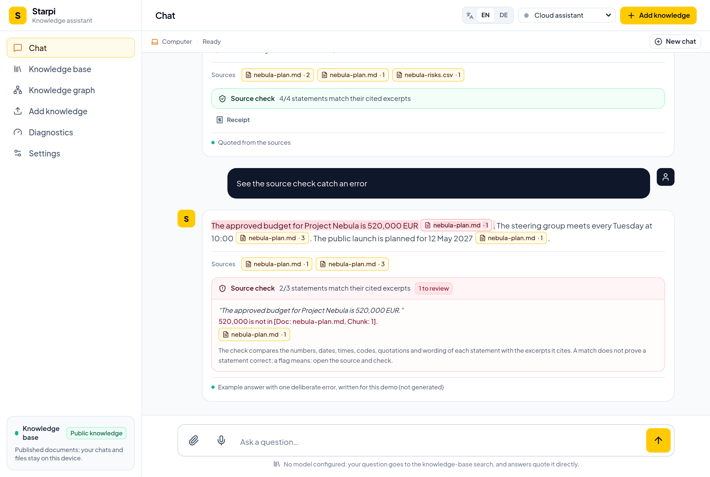
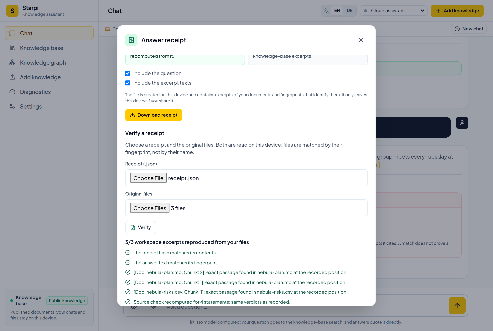
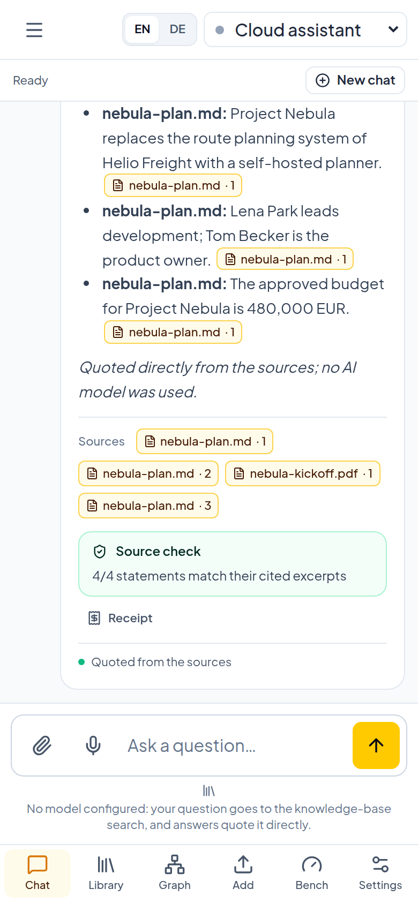
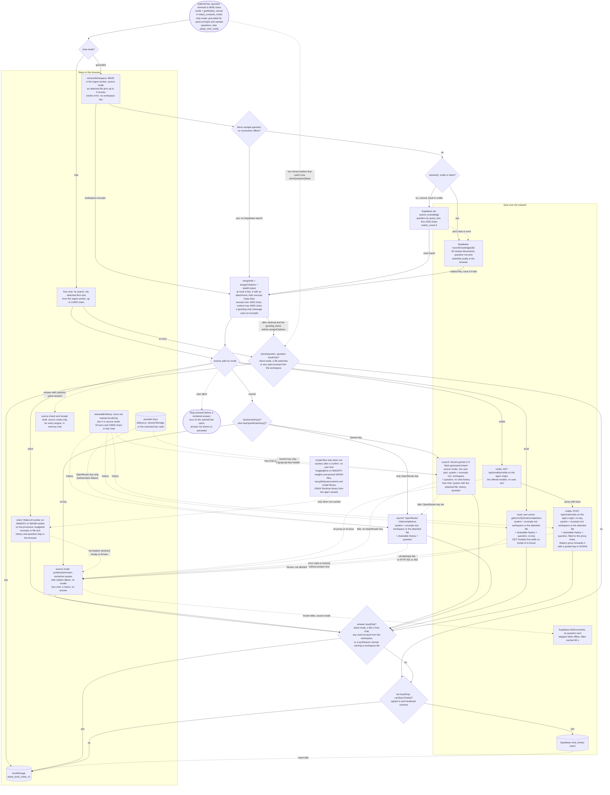

# Starpi

<p align="center">
  <a href="https://github.com/umutcantezgel-cpu/Starpi/actions/workflows/ci.yml"></a>
  <a href="https://github.com/umutcantezgel-cpu/Starpi/releases/latest"></a>
  <a href="https://www.npmjs.com/package/@starpi/core"></a>
  <a href="LICENSE"></a>
  <a href="https://www.starpi.app"></a>
</p>

**A knowledge assistant in the browser that shows how far each answer can be trusted.** Starpi
answers from your files with a model in the browser (WebGPU, or WebAssembly on the processor), your
own server or a cloud model: NVIDIA NIM models through the site's own proxy, or Gemini and
OpenRouter with your own key. In verified source mode a deterministic source check compares every
statement with the passages it cites, and every answer comes with a receipt that anyone can verify
against the original files; free chat talks with the same models without sources and marks its
answers as not checked. Your files are read on your device and never uploaded, and the app is a
static site with two server functions for the NVIDIA models: no account, no API key and no server
of your own are needed. English and German.

<p align="center">
  
</p>

**Live:** [www.starpi.app](https://www.starpi.app) · **Tour of the code:** [walkthrough](docs/WALKTHROUGH.md) ·
**How it works in detail:** [architecture atlas](docs/ARCHITECTURE.md) · **The checks as a library:**
[`@starpi/core`](packages/core/README.md) · [Changelog](CHANGELOG.md)

## Try it in 20 seconds

1. Open [www.starpi.app](https://www.starpi.app). No account, no API key, nothing to install.
2. Click **Try with sample files**. A plan (Markdown), a risk register (CSV) and kickoff notes (PDF)
   of a fictitious project are read into the on-device workspace.
3. Ask one of the suggested questions. Every citation opens the exact passage, highlighted in its
   file, and the **Source check** under the answer shows how many statements match their excerpts.
4. Click **See the source check catch an error**: a prepared answer with one wrong number (labelled
   as written for the demo) is flagged, with the reason.
5. Open **Receipt** under an answer, download it, and verify it against the sample files, in the
   dialog or on the command line with `npm run verify:receipt`.

Without an API key Starpi answers by quoting the sources, and says so. Pick an NVIDIA cloud model
in the model menu (where the site has set up the NVIDIA proxy), add a Gemini or OpenRouter key,
point it at your own server, or load an on-device model in **Settings**, and a model writes the
answer; the same checks apply. Switch the composer to **Free chat** to talk with the model without
sources: nothing is searched, and every answer is marked as not checked against sources.

## What is different

Retrieval-augmented assistants cite sources, but a citation does not tell you whether the sentence
next to it says what the source says. Starpi makes that visible and checkable:

- **Source check on every answer.** Each statement is compared with the excerpts it cites: numbers
  in English and German formats (480,000 = 480.000 = 480k), dates, times, weekdays, codes, version
  numbers, quotations and wording; and whether it reverses a negation of the excerpt ("is
  supported" where the excerpt says "is not supported") or puts a name or a value next to
  something else than the excerpt does. A value that is not in the cited excerpt is named
  ("520,000 is not in [Doc: plan.md, Chunk: 1]"), the statement is highlighted and its citation
  marked; a reversed or misplaced statement is listed for review with the passage that says
  otherwise. It runs in the browser, is deterministic and needs no second model. On labelled test
  answers held out from its development it flagged every changed value, about three in four
  reversed statements, wrong names and misplaced values, and no statement of a faithful answer as
  unsupported ([how well it works](#how-well-it-works)).
- **Answer receipts.** A JSON file per answer with SHA-256 fingerprints of the source files, the
  exact offsets of each cited passage, the source-check verdicts and a Merkle tree (RFC 6962) over
  the citations, so one cited passage can be shown with its inclusion proof without the others.
  Anyone with the same files can reproduce every passage, in the app or with a command-line
  verifier. The app signs the receipts it exports with a key of the device (Ed25519, or ECDSA
  P-256), whose public key you can hand out from **Settings › Trust**. The format is specified
  in [`docs/spec/receipts.md`](docs/spec/receipts.md).
- **A check for CI.** `starpi-ground` checks release notes, generated documentation or any
  Markdown document against source files and writes SARIF 2.1.0, so a pull request shows an
  unsupported statement in GitHub code scanning ([CI snippet](#check-documents-in-ci)).
- **Citations the model cannot forge.** Only labels the app registered for the excerpts it sent
  become clickable, and the drawer shows the cited chunk inside its source text.
- **Verified source mode or free chat.** Verified source mode, the default, retrieves passages,
  cites them and checks the answer. Free chat sends the conversation to the chosen model without
  retrieval, citations, source check or receipt, and marks every answer "Free chat · not checked
  against sources". Suggested questions, quick prompts and questions about a graph entity always
  run in source mode.
- **A model for your device.** The model menu groups the choices: recommended for your device,
  models that run in this browser (WebGPU, or WebAssembly on the processor, which also works
  without WebGPU), NVIDIA NIM cloud models through the site's proxy, and the other assistants.
  Nothing is downloaded without confirmation, and the NVIDIA keys stay on the server.
- **Files are read on the device.** PDF, Markdown, text, JSON and CSV files are parsed, chunked
  and indexed with BM25 in a Web Worker and never uploaded. Only the excerpts an answer needs go to
  the model you chose (none in on-device mode); in free chat, a file attached to the question goes
  to the model as text (at most 12,000 characters of it). Turns that use your files are never
  synced or sent to a cloud provider, NVIDIA or your own server as chat history.
- **A privacy statement per mode.** The footer says where the question goes in the current mode
  and chat mode; in on-device mode it does not leave the browser.

Both checks have limits, and the app says so where it shows them. The source check compares text;
a match does not prove a statement true, and a flag means "open the source and look". Receipts
show that the excerpts are reproducible from the same files, not what a model read. A signature
shows who signed only when it is checked with a public key obtained from the signer, not with the
key inside the receipt.

<table>
  <tr>
    <td width="62%"></td>
    <td width="38%"></td>
  </tr>
  <tr>
    <td>Verifying a receipt against the original files</td>
    <td>On a phone</td>
  </tr>
</table>

## How the source check works

The check reads the rendered answer, not the raw text, so it knows exactly which citation belongs
to which sentence (also for lists, tables and a "Sources:" line). For each statement it extracts the
facts and looks them up in the cited excerpts, then compares the remaining wording:

| Verdict | When |
| --- | --- |
| **Supported** | Every fact is in a cited excerpt and at least half of the content words appear there. |
| **Weak** | A value is rounded or approximate, appears only in another excerpt or in the question, or stands in the excerpt next to something else than the statement says; a name stands in the excerpt in another place, or an English statement names someone or something the excerpt does not; the statement reverses a negation of the passage it matches; the wording overlaps little; or a statement without a citation states a value that one of the excerpts contains. |
| **Unsupported** | A number, date, time, weekday, code or quotation appears in none of the excerpts, a cited label was not one of the excerpts, or the cited excerpt did not fit into the model's context. |
| **Unchecked** | The statement and its excerpt are in different languages, so only facts are compared, and the statement has none. |

Headings, short fragments, and statements with neither a citation nor a fact are not counted.

Version 2 of the rules (Starpi 2.0) looks for three ways in which a statement uses the excerpt's
own words and still says something else, in English and German:

- **Negations.** "Power over Ethernet is supported" against "Power over Ethernet is not
  supported", "USB-Datenträger sind erlaubt" against "… sind verboten", "gestiegen" against
  "gesunken". The check reads negations by their meaning, so "is unsupported", "no … without" or
  "darf … nicht" match their excerpts, and "no later than", "not … until", "only after" and
  questions are not read as reversals. A reversal is marked weak, never unsupported: a reading of
  negations by words cannot tell every restatement of a negated rule from its reversal. The panel
  quotes the passage.
- **Names in the wrong place.** "Marcus Hale owns the specification" when the excerpt says
  "Priya Raman owns this specification; Marcus Hale maintains the network configuration" is
  marked weak, with the passage that names someone else; so is a statement that matches a passage
  but names someone or something the passage does not ("the Munich depot" when it says Hamburg).
- **Values next to something else.** "75,000 EUR for infrastructure" when the excerpt says "95,000
  EUR for infrastructure and 75,000 EUR for training" is marked weak, with the passage where the
  value stands. Version 1 checked this too; version 2 compares the passage around each value and
  no longer counts a section heading as the context of every value below it.

Each statement is checked on its own, so a receipt can recompute it; a wrong relation spread over
two statements is not seen. In English answers, a name that none of the cited excerpts contains
("the Munich depot" when the plan says Hamburg) is marked weak as before. When the answer and the
excerpt are in different languages, only the facts are compared. The rules live in
[`src/js/core/facts.js`](src/js/core/facts.js), [`src/js/core/polarity.js`](src/js/core/polarity.js),
[`src/js/core/binding.js`](src/js/core/binding.js) and
[`src/js/core/grounding.js`](src/js/core/grounding.js), carry a version that receipts record
(version 1 can still be run and is still used to recompute 1.x receipts), and are pinned by golden
tests.

### How well it works

Measured with `npm run eval:source-check` on labelled answers, each either faithful or with exactly
one planted error, in English and German: two sets written for Starpi 1.2 about the sample files
and the sample knowledge base (also across the two languages), two sets written for Starpi 2.0
about technical specifications (an edge gateway and a data retention policy), and 854 faithful
paraphrases. In each pair, the first set was available while the rules were adjusted; the
held-out set was written in advance and measured once, with both versions of the rules
([protocol](docs/eval/v2-protocol.md), [all results](docs/eval/v2-results.md)). Detected means
marked unsupported or weak; each cell gives version 2 / version 1 of the rules.

| | Set for 1.2 | Held-out for 1.2 ¹ | Set for 2.0 | Held-out for 2.0 | Paraphrases |
| --- | --- | --- | --- | --- | --- |
| Statements of faithful answers | 143 | 324 | 143 | 144 | 844 |
| … marked unsupported | 0 / 0 | 0 / 0 | 0 / 1 | 0 / 0 | 0 / 0 |
| … marked weak | 0 / 0 | 16 / 15 | 0 / 2 | 8 / 4 | 27 / 16 |
| Changed number, date, time, weekday or code detected | 47 / 48 of 49 | 49 / 49 of 49 | – | – | – |
| Wrong name or place detected | 5 / 3 of 10 | 6 / 4 of 10 | 19 / 9 of 24 | **17 / 10 of 23** | – |
| Correct value attached to the wrong thing detected | 3 / 2 of 10 | 7 / 6 of 10 | 23 / 13 of 24 | **20 / 13 of 24** | – |
| Negated or reversed statement detected | 8 / 0 of 10 | 4 / 0 of 10 | 24 / 1 of 24 | **16 / 0 of 23** | – |

¹ Its misses under version 1 were inspected while version 2 was designed, so it is not a clean
held-out measure for version 2.

The clean measure of version 2 is the held-out set for 2.0: it detects 17 of 23 wrong names, 20 of
24 values attached to the wrong thing and 16 of 23 reversed statements, where version 1 detected
10, 13 and none, and it marks no statement of a faithful answer unsupported. The target set before
the work, 8 of 10 in each of these three categories, is reached for values (83 %) and not for
names (74 %) or negations (70 %). The price is more weak marks on faithful statements: 8 instead
of 4 of 144 in that set. Reversed negations are marked weak, never unsupported: a red-team test
with 843 faithful paraphrases showed that reading negations by their words also reverses correct
restatements ("only allowed after the update" for "prohibited until the update"), and no faithful
statement may be marked unsupported.

The answers were written by language models following fixed instructions, and every label was
confirmed by two independent model reviewers; they are not answers from real users, and each
category has 10 to 24 answers per set. Read the table as what the check can and cannot see: it is
reliable for changed values and finds most reversed statements, wrong names and misplaced values
within one statement, but not all, and not a wrong relation spread over two statements. The
labelled answers are in [`tests/fixtures/grounding/`](tests/fixtures/grounding), and a unit test
fails if any of these results gets worse.

```mermaid
flowchart TD
    sIn(["chat.js submitChat: rendered messageEl, a citation scope,<br/>the same chat session still shown"]) --> sEng{"answer.engine is synthesizer?"}
    sEng -->|"yes"| sFull["every excerpt delivered full,<br/>text = the excerpt as given"]
    sEng -->|"no, a model answered"| sCov["contextCoverage(citationList, deliveredContext or context):<br/>the EXCERPT n blocks of the context that was sent give<br/>full, partial without the ellipsis, or omitted"]
    sFull --> sApply
    sCov --> sApply
    sDemo(["demo.js showCheckDemo: excerpts delivered full,<br/>no given, citedOnly off"]) -.-> sApply
    sApply["applyGrounding(messageEl): scope, sources with label, doc,<br/>heading, delivered text and state, given = the prompt and the<br/>user messages among the last 4 conversation entries,<br/>citedOnly = synthesizer answer"]
    sApply --> sSlot{".message-content and .message-provenance<br/>present and sources not empty?"}
    sSlot -->|"no"| sNull(["returns null, no panel"])
    sSlot -->|"yes"| sBlocks["blocksFromElement: one block per p, li, h1 to h6, tr,<br/>blockquote, dd, dt, pre skipped, br as a line break,<br/>td and th cells joined with a separator,<br/>kind p, li, heading, row, header-row or other"]
    sBlocks --> sBtn{"button with data-action open-citation<br/>and data-arg of this answer's scope?"}
    sBtn -->|"yes"| sCite["cite segment, chip position recorded"]
    sBtn -->|"no"| sIgn["other buttons ignored"]
    sBlocks --> sLoose["text matching LOOSE_LABEL_PATTERN: badcite,<br/>resolveLabel by document name and chunk number"]
    sBlocks --> sLead["list item, or the first paragraph of a loose list item,<br/>whose list follows a block ending in a colon:<br/>leadIn = that block"]
    sCite --> sSize
    sLoose --> sSize
    sLead --> sSize
    sSize{"groundAnswer, rules version GROUNDING.version 2:<br/>text segments over THRESHOLDS.maxChars 20000 characters?"}
    sSize -->|"yes"| sSkip["skipped too_long"]
    sSize -->|"no"| sAssoc["associate: sentenceSpans per block, no statement ends at the dot<br/>of an ordinal, a day.month date such as 1.6. or a known abbreviation,<br/>a marker belongs to the last statement that starts before it,<br/>a statement without one inherits from the next cited statement<br/>of its block, then the previous one, then its lead-in up to 4 hops,<br/>then the markers and bad labels of contentless blocks<br/>such as a Sources line"]
    sAssoc --> sMany{"more than maxSentences 300 statements?"}
    sMany -->|"yes"| sSkip
    sMany -->|"no"| sIdx["indexSource per excerpt over text, doc and heading<br/>with the same rules version, no index for an omitted excerpt,<br/>given indexed, answer language from guessLanguage"]
    sIdx --> sCheck["checkSentence per statement,<br/>see source-check-verdicts and source-check-v2-checks"]
    sCheck --> sCount["counts supported, weak, unsupported, unchecked,<br/>neutral statements not counted"]
    sCount --> sAny{"anything counted, unchecked or skipped?"}
    sSkip --> sAny
    sAny -->|"no"| sQuiet(["report returned, no panel"])
    sAny -->|"yes"| sBar["details.grounding-bar replaces the .message-provenance content:<br/>grounding-review and shield-alert when a statement is unsupported,<br/>else grounding-partial and shield-question-mark when one is weak,<br/>else grounding-ok and shield-check when statements were compared,<br/>else grounding-none and shield"]
    sBar --> sSum["summary: grounding.title, then grounding.too_long,<br/>grounding.summary ok of total, or grounding.only_unchecked,<br/>badges grounding.review n and grounding.partial n"]
    sSum --> sList["ol.grounding-list: unsupported first, then weak, in answer order,<br/>li id grd-n-i, n per panel, i the statement index,<br/>grounding.statement cut to 160 chars,<br/>one grounding.reason_code line per reason, citation badges"]
    sList --> sNotes["grounding.unchecked n when statements were not compared,<br/>grounding.disclaimer in every panel"]
    sNotes --> sOpen["details opened when a statement is unsupported"]
    sOpen --> sChips["each citation button belongs to the last statement of its block<br/>that starts before it, else the first, if that one is unsupported:<br/>class citation-chip-flag, aria-describedby = id of its list item"]
    sChips --> sHl{"Highlight and CSS.highlights available?"}
    sHl -->|"yes"| sMark["a Range per unsupported statement in the<br/>starpi-review highlight, no DOM change, no inline style"]
    sHl -->|"no"| sNoMark["no highlight, the flagged list<br/>stays the accessible channel"]
    sMark --> sRet(["report returned to chat.js for the receipt draft"])
    sNoMark --> sRet
    sReset(["resetMessages: new chat, deleted or restored history"]) -.-> sClear["clearGroundingHighlights"]
```

<!-- diagram: source-check-pipeline -->


## Use the checks in your own app

The source check, answer receipts, text extraction, chunking and BM25 are published as
[`@starpi/core`](packages/core/README.md): ESM with type declarations, no dependencies, for
browsers, Web Workers and Node.js 22.13+. It is built from the same modules the app runs.

```bash
npm install @starpi/core
# or straight from the tarball attached to each GitHub release (the package README shows
# how to check it against SHA256SUMS first):
npm install https://github.com/umutcantezgel-cpu/Starpi/releases/download/v2.1.0/starpi-core-2.1.0.tgz
```

```js
import { blocksFromMarkdown, groundAnswer } from '@starpi/core';

const sources = [{ label: '[Doc: plan.md, Chunk: 1]', doc: 'plan.md', heading: '', delivered: 'full',
  text: 'The approved budget is 480,000 EUR. The steering group meets every Tuesday at 10:00.' }];
const answer = 'The budget is 520,000 EUR [Doc: plan.md, Chunk: 1].';

const report = groundAnswer(blocksFromMarkdown(answer, sources), sources);
console.log(report.counts); // { supported: 0, weak: 0, unsupported: 1, unchecked: 0 }
console.log(report.sentences[0].reasons[0]); // { code: 'missing_fact', level: 'unsupported', fact: '520,000', cites: [0] }
```

`buildReceipt`, `signReceipt` and `verifyReceipt` create, sign and check receipts, `chunkText` and
`BM25Index` split and rank text, and `npx starpi-verify-receipt receipt.json file…` verifies a
receipt on the command line. Examples for each are in the [package README](packages/core/README.md).

### Check documents in CI

`starpi-ground` runs the source check on a Markdown document against source files and fails on an
unsupported statement. In a GitHub Actions job with `security-events: write`, the findings appear
in code scanning at their line:

```yaml
- run: npx --yes --package=@starpi/core@2 starpi-ground --answer docs/release-notes.md --source docs/spec --format sarif --output starpi.sarif
- uses: github/codeql-action/upload-sarif@24c54180a607b1449ed407dd24f251e4e9147c8d # v4.38.3
  if: always()
  with:
    sarif_file: starpi.sarif
```

Options, the text and JSON formats and an example run are in the
[package README](packages/core/README.md#check-documents-in-ci).

## Ecosystem and downstream use

Starpi is the first user of `@starpi/core`: the app runs the same modules in the browser and in its
ingestion worker. The first downstream project is **Fluid Systems**, a local AI assistant for
production management and shift supervisors in plastics processing (injection moulding and
extrusion), by the same maintainer. It is built on Starpi 1.2.0 and takes over the source check,
answer receipts, text extraction, chunking and BM25: answers about the user's own documents are
checked by the source check and can be exported as `starpi.receipt/v1` receipts. The sentence
gate in development for its next version, which lets a sentence about machine or shift figures
through only when every number comes from its deterministic engine or from a cited excerpt,
builds on Starpi's citation-label and sentence rules. Fluid Systems is at demo stage (v0.1.0,
simulated operating data) and not public yet. Starpi is meant as a reusable core for applications where a wrong number in an answer
matters, not only as a demo app.

## How it works

<p align="center">
  
</p>

In verified source mode the browser retrieves passages from the on-device workspace (BM25) and
from the shared knowledge base (Postgres full-text search behind row level security), labels each
one `[Doc: <name>, Chunk: <n>]`, and answers in one of five ways. In free chat nothing is
retrieved or searched: the question goes to the chosen model with the earlier messages of the chat
(up to 16 messages, 24,000 characters in all) and an attached file, so free chat needs a model.

| Mode | Where the answer is written | What leaves the device |
| --- | --- | --- |
| **On-device** | [WebLLM](https://github.com/mlc-ai/web-llm) on WebGPU, or Transformers.js with ONNX Runtime Web on the processor (WASM), in a dedicated Web Worker | Nothing. Knowledge-base candidates are fetched without the question and ranked in the browser. |
| **NVIDIA NIM cloud** | A model of the NVIDIA API Catalog, through the site's proxy (`/api/chat/nvidia`), which holds the keys on the server; no key of your own | Source mode: the question, the retrieved excerpts and the last 4 messages go through the proxy to NVIDIA, and the question to the knowledge-base search. Free chat: the question, the earlier messages and an attached file. The proxy stores and logs no content. |
| **Cloud assistant** | Google Gemini or OpenRouter, with **your own** API key | Source mode: the question and the retrieved excerpts go to the provider (OpenRouter also gets the last 4 messages, Gemini none), and the question to the knowledge-base search. Free chat: the question, the earlier messages and an attached file, to either provider. |
| **Own server** | Any Chat Completions endpoint (`/v1/chat/completions`: MLX, Ollama, vLLM) at `https://…` or `http://localhost` | Source mode: the question, the retrieved excerpts and the last 4 messages go to that server, and the question to the knowledge-base search. Free chat: the question, the earlier messages and an attached file. |
| **Quoted from the sources** | No model | Only the question, to the knowledge-base search. Matching sentences are quoted verbatim with their citations; used in source mode when no model is configured or a model fails. |

Earlier messages of turns that used your files (workspace excerpts or an attached file) or ran in
on-device mode are never sent as history, in either chat mode.

Chats are synced to Supabase only when the browser has an anonymous session **and** the hardened
row-level-security schema is installed, so every row is visible to its owner only; otherwise they
stay in the browser. **Settings › Delete chat history** removes both.

<details>
<summary><strong>What leaves the device in each mode</strong> (diagram)</summary>

<!-- diagram: modes-privacy-data-egress -->


</details>

<details>
<summary><strong>System context and trust boundaries</strong> (diagram)</summary>

<!-- diagram: system-context-overview -->


</details>

```mermaid
flowchart LR
    subgraph device["User device: browser tab on www.starpi.app, CSP enforced"]
        subgraph mainThread["Main thread, src/js"]
            boot["main.js boot()<br/>chat.js, settings.js, model-picker.js,<br/>demo.js, UI modules"]
            sbClient["supabase.js createClient<br/>public key compiled in: publishable or anon JWT,<br/>build refuses sb_secret_ keys, non-anon JWTs<br/>and any other key, fetchWithTimeout 12 s, db retry off"]
            provJs["providers.js<br/>callGemini, callOpenRouter,<br/>callLocalServer, probeLocalServer,<br/>getNvidiaCatalog, callNvidia"]
            engineJs["webgpu/engine.js<br/>loadModel, generate, unloadModel,<br/>getDeviceProbe, WebGPU or WASM runtime"]
            wsJs["rag/workspace.js<br/>request(type, payload)"]
            trustJs["rag/grounding-view.js, rag/receipts.js<br/>source check and receipt drafts,<br/>computed and kept in memory"]
            voiceJs["voice.js<br/>Web Speech API, processLocally<br/>required in client mode"]
        end
        subgraph llmWorker["Web Worker starpi-webllm"]
            mlc["webgpu/worker.js<br/>WebWorkerMLCEngineHandler<br/>inference on WebGPU"]
        end
        subgraph wasmWorker["Web Worker starpi-wasm"]
            wasmw["wasm/worker.js<br/>Transformers.js 4.3.0, ONNX Runtime WASM,<br/>one thread, catalog models only,<br/>env.fetch pinned to the model revision"]
        end
        subgraph ingestWorker["Web Worker starpi-ingest"]
            ingest["rag/ingest.worker.js<br/>extractText with pdf.js, chunkText,<br/>BM25Index in worker memory only,<br/>SHA-256 of file and text, verify-receipt"]
        end
        sw["sw.js service worker<br/>same-origin GET only,<br/>cross-origin requests bypass it,<br/>a new version skips waiting only<br/>when no window is open"]
        subgraph browserStores["Per-origin browser storage"]
            ls[("localStorage<br/>starpi_local_chats_v1, starpi_chat_session_id,<br/>starpi_compute_mode, starpi_webgpu_model,<br/>starpi_nvidia_model, starpi_chat_mode,<br/>starpi_llm_url, starpi_relay_fallback,<br/>starpi_transport_*, starpi_locale,<br/>starpi-auth session")]
            ss[("sessionStorage<br/>provider keys for this tab;<br/>kept longer only in the encrypted<br/>key vault (IndexedDB keyvault)")]
            swCache[("CacheStorage<br/>starpi-shell-VERSION, starpi-assets")]
            modelCache[("Cache API owned by WebLLM<br/>webllm/model, webllm/config, webllm/wasm")]
            tfCache[("Cache API owned by Transformers.js<br/>transformers-cache")]
        end
    end

    subgraph vercel["Vercel: static hosting and two functions"]
        host["dist/: index.html, hashed /assets/*, sw.js,<br/>build-manifest.json, public files such as /samples/*<br/>vercel.json headers on every path:<br/>CSP script-src self and wasm-unsafe-eval,<br/>connect-src self, data:, https:, wss://*.supabase.co,<br/>http://localhost:* and http://127.0.0.1:*<br/>HSTS, COOP same-origin, X-Frame-Options DENY,<br/>nosniff, Referrer-Policy,<br/>Permissions-Policy microphone self only"]
        fn["api/models/nvidia.js, api/chat/nvidia.js<br/>Node.js functions, NVIDIA_API_KEYS only in<br/>the server environment, same-origin check,<br/>rate limit, model allowlist, size caps"]
    end

    subgraph supabase["Supabase project: access decided by roles and RLS"]
        auth["Auth<br/>anonymous sign-in, session JWT"]
        rest["PostgREST<br/>/rest/v1 tables and /rest/v1/rpc"]
        subgraph pg["Postgres, RLS enabled on every table"]
            tables[("knowledge_documents, knowledge_entities,<br/>knowledge_relations: read is_public or owner_id = auth.uid(),<br/>knowledge_sections: visible with their document,<br/>writes only to own private rows<br/>chat_history: owner only, no anon grant<br/>brain_settings: no policy, service_role only")]
            rpcFns["SECURITY INVOKER functions<br/>search_knowledge: anon, authenticated, service_role<br/>match_knowledge_vector_384, optional migration:<br/>anon, authenticated, service_role<br/>match_knowledge_sections, match_knowledge_hybrid:<br/>authenticated, service_role<br/>ingest_document_atomic: service_role only"]
        end
    end

    subgraph backendHost["Optional library publisher, operator machine"]
        brain["tools/library-publisher<br/>python -m publisher, no listener:<br/>publish, backfill, list, test-query"]
    end

    subgraph thirdParty["Third-party services outside Starpi control"]
        gemini["Google Gemini<br/>gemini-2.5-flash:generateContent"]
        openrouter["OpenRouter<br/>/api/v1/chat/completions"]
        ownServer["Own Chat Completions server<br/>https anywhere, http only on<br/>localhost or 127.0.0.1"]
        nvidia["NVIDIA API<br/>integrate.api.nvidia.com/v1/chat/completions"]
        hf["Hugging Face<br/>huggingface.co/mlc-ai weights,<br/>WASM model repositories at pinned revisions"]
        ghLibs["raw.githubusercontent.com<br/>binary-mlc-llm-libs wasm"]
        speech["Browser speech recognition<br/>vendor servers in most browsers"]
        backendApis["Publisher upstreams<br/>Hugging Face model files at a pinned revision,<br/>LLM_BASE_URL only for publish --structure"]
    end

    host -->|"app shell, hashed assets and<br/>public files with security headers"| sw
    sw -->|"navigations network-first, cached shell<br/>after 3.5 s or on failure,<br/>/assets/* and precache cache-first"| boot
    sw -->|"precache at install, / with cache reload,<br/>navigations store / again only as<br/>non-redirected HTML and not after the<br/>cached shell was served, /assets/* put if cacheable()"| swCache
    boot -->|"register /sw.js, scope /"| sw
    boot -->|"GET /build-manifest.json no-store<br/>after controllerchange, update banner"| host
    boot -->|"settings, locale, chat fallback"| ls
    provJs -->|"readSecret"| ss
    sbClient -->|"persistSession, storageKey starpi-auth"| ls
    engineJs -->|"CreateWebWorkerMLCEngine,<br/>messages in, stream deltas out"| mlc
    engineJs -->|"certainlyNotCached, hasModelInCache,<br/>deleteModelAllInfoInCache"| modelCache
    engineJs -->|"WasmEngineClient: load, generate,<br/>interrupt, unload messages"| wasmw
    engineJs -->|"wasmCacheStatus,<br/>delete on Delete downloaded model data"| tfCache
    mlc -->|"read and write shards"| modelCache
    mlc -->|"GET weights if not cached,<br/>interactive loads only, after confirmDownload"| hf
    mlc -->|"GET model_lib wasm"| ghLibs
    wasmw -->|"read and write model files"| tfCache
    wasmw -->|"GET pinned files if not cached,<br/>interactive loads only, after confirmDownload"| hf
    wasmw -->|"GET /assets/ort-wasm-simd-threaded-hash.wasm,<br/>same origin"| host
    wsJs -->|"postMessage ingest, search, head,<br/>context, text, remove, verify-receipt,<br/>File structured-cloned"| ingest
    trustJs -->|"verifyReceiptFiles"| wsJs
    sbClient -->|"getSession, GET /auth/v1/settings,<br/>signInAnonymously unless<br/>anonymous sign-ins are off"| auth
    sbClient -->|"apikey public key, Bearer session JWT:<br/>select, insert, delete, rpc search_knowledge"| rest
    rest -->|"SQL as anon or authenticated"| tables
    rest -->|"rpc"| rpcFns
    rpcFns -->|"run as the caller role"| tables
    provJs -->|"x-goog-api-key header,<br/>prompt with retrieved excerpts<br/>or the free-chat conversation"| gemini
    provJs -->|"Bearer key, messages,<br/>failover over free models"| openrouter
    provJs -->|"messages, no key sent,<br/>GET /models probe"| ownServer
    provJs -->|"same-origin GET /api/models/nvidia,<br/>POST /api/chat/nvidia without a key,<br/>answer streamed back as SSE"| fn
    fn -->|"Bearer key from the pool,<br/>failover before the first byte"| nvidia
    voiceJs -->|"microphone audio, handled by the browser"| speech
    brain -->|"service_role key bypasses RLS:<br/>rpc ingest_document_atomic, PATCH is_public<br/>and embedding_384, reads kept to is_public or no owner"| rest
    brain -->|"fetch-model, chat/completions"| backendApis

    classDef external stroke-dasharray: 5 5
    class gemini,openrouter,ownServer,nvidia,hf,ghLibs,speech,backendApis external
```

The [architecture atlas](docs/ARCHITECTURE.md) documents every subsystem with diagrams checked
against the code: boot, chat in both modes, retrieval and citations, the source check and
receipts, the on-device engines (WebGPU and WASM), storage and offline use, the database and its
policies, the library publisher, the NVIDIA cloud proxy, and build, test and deployment.

## On-device models

On-device presets come in tiers by the GPU memory they need: **T1** fits phones and small GPUs
(under 2 GB of VRAM), **T2** needs about 2–4 GB and **T3** at least 4 GB. **T4** are the NVIDIA
NIM cloud models: nothing is downloaded, and they run on NVIDIA's servers
([below](#nvidia-nim-cloud-models-t4)). Automatic selection picks a T1 or T2 preset from the
device class and never a T3 preset, because browsers report no VRAM and cap
`navigator.deviceMemory` at 8 GB; on a strong GPU a T3 preset is only suggested. Without WebGPU it
picks a processor (WASM) preset, and it never picks a T4 model: a new installation starts with the
cloud assistant, which quotes the sources until a key or a model is set up.

WebLLM model ids are validated against the pinned WebLLM catalog in the unit tests. On adapters
without the `shader-f16` feature the `q4f32_1` variant is selected automatically, and phones
request at most 2,048 tokens of context.

| Tier | Preset | WebLLM model (f16 / f32 fallback) | Approx. download | VRAM (f16 / f32) | Context window |
| --- | --- | --- | --- | --- | --- |
| T1 | `smollm2-360m` | `SmolLM2-360M-Instruct-q4f16_1-MLC` / `…q4f32_1-MLC` | 0.3 GB | 376 MB / 580 MB | 2,048 |
| T1 | `qwen-0.5b` | `Qwen2.5-0.5B-Instruct-q4f16_1-MLC` / `…q4f32_1-MLC` | 0.3 GB | 945 MB / 1,060 MB | 2,048 |
| T1 | `llama-1b` (phones and small GPUs) | `Llama-3.2-1B-Instruct-q4f16_1-MLC` / `…q4f32_1-MLC` | 0.7 GB | 879 MB / 1,129 MB | 2,048 |
| T1 | `qwen-1.5b` (memory not reported) | `Qwen2.5-1.5B-Instruct-q4f16_1-MLC` / `…q4f32_1-MLC` | 1.0 GB | 1,630 MB / 1,889 MB | 2,048 |
| T1 | `smollm2-1.7b` | `SmolLM2-1.7B-Instruct-q4f16_1-MLC` / `…q4f32_1-MLC` | 1.0 GB | 1,774 MB / 2,692 MB | 2,048 |
| T2 | `gemma-2b` | `gemma-2-2b-it-q4f16_1-MLC` / `…q4f32_1-MLC` | 1.5 GB | 1,895 MB / 2,509 MB | 4,096 |
| T2 | `llama-3b` | `Llama-3.2-3B-Instruct-q4f16_1-MLC` / `…q4f32_1-MLC` | 1.9 GB | 2,264 MB / 2,952 MB | 4,096 |
| T2 | `phi-3.5-mini` | `Phi-3.5-mini-instruct-q4f16_1-MLC` / `…q4f32_1-MLC` | 2.2 GB | 3,672 MB / 5,483 MB | 4,096 |
| T2 | `qwen-3b` (desktop default, ≥ 8 GB RAM) | `Qwen2.5-3B-Instruct-q4f16_1-MLC` / `…q4f32_1-MLC` | 1.9 GB | 2,505 MB / 2,894 MB | 4,096 |
| T3 | `mistral-7b` | `Mistral-7B-Instruct-v0.3-q4f16_1-MLC` / `…q4f32_1-MLC` | 4.1 GB | 4,573 MB / 5,619 MB | 4,096 |
| T3 | `qwen-7b` (suggested for strong GPUs) | `Qwen2.5-7B-Instruct-q4f16_1-MLC` / `…q4f32_1-MLC` | 4.3 GB | 5,107 MB / 5,900 MB | 4,096 |
| T3 | `llama-8b` | `Llama-3.1-8B-Instruct-q4f16_1-MLC` / `…q4f32_1-MLC` | 4.6 GB | 5,001 MB / 6,101 MB | 4,096 |
| T3 | `gemma-9b` | `gemma-2-9b-it-q4f16_1-MLC` / `…q4f32_1-MLC` | 5.3 GB | 6,422 MB / 8,383 MB | 4,096 |

Processor (WASM) presets are ONNX models with 8-bit weights. Each Hugging Face repository is
pinned to a commit, and the unit tests check the list of files and their sizes:

| Tier | Preset | Hugging Face repository @ revision | Weights (ONNX, q8) | Approx. download | Context window |
| --- | --- | --- | --- | --- | --- |
| T1 | `smollm2-135m` | `HuggingFaceTB/SmolLM2-135M-Instruct` @ `12fd25f` | `onnx/model_quantized.onnx` | 0.14 GB | 2,048 |
| T1 | `smollm2-360m` (processor on phones) | `HuggingFaceTB/SmolLM2-360M-Instruct` @ `a10cc15` | `onnx/model_quantized.onnx` | 0.37 GB | 2,048 |
| T1 | `qwen-0.5b` (processor default) | `onnx-community/Qwen2.5-0.5B-Instruct` @ `22942cb` | `onnx/model_quantized.onnx` | 0.52 GB | 2,048 |

Without WebGPU, automatic selection picks one of these. They run with Transformers.js and ONNX
Runtime Web in a worker, on one thread (the app is not cross-origin isolated, so WebAssembly
threads are unavailable), and answer with at most 384 tokens. The 14 MB ONNX Runtime binary is
served from the app's own `/assets` and loaded on first use; every model file is downloaded from
huggingface.co at the pinned revision, so a stored model also loads offline.

Model licenses: the Llama presets are under the Llama 3.1 and 3.2 community licenses, the Gemma
presets under the Gemma terms of use and Qwen 2.5 3B under the Qwen research license; the other
presets are under Apache-2.0 or MIT.

Nothing is downloaded without confirmation. Before asking, the app checks whether the model is
already cached and whether the storage quota suffices; persistent storage is requested only after
you agree. Weights are cached by WebLLM and by Transformers.js (Cache API `transformers-cache`), not
by the service worker; **Settings › Advanced › Delete downloaded model data** removes both. The
**Diagnostics** tab reports the WebGPU adapter and measures time to first token and decode speed on
the loaded model.

### NVIDIA NIM cloud models (T4)

These models run on NVIDIA's servers and are reached only through the site's proxy
([deployment](#nvidia-cloud-models-deployment)), which accepts no other model. The list lives in
[`src/js/models/nvidia-catalog.js`](src/js/models/nvidia-catalog.js); the first entry is the
default and is called with its thinking mode switched off. Reasoning models stream their reasoning
before the answer; the app keeps it out of the answer and shows it in the answer's details. The
unit tests fail if this table and the list differ:

| Tier | Model id | Name in the model menu | Reasoning |
| --- | --- | --- | --- |
| T4 | `nvidia/nemotron-3.5-lightning-30b-a3b` | Nemotron 3.5 Lightning 30B A3B | no |
| T4 | `nvidia/nemotron-3-super-120b-a12b` | Nemotron 3 Super 120B A12B | yes |
| T4 | `nvidia/nemotron-3-ultra-550b-a55b` | Nemotron 3 Ultra 550B A55B | yes |
| T4 | `nvidia/nemotron-3-nano-omni-30b-a3b-reasoning` | Nemotron 3 Nano Omni 30B A3B | yes |
| T4 | `moonshotai/kimi-k3` | Kimi K3 | yes |
| T4 | `z-ai/glm-5.3` | GLM-5.3 | yes |
| T4 | `z-ai/glm-5.3-flash` | GLM-5.3 Flash | yes |
| T4 | `openai/gpt-oss-20b` | GPT-OSS 20B | yes |
| T4 | `meta/muse-glimmer-30b` | Muse Glimmer 30B | yes |
| T4 | `poolside/laguna-xs-2.1` | Laguna XS 2.1 | no |
| T4 | `meta/llama-3.2-90b-vision-instruct` | Llama 3.2 90B Vision Instruct | no |
| T4 | `meta/llama-3.2-11b-vision-instruct` | Llama 3.2 11B Vision Instruct | no |
| T4 | `google/diffusiongemma-26b-a4b-it` | DiffusionGemma 26B A4B | no |

The app sends text only, also to models that accept images. Requests are fitted to the proxy's
limits (at most 40 messages, 24,000 characters per message and 64,000 in all) by leaving out the
oldest earlier messages first, and ask for 1,024 tokens (2,048 for reasoning models). NVIDIA's API
terms and each model's license apply to what is sent. `npm run nvidia:ping` checks the list
against the live API before it changes.

## Browser support

| Browser | On-device model (WebGPU) | Notes |
| --- | --- | --- |
| Chrome / Edge 113+ (Windows, macOS, ChromeOS) | Yes | Linux support depends on GPU and driver; check `chrome://gpu`. |
| Chrome 121+ on Android 12+ | Yes | The compact 1B model with a 2,048-token context is selected by default. |
| Safari 26 (macOS, iOS, iPadOS) | Yes | iOS may evict cached model data under storage pressure. |
| Firefox 141+ | Windows; other platforms are rolling out | `about:support` › Graphics shows whether WebGPU is available. |
| Any browser without WebGPU | Processor (WASM) models only, slower | Automatic selection picks a WASM preset. Everything else works: sample files, workspace, source check, receipts, free chat, NVIDIA cloud, cloud and own-server modes. |

Own-server mode from `https://www.starpi.app` to `http://localhost` triggers Chrome's Local
Network Access permission prompt (Chrome 142+), and Ollama must allow the origin
(`OLLAMA_ORIGINS`).

## Quickstart

Prerequisites: Node.js 22.13+ (`.nvmrc`), npm 10+. Python 3.11+ only for the optional library publisher.

```bash
git clone https://github.com/umutcantezgel-cpu/Starpi.git
cd Starpi
npm ci --ignore-scripts   # as in CI and on Vercel: no install scripts of dependencies run
npm run dev               # build in watch mode and serve dist/ on http://127.0.0.1:3000
```

The dev server applies the same response headers as production (`vercel.json`), including the
Content-Security-Policy, and serves the two NVIDIA routes from `api/` as Vercel does.

| Command | Purpose |
| --- | --- |
| `npm run build` | Production build into `dist/` (Tailwind CSS, esbuild bundle, hashed assets, generated service worker) |
| `npm run preview` | Serve `dist/` with production headers, and the NVIDIA routes from `api/` |
| `npm run lint` / `npm run typecheck` | ESLint; TypeScript `checkJs` in strict mode for every `@ts-check` module |
| `npm test` | Unit tests (`node --test`) |
| `npm run test:e2e` | Playwright tests against `dist/` with a mocked Supabase backend, including an axe accessibility scan |
| `npm run verify` | Lint, typecheck, unit tests, build and output verification |
| `npm run verify:receipt -- receipt.json file…` | Verify an answer receipt against the original files |
| `npm run pack:core` | Build `@starpi/core` with its type declarations and list the files `npm pack` would publish |
| `npm run sbom` | CycloneDX SBOMs of the app and of `@starpi/core` into `sbom/`, from `package-lock.json` |
| `npm run docs:sync` | Copy diagrams from the atlas into the README and guides |

### Reproduce the published numbers

The figures in this README are produced by scripts in the repository and pinned by unit tests.
None of these steps needs a GPU, an account or an API key. From a fresh clone with an empty npm
cache, the five commands took 45 seconds in total on a 4-vCPU Linux container with Node.js 22:

```bash
git clone https://github.com/umutcantezgel-cpu/Starpi.git && cd Starpi
npm ci
npm test                    # unit tests, including the checks in the table below
npm run eval:source-check -- --unblind --grounding 2   # the source check on every answer set
npm run eval:source-check -- --unblind --grounding 1   # the same with the rules of 1.x
```

| Figure | Produced by | Pinned by |
| --- | --- | --- |
| Source check results ([How well it works](#how-well-it-works)) | `npm run eval:source-check` on the answer sets in [`tests/fixtures/grounding/`](tests/fixtures/grounding) (`--unblind` adds the held-out sets) | `tests/unit/source-check-eval.test.mjs` fails if any result gets worse; `tests/unit/golden.test.mjs` pins every verdict |
| Tier, VRAM, download size and context window ([On-device models](#on-device-models)) | `vram_required_MB` in the WebLLM catalog pinned by `package-lock.json`; the context window the app requests (`chooseModel`); the pinned Hugging Face revisions and file sizes of the processor (WASM) presets | `tests/unit/models.test.mjs` and `tests/unit/wasm-catalog.test.mjs` fail if the tables and the catalogs differ |
| Time to first token, prefill and decode speed | **Diagnostics** tab on your device: a warm-up request, then a fixed prompt with exactly 128 generated tokens (`ignore_eos`, temperature 0) on a reset chat | Not published: the result depends on the GPU, the driver and the browser |

### Configuration

The Supabase URL and the public key are compiled into the bundle. Forks set their own at build
time, with a publishable key (`sb_publishable_…`) or a legacy `anon` JWT:

```bash
STARPI_SUPABASE_URL=https://<project-ref>.supabase.co \
STARPI_SUPABASE_ANON_KEY=<publishable or anon key> \
npm run build
```

The build refuses secret keys (`sb_secret_…`) and any JWT whose role is not `anon`, so a key that
bypasses row level security can never reach the browser.

### NVIDIA cloud models (deployment)

The NVIDIA NIM models run through two Vercel Functions:
[`api/models/nvidia.js`](api/models/nvidia.js) (`GET /api/models/nvidia`: the allowed models and
whether the server has keys, never a key or their number) and
[`api/chat/nvidia.js`](api/chat/nvidia.js) (`POST /api/chat/nvidia`: streams an answer from
`integrate.api.nvidia.com` with a key from the server's pool). The browser holds no NVIDIA key; it
calls these routes on its own origin without an `Authorization` header. Without keys the model menu
shows the NVIDIA models as not set up on this server; on a host without the functions it does not
show them.

| Variable | Default | Purpose |
| --- | --- | --- |
| `NVIDIA_API_KEYS` | empty: the chat route answers `503 nvidia_not_configured` | The key pool, comma separated: `nvapi-<64 characters>` per key. On Vercel an environment variable of type **Sensitive** for **Production** and **Preview**. Entries of another shape are ignored and only counted in the log. |
| `NVIDIA_RATE_LIMIT_PER_MINUTE` | `20` | Chat requests per client IP and minute, counted in each function instance (the older name of `STARPI_POOL_RPM_PER_IP`, which wins when set) |
| `NVIDIA_ALLOWED_ORIGINS` | empty | Further origins, comma separated, whose pages may call the chat route; the site's own origin always may (the older name of `STARPI_ALLOWED_ORIGINS`) |

`POST /api/chat/nvidia` is the NVIDIA pool of the site's key pools. The relay for keys of your own,
the further pools, `GET /api/health`, the shared variables and the optional access code are
described in [docs/SERVER.md](docs/SERVER.md).

Vercel reads environment variables when it creates a deployment: set them first, then deploy, and
redeploy after a change. Each request starts at the next key and moves on to the following keys
when one is rate limited (429), rejected (401, 403), fails (408, 5xx) or does not answer in time,
until a stream starts; a key that failed waits before it is used again. The guards, limits and
timeouts are in [SECURITY.md](SECURITY.md#nvidia-cloud-models-and-offline-use).

Locally, `npm run dev` and `npm run preview` serve the routes for `localhost`, IP addresses and the
hosts in `NVIDIA_ALLOWED_ORIGINS`; the end-to-end tests run without them and mock `/api/*`:

```bash
npm run build
NVIDIA_API_KEYS=nvapi-<64 characters> npm run preview   # app and both routes on :3000
NVIDIA_API_KEYS=… npm run nvidia:ping   # maintainers: one request per model, real quota
```

`nvidia:ping` prints the number of keys and, per model, only the id, the status, the time to the
first byte and whether reasoning and content arrived, never a key or a response. On a host without
Vercel, `node scripts/serve.mjs --functions` serves the built app together with both routes, behind
a TLS reverse proxy ([backend/README.md](backend/README.md#what-changed-in-30)).

## Database setup (Supabase)

See [`backend/supabase/README.md`](backend/supabase/README.md) for details, verification queries and
rollback.

1. Enable **Anonymous sign-ins** (Authentication › Sign In / Providers). Consider CAPTCHA and rate
   limits for anonymous sign-ins. Without them the app still reads published knowledge and keeps
   chats in the browser.
2. New project: apply `backend/supabase/full_schema.sql`. Existing project: apply the files in
   `backend/supabase/migrations/` in file-name order.
3. Check the result with Supabase's security advisors.

## Library publisher (optional)

`tools/library-publisher/` is a Python command line tool that fills the shared library: it splits
text and Markdown files into sections, embeds each one with multilingual-e5-small (384 dimensions,
the model the browser uses for its query vectors, run through ONNX Runtime with pinned and
hash-checked model files) and stores them with the **service role** key on a machine you control.
It opens no port, and its reads stay within published rows and rows without an owner. The vectors
need the optional migration `backend/supabase/migrations/20261101000000_embedding_384.sql`. See
[backend/README.md](backend/README.md#library-publisher). The Python HTTP service of earlier
releases (`/api/brain/*` and its NVIDIA routes) has been removed.

## Security

- **Data access:** the public key and an anonymous session; row level security limits chats to
  their owner and private knowledge rows to their creator, and published rows are read-only for
  the browser.
- **Rendering:** Markdown from the database or a model passes DOMPurify with a restrictive
  profile; the source check, receipts and citations are built with DOM APIs and `textContent`.
- **Headers:** `script-src 'self' 'wasm-unsafe-eval'`, `style-src 'self'`, no inline code (checked
  after every build), `frame-ancestors 'none'`, HSTS, COOP and a Permissions-Policy.
- **Untrusted files:** parsed in a worker; pdf.js runs without `eval` or font loading.
- **Credentials:** provider keys stay in the browser tab unless you choose to keep them. NVIDIA
  keys exist only in the server environment and never in the bundle: `verify-dist` fails on an
  `nvapi-` key in the JavaScript bundles, `index.html`, `sw.js` or the build manifest, and gitleaks
  (with a rule for NVIDIA keys) and a unit test scan the repository.
- **NVIDIA proxy:** requests from the site's own pages only (and from origins the operator
  lists), a per-IP rate limit, the model allowlist and size limits before any upstream call;
  responses are not cached, and no request or answer content is stored or logged.
- **Supply chain:** exact dependency pins, `npm ci --ignore-scripts`, SHA-pinned GitHub Actions,
  a dependency audit (`npm audit`, `pip-audit`) and gitleaks in CI. CycloneDX SBOMs of the app
  and of `@starpi/core` (`npm run sbom`, deterministic for a given commit and npm version) come
  with every CI run and every release; the release assets are built without write access and
  listed in `SHA256SUMS`.

Details and known limitations are in [SECURITY.md](SECURITY.md).

## Testing and CI

`.github/workflows/ci.yml` runs on every push and pull request to `main`:

| Job | Checks |
| --- | --- |
| `frontend` | ESLint, TypeScript, unit tests (including golden tests for extraction, chunking and the source check, receipt round trips, the model catalogs and device classes, both chat modes, the streaming parser, the NVIDIA proxy with its guards and failover), a typed build and dry-run pack of `@starpi/core`, production build, `verify-dist` (also: no NVIDIA key in the bundles) |
| `e2e` | Playwright on desktop and mobile viewports under the production CSP: zero CSP violations, sample files, source check, receipts verified against the original files, axe (no serious or critical violations), privacy of on-device turns, inert XSS payloads, offline reconnect, the model menu, free chat, chat export and delete, and NVIDIA answers from a mocked proxy |
| `backend` | The library publisher on Python 3.11 and 3.13: ruff, byte-compilation and offline unit tests of chunking, the e5 prefixes and pooling, the pinned model files, the Supabase payloads and filters and every command, against mocked HTTP |
| `database` | Migration and RLS suite on PostgreSQL 16 with pgvector: live, fresh and legacy schemas, idempotency, schema parity, cross-user isolation, search |
| `audit` | `npm audit` with no advisory of any severity allowed in runtime dependencies (development tooling is reported, not blocking), `pip-audit` on the library publisher's requirements, CycloneDX SBOMs of the app and of `@starpi/core` from the lockfile, kept as the `sbom` artifact |
| `secrets` | gitleaks on the working tree and on the commits of a pull request, with a rule for NVIDIA API keys (also when pasted with Markdown escapes) |

In numbers: 479 unit tests in 38 files, 94 end-to-end tests (the desktop and mobile runs counted
separately; the diagram check runs on desktop only) and 76 library publisher tests.

The unit and end-to-end suites also check the documentation: every Mermaid block renders, diagram
copies match the atlas, and links and anchors resolve.

Once CI has passed on a push to `main`, `.github/workflows/release.yml` creates the GitHub release
for the version in `package.json` when its notes exist in `docs/releases/`. A job without write
access packs `@starpi/core`, smoke-tests the tarball and writes the SBOMs; the release job, the
only one with write access, installs nothing, checks `SHA256SUMS` and attaches the tarball, both
SBOMs and the checksums to the release.

## Roadmap

- **Answer quality evaluation:** an English and German question set over the sample data that
  compares on-device, own-server and cloud models on faithfulness and citation accuracy, with the
  source check as one of the measures.
- **Model-based checks:** an optional second opinion (entailment) for statements the deterministic
  check can only mark as weak.
- **Relations across statements:** the source check compares one statement at a time, so a receipt
  can recompute it; a wrong relation spread over two statements is not seen yet.
- **Hybrid retrieval in the browser:** on-device query embeddings, so on-device mode can use
  pgvector ranking without sending the question to the server.
- **Benchmark history:** keep Diagnostics results per model and device class and use them for the
  automatic model choice.

## Contributing

See [CONTRIBUTING.md](CONTRIBUTING.md), the [walkthrough](docs/WALKTHROUGH.md) for a tour of the
code, and the [Code of Conduct](CODE_OF_CONDUCT.md). Changes are listed in
[CHANGELOG.md](CHANGELOG.md).

## License

[MIT](LICENSE)
