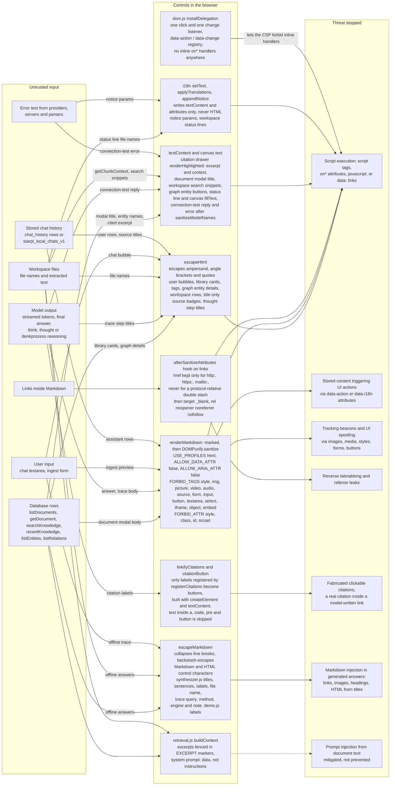
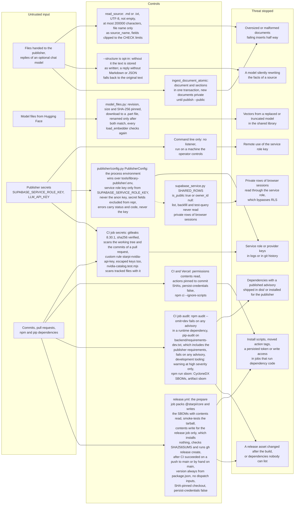

# Security Policy

## Supported versions

| Component | Supported | How fixes ship |
| --- | --- | --- |
| Web app | the `main` branch, which is what https://www.starpi.app deploys (3.0.x) | deployed from `main` |
| `@starpi/core` (npm package and release tarball) | the latest release (3.0.x) | a new patch release on npm and on GitHub, with its SBOM, checksums, provenance and signatures |
| `@starpi/companion` (npm package and offline bundle) | the latest release (3.0.x) | a new patch release on npm and on GitHub with a new offline bundle |

Releases before 3.0.0 get no fixes.

## Reporting a vulnerability

Please report vulnerabilities privately, preferably through GitHub:
**Security → Advisories → Report a vulnerability** in this repository. If you cannot use GitHub,
email **phoenixprojekt1@gmail.com** with the subject line `[starpi security]`. Do not open a
public issue, discussion or pull request for security problems.

Include the affected component (the web app, the service worker, the server functions in `api/`
(relay, pools, speech routes, research steps), the database policies, the library publisher, the
local companion or its offline bundle and install scripts, the `@starpi/core` package or one of its
commands, the release workflow), the commit or release you tested, reproduction steps, and the
impact you observed.

### Coordinated disclosure

| Step | Target |
| --- | --- |
| Acknowledgement of your report | within 7 days |
| Triage: confirmed or declined, with a severity assessment | within 14 days |
| Fix released on `main` and deployed to www.starpi.app (for a package: a patch release) | within 90 days of the report |
| Public advisory (GitHub Security Advisory, CVE requested where applicable) | when the fix is released |

If a fix needs longer, we agree on a new date with you before the 90 days end. Reporters are
credited in the advisory unless they ask not to be. Please keep the details confidential until
the advisory is published.

### Safe harbor

We will not pursue or support legal action against research that follows this policy: testing
only against your own deployment, a local build, your own companion or your own account on
www.starpi.app; not accessing, modifying or retaining other users' data; not spending the site's
key pools or speech budgets beyond what a test needs (no load or denial-of-service testing); and
reporting promptly through the channels above.

## Scope

In scope:

- Cross-site scripting, HTML or Markdown injection, CSP or cross-origin isolation bypasses in the
  web application, and escapes from the sandboxed render and grounding frames
- Files added to the on-device workspace or attached to a message that execute code, escape the
  ingestion worker (ZIP bombs, XML entity expansion and parser crashes included) or make citations
  point at text the answer was not given
- Provider keys leaving the browser other than to their provider or through the relay: in plain
  text at rest, in a URL, in a log, a receipt, a sync record or an export; the key vault opening
  without the passphrase
- The server functions under [`api/`](api), also when `scripts/serve.mjs --functions` serves them:
  reaching a host other than the relay's fixed upstreams (SSRF), bypassing the origin check, the
  rate limits, the daily budgets or the access code, a pool forwarding tools or a model off its
  allowlist, reading a site key, a speech route speaking an unlisted voice, a Live token whose
  setup the browser can change, a research step accepting a model turn whose signature does not
  verify
- Row level security or privilege problems in `backend/supabase`: reading or changing another
  user's encrypted sync rows or key envelope, private knowledge entries or published rows, calling
  privileged functions
- The end-to-end encrypted sync: the server, or anyone with database access, learning the content
  of a conversation, moving a record to another row or revision unnoticed, or a device-only turn
  entering a record
- Tool approvals: an MCP tool running without the approval its class requires, or with a
  definition that changed after it was approved; a built-in tool the user switched off running
- The local companion: pairing or calling it without a valid pairing (DNS rebinding, CSRF, another
  origin), egress to a host the owner did not list (beyond the limits of an in-process guard
  described below), opening sealed data without the key-encryption key, an audit chain or anchor
  that can be rewritten or rolled back without the companion or the paired browser noticing,
  computer control running a step of class high without the mandate owner's approval or any step
  of class forbidden
- The source check, the sentence gate or the receipt verifier reporting a match for text that does
  not match, the gate releasing a unit whose number no cited excerpt holds, or a receipt that the
  verifier accepts although its file, passage, hash or signature was changed
- On-device model files that load although they do not match `model-lock.json` (unless the user
  allowed that model to load unverified)
- Release assets (the package tarballs, the offline bundle, the SBOMs, `SHA256SUMS`) that do not
  match what the release workflow built from the tested commit, or a signature or attestation that
  verifies for something else

Out of scope:

- The Supabase public key (publishable key or legacy **anon** JWT) embedded in the frontend. It is
  public by design; access is enforced by RLS. The build refuses secret and service-role keys.
- Denial of service through large model downloads a user explicitly confirms
- Calls to the server functions from scripts that forge the browser's `Origin` and
  `Sec-Fetch-Site` headers, within the rate limits, budgets and allowlists (see
  [Known limitations](#known-limitations))
- The documented limits of the companion's in-process egress guard (references taken before it was
  installed, native add-ons, WebAssembly with host imports) on installations without the Linux
  system unit
- Prompt injection that makes a model write something false: the source check and the gate are
  the controls for what is shown as checked; a free answer is labelled as not checked
- Vulnerabilities in third-party providers (Supabase, Anthropic, OpenAI, Google, xAI, Groq,
  Mistral, DeepSeek, OpenRouter, NVIDIA, ElevenLabs, Brave, Tavily, Hugging Face)

## Security model in brief

- **Static site, strict browser policy.** The app is a static site with stateless functions. Every
  response carries one header set generated from `scripts/headers.json` per build profile: a
  Content-Security-Policy without `unsafe-inline` or `unsafe-eval` (only `wasm-unsafe-eval`, for
  the WebAssembly runtimes), `Cross-Origin-Opener-Policy: same-origin`,
  `Cross-Origin-Embedder-Policy: require-corp`, `Cross-Origin-Resource-Policy: same-origin`,
  `Origin-Agent-Cluster`, `X-Frame-Options: DENY`, `Referrer-Policy: no-referrer`, HSTS and a
  Permissions-Policy that allows the microphone and the camera for this origin only (the build the
  companion serves allows the microphone only). `verify-dist` checks the build against it;
  `headers:check` keeps `vercel.json` equal to the source.
- **Untrusted content.** Rendered Markdown passes DOMPurify; highlighting and math pass a second,
  narrower sanitizer; diagrams and HTML or SVG previews render only in a sandboxed frame with an
  opaque origin that can fetch nothing. Citations become buttons only for excerpts the app
  registered. Excerpts, tool results and web results reach models fenced as data, never as
  instructions.
- **Keys.** Provider keys live in the tab's session storage, or encrypted in the key vault, and go
  only to their provider (direct) or through the site's stateless relay. Site keys (pools, speech,
  research) live only in the server environment; the browser never sees one.
- **Where answers come from.** The user picks a model or Auto; nothing switches between a model on
  the device and one in the cloud without the user's choice. A turn answered on this device (the
  device model, files of the workspace, a question asked of the companion) stays there: it is
  never sent to a cloud model as history, never synced, and asked without web search or cloud tools.
- **Data at rest.** Conversations, workspace files, notes, receipts' signing keys and settings
  live in the app's IndexedDB database (large files in OPFS). Memory notes are sealed with the vault
  key when a passphrase is set. Sync is end-to-end encrypted and off by default.
- **Database.** Browsers use the public key plus an anonymous Supabase session. RLS limits sync
  rows and key envelopes to their owner and private knowledge rows to their creator; browser roles
  cannot execute SECURITY DEFINER functions. The library publisher, a command line tool on a
  machine the operator controls, holds the `service_role` key and reads only published rows.
- **The local companion** listens on the loopback interface only, answers only paired browsers,
  seals what it keeps, signs every answer into an audit chain the browser checks, and reaches
  nothing outside the machine unless the owner listed a host for a module.
- **Supply chain.** Exact dependency versions, a committed lockfile, installs without scripts,
  pinned GitHub Actions, gitleaks, dependency audits, a licence gate, an end-of-life register,
  CycloneDX SBOMs, SHA-256-pinned model files, and signed, attested releases with npm provenance
  ([Supply chain](#supply-chain)).

## What leaves the device

| Destination | When | What is sent |
| --- | --- | --- |
| A provider, direct | a model of a provider the user has a key for, whose API accepts browser calls (Anthropic, OpenAI, Gemini, OpenRouter) | the request (system prompt, history the turn may share, the question, its attachments, excerpts of a grounded question) with the key in the provider's header |
| The site's relay | the same, for providers that refuse browser calls (xAI, Groq, Mistral, DeepSeek; also ElevenLabs, Brave and Tavily) | the same request and the user's key, forwarded once and kept nowhere |
| The site's pools | a free model without a key of the user's | text and images only, no tools, a model from the pool's allowlist; forwarded with a site key |
| Your own server | a model of your server (`https://…`, or `http://localhost`) | the request, called direct, never through the site |
| The model on this device | WebGPU or processor (WASM) models | nothing; model files are downloaded once after a confirmation |
| The paired companion | the companion as a model or a retrieval source | the question (and its mode and data class) to the loopback service; passages come back up to the class the question allows |
| Speech services | dictation, read-aloud, Live | audio or released sentences to the chosen source (the browser's own service may use its vendor); the site's speech routes keep neither |
| A search service | web search for models without their own (Brave, Tavily, SearXNG) | the query; research jobs can strip e-mail addresses, phone numbers, IBANs, card numbers and IP addresses first |
| Supabase | the knowledge library, encrypted sync | the question for full-text search, or only a query vector for ranking by meaning; sync rows as ciphertext |

Turns that stay on the device are never part of another model's history, and a question asked in
the on-device mode runs without web search and cloud tools. The footer under the composer says
where the current question goes.

## Keys and the vault

- **Default: the tab.** A key typed into **Settings › Model providers and keys** lives in the tab's
  session storage and is gone when the tab closes.
- **The vault.** With a passphrase, keys are kept in IndexedDB as one AES-GCM-256 record whose key
  is derived with PBKDF2-SHA-256 (600,000 iterations, 16-byte random salt) as a non-extractable
  CryptoKey held in memory only. The vault locks by hand or after 30 minutes without activity.
  Memory notes and MCP bearer tokens use the same vault.
- **Never elsewhere.** Keys are never written in plain text outside session storage, never exported,
  synced or put into receipts and logs; transports refuse keys in URLs and set the provider's auth
  header themselves. 2.x kept "remembered" keys in plain text in `localStorage`; 3.0 moves them into
  the tab once and suggests a passphrase.
- **Errors without provider text.** A failed call is reduced to a short error code; provider error
  bodies, which can quote request details, are never kept, shown or logged.

## Relay, pools and the other server functions

[docs/SERVER.md](docs/SERVER.md) lists every route, guard and variable. In short:

- **Relay** (`/api/relay/<provider>/<path>`): the host comes from a fixed table, never from the
  browser, so a local server or another address cannot be reached through it (no SSRF); paths are
  checked as sent, still percent-encoded. Exactly one auth header in the provider's style, no key in
  the query, a body of at most 4 MB, an allowlist of forwarded headers, no redirects, and only an
  error identifier of the upstream's answer is returned. Nothing is stored or logged.
- **Pools** (`/api/pool`): text and images for vision models only, no tools, no response formats,
  an output limit clamped to the model's, a model from the allowlist (`src/js/ai/catalog/pools.js`,
  shared by the browser and the server). Keys rotate and park after failures; log lines name a key
  by its index only. `GET /api/health` and `GET /api/models/pool` say whether a pool has keys, never
  how many.
- **Speech routes** speak only listed voices (prebuilt Gemini voices, ElevenLabs premade voices),
  take one released piece of text at a time, cap recordings at 60 seconds, and mint Live tokens
  whose whole setup is locked into the token; a user's own Gemini key is used for that one call.
- **Research steps** sign every model turn that asks for tools with HMAC-SHA-256 (a key derived
  with HKDF from the pool's first Gemini key, never sent), and refuse a history whose signatures do
  not verify, so a browser cannot forge what the model said.
- **Front guards** on every route: the origin check, per-IP limits, optional daily budgets and an
  optional access code (`STARPI_ACCESS_CODE`, compared in constant time, checked after the rate
  limit so it cannot be guessed faster than the limit allows).

## Pairing with the local companion

- **Loopback only.** The companion listens on `127.0.0.1`. A request whose `Host` is not
  `127.0.0.1`, `localhost` or `[::1]` with its port gets 421, so a rebound DNS name cannot reach it.
- **Pairing codes.** `starpi-companion pair` prints a one-time code valid for 10 minutes; five wrong
  codes in a row void every open code. The companion stores only hashes of codes, cookies, CSRF
  values and tokens. Roles: `owner` (configuration, secrets, sessions, computer control) and
  `member`.
- **Mode A** (the companion serves the app from its own origin): an `HttpOnly; SameSite=Strict`
  cookie plus a CSRF value the app sends as `X-Companion-CSRF`; a cookie without it counts for
  nothing. **Mode B** (the hosted app): a 32-byte bearer token bound to the page's origin, CORS
  answers that name exactly that origin, and the browser's private network access prompt; no cookie
  is sent.
- **In the browser** the token or CSRF value is sealed with AES-GCM under a non-extractable key and
  kept in the IndexedDB database `starpi-companion`; nothing about the companion is synced. Requests
  are never cached, never follow a redirect and carry only `Authorization` and `Content-Type`.
- **Audit heads.** Every answer carries the companion's signed audit head (Ed25519 over the
  canonical JSON of sequence number and hash). The browser checks it with the public key from the
  pairing and keeps the highest head per companion; a different hash at a known number, a newer head
  whose chain no longer holds the stored record, or a current head below the stored one shows a red
  banner (rollback or fork) until the user accepts the companion's current state. Inside, anchors
  outside the data folder make the companion refuse to start on a rolled-back or tampered database.
- **Egress.** With no `egress.allow` entries the companion reaches nothing but this machine. An
  in-process guard patches every socket connect, DNS lookup and datagram socket, refuses other host
  names before any DNS query, and forbids child processes, worker threads and loader threads; a
  module gets a capability only for the `host:443` entries the owner listed for it, which resolves
  that host, connects to public addresses only and checks TLS as usual. **Limits:** references to
  original functions taken before the guard was installed, Node's internal handles, native add-ons
  and WebAssembly with host imports. On Linux the system unit therefore adds `IPAddressDeny=any`
  outside the process and an egress splice on a Unix socket only the companion may open; a systemd
  user unit and the macOS launchd agent rely on the guard alone.
- **Models by data class.** `public` and `personal` may reach any configured model (personal to the
  cloud only while the owner allows it), `sensitive` only local models, `secret` no model. A failing
  model is never replaced by one of the other kind. In the app, a question that stays on the device
  may take companion passages up to `sensitive`; other questions up to the ceiling the user chose
  (`personal` by default); `secret` passages never leave the companion.
- **Computer control** is experimental and off unless the configuration switches it on: consent by
  an owner, a mandate of at most 120 seconds, a stop that is never refused, steps classed from what
  the screen reports (never from what the model claims), approvals by the mandate owner for risky
  steps, and nobody can approve while the actor works. In 3.0 it drives a simulated screen only.

## Supply chain

- **SBOMs (CycloneDX 1.5, JSON).** `npm run sbom` writes, from `package-lock.json` and without
  installing anything, `starpi-<version>.cdx.json` (every npm package of the app, development
  tooling marked as such except what the render frame bundles, mermaid and its tree, plus the
  on-device models of both catalogs as an ML-BOM) and `starpi-core-<version>.cdx.json` (the
  package, which has no dependencies). Both are deterministic for one commit and checked before
  they are written. CI uploads them on every run; every release carries them.
- **Gates in CI.** `npm audit --omit=dev` fails on any advisory in a runtime dependency (development
  tooling is reported); `pip-audit` fails on advisories of the library publisher's requirements
  (the local voice server's pinned requirements pass a licence check, not yet `pip-audit`); the
  licence gate (`npm run license:check`) checks every shipped package against
  `scripts/license-allowlist.json`, and the companion's tree has its own dependency and licence
  checks; `npm run eol:check` warns a year before a runtime reaches its end of life; gitleaks scans
  the tree and every pull request's commits; `npm run hygiene:check` keeps private paths and
  internal identifiers out; CodeQL and a workflow lint (actionlint, zizmor) run on every change.
- **Installs and pins.** Exact versions in `package.json`, a committed lockfile,
  `npm ci --ignore-scripts` in CI and on Vercel, GitHub Actions pinned to commit SHAs,
  `persist-credentials: false` on every checkout, read-only permissions by default. Dependabot
  proposes updates every week.
- **Model files.** Every file an on-device runtime stores is hashed in a worker and compared with
  `model-lock.json` before the model answers; a mismatch is deleted and refused. The processor and
  embedding models download from Hugging Face at a pinned commit. A weekly workflow checks the lock
  against the model hosts.
- **Release assets.** The release workflow builds both package tarballs, the SBOMs and the
  companion's offline bundle in a job without write access or secrets, from the commit CI tested,
  and smoke-tests the `@starpi/core` tarball offline. A second job, which installs nothing, attests
  every asset (`actions/attest-build-provenance`), signs `SHA256SUMS` and the offline bundle keyless
  with Sigstore and, when the project's release key is configured, signs `SHA256SUMS` with Ed25519.
  The job that creates the release is the only one with `contents: write`, and the npm packages are
  published from the very tarballs of the release, with npm provenance. To check a download:

  ```bash
  sha256sum -c --ignore-missing SHA256SUMS
  cosign verify-blob --bundle SHA256SUMS.sigstore.json \
    --certificate-identity https://github.com/umutcantezgel-cpu/Starpi/.github/workflows/release.yml@refs/heads/main \
    --certificate-oidc-issuer https://token.actions.githubusercontent.com SHA256SUMS
  gh attestation verify starpi-core-3.0.0.tgz --repo umutcantezgel-cpu/Starpi
  openssl pkeyutl -verify -pubin -inkey starpi-release.pub -rawin -in SHA256SUMS -sigfile SHA256SUMS.sig
  npm view @starpi/core@3.0.0 dist.integrity   # the SHA-512 of the release asset
  ```

  The offline bundle carries its own `SHA256SUMS`, which its install scripts check before they copy
  anything; check the bundle's signature with a tool you already trust before you run anything
  from it.

## Answer receipts, the source check and the sentence gate

- **What a receipt contains.** The answer, the question and every excerpt the answer was given
  (question and excerpts can be left out on export), SHA-256 fingerprints of the source files and of
  their extracted text, passage offsets, the source-check verdicts, a Merkle tree over the citations
  and, in v3, the signer, what the sentence gate released and withheld, advisory second opinions and
  relations. A fingerprint identifies a file: whoever holds the file can tell it was a source, even
  when the excerpts are left out. Share a receipt only with people who may know that.
- **Signing.** The app signs exported receipts with a key of the device (**Settings › Trust**, on by
  default): Ed25519, or ECDSA P-256 where WebCrypto lacks Ed25519, generated as a non-extractable
  key whose handle IndexedDB keeps; it is never synced or exported. A v3 receipt names its signer
  inside its id, so a removed or swapped signature is detected. A signature checked with a public
  key obtained from the signer shows that the receipt is unchanged since that key signed it; a
  signature checked only with the key embedded in the receipt shows integrity, not authorship.
- **What it proves.** That each workspace excerpt is an unchanged passage of the file with the
  recorded fingerprint, at the recorded position, under the recorded extraction rules. Not which
  excerpts a model read, nor that the answer is correct, nor anything about knowledge-base excerpts.
  See [docs/spec/receipts.md](docs/spec/receipts.md).
- **Untrusted receipts.** A receipt is JSON from anywhere: it is checked against size and field
  limits before use, everything shown from it is set as text, and a public key is read only as a
  JWK or PEM public key (a private key is refused).
- **The source check is a heuristic.** It compares numbers, dates, times, weekdays, codes, version
  numbers, quotations, wording, reversed negations, names and values next to something else, and
  relations between values and events with the cited excerpts. It can miss a wrong statement that
  uses the excerpt's words and flag a correct paraphrase; it is an aid for reading the sources, not a
  guarantee. Its rules are deterministic and bounded (20,000 characters and 300 statements per
  answer).
- **The sentence gate decides what is spoken or shown as checked** outside the chat bubble:
  read-aloud, Live, research reports and the companion's answers carry only units it released. A
  released unit is a frozen object only the gate creates, and the speech queue refuses anything
  else. In sources mode every number of a unit must appear with the same value in an excerpt the
  unit cites; links, other scripts, look-alike digits and invisible characters withhold a unit in
  every mode. A second opinion (an entailment model or the AI judge) is advisory and never releases
  or upgrades anything.

## Known limitations

- **Server limits are per instance.** The per-IP limits, the daily budgets and the key cooldowns
  live in the memory of one function instance. Several instances count separately, so they are a
  brake, not a quota; use the providers' spending limits and the Vercel Firewall for a hard ceiling.
- **The origin check stops other websites, not scripts.** A script outside a browser can send any
  headers; what it can do then is bounded by the rate limits, the budgets, the allowlists and the
  access code, if one is set.
- **Pooling free keys.** Rotating many free keys of a provider on a public site may conflict with
  that provider's terms; the operator of a deployment decides and is responsible.
- **The relay sees the user's key in transit.** It forwards and forgets it; a user who does not
  want that can use providers that accept browser calls, or turn the relay setting off.
- **Encrypted sync.** The server keeps the passphrase-wrapped sync key (PBKDF2-SHA-256, 600,000
  iterations): whoever obtains the database can try passphrases offline, so choose a long one. The
  server learns how many conversations a user syncs, rough record sizes (padded to 512 bytes),
  revision numbers and times. `chat_sync` has no per-user quota, and the passphrase cannot be
  changed in 3.0 (turn sync off and on again). Restoring in another browser needs Email sign-in with
  a one-time code.
- **Provider-side MCP.** With the provider-side option on (off by default), Anthropic or OpenAI call
  the allowed tools of a public MCP server themselves, without asking per call.
- **Web answers.** Answers grounded by a search API carry no receipt (receipt sources are the
  workspace and the knowledge base); a web answer is checked as far as the provider's citations
  allow and labelled accordingly.
- **Model downloads.** WebLLM downloads its presets at the hosts' main branch; the lock pins their
  files, so an upstream change refuses the model until the lock is regenerated or the user allows
  it to load unverified. A file that was verified is checked again by URL and size only, so an
  in-place change of the same size is not hashed again ("Delete downloaded model data" resets
  that). Hashing holds a file in memory once more, about twice the largest file at the peak.
- **The companion's egress guard runs in its process** (see above); only the Linux system unit adds
  a boundary outside it. Its HTTP API trusts every paired session of a role; revoke sessions you no
  longer use (`starpi-companion token-revoke`).
- **PII stripping is heuristic.** The optional stripping of research web queries recognises common
  shapes only; a run of 7 to 15 digits that starts with 0 counts as a phone number on purpose.
- **Vector ranking returns approximate results.** `match_knowledge_vector_384` uses the HNSW index
  and RLS filters its candidates, so a visitor who can see only a small part of the table may get
  fewer rows than asked for; it never returns rows the visitor cannot see.
- **Anonymous sign-ins.** Every anonymous sign-in creates a user, and RLS bounds the size of each
  row a browser writes but not the number of rows. Enable CAPTCHA and rate limits for anonymous
  sign-ins (Supabase dashboard) before relying on it at scale.
- **Voice input.** Most browsers recognise speech on their vendor's servers. In the on-device mode
  only sources that keep audio on the user's machines count, plus the browser where it recognises on
  the device (`processLocally`).

The layers in detail (all diagrams are also in the
[architecture atlas](docs/ARCHITECTURE.md#9-security-layers)):

**Untrusted content on its way to the DOM**

<!-- diagram: security-layers-render -->


**Worker isolation, RLS, key handling, CSP and the build gate**

```mermaid
flowchart LR
    subgraph sg_in["Untrusted input"]
        iFile["Workspace files<br/>drop zone, file input, chat attachment"]
        iDb["Supabase access<br/>public key built into the bundle,<br/>anonymous session JWT, reads and writes"]
        iKey["Provider keys: Gemini and OpenRouter in the tab,<br/>NVIDIA keys only in the server environment"]
        iUrl["Own server URL cfgLlmUrl,<br/>stored as starpi_llm_url"]
        iNet["Responses from Supabase,<br/>providers and model downloads"]
        iProxy["Requests to the NVIDIA routes<br/>from other sites, scripts and floods"]
        iSlip["Markup that slips past<br/>escaping and sanitizing"]
        iDist["dist/ build output<br/>index.html, bundles, app CSS,<br/>sw.js, build-manifest.json"]
        iOrigin["Other sites and networks<br/>framing pages, opener windows,<br/>network attackers"]
    end

    subgraph sg_ctl["Controls"]
        cWorker["ingest.worker.js, Web Worker starpi-ingest<br/>parse, chunk and BM25 off the main thread,<br/>full text kept in worker memory, never uploaded or synced by the app,<br/>failures return ParseError codes, ok false"]
        cParse["parser.js extractText<br/>extension allowlist txt, md, markdown, csv, log, json, pdf<br/>MAX_FILE_BYTES 25 MiB, MAX_TEXT_CHARS 5000000,<br/>at most MAX_PDF_PAGES 2000 read, normalizeText drops NUL and control chars"]
        cPdf["pdf.js legacy build inside the worker<br/>disableFontFace, useSystemFonts false,<br/>isOffscreenCanvasSupported false,<br/>PasswordException becomes encrypted_pdf,<br/>other document errors invalid_pdf,<br/>pdf.js failing to load becomes pdf_reader"]
        cLocal["chat.js and chat-store.js persistMessage localOnly:<br/>on-device mode, question and answer of a turn<br/>using workspace excerpts, question stored after retrieval,<br/>questions with an attached file, their answers in free chat,<br/>and answers without a model that name a workspace file<br/>stay in localStorage with metadata local_only true,<br/>rows without the flag count as local"]
        cHist["chat.js shareableHistory: turns marked localOnly<br/>are never sent as history; source mode: the last 4 others<br/>to OpenRouter, the own server and NVIDIA, none to Gemini;<br/>free chat: up to 16 within 24000 chars, Gemini included;<br/>matching excerpts or the attached file still reach the model"]
        cRls["Postgres RLS and grants<br/>visible = is_public or owner_id = auth.uid()<br/>published rows read-only for browser roles,<br/>chat_history: own rows, select, insert and delete,<br/>brain_settings service role only, RPCs SECURITY INVOKER"]
        cCheck["CHECK size limits on browser-writable columns<br/>violations fail with SQLSTATE 23514"]
        cSync["canSyncChats: signedIn and hardened,<br/>otherwise chats stay in localStorage"]
        cBuildKey["build.mjs assertPublicKey, lib/supabase-key.mjs<br/>sb_publishable_ key or a JWT with role anon,<br/>empty, sb_secret_, not a JWT or another role:<br/>the build fails"]
        cSecret["ai/keys.js and storage.js writeSecret<br/>sessionStorage for this tab, or the<br/>key vault: AES-GCM under a PBKDF2 key<br/>held in memory, auto-lock after 30 min"]
        cHeader["providers.js: Gemini key in x-goog-api-key header,<br/>OpenRouter key as Authorization Bearer, never in a URL,<br/>NVIDIA requests carry no key, same origin only"]
        cProxy["api/_lib guards on the NVIDIA routes:<br/>same-origin check, per-IP rate limit, keys configured,<br/>JSON body at most 256 KiB, model and field allowlist,<br/>no-store, keys by index and bodies never logged"]
        cNorm["providers.js normalizeServerUrl<br/>https anywhere, http only for localhost and 127.0.0.1,<br/>the plain-http hosts in connect-src, no user or password,<br/>query and hash dropped"]
        cPin["wasm/worker.js env.fetch: only catalog repositories<br/>at the pinned revision, plain path segments,<br/>everything else refused before any request"]
        cSw["sw.js fetch handler<br/>only same-origin GET requests handled,<br/>cross-origin requests bypass the worker,<br/>cached only when 200, basic and not no-store"]
        cCsp["vercel.json Content-Security-Policy<br/>default-src self, script-src self wasm-unsafe-eval, style-src self,<br/>font-src self, img-src self data: blob:, worker-src self,<br/>manifest-src self, media-src none,<br/>connect-src self data: https: wss://*.supabase.co<br/>http://localhost:* http://127.0.0.1:*<br/>object-src, frame-src, base-uri, form-action, frame-ancestors none"]
        cHdr["vercel.json headers: X-Frame-Options DENY, nosniff,<br/>COOP same-origin, HSTS max-age 63072000,<br/>Referrer-Policy strict-origin-when-cross-origin,<br/>Permissions-Policy microphone self only,<br/>camera, geolocation, payment, usb, serial, hid off"]
        cVerify["scripts/verify-dist.mjs in CI after npm run build:<br/>CSP compatibility, no inline script, style block, style attribute,<br/>on* handler or javascript: URL, scripts and stylesheets<br/>only from /assets/, referenced and precached files exist,<br/>no __STARPI_ placeholder in sw.js or the bundles,<br/>no eval or new Function, CSP without unsafe-inline or unsafe-eval,<br/>no nvapi- key in bundles, index.html, sw.js or the manifest"]
        cVerify2["scripts/verify-dist.mjs: version and offline shell<br/>buildVersion over index.html, asset URLs, public files<br/>and the sw.js template equals the manifest version,<br/>sw.js carries it, public files listed, ingest worker<br/>precached, /index.html not precached,<br/>WASM worker and ONNX Runtime binary present, not precached,<br/>app CSS contains ::highlight(starpi-review)"]
    end

    subgraph sg_thr["Threat stopped"]
        tFreeze["Frozen UI or exhausted memory<br/>from large or hostile files"]
        tPdf["Hostile PDF: font loading,<br/>parser failure in the page"]
        tLeak["Workspace content uploaded, synced<br/>or sent as chat history"]
        tTenant["Reading or changing other users' chats<br/>and private rows, editing published rows"]
        tSize["Oversized writes into the database"]
        tSecretKey["A key that bypasses RLS<br/>shipped to every browser"]
        tKey["Keys persisted on shared devices,<br/>exposed in URLs and logs or shipped in a bundle"]
        tQuota["Quota abuse of the shared NVIDIA key pool<br/>and use as an open proxy"]
        tUrl["Cleartext http to remote hosts,<br/>credentials in URLs, non-http schemes"]
        tModel["Model files from another repository<br/>or a moved branch"]
        tCache["Private API responses<br/>kept in CacheStorage"]
        tXss["Injected or inline script, eval"]
        tExfil["Image beacons and plugins: remote images,<br/>object, embed, frames, form posts"]
        tFrame["Clickjacking, cross-window access, downgrade"]
        tRegress["A build that breaks under or weakens the CSP,<br/>serves stale code or has no offline workspace"]
    end

    iFile --> cWorker
    iFile --> cParse
    iFile -->|"pdf"| cPdf
    cWorker --> tFreeze
    cWorker --> tLeak
    cParse --> tFreeze
    cPdf --> tPdf
    iFile -->|"attached-file questions and free-chat answers,<br/>workspace turns: question and answer,<br/>answers without a model naming<br/>a workspace file"| cLocal
    iFile -->|"workspace and attached-file turns,<br/>turns whose answer without a model<br/>names a workspace file"| cHist
    cLocal --> tLeak
    cHist --> tLeak
    iDb --> cBuildKey
    iDb --> cRls
    iDb --> cCheck
    iDb --> cSync
    cBuildKey --> tSecretKey
    cRls --> tTenant
    cSync -->|"no chat rows without owner RLS"| tTenant
    cCheck --> tSize
    iKey --> cSecret
    iKey --> cHeader
    iKey -->|"NVIDIA keys"| cVerify
    cSecret --> tKey
    cHeader --> tKey
    cVerify -->|"nvapi- check"| tKey
    iProxy --> cProxy
    cProxy --> tQuota
    iUrl --> cNorm
    cNorm --> tUrl
    iNet --> cPin
    cPin --> tModel
    iNet --> cSw
    cSw --> tCache
    iSlip --> cCsp
    iOrigin --> cHdr
    cCsp --> tXss
    cCsp --> tExfil
    cHdr --> tFrame
    iDist --> cVerify
    iDist --> cVerify2
    cVerify --> tRegress
    cVerify2 --> tRegress
```

<!-- diagram: security-layers-platform -->


**Publisher secrets, service role reads and CI supply chain**

<!-- diagram: security-layers-backend-ci -->

