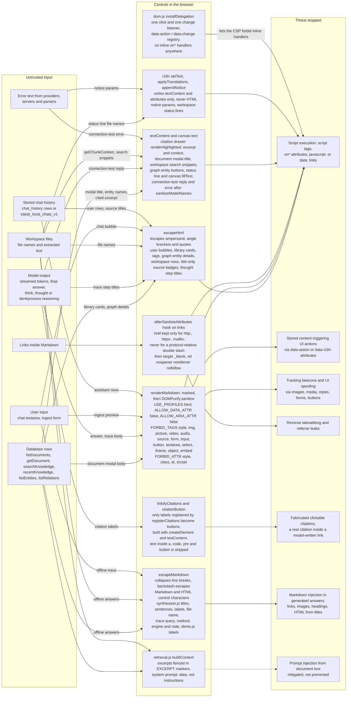

# Security Policy

## Supported versions

| Component | Supported | How fixes ship |
| --- | --- | --- |
| Web app | the `main` branch, which is what https://www.starpi.app deploys | deployed from `main` |
| `@starpi/core` (npm package and release tarball) | the latest release | a new patch release on npm and on GitHub, with its SBOM and checksums |

## Reporting a vulnerability

Please report vulnerabilities privately, preferably through GitHub:
**Security → Advisories → Report a vulnerability** in this repository. If you cannot use GitHub,
email **phoenixprojekt1@gmail.com** with the subject line `[starpi security]`. Do not open a
public issue, discussion or pull request for security problems.

Include the affected component (frontend, service worker, database policies, Python backend, the
NVIDIA proxy in `api/`, deployment scripts, the `@starpi/core` package or its
`starpi-verify-receipt` command), the commit
or release you tested, reproduction steps, and the impact you
observed.

### Coordinated disclosure

| Step | Target |
| --- | --- |
| Acknowledgement of your report | within 7 days |
| Triage: confirmed or declined, with a severity assessment | within 14 days |
| Fix released on `main` and deployed to www.starpi.app (for `@starpi/core`: a patch release) | within 90 days of the report |
| Public advisory (GitHub Security Advisory, CVE requested where applicable) | when the fix is released |

If a fix needs longer, we agree on a new date with you before the 90 days end. Reporters are
credited in the advisory unless they ask not to be. Please keep the details confidential until
the advisory is published.

### Safe harbor

We will not pursue or support legal action against research that follows this policy: testing
only against your own deployment, a local build or your own account on www.starpi.app; not
accessing, modifying or retaining other users' data; not degrading the service for others (no
load or denial-of-service testing); and reporting promptly through the channels above.

## Scope

In scope:

- Cross-site scripting, HTML or Markdown injection, CSP bypasses in the web application
- Files added to the on-device workspace that execute code, escape the ingestion worker or make
  citations point at text the answer was not given
- Row Level Security or privilege problems in `backend/supabase` (reading or modifying another
  user's chats or private knowledge entries, bypassing `is_public`, calling privileged functions)
- Credential exposure (provider API keys including the NVIDIA key pool, Supabase `service_role`
  key)
- Authentication, CORS or request-handling flaws in `backend/server.py`
- Request handling in the Vercel Functions under [`api/`](api) and in the NVIDIA routes of
  `backend/server.py` ([`backend/core/nvidia.py`](backend/core/nvidia.py)): bypassing the origin
  check, the rate limit or the model allowlist, reaching an upstream other than NVIDIA's chat
  endpoint, or reading a key
- Service worker behaviour that caches private data or serves stale code
- The source check or the receipt verifier reporting a match for text that does not match, or a
  receipt that the verifier accepts although its file, passage or hash was changed, in the app or
  in the published `@starpi/core` package
- Release assets (the package tarball, the SBOMs, `SHA256SUMS`) that do not match what the release
  workflow built from the tagged commit

Out of scope:

- The Supabase public key (publishable key or legacy **anon** JWT) embedded in the frontend. It
  is public by design; access is enforced by RLS. The build refuses secret and service-role keys.
- Denial of service through large model downloads a user explicitly confirms
- Calls to the NVIDIA proxy from scripts that forge the browser's `Origin` and `Sec-Fetch-Site`
  headers, within the rate limit and the allowlist (see [Known limitations](#known-limitations))
- Vulnerabilities in third-party providers (Supabase, Google Gemini, OpenRouter, NVIDIA, Hugging
  Face)

## Security model in brief

- Browsers use the anon key plus an anonymous Supabase session. RLS limits chat history to its
  owner and private knowledge rows to their creator; browser roles cannot execute SECURITY
  DEFINER functions.
- The frontend ships with a strict Content-Security-Policy (no inline scripts, handlers or
  styles; no remote images) and sanitizes all rendered Markdown.
- The Python backend holds the `service_role` key, binds to `127.0.0.1` by default and requires
  a bearer token when exposed on another interface.
- NVIDIA API keys exist only in the server environment (`NVIDIA_API_KEYS` on Vercel or in the
  backend's `.env`). The browser calls the NVIDIA proxy on its own origin without a key, and
  `verify-dist` fails if a JavaScript bundle, `index.html`, `sw.js` or the build manifest contains
  one.
- CI runs gitleaks on the working tree and on the commits of every pull request, fails on any
  known advisory in a runtime npm dependency (`npm audit`) or in the backend requirements
  (`pip-audit`), and writes CycloneDX SBOMs of the app and of `@starpi/core` on every run (see
  [Supply chain](#supply-chain)).
- Chat turns that use the on-device workspace are never synced and never sent to a cloud provider,
  the NVIDIA proxy or an own server as chat history.

## NVIDIA cloud models and offline use

- **What is sent.** In the NVIDIA mode the browser sends a request to the site's own proxy
  (`POST /api/chat/nvidia`), which passes it on to NVIDIA's API with a key from its pool:

  | Chat mode | Sent to NVIDIA through the proxy | Also sent |
  | --- | --- | --- |
  | Verified source mode | The system prompt with the retrieved excerpts (also from workspace files and an attached file), the last 4 earlier messages and the question | The question to the knowledge-base search |
  | Free chat | The system prompt, up to 16 earlier messages (24,000 characters in all), an attached file (at most 12,000 characters of it, fenced as data) and the question | Nothing; no search |

  Earlier messages of turns that used workspace files or an attached file, or ran in on-device
  mode, are never part of it. The request carries the model id, the messages, `max_tokens` and
  `temperature`; the proxy builds the upstream request from these fields (and `top_p`) only and
  drops every other one. The cloud assistant and an own server get the same messages (Gemini gets
  no earlier messages in source mode, but the conversation in free chat); with an on-device model
  nothing leaves the device.
- **Keys.** The key pool exists only in the server environment. `GET /api/models/nvidia` reports
  whether keys are configured, never a key or their number; log lines name a key by its position
  in the pool (`key 3/20`). `scripts/verify-dist.mjs` fails if a JavaScript bundle, `index.html`,
  `sw.js` or the build manifest contains an `nvapi-` key, gitleaks has a rule for NVIDIA keys (also
  when pasted with Markdown escapes), and a unit test scans every tracked text file with the same
  rule.
- **Guards.** `POST /api/chat/nvidia` runs, in this order: the method (405); the origin
  (`Sec-Fetch-Site`, when sent, must be `same-origin`, and `Origin` must be present and match the
  host, unless the origin is listed in `NVIDIA_ALLOWED_ORIGINS`: 403); a per-IP rate limit
  (`NVIDIA_RATE_LIMIT_PER_MINUTE`, default 20: 429 with `Retry-After`); keys configured (503); a
  JSON object body of at most 256 KiB (413, 415, 400); then the validation: a model on the
  allowlist, 1 to 40 messages with the roles `system` (first only), `user` and `assistant`, a
  non-blank question last, at most 24,000 characters per message and 64,000 in all, `max_tokens`
  clamped to the model's limit, `temperature` from 0 to 2 and `top_p` above 0 up to 1 (400). The
  upstream URL is fixed (`https://integrate.api.nvidia.com/v1/chat/completions`) and redirects are
  not followed. The Python backend applies the same validation (both test suites run the shared
  cases in `backend/test_fixtures/nvidia_validation.json`) and accepts a caller only with an
  `Origin` from `BRAIN_ALLOWED_ORIGINS` or the bearer token.
  The route runs in the site pool handler (`api/_lib/pool/handler.js`): when the site sets
  `STARPI_ACCESS_CODE`, the code is checked right after the rate limit (401), and a request that
  passes the validation also counts against the per-IP daily budget (`STARPI_POOL_DAILY_PER_IP`,
  default 200: 429). The relay, the other pools and the access code are described in
  [docs/SERVER.md](docs/SERVER.md).
- **Failover and time limits.** Each request starts at the next key and moves on while no stream
  has started: a key answered with 429 waits for its `Retry-After` (1 s to 5 minutes, 20 s when
  missing), a key rejected with 401 or 403 for 30 minutes, and a key that failed (408, 5xx, a
  network error, no first byte in 20 s, an empty stream) for 10 s. All keys together get 25 s for
  the first byte; a stream ends after 30 s without data or 240 s in all, with an error event, and
  the app keeps the part of the answer that arrived and notes that it was cut off. Other upstream
  errors are not retried, and no upstream error body is read or passed on.
- **Nothing is kept.** The proxy stores no request or answer and logs no content: its log lines
  hold the key position, the upstream status and the wait time. Its responses are sent with
  `Cache-Control: no-store`, and the service worker does not handle them. The app shows its own
  translated text for each error code, never text from the server or from NVIDIA.
- **NVIDIA's terms.** What the proxy sends is processed by NVIDIA under the terms of the NVIDIA API
  Catalog. Pooling many free API Catalog keys and moving to the next key when one is rate limited,
  on a public site, may conflict with NVIDIA's terms for the free endpoints; the operator of a
  deployment decides whether to do so and is responsible for it.
- **Offline.** The NVIDIA models need the network: offline, an NVIDIA answer fails, and source
  mode quotes the sources instead. The on-device models keep working offline once downloaded:
  WebLLM and Transformers.js keep the model files in the Cache API, the processor (WASM) runtime
  loads its pinned files from that cache first, and the service worker keeps the ONNX Runtime
  binary once it has been loaded. Free chat sends the conversation with every
  question to a model outside the device (the NVIDIA proxy, a cloud provider or an own server);
  with an on-device model it stays on the device.

## Supply chain

- **SBOMs (CycloneDX 1.5, JSON).** `npm run sbom` writes two documents from `package-lock.json`,
  without installing anything: `starpi-<version>.cdx.json` lists every npm package of the app,
  with development tooling marked (`scope: optional`, `cdx:npm:package:development`), and
  `starpi-core-<version>.cdx.json` describes `@starpi/core`, which lists no other component
  because the package has no dependencies. `scripts/lib/sbom.mjs` makes them deterministic: for one
  commit and one npm version the files are byte-identical (serial number derived from the
  content, timestamp from the commit). Each document is checked before it is written (format,
  unique `bom-ref`s, every dependency edge resolvable, every runtime dependency present). The CI
  `audit` job uploads them as the `sbom` artifact on every run, and every GitHub release carries
  them as assets. The backend's Python requirements are covered by `pip-audit`, not by an SBOM.
- **Dependency audit gates.** `npm audit --omit=dev --audit-level=low` fails CI on any advisory in
  a runtime dependency; advisories in development tooling, which is not shipped in `dist/`, are
  reported as a warning. `pip-audit` fails on any advisory in the backend requirements.
  Dependabot proposes npm, pip and GitHub Actions updates every week.
- **Installs and pins.** Exact versions in `package.json`, a committed lockfile,
  `npm ci --ignore-scripts` in CI and on Vercel, GitHub Actions pinned to commit SHAs,
  `persist-credentials: false` on every checkout, and read-only permissions by default. gitleaks,
  downloaded with a pinned SHA-256, scans the tree and the commits of every pull request.
- **Release assets.** The release workflow builds the `@starpi/core` tarball and the SBOMs in a job
  with read-only permissions, from the commit CI tested; it installs the tarball offline into an
  empty project, imports it and runs `starpi-verify-receipt` and `starpi-ground` before anything is
  published. The job
  that creates the release is the only one with write access; it installs and runs nothing from
  the repository, checks `SHA256SUMS` and attaches the tarball, both SBOMs and `SHA256SUMS`. The
  npm package is published from that tarball, so its npm integrity is the SHA-512 of the release
  asset. To check a download:

  ```bash
  sha256sum -c --ignore-missing SHA256SUMS
  npm view @starpi/core@2.1.0 dist.integrity   # sha512-…, compare with:
  echo "sha512-$(openssl dgst -sha512 -binary starpi-core-2.1.0.tgz | base64 -w0)"
  ```
- **Browser.** A Content-Security-Policy without `unsafe-inline` or `unsafe-eval` (only
  `wasm-unsafe-eval`, for on-device inference with WebLLM and ONNX Runtime Web), checked by
  `scripts/verify-dist.mjs` after every build, and DOMPurify on all rendered Markdown.
- **Answers.** Receipts record SHA-256 fingerprints and passage offsets that anyone with the same
  files can reproduce, with the same deterministic code; see
  [Answer receipts and the source check](#answer-receipts-and-the-source-check).

## Answer receipts and the source check

- **What a receipt contains.** The answer, the question and every excerpt the answer was given,
  cited or not (question and excerpts can be left out on export), SHA-256 fingerprints of the
  source files and of their extracted text, passage offsets and the source-check verdicts. A fingerprint identifies a file:
  whoever holds the file can tell it was a source, even when the excerpts are left out. Share a
  receipt only with people who may know that.
- **Where it goes.** Receipts are built in memory (at most 50 per page, never persisted) and leave
  the device only as a file you download. Verification reads the receipt and the original files on
  the device, in the ingest worker; nothing is uploaded.
- **What it proves.** That each workspace excerpt is an unchanged passage of the file with the
  recorded fingerprint and, in format v2, that each citation belongs to the receipt through its
  Merkle inclusion proof. The app does **not sign** the receipts it writes. A deployment can sign
  receipts with `signReceipt` from `@starpi/core` (Ed25519 or ECDSA P-256); a signature checked with
  the signer's public key shows that the receipt is unchanged since that key signed it, while a
  signature checked only with the key embedded in the receipt shows integrity, not authorship.
  Receipts do not prove which excerpts a model read, or that the answer is correct. See
  [docs/spec/receipts.md](docs/spec/receipts.md).
- **Untrusted receipts.** A receipt is JSON from anywhere. It is checked against size and field
  limits before use (`validateReceipt`, with its own list of members per format version), and
  everything shown from it is set as text, never as HTML. A public key for signature checks is
  read only as a JWK or PEM public key; a file with a private key is refused.
- **The source check is a heuristic.** It compares numbers, dates, times, weekdays, codes,
  version numbers, quotations and wording with the cited excerpts and, in the excerpt's language,
  reversed negations and names and values next to something else; names in English statements
  are also checked against all cited excerpts. Its lists of negations and opposites and its way of
  recognising names are fixed rules for English and German. It can miss a wrong statement that
  uses the excerpt's words, and it can flag a correct paraphrase; it is an aid for reading the
  sources, not a guarantee. Its rules are deterministic and pure: regular expressions and loops
  over the answer and the cited excerpts, bounded by the check's limits (20,000 characters and 300
  statements per answer).

## Known limitations

- **Release assets are checksummed, not signed.** `SHA256SUMS` shows that a file is the one the
  release lists, not who built it; the npm package has no provenance attestation yet. Both depend
  on the integrity of the GitHub repository and the maintainer's npm account.
- **Model downloads.** WebLLM downloads model weights from Hugging Face and the model library
  (WebAssembly) from GitHub at runtime; the processor (WASM) models are downloaded from Hugging
  Face at a pinned commit, and their ONNX Runtime binary is part of the build. Starpi does not
  verify a hash of the downloaded files; it relies on HTTPS, the pinned model ids and the pinned
  revisions. The Content-Security-Policy allows `wasm-unsafe-eval` for the model library and the
  runtime and does not allow `unsafe-eval`.
- **NVIDIA proxy limits are per instance.** The per-IP rate limit and the key cooldowns live in
  the memory of one function instance (one process for the Python backend). Several instances
  count separately, and a new instance starts from zero, so the limit is a brake, not a quota.
  Rate-limit rules of the Vercel Firewall are the stronger option for a public deployment.
- **The origin check stops other websites, not scripts.** Browsers always send `Origin` on this
  request, and `Sec-Fetch-Site`, so a page of another site cannot use the proxy. A script outside
  a browser can send any headers; what it can do then is bounded by the rate limit, the model
  allowlist and the size limits.
- **Time limits of the Python NVIDIA route.** httpx applies its read timeout (30 s) to each read,
  not to an attempt as a whole: a slow key can start its stream after the browser's first-byte
  timeout, and a stream can run up to one read timeout past its 240 s limit. The browser then ends
  it with its own timeouts. The details are in
  [`backend/core/nvidia.py`](backend/core/nvidia.py).
- **Offline PDF reading.** pdf.js is loaded when the first PDF is read and then cached by the
  service worker. A PDF added offline before that fails with a clear message; text files work.
- **Anonymous sign-ins.** Every anonymous sign-in creates a user, and RLS bounds the size of each
  row a browser writes but not the number of rows. Enable CAPTCHA and rate limits for anonymous
  sign-ins (Supabase dashboard) before relying on it at scale.
- **Voice input.** Most browsers recognise speech on their vendor's servers. In the on-device mode
  voice input runs only where the browser offers on-device recognition (`processLocally`) and is
  switched off otherwise, with an explanation. In the other modes it uses the browser's speech
  service, which may send the audio to the browser vendor; the button's tooltip says so.

The layers in detail (all diagrams are also in the
[architecture atlas](docs/ARCHITECTURE.md#9-security-layers)):

**Untrusted content on its way to the DOM**

<!-- diagram: security-layers-render -->


**Worker isolation, RLS, key handling, CSP and the build gate**

```mermaid
flowchart LR
    subgraph sg_in["Untrusted input"]
        iFile["Workspace files<br/>drop zone, file input, chat attachment"]
        iDb["Supabase access<br/>public key built into the bundle,<br/>anonymous session JWT, reads and writes"]
        iKey["Provider keys: Gemini and OpenRouter in the tab,<br/>NVIDIA keys only in the server environment"]
        iUrl["Own server URL cfgLlmUrl,<br/>stored as starpi_llm_url"]
        iNet["Responses from Supabase,<br/>providers and model downloads"]
        iProxy["Requests to the NVIDIA routes<br/>from other sites, scripts and floods"]
        iSlip["Markup that slips past<br/>escaping and sanitizing"]
        iDist["dist/ build output<br/>index.html, bundles, app CSS,<br/>sw.js, build-manifest.json"]
        iOrigin["Other sites and networks<br/>framing pages, opener windows,<br/>network attackers"]
    end

    subgraph sg_ctl["Controls"]
        cWorker["ingest.worker.js, Web Worker starpi-ingest<br/>parse, chunk and BM25 off the main thread,<br/>full text kept in worker memory, never uploaded or synced by the app,<br/>failures return ParseError codes, ok false"]
        cParse["parser.js extractText<br/>extension allowlist txt, md, markdown, csv, log, json, pdf<br/>MAX_FILE_BYTES 25 MiB, MAX_TEXT_CHARS 5000000,<br/>at most MAX_PDF_PAGES 2000 read, normalizeText drops NUL and control chars"]
        cPdf["pdf.js legacy build inside the worker<br/>disableFontFace, useSystemFonts false,<br/>isOffscreenCanvasSupported false,<br/>PasswordException becomes encrypted_pdf,<br/>other document errors invalid_pdf,<br/>pdf.js failing to load becomes pdf_reader"]
        cLocal["chat.js and chat-store.js persistMessage localOnly:<br/>on-device mode, question and answer of a turn<br/>using workspace excerpts, question stored after retrieval,<br/>questions with an attached file, their answers in free chat,<br/>and answers without a model that name a workspace file<br/>stay in localStorage with metadata local_only true,<br/>rows without the flag count as local"]
        cHist["chat.js shareableHistory: turns marked localOnly<br/>are never sent as history; source mode: the last 4 others<br/>to OpenRouter, the own server and NVIDIA, none to Gemini;<br/>free chat: up to 16 within 24000 chars, Gemini included;<br/>matching excerpts or the attached file still reach the model"]
        cRls["Postgres RLS and grants<br/>visible = is_public or owner_id = auth.uid()<br/>published rows read-only for browser roles,<br/>chat_history: own rows, select, insert and delete,<br/>brain_settings service role only, RPCs SECURITY INVOKER"]
        cCheck["CHECK size limits on browser-writable columns<br/>violations fail with SQLSTATE 23514"]
        cSync["canSyncChats: signedIn and hardened,<br/>otherwise chats stay in localStorage"]
        cBuildKey["build.mjs assertPublicKey, lib/supabase-key.mjs<br/>sb_publishable_ key or a JWT with role anon,<br/>empty, sb_secret_, not a JWT or another role:<br/>the build fails"]
        cSecret["storage.js writeSecret<br/>sessionStorage for this tab,<br/>localStorage only with remember keys,<br/>inputs cleared after save, clearKeys"]
        cHeader["providers.js: Gemini key in x-goog-api-key header,<br/>OpenRouter key as Authorization Bearer, never in a URL,<br/>NVIDIA requests carry no key, same origin only"]
        cProxy["api/_lib guards on the NVIDIA routes:<br/>same-origin check, per-IP rate limit, keys configured,<br/>JSON body at most 256 KiB, model and field allowlist,<br/>no-store, keys by index and bodies never logged"]
        cNorm["providers.js normalizeServerUrl<br/>https anywhere, http only for localhost and 127.0.0.1,<br/>the plain-http hosts in connect-src, no user or password,<br/>query and hash dropped"]
        cPin["wasm/worker.js env.fetch: only catalog repositories<br/>at the pinned revision, plain path segments,<br/>everything else refused before any request"]
        cSw["sw.js fetch handler<br/>only same-origin GET requests handled,<br/>cross-origin requests bypass the worker,<br/>cached only when 200, basic and not no-store"]
        cCsp["vercel.json Content-Security-Policy<br/>default-src self, script-src self wasm-unsafe-eval, style-src self,<br/>font-src self, img-src self data: blob:, worker-src self,<br/>manifest-src self, media-src none,<br/>connect-src self data: https: wss://*.supabase.co<br/>http://localhost:* http://127.0.0.1:*<br/>object-src, frame-src, base-uri, form-action, frame-ancestors none"]
        cHdr["vercel.json headers: X-Frame-Options DENY, nosniff,<br/>COOP same-origin, HSTS max-age 63072000,<br/>Referrer-Policy strict-origin-when-cross-origin,<br/>Permissions-Policy microphone self only,<br/>camera, geolocation, payment, usb, serial, hid off"]
        cVerify["scripts/verify-dist.mjs in CI after npm run build:<br/>CSP compatibility, no inline script, style block, style attribute,<br/>on* handler or javascript: URL, scripts and stylesheets<br/>only from /assets/, referenced and precached files exist,<br/>no __STARPI_ placeholder in sw.js or the bundles,<br/>no eval or new Function, CSP without unsafe-inline or unsafe-eval,<br/>no nvapi- key in bundles, index.html, sw.js or the manifest"]
        cVerify2["scripts/verify-dist.mjs: version and offline shell<br/>buildVersion over index.html, asset URLs, public files<br/>and the sw.js template equals the manifest version,<br/>sw.js carries it, public files listed, ingest worker<br/>precached, /index.html not precached,<br/>WASM worker and ONNX Runtime binary present, not precached,<br/>app CSS contains ::highlight(starpi-review)"]
    end

    subgraph sg_thr["Threat stopped"]
        tFreeze["Frozen UI or exhausted memory<br/>from large or hostile files"]
        tPdf["Hostile PDF: font loading,<br/>parser failure in the page"]
        tLeak["Workspace content uploaded, synced<br/>or sent as chat history"]
        tTenant["Reading or changing other users' chats<br/>and private rows, editing published rows"]
        tSize["Oversized writes into the database"]
        tSecretKey["A key that bypasses RLS<br/>shipped to every browser"]
        tKey["Keys persisted on shared devices,<br/>exposed in URLs and logs or shipped in a bundle"]
        tQuota["Quota abuse of the shared NVIDIA key pool<br/>and use as an open proxy"]
        tUrl["Cleartext http to remote hosts,<br/>credentials in URLs, non-http schemes"]
        tModel["Model files from another repository<br/>or a moved branch"]
        tCache["Private API responses<br/>kept in CacheStorage"]
        tXss["Injected or inline script, eval"]
        tExfil["Image beacons and plugins: remote images,<br/>object, embed, frames, form posts"]
        tFrame["Clickjacking, cross-window access, downgrade"]
        tRegress["A build that breaks under or weakens the CSP,<br/>serves stale code or has no offline workspace"]
    end

    iFile --> cWorker
    iFile --> cParse
    iFile -->|"pdf"| cPdf
    cWorker --> tFreeze
    cWorker --> tLeak
    cParse --> tFreeze
    cPdf --> tPdf
    iFile -->|"attached-file questions and free-chat answers,<br/>workspace turns: question and answer,<br/>answers without a model naming<br/>a workspace file"| cLocal
    iFile -->|"workspace and attached-file turns,<br/>turns whose answer without a model<br/>names a workspace file"| cHist
    cLocal --> tLeak
    cHist --> tLeak
    iDb --> cBuildKey
    iDb --> cRls
    iDb --> cCheck
    iDb --> cSync
    cBuildKey --> tSecretKey
    cRls --> tTenant
    cSync -->|"no chat rows without owner RLS"| tTenant
    cCheck --> tSize
    iKey --> cSecret
    iKey --> cHeader
    iKey -->|"NVIDIA keys"| cVerify
    cSecret --> tKey
    cHeader --> tKey
    cVerify -->|"nvapi- check"| tKey
    iProxy --> cProxy
    cProxy --> tQuota
    iUrl --> cNorm
    cNorm --> tUrl
    iNet --> cPin
    cPin --> tModel
    iNet --> cSw
    cSw --> tCache
    iSlip --> cCsp
    iOrigin --> cHdr
    cCsp --> tXss
    cCsp --> tExfil
    cHdr --> tFrame
    iDist --> cVerify
    iDist --> cVerify2
    cVerify --> tRegress
    cVerify2 --> tRegress
```

<!-- diagram: security-layers-platform -->


**Backend API guards, backend secrets and CI supply chain**

```mermaid
flowchart LR
    subgraph sg_in["Untrusted input"]
        iReq["HTTP requests to the brain API<br/>/api/health, /api/brain/documents,<br/>/api/brain/ingest, /api/brain/query,<br/>/api/models/nvidia, /api/chat/nvidia"]
        iSecret["Backend secrets<br/>SUPABASE_SERVICE_ROLE_KEY, BRAIN_API_TOKEN,<br/>LLM, embedding and provider keys, NVIDIA_API_KEYS"]
        iRepo["Commits, pull requests,<br/>npm and pip dependencies"]
    end

    subgraph sg_ctl["Controls"]
        cBind["server.py run_server: binds 127.0.0.1 by default,<br/>refuses a non-loopback address without BRAIN_API_TOKEN, exit 2,<br/>warns when the token is shorter than 32 characters"]
        cProxy["_check_proxy_headers, only without a token:<br/>Forwarded, X-Forwarded-For, X-Forwarded-Host,<br/>X-Forwarded-Proto or X-Real-IP present: 401"]
        cOrigin["Origin header not in BRAIN_ALLOWED_ORIGINS: 403,<br/>Access-Control-Allow-Origin only for allowed origins"]
        cHost["_check_host, only without a token:<br/>Host header that is not loopback: 403"]
        cAuth["_check_auth for /api/brain/* when a token is set:<br/>Authorization Bearer checked with hmac.compare_digest, else 401"]
        cBody["_read_json_object: Transfer-Encoding or no Content-Length 411,<br/>invalid or repeated Content-Length 400, above BRAIN_MAX_BODY_BYTES<br/>default 1 MiB, 256 KiB for /api/chat/nvidia, 413, not application/json 415,<br/>stalled body 408 after 30 s, BOM ignored, NaN and Infinity refused<br/>fields: text 200000, query 4000, source_name 256, source_type 64 characters"]
        cNvidia["NVIDIA chat route: _check_nvidia_caller, an Origin in<br/>BRAIN_ALLOWED_ORIGINS or the Bearer token, else 403,<br/>RateLimiter per client, NVIDIA_RATE_LIMIT_PER_MINUTE,<br/>validate_chat_request: allowlist and size limits,<br/>upstream bodies never read on errors, keys logged by index"]
        cResp["Every response: nosniff, Cache-Control no-store,<br/>Referrer-Policy no-referrer, CSP default-src none,<br/>unhandled errors return a generic 500 internal_error,<br/>request log without headers or query string"]
        cVisible["core/supabase_client.py VISIBLE_ROWS<br/>is_public true or owner_id null:<br/>list_documents filtered, match_knowledge_sections<br/>matches kept only for such documents,<br/>a failed lookup falls back to the in-memory search"]
        cCfg["core/config.py BrainConfig: read from the process environment,<br/>which wins over backend/.env (else the root .env)<br/>loaded at import, last assignment in the file wins,<br/>service role key only from SUPABASE_SERVICE_ROLE_KEY,<br/>never the anon key, secret fields excluded from repr"]
        cLeaks["CI job secrets: gitleaks 8.30.1, sha256 verified,<br/>scans the working tree and the commits of a pull request,<br/>custom rule starpi-nvidia-api-key, escaped keys too,<br/>nvidia-catalog.test.mjs scans tracked files with it"]
        cAudit["CI job audit: npm audit --omit=dev fails on any advisory<br/>in a runtime dependency, pip-audit on<br/>backend/requirements-dev.txt fails on any advisory,<br/>development tooling: warning at high severity only,<br/>npm run sbom: CycloneDX SBOMs, artifact sbom"]
        cSupply["CI and Vercel: permissions contents read,<br/>actions pinned to commit SHAs, persist-credentials false,<br/>npm ci --ignore-scripts"]
        cRelease["release.yml: the prepare job packs @starpi/core and writes<br/>the SBOMs with contents read, smoke-tests the tarball,<br/>contents write for the release job only, which installs<br/>nothing, checks SHA256SUMS and runs gh release create,<br/>after CI succeeded on a push to main or by hand on main,<br/>version always from package.json, no dispatch inputs,<br/>SHA-pinned checkout, persist-credentials false"]
    end

    subgraph sg_thr["Threat stopped"]
        tRemote["Unauthenticated remote use of<br/>the service role backend"]
        tRebind["Web pages the local user visits calling the API,<br/>DNS rebinding, remote clients forwarded as local"]
        tAbuse["Oversized, slow or malformed request bodies"]
        tQuota["Quota abuse of the shared NVIDIA key pool<br/>by other sites or bare scripts"]
        tInfo["Error details, cached responses<br/>or credentials in logs"]
        tPrivate["Private rows of browser sessions<br/>read through the service role,<br/>which bypasses RLS"]
        tKeys["Service role or provider keys<br/>in logs or in git history"]
        tSupply["Install scripts, moved action tags,<br/>a persisted token or write access<br/>in jobs that run dependency code"]
        tVuln["Dependencies with a published advisory<br/>shipped in dist/ or installed for the backend"]
        tAsset["A release asset changed after the build,<br/>or dependencies nobody can list"]
    end

    iReq --> cBind
    iReq --> cProxy
    iReq --> cOrigin
    iReq --> cHost
    iReq --> cAuth
    iReq --> cBody
    iReq --> cResp
    iReq -->|"documents, query"| cVisible
    iReq -->|"/api/chat/nvidia"| cNvidia
    cNvidia --> tQuota
    cBind --> tRemote
    cAuth --> tRemote
    cProxy --> tRebind
    cOrigin --> tRebind
    cHost --> tRebind
    cBody --> tAbuse
    cResp --> tInfo
    cVisible --> tPrivate
    iSecret --> cCfg
    iSecret --> cLeaks
    iRepo --> cLeaks
    iRepo --> cSupply
    iRepo --> cAudit
    cAudit --> tVuln
    cCfg --> tKeys
    cLeaks --> tKeys
    cSupply --> tSupply
    iRepo --> cRelease
    cRelease --> tSupply
    cRelease --> tAsset
    cAudit --> tAsset
```

<!-- diagram: security-layers-backend-ci -->

