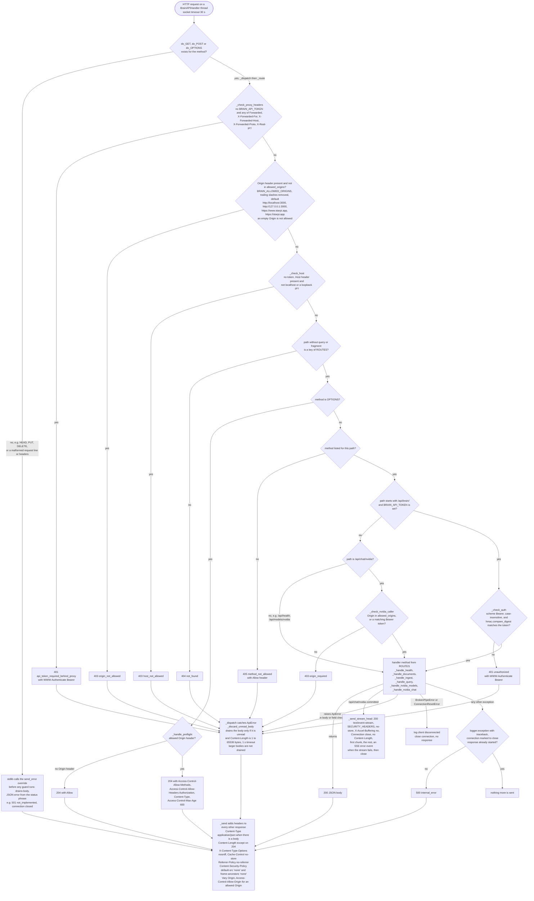
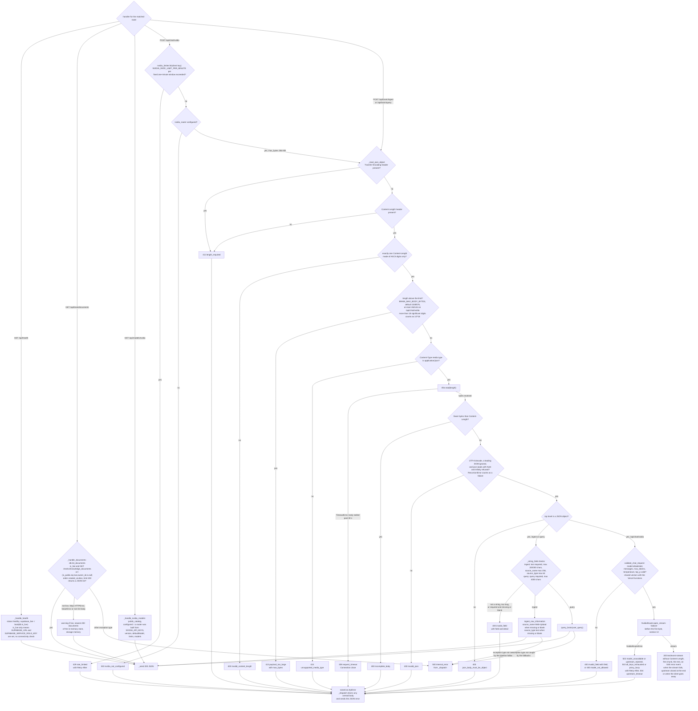
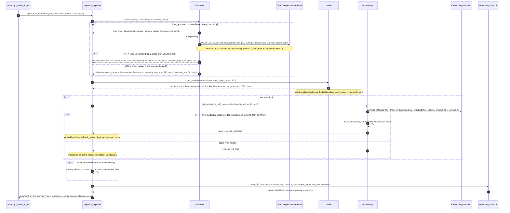
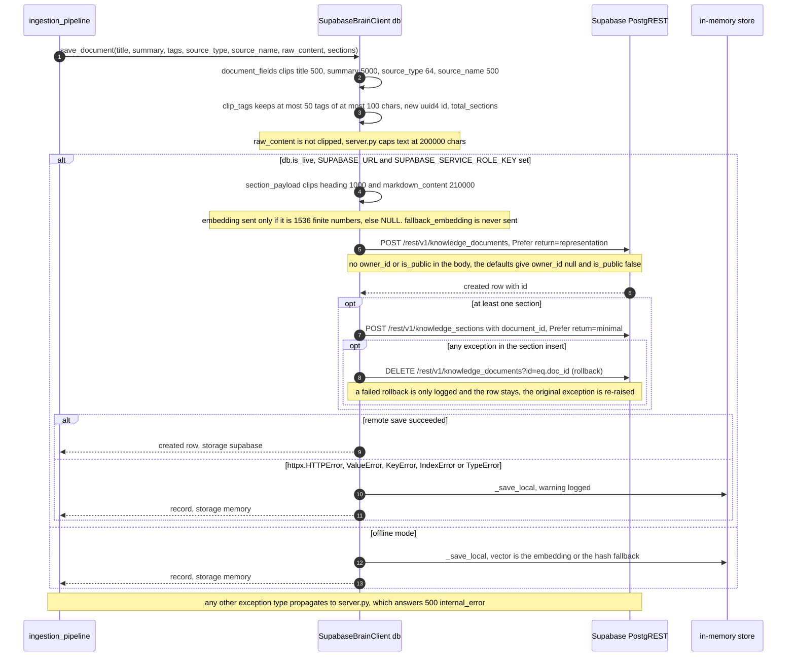
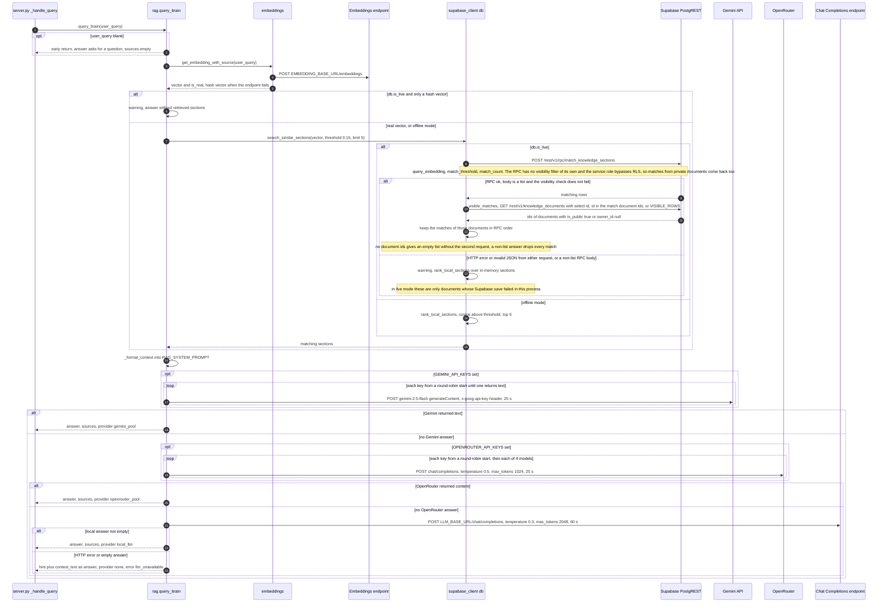
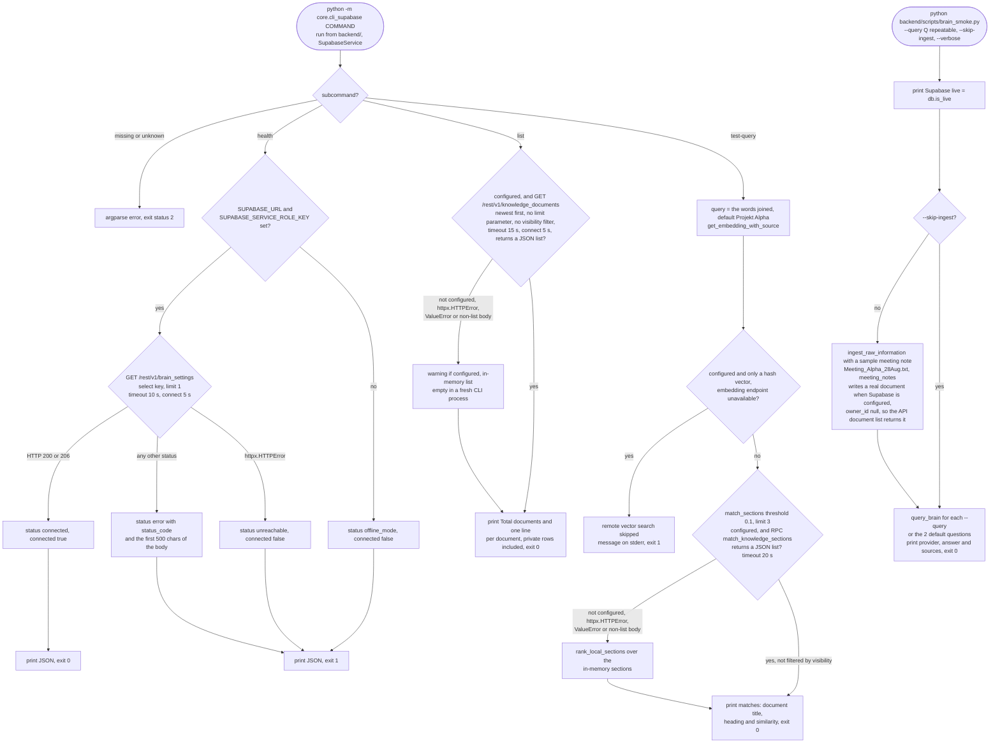

# Starpi backend (optional)

A dependency-light Python service for server-side ingestion and retrieval. It structures raw text
into Markdown sections, stores them with 1536-dimensional embeddings in Supabase and answers
questions over pgvector search. The browser app does not call its ingestion and retrieval routes:
the PWA reads Supabase directly with the anon key and row level security. The service also offers
the NVIDIA NIM routes of the Vercel Functions in [`api/`](../api), for hosts without Vercel; the
app calls them only on its own origin ([below](#nvidia-routes-on-the-apps-origin)).

The backend writes with the Supabase **service role key**, which bypasses RLS. Run it only on a
machine you control, keep it on `127.0.0.1` or behind a TLS reverse proxy with `BRAIN_API_TOKEN`
set, and never ship the service role key or the API token to a browser. The full set of backend
diagrams is in the [architecture atlas](../docs/ARCHITECTURE.md#10-optional-backend).

## Run locally

```bash
cd backend
python -m pip install -r requirements.txt
cp .env.example .env        # fill in the values you need, see below
python server.py            # 127.0.0.1:9200; override with: python server.py 9300 --host 127.0.0.1 --log-level DEBUG
```

Without `SUPABASE_URL` and `SUPABASE_SERVICE_ROLE_KEY` the service runs on an in-memory store,
which is enough for development and for the tests.

## Configuration

Values come from the process environment, then from `backend/.env` (or `.env` in the repository
root); the environment always wins, and within the file the last assignment of a key wins.
[`.env.example`](.env.example) documents every variable.

| Variable | Default | Purpose |
| --- | --- | --- |
| `SUPABASE_URL`, `SUPABASE_SERVICE_ROLE_KEY` | empty | Supabase project; both are required, and if either is empty documents are kept in memory only |
| `LLM_BASE_URL`, `LLM_API_KEY`, `LLM_MODEL` | `http://127.0.0.1:8000/v1`, `EMPTY`, `Qwen/Qwen2.5-7B-Instruct` | Chat Completions-compatible endpoint for structuring and answers |
| `GEMINI_API_KEYS`, `OPENROUTER_API_KEYS` | empty | Optional key pools, comma separated, tried before `LLM_BASE_URL` for answers |
| `NVIDIA_API_KEYS` | empty | Key pool of `POST /api/chat/nvidia`, comma separated, `nvapi-<64 characters>` per key; entries of another shape are ignored and only counted in the log. Empty: the route answers `503 nvidia_not_configured`. Never logged or returned |
| `NVIDIA_RATE_LIMIT_PER_MINUTE` | `20` | NVIDIA chat requests per client address and minute, counted in this process |
| `EMBEDDING_BASE_URL`, `EMBEDDING_API_KEY`, `EMBEDDING_MODEL` | `http://127.0.0.1:8000/v1`, `EMPTY`, see `.env.example` | `/v1/embeddings` endpoint returning 1536 dimensions; set the model your endpoint serves. Without the endpoint, sections are stored without embeddings |
| `BRAIN_SERVER_HOST`, `BRAIN_SERVER_PORT` | `127.0.0.1`, `9200` | Bind address; any non-loopback address requires `BRAIN_API_TOKEN` |
| `BRAIN_API_TOKEN` | empty | Bearer token for `/api/brain/*` (`openssl rand -hex 32`) |
| `BRAIN_ALLOWED_ORIGINS` | local dev servers and `starpi.app` | CORS allow-list, comma separated; also the pages that may call `POST /api/chat/nvidia` without the token |
| `BRAIN_MAX_BODY_BYTES` | `1048576` | Largest accepted request body |
| `BRAIN_LOG_LEVEL` | `INFO` | `DEBUG`, `INFO`, `WARNING` or `ERROR` |

## Endpoints

| Method and path | Token | Body | Response |
| --- | --- | --- | --- |
| `GET /api/health` | never | none | `{"status": "healthy", "supabase_live": bool}`; `supabase_live` only means URL and key are set |
| `GET /api/brain/documents` | when set | none | `{"documents": [...], "count": n}` |
| `POST /api/brain/ingest` | when set | `{"text": str, "source_name"?: str, "source_type"?: str}` (200000 / 256 / 64 characters) | document id, title, summary, tags, Markdown, section and embedding counts, storage |
| `POST /api/brain/query` | when set | `{"query": str}` (4000 characters) | `answer`, `sources`, `provider` (`gemini_pool`, `openrouter_pool` or `local_llm`); when no model answers, still 200 with `provider` `none`, `error` `llm_unavailable` and the retrieved context as `answer` |
| `GET /api/models/nvidia` | never | none | `{"configured": bool, "version": 1, "defaultModel", "limits", "models": [...]}`: the allowlist from [`core/nvidia_catalog.json`](core/nvidia_catalog.json) and whether `NVIDIA_API_KEYS` holds a key, never a key or their number |
| `POST /api/chat/nvidia` | an `Origin` from `BRAIN_ALLOWED_ORIGINS`, or the token | `{"model", "messages", "max_tokens"?, "temperature"?, "top_p"?}` (256 KiB, validated like the Vercel Function) | `text/event-stream`: the upstream stream, which ends when the connection closes (HTTP/1.0, no `Content-Length`); a stream that fails ends with `data: {"error":{"code":"stream_timeout"}}` (or `stream_too_large`, `upstream_interrupted`) |

Rejected requests get a 4xx or 5xx status and a JSON object with an `error` code. Every response,
including errors, carries the security headers. The NVIDIA chat route answers with the codes of
the Vercel Function: `403 origin_required` without an allowed `Origin` or the token,
`429 rate_limited` and `503 all_keys_exhausted` with `Retry-After`, `503 nvidia_not_configured`,
`400 invalid_field` (with `field`) or `model_not_allowed`, `502 model_unavailable` or
`upstream_rejected`, and `504 upstream_timeout`. Two of its codes do not occur on Vercel:
`411 length_required` for a body without `Content-Length` (as on every POST route here), and
`503 proxy_busy` (with `Retry-After`) when all connections of the shared upstream client are in
use.

## NVIDIA routes on the app's origin

The app's NVIDIA client calls `/api/models/nvidia` and `/api/chat/nvidia` on the origin the page
was loaded from and sends no key, so it can use this backend only when one host serves both the
app and these two routes. The EC2 setup in [aws/cloud_architecture.md](aws/cloud_architecture.md)
serves the API on an origin of its own (`api.example.com`), which the app does not call. A reverse
proxy in front of the built app (`npm run build`, then `dist/`) can serve both, for example Caddy:

```caddyfile
app.example.com {
    handle /api/chat/nvidia* {
        reverse_proxy 127.0.0.1:9200 {
            flush_interval -1
        }
    }
    handle /api/models/nvidia {
        reverse_proxy 127.0.0.1:9200
    }
    handle {
        root * /srv/starpi/dist
        file_server
    }
}
```

`flush_interval -1` passes every chunk of the stream on at once. Only the two NVIDIA paths reach
the backend; `/api/brain/*` stays off the app's origin. Behind such a proxy:

- `BRAIN_API_TOKEN` must be set: without it the backend refuses every request that carries the
  proxy's `X-Forwarded-*` headers (401 `api_token_required_behind_proxy`).
- `BRAIN_ALLOWED_ORIGINS` must contain the app's origin (`https://app.example.com`), which the
  browser sends as `Origin` with the chat request.
- The rate limit counts the right-most `X-Forwarded-For` entry, the address the proxy added, when
  a token is set and the request comes from a loopback address; otherwise the socket address.
- `file_server` does not add the app's response headers (the Content-Security-Policy and the
  others in [`vercel.json`](../vercel.json)); add them with Caddy's `header` directive, so the app
  runs under the same policy as on Vercel.

The model list is [`core/nvidia_catalog.json`](core/nvidia_catalog.json), a generated copy of
[`src/js/models/nvidia-catalog.js`](../src/js/models/nvidia-catalog.js) (`npm run nvidia:sync`;
a unit test fails when it is outdated), so the backend runs from `backend/` alone. A local check
without a proxy and without a token, as a page of an allowed origin calls the route:

```bash
curl http://127.0.0.1:9200/api/models/nvidia
curl -N http://127.0.0.1:9200/api/chat/nvidia \
  -H 'Origin: http://localhost:3000' -H 'Content-Type: application/json' \
  -d '{"model": "nvidia/nemotron-3.5-lightning-30b-a3b", "messages": [{"role": "user", "content": "Hello"}], "max_tokens": 64}'
```

## Request handling

Every request passes the same guards in a fixed order before a handler runs:

<!-- diagram: backend-request-routing -->


JSON bodies are bounded and validated before any work starts:

<!-- diagram: backend-request-body -->


Start-up refuses unsafe configurations:

```mermaid
flowchart TD
    Start(["python server.py [port] [--host HOST] [--log-level LEVEL]"]) --> Env["import core.config<br/>loads backend/.env, else the repo-root .env<br/>parse_env_line: an export prefix is dropped,<br/>a quoted value ends at its matching quote,<br/>an unquoted value drops a whitespace # comment<br/>last assignment of a key in the file wins<br/>variables already in the environment win<br/>an unreadable file is logged and skipped"]
    Env --> Cfg["config = BrainConfig()<br/>BRAIN_SERVER_HOST default 127.0.0.1<br/>BRAIN_SERVER_PORT default 9200"]
    Cfg --> Int{"BRAIN_SERVER_PORT, BRAIN_MAX_BODY_BYTES or<br/>NVIDIA_RATE_LIMIT_PER_MINUTE not an integer,<br/>or the rate limit below 1?"}
    Int -->|"yes"| IntW["warning, default value used"]
    Int -->|"no"| LL
    IntW --> LL{"_env_log_level<br/>BRAIN_LOG_LEVEL value?"}
    LL -->|"empty"| LInfo["log_level INFO"]
    LL -->|"not DEBUG, INFO,<br/>WARNING or ERROR"| LWarn["warning without the raw value<br/>log_level INFO"]
    LL -->|"valid, case-insensitive"| LSet["log_level = that level"]
    LInfo --> Db
    LWarn --> Db
    LSet --> Db
    Db["server.py imports core.supabase_client<br/>db = SupabaseBrainClient()<br/>is_live = SUPABASE_URL and SUPABASE_SERVICE_ROLE_KEY<br/>both set, no network call<br/>core.nvidia loads core/nvidia_catalog.json"] --> Args
    Args{"main(): argparse<br/>--log-level upper-cased, one of LOG_LEVELS,<br/>default config.log_level<br/>port, if given, an integer?"}
    Args -->|"no"| ArgErr["argparse error, exit status 2"]
    Args -->|"yes"| Basic["logging.basicConfig(level)"]
    Basic --> Host["run_server<br/>host = --host or BRAIN_SERVER_HOST<br/>port = argument or BRAIN_SERVER_PORT"]
    Host --> Loop{"host is not localhost or a loopback IP<br/>and BRAIN_API_TOKEN is empty?"}
    Loop -->|"yes"| Refuse["log error, raise SystemExit(2)"]
    Loop -->|"no"| TokLen{"token set but shorter<br/>than 32 characters?"}
    TokLen -->|"yes"| TokW["warning"]
    TokLen -->|"no"| Bind
    TokW --> Bind["create_server: BrainHTTPServer (ThreadingHTTPServer)<br/>daemon_threads False, request threads not daemonic<br/>build_router(NVIDIA_API_KEYS): warning with the count of<br/>malformed entries, info NVIDIA key pool: n keys,<br/>None without a valid key, RateLimiter per client<br/>AF_INET6 when the host contains a colon<br/>server_bind skips the reverse DNS lookup"]
    Bind -->|"OSError, e.g. address in use"| BindErr["not caught: traceback, exit status 1"]
    Bind --> Sig{"running in the main thread?"}
    Sig -->|"yes"| SigT["install SIGTERM handler: logs Received SIGTERM,<br/>httpd.shutdown in a daemon thread"]
    Sig -->|"no"| Listen
    SigT --> Listen["log Brain API listening<br/>with supabase_live, token_auth and nvidia"]
    Listen --> Live{"db.is_live?"}
    Live -->|"no"| MemW["warning: Supabase is not configured,<br/>documents are kept in memory only"]
    Live -->|"yes"| Serve
    MemW --> Serve["serve_forever"]
    Serve -->|"SIGTERM shutdown or KeyboardInterrupt"| Close["finally: server_close<br/>joins the non-daemon request threads,<br/>so requests in flight finish first"]
```

<!-- diagram: backend-request-startup -->


## Pipelines

Ingestion structures the text, chunks it and embeds each section:

<!-- diagram: backend-pipelines-ingest -->


On Supabase, a document whose sections cannot be inserted is deleted again (best effort: a failed
rollback is only logged and the row stays). A failed remote save falls back to the in-memory store:

<!-- diagram: backend-pipelines-storage -->


Queries embed the question, search pgvector and ask the answer providers in order:

<!-- diagram: backend-pipelines-query -->


## Command line

<!-- diagram: backend-pipelines-cli -->


## Tests

```bash
python -m pip install -r requirements-dev.txt
ruff check . && ruff format --check .
python -m unittest discover -s . -p 'test_*.py'
```

The unit tests run offline: calls to external services are mocked or replaced with fakes, and the
server tests send real HTTP requests to a server started on `127.0.0.1` with an ephemeral port.
`test_nvidia.py` and the NVIDIA tests in `test_server.py` answer for NVIDIA with
`httpx.MockTransport` (key rotation, cooldowns, timeouts, the stream relay, and that no key is
logged), and `test_nvidia.py` runs the validation cases in `test_fixtures/nvidia_validation.json`,
which the JavaScript proxy tests run as well. `scripts/brain_smoke.py` is a manual end-to-end
check against live endpoints. The database policies are tested separately with
`supabase/tests/run_rls_tests.sh` (see [supabase/README.md](supabase/README.md)).

## Deployment

[aws/cloud_architecture.md](aws/cloud_architecture.md) describes the EC2 deployment with
`remote_sync.sh` and `aws/deploy_ec2.sh`, the reverse proxy and operations.
