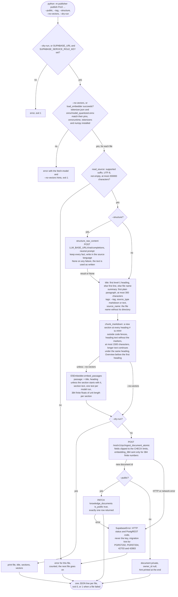

# Starpi backend: database and library publisher

Starpi runs in the browser and reads its shared knowledge library from Supabase with the public key
and row level security. This directory holds what sits behind that:

| Path | Purpose |
| --- | --- |
| [`supabase/`](supabase/README.md) | Schema, migrations and the RLS test suite of the Supabase project |
| [`../tools/library-publisher/`](../tools/library-publisher) | The library publisher: a Python command line tool that writes documents, sections and their 384-dimensional vectors with the service role key ([below](#library-publisher)) |
| [`test_fixtures/nvidia_validation.json`](test_fixtures/nvidia_validation.json) | Request validation cases of the NVIDIA proxy, run by `tests/unit/nvidia-proxy.test.mjs` |
| `requirements-dev.txt` | Includes the publisher's development requirements, for the dependency audit |
| `pyproject.toml` | ruff settings for `supabase/apply_migration.py` |

## What changed in 3.0

The Python HTTP service is gone: `server.py` with its `/api/brain/*` routes (the app never called
them), its copy of the NVIDIA proxy routes with the mirrored model list, and the EC2 deployment
scripts. What it did is covered elsewhere:

- **Self-hosting the app with the NVIDIA routes:** build the app (`npm run build`) and serve it
  together with the functions of [`api/`](../api), by the route table of `vercel.json`, with
  `node scripts/serve.mjs --functions` (`npm run preview` does this on port 3000), behind a TLS
  reverse proxy. The server answers the routes for `localhost`, IP addresses and the hosts of
  `STARPI_ALLOWED_ORIGINS` (or its aliases `NVIDIA_ALLOWED_ORIGINS` and `RELAY_ALLOWED_ORIGINS`),
  and it passes no forwarding headers on to the functions, so behind a proxy every client counts
  towards one rate limit.
- **Ingestion:** the publisher keeps the pipeline (structuring, chunking, storage through
  `ingest_document_atomic`) and computes multilingual-e5-small vectors on the operator's machine
  instead of calling a 1536-dimension embedding endpoint.
- **Answers over the library:** the app retrieves and answers itself, with the model the user
  picked.

## Library publisher

The publisher reads text and Markdown files, splits them into heading-based sections, embeds each
section with multilingual-e5-small (384 dimensions, the model the browser uses for its query
vectors) and stores document and sections in one transaction. It runs on a machine you control,
opens no port and holds the Supabase **service role key**, which bypasses RLS: keep that key in
`tools/library-publisher/.env` (mode 600) or the process environment, never in a browser.

<!-- diagram: publisher-pipeline -->


The full set of diagrams (vectors, service role reads, trust boundary) is in
[section 10 of the architecture atlas](../docs/ARCHITECTURE.md#10-library-publisher).

### Set up

Python 3.11 or newer. From the repository root:

```bash
cd tools/library-publisher
python3 -m venv .venv && . .venv/bin/activate
python -m pip install -r requirements.txt -r requirements-embed.txt
cp .env.example .env && chmod 600 .env     # SUPABASE_URL, SUPABASE_SERVICE_ROLE_KEY
python -m publisher fetch-model            # about 135 MB, checked against SHA-256 pins
python -m publisher health                 # exit 0 when Supabase answers and embedding_384 exists
```

`requirements-embed.txt` (ONNX Runtime, tokenizers, numpy) is only needed for vectors; without it
`publish --no-vectors`, `list` and `health` still work. The vectors need the optional migration
[`supabase/migrations/20261101000000_embedding_384.sql`](supabase/migrations/20261101000000_embedding_384.sql)
(or a fresh `full_schema.sql`); `health` and every command that needs the column point to it when it
is missing.

| Variable | Default | Purpose |
| --- | --- | --- |
| `SUPABASE_URL`, `SUPABASE_SERVICE_ROLE_KEY` | empty | Supabase project and its service role key; never the anon key |
| `PUBLISHER_MODEL_DIR` | `tools/library-publisher/models/multilingual-e5-small` (git-ignored) | Where `fetch-model` writes and every command reads the model files |
| `LLM_BASE_URL`, `LLM_API_KEY`, `LLM_MODEL` | `http://127.0.0.1:8000/v1`, `EMPTY`, `Qwen/Qwen2.5-7B-Instruct` | Chat Completions endpoint, used only by `publish --structure` |

Values come from the process environment, then from `tools/library-publisher/.env`; the
environment always wins, and within the file the last assignment of a key wins.

### Commands

Run from `tools/library-publisher` as `python -m publisher COMMAND` (the same as
`python -m publisher.cli_supabase`). Global options: `--model-dir DIR`, `--log-level LEVEL`.

| Command | What it does |
| --- | --- |
| `fetch-model [--base-url URL]` | Downloads `tokenizer.json` and `onnx/model_quantized.onnx` of `Xenova/multilingual-e5-small` at a pinned revision; a file is kept only when its size and SHA-256 match the pin, and valid files are not downloaded again |
| `health` | Checks the REST API, the key and the `embedding_384` column |
| `publish FILE... [--public] [--tag T]... [--structure] [--no-vectors] [--dry-run]` | Stores each UTF-8 `.md`, `.markdown`, `.txt` or `.text` file (at most 200000 characters) as one document. Documents stay private until `--public` publishes them. `--structure` lets the chat model rewrite the text first; without it the text is stored as written, so citations in the app match the file. `--dry-run` embeds and prints without writing |
| `backfill [--limit N] [--dry-run]` | Adds `embedding_384` to shared-library sections that have none, for example documents stored with `--no-vectors` or before the migration |
| `test-query QUESTION... [--count N]` | Embeds the question as the browser does and prints the closest shared-library sections |
| `list [--limit N]` | Lists the newest shared-library documents |

Each command prints JSON lines on stdout and messages on stderr. The exit status is 0 on success, 1
when a command or one of the files failed, and 2 for invalid arguments.

### Vectors

- **Model:** the q8 ONNX export `Xenova/multilingual-e5-small` of `intfloat/multilingual-e5-small`,
  the same weights the browser loads with Transformers.js. Vectors from other weights would have
  384 dimensions too but rank worse against the browser's query vectors.
- **Prefixes:** sections are embedded as `passage: ` + document title, heading and text; questions
  as `query: ` + question.
- **Pooling:** the last hidden states are averaged over the attention mask and L2-normalised, so the
  cosine similarity is a dot product. Texts are truncated at 512 tokens; sections are at most 1500
  characters.
- **One text per run:** the q8 export quantises activations per run, so in a batch each vector would
  depend slightly on its neighbours and on the padding.
- **Parity:** a test compares the vectors with ones Transformers.js 4.3.0 computed for the same texts;
  the cosine similarity must stay above 0.99 (the ONNX Runtime builds round slightly differently).

### What the service role key touches

The key bypasses RLS, so the publisher limits itself:

- Every read is restricted to the shared library: documents that are published (`is_public`) or
  have no owner (written with the service role). Private rows of browser sessions are never read,
  not even by `backfill`.
- Writes go through `ingest_document_atomic` (document and sections in one transaction, the document
  private and without owner), a `PATCH` of `is_public` for `--public` and a `PATCH` of
  `embedding_384` per section for `backfill`.
- Fields are clipped to the database's CHECK limits, so a long title or heading cannot make an insert
  fail half way.
- Error messages carry the HTTP status and the PostgREST code, never the key.

## Tests

```bash
cd tools/library-publisher
python -m pip install -r requirements-dev.txt
ruff check . ../../backend && ruff format --check . ../../backend
python -m unittest discover -v          # or: python -m pytest
```

The tests run offline: Supabase, the chat model and the model hub are answered by
`httpx.MockTransport`, and the embedder runs against a fake tokenizer and a fake ONNX session (those
tests need numpy and are skipped without it). The test against the real model runs only when
`PUBLISHER_TEST_MODEL_DIR` points at the files `fetch-model` wrote. The database policies are tested
with `supabase/tests/run_rls_tests.sh` (see [supabase/README.md](supabase/README.md#tests)).
