# Starpi architecture

This atlas describes how Starpi works, one diagram per question a contributor or reviewer is likely
to ask. Every diagram was drawn from the source files listed under it and then checked against the
code line by line: names, guards, limits and failure paths are the ones in the code, not an
idealised design. When the code changes, change the diagram in the same pull request.

- **Rendering:** GitHub renders the diagrams. CI parses and renders every Mermaid block in the
  repository's Markdown files with the pinned Mermaid release (`tests/e2e/docs-diagrams.spec.mjs`),
  so a broken diagram fails the build.
- **Single source:** this file is the only place a diagram is edited. The README and the guides embed
  some of them as exact copies under the same `<!-- diagram: <id> -->` marker: `npm run docs:sync`
  refreshes the copies, and `tests/unit/docs.test.mjs` fails when a copy differs from this file.
- **Conventions:** dashed nodes and edges are optional, manual or outside Starpi's control. Mode names
  follow the UI: *on-device* is the `client` mode (a WebGPU or a processor (WASM) model), *cloud
  assistant* is `council`, *own server* is `local` and *NVIDIA NIM cloud* is `nvidia`. The chat modes
  are *verified source mode* (`grounded`) and *free chat* (`free`).

## Contents

1. [System overview](#1-system-overview)
   - [System context and trust boundaries](#system-context-and-trust-boundaries)
   - [What leaves the device: connection state](#what-leaves-the-device-connection-state)
   - [What leaves the device: one chat turn](#what-leaves-the-device-one-chat-turn)
   - [Library publisher trust boundary](#library-publisher-trust-boundary)
   - [Frontend import graph (1 of 4): main.js and its application imports](#frontend-import-graph-1-of-4-mainjs-and-its-application-imports)
   - [Frontend import graph (2 of 4): imports made by the feature views and the model pickers](#frontend-import-graph-2-of-4-imports-made-by-the-feature-views-and-the-model-pickers)
   - [Frontend import graph (3 of 4): chat pipeline, workspace client and on-device engine](#frontend-import-graph-3-of-4-chat-pipeline-workspace-client-and-on-device-engine)
   - [Frontend import graph (4 of 4): demo, source check, receipts and core/](#frontend-import-graph-4-of-4-demo-source-check-receipts-and-core)
   - [Shared infrastructure modules, their importers and npm packages](#shared-infrastructure-modules-their-importers-and-npm-packages)
   - [Bundle entry points, Web Workers and lazy imports](#bundle-entry-points-web-workers-and-lazy-imports)
2. [Boot and settings](#2-boot-and-settings)
   - [boot(): module start-up order](#boot-module-start-up-order)
   - [Boot-time changeEngine: cached model only, never a download](#boot-time-changeengine-cached-model-only-never-a-download)
   - [connect(), connection subscribers and restoreHistory](#connect-connection-subscribers-and-restorehistory)
   - [restoreHistory: merging synced and on-device messages](#restorehistory-merging-synced-and-on-device-messages)
   - [saveSettings: server URL, API keys and a pending assistant pick](#savesettings-server-url-api-keys-and-a-pending-assistant-pick)
   - [changeEngine, clearKeys and deleteModelCache](#changeengine-clearkeys-and-deletemodelcache)
   - [deleteHistory: deleting the chat history](#deletehistory-deleting-the-chat-history)
   - [testProvider: Gemini and OpenRouter connection tests](#testprovider-gemini-and-openrouter-connection-tests)
3. [Answering a question](#3-answering-a-question)
   - [submitChat: from input to persisted answer](#submitchat-from-input-to-persisted-answer)
   - [retrieve(): knowledge-base decision tree per mode](#retrieve-knowledge-base-decision-tree-per-mode)
   - [Workspace hits and mergeHits: slots per source and the pinned file](#workspace-hits-and-mergehits-slots-per-source-and-the-pinned-file)
   - [Answer dispatch, synthesizer fallback, rendering and persistence](#answer-dispatch-synthesizer-fallback-rendering-and-persistence)
   - [Free chat and verified source mode: one turn in each chat mode](#free-chat-and-verified-source-mode-one-turn-in-each-chat-mode)
   - [NVIDIA cloud in the browser: catalog, streamed request and errors](#nvidia-cloud-in-the-browser-catalog-streamed-request-and-errors)
   - [After rendering: source check, receipt draft and conversation turns](#after-rendering-source-check-receipt-draft-and-conversation-turns)
   - [synthesizeAnswer: the extractive fallback](#synthesizeanswer-the-extractive-fallback)
   - [Answer modes: what leaves the device](#answer-modes-what-leaves-the-device)
   - [Council mode: Gemini then OpenRouter failover](#council-mode-gemini-then-openrouter-failover)
   - [Settings: server URL rules and key storage](#settings-server-url-rules-and-key-storage)
   - [Privacy notice under the chat input](#privacy-notice-under-the-chat-input)
   - [On-device model selection](#on-device-model-selection)
   - [Device tiers and the model pickers](#device-tiers-and-the-model-pickers)
   - [On-device prompt budgeting](#on-device-prompt-budgeting)
4. [On-device workspace and citations](#4-on-device-workspace-and-citations)
   - [On-device workspace: from file drop to the document list](#on-device-workspace-from-file-drop-to-the-document-list)
   - [ingest() in the worker: fingerprint, duplicate check, unique name and DocumentInfo](#ingest-in-the-worker-fingerprint-duplicate-check-unique-name-and-documentinfo)
   - [extractText: checks, text, JSON and CSV branches, normalization](#extracttext-checks-text-json-and-csv-branches-normalization)
   - [csvToText: CSV rows as column: value lines](#csvtotext-csv-rows-as-column-value-lines)
   - [pdfToText: pdf.js loading, page loop and limits](#pdftotext-pdfjs-loading-page-loop-and-limits)
   - [Workspace RPCs: search, head, context, text, remove, clear](#workspace-rpcs-search-head-context-text-remove-clear)
   - [verify-receipt: re-checking an answer receipt against the original files](#verify-receipt-re-checking-an-answer-receipt-against-the-original-files)
   - [Worker crash, Clear workspace and restart](#worker-crash-clear-workspace-and-restart)
   - [chunkText: sliding windows with exact offsets](#chunktext-sliding-windows-with-exact-offsets)
   - [Chunk boundary helpers: findBreak and safeBoundary](#chunk-boundary-helpers-findbreak-and-safeboundary)
   - [BM25Index: tokenize, add, remove and search](#bm25index-tokenize-add-remove-and-search)
   - [Citation labels, scopes and the fenced context](#citation-labels-scopes-and-the-fenced-context)
   - [From hits to a citation in the drawer](#from-hits-to-a-citation-in-the-drawer)
   - [linkifyCitations and the Sources row](#linkifycitations-and-the-sources-row)
   - [Attaching a file to the chat](#attaching-a-file-to-the-chat)
   - [Asking about an attached file](#asking-about-an-attached-file)
   - [Voice input with the Web Speech API](#voice-input-with-the-web-speech-api)
5. [On-device inference](#5-on-device-inference)
   - [On-device engine status machine](#on-device-engine-status-machine)
   - [loadModel: probe, choice, cache and storage checks](#loadmodel-probe-choice-cache-and-storage-checks)
   - [loadModel: WebLLM import, model record and partial cache](#loadmodel-webllm-import-model-record-and-partial-cache)
   - [loadModel: worker creation, progress phases and generation guards](#loadmodel-worker-creation-progress-phases-and-generation-guards)
   - [Processor (WASM) runtime: loading, pinned downloads, generation and Stop](#processor-wasm-runtime-loading-pinned-downloads-generation-and-stop)
   - [Diagnostics tab: WebGPU probe](#diagnostics-tab-webgpu-probe)
   - [Inference benchmark run](#inference-benchmark-run)
6. [Knowledge base views](#6-knowledge-base-views)
   - [Knowledge base tab: document list](#knowledge-base-tab-document-list)
   - [Knowledge base tab: document modal](#knowledge-base-tab-document-modal)
   - [Knowledge graph tab: loading, status and entity list](#knowledge-graph-tab-loading-status-and-entity-list)
   - [Knowledge graph tab: canvas drawing](#knowledge-graph-tab-canvas-drawing)
   - [Knowledge graph tab: selection and ask-entity](#knowledge-graph-tab-selection-and-ask-entity)
   - [Knowledge graph tab: new entities](#knowledge-graph-tab-new-entities)
7. [Languages, storage and offline](#7-languages-storage-and-offline)
   - [Locale boot and EN/DE switch](#locale-boot-and-ende-switch)
   - [How an element gets its translated text](#how-an-element-gets-its-translated-text)
   - [Tests that keep the dictionaries and keys consistent](#tests-that-keep-the-dictionaries-and-keys-consistent)
   - [localStorage, sessionStorage and the auth session](#localstorage-sessionstorage-and-the-auth-session)
   - [Caches and the on-device workspace](#caches-and-the-on-device-workspace)
   - [In-memory answer stores](#in-memory-answer-stores)
   - [Service worker fetch handler](#service-worker-fetch-handler)
   - [Service worker install, waiting and activate](#service-worker-install-waiting-and-activate)
   - [App update flow in the page](#app-update-flow-in-the-page)
8. [Supabase](#8-supabase)
   - [connect(): anonymous session and schema probe](#connect-anonymous-session-and-schema-probe)
   - [classifyError: mapping failures to error kinds](#classifyerror-mapping-failures-to-error-kinds)
   - [Database badge states (renderConnection)](#database-badge-states-renderconnection)
   - [Data access functions: callers, tables and failure paths](#data-access-functions-callers-tables-and-failure-paths)
   - [Chat sync: chat_history and the localStorage fallback](#chat-sync-chat_history-and-the-localstorage-fallback)
   - [Supabase schema: knowledge base and knowledge graph](#supabase-schema-knowledge-base-and-knowledge-graph)
   - [Supabase schema: chat history and settings](#supabase-schema-chat-history-and-settings)
   - [RLS decisions for documents, entities and relations](#rls-decisions-for-documents-entities-and-relations)
   - [RLS for sections, chat history and settings](#rls-for-sections-chat-history-and-settings)
   - [RPC EXECUTE grants and size limits](#rpc-execute-grants-and-size-limits)
   - [search_knowledge: full matches first, then shared terms](#search_knowledge-full-matches-first-then-shared-terms)
   - [Migration apply order and guards](#migration-apply-order-and-guards)
   - [run_rls_tests.sh scenarios and assertions](#run_rls_testssh-scenarios-and-assertions)
   - [What rls_test.sql asserts, in order](#what-rls_testsql-asserts-in-order)
9. [Security layers](#9-security-layers)
   - [Untrusted content on its way to the DOM](#untrusted-content-on-its-way-to-the-dom)
   - [Source-check panel and answer receipts](#source-check-panel-and-answer-receipts)
   - [Worker isolation, RLS, key handling, CSP and the build gate](#worker-isolation-rls-key-handling-csp-and-the-build-gate)
   - [Publisher secrets, service role reads and CI supply chain](#publisher-secrets-service-role-reads-and-ci-supply-chain)
10. [Library publisher](#10-library-publisher)
    - [Publishing a file: sections, vectors and one atomic insert](#publishing-a-file-sections-vectors-and-one-atomic-insert)
    - [Vectors: the model of the browser, pinned and verified](#vectors-the-model-of-the-browser-pinned-and-verified)
    - [Service role reads: health, list, backfill and test-query](#service-role-reads-health-list-backfill-and-test-query)
11. [Build, test and deploy](#11-build-test-and-deploy)
    - [npm run build (scripts/build.mjs)](#npm-run-build-scriptsbuildmjs)
    - [Build output gate (verify-dist.mjs)](#build-output-gate-verify-distmjs)
    - [Dev watch mode and the local static server](#dev-watch-mode-and-the-local-static-server)
    - [Command-line tools beside the build](#command-line-tools-beside-the-build)
    - [CI jobs and the test layers they run](#ci-jobs-and-the-test-layers-they-run)
    - [Unit tests grouped by concern](#unit-tests-grouped-by-concern)
    - [Unit tests for the source check, receipts and sample files](#unit-tests-for-the-source-check-receipts-and-sample-files)
    - [End-to-end tests with mocked Supabase and diagnostics](#end-to-end-tests-with-mocked-supabase-and-diagnostics)
    - [End-to-end tests for the source check, receipts and accessibility](#end-to-end-tests-for-the-source-check-receipts-and-accessibility)
    - [CI workflow triggers, jobs and Dependabot](#ci-workflow-triggers-jobs-and-dependabot)
    - [Frontend and end-to-end jobs](#frontend-and-end-to-end-jobs)
    - [Backend, database, audit and secret-scanning jobs](#backend-database-audit-and-secret-scanning-jobs)
    - [Release workflow after CI](#release-workflow-after-ci)
    - [CI workflow and Vercel build of the PWA and the NVIDIA functions](#ci-workflow-and-vercel-build-of-the-pwa-and-the-nvidia-functions)
    - [Supabase schema: fresh install or ordered migrations](#supabase-schema-fresh-install-or-ordered-migrations)
12. [Source check, answer receipts and sample files](#12-source-check-answer-receipts-and-sample-files)
    - [Source check: from the rendered answer to the panel](#source-check-from-the-rendered-answer-to-the-panel)
    - [checkSentence: when a statement is checked, its reasons and its verdict](#checksentence-when-a-statement-is-checked-its-reasons-and-its-verdict)
    - [checkV2: negations, names and values in another place](#checkv2-negations-names-and-values-in-another-place)
    - [Facts: strict claims, lenient excerpts and how they are matched](#facts-strict-claims-lenient-excerpts-and-how-they-are-matched)
    - [Answer receipts: fingerprints, draft, dialog and download](#answer-receipts-fingerprints-draft-dialog-and-download)
    - [Receipts v2: Merkle tree, inclusion proofs and signature](#receipts-v2-merkle-tree-inclusion-proofs-and-signature)
    - [Deterministic citation verification and receipt flow](#deterministic-citation-verification-and-receipt-flow)
    - [Re-checking a receipt in the app and on the command line](#re-checking-a-receipt-in-the-app-and-on-the-command-line)
    - [starpi-ground: from arguments to exit code](#starpi-ground-from-arguments-to-exit-code)
    - [Sample files and the source-check demo](#sample-files-and-the-source-check-demo)
13. [NVIDIA cloud proxy](#13-nvidia-cloud-proxy)
    - [NVIDIA proxy: request guards and limits](#nvidia-proxy-request-guards-and-limits)
    - [NVIDIA proxy: key rotation and failover before the first byte](#nvidia-proxy-key-rotation-and-failover-before-the-first-byte)
    - [NVIDIA proxy: relaying the stream to the browser](#nvidia-proxy-relaying-the-stream-to-the-browser)
    - [One model allowlist for the app and the functions](#one-model-allowlist-for-the-app-and-the-functions)

## 1. System overview

Where each part of Starpi runs, which trust boundary it sits behind, and how the frontend modules depend on each other. The browser tab is the trusted zone; Supabase, model providers, Starpi's NVIDIA proxy, the optional library publisher, model downloads and the browser's speech recognition are reached across explicit boundaries.

### System context and trust boundaries

The browser tab is the trusted zone: the main thread, the three Web Workers (starpi-webllm for WebLLM inference on WebGPU, starpi-wasm for Transformers.js on the processor, started only for a processor model, and starpi-ingest for parsing, hashing and BM25), the service worker and per-origin storage all live there. Vercel serves the static files with the vercel.json headers (CSP, HSTS, COOP, X-Frame-Options, Permissions-Policy) and runs two Node.js functions, api/models/nvidia.js and api/chat/nvidia.js, which keep the NVIDIA_API_KEYS pool in the server environment: the browser calls them on its own origin without any key, and they forward a validated request to NVIDIA's API with a key from the pool. Supabase is reached only with the public key (a publishable sb_publishable_ key or a JWT with role anon; scripts/lib/supabase-key.mjs makes the build refuse an empty key, sb_secret_ keys, JWTs with any other role and anything that is neither) plus an anonymous session JWT, so role grants and RLS decide what each caller can read or write, and the RPC functions are SECURITY INVOKER. The optional library publisher, a command line tool on a machine the operator controls, is the only component that holds the service_role key; the browser never talks to it, and because the key bypasses RLS, the publisher limits its own reads to rows that are public or have no owner (rows written with the service role), so private rows of browser sessions do not leave through it. The source check and the answer receipts are computed in the tab, a receipt loaded for verification is checked in the ingestion worker, and neither is sent anywhere; a receipt leaves the tab only as a JSON file the user downloads. Dashed nodes are third-party services outside Starpi control, including the browser's speech recognition, which in client mode voice.js uses only where the browser offers on-device recognition (processLocally). Because cross-origin requests bypass sw.js, model files are cached only in the Cache API buckets of WebLLM and of Transformers.js (transformers-cache); the self-hosted ONNX Runtime binary is a hashed /assets file. A new sw.js version takes over at install only when no window of the app is open; otherwise it waits until those windows close or a page posts a SKIP_WAITING message (the app itself sends none), and a navigation answered with the cached shell after the 3.5 s deadline does not store the late network response as the new shell.

<!-- diagram: system-context-overview -->
```mermaid
flowchart LR
    subgraph device["User device: browser tab on www.starpi.app, CSP enforced"]
        subgraph mainThread["Main thread, src/js"]
            boot["main.js boot()<br/>chat.js, settings.js, model-picker.js,<br/>demo.js, UI modules"]
            sbClient["supabase.js createClient<br/>public key compiled in: publishable or anon JWT,<br/>build refuses sb_secret_ keys, non-anon JWTs<br/>and any other key, fetchWithTimeout 12 s, db retry off"]
            provJs["providers.js<br/>callGemini, callOpenRouter,<br/>callLocalServer, probeLocalServer,<br/>getNvidiaCatalog, callNvidia"]
            engineJs["webgpu/engine.js<br/>loadModel, generate, unloadModel,<br/>getDeviceProbe, WebGPU or WASM runtime"]
            wsJs["rag/workspace.js<br/>request(type, payload)"]
            trustJs["rag/grounding-view.js, rag/receipts.js<br/>source check and receipt drafts,<br/>computed and kept in memory"]
            voiceJs["voice.js<br/>Web Speech API, processLocally<br/>required in client mode"]
        end
        subgraph llmWorker["Web Worker starpi-webllm"]
            mlc["webgpu/worker.js<br/>WebWorkerMLCEngineHandler<br/>inference on WebGPU"]
        end
        subgraph wasmWorker["Web Worker starpi-wasm"]
            wasmw["wasm/worker.js<br/>Transformers.js 4.3.0, ONNX Runtime WASM,<br/>one thread, catalog models only,<br/>env.fetch pinned to the model revision"]
        end
        subgraph ingestWorker["Web Worker starpi-ingest"]
            ingest["rag/ingest.worker.js, rag/workspace-core.js<br/>extractText with pdf.js, chunkText,<br/>BM25Index rebuilt from stored chunks,<br/>hybrid search, SHA-256 of file and text, verify-receipt"]
        end
        sw["sw.js service worker<br/>same-origin GET only,<br/>cross-origin requests bypass it,<br/>a new version skips waiting only<br/>when no window is open"]
        subgraph browserStores["Per-origin browser storage"]
            ls[("localStorage<br/>starpi_local_chats_v1, starpi_chat_session_id,<br/>starpi_compute_mode, starpi_webgpu_model,<br/>starpi_nvidia_model, starpi_chat_mode,<br/>starpi_llm_url, starpi_relay_fallback,<br/>starpi_transport_*, starpi_locale,<br/>starpi-auth session")]
            ss[("sessionStorage<br/>provider keys for this tab;<br/>kept longer only in the encrypted<br/>key vault (IndexedDB keyvault)")]
            swCache[("CacheStorage<br/>starpi-shell-VERSION, starpi-assets")]
            modelCache[("Cache API owned by WebLLM<br/>webllm/model, webllm/config, webllm/wasm")]
            tfCache[("Cache API owned by Transformers.js<br/>transformers-cache")]
        end
    end

    subgraph vercel["Vercel: static hosting and two functions"]
        host["dist/: index.html, hashed /assets/*, sw.js,<br/>build-manifest.json, public files such as /samples/*<br/>vercel.json headers on every path:<br/>CSP script-src self and wasm-unsafe-eval,<br/>connect-src self, data:, https:, wss://*.supabase.co,<br/>http://localhost:* and http://127.0.0.1:*<br/>HSTS, COOP same-origin, X-Frame-Options DENY,<br/>nosniff, Referrer-Policy,<br/>Permissions-Policy microphone self only"]
        fn["api/models/nvidia.js, api/chat/nvidia.js<br/>Node.js functions, NVIDIA_API_KEYS only in<br/>the server environment, same-origin check,<br/>rate limit, model allowlist, size caps"]
    end

    subgraph supabase["Supabase project: access decided by roles and RLS"]
        auth["Auth<br/>anonymous sign-in, session JWT"]
        rest["PostgREST<br/>/rest/v1 tables and /rest/v1/rpc"]
        subgraph pg["Postgres, RLS enabled on every table"]
            tables[("knowledge_documents, knowledge_entities,<br/>knowledge_relations: read is_public or owner_id = auth.uid(),<br/>knowledge_sections: visible with their document,<br/>writes only to own private rows<br/>chat_history: owner only, no anon grant<br/>brain_settings: no policy, service_role only")]
            rpcFns["SECURITY INVOKER functions<br/>search_knowledge: anon, authenticated, service_role<br/>match_knowledge_vector_384, optional migration:<br/>anon, authenticated, service_role<br/>match_knowledge_sections, match_knowledge_hybrid:<br/>authenticated, service_role<br/>ingest_document_atomic: service_role only"]
        end
    end

    subgraph backendHost["Optional library publisher, operator machine"]
        brain["tools/library-publisher<br/>python -m publisher, no listener:<br/>publish, backfill, list, test-query"]
    end

    subgraph thirdParty["Third-party services outside Starpi control"]
        gemini["Google Gemini<br/>gemini-2.5-flash:generateContent"]
        openrouter["OpenRouter<br/>/api/v1/chat/completions"]
        ownServer["Own Chat Completions server<br/>https anywhere, http only on<br/>localhost or 127.0.0.1"]
        nvidia["NVIDIA API<br/>integrate.api.nvidia.com/v1/chat/completions"]
        hf["Hugging Face<br/>huggingface.co/mlc-ai weights,<br/>WASM model repositories at pinned revisions"]
        ghLibs["raw.githubusercontent.com<br/>binary-mlc-llm-libs wasm"]
        speech["Browser speech recognition<br/>vendor servers in most browsers"]
        backendApis["Publisher upstreams<br/>Hugging Face model files at a pinned revision,<br/>LLM_BASE_URL only for publish --structure"]
    end

    host -->|"app shell, hashed assets and<br/>public files with security headers"| sw
    sw -->|"navigations network-first, cached shell<br/>after 3.5 s or on failure,<br/>/assets/* and precache cache-first"| boot
    sw -->|"precache at install, / with cache reload,<br/>navigations store / again only as<br/>non-redirected HTML and not after the<br/>cached shell was served, /assets/* put if cacheable()"| swCache
    boot -->|"register /sw.js, scope /"| sw
    boot -->|"GET /build-manifest.json no-store<br/>after controllerchange, update banner"| host
    boot -->|"settings, locale, chat fallback"| ls
    provJs -->|"readSecret"| ss
    sbClient -->|"persistSession, storageKey starpi-auth"| ls
    engineJs -->|"CreateWebWorkerMLCEngine,<br/>messages in, stream deltas out"| mlc
    engineJs -->|"certainlyNotCached, hasModelInCache,<br/>deleteModelAllInfoInCache"| modelCache
    engineJs -->|"WasmEngineClient: load, generate,<br/>interrupt, unload messages"| wasmw
    engineJs -->|"wasmCacheStatus,<br/>delete on Delete downloaded model data"| tfCache
    mlc -->|"read and write shards"| modelCache
    mlc -->|"GET weights if not cached,<br/>interactive loads only, after confirmDownload"| hf
    mlc -->|"GET model_lib wasm"| ghLibs
    wasmw -->|"read and write model files"| tfCache
    wasmw -->|"GET pinned files if not cached,<br/>interactive loads only, after confirmDownload"| hf
    wasmw -->|"GET /assets/ort-wasm-simd-threaded-hash.wasm,<br/>same origin"| host
    wsJs -->|"postMessage ingest, search, head,<br/>context, text, remove, verify-receipt,<br/>File structured-cloned"| ingest
    trustJs -->|"verifyReceiptFiles"| wsJs
    sbClient -->|"getSession, GET /auth/v1/settings,<br/>signInAnonymously unless<br/>anonymous sign-ins are off"| auth
    sbClient -->|"apikey public key, Bearer session JWT:<br/>select, insert, delete, rpc search_knowledge"| rest
    rest -->|"SQL as anon or authenticated"| tables
    rest -->|"rpc"| rpcFns
    rpcFns -->|"run as the caller role"| tables
    provJs -->|"x-goog-api-key header,<br/>prompt with retrieved excerpts<br/>or the free-chat conversation"| gemini
    provJs -->|"Bearer key, messages,<br/>failover over free models"| openrouter
    provJs -->|"messages, no key sent,<br/>GET /models probe"| ownServer
    provJs -->|"same-origin GET /api/models/nvidia,<br/>POST /api/chat/nvidia without a key,<br/>answer streamed back as SSE"| fn
    fn -->|"Bearer key from the pool,<br/>failover before the first byte"| nvidia
    voiceJs -->|"microphone audio, handled by the browser"| speech
    brain -->|"service_role key bypasses RLS:<br/>rpc ingest_document_atomic, PATCH is_public<br/>and embedding_384, reads kept to is_public or no owner"| rest
    brain -->|"fetch-model, chat/completions"| backendApis

    classDef external stroke-dasharray: 5 5
    class gemini,openrouter,ownServer,nvidia,hf,ghLibs,speech,backendApis external
```

<sub>Sources: [`README.md`](../README.md), [`src/js/main.js`](../src/js/main.js), [`src/js/supabase.js`](../src/js/supabase.js), [`src/js/providers.js`](../src/js/providers.js), [`src/js/storage.js`](../src/js/storage.js), [`src/js/state.js`](../src/js/state.js), [`src/js/config.js`](../src/js/config.js), [`src/js/i18n/index.js`](../src/js/i18n/index.js), [`src/js/settings.js`](../src/js/settings.js), [`src/js/model-picker.js`](../src/js/model-picker.js), [`src/js/voice.js`](../src/js/voice.js), [`src/js/demo.js`](../src/js/demo.js), [`src/js/rag/grounding-view.js`](../src/js/rag/grounding-view.js), [`src/js/rag/receipts.js`](../src/js/rag/receipts.js), [`src/js/webgpu/engine.js`](../src/js/webgpu/engine.js), [`src/js/webgpu/worker.js`](../src/js/webgpu/worker.js), [`src/js/wasm/client.js`](../src/js/wasm/client.js), [`src/js/wasm/worker.js`](../src/js/wasm/worker.js), [`src/js/models/wasm-catalog.js`](../src/js/models/wasm-catalog.js), [`src/js/rag/workspace.js`](../src/js/rag/workspace.js), [`src/js/rag/ingest.worker.js`](../src/js/rag/ingest.worker.js), [`src/sw.js`](../src/sw.js), [`vercel.json`](../vercel.json), [`api/chat/nvidia.js`](../api/chat/nvidia.js), [`api/models/nvidia.js`](../api/models/nvidia.js), [`api/_lib/handlers.js`](../api/_lib/handlers.js), [`scripts/build.mjs`](../scripts/build.mjs), [`scripts/lib/supabase-key.mjs`](../scripts/lib/supabase-key.mjs), [`tools/library-publisher/publisher/cli_supabase.py`](../tools/library-publisher/publisher/cli_supabase.py), [`tools/library-publisher/publisher/supabase_service.py`](../tools/library-publisher/publisher/supabase_service.py), [`backend/supabase/full_schema.sql`](../backend/supabase/full_schema.sql)</sub>

### What leaves the device: connection state

boot() awaits connect(), which is safe to call repeatedly because concurrent callers share one attempt. When navigator.onLine is false, connect() marks the connection offline without sending a request. Otherwise ensureSession() reuses a stored session; without one it first reads the public auth settings (GET /auth/v1/settings with the public key) and, when they say anonymous sign-ins are off, returns auth_disabled without sending a sign-in request; when that settings request times out (12 s), it returns the timeout error and skips the sign-in as well, so the attempt does not wait a second time for a project that does not answer; otherwise, also when the settings say nothing about anonymous sign-ins or the request fails in another way, it calls signInAnonymously(). A probe then reads knowledge_documents for the is_public column. The result sets status, signedIn (no authError) and hardened (probe ok), a result that is not offline resets the back-off, and every change reaches the onConnectionChange listeners that main.js registers. Every Supabase request goes through fetchWithTimeout (12 s) with postgrest retries switched off, and run() switches a ready connection to offline as soon as any request fails with a network error or a timeout; it changes only the status, so signedIn and hardened keep their values. scheduleReconnect() repeats connect() on the window online event or after 30 s, doubling up to 5 min. While the status is offline, chat retrieval and knownTitles() send no Supabase request, and chat_history is written and read only when canSyncChats() sees both signedIn and hardened; after run() went offline that can still be true, and a failed insert then keeps the message in localStorage. Deleting chats is the exception: deleteChatHistory() in the settings and deleteSession() behind the chat menu's Delete this chat first wait for message writes still under way, clear the local chats (all of them, or the one session) and skip the remote delete only when the status is ready and canSyncChats() is false; while the status is offline or pending they still call deleteOwnChats() or deleteChatSession(sid), which send the delete when a stored session exists, and a failure is reported as a partial delete instead of a success.

<!-- diagram: system-context-egress-connection -->
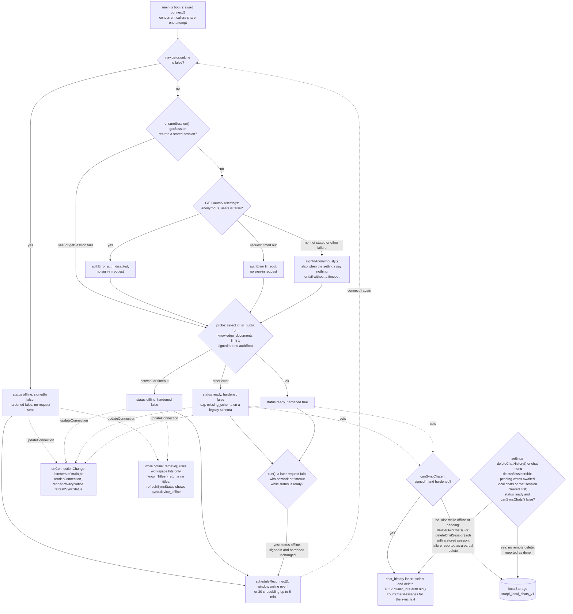

<sub>Sources: [`src/js/supabase.js`](../src/js/supabase.js), [`src/js/main.js`](../src/js/main.js), [`src/js/chat.js`](../src/js/chat.js), [`src/js/chat-store.js`](../src/js/chat-store.js), [`src/js/settings.js`](../src/js/settings.js), [`src/js/config.js`](../src/js/config.js), [`backend/supabase/full_schema.sql`](../backend/supabase/full_schema.sql)</sub>

### What leaves the device: one chat turn

submitChat first fixes the chat mode: quick prompts, sample questions and graph entity questions always run in verified source mode and switch the composer toggle to it, and every other question follows the toggle (starpi_chat_mode, grounded by default). In source mode, workspace search always stays in the ingestion worker. A sample question offered by demo.js (data-scope workspace, so submitChat gets workspaceOnly) and any question while the connection is offline use workspace hits only. Otherwise, in client mode Supabase receives only question-free reads (recentKnowledge(30), ranked in the browser), while council, own-server and NVIDIA modes also send the question, cut to 1000 characters, to the search_knowledge RPC and fall back to recentKnowledge(30) when it returns no rows or fails. These three modes then send the question with the retrieved excerpts, workspace excerpts included, to the provider, the own server or Starpi's NVIDIA proxy; OpenRouter, the own server and NVIDIA also get shareableHistory(), the last 4 conversation turns not marked localOnly, and Gemini gets no history. In free chat nothing is retrieved and the question goes to no knowledge-base search: the model receives the conversation instead, up to 16 turns and 24,000 characters of turns not marked localOnly, each cut to 4,000 characters (Gemini gets them too), plus a file attached to that question as fenced data, whole up to 12,000 characters, otherwise its beginning and the passages that match the question, picked in the ingestion worker. NVIDIA requests go to the app's own origin without any key, fitted to the proxy's limits by fitNvidiaMessages. Each answer path has its own guards (provider keys, OpenRouter stopping early on 401 or 403, the NVIDIA catalog reporting a proxy with keys, the device probe and the cache checks before the quota check and the download confirmation, normalizeServerUrl). In source mode every failure or empty answer ends in the extractive synthesizeAnswer, whose knownTitles() reads document titles only, and when excerpts were used the source check and the receipt draft are computed on the device for every engine; in free chat a failure ends in a notice, and an answer is marked as not checked against sources. Both turns are marked localOnly in the conversation for client mode, a used workspace hit, an attached file, or an extractive synthesizer answer that contains the name of a file in the workspace (for example a greeting or document list that names the on-device files); that last case also keeps the stored answer local-only, while its question has already been stored by the retrieval rule. In source mode the question is stored only after retrieval (or by the catch if the turn throws first), in free chat at once. A message stays in localStorage with metadata.local_only set to its local-only flag when it is local-only or when sync is not possible, and without the flag when the chat_history insert fails; loadCurrentSession() reads local rows without the flag back as local-only, and restoreHistory() carries the flag into the conversation.

<!-- diagram: system-context-egress-guards -->
```mermaid
flowchart TD
    submit["submitChat(): input cut to 8000 chars,<br/>waits for a file still being read,<br/>mode = getMode()"]
    cm{"chat mode: grounded for quick prompts,<br/>sample and entity questions,<br/>else getChatMode()"}
    wsSearch["retrieveWorkspace: searchWorkspace<br/>in starpi-ingest, an attached file's<br/>chunks first, stays on the device"]
    scopeQ{"workspaceOnly:<br/>a demo sample question?"}
    offQ{"getConnection().status<br/>is offline?"}
    wsOnly["workspace hits only,<br/>no Supabase request"]
    modeR{"mode is client?"}
    recent["recentKnowledge(30)<br/>no user text sent,<br/>rankHitsLocally in the browser"]
    fts["rpc search_knowledge<br/>query_text sliced to 1000 chars,<br/>match_count 6"]
    ftsQ{"rows returned?"}
    submit --> cm
    cm -->|"grounded"| wsSearch --> scopeQ
    scopeQ -->|"yes"| wsOnly
    scopeQ -->|"no"| offQ
    offQ -->|"yes"| wsOnly
    offQ -->|"no"| modeR
    modeR -->|"yes"| recent
    modeR -->|"no: council, local or nvidia"| fts
    fts --> ftsQ
    ftsQ -->|"no rows or error"| recent
    qStore["no hits used for a greeting without a file<br/>storeQuestion(usesWorkspace),<br/>usesWorkspace = a used workspace hit"]
    ftsQ -->|"yes"| qStore
    recent -->|"ranked hits, or workspace<br/>hits only on error"| qStore
    wsOnly --> qStore
    qStore --> modeA

    fStore["free chat: storeQuestion(false) at once,<br/>no retrieval, no knowledge-base search"]
    fFile{"file attached<br/>to this question?"}
    fAtt["attachmentForChat in starpi-ingest:<br/>the text up to 12000 chars, else its first<br/>chunks and the passages matching the question"]
    cm -->|"free"| fStore --> fFile
    fFile -->|"yes"| fAtt --> modeA
    fFile -->|"no"| modeA

    modeA{"answer mode"}
    gemQ{"hasGeminiKey?"}
    gemCall["callGemini to Google, 20 s<br/>key in x-goog-api-key header<br/>source mode: system prompt with excerpts<br/>and the question, no history<br/>free chat: system, history, question"]
    orQ{"hasOpenRouterKey?"}
    orCall["callOpenRouter, Bearer key, 20 s per model<br/>system prompt with excerpts or the attached file,<br/>shareableHistory, question,<br/>up to 3 free models, stops early on 401 or 403"]
    modeA -->|"council"| gemQ
    gemQ -->|"yes"| gemCall
    gemQ -->|"no"| orQ
    gemCall -->|"HTTP error, timeout or empty answer"| orQ
    orQ -->|"yes"| orCall

    readyQ{"engine.isReady()?"}
    loadQ{"startLocalEngine interactive, loadModel:<br/>WebGPU preset with an adapter, or a WASM model,<br/>model files already cached?"}
    dl["checkQuota, confirmDownload dialog,<br/>storage.persist, then WebGPU weights from<br/>Hugging Face and wasm from GitHub, or pinned<br/>WASM files from Hugging Face and the<br/>ONNX Runtime binary from /assets"]
    gen["engine.generate in starpi-webllm or starpi-wasm<br/>prompt and history never leave the device"]
    modeA -->|"client"| readyQ
    readyQ -->|"yes"| gen
    readyQ -->|"no"| loadQ
    loadQ -->|"cached"| gen
    loadQ -->|"not or partly cached"| dl
    dl -->|"accepted"| gen

    urlQ{"normalizeServerUrl:<br/>https, or http on localhost or<br/>127.0.0.1, no credentials in URL?"}
    srv["callLocalServer, no key, 90 s<br/>GET base/models, 4 s, until a model id is known,<br/>POST base/chat/completions: system prompt with<br/>excerpts or the attached file, shareableHistory, question"]
    modeA -->|"local"| urlQ
    urlQ -->|"valid"| srv

    nvCat{"getNvidiaCatalog: same-origin<br/>GET /api/models/nvidia, cached,<br/>proxy has keys and offers a model?"}
    nvCall["callNvidia: same-origin POST /api/chat/nvidia,<br/>no Authorization header, fitNvidiaMessages:<br/>system with excerpts or the attached file,<br/>shareableHistory, question, max_tokens<br/>= the model's defaultMaxTokens"]
    nvProxy["Starpi proxy, Vercel function or backend:<br/>a pooled key, NVIDIA API, the stream relayed back"]
    modeA -->|"nvidia"| nvCat
    nvCat -->|"yes"| nvCall --> nvProxy

    noAns["no model answer: in source mode knownTitles():<br/>listDocuments select, no question text, cached 60 s,<br/>none while offline, then synthesizeAnswer, extractive quotes<br/>in free chat: a notice says why, nothing more is sent"]
    orQ -->|"no key"| noAns
    orCall -->|"all attempts failed"| noAns
    loadQ -->|"unsupported, no-adapter<br/>or other load error"| noAns
    dl -->|"declined, quota, code-download<br/>or network error"| noAns
    gen -->|"error or empty text"| noAns
    urlQ -->|"ProviderError"| noAns
    srv -->|"HTTP error, timeout or empty"| noAns
    nvCat -->|"no proxy, no keys or no model"| noAns
    nvProxy -->|"error code, timeout or a stream<br/>that ended without answer text"| noAns

    check["source mode, when excerpts were used: applyGrounding<br/>source check and storeReceiptDraft for every<br/>engine on this device, receipt JSON saved<br/>only when the user downloads it<br/>free chat: markFreeAnswer, no check, no receipt"]
    gemCall -->|"answer"| check
    orCall -->|"answer"| check
    gen -->|"answer"| check
    srv -->|"answer"| check
    nvProxy -->|"answer, a partial one after Stop"| check
    noAns -->|"source-mode answer"| check
    turns["conversation.push: both turns localOnly<br/>for client mode, a used workspace hit, a file<br/>or a synthesizer answer naming a workspace file,<br/>question cut to 4000 chars"]
    check --> turns
    turns -.->|"shareableHistory drops localOnly turns,<br/>keeps the last 4 in source mode,<br/>16 turns and 24000 chars in free chat"| orCall
    turns -.->|"shareableHistory"| srv
    turns -.->|"shareableHistory"| nvCall
    turns -.->|"free chat only"| gemCall

    persistQ{"persistMessage localOnly?<br/>question: client mode, a file<br/>or a used workspace hit<br/>answer: client mode, a file in free chat,<br/>a used workspace hit or a synthesizer<br/>answer naming a workspace file"}
    syncQ{"canSyncChats():<br/>signedIn and hardened?"}
    lsStore[("localStorage starpi_local_chats_v1<br/>last 200 messages of 10 sessions")]
    insert["insert into chat_history<br/>RLS: owner_id = auth.uid()<br/>then refreshSyncStatus counts<br/>chat_history rows for the sync text"]
    qStore -->|"question"| persistQ
    fStore -->|"question"| persistQ
    submit -.->|"question via storeQuestion(false)<br/>in the catch if the turn throws first"| persistQ
    turns -->|"answer"| persistQ
    persistQ -->|"yes: local_only true"| lsStore
    persistQ -->|"no"| syncQ
    syncQ -->|"no: local_only false"| lsStore
    syncQ -->|"yes"| insert
    insert -->|"error: kept without the flag,<br/>read back as local-only"| lsStore
```

<sub>Sources: [`src/js/chat.js`](../src/js/chat.js), [`src/js/chat-store.js`](../src/js/chat-store.js), [`src/js/supabase.js`](../src/js/supabase.js), [`src/js/providers.js`](../src/js/providers.js), [`src/js/prompts.js`](../src/js/prompts.js), [`src/js/engine-ui.js`](../src/js/engine-ui.js), [`src/js/webgpu/engine.js`](../src/js/webgpu/engine.js), [`src/js/wasm/client.js`](../src/js/wasm/client.js), [`src/js/rag/workspace.js`](../src/js/rag/workspace.js), [`src/js/rag/grounding-view.js`](../src/js/rag/grounding-view.js), [`src/js/rag/receipts.js`](../src/js/rag/receipts.js), [`src/js/messages.js`](../src/js/messages.js), [`src/js/demo.js`](../src/js/demo.js), [`src/js/graph.js`](../src/js/graph.js), [`src/js/synthesizer.js`](../src/js/synthesizer.js), [`src/js/state.js`](../src/js/state.js), [`src/js/config.js`](../src/js/config.js), [`backend/supabase/full_schema.sql`](../backend/supabase/full_schema.sql)</sub>

### Library publisher trust boundary

The library publisher (section 10) is the only component that holds the service_role key. It runs as a command line tool on a machine the operator controls and opens no port, so there is no request to guard; what it guards are its reads, which the service role would otherwise let reach every row. The browser bundle never talks to it: the browser and the publisher meet only in the database, where RLS decides what the browser sees of the rows the publisher wrote.

<!-- diagram: system-context-publisher -->
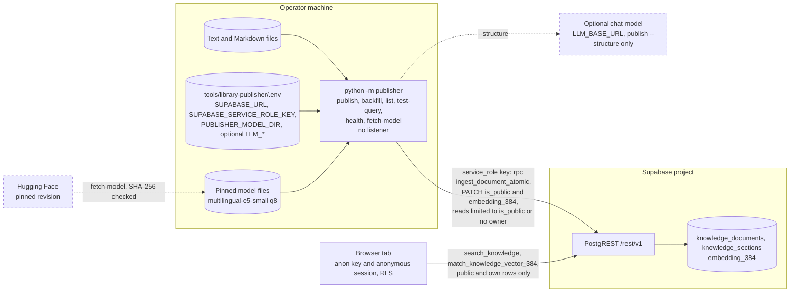

<sub>Sources: [`tools/library-publisher/publisher/cli_supabase.py`](../tools/library-publisher/publisher/cli_supabase.py), [`tools/library-publisher/publisher/config.py`](../tools/library-publisher/publisher/config.py), [`tools/library-publisher/publisher/supabase_service.py`](../tools/library-publisher/publisher/supabase_service.py), [`tools/library-publisher/publisher/model_files.py`](../tools/library-publisher/publisher/model_files.py), [`backend/supabase/full_schema.sql`](../backend/supabase/full_schema.sql)</sub>

### Frontend import graph (1 of 4): main.js and its application imports

main.js is the only main-thread entry point and has 20 imports: the 15 application modules drawn here (with the names it imports from each) and 5 infrastructure modules (dom, i18n, icons, state, supabase) drawn in frontend-modules-infrastructure. Application modules are every module reachable from main.js except the 10 infrastructure modules drawn in frontend-modules-infrastructure; there are 45 of them, including the ten core/ modules the page reaches, rag/bm25.js and rag/chunker.js, which core/ reuses from the ingestion worker, and models/wasm-catalog.js, which the processor (WASM) worker shares. The 121 imports between them are split across four diagrams: the 15 made by main.js here, the 31 made by settings.js, model-picker.js, models/choices.js, graph.js, ingest.js, bench/bench-ui.js and voice.js in frontend-modules-views, the 38 made by chat.js, engine-ui.js, messages.js, prompts.js, providers.js, rag/citations.js, webgpu/engine.js, webgpu/models.js and wasm/client.js in frontend-modules-chat, and the 37 made by demo.js, synthesizer.js, retrieval.js, rag/grounding-view.js, rag/receipts.js and the core/ modules in frontend-modules-trust. An import and a re-export of the same module count as one edge. The import graph has no cycles.

<!-- diagram: frontend-modules-overview -->
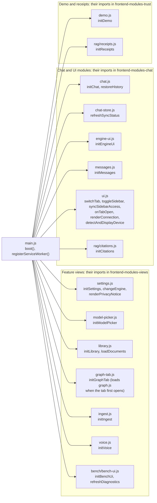

<sub>Sources: [`src/js/main.js`](../src/js/main.js)</sub>

### Frontend import graph (2 of 4): imports made by the feature views and the model pickers

Every import between application modules made by settings.js, model-picker.js, models/choices.js, graph.js, ingest.js, bench/bench-ui.js and voice.js (31 of the 121); library.js imports only infrastructure modules (dialog, dom, i18n, render, supabase). Views that call into chat.js use narrow imports (graph.js submitChat, ingest.js invalidateKnownTitles, bench-ui.js isChatBusy, settings.js isChatBusy and resetConversation), and chat.js imports no view back. settings.js deletes the chat history through deleteChatHistory in chat-store.js and refuses to start while isChatBusy() reports an answer still being written (settings.delete_history_busy), graph.js and ingest.js reuse describeDataError from library.js, settings.js and bench-ui.js drive the on-device engine both through engine-ui.js and directly through webgpu/engine.js, and voice.js reports speech errors with appendNotice from messages.js. model-picker.js fills both assistant pickers from assistantGroups in models/choices.js once getDeviceProbe() and getNvidiaCatalog() have answered, and settings.js applies a picked value through parseAssistantChoice, checked against the NVIDIA_MODELS allowlist, and then calls syncPickerValue; model-picker.js imports neither settings.js nor chat.js, because settings.js imports it. models/choices.js is pure: it reads the three model catalogs and recommendModels from models/device.js and returns i18n keys, never translated text.

<!-- diagram: frontend-modules-views -->
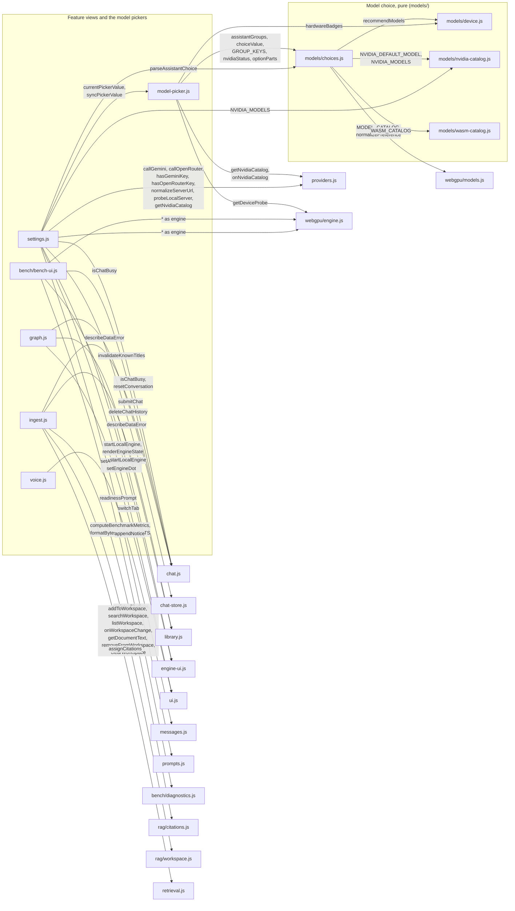

<sub>Sources: [`src/js/settings.js`](../src/js/settings.js), [`src/js/model-picker.js`](../src/js/model-picker.js), [`src/js/models/choices.js`](../src/js/models/choices.js), [`src/js/models/device.js`](../src/js/models/device.js), [`src/js/models/nvidia-catalog.js`](../src/js/models/nvidia-catalog.js), [`src/js/models/wasm-catalog.js`](../src/js/models/wasm-catalog.js), [`src/js/graph.js`](../src/js/graph.js), [`src/js/ingest.js`](../src/js/ingest.js), [`src/js/bench/bench-ui.js`](../src/js/bench/bench-ui.js), [`src/js/voice.js`](../src/js/voice.js), [`src/js/library.js`](../src/js/library.js)</sub>

### Frontend import graph (3 of 4): chat pipeline, workspace client and on-device engine

The 38 imports between application modules made by chat.js, engine-ui.js, messages.js, prompts.js, providers.js, rag/citations.js, webgpu/engine.js, webgpu/models.js and wasm/client.js. chat.js is the hub: 18 of its 26 imports are drawn here, and the other 8 go to infrastructure (config, dom, i18n, icons, render, signals, state, supabase). chat-store.js, chat-stream.js, chat-export.js, code-blocks.js, ui.js, rag/workspace.js, models/device.js, models/nvidia-catalog.js and models/wasm-catalog.js import no other application module. chat-stream.js holds the pure SSE parser and stream assembler that callNvidia in providers.js uses and the splitReasoning that chat.js and messages.js use; models/nvidia-catalog.js is the one NVIDIA allowlist with the proxy's limits and timings, which prompts.js (fitNvidiaMessages), providers.js and chat.js read and the Vercel functions import too (section 13). messages.js adds the copy buttons of code blocks through code-blocks.js, and chat.js writes the chat export through chat-export.js. After an answer in source mode is rendered, chat.js runs the source check through applyGrounding in rag/grounding-view.js, with contextCoverage from core/grounding.js telling which part of each excerpt reached the model, and keeps a receipt draft through rag/receipts.js, passing for a partly delivered excerpt how many of its leading characters reached the model (deliveredChars); the imports of those modules, and of synthesizer.js and retrieval.js, are in frontend-modules-trust. rag/citations.js takes CITATION_PATTERN and citationLabel from retrieval.js, which re-exports them from core/labels.js, and reads source text back from the workspace worker through getChunkContext. webgpu/engine.js runs a WebGPU preset in its WebLLM worker or a processor (WASM) model through WasmEngineClient from wasm/client.js, and both it and webgpu/models.js read the processor catalog in models/wasm-catalog.js.

<!-- diagram: frontend-modules-chat -->
```mermaid
flowchart TD
    chat["chat.js<br/>submitChat, answerGrounded, answerFree,<br/>retrieve, shareableHistory, answerWith* helpers"]

    subgraph pipeline["Chat pipeline"]
        chatstore["chat-store.js<br/>persistMessage, loadCurrentSession, deleteSession"]
        chatexport["chat-export.js<br/>chatToJson, chatToMarkdown, exportFileName"]
        prompts["prompts.js<br/>buildSystemPrompt, buildChatPrompt,<br/>historyWindow, fitNvidiaMessages"]
        providers["providers.js<br/>callGemini, callOpenRouter, callLocalServer,<br/>getNvidiaCatalog, callNvidia"]
        chatstream["chat-stream.js<br/>createSseParser, createChatStreamAssembler,<br/>splitReasoning, splitStreamingText"]
        synth["synthesizer.js<br/>synthesizeAnswer, describeTrace,<br/>describeChatTrace, isGreeting"]
        retrieval["retrieval.js<br/>rankHitsLocally, mergeHits,<br/>assignCitations, buildContext"]
    end

    subgraph rendering["Rendering and engine UI"]
        engineui["engine-ui.js<br/>startLocalEngine, renderEngineState"]
        messages["messages.js<br/>appendMessage, createStreamingMessage,<br/>markFreeAnswer"]
        codeblocks["code-blocks.js<br/>decorateCodeBlocks, initCodeBlocks"]
        ui["ui.js<br/>setAssistantStatus, setEngineDot"]
    end

    subgraph trust["Source check and receipts"]
        groundview["rag/grounding-view.js<br/>applyGrounding, clearGroundingHighlights"]
        receipts["rag/receipts.js<br/>storeReceiptDraft, receiptButton"]
        coregrounding["core/grounding.js<br/>contextCoverage"]
        coresentences["core/sentences.js<br/>safeSlice"]
    end

    subgraph ragmain["On-device workspace, main thread (rag/)"]
        citations["rag/citations.js<br/>registerCitations, linkifyCitations"]
        workspace["rag/workspace.js<br/>searchWorkspace, firstChunks,<br/>getDocumentText, getChunkContext"]
    end

    subgraph gpu["On-device engine (webgpu/, wasm/) and catalogs (models/)"]
        engine["webgpu/engine.js<br/>loadModel, generate, isReady"]
        models["webgpu/models.js<br/>chooseModel, budgetPrompt"]
        wasmclient["wasm/client.js<br/>WasmEngineClient, wasmCacheStatus"]
        wasmcat["models/wasm-catalog.js<br/>WASM_CATALOG, WASM_CACHE_NAME"]
        nvcat["models/nvidia-catalog.js<br/>NVIDIA_LIMITS, NVIDIA_CLIENT_TIMEOUTS"]
        device["models/device.js<br/>recommendModels"]
    end

    chat --> chatstore
    chat -->|"chatToJson, chatToMarkdown,<br/>exportFileName"| chatexport
    chat --> prompts
    chat --> providers
    chat -->|"splitReasoning"| chatstream
    chat --> synth
    chat --> retrieval
    chat -->|"startLocalEngine"| engineui
    chat --> messages
    chat -->|"setAssistantStatus"| ui
    chat -->|"applyGrounding"| groundview
    chat -->|"storeReceiptDraft,<br/>receiptButton"| receipts
    chat -->|"contextCoverage"| coregrounding
    chat -->|"registerCitations"| citations
    chat -->|"searchWorkspace, firstChunks,<br/>getDocumentText, addToWorkspace,<br/>listWorkspace"| workspace
    chat -->|"* as engine"| engine
    chat -->|"budgetPrompt"| models
    chat -->|"findNvidiaModel, NVIDIA_LIMITS"| nvcat

    engineui -->|"appendNotice"| messages
    engineui -->|"setEngineDot"| ui
    engineui -->|"* as engine"| engine
    engineui -->|"WASM_RUNTIME_MB"| wasmcat

    messages -->|"linkifyCitations,<br/>citationSources"| citations
    messages -->|"clearGroundingHighlights"| groundview
    messages -->|"splitReasoning,<br/>splitStreamingText"| chatstream
    messages -->|"decorateCodeBlocks,<br/>initCodeBlocks"| codeblocks
    prompts -->|"safeSlice"| coresentences
    prompts -->|"NVIDIA_LIMITS"| nvcat
    providers -->|"createSseParser,<br/>createChatStreamAssembler,<br/>splitStreamingText"| chatstream
    providers -->|"findNvidiaModel, NVIDIA_LIMITS,<br/>NVIDIA_CLIENT_TIMEOUTS"| nvcat
    citations -->|"CITATION_PATTERN, citationLabel,<br/>re-exported from core/labels.js"| retrieval
    citations -->|"getChunkContext"| workspace
    engine -->|"ALL_MODEL_IDS, chooseModel,<br/>detectMobile"| models
    engine -->|"WasmEngineClient,<br/>wasmCacheStatus"| wasmclient
    engine -->|"WASM_CACHE_NAME,<br/>WASM_RUNTIME_MB"| wasmcat
    models -->|"recommendModels,<br/>re-exports detectMobile"| device
    models -->|"WASM_CATALOG"| wasmcat
    wasmclient -->|"WASM_CACHE_NAME, wasmFileUrl"| wasmcat
```

<sub>Sources: [`src/js/chat.js`](../src/js/chat.js), [`src/js/engine-ui.js`](../src/js/engine-ui.js), [`src/js/messages.js`](../src/js/messages.js), [`src/js/prompts.js`](../src/js/prompts.js), [`src/js/providers.js`](../src/js/providers.js), [`src/js/rag/citations.js`](../src/js/rag/citations.js), [`src/js/webgpu/engine.js`](../src/js/webgpu/engine.js), [`src/js/webgpu/models.js`](../src/js/webgpu/models.js), [`src/js/wasm/client.js`](../src/js/wasm/client.js), [`src/js/chat-store.js`](../src/js/chat-store.js), [`src/js/chat-export.js`](../src/js/chat-export.js), [`src/js/chat-stream.js`](../src/js/chat-stream.js), [`src/js/code-blocks.js`](../src/js/code-blocks.js), [`src/js/synthesizer.js`](../src/js/synthesizer.js), [`src/js/retrieval.js`](../src/js/retrieval.js), [`src/js/ui.js`](../src/js/ui.js), [`src/js/rag/grounding-view.js`](../src/js/rag/grounding-view.js), [`src/js/rag/receipts.js`](../src/js/rag/receipts.js), [`src/js/core/grounding.js`](../src/js/core/grounding.js), [`src/js/core/sentences.js`](../src/js/core/sentences.js), [`src/js/rag/workspace.js`](../src/js/rag/workspace.js), [`src/js/models/wasm-catalog.js`](../src/js/models/wasm-catalog.js), [`src/js/models/nvidia-catalog.js`](../src/js/models/nvidia-catalog.js), [`src/js/models/device.js`](../src/js/models/device.js)</sub>

### Frontend import graph (4 of 4): demo, source check, receipts and core/

The remaining 37 of the 121 imports: every import made by demo.js, synthesizer.js, retrieval.js, rag/grounding-view.js, rag/receipts.js and the core/ modules. The ten core/ modules the page reaches import no infrastructure module and use no DOM, so the same code runs in the page, in the ingestion worker and in Node: core/labels.js holds the citation label format that retrieval.js re-exports, core/sentences.js the sentence splitting that synthesizer.js re-exports and safeSlice, with which retrieval.js shortens excerpts, prompts.js shortens history turns and fenced blocks (frontend-modules-chat) and core/grounding.js the passage it quotes in a reason without splitting a surrogate pair, core/facts.js and core/grounding.js the source check, core/polarity.js its version 2 negation check and core/binding.js its version 2 checks of names and values in another place, and core/receipt.js builds and verifies starpi.receipt/v2 receipts (and still reads v1), with core/merkle.js for the Merkle tree over the citations, core/signature.js for Ed25519 and ES256 signatures and core/hash.js for SHA-256, canonical JSON, hex and base64url. core/facts.js reuses tokenize and the stopword lists of rag/bm25.js, core/grounding.js reuses its English stopword list, core/polarity.js and core/binding.js its combined STOPWORDS, and core/receipt.js reuses chunkText and CHUNKER from rag/chunker.js, so both worker modules are part of the main-thread graph too. Outside this graph, rag/ingest.worker.js imports core/receipt.js to hash files and verify receipts and core/signature.js to import a signer's public key, scripts/verify-receipt.mjs imports core/receipt.js, core/signature.js and rag/parser.js in Node, scripts/ground.mjs imports core/document.js and core/sarif.js, the two core/ modules the page never loads, and packages/core/src/index.js re-exports nine of the twelve core/ modules (core/polarity.js, core/binding.js and core/hash.js come in through them, canonicalJson and sha256Hex through core/receipt.js), rag/parser.js, rag/chunker.js and rag/bm25.js as the @starpi/core package. demo.js fetches the sample files from /samples/ into the workspace and shows a fixed answer with one deliberate error through applyGrounding, in the language of the sample set that is complete in the workspace (the interface language first, and also when neither set is complete).

<!-- diagram: frontend-modules-trust -->
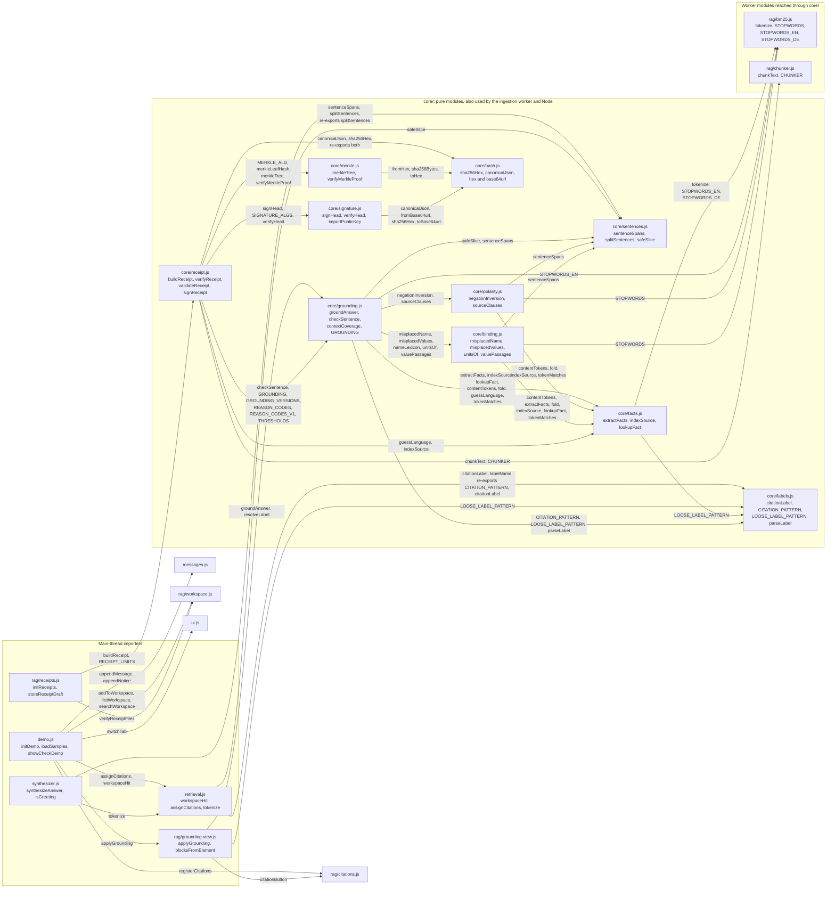

<sub>Sources: [`src/js/demo.js`](../src/js/demo.js), [`src/js/synthesizer.js`](../src/js/synthesizer.js), [`src/js/retrieval.js`](../src/js/retrieval.js), [`src/js/rag/grounding-view.js`](../src/js/rag/grounding-view.js), [`src/js/rag/receipts.js`](../src/js/rag/receipts.js), [`src/js/core/labels.js`](../src/js/core/labels.js), [`src/js/core/sentences.js`](../src/js/core/sentences.js), [`src/js/core/facts.js`](../src/js/core/facts.js), [`src/js/core/grounding.js`](../src/js/core/grounding.js), [`src/js/core/polarity.js`](../src/js/core/polarity.js), [`src/js/core/binding.js`](../src/js/core/binding.js), [`src/js/core/receipt.js`](../src/js/core/receipt.js), [`src/js/core/merkle.js`](../src/js/core/merkle.js), [`src/js/core/signature.js`](../src/js/core/signature.js), [`src/js/core/hash.js`](../src/js/core/hash.js), [`src/js/rag/bm25.js`](../src/js/rag/bm25.js), [`src/js/rag/chunker.js`](../src/js/rag/chunker.js), [`src/js/rag/ingest.worker.js`](../src/js/rag/ingest.worker.js), [`scripts/verify-receipt.mjs`](../scripts/verify-receipt.mjs), [`scripts/ground.mjs`](../scripts/ground.mjs), [`packages/core/src/index.js`](../packages/core/src/index.js)</sub>

### Shared infrastructure modules, their importers and npm packages

Every import of config.js (9 importers), supabase.js (7), state.js (6), storage.js (4) and signals.js (3) is drawn. The most widely imported modules, i18n/index.js (21 importers), dom.js (18), icons.js (13) and render.js (8), show their importer count in the label instead of individual edges, and dialog.js, which gives the citation, document, entity and receipt dialogs their focus handling, names its 4 importers in its label. config.js, signals.js and storage.js import nothing; config.js takes APP_VERSION and the Supabase URL and key from build-time defines, state.js reaches into webgpu/models.js for normalizePreference and into models/nvidia-catalog.js for normalizeNvidiaModel, and supabase.js passes a fetch wrapped with withTimeoutSignal to createClient. The main thread's static npm dependencies (lucide, dompurify, marked) come in only through icons.js and render.js, while @supabase/supabase-js is a lazy entry of its own (supabase-lib.js) that supabase.js imports by URL on first use, with the 12000 ms Supabase timeout as its deadline (the dotted edge), and i18n/index.js bundles both locale JSON files via import attributes; @huggingface/transformers is bundled into the processor (WASM) worker only. JSDoc typedef imports are not counted.

<!-- diagram: frontend-modules-infrastructure -->
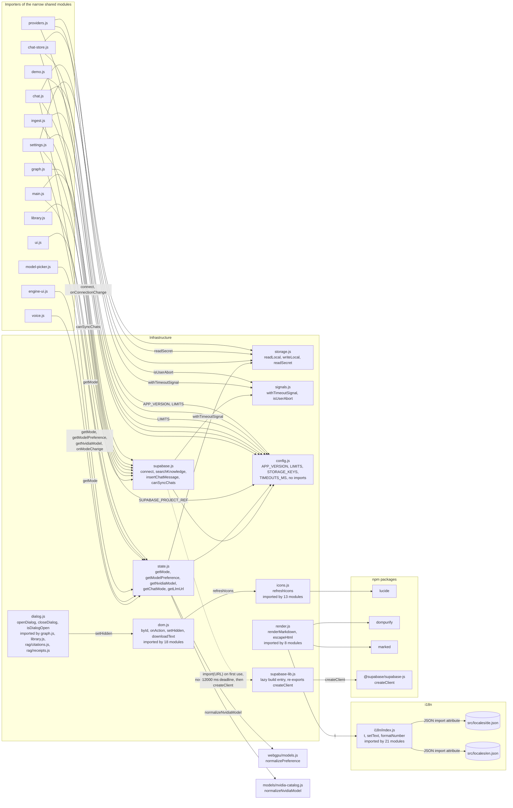

<sub>Sources: [`src/js/config.js`](../src/js/config.js), [`src/js/dom.js`](../src/js/dom.js), [`src/js/dialog.js`](../src/js/dialog.js), [`src/js/icons.js`](../src/js/icons.js), [`src/js/render.js`](../src/js/render.js), [`src/js/storage.js`](../src/js/storage.js), [`src/js/signals.js`](../src/js/signals.js), [`src/js/state.js`](../src/js/state.js), [`src/js/supabase.js`](../src/js/supabase.js), [`src/js/supabase-lib.js`](../src/js/supabase-lib.js), [`src/js/i18n/index.js`](../src/js/i18n/index.js), [`src/js/main.js`](../src/js/main.js), [`src/js/chat.js`](../src/js/chat.js), [`src/js/chat-store.js`](../src/js/chat-store.js), [`src/js/demo.js`](../src/js/demo.js), [`src/js/graph.js`](../src/js/graph.js), [`src/js/ingest.js`](../src/js/ingest.js), [`src/js/library.js`](../src/js/library.js), [`src/js/providers.js`](../src/js/providers.js), [`src/js/settings.js`](../src/js/settings.js), [`src/js/model-picker.js`](../src/js/model-picker.js), [`src/js/engine-ui.js`](../src/js/engine-ui.js), [`src/js/ui.js`](../src/js/ui.js), [`src/js/voice.js`](../src/js/voice.js), [`src/js/webgpu/models.js`](../src/js/webgpu/models.js), [`src/js/models/nvidia-catalog.js`](../src/js/models/nvidia-catalog.js), [`scripts/build.mjs`](../scripts/build.mjs)</sub>

### Bundle entry points, Web Workers and lazy imports

scripts/build.mjs bundles five JS entry points with esbuild (splitting: true): main.js, rag/ingest.worker.js, webgpu/worker.js, wasm/worker.js and supabase-lib.js, the Supabase library, which supabase.js imports by the URL the build writes into __STARPI_SUPABASE_LIB_URL__ (plus the CSS entry). Nothing imports the workers: rag/workspace.js and webgpu/engine.js start them with new Worker(new URL(...)) using the placeholders __STARPI_INGEST_WORKER_URL__, __STARPI_WEBLLM_WORKER_URL__ and __STARPI_WASM_WORKER_URL__, and wasm/worker.js points ONNX Runtime at its binary through __STARPI_ORT_WASM_URL__. An esbuild onLoad plugin writes the hashed URLs into the sources while they are bundled, and the build bundles again until those URLs match the outputs (the WASM worker holds the ONNX Runtime URL, so this takes three passes); the build fails if a placeholder is in no source file. A second plugin resolves onnxruntime-web/webgpu and onnxruntime-common, which Transformers.js imports, to onnxruntime-web/wasm, so one ONNX Runtime without new Function ships, and build.mjs copies its ort-wasm-simd-threaded.wasm binary to a content-hashed /assets URL. Because the page and the ingestion worker both import core/receipt.js and core/signature.js, and through them core/merkle.js, core/hash.js, core/grounding.js, core/polarity.js, core/binding.js, core/facts.js, core/labels.js, core/sentences.js, rag/bm25.js and rag/chunker.js, esbuild puts these twelve modules in one chunk that both entries import statically; models/wasm-catalog.js is a small chunk shared by the page and the WASM worker, and @mlc-ai/web-llm is one chunk shared by the WebLLM worker and the page. The service worker precaches the page, its CSS, main.js, the chunks main.js imports statically, the ingestion worker, the Latin font and the public files; WebLLM, pdf.js, the WASM worker with Transformers.js, the ONNX Runtime binary and the Supabase library are cached on first use. Solid edges are static imports: main.js's edges go to the modules shown in its bundle (its other imports are in frontend-modules-overview), the edges into rag/workspace.js and webgpu/engine.js are every static import of those two modules, and the edges into the shared chunk show one path from the page and one from the ingestion worker (rag/grounding-view.js, retrieval.js, synthesizer.js and prompts.js also import core/ modules, see frontend-modules-trust and frontend-modules-chat). Dotted edges are the three Worker spawns, the service worker registration, the ONNX Runtime binary that the WASM worker fetches, and the lazy import() calls for @mlc-ai/web-llm (in engine.js), the Supabase library (in supabase.js, by its URL, with a 12000 ms deadline) and pdf.js (in parser.js, inside the ingestion worker). scripts/verify-receipt.mjs and scripts/ground.mjs are not part of the app build; they run the same receipt, source-check, extraction and chunking code in Node, and core/document.js and core/sarif.js, which only scripts/ground.mjs and the package use, are in no app bundle. A separate build, scripts/build-core.mjs, bundles packages/core/src/index.js (which re-exports nine of the shared-chunk modules, reaching core/polarity.js, core/binding.js and core/hash.js through them, plus core/document.js, core/sarif.js and rag/parser.js) into packages/core/dist/index.js, scripts/verify-receipt.mjs into packages/core/dist/verify-receipt.js and scripts/ground.mjs into packages/core/dist/ground.js, the @starpi/core package, with pdfjs-dist left external.

<!-- diagram: frontend-modules-workers -->
```mermaid
flowchart TD
    subgraph mainbundle["esbuild entry main (src/js/main.js), main thread"]
        main["main.js<br/>boot(), registerServiceWorker()"]
        chat["chat.js"]
        ingest["ingest.js"]
        citations["rag/citations.js"]
        demo["demo.js"]
        receipts["rag/receipts.js"]
        engineui["engine-ui.js"]
        settings["settings.js"]
        picker["model-picker.js"]
        benchui["bench/bench-ui.js"]
        workspace["rag/workspace.js<br/>getWorker() on first request()<br/>error or messageerror: worker_crashed, reset()<br/>clearWorkspace() terminates the worker"]
        engine["webgpu/engine.js<br/>loadModel(), loadWebLLM()<br/>teardown() calls terminate()"]
        wasmclient["wasm/client.js<br/>WasmEngineClient"]
        sbjsmod["supabase.js<br/>client() on first use"]
    end

    subgraph sbbundle["esbuild entry supabase, not precached"]
        sblib["supabase-lib.js<br/>createClient from @supabase/supabase-js"]
    end

    subgraph shared["Shared chunk, imported statically by main and ingest-worker"]
        coreReceipt["core/receipt.js, core/merkle.js,<br/>core/signature.js, core/hash.js"]
        coreCheck["core/grounding.js, core/polarity.js,<br/>core/binding.js, core/facts.js,<br/>core/labels.js, core/sentences.js"]
        bm25["rag/bm25.js<br/>BM25Index, tokenize, stopword lists"]
        chunker["rag/chunker.js<br/>chunkText, CHUNKER"]
    end

    wasmcat["models/wasm-catalog.js<br/>chunk shared by main and wasm-worker"]

    subgraph ingestbundle["esbuild entry ingest-worker, Worker starpi-ingest"]
        iw["rag/ingest.worker.js<br/>ingest, search, context, head,<br/>text, remove, clear, verify-receipt"]
        parser["rag/parser.js<br/>extractText, loadPdfjs()"]
        pdfw["pdfjs-dist<br/>legacy/build/pdf.worker.mjs"]
        pdf["pdfjs-dist<br/>legacy/build/pdf.mjs"]
    end

    subgraph llmbundle["esbuild entry webllm-worker, Worker starpi-webllm"]
        ww["webgpu/worker.js<br/>WebWorkerMLCEngineHandler"]
    end

    subgraph wasmbundle["esbuild entry wasm-worker, Worker starpi-wasm"]
        wsw["wasm/worker.js<br/>load, generate, unload, interrupt"]
        tfjs["@huggingface/transformers 4.3.0<br/>with onnxruntime-web/wasm in place of<br/>onnxruntime-web/webgpu and onnxruntime-common"]
    end

    ort[("/assets/ort-wasm-simd-threaded-hash.wasm<br/>copied from onnxruntime-web, 14.3 MB")]
    webllm["@mlc-ai/web-llm<br/>chunk shared by webllm-worker and main"]
    sw["src/sw.js<br/>written to dist/sw.js by build.mjs<br/>with build version, precache and asset lists"]
    cli["scripts/verify-receipt.mjs<br/>Node command line, not in the app build,<br/>bundled by scripts/build-core.mjs<br/>as packages/core/dist/verify-receipt.js"]
    groundcli["scripts/ground.mjs, starpi-ground<br/>Node command line, not in the app build,<br/>bundled by scripts/build-core.mjs<br/>as packages/core/dist/ground.js"]
    docsarif["core/document.js, core/sarif.js<br/>checkDocument, toSarif, describeReason,<br/>in no app bundle"]
    corepkg["packages/core/src/index.js<br/>@starpi/core entry, bundled by<br/>scripts/build-core.mjs, not by build.mjs"]

    main --> chat
    main --> ingest
    main -->|"initCitations"| citations
    main -->|"initDemo"| demo
    main -->|"initReceipts"| receipts
    main --> engineui
    main --> settings
    main -->|"initModelPicker"| picker
    main --> benchui
    main -.->|"serviceWorker.register('/sw.js'), scope /"| sw
    main -->|"connect"| sbjsmod
    sbjsmod -.->|"import(__STARPI_SUPABASE_LIB_URL__),<br/>?attempt=n after a failed or timed-out load"| sblib

    chat -->|"searchWorkspace, firstChunks,<br/>getDocumentText, addToWorkspace,<br/>listWorkspace"| workspace
    ingest --> workspace
    citations -->|"getChunkContext"| workspace
    demo --> workspace
    receipts -->|"verifyReceiptFiles"| workspace
    chat --> engine
    engineui --> engine
    settings --> engine
    picker -->|"getDeviceProbe"| engine
    benchui --> engine
    engine -->|"WasmEngineClient, wasmCacheStatus"| wasmclient
    engine --> wasmcat
    wasmclient --> wasmcat

    chat -->|"contextCoverage"| coreCheck
    receipts -->|"buildReceipt"| coreReceipt
    coreReceipt --> coreCheck
    coreReceipt -->|"chunkText, CHUNKER"| chunker
    coreCheck -->|"tokenize, stopword lists"| bm25

    workspace -.->|"new Worker(), type module,<br/>URL written by build.mjs"| iw
    engine -.->|"new Worker() in loadModel(),<br/>WebGPU preset, after cache check"| ww
    engine -.->|"new Worker() in loadModel(),<br/>processor model, after cache check"| wsw
    engine -.->|"import() in loadWebLLM()"| webllm
    ww --> webllm
    wsw -->|"AutoTokenizer, AutoModelForCausalLM,<br/>env, TextStreamer"| tfjs
    wsw -->|"findWasmSource, pinnedWasmUrl,<br/>WASM_CACHE_NAME"| wasmcat
    tfjs -.->|"wasmPaths, fetched on first load"| ort

    iw -->|"sha256Hex, validateReceipt, verifyReceipt,<br/>importPublicKey from core/signature.js"| coreReceipt
    iw -->|"BM25Index"| bm25
    iw -->|"chunkText, CHUNKER,<br/>DEFAULT_CHUNK_SIZE, DEFAULT_CHUNK_OVERLAP"| chunker
    iw -->|"extractText, EXTRACTOR,<br/>MAX_FILE_BYTES, ParseError"| parser
    parser -.->|"first import()"| pdfw
    parser -.->|"then import()"| pdf
    cli -->|"RECEIPT_LIMITS, validateReceipt, verifyReceipt,<br/>importPublicKey from core/signature.js"| coreReceipt
    cli -->|"extractText, EXTRACTOR"| parser
    groundcli -->|"checkDocument, describeReason, toSarif"| docsarif
    groundcli -->|"citationLabel"| coreCheck
    groundcli -->|"chunkText"| chunker
    groundcli -->|"extractText, extensionOf,<br/>MAX_FILE_BYTES, SUPPORTED_EXTENSIONS"| parser
    docsarif -->|"groundAnswer, associate, blocksFromMarkdown,<br/>THRESHOLDS, REASON_CODES, extractFacts, contentTokens"| coreCheck
    docsarif -->|"sha256Hex from core/hash.js"| coreReceipt
    corepkg -->|"re-exports nine of the twelve modules,<br/>bundles the other three through them"| shared
    corepkg -->|"re-exports checkDocument, toSarif,<br/>describeReason and more"| docsarif
    corepkg -->|"re-exports extractText,<br/>EXTRACTOR, ParseError and more"| parser
```

<sub>Sources: [`scripts/build.mjs`](../scripts/build.mjs), [`src/js/main.js`](../src/js/main.js), [`src/js/chat.js`](../src/js/chat.js), [`src/js/ingest.js`](../src/js/ingest.js), [`src/js/demo.js`](../src/js/demo.js), [`src/js/engine-ui.js`](../src/js/engine-ui.js), [`src/js/settings.js`](../src/js/settings.js), [`src/js/model-picker.js`](../src/js/model-picker.js), [`src/js/bench/bench-ui.js`](../src/js/bench/bench-ui.js), [`src/js/rag/citations.js`](../src/js/rag/citations.js), [`src/js/rag/receipts.js`](../src/js/rag/receipts.js), [`src/js/rag/workspace.js`](../src/js/rag/workspace.js), [`src/js/rag/ingest.worker.js`](../src/js/rag/ingest.worker.js), [`src/js/core/receipt.js`](../src/js/core/receipt.js), [`src/js/core/signature.js`](../src/js/core/signature.js), [`src/js/core/grounding.js`](../src/js/core/grounding.js), [`src/js/core/document.js`](../src/js/core/document.js), [`src/js/core/sarif.js`](../src/js/core/sarif.js), [`src/js/rag/bm25.js`](../src/js/rag/bm25.js), [`src/js/rag/chunker.js`](../src/js/rag/chunker.js), [`src/js/rag/parser.js`](../src/js/rag/parser.js), [`src/js/webgpu/engine.js`](../src/js/webgpu/engine.js), [`src/js/webgpu/worker.js`](../src/js/webgpu/worker.js), [`src/js/wasm/client.js`](../src/js/wasm/client.js), [`src/js/wasm/worker.js`](../src/js/wasm/worker.js), [`src/js/models/wasm-catalog.js`](../src/js/models/wasm-catalog.js), [`src/js/supabase.js`](../src/js/supabase.js), [`src/js/supabase-lib.js`](../src/js/supabase-lib.js), [`src/sw.js`](../src/sw.js), [`scripts/verify-receipt.mjs`](../scripts/verify-receipt.mjs), [`scripts/ground.mjs`](../scripts/ground.mjs), [`scripts/build-core.mjs`](../scripts/build-core.mjs), [`packages/core/src/index.js`](../packages/core/src/index.js)</sub>

## 2. Boot and settings

What happens between the first byte of `index.html` and a usable chat, and how the settings form stores provider keys, preferences and the engine choice, tests provider keys and deletes the chat history.

### boot(): module start-up order

main.js boot() runs initI18n first, so the stored starpi_locale (or en) is applied before any module renders text. It then installs the delegated click/change dispatcher, registers the switch-tab and toggle-sidebar actions, calls syncSidebarAccess(false) so that below 768 px the closed off-canvas sidebar is inert, registers set-locale and the lazy onTabOpen hooks, and runs the thirteen init* functions (initModelPicker right after initSettings, initDemo and initReceipts last), refreshIcons, detectAndDisplayDevice and registerServiceWorker. registerServiceWorker registers the reload-app and dismiss-update actions, fetches /build-manifest.json on every controllerchange and shows the update banner only when its entries.mainJs differs from the page's own /assets/ module script, and registers /sw.js on window load (section 7 shows the update flow). sw.js calls skipWaiting only when no window is open at install time or on a SKIP_WAITING message, which main.js never sends, so an updated worker usually waits until every Starpi tab is closed. boot() subscribes to onConnectionChange before calling connect(), so the listener also renders the later attempts that connect() schedules itself after an offline result, while restoreHistory() runs only once. changeEngine is started with void, so it is neither awaited nor covered by boot().catch, while connect() and restoreHistory() are awaited in sequence. initModelPicker leaves the static options of both assistant pickers in place and rebuilds them once the page is idle (requestIdleCallback, at most 2 s), after the device probe and again when the NVIDIA proxy answers. A throw or rejection inside boot() skips the remaining steps, and reportUnexpected only logs it with console.error.

<!-- diagram: boot-sequence-overview -->
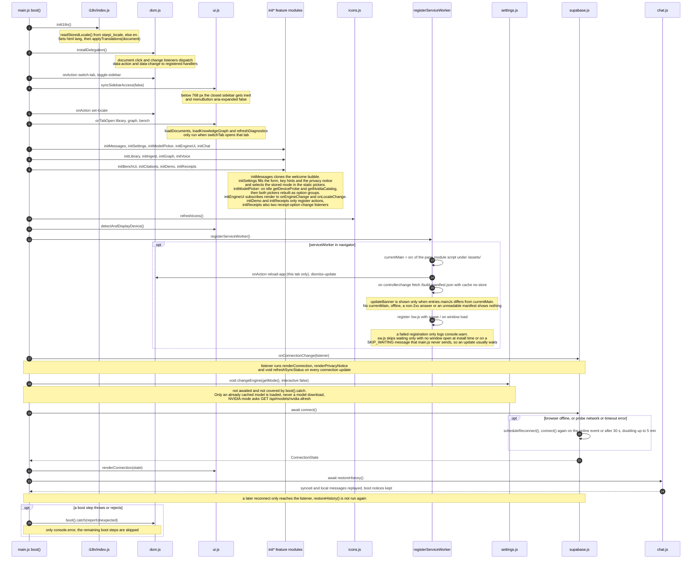

<sub>Sources: [`src/js/main.js`](../src/js/main.js), [`src/js/i18n/index.js`](../src/js/i18n/index.js), [`src/js/dom.js`](../src/js/dom.js), [`src/js/ui.js`](../src/js/ui.js), [`src/js/messages.js`](../src/js/messages.js), [`src/js/settings.js`](../src/js/settings.js), [`src/js/model-picker.js`](../src/js/model-picker.js), [`src/js/engine-ui.js`](../src/js/engine-ui.js), [`src/js/demo.js`](../src/js/demo.js), [`src/js/rag/receipts.js`](../src/js/rag/receipts.js), [`src/js/icons.js`](../src/js/icons.js), [`src/js/supabase.js`](../src/js/supabase.js), [`src/js/chat.js`](../src/js/chat.js), [`src/js/state.js`](../src/js/state.js), [`scripts/build.mjs`](../scripts/build.mjs), [`src/sw.js`](../src/sw.js)</sub>

### Boot-time changeEngine: cached model only, never a download

At boot changeEngine applies the stored compute mode (state.js has already mapped legacy values and fallen back to council) with interactive false: parseAssistantChoice reads the bare mode, which keeps the stored on-device and NVIDIA models, and changeEngine resolves to whether setMode could store it, which boot() discards. In client mode startLocalEngine calls engine.loadModel with onlyIfCached true and no confirmDownload callback. loadModel probes the device with the high-performance adapter and a 10 s deadline (a browser without WebGPU, an adapter that fails or does not answer in time gives a profile without WebGPU) and chooseModel resolves the stored preference, where auto picks a processor (WASM) model on a device without WebGPU. A WebGPU preset on a device without WebGPU rejects with the probe's EngineError. For a WebGPU model certainlyNotCached looks for the model's tensor-cache.json in the webllm/model cache, and for a WASM model wasmCacheStatus looks for its config, tokenizer and weights in transformers-cache; when they are missing, loadModel resolves false before the WebLLM library is imported or a worker starts, and the engine status stays unchanged (idle at boot). Otherwise the engine tears down any old worker and switches to loading: a WASM model starts the starpi-wasm worker and loads from transformers-cache, while a WebGPU model imports WebLLM, checks that the model id is in the WebLLM build and asks hasModelInCache, and a model that is not fully cached resolves false with status idle. In no case is model data downloaded, and a load that resolves false with status idle turns the engine dot off. Missing WebGPU for a WebGPU preset, a failed WebLLM import (kind code-download when the error message is one of the browser texts for a failed module import), a model missing from the WebLLM build (kind unknown) or a failed load of a cached model rejects with an EngineError and status error, which engine-ui turns into a chat notice (notice_unavailable_title for the kinds unsupported and no-adapter, otherwise notice_failed_title). Local mode probes GET /models on the own server URL with a 4 s timeout, NVIDIA mode asks the proxy for its catalog afresh (GET /api/models/nvidia on the app's origin, 6 s), and both show the result in the engine dot and the assistant status line; council mode only checks whether a Gemini or OpenRouter key exists.

<!-- diagram: boot-sequence-engine-restore -->
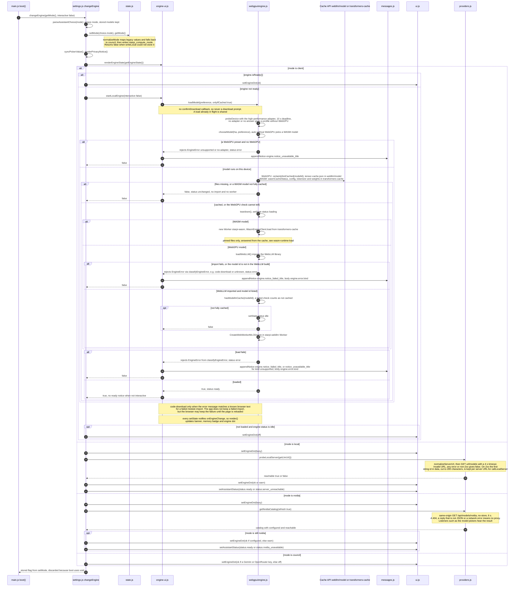

<sub>Sources: [`src/js/main.js`](../src/js/main.js), [`src/js/settings.js`](../src/js/settings.js), [`src/js/models/choices.js`](../src/js/models/choices.js), [`src/js/engine-ui.js`](../src/js/engine-ui.js), [`src/js/webgpu/engine.js`](../src/js/webgpu/engine.js), [`src/js/webgpu/models.js`](../src/js/webgpu/models.js), [`src/js/models/device.js`](../src/js/models/device.js), [`src/js/wasm/client.js`](../src/js/wasm/client.js), [`src/js/state.js`](../src/js/state.js), [`src/js/messages.js`](../src/js/messages.js), [`src/js/ui.js`](../src/js/ui.js), [`src/js/providers.js`](../src/js/providers.js), [`src/js/config.js`](../src/js/config.js)</sub>

### connect(), connection subscribers and restoreHistory

connect() first checks navigator.onLine: when the browser reports offline it marks the state offline (signedIn and hardened false, authError and probeError of kind network) without sending any request. Otherwise ensureSession reuses the stored session; without one it first reads the public auth settings (GET /auth/v1/settings). When they report anonymous sign-ins as off, authError is auth_disabled; when that read times out, the timeout error itself becomes authError. In both cases no sign-in request is sent, so a project that does not answer costs one timeout less. In all other cases (sign-ins on, a non-2xx answer, an unreadable body or a network error) it signs in anonymously. connect() then probes for the hardened schema by selecting id and is_public from knowledge_documents; every Supabase request, including the settings read, has a 12 s fetch timeout and the client's own retries are off (db retry false). Only a network or timeout error of that probe marks the state offline; a timeout authError on its own only leaves signedIn false. In both offline cases scheduleReconnect() clears connectPromise and calls connect() again on the window online event or after 30 s, doubling up to 5 min, until an attempt is no longer offline. Later, any request sent through run() that fails with a network or timeout error while the status is ready switches only the status to offline (signedIn and hardened keep their values) and schedules the same reconnect. updateConnection calls the single subscriber from main.js (renderConnection, renderPrivacyNotice, refreshSyncStatus) and boot then calls renderConnection again, while a later reconnect reaches only the subscriber and never runs restoreHistory again.

<!-- diagram: boot-sequence-connect-history -->
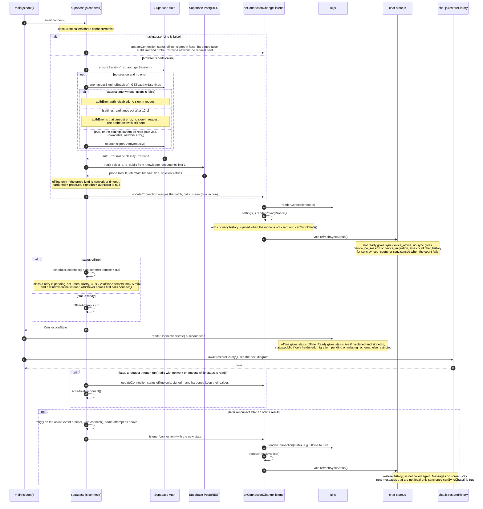

<sub>Sources: [`src/js/main.js`](../src/js/main.js), [`src/js/supabase.js`](../src/js/supabase.js), [`src/js/ui.js`](../src/js/ui.js), [`src/js/settings.js`](../src/js/settings.js), [`src/js/chat-store.js`](../src/js/chat-store.js), [`src/js/chat.js`](../src/js/chat.js), [`src/js/config.js`](../src/js/config.js)</sub>

### restoreHistory: merging synced and on-device messages

restoreHistory first awaits loadCurrentSession. It reads the current session's messages from localStorage, where rows without a boolean metadata.local_only flag count as on-device turns, and, only when canSyncChats() (signedIn and hardened), the newest 200 chat_history rows of the session, returned oldest first. With rows on both sides, mergeByTime drops local rows without created_at that repeat a synced row's role and content, and sorts the rest by created_at with a stable sort, rows without a valid time last. A failed query only logs console.warn and falls back to the local rows. The messages are replayed with title-only sources and the stored engine badge (metadata.engine, with the model name of an NVIDIA answer from metadata.model), a free-chat answer (metadata.chat_mode free) gets its not-checked note again, the conversation keeps each turn's localOnly flag, engine, model, chat mode and time so that on-device turns are never sent as history to a cloud provider, NVIDIA or the own server and the chat export has them, every bubble shown after the welcome while the history loaded (such as an engine notice) is appended again after the restored messages, and turns already in memory are kept after the restored turns.

<!-- diagram: boot-sequence-restore-history -->
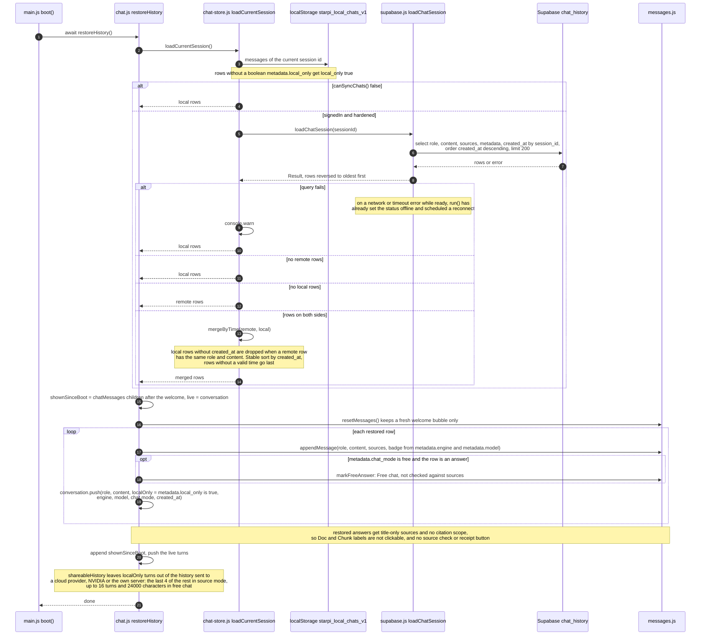

<sub>Sources: [`src/js/chat.js`](../src/js/chat.js), [`src/js/chat-store.js`](../src/js/chat-store.js), [`src/js/supabase.js`](../src/js/supabase.js), [`src/js/messages.js`](../src/js/messages.js), [`src/js/rag/citations.js`](../src/js/rag/citations.js), [`src/js/storage.js`](../src/js/storage.js), [`src/js/config.js`](../src/js/config.js)</sub>

### saveSettings: server URL, API keys and a pending assistant pick

saveSettings first validates the own-server URL with normalizeServerUrl and stops with an alert (and focus on the field) when it is invalid, insecure or contains credentials. The URL and the remember toggle go to localStorage; each key is written only when a new one was typed, or re-written to the other storage when an existing key's remember setting changed, and writeSecret always deletes both copies first and then uses localStorage (remember) or sessionStorage. Inputs are cleared and only masked hints with the last four characters are shown. The assistant pickers apply a pick as soon as it is made, so Save calls changeEngine only when the settings picker shows another value than the stored choice (currentPickerValue), for example a pick made with the arrow keys that has not settled yet; re-applying the recommendation the picker shows for auto would turn the stored auto into a fixed model. changeEngine resolves with whether every write it made was stored, and saveSettings then alerts settings.saved_toast only when every write returned true, otherwise settings.save_failed.

<!-- diagram: settings-flow-save -->
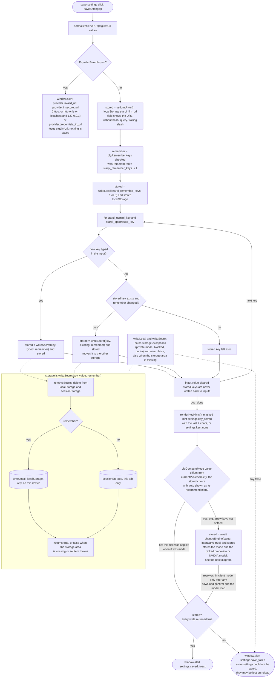

<sub>Sources: [`src/js/settings.js`](../src/js/settings.js), [`src/js/model-picker.js`](../src/js/model-picker.js), [`src/js/models/choices.js`](../src/js/models/choices.js), [`src/js/providers.js`](../src/js/providers.js), [`src/js/storage.js`](../src/js/storage.js), [`src/js/state.js`](../src/js/state.js), [`src/js/config.js`](../src/js/config.js)</sub>

### changeEngine, clearKeys and deleteModelCache

changeEngine takes a picker value: a mode (council, local, or before the device probe the bare client and nvidia, which keep the stored models), an on-device model (webgpu:key or wasm:key) or an NVIDIA model (nvidia:id). parseAssistantChoice refuses any other value, such as an NVIDIA id outside the allowlist, and the pickers then show the stored choice again (syncPickerValue). While an answer is being written, a switch to another mode or model is refused, with the models.switch_busy alert when the user picked it, because unloading the model would cut the answer off. Otherwise changeEngine stores the on-device preference (and unloads another on-device model that is loaded or loading), the NVIDIA model and the mode, selects the stored choice in both pickers, refreshes the privacy notice and the engine state, sets the status dot per mode and resolves with whether every write was stored (saveSettings uses it; boot and the two pickers, engineSelector and cfgComputeMode, ignore it): client reuses a ready engine or calls startLocalEngine (interactive loads may ask to download, non-interactive loads only use a cached model), local probes GET /models on the own server with a 4 s timeout and also writes status.ready or status.server_unreachable to the assistant status line, nvidia asks the proxy for its catalog afresh and writes status.ready or status.nvidia_unavailable unless another mode was picked meanwhile, and council is ok only when a Gemini or OpenRouter key is stored. Client and council mode leave the assistant status line as it is. A pick with the mouse or by touch applies at once; a change that follows a key press within 500 ms (Chrome fires change at every arrow step on a closed select) applies once the keys rest for 700 ms, on Enter or when the picker loses focus. clearKeys removes both keys from localStorage and sessionStorage and refreshes hints and privacy notice but not the engine dot. deleteModelCache asks for confirmation, unloads the engine, deletes the transformers-cache of the processor models and the cached f16 and f32 variants of every WebGPU catalog model, alerting done or failed; the ONNX Runtime binary is app code under /assets and stays.

<!-- diagram: settings-flow-engine-keys-cache -->
```mermaid
flowchart TD
    Pick(["change on engineSelector or cfgComputeMode:<br/>pickFromSelect"]) --> KeyQ{"a key was pressed on the<br/>picker within the last 500 ms?"}
    KeyQ -->|"no: mouse or touch"| CE
    KeyQ -->|"yes: arrow keys"| Settle["timer 700 ms, restarted at every step,<br/>Enter or blur applies at once"]
    Settle --> CE
    CE(["changeEngine(value, opts)<br/>pickers and saveSettings: interactive true<br/>boot: interactive false"]) --> Parse{"parseAssistantChoice(value, NVIDIA_MODELS ids):<br/>council, local, client, nvidia,<br/>webgpu:key, wasm:key or nvidia:id?"}
    Parse -->|"no"| Revert(["syncPickerValue, return false"])
    Parse -->|"yes"| Busy{"a switch of mode or model<br/>while isChatBusy()?"}
    Busy -->|"yes"| Refuse(["syncPickerValue, alert models.switch_busy<br/>when interactive, return false"])
    Busy -->|"no"| Local{"an on-device model picked?"}
    Local -->|"yes"| SetPref["stored = setModelPreference: starpi_webgpu_model<br/>changed and the engine not idle, unless it is<br/>ready with that model: unloadModel()"]
    Local -->|"no"| Nv
    SetPref --> Nv{"an NVIDIA model picked?"}
    Nv -->|"yes"| SetNv["stored = setNvidiaModel: starpi_nvidia_model,<br/>normalized against the allowlist"]
    Nv -->|"no"| SetMode
    SetNv --> SetMode["stored = setMode: normalizeMode (legacy aliases, unknown becomes council)<br/>writeLocal starpi_compute_mode, false when not stored"]
    SetMode --> SyncUi["syncPickerValue (both pickers),<br/>renderPrivacyNotice, renderEngineState"]
    SyncUi --> Mode{"mode?"}
    Mode -->|"client"| Ready{"engine.isReady()?"}
    Ready -->|"yes"| DotOk1["setEngineDot ok"]
    Ready -->|"no"| Start["startLocalEngine: engine.loadModel with getModelPreference()<br/>interactive: confirm before a download, ready notice<br/>not interactive: onlyIfCached, no download, stops before<br/>the WebLLM import or the worker when the model is not cached<br/>EngineError other than cancelled: error notice<br/>any error: returns false"]
    Start --> Loaded{"not loaded, not interactive<br/>and engine status idle?"}
    Loaded -->|"yes"| DotOff1["setEngineDot off"]
    Loaded -->|"no"| DotEngine["dot follows the engine state (engine-ui render):<br/>ready ok, loading busy, error warn, idle off"]
    Mode -->|"local"| Probe["setEngineDot busy<br/>probeLocalServer(getLlmUrl()): GET base URL + /models<br/>4 s timeout (TIMEOUTS_MS.localServerProbe)"]
    Probe --> ProbeOk{"response ok?"}
    ProbeOk -->|"yes"| DotOk2["setEngineDot ok<br/>setAssistantStatus status.ready<br/>first model id kept for callLocalServer"]
    ProbeOk -->|"no, invalid URL, non-2xx or error"| DotWarn["setEngineDot warn<br/>setAssistantStatus status.server_unreachable"]
    Mode -->|"nvidia"| NvCat["setEngineDot busy<br/>getNvidiaCatalog(refresh true):<br/>same-origin GET /api/models/nvidia"]
    NvCat --> NvMode{"mode still nvidia<br/>when it answers?"}
    NvMode -->|"no"| Ret
    NvMode -->|"yes"| NvDot["setEngineDot ok when configured, else warn<br/>setAssistantStatus status.ready<br/>or status.nvidia_unavailable"]
    Mode -->|"council"| HasKey{"Gemini or OpenRouter key stored?"}
    HasKey -->|"yes"| DotOk3["setEngineDot ok"]
    HasKey -->|"no"| DotOff2["setEngineDot off"]
    Ret(["return stored<br/>saveSettings: save_failed when false<br/>boot and both pickers ignore it"])
    DotOk1 --> Ret
    DotOff1 --> Ret
    DotEngine --> Ret
    DotOk2 --> Ret
    DotWarn --> Ret
    NvDot --> Ret
    DotOk3 --> Ret
    DotOff2 --> Ret

    Clear(["clear-keys click: clearKeys()"]) --> Remove["removeSecret starpi_gemini_key and starpi_openrouter_key<br/>(localStorage and sessionStorage)"]
    Remove --> ClearUi["renderKeyHints: settings.key_none<br/>renderPrivacyNotice<br/>engine dot is not re-evaluated"]
    ClearUi --> ClearAlert(["window.alert settings.keys_cleared"])

    Del(["delete-model-cache click: deleteModelCache()"]) --> Confirm{"window.confirm<br/>settings.delete_models_confirm?"}
    Confirm -->|"cancel"| NoOp(["nothing happens"])
    Confirm -->|"ok"| DelCache["engine.deleteCachedModels(): unloadModel,<br/>caches.delete transformers-cache (a failure only logged),<br/>loadWebLLM, then deleteModelAllInfoInCache for the f16<br/>and f32 id of every MODEL_CATALOG entry (per-id failures only logged)"]
    DelCache --> Threw{"threw?"}
    Threw -->|"no"| DelDone(["window.alert settings.delete_models_done"])
    Threw -->|"yes"| DelFail(["window.alert settings.delete_models_failed with reason"])
```

<sub>Sources: [`src/js/settings.js`](../src/js/settings.js), [`src/js/models/choices.js`](../src/js/models/choices.js), [`src/js/model-picker.js`](../src/js/model-picker.js), [`src/js/engine-ui.js`](../src/js/engine-ui.js), [`src/js/webgpu/engine.js`](../src/js/webgpu/engine.js), [`src/js/models/wasm-catalog.js`](../src/js/models/wasm-catalog.js), [`src/js/providers.js`](../src/js/providers.js), [`src/js/state.js`](../src/js/state.js), [`src/js/storage.js`](../src/js/storage.js), [`src/js/ui.js`](../src/js/ui.js), [`src/js/config.js`](../src/js/config.js), [`src/js/main.js`](../src/js/main.js)</sub>

### deleteHistory: deleting the chat history

The delete-chat-history button first checks isChatBusy(): while an answer is still running (or a question waits for an attached file) it only alerts settings.delete_history_busy and deletes nothing, because the running turn would be stored again after the delete. Otherwise it asks for confirmation and then calls deleteChatHistory in chat-store.js. It first waits for message writes still under way and marks their sessions as deleted, so a write that ends later cannot store a deleted chat again, then overwrites the local chat store with an empty object, which removes every session kept in this browser (a failed write is not reported), and starts a new session id. It resolves true without any remote delete only when the connection status is ready and canSyncChats() is false (no session or an older schema, so nothing was synced). In every other case, including offline and a still pending connection, it calls deleteOwnChats, which reads the auth session and deletes every chat_history row whose owner_id is the signed-in user, across all of that user's sessions; row level security limits the delete to own rows. If reading the session throws, deleteOwnChats returns a failed Result without sending the delete; if it yields no user id, nothing is deleted in Supabase and the Result still counts as ok. Offline, the delete request is still sent when a user id is found and its failure is reported. After deleteChatHistory the chat on screen is reset whatever it returned, and the alert says settings.delete_history_done, or settings.delete_history_partial when deleteOwnChats returned a failed Result. Delete this chat in the chat menu does the same for the current session only: it is refused with chat.delete_busy while an answer is being written, asks chat.delete_confirm, and deleteSession(sid) waits for that session's writes, removes it from the local store, starts a new session and deletes its synced rows with deleteChatSession (owner_id and session_id), reporting chat.deleted_title or chat.delete_partial_title as a notice.

<!-- diagram: settings-flow-delete-history -->
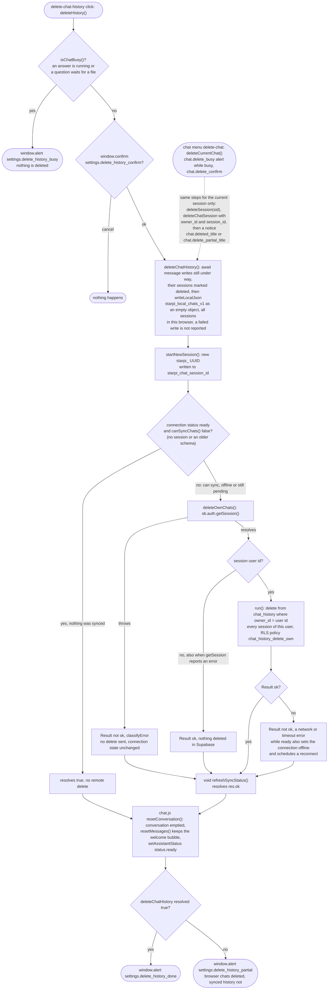

<sub>Sources: [`src/js/settings.js`](../src/js/settings.js), [`src/js/chat-store.js`](../src/js/chat-store.js), [`src/js/supabase.js`](../src/js/supabase.js), [`src/js/chat.js`](../src/js/chat.js), [`src/js/messages.js`](../src/js/messages.js), [`src/js/storage.js`](../src/js/storage.js), [`src/js/config.js`](../src/js/config.js), [`backend/supabase/migrations/20260923000000_harden_rls_anonymous_auth.sql`](../backend/supabase/migrations/20260923000000_harden_rls_anonymous_auth.sql), [`src/locales/en.json`](../src/locales/en.json)</sub>

### testProvider: Gemini and OpenRouter connection tests

A test button disables itself, shows an amber running box and sends readinessPrompt in the active language (English or German) through callGemini or callOpenRouter, each request limited to 20 s. A key typed into cfgGeminiKey or cfgOpenrouterKey is tested as typed, without saving it or clearing the field; with an empty field the stored key is used (sessionStorage first, then localStorage). With neither, the provider throws a ProviderError with notConfigured, shown as an amber settings.test_not_configured box with the settings.test_enter_key hint; any other failure shows a rose settings.test_failed box with the error message; success shows a green box with the elapsed milliseconds and the first 140 characters of the reply. The reply and the error message pass through sanitizeModelNames. The headings and the hint are set with setText, so they re-translate on a language switch (the milliseconds, the reply and the error message do not), and the button is re-enabled in all cases.

<!-- diagram: settings-flow-test-provider -->
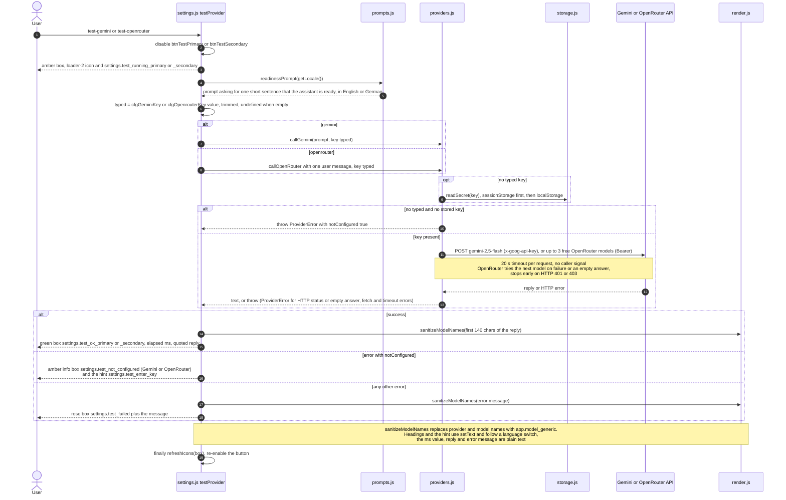

<sub>Sources: [`src/js/settings.js`](../src/js/settings.js), [`src/js/prompts.js`](../src/js/prompts.js), [`src/js/providers.js`](../src/js/providers.js), [`src/js/storage.js`](../src/js/storage.js), [`src/js/config.js`](../src/js/config.js), [`src/js/render.js`](../src/js/render.js), [`src/js/i18n/index.js`](../src/js/i18n/index.js), [`src/locales/en.json`](../src/locales/en.json)</sub>

## 3. Answering a question

One chat turn from submit to persisted answer: the chat mode (verified source mode or free chat), retrieval and how workspace and knowledge-base hits share the slots, citation assignment, the answer path chosen by the mode, including the browser client of Starpi's NVIDIA proxy, the fallbacks when a path fails, the source check and receipt draft after rendering, and exactly which data leaves the device in each mode, followed by the settings, the privacy notice, the on-device model selection with its device tiers, and the prompt budget that shape a turn.

### submitChat: from input to persisted answer

submitChat returns early with status.busy while a request runs. If an attached file is still being read, it marks itself busy, shows status.reading_file and waits for the read, so a question is not sent before its file is ready (if the read fails, the question goes without it); it then returns when there is neither text nor an attachment. Next it fixes the chat mode: a quick prompt, a sample question or a graph entity question passes chatMode grounded, which also switches the composer toggle, and any other question follows getChatMode(). Free chat continues in answerFree (chat-dual-mode) without retrieval, citations, source check or receipt. In verified source mode it shows the user turn at once but stores it only after retrieval with storeQuestion(usesWorkspace), so the question stays on the device in client mode, with an attached file or when a used hit comes from the workspace; if the turn throws before that, the catch stores it with usesWorkspace false. Retrieval merges on-device BM25 workspace chunks with Supabase knowledge hits, a greeting-only message uses none of them, and citations are assigned and registered. The mode captured at submit picks council (Gemini then OpenRouter), client (the on-device WebGPU or WASM model, streamed), local (own server) or nvidia (Starpi's NVIDIA proxy, streamed); a model that fails shows a chat.provider_failed notice, and a null or empty answer falls back to the extractive synthesizer. Only while the chat session is unchanged is the answer rendered, source-checked, given a receipt button and added to the conversation; a finished answer is persisted under the original session id whether or not the session changed, and it stays in localStorage when the mode is client, a workspace excerpt was used, an extractive answer contains the name of a workspace file (a greeting or document list, for example), sync is unavailable or the insert fails. When the turn ends, setBusy(false) puts the focus back in the input if the Stop button or nothing had it.

<!-- diagram: chat-request-lifecycle -->
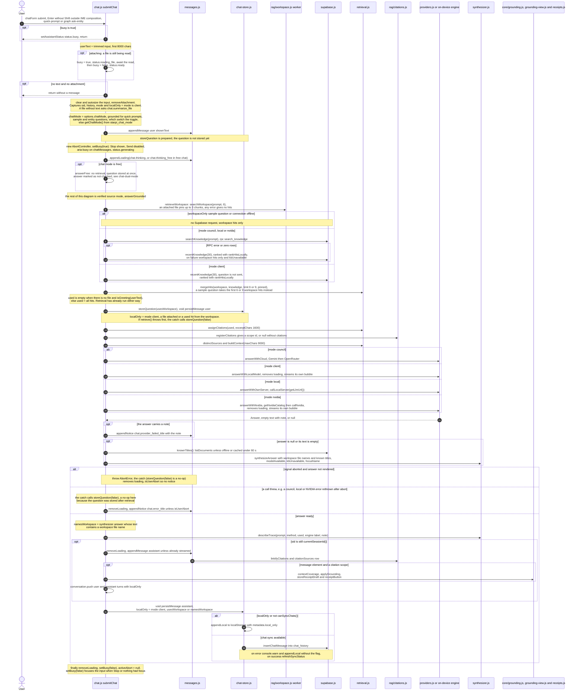

<sub>Sources: [`src/js/chat.js`](../src/js/chat.js), [`src/js/retrieval.js`](../src/js/retrieval.js), [`src/js/rag/citations.js`](../src/js/rag/citations.js), [`src/js/messages.js`](../src/js/messages.js), [`src/js/chat-store.js`](../src/js/chat-store.js), [`src/js/synthesizer.js`](../src/js/synthesizer.js), [`src/js/rag/workspace.js`](../src/js/rag/workspace.js), [`src/js/supabase.js`](../src/js/supabase.js), [`src/js/providers.js`](../src/js/providers.js), [`src/js/core/grounding.js`](../src/js/core/grounding.js), [`src/js/rag/grounding-view.js`](../src/js/rag/grounding-view.js), [`src/js/rag/receipts.js`](../src/js/rag/receipts.js), [`src/js/signals.js`](../src/js/signals.js), [`src/js/ui.js`](../src/js/ui.js), [`src/js/graph.js`](../src/js/graph.js), [`src/js/demo.js`](../src/js/demo.js), [`src/js/config.js`](../src/js/config.js), [`src/js/state.js`](../src/js/state.js)</sub>

### retrieve(): knowledge-base decision tree per mode

retrieve() first collects the workspace hits (next diagram) and sets the limit to 6 hits, or 9 with an attached file. A demo sample question (quick-prompt with data-scope workspace, workspaceOnly) takes the first hits of the workspace without a Supabase search; while the connection status is offline, retrieve() also skips Supabase and returns the workspace hits with the method "knowledge base not reachable, skipped" and kbUnavailable true. retrieve() runs only in verified source mode. Council, local and NVIDIA modes send the question to the search_knowledge RPC. Since migration 20260924120000 the RPC returns the rows that contain every search term and, when no visible row does, the rows that share at least two terms (or the only one), ranked by the number of shared terms. On zero rows or any error, PGRST202 (missing_function) included, the browser ranks the 30 newest documents from recentKnowledge; if that fetch fails too, only workspace hits remain and kbUnavailable is set. Client mode never sends the question: it always ranks recentKnowledge(30) locally. Every result goes through mergeHits, and the method line counts the workspace hits that survived the merge ("BM25 in the on-device workspace (n)") and joins the remote label with " + ". A network or timeout error from any Supabase request while the connection is ready switches it to offline and schedules a reconnect, so later turns skip Supabase until it answers again.

<!-- diagram: chat-request-retrieve -->
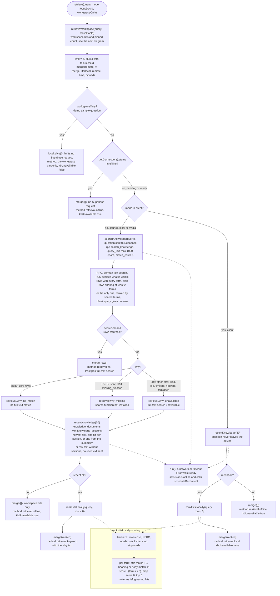

<sub>Sources: [`src/js/chat.js`](../src/js/chat.js), [`src/js/retrieval.js`](../src/js/retrieval.js), [`src/js/supabase.js`](../src/js/supabase.js), [`backend/supabase/migrations/20260924120000_search_knowledge_shared_terms.sql`](../backend/supabase/migrations/20260924120000_search_knowledge_shared_terms.sql), [`src/js/demo.js`](../src/js/demo.js), [`src/js/config.js`](../src/js/config.js), [`src/locales/en.json`](../src/locales/en.json)</sub>

### Workspace hits and mergeHits: slots per source and the pinned file

searchWorkspace resolves empty without contacting the ingest worker when the workspace has no documents or the query is blank; otherwise the worker returns the BM25 top 6 chunks with a score above 0. Without an attached file every hit is kept in rank order. With one, up to 3 of its matching chunks, or its first 3 chunks (score 0) when none matched, are pinned in front of the hits from other files, and any further chunks of that file are dropped; any worker error drops all workspace hits. mergeHits keeps the pinned hits, then gives the knowledge base the larger of half the remaining slots (rounded up) and the slots the other workspace hits cannot fill, but never more than it has hits, and fills the rest with workspace hits. The order is pinned hits, other workspace hits, knowledge-base hits, so neither source crowds out the other.

<!-- diagram: chat-request-workspace-merge -->
```mermaid
flowchart TD
    Start(["retrieveWorkspace(query, focusDocId)"]) --> Empty{"searchWorkspace(query, 6):<br/>workspace has documents and query not blank?"}
    Empty -->|"no"| None["resolves empty on the main thread<br/>worker not asked"]
    Empty -->|"yes"| Bm25["ingest worker search<br/>BM25 top 6 chunks with score above 0"]
    None --> Focus{"focusDocId set?<br/>a file attached to this question"}
    Bm25 --> Focus
    Focus -->|"no"| Plain["hits = found chunks via workspaceHit<br/>pinned = 0"]
    Focus -->|"yes"| InFile{"any found chunk<br/>from that file?"}
    InFile -->|"yes"| Best["focus = its first 3 found chunks"]
    InFile -->|"no"| Head["focus = firstChunks(focusDocId, 3)<br/>worker head request, score 0"]
    Best --> Pin["hits = focus, then found chunks of other files<br/>pinned = number of focus chunks, at most 3<br/>further chunks of the file are dropped"]
    Head --> Pin
    Bm25 -.->|"worker rejects or crashes"| Fail["console.warn workspace search failed<br/>hits empty, pinned 0"]
    Head -.->|"worker rejects or crashes"| Fail

    Plain --> Merge
    Pin --> Merge
    Fail --> Merge
    Merge(["mergeHits(workspace, knowledge, limit, pinned)"]) --> Kept["kept = first min(pinned, limit) workspace hits<br/>rest = the other workspace hits<br/>room = limit - kept"]
    Kept --> FromKb["fromKnowledge = min(knowledge hits,<br/>max(room - rest, ceil(room / 2)))"]
    FromKb --> FromWs["fromWorkspace = min(rest, room - fromKnowledge)"]
    FromWs --> Out["kept, then the first fromWorkspace of rest,<br/>then the first fromKnowledge knowledge hits"]
    Out --> Ex1["no file, limit 6: 6 workspace and 6 knowledge hits give 3 + 3,<br/>2 workspace hits give 2 + 4,<br/>no knowledge hits give up to 6 workspace hits"]
    Out --> Ex2["attached file, limit 9: 3 pinned, room 6,<br/>3 hits from other files and 6 knowledge hits give 3 + 3 + 3,<br/>no hits from other files give 3 + 6"]
```

<sub>Sources: [`src/js/chat.js`](../src/js/chat.js), [`src/js/retrieval.js`](../src/js/retrieval.js), [`src/js/rag/workspace.js`](../src/js/rag/workspace.js), [`src/js/rag/ingest.worker.js`](../src/js/rag/ingest.worker.js), [`src/js/rag/bm25.js`](../src/js/rag/bm25.js), [`src/js/config.js`](../src/js/config.js)</sub>

### Answer dispatch, synthesizer fallback, rendering and persistence

In verified source mode the mode captured at submit selects the path: council sends Gemini one prompt without history and falls back to OpenRouter when there is no Gemini key or the Gemini call fails, client loads the on-device model interactively (a WebGPU preset or a processor model; it may ask to download) and streams into its own bubble marked rendered, local calls the own server at getLlmUrl(), and nvidia asks Starpi's NVIDIA proxy, which also streams into its own bubble. OpenRouter, the own server and NVIDIA get shareableHistory: the last 4 turns that are not marked localOnly, so turns from on-device mode, with workspace excerpts or with an attached file are never sent as history; the NVIDIA messages are then fitted to the proxy's limits with fitNvidiaMessages, and when that cuts the system message the cut context becomes deliveredContext for the source check. Council, local and NVIDIA failures become an empty-text answer with a note unless the request was aborted, in which case the error is rethrown to the submitChat catch (an NVIDIA answer that was partly streamed before Stop is kept instead, marked as cut off in its trace); in client mode a generation error always becomes a note, while a model that is not loaded, a blank answer or an abort before generating returns null. An NVIDIA proxy without keys or without the route gives a note too, and refreshes the cached catalog when a request found it gone. A note is shown at once as a chat.provider_failed notice, and a null or empty answer is replaced by synthesizeAnswer with modelAvailable false after a note. The answer is shown, source-checked and added to the conversation only if the session id is unchanged; the stored metadata records the engine (cloud, client, wasm, local, nvidia or synthesizer), the model id when known, the chat mode, the trace and the duration. persistMessage keeps it in localStorage with metadata.local_only when localOnly is set (client mode, any used hit from the workspace, the same usesWorkspace that storeQuestion applied to the question right after retrieval, or an extractive answer whose text contains a workspace file name, which does not change how the question was stored) or when canSyncChats() is false; a failed chat_history insert also falls back to localStorage, without the flag, and such rows are read back as on-device turns.

<!-- diagram: chat-request-answer-dispatch -->
```mermaid
flowchart TD
    Entry(["answerGrounded after retrieve, storeQuestion(usesWorkspace)<br/>and buildContext: prompt, context, history, signal"]) --> Mode{"mode captured<br/>at submit"}

    subgraph cloud["council: answerWithCloud"]
        GemKey{"hasGeminiKey()?"}
        Gem["callGemini, one prompt without history<br/>buildSystemPrompt target cloud + question"]
        OrKey{"hasOpenRouterKey()?"}
        Or["callOpenRouter<br/>system + shareableHistory + prompt<br/>up to 3 free models, stops on 401 or 403"]
        GemFailed{"Gemini failed<br/>before?"}
        CloudFail["text empty, engine synthesizer<br/>note chat.note_cloud_failed"]
    end

    subgraph client["client: answerWithLocalModel"]
        Ready{"engine.isReady() or<br/>startLocalEngine interactive true?<br/>may confirm a download"}
        Gen["budgetPrompt, removeLoading, createStreamingMessage<br/>engine.generate in the WebGPU or WASM worker,<br/>model maxOutputTokens: 512 WebGPU, 384 WASM,<br/>temperature 0.2, abort calls engine.interrupt"]
        Fin["stream.finalize with citations and trace<br/>engine client or wasm, model id, rendered,<br/>element, deliveredContext = budgeted context"]
        LocalFail["stream.remove, text empty, engine synthesizer<br/>note chat.note_local_failed, also after abort"]
    end

    subgraph server["local: answerWithOwnServer"]
        Srv["callLocalServer(getLlmUrl())<br/>system target server + shareableHistory + prompt"]
        SrvFail["text empty, engine synthesizer<br/>note chat.note_server_failed"]
    end

    subgraph nv["nvidia: answerWithNvidia"]
        NvCat{"getNvidiaCatalog(): proxy configured<br/>and resolveNvidiaModel finds a model?<br/>the stored one, else the default or the first"}
        NvNo["text empty, engine synthesizer, notConfigured<br/>note provider.nvidia_not_configured,<br/>nvidia_not_available or nvidia_no_models"]
        NvCall["fitNvidiaMessages(system + shareableHistory + prompt),<br/>removeLoading, createStreamingMessage with<br/>engine.label_nvidia and the model name,<br/>callNvidia: max_tokens = model defaultMaxTokens,<br/>temperature 0.2, deltas into the bubble"]
        NvFin["stream.finalize, trace notes chat.note_truncated<br/>and chat.note_model_replaced when they apply,<br/>engine nvidia, model id, rendered, element,<br/>deliveredContext = the system message if it was cut"]
        NvFail["stream.remove, text empty, engine synthesizer<br/>note = the i18n text of the error code, notConfigured<br/>refreshes the catalog, never server text"]
    end

    Share["shareableHistory: turns without localOnly,<br/>last 4, role and content only"]
    Notice["appendNotice chat.provider_failed_title,<br/>body chat.provider_failed_body with the note"]
    Check{"answer null or<br/>answer.text empty?"}

    Mode -->|"council"| GemKey
    GemKey -->|"yes"| Gem
    GemKey -->|"no"| OrKey
    Gem -->|"throws, not aborted, console.warn"| OrKey
    OrKey -->|"yes"| Or
    OrKey -->|"no"| GemFailed
    GemFailed -->|"yes, Gemini reason"| CloudFail
    Or -->|"throws, not aborted"| CloudFail
    Mode -->|"client"| Ready
    Ready -->|"yes"| Gen
    Gen -->|"non-blank text"| Fin
    Gen -->|"throws"| LocalFail
    Mode -->|"local"| Srv
    Srv -->|"throws, not aborted"| SrvFail
    Mode -->|"nvidia"| NvCat
    NvCat -->|"no"| NvNo
    NvCat -->|"yes"| NvCall
    NvCall -->|"answer text, also a partial one<br/>after Stop, a timeout or an interruption"| NvFin
    NvCall -->|"error code, timeout, nothing usable,<br/>not aborted"| NvFail
    Share -.-> Or
    Share -.-> Srv
    Share -.-> NvCall

    Gem -->|"text, engine cloud"| Check
    Or -->|"text, engine cloud"| Check
    Srv -->|"text, engine local"| Check
    Fin --> Check
    NvFin --> Check
    GemFailed -->|"no key at all, null"| Check
    Ready -->|"not ready, no model or aborted, null"| Check
    Gen -->|"blank text, stream.remove, null"| Check
    CloudFail --> Notice
    LocalFail --> Notice
    SrvFail --> Notice
    NvNo --> Notice
    NvFail --> Notice
    Notice --> Check

    Check -->|"yes"| Synth["synthesizeAnswer, engine synthesizer<br/>known titles: workspace file names + knownTitles()<br/>modelAvailable = no note and, in council mode,<br/>a Gemini or OpenRouter key stored"]
    Check -->|"no"| AbortChk{"signal aborted and<br/>not answer.rendered?"}
    Synth --> AbortChk
    AbortChk -->|"yes, throw AbortError"| Catch["catch in submitChat, no answer persisted<br/>storeQuestion(false) is a no-op, question already stored<br/>removeLoading, chat.error_title notice unless<br/>isUserAbort: the error is a DOMException AbortError"]
    Gem -.->|"throws while aborted"| Catch
    Or -.->|"throws while aborted"| Catch
    Srv -.->|"throws while aborted"| Catch
    NvCall -.->|"Stop before any answer text"| Catch
    AbortChk -->|"no"| Trace["splitReasoning, describeTrace with the note or trace note<br/>metadata engine, model, chat_mode grounded,<br/>thoughts, duration_ms"]
    Trace --> Names["namesWorkspace: engine synthesizer and the<br/>answer text contains a workspace file name"]
    Names --> SidChk{"sid equals<br/>currentSessionId()?"}
    SidChk -->|"yes, not rendered"| Render["removeLoading, appendMessage assistant<br/>linkifyCitations only for registered labels<br/>citationSources row, code copy buttons, engine badge"]
    SidChk -->|"yes, already rendered"| After
    Render --> After["source check, receipt button and<br/>conversation.push, see chat-request-source-check"]
    SidChk -->|"no, user switched chat"| Persist
    After --> Persist["void persistMessage under the original sid<br/>localOnly = mode client, a used hit has workspace,<br/>or a synthesizer answer names a workspace file"]
    Persist --> EmptyChk{"content empty?"}
    EmptyChk -->|"yes"| Skip["nothing stored"]
    EmptyChk -->|"no"| LocalChk{"localOnly or<br/>not canSyncChats()?"}
    LocalChk -->|"yes"| AppendLocal["appendLocal to localStorage starpi_local_chats_v1<br/>metadata.local_only = localOnly, created_at stamped<br/>last 200 messages, newest 10 sessions"]
    LocalChk -->|"no, signedIn and hardened"| Insert["insertChatMessage into chat_history<br/>session_id, role, content, sources, metadata"]
    Insert -->|"error, console.warn"| AppendFail["appendLocal without local_only,<br/>read back later as an on-device turn"]
    Insert -->|"ok"| Status["refreshSyncStatus"]
```

<sub>Sources: [`src/js/chat.js`](../src/js/chat.js), [`src/js/prompts.js`](../src/js/prompts.js), [`src/js/providers.js`](../src/js/providers.js), [`src/js/models/nvidia-catalog.js`](../src/js/models/nvidia-catalog.js), [`src/js/synthesizer.js`](../src/js/synthesizer.js), [`src/js/messages.js`](../src/js/messages.js), [`src/js/code-blocks.js`](../src/js/code-blocks.js), [`src/js/rag/citations.js`](../src/js/rag/citations.js), [`src/js/chat-store.js`](../src/js/chat-store.js), [`src/js/supabase.js`](../src/js/supabase.js), [`src/js/engine-ui.js`](../src/js/engine-ui.js), [`src/js/webgpu/engine.js`](../src/js/webgpu/engine.js), [`src/js/signals.js`](../src/js/signals.js), [`src/js/render.js`](../src/js/render.js), [`src/js/config.js`](../src/js/config.js), [`src/locales/en.json`](../src/locales/en.json)</sub>

### Free chat and verified source mode: one turn in each chat mode

The composer toggle (data-action set-chat-mode, Free chat or Verified source mode) stores the chat mode in starpi_chat_mode; a missing or unknown value counts as grounded, and the toggle, its hint, the placeholder and the privacy notice follow every change. Quick prompts, sample questions and graph entity questions pass chatMode grounded to submitChat, which switches the toggle before the turn starts. answerGrounded retrieves, cites and builds the fenced context, asks the model of the mode and then, for every engine (cloud, own server, NVIDIA, the WebGPU or WASM model on the device, or the extractive synthesizer), runs the source check and keeps a receipt draft whose answer.engine names that engine. answerFree retrieves nothing: it stores the question at once, reads an attached file through attachmentForChat (the whole text up to 12,000 characters, else its first two chunks and its passages among the top 12 workspace matches, joined by excerptForChat) and gives the model the free-chat system prompt (buildChatPrompt, with the file fenced as data whose instructions must not be followed) and the conversation. Remote models get the turns not marked localOnly, at most 16 turns and 24,000 characters with each turn cut to 4,000, and Gemini gets them too, while the on-device model gets the last 16 turns, local-only ones included, each budgeted to 2,000 characters. The on-device model and NVIDIA answer at temperature 0.7 in free chat (0.2 in source mode), and on the device a free answer may run longer: up to a third of the context window and at most 768 tokens on WebGPU, while WASM models keep their 384. A free answer gets no citations, no source check and no receipt, carries the note "Free chat · not checked against sources", and its trace names the engine, the duration and the attached file. Without a model, or when the model fails, the free chat shows a notice instead of quoting the sources, because it has none. A question with an attached file stays on the device with its answer in both modes, and client mode keeps every turn on the device.

<!-- diagram: chat-dual-mode -->
```mermaid
flowchart TD
    Toggle(["composer toggle set-chat-mode: setChatMode,<br/>starpi_chat_mode grounded or free, default grounded"])
    Q(["submitChat(text, options)"])
    CM{"options.chatMode is grounded?<br/>quick prompt, sample or entity question"}
    Sw["setChatMode(grounded) when the toggle shows free:<br/>toggle, hint, placeholder and privacy notice follow"]
    Get{"getChatMode()"}
    Toggle -.->|"onChatModeChange"| Get
    Q --> CM
    CM -->|"yes"| Sw --> G
    CM -->|"no"| Get
    Get -->|"grounded"| G
    Get -->|"free"| F

    G["answerGrounded: retrieve, assignCitations,<br/>buildContext max 9000 chars,<br/>storeQuestion(usesWorkspace) after retrieval"]
    F["answerFree: storeQuestion(false) at once,<br/>nothing retrieved, no citations"]
    Att{"file attached<br/>to this question?"}
    AttFile["attachmentForChat: text RPC in starpi-ingest,<br/>whole up to 12000 chars, else its first 2 chunks<br/>and its passages among the top 12 matches,<br/>joined by excerptForChat"]
    F --> Att
    Att -->|"yes"| AttFile --> FGen
    Att -->|"no"| FGen

    GGen["generateAnswer(mode) with plan grounded:<br/>buildSystemPrompt or buildInstructions, answer only<br/>from the fenced excerpts and cite their labels,<br/>history: last 4 shareable turns, on the device<br/>the last 4 turns, temperature 0.2"]
    FGen["generateAnswer(mode) with plan free:<br/>buildChatPrompt or chatInstructions, file fenced as data,<br/>history: up to 16 shareable turns, 24000 chars, 4000 each,<br/>Gemini included, on the device the last 16 turns, 2000 each,<br/>temperature 0.7 on the device and on NVIDIA"]
    G --> GGen

    subgraph engines["Engines of both modes"]
        ECloud["council: Gemini, then OpenRouter"]
        EDev["client: WebGPU preset in starpi-webllm<br/>or WASM model in starpi-wasm"]
        ESrv["local: own server"]
        ENv["nvidia: Starpi's proxy, streamed"]
    end
    GGen --> engines
    FGen --> engines

    GChk{"source mode:<br/>answer text?"}
    FChk{"free chat:<br/>answer text?"}
    engines -->|"source mode"| GChk
    engines -->|"free chat"| FChk

    GSyn["synthesizeAnswer: quotes from the excerpts,<br/>after a chat.provider_failed notice for a note"]
    GCheck["source check and receipt draft for every engine:<br/>contextCoverage, applyGrounding, storeReceiptDraft,<br/>answer.engine cloud, client, wasm, local,<br/>nvidia or synthesizer"]
    GChk -->|"no"| GSyn --> GCheck
    GChk -->|"yes"| GCheck

    FNote(["notice and no answer: chat.free_no_model_title<br/>with free_no_model_body without a model or<br/>free_not_configured_body when it is not set up,<br/>chat.provider_failed_title with free_failed_body on a failure"])
    FMark["markFreeAnswer: chat.free_note under the answer,<br/>no citations, source check or receipt,<br/>describeChatTrace: engine, duration, attached file"]
    FChk -->|"no"| FNote
    FChk -->|"yes"| FMark

    Push["pushTurns while the session is current:<br/>role, content, localOnly, engine, model,<br/>chat mode, created time"]
    GCheck --> Push
    FMark --> Push
    Persist["persistMessage, metadata engine, model,<br/>chat_mode, thoughts, duration_ms"]
    Push --> Persist
    Rule{"localOnly?<br/>source mode: client mode, a file or a used workspace hit,<br/>the answer also when it is extractive and names a workspace file<br/>free chat: client mode or a file, question and answer alike"}
    Persist --> Rule
    Rule -->|"yes"| LS[("localStorage starpi_local_chats_v1,<br/>never sent as history to a remote model")]
    Rule -->|"no"| Sync["chat_history when canSyncChats(),<br/>else localStorage"]
```

<sub>Sources: [`src/js/chat.js`](../src/js/chat.js), [`src/js/prompts.js`](../src/js/prompts.js), [`src/js/state.js`](../src/js/state.js), [`src/js/config.js`](../src/js/config.js), [`src/js/messages.js`](../src/js/messages.js), [`src/js/synthesizer.js`](../src/js/synthesizer.js), [`src/js/settings.js`](../src/js/settings.js), [`src/js/demo.js`](../src/js/demo.js), [`src/js/graph.js`](../src/js/graph.js), [`src/js/rag/workspace.js`](../src/js/rag/workspace.js), [`src/js/rag/receipts.js`](../src/js/rag/receipts.js), [`src/js/chat-store.js`](../src/js/chat-store.js), [`src/index.html`](../src/index.html), [`src/locales/en.json`](../src/locales/en.json), [`docs/spec/receipts.md`](spec/receipts.md)</sub>

### NVIDIA cloud in the browser: catalog, streamed request and errors

The browser side of NVIDIA mode lives in providers.js and holds no NVIDIA key. getNvidiaCatalog asks GET /api/models/nvidia on the app's own origin (no-store, 6 s), caches the answer for five minutes when the proxy has keys and for 30 seconds otherwise, shares one request between concurrent callers and tells its listeners, so the model pickers show what the proxy offers; a 404, a page that is not JSON, a network error or a timeout means there is no proxy, and the NVIDIA group stays hidden. answerWithNvidia asks for the stored model when the proxy offers it, else for the proxy's default or its first model (the trace then says the model was replaced), fits the messages to the proxy's limits with fitNvidiaMessages and calls callNvidia, which posts only model, messages, max_tokens (the model's defaultMaxTokens) and temperature, without an Authorization header. Its first-byte (35 s), idle (40 s) and total (255 s) timers are each longer than the proxy's own limits, so the proxy's error normally arrives first. A refused request maps the flat error code, or else the status, to a provider.nvidia_* text with the Retry-After seconds where they help; text from the server or from NVIDIA is never shown. The event stream is parsed incrementally by createSseParser and folded by createChatStreamAssembler: content deltas form the answer, reasoning_content (or reasoning) deltas form a leading think block that the bubble shows as a reasoning line while it streams and keeps in its details, and an error event keeps only its code. On Stop, a timeout, an interrupted stream or the 200,000-character limit, the text that already arrived is kept and marked as cut off; without any answer text Stop ends the turn silently and the other cases give an error note. A complete stream counts as cut off when its finish reason is length, or when it ended without [DONE] and without a finish reason.

<!-- diagram: nvidia-browser-client -->
```mermaid
sequenceDiagram
    autonumber
    participant Pick as model-picker.js and settings.js
    participant Chat as chat.js answerWithNvidia
    participant Prov as providers.js
    participant Fit as prompts.js fitNvidiaMessages
    participant SSE as chat-stream.js
    participant Msg as messages.js streaming bubble
    participant Proxy as same-origin /api/models/nvidia and /api/chat/nvidia

    Pick->>Prov: getNvidiaCatalog() when the page is idle, refresh true when NVIDIA mode is picked
    Note over Prov: cached 5 min when configured, 30 s otherwise,<br/>concurrent callers share one request
    Prov->>Proxy: fetchNvidiaModels: GET /api/models/nvidia, Accept JSON, no-store, 6 s
    alt 404, a reply that is not JSON, network error or timeout
        Proxy-->>Prov: no proxy at this address
        Prov-->>Pick: reachable false: NVIDIA group hidden, a stored NVIDIA model shown as not set up
    else JSON
        Proxy-->>Prov: configured, version, defaultModel, limits, models
        Prov->>Prov: parseNvidiaCatalog drops unknown fields, invalid and repeated ids, keeps at most 64 models
        Prov-->>Pick: listeners: the offered models, disabled and marked not set up without keys
    end

    Chat->>Prov: getNvidiaCatalog() and resolveNvidiaModel with the stored model
    Note over Chat,Prov: not configured or no model: a note, the turn falls back,<br/>see chat-request-answer-dispatch
    Chat->>Fit: system, shareable history and question, NVIDIA_LIMITS, 4000 chars per earlier turn
    Note over Fit: oldest pairs go first, then the system context is cut without breaking a fence,<br/>never the question: at most 40 messages, 24000 chars each,<br/>64000 in all, JSON body below 256 KiB minus 2 KiB
    Fit-->>Chat: fitted messages
    Chat->>Msg: createStreamingMessage, engine.label_nvidia with the model name
    Chat->>Prov: callNvidia with model, defaultMaxTokens, temperature, signal, onDelta
    Prov->>Proxy: POST /api/chat/nvidia, JSON model, messages, max_tokens, temperature,<br/>Accept text/event-stream, no Authorization header, no-store
    Note over Prov: timers: first byte 35 s, idle 40 s per read, total 255 s
    alt response not ok
        Proxy-->>Prov: flat JSON error code, Retry-After on 429 and 503
        Prov->>Prov: nvidiaHttpError: code to a provider.nvidia_* key, else by status:<br/>429 rate limited, 503 busy, 504 timeout, 404 or not JSON not available
        Note over Prov: the body is read only as JSON for its code, server text is never shown,<br/>Retry-After seconds clamped to 1 s up to 1 h
        Prov-->>Chat: ProviderError with the translated text,<br/>notConfigured for not configured or not available
    else application/json, a reply that was not streamed
        Prov->>Prov: nvidiaJsonAnswer: one chat.completion, reasoning as a leading think block
        Prov-->>Chat: text, truncated when finish_reason is length
    else text/event-stream
        loop each read until DONE, an error event, the size limit, Stop or a timer
            Proxy-->>Prov: bytes, decoded by TextDecoderStream
            Prov->>SSE: createSseParser push: LF, CRLF or CR line ends, a blank line dispatches,<br/>more than 1000000 pending chars throws
            SSE->>SSE: assembler push: delta.content to the answer, reasoning_content or reasoning<br/>to the reasoning, finish_reason, DONE, an error event keeps its code only
            SSE-->>Prov: the text so far, reasoning first as a think block, reasoning tags stripped
            Prov->>Msg: onDelta: render once per animation frame,<br/>a reasoning line while no answer text has arrived
        end
        alt Stop pressed
            Prov->>Proxy: reader cancelled, the proxy then cancels its upstream request
            Prov-->>Chat: the partial answer marked truncated, or AbortError without answer text
        else a timer fired
            Prov-->>Chat: the partial answer marked truncated, or provider.nvidia_timeout
        else read error, error event or more than 200000 chars
            Prov-->>Chat: the partial answer marked truncated, or provider.nvidia_timeout<br/>for stream_timeout and provider.nvidia_interrupted otherwise
        else only reasoning or nothing arrived
            Prov-->>Chat: provider.nvidia_only_reasoning or provider.empty_answer
        else complete
            Prov-->>Chat: text, truncated when finish_reason is length<br/>or neither DONE nor a finish reason arrived
        end
    end
    Chat->>Msg: finalize: the answer, the reasoning in the details,<br/>chat.note_truncated in the trace when cut off
```

<sub>Sources: [`src/js/providers.js`](../src/js/providers.js), [`src/js/chat-stream.js`](../src/js/chat-stream.js), [`src/js/prompts.js`](../src/js/prompts.js), [`src/js/chat.js`](../src/js/chat.js), [`src/js/messages.js`](../src/js/messages.js), [`src/js/model-picker.js`](../src/js/model-picker.js), [`src/js/models/choices.js`](../src/js/models/choices.js), [`src/js/settings.js`](../src/js/settings.js), [`src/js/models/nvidia-catalog.js`](../src/js/models/nvidia-catalog.js), [`src/locales/en.json`](../src/locales/en.json)</sub>

### After rendering: source check, receipt draft and conversation turns

In verified source mode, while the session is unchanged, answerGrounded takes the rendered message element (the appended bubble, or the streamed bubble of an on-device or NVIDIA answer) and, when the answer has a citation scope, runs the source check and adds a receipt button. The check first needs the part of each excerpt that reached the model: extractive answers count every excerpt as delivered in full, and for model answers contextCoverage parses the context that was actually sent (the budgeted context for the on-device model, the system message as fitNvidiaMessages cut it for NVIDIA when it had to, otherwise the buildContext string) back into its excerpt blocks and marks each excerpt full, partial or omitted. applyGrounding compares the numbers, dates, times, weekdays, codes, quotations and wording of each statement in the rendered answer with the excerpts it cites and, with the current rules (starpi-grounding 2), whether in the excerpts' language it keeps their negations and puts names and values where they do; it shows the result under the answer, and a match does not prove a statement correct. A value or name that the check does not find in the excerpts but finds in the question or one of the last user turns is marked from_conversation, a weak verdict; the model's own earlier answers do not count as given. When nothing was compared (the answer is too long, or answer and excerpts are in different languages and no statement was counted), the bar is neutral (grounding-none, a plain shield icon) instead of green. The receipt draft stays in memory, records for a partly delivered excerpt how many of its first characters reached the model (deliveredChars), and becomes a starpi.receipt/v2 JSON file, with a Merkle tree over its citations but without a signature (the app signs nothing), only when the user exports it from the receipt dialog: it shows that cited workspace excerpts can be reproduced from the same files, not that the receipt is authentic, what a model saw, or that its reasoning is right. Finally both turns are pushed to the in-memory conversation with localOnly set for client mode, workspace excerpts, an attached file or an extractive answer that names a workspace file.

<!-- diagram: chat-request-source-check -->
```mermaid
flowchart TD
    In(["sid equals currentSessionId()"]) --> El["messageEl = answer.element of a streamed answer,<br/>else the bubble appendMessage returned"]
    El --> Has{"messageEl and a<br/>citation scope?"}
    Has -->|"no, e.g. no used hits"| Push
    Has -->|"yes"| EngChk{"answer.engine is<br/>synthesizer?"}
    EngChk -->|"yes"| Full["every excerpt delivered full,<br/>text = the excerpt as given"]
    EngChk -->|"no, a model answered"| Cov["contextCoverage(citationList,<br/>deliveredContext or context):<br/>finds the EXCERPT n blocks that were sent"]
    Cov --> Blk{"block n found<br/>with text?"}
    Blk -->|"no"| Om["omitted, empty text"]
    Blk -->|"closing fence, text not cut"| Fu["full"]
    Blk -->|"closing fence missing, or text shortened by<br/>buildContext, budgetPrompt or fitNvidiaMessages,<br/>ending in an ellipsis"| Pa["partial, ellipsis removed"]
    Full --> Apply
    Om --> Apply
    Fu --> Apply
    Pa --> Apply
    Apply["applyGrounding(messageEl): scope, sources with label,<br/>doc, heading, delivered text and state,<br/>given = prompt + the user turns among the last 4<br/>history messages, citedOnly for a synthesizer answer"]
    Apply --> Slot{".message-content and .message-provenance<br/>present and sources not empty?"}
    Slot -->|"no"| NoRep["report null, nothing shown"]
    Slot -->|"yes"| Ground["groundAnswer on the rendered blocks, rules version 2: numbers,<br/>dates, times, weekdays, codes, quotations and wording<br/>of each statement against its cited excerpts, and negations,<br/>names and values in another place in the excerpts' language,<br/>over 20000 chars or 300 statements: skipped, too_long"]
    Ground --> Show{"any statement counted,<br/>unchecked or skipped?"}
    Show -->|"no"| Quiet["report returned, no bar"]
    Show -->|"yes"| Bar["details bar replaces the content of .message-provenance:<br/>review, partial or ok color and shield icon, neutral<br/>grounding-none with a plain shield when nothing was compared,<br/>grounding.title with grounding.summary ok of total,<br/>grounding.too_long or grounding.only_unchecked,<br/>badges to review and partly, flagged statements,<br/>grounding.disclaimer, opened when one is unsupported,<br/>unsupported statements highlighted"]
    NoRep --> Draft
    Quiet --> Draft
    Bar --> Draft
    Draft["storeReceiptDraft: createdAt, APP_VERSION, answer text,<br/>engine cloud, client, wasm, local, nvidia or synthesizer, locale, question, grounding report,<br/>citations with delivered state, deliveredChars<br/>for a partly delivered excerpt, workspace file<br/>and text SHA-256 and chunk offsets"]
    Draft --> Mem[("in-memory Map, ids r1, r2 and so on<br/>at most 50 drafts, never stored")]
    Draft --> Btn["receiptButton(id) appended to .message-provenance<br/>data-action open-receipt, then refreshIcons"]
    Btn -.->|"export in the receipt dialog"| Json["buildReceipt: JSON starpi.receipt/v2,<br/>Merkle root over the citations, not signed by the app,<br/>id from a hash of its body,<br/>at most 20 reasons per statement"]
    Btn --> Push
    Push["conversation.push user turn, first 4000 chars,<br/>and assistant turn, both with localOnly =<br/>mode client, usesWorkspace, namesWorkspace<br/>or a file attached"]
    Push --> Out(["persistMessage follows, see chat-request-answer-dispatch"])
```

<sub>Sources: [`src/js/chat.js`](../src/js/chat.js), [`src/js/core/grounding.js`](../src/js/core/grounding.js), [`src/js/rag/grounding-view.js`](../src/js/rag/grounding-view.js), [`src/js/rag/receipts.js`](../src/js/rag/receipts.js), [`src/js/core/receipt.js`](../src/js/core/receipt.js), [`src/js/messages.js`](../src/js/messages.js), [`src/locales/en.json`](../src/locales/en.json)</sub>

### synthesizeAnswer: the extractive fallback

synthesizeAnswer never generates text: it builds Markdown from the used hits and their citations, and only verified source mode uses it (free chat has no excerpts to quote). Its document list joins the titles of the used hits with the known titles (workspace file names plus knownTitles(), which calls listDocuments unless the connection is offline and caches the titles for 60 s only after a successful read) and shows up to 8 of them followed by "and n more". A greeting-only message gets synth.greeting with that list, and a request for the list itself (DOC_LIST_REQUEST, such as "Which documents are available?") gets the list, or the unreachable text when the knowledge base could not be searched and no title is known. Otherwise it quotes up to 4 sentences that share a search term with the question, each with the label of its excerpt; the last sentence of an excerpt cut at 1600 chars is left out. When no sentence shares a term (for example "Summarize the attached file"), it quotes the first 2 quotable sentences of each passage, at most 4, the attached file first. Only when nothing is quotable does it answer with the unreachable or the no-hits text. When modelAvailable is false, every answer ends with synth.footer_no_model.

<!-- diagram: chat-request-synthesizer -->
```mermaid
flowchart TD
    In(["synthesizeAnswer(query, hits, citations, knownTitles,<br/>modelAvailable, kbUnavailable, focusName)"]) --> Titles["document list: titles of the hits + known titles, unique<br/>shows 8, then synth.more_documents<br/>empty: synth.kb_unavailable_short when kbUnavailable,<br/>else synth.no_documents"]
    Titles --> Greet{"isGreeting(query)?<br/>only a greeting, or who are you,<br/>what can you do"}
    Greet -->|"yes"| GreetOut["synth.greeting,<br/>synth.available_documents and the list"]
    Greet -->|"no"| DocList{"DOC_LIST_REQUEST?<br/>e.g. Which documents are available?"}
    DocList -->|"yes"| DocUnav{"kbUnavailable and<br/>no title known?"}
    DocUnav -->|"yes"| Unav["synth.kb_unavailable_heading<br/>and synth.kb_unavailable_body"]
    DocUnav -->|"no"| DocOut["synth.documents_heading with the count,<br/>then the list"]
    DocList -->|"no"| Quot["quotable text per hit: the excerpt as given,<br/>an excerpt cut at 1600 chars loses its last sentence"]
    Quot --> Facts["extractSentences(query, quotable, 4):<br/>sentences of 16 to 399 chars with at least 5 words,<br/>no lower-case fragment at a workspace chunk start,<br/>scored by shared query terms, best first"]
    Facts --> HasFacts{"any sentence shares<br/>a term?"}
    HasFacts -->|"yes"| FactsOut["synth.facts_heading, one line per sentence:<br/>document title, sentence, excerpt label"]
    HasFacts -->|"no"| Open["first 2 quotable sentences per passage,<br/>at most 4, the attached file first"]
    Open --> HasOpen{"any sentence?"}
    HasOpen -->|"yes, file attached"| FileOut["synth.file_heading with the file name,<br/>lines with excerpt labels"]
    HasOpen -->|"yes, no file"| Closest["synth.closest_heading, synth.closest_note,<br/>lines with excerpt labels"]
    HasOpen -->|"no"| KbChk{"kbUnavailable?"}
    KbChk -->|"yes"| Unav
    KbChk -->|"no"| NoHits["synth.no_hits_heading, synth.no_hits_body,<br/>synth.available_documents and the list"]
    Done(["Markdown, engine synthesizer<br/>modelAvailable false: synth.footer_no_model appended"])
    GreetOut --> Done
    DocOut --> Done
    Unav --> Done
    FactsOut --> Done
    FileOut --> Done
    Closest --> Done
    NoHits --> Done
```

<sub>Sources: [`src/js/synthesizer.js`](../src/js/synthesizer.js), [`src/js/chat.js`](../src/js/chat.js), [`src/js/retrieval.js`](../src/js/retrieval.js), [`src/js/core/sentences.js`](../src/js/core/sentences.js), [`src/js/supabase.js`](../src/js/supabase.js), [`src/locales/en.json`](../src/locales/en.json)</sub>

### Answer modes: what leaves the device

In verified source mode every mode first runs BM25 over the on-device workspace in the ingest worker when it holds files. Unless the question is a demo sample question or the connection is offline, council, own-server and NVIDIA mode then send the question (first 1000 chars) to the Supabase search_knowledge RPC and fall back to recentKnowledge(30) on zero rows or an error, while client mode only fetches the 30 newest documents without the question and ranks them in the browser; a greeting-only message goes through the same retrieval before its excerpts are dropped. The excerpts, workspace excerpts included, go to Gemini (no history) or OpenRouter in council mode, to the own server (no key) in own-server mode, and through Starpi's NVIDIA proxy to NVIDIA in NVIDIA mode, where the browser sends no key and the proxy adds one from its pool; OpenRouter, the own server and NVIDIA also get the last 4 history turns not marked localOnly. Free chat searches nothing: the question, up to 16 earlier turns not marked localOnly (24,000 characters in all, Gemini included) and the text of a file attached to that question go to the model of the mode. Client mode keeps everything in the WebLLM or WASM worker and only downloads model files: WebGPU weights from Hugging Face and the model library from GitHub, or the pinned files of a WASM model from Hugging Face and the ONNX Runtime binary from the app's own /assets. In source mode every failure except a user abort falls back to the extractive synthesizer, which may read document titles with listDocuments; in free chat it ends in a notice. The question is stored once retrieval shows whether workspace excerpts are used (in free chat at once) and stays in localStorage in client mode, with an attached file or when a used excerpt came from the workspace (a turn that fails before that uses the first two rules only); the answer stays local in client mode, with an attached file in free chat, when a used excerpt came from the workspace or when an extractive answer contains a workspace file name (a greeting or document list, whose question may still be synced), so a workspace turn never reaches chat_history. Everything else goes to chat_history only when canSyncChats() is true and the insert succeeds, otherwise to localStorage. Source-check results and receipt drafts stay in memory.

<!-- diagram: modes-privacy-data-egress -->
```mermaid
flowchart TD
    Ask(["submitChat: question trimmed to 8000 chars<br/>mode = getMode(), stored in starpi_compute_mode<br/>chat mode: grounded for quick prompts and sample<br/>questions, else starpi_chat_mode"])
    CMode{"chat mode?"}
    UserTurn{"storeQuestion, question localOnly?<br/>client mode, a file attached,<br/>or any used excerpt from the workspace"}
    Skip{"demo sample question,<br/>or connection offline?"}
    RetMode{"retrieve(): mode is client?"}
    Ctx["mergeHits + assignCitations + buildContext<br/>at most 6 hits, 9 with an attachment, both sources keep slots<br/>excerpt max 1600 chars, context max 9000 chars<br/>a greeting-only message uses no excerpts"]
    Dispatch{"answer path by mode"}
    CKeys{"hasGeminiKey()?<br/>else hasOpenRouterKey()?"}
    Abort(["Stop pressed before a rendered answer:<br/>error to the submitChat catch,<br/>answer not shown or persisted"])
    Persist{"answer localOnly?<br/>client mode, a file in free chat,<br/>any used excerpt from the workspace,<br/>or a synthesizer answer naming a workspace file"}
    Sync{"not localOnly: canSyncChats()?<br/>signed in and hardened schema"}

    subgraph dev["Stays in this browser"]
        WsSearch["retrieveWorkspace: BM25 in the ingest worker, source mode<br/>an attached file pins up to 3 chunks<br/>worker error: no workspace hits"]
        FreeCtx["free chat: no search, the attached file's text<br/>from the ingest worker, up to 12000 chars"]
        Keys[("provider keys<br/>ai/keys.js: sessionStorage,<br/>or the unlocked key vault")]
        Hist["shareableHistory: turns not marked localOnly,<br/>last 4 in source mode,<br/>16 turns and 24000 chars in free chat"]
        LGen["client: WebLLM worker on WebGPU or WASM worker<br/>on the processor, budgeted excerpts or file text,<br/>history and question stay in the browser"]
        Synth["source mode: synthesizeAnswer, extractive quotes<br/>with citation labels, no model<br/>free chat: a notice, no answer"]
        Check["source check and receipt draft, source mode only,<br/>for every engine, in memory only"]
        LS[("localStorage<br/>starpi_local_chats_v1")]
    end

    subgraph net["Sent over the network"]
        FTS["Supabase rpc search_knowledge<br/>question as query_text, first 1000 chars<br/>match_count 6"]
        Recent["Supabase recentKnowledge(30)<br/>30 newest documents, question not sent<br/>rankHitsLocally in the browser"]
        Gem["council: Gemini gemini-2.5-flash generateContent<br/>source mode: one user part, system + excerpts incl. workspace<br/>+ question, no chat history<br/>free chat: system with the attached file, history, question"]
        OR["council: OpenRouter chat/completions<br/>system + excerpts incl. workspace or the attached file<br/>+ shareable history + question"]
        Srv["local: own server getLlmUrl()/chat/completions<br/>system + excerpts incl. workspace or the attached file<br/>+ shareable history + question, no key<br/>GET /models first while no model id is known"]
        NvCat["nvidia: GET /api/models/nvidia on the app's origin,<br/>the offered models, no user text"]
        NV["nvidia: POST /api/chat/nvidia on the app's origin, no key,<br/>system + excerpts incl. workspace or the attached file<br/>+ shareable history + question, fitted to the proxy limits,<br/>Starpi's proxy forwards it with a pooled key to NVIDIA"]
        HF["model files only when not cached, after a confirm, no user text:<br/>huggingface.co WebGPU weights and pinned WASM files,<br/>raw.githubusercontent.com model library,<br/>ONNX Runtime binary from the app's /assets"]
        Titles["Supabase listDocuments, no question sent<br/>skipped while offline, titles cached 60 s"]
        CH[("Supabase chat_history insert")]
    end

    Ask --> CMode
    CMode -->|"grounded"| WsSearch --> Skip
    CMode -->|"free"| FreeCtx
    Skip -->|"yes: no Supabase search"| Ctx
    Skip -->|"no"| RetMode
    RetMode -->|"no, council, local or nvidia"| FTS
    RetMode -->|"yes"| Recent
    FTS -->|"rows found"| Ctx
    FTS -.->|"zero rows or error"| Recent
    Recent -->|"ranked hits, none if it fails"| Ctx
    WsSearch -->|"workspace excerpts"| Ctx
    Ctx -->|"after retrieval and the greeting check,<br/>before assignCitations"| UserTurn
    FreeCtx -->|"at once"| UserTurn
    Ask -.->|"turn throws before that:<br/>catch runs storeQuestion(false)"| UserTurn
    UserTurn -->|"yes"| LS
    UserTurn -->|"no"| Sync
    Ctx --> Dispatch
    FreeCtx --> Dispatch
    Dispatch -->|"council"| CKeys
    Dispatch -->|"client"| LGen
    Dispatch -->|"local"| Srv
    Dispatch -->|"nvidia"| NvCat
    NvCat -->|"proxy with keys"| NV
    NvCat -.->|"no proxy or no keys"| Synth
    CKeys -->|"Gemini key"| Gem
    CKeys -->|"only OpenRouter key"| OR
    CKeys -->|"no key"| Synth
    Gem -.->|"fails, OpenRouter key set"| OR
    Gem -.->|"fails, no OpenRouter key"| Synth
    OR -.->|"all attempts fail,<br/>or HTTP 401 or 403"| Synth
    NV -.->|"error code or timeout<br/>without answer text"| Synth
    Hist -.->|"history"| OR
    Hist -.->|"history"| Srv
    Hist -.->|"history"| NV
    Hist -.->|"free chat only"| Gem
    HF -.->|"only when not cached"| LGen
    LGen -.->|"not loaded, declined,<br/>empty or throws"| Synth
    Srv -.->|"throws, not aborted"| Synth
    Keys -.->|"Gemini key only,<br/>x-goog-api-key header"| Gem
    Keys -.->|"OpenRouter key only,<br/>Authorization Bearer"| OR
    Synth -.->|"known titles, source mode"| Titles
    Dispatch -.->|"user abort"| Abort
    Dispatch -.->|"answer with citations,<br/>same session"| Check
    Gem --> Persist
    OR --> Persist
    LGen --> Persist
    Srv --> Persist
    NV --> Persist
    Synth --> Persist
    Persist -->|"yes"| LS
    Persist -->|"no"| Sync
    Sync -->|"yes"| CH
    Sync -->|"no"| LS
    CH -.->|"insert fails"| LS
```

<sub>Sources: [`src/js/chat.js`](../src/js/chat.js), [`src/js/retrieval.js`](../src/js/retrieval.js), [`src/js/rag/workspace.js`](../src/js/rag/workspace.js), [`src/js/providers.js`](../src/js/providers.js), [`src/js/prompts.js`](../src/js/prompts.js), [`src/js/supabase.js`](../src/js/supabase.js), [`src/js/chat-store.js`](../src/js/chat-store.js), [`src/js/storage.js`](../src/js/storage.js), [`src/js/config.js`](../src/js/config.js), [`src/js/state.js`](../src/js/state.js), [`src/js/webgpu/engine.js`](../src/js/webgpu/engine.js), [`src/js/wasm/worker.js`](../src/js/wasm/worker.js), [`src/js/engine-ui.js`](../src/js/engine-ui.js), [`src/js/rag/receipts.js`](../src/js/rag/receipts.js), [`src/js/demo.js`](../src/js/demo.js), [`api/chat/nvidia.js`](../api/chat/nvidia.js)</sub>

### Council mode: Gemini then OpenRouter failover

answerWithCloud tries Gemini 2.5 Flash first when a Gemini key exists, in source mode with one user part that holds the system prompt, the excerpts and the question, and in free chat with the free-chat system prompt as systemInstruction and up to 16 shareable turns before the question; on any failure that is not a user abort (HTTP error, empty answer, 20 s timeout, network) it keeps the reason, with provider and model names replaced by sanitizeModelNames and cut to 160 chars, and continues with OpenRouter if an OpenRouter key is set. callOpenRouter tries up to 3 free models in a fixed order, moves on after empty answers and most errors, and stops early on HTTP 401 or 403; when every attempt fails the answer is empty with the note chat.note_cloud_failed and the OpenRouter reason. Without an OpenRouter key a failed Gemini call gives the same note with the Gemini reason, so only a council turn with no key at all returns null. A note appears in a chat.provider_failed notice above the answer and in the answer trace. In all these cases verified source mode falls back to synthesizeAnswer with modelAvailable false, so the answer ends with synth.footer_no_model, while free chat shows a notice and no answer. After Stop the error is rethrown and no answer is persisted; the submitChat catch stays silent only for a DOMException AbortError, so Stop pressed during retrieval with only an OpenRouter key, where the model loop never starts, shows chat.error_title with provider.cloud_unreachable.

<!-- diagram: modes-privacy-cloud-failover -->
```mermaid
flowchart TD
    Start(["answerWithCloud: source mode buildSystemPrompt<br/>target cloud, excerpts in the context block,<br/>free chat buildChatPrompt with the attached file<br/>geminiFailure = null"])
    GK{"hasGeminiKey()?"}
    GCall["callGemini: POST v1beta/models/gemini-2.5-flash:generateContent<br/>source mode: one user part, system + question, no history<br/>free chat: systemInstruction, up to 16 shareable turns<br/>as user and model contents, then the question<br/>x-goog-api-key header, timeout 20 s"]
    GOk{"res.ok and<br/>candidate text?"}
    GAb{"req.signal.aborted?"}
    GWarn["geminiFailure = sanitizeModelNames(message),<br/>first 160 chars, console.warn:<br/>Gemini failed, trying the next provider"]
    OK{"hasOpenRouterKey()?"}
    GF{"geminiFailure set?"}
    Null(["return null, no note<br/>no key at all"])
    Loop["callOpenRouter: OPENROUTER_MODELS,<br/>at most 3 attempts in order<br/>liquid/lfm-2.5-2.6b:free, openrouter/free,<br/>nvidia/nemotron-3.5-lightning:free"]
    LAb{"signal aborted<br/>before the attempt?"}
    Post["POST openrouter.ai/api/v1/chat/completions<br/>Authorization Bearer key, HTTP-Referer, X-Title<br/>system + shareableHistory + question<br/>temperature 0.5, max_tokens 1024, timeout 20 s"]
    ROk{"res.ok?"}
    HttpErr["httpError: ProviderError<br/>HTTP status [model]: message"]
    Txt{"choices[0].message.content<br/>not empty?"}
    Empty["lastErr = empty answer [model]"]
    CatchAb{"signal aborted?"}
    Auth{"ProviderError with<br/>status 401 or 403?"}
    Warn["lastErr = err, console.warn,<br/>try the next model"]
    Next{"another model left?"}
    Throw["throw lastErr, or<br/>provider.cloud_unreachable"]
    OAb{"req.signal.aborted?"}
    Cloud(["answer engine cloud"])
    Note(["text empty, engine synthesizer<br/>note chat.note_cloud_failed with the OpenRouter<br/>or Gemini reason, sanitized, max 160 chars"])
    Rethrow(["rethrow to the submitChat catch, no answer persisted<br/>a DOMException AbortError shows no notice,<br/>any other error chat.error_title, e.g. Stop during<br/>retrieval with only an OpenRouter key:<br/>provider.cloud_unreachable"])
    Synth(["source mode: appendNotice chat.provider_failed_title<br/>when there is a note, then synthesizeAnswer<br/>modelAvailable false: synth.footer_no_model<br/>free chat: a notice why, no answer"])

    Start --> GK
    GK -->|"yes"| GCall
    GK -->|"no"| OK
    GCall --> GOk
    GOk -->|"yes"| Cloud
    GOk -->|"no: HTTP error, empty,<br/>timeout or network"| GAb
    GAb -->|"yes"| Rethrow
    GAb -->|"no"| GWarn --> OK
    OK -->|"no"| GF
    GF -->|"yes"| Note
    GF -->|"no"| Null
    OK -->|"yes"| Loop --> LAb
    LAb -->|"no"| Post
    LAb -->|"yes"| Throw
    Post --> ROk
    ROk -->|"no"| HttpErr
    ROk -->|"yes"| Txt
    Txt -->|"yes"| Cloud
    Txt -->|"no"| Empty --> Next
    HttpErr --> CatchAb
    Post -.->|"fetch or res.json throws,<br/>timeout or network"| CatchAb
    CatchAb -->|"yes"| Rethrow
    CatchAb -->|"no"| Auth
    Auth -->|"yes, stop early"| Throw
    Auth -->|"no"| Warn --> Next
    Next -->|"yes"| LAb
    Next -->|"no"| Throw
    Throw --> OAb
    OAb -->|"yes"| Rethrow
    OAb -->|"no"| Note
    Note --> Synth
    Null --> Synth
```

<sub>Sources: [`src/js/chat.js`](../src/js/chat.js), [`src/js/providers.js`](../src/js/providers.js), [`src/js/config.js`](../src/js/config.js), [`src/js/signals.js`](../src/js/signals.js), [`src/js/synthesizer.js`](../src/js/synthesizer.js), [`src/js/render.js`](../src/js/render.js), [`src/locales/en.json`](../src/locales/en.json), [`src/js/prompts.js`](../src/js/prompts.js)</sub>

### Settings: server URL rules and key storage

saveSettings first validates the own-server URL with normalizeServerUrl: it must parse, use https unless it is http on localhost or 127.0.0.1 (exactly the plain-http hosts the vercel.json CSP connect-src allows, so http://[::1] is rejected), and carry no credentials; hash and query are removed and trailing slashes stripped, and any violation shows an alert and saves nothing. The remember toggle (starpi_remember_keys) decides where keys go: writeSecret deletes a key from both stores and writes it to localStorage when remembered, otherwise to sessionStorage for this tab only, flipping the toggle moves already stored keys, readSecret checks sessionStorage first and clear-keys removes both keys from both stores. The connection tests use a key typed into the field as typed, without storing it. The assistant pickers store a pick when it is made; Save applies the settings picker again only when it shows another value than the stored choice (a pick whose arrow keys have not settled), and the saved toast appears only when every storage write, that pick included, returned true, otherwise settings.save_failed. NVIDIA keys never reach the browser, so there is nothing to store for them. A stored URL is validated again on every own-server request, and probeLocalServer remembers the first model id the server lists, which callLocalServer then sends as model.

<!-- diagram: modes-privacy-settings-storage -->
```mermaid
flowchart TD
    Save(["save-settings: saveSettings()"])
    Parse{"normalizeServerUrl(cfgLlmUrl)<br/>new URL(value.trim()) parses?"}
    Proto{"protocol https:, or http: with hostname<br/>localhost or 127.0.0.1?<br/>the plain-http hosts of the CSP connect-src"}
    Cred{"username or password<br/>in the URL?"}
    Clean["clear hash and search,<br/>strip trailing slashes"]
    Bad["window.alert provider.invalid_url,<br/>provider.insecure_url or provider.credentials_in_url<br/>focus the field, nothing is saved"]
    SetUrl["setLlmUrl(url): localStorage starpi_llm_url<br/>value used when never saved: http://localhost:8000/v1<br/>returns whether it was stored"]
    Remember["remember = cfgRememberKeys checked<br/>writeLocal starpi_remember_keys 1 or 0"]
    Each["for starpi_gemini_key and starpi_openrouter_key"]
    Typed{"key typed<br/>in the field?"}
    Flip{"key already stored and<br/>remember toggle changed?"}
    Keep["stored key, if any, unchanged"]
    Write["writeSecret(key, value, remember)<br/>removeSecret from both stores first<br/>false when the store is missing or refuses"]
    RemChk{"remember?"}
    LSk[("localStorage<br/>kept across browser restarts")]
    SSk[("sessionStorage<br/>this tab only")]
    Hints["after both keys: fields cleared,<br/>renderKeyHints shows only the last 4 characters"]
    Pref{"cfgComputeMode shows another value<br/>than currentPickerValue()?<br/>a pick not applied yet"}
    Engine["await changeEngine(value, interactive true)<br/>stores mode and on-device or NVIDIA model,<br/>local mode: probeLocalServer GET url/models, 4 s,<br/>remembers the first listed model id,<br/>status.server_unreachable when it fails<br/>client mode: may load the model first<br/>resolves with whether its writes were stored"]
    AllOk{"every write returned true?<br/>URL, remember flag, keys,<br/>and a pending pick"}
    Saved(["alert settings.saved_toast"])
    SaveFail(["alert settings.save_failed<br/>storage missing, blocked or full"])
    Read["readSecret: sessionStorage first,<br/>then localStorage"]
    Use["hasGeminiKey, hasOpenRouterKey,<br/>callGemini, callOpenRouter<br/>connection tests: a typed key is used as typed"]
    Clear(["clear-keys: removeSecret for both keys in both stores<br/>renderKeyHints, renderPrivacyNotice,<br/>alert settings.keys_cleared"])
    PerCall["stored URL is not validated at load, so<br/>callLocalServer and probeLocalServer run<br/>normalizeServerUrl again on every request<br/>invalid: note chat.note_server_failed and<br/>the synthesizer answers, probe is false"]

    Save --> Parse
    Parse -->|"no"| Bad
    Parse -->|"yes"| Proto
    Proto -->|"no"| Bad
    Proto -->|"yes"| Cred
    Cred -->|"yes"| Bad
    Cred -->|"no"| Clean --> SetUrl --> Remember --> Each --> Typed
    Typed -->|"yes"| Write
    Typed -->|"no"| Flip
    Flip -->|"yes, move it"| Write
    Flip -->|"no"| Keep
    Write --> RemChk
    RemChk -->|"yes"| LSk
    RemChk -->|"no"| SSk
    Keep --> Hints
    LSk --> Hints
    SSk --> Hints
    Hints --> Pref
    Pref -->|"yes"| Engine --> AllOk
    Pref -->|"no"| AllOk
    AllOk -->|"yes"| Saved
    AllOk -->|"no"| SaveFail
    SetUrl -.-> PerCall
    LSk -.-> Read
    SSk -.-> Read
    Read --> Use
    Clear -.->|"removes"| LSk
    Clear -.->|"removes"| SSk
```

<sub>Sources: [`src/js/settings.js`](../src/js/settings.js), [`src/js/providers.js`](../src/js/providers.js), [`src/js/storage.js`](../src/js/storage.js), [`src/js/state.js`](../src/js/state.js), [`src/js/config.js`](../src/js/config.js), [`src/js/chat.js`](../src/js/chat.js), [`vercel.json`](../vercel.json), [`src/js/model-picker.js`](../src/js/model-picker.js)</sub>

### Privacy notice under the chat input

renderPrivacyNotice chooses the footer from the mode and the chat mode, plus in council mode whether any provider key is stored, and re-renders on settings init, every changeEngine, every change of the chat mode toggle, clear-keys and every Supabase connection update: each connect attempt, the automatic reconnects after an offline result and the switch to offline after a failed request. In verified source mode every notice says where the question goes: nowhere in on-device mode, and to the knowledge-base search in the other three modes, plus the own server, the cloud provider or, through Starpi's server, NVIDIA together with the matching excerpts and earlier messages of the chat. In free chat each notice says that no sources are searched and what goes to the model: the question, an attached file and earlier messages of this chat, or nothing at all when council mode has no key. NVIDIA mode shows its notice before the proxy has answered; without a proxy nothing goes to NVIDIA, and the status line says status.nvidia_unavailable. Outside on-device mode, a second line, privacy.history_synced, says that questions and answers are saved to the private chat history whenever canSyncChats() is true. The texts do not mention the exceptions: a demo sample question or an offline connection skips the knowledge-base search, and turns that use workspace excerpts or an attached file, like extractive answers that name workspace files, stay in the browser. When chats stay in the browser no line says so; privacy.history_local exists in the dictionaries but no code renders it.

<!-- diagram: modes-privacy-notice -->
```mermaid
flowchart TD
    Trig(["renderPrivacyNotice() fills the privacyNotice footer<br/>on initSettings, every changeEngine, onChatModeChange,<br/>clear-keys and every Supabase connection update,<br/>reconnect attempts and the switch to offline included"])
    Mode{"getMode()"}
    NLocal["client: lock icon<br/>source mode privacy.local: your question<br/>and the model stay on this device<br/>free chat privacy.free_local: the same,<br/>no sources are searched"]
    NServer["local: server icon, host = new URL(getLlmUrl()).host,<br/>a dash if unparsable<br/>source mode privacy.server: your question goes<br/>to host and to the knowledge-base search<br/>free chat privacy.free_server: question,<br/>attached file and earlier messages go to host"]
    NNv["nvidia: cloud icon<br/>source mode privacy.nvidia: knowledge-base search,<br/>then question, matching excerpts and earlier messages<br/>through Starpi's server to NVIDIA<br/>free chat privacy.free_nvidia: question, attached file<br/>and earlier messages through Starpi's server to NVIDIA"]
    Keys{"council: hasGeminiKey()<br/>or hasOpenRouterKey()?"}
    NCloud["cloud icon<br/>source mode privacy.cloud: knowledge-base search,<br/>and with matching excerpts to your provider<br/>free chat privacy.free_cloud: question, attached file<br/>and earlier messages go to your provider"]
    NExt["source mode: library icon, privacy.extractive<br/>question goes to the knowledge-base search,<br/>answers quote it directly<br/>free chat: info icon, privacy.free_no_model:<br/>no model is set up, nothing is sent"]
    SyncChk{"canSyncChats()?<br/>signed in and hardened schema"}
    Hist["second line privacy.history_synced:<br/>questions and answers are saved to your<br/>private chat history, delete it in Settings"]
    NoHist["no history line,<br/>privacy.history_local is never rendered"]
    RLocal["requests: in source mode recentKnowledge(30) unless<br/>offline or a sample question, listDocuments for the<br/>synthesizer, model files when not cached,<br/>none carries the question, chats stay local"]
    RServer["requests: search_knowledge with the question in source mode<br/>unless offline or a sample question, GET /models<br/>while no model id is known, own server with<br/>question, excerpts or file and shareable history,<br/>chat_history except turns with workspace excerpts,<br/>attached files and extractive answers naming workspace files"]
    RNv["requests: GET /api/models/nvidia, search_knowledge with<br/>the question in source mode unless offline or a sample question,<br/>POST /api/chat/nvidia with question, excerpts or file<br/>and shareable history when the proxy has keys,<br/>chat_history with the same exceptions"]
    RCloud["requests: search_knowledge with the question in source mode<br/>unless offline or a sample question, Gemini or OpenRouter<br/>with question and excerpts or file, OpenRouter also history,<br/>Gemini history only in free chat,<br/>chat_history with the same exceptions"]
    RExt["requests: in source mode search_knowledge with the question<br/>unless offline or a sample question, listDocuments,<br/>chat_history with the same exceptions"]

    Trig --> Mode
    Mode -->|"client"| NLocal
    Mode -->|"local"| NServer
    Mode -->|"nvidia"| NNv
    Mode -->|"council"| Keys
    Keys -->|"yes"| NCloud
    Keys -->|"no"| NExt
    NLocal --> NoHist
    NServer --> SyncChk
    NNv --> SyncChk
    NCloud --> SyncChk
    NExt --> SyncChk
    SyncChk -->|"yes"| Hist
    SyncChk -->|"no"| NoHist
    NLocal -.->|"actual requests"| RLocal
    NServer -.->|"actual requests"| RServer
    NNv -.->|"actual requests"| RNv
    NCloud -.->|"actual requests"| RCloud
    NExt -.->|"actual requests"| RExt
```

<sub>Sources: [`src/js/settings.js`](../src/js/settings.js), [`src/locales/en.json`](../src/locales/en.json), [`src/js/main.js`](../src/js/main.js), [`src/js/chat.js`](../src/js/chat.js), [`src/js/chat-store.js`](../src/js/chat-store.js), [`src/js/supabase.js`](../src/js/supabase.js), [`src/js/state.js`](../src/js/state.js), [`src/js/providers.js`](../src/js/providers.js), [`src/js/demo.js`](../src/js/demo.js)</sub>

### On-device model selection

Both assistant pickers, engineSelector in the header and cfgComputeMode in the settings, offer the on-device presets as values webgpu:key and wasm:key; picking one runs changeEngine, which stores the ref in starpi_webgpu_model (the value auto stays until the user picks a model) and loads the model interactively. normalizePreference keeps auto and known refs, turns a bare 2.0 key such as qwen-3b into webgpu:qwen-3b and any other value into auto. loadModel probes the device with the high-performance adapter and a 10 s deadline and chooseModel resolves the preference: a manual ref always wins, and auto follows recommendModels (device-tier-selector), which picks a processor (WASM) model when there is no WebGPU and never a T3 preset. A WebGPU preset with no WebGPU is not swapped for a processor model: the load fails with the probe's error (unsupported or no-adapter). WebGPU presets load the q4f16_1 build when the adapter has shader-f16, else the q4f32_1 build; T1 presets use a 2,048-token context window, T2 and T3 presets 4,096, phones at most 2,048, and the prefill chunk is 128 on phones, else 512 at 4,096 tokens and 256 below; each answers with up to 512 tokens. WASM models run with a 2,048-token window, a prefill chunk of 256 and up to 384 tokens, need no GPU memory and report none. The approximate download (300 MB to 5.3 GB for the 13 WebGPU presets, 140 to 520 MB for the 3 WASM models, plus 15 MB of ONNX Runtime counted for every WASM download) drives the confirm dialog and the 1.2x quota check, and the WebGPU badge shows WebLLM vram_required_MB for the chosen build (values from the pinned @mlc-ai/web-llm 0.2.85). The same runtime and model id reuse the loaded engine. A model that is certainly not cached is settled before anything is torn down, the WebLLM library is imported or a worker starts: a start-up load resolves false, an interactive one checks the quota, asks (a T3 preset first warns that it needs several GB of GPU memory), and requests persistent storage; a WASM model counts as missing unless its config, tokenizer and weights are all in transformers-cache, and a partly cached WebGPU model gets the same consent after the import. A declined download resolves false, and every error ends in status error with a notice from startLocalEngine unless the load was cancelled.

<!-- diagram: model-selection-choose-model -->
```mermaid
flowchart TD
    Pick["model picker: engineSelector or cfgComputeMode<br/>value webgpu:key or wasm:key,<br/>applied at once, arrow keys after 700 ms of rest<br/>changeEngine: setModelPreference, starpi_webgpu_model,<br/>another model loaded or loading: unloadModel()"]
    Pref["preference = normalizePreference(starpi_webgpu_model)<br/>auto, webgpu:key or wasm:key, a bare 2.0 key<br/>becomes webgpu:key, unknown values become auto"]
    Start(["startLocalEngine: loadModel with getModelPreference()<br/>mode restore at boot: onlyIfCached, no download<br/>chat answer, benchmark, a pick: interactive"])
    Probe["probeDevice with the high-performance adapter, 10 s deadline<br/>hw: isMobile, deviceMemoryGB, maxBufferSize, hasF16,<br/>webgpu, maxStorageBufferBindingSize, vendor, architecture<br/>no adapter or no answer: webgpu false, maxBufferSize 0"]
    PrefQ{"chooseModel: preference is auto?"}
    Auto["ref = recommendModels(hw).local, reason auto<br/>never a T3 preset, a WASM model without WebGPU,<br/>see device-tier-selector"]
    Manual["ref = preference, reason manual<br/>no hardware check for the ref"]
    Runtime{"ref is wasm:key?"}
    Wasm["WASM choice: modelId = the Hugging Face repo,<br/>pinned revision, dtype q8, tier t1, f16 false,<br/>vramMB null, context 2048, prefill 256,<br/>maxOutputTokens 384, approxDownloadMB 140 to 520"]
    NoGpu{"WebGPU preset and<br/>the probe found no WebGPU?"}
    Unsup["EngineError from the probe:<br/>unsupported or no-adapter"]
    F16{"hasF16 and webgpu?"}
    Id16["modelId = spec.f16, a q4f16_1 build<br/>e.g. Qwen2.5-3B-Instruct-q4f16_1-MLC"]
    Id32["modelId = spec.f32, a q4f32_1 build<br/>e.g. Qwen2.5-3B-Instruct-q4f32_1-MLC"]
    Ctx["chatOptions: context_window_size = 2048 for T1,<br/>4096 for T2 and T3, at most 2048 on phones<br/>prefill_chunk_size 128 on phones, else 512<br/>at 4096 and 256 below, maxOutputTokens 512"]
    Same{"engine loaded with the same<br/>runtime and modelId?"}
    Reuse(["reuse it, resolve true"])
    Missing{"WASM: wasmCacheStatus is not full<br/>WebGPU: certainlyNotCached, no tensor-cache.json<br/>for the model in webllm/model"}
    Silent(["resolve false, state unchanged,<br/>no import, no worker"])
    Agree["agreeToDownload: checkQuota needs 1.2 x<br/>approxDownloadMB, plus 15 MB of ONNX Runtime<br/>for WASM, free when the quota is known,<br/>confirmDownload: engine.confirm_large for T3,<br/>engine.confirm_download or confirm_download_wasm,<br/>engine.confirm_save_data with Save-Data,<br/>then navigator.storage.persist, best effort"]
    LoadW["teardown, status loading, new Worker starpi-wasm,<br/>WasmEngineClient.load, see wasm-runtime-load"]
    Load["teardown, status loading, import web-llm<br/>modelId not in prebuiltAppConfig: EngineError unknown"]
    Partial{"not certainly missing, but<br/>hasModelInCache false?<br/>index cached, shards missing"}
    Declined(["status idle, resolve false"])
    Create["CreateWebWorkerMLCEngine(worker, modelId,<br/>initProgressCallback, chatOptions)"]
    ReadyW(["status ready, badge engine.ram_ready<br/>with the model label, memory not reported"])
    Ready(["status ready, vramMB = round(record.vram_required_MB)<br/>badge engine.vram_ready: label, f16 or f32,<br/>about vramMB / 1024 GB VRAM<br/>engine.vram_ready_no_size without a size"])
    Fail(["loadModel catch: teardown, status error, rethrow<br/>startLocalEngine: notice engine.error.kind<br/>unless cancelled, resolves false"])

    Pick --> Pref --> Start --> Probe --> PrefQ
    PrefQ -->|"yes"| Auto
    PrefQ -->|"no"| Manual
    Auto --> Runtime
    Manual --> Runtime
    Runtime -->|"yes"| Wasm --> Same
    Runtime -->|"no, webgpu:key"| NoGpu
    NoGpu -->|"yes"| Unsup --> Fail
    NoGpu -->|"no"| F16
    F16 -->|"yes"| Id16
    F16 -->|"no"| Id32
    Id16 --> Ctx
    Id32 --> Ctx
    Ctx --> Same
    Same -->|"yes"| Reuse
    Same -->|"no"| Missing
    Missing -->|"yes, onlyIfCached"| Silent
    Missing -->|"yes, interactive"| Agree
    Agree -.->|"declined"| Silent
    Agree -.->|"quota too small"| Fail
    Agree -->|"agreed, WASM"| LoadW
    Agree -->|"agreed, WebGPU"| Load
    Missing -->|"no, WASM fully cached"| LoadW
    Missing -->|"no or not known, WebGPU"| Load
    LoadW --> ReadyW
    LoadW -.->|"network, quota or worker error"| Fail
    Load --> Partial
    Partial -->|"yes: onlyIfCached,<br/>or agreeToDownload declined"| Declined
    Partial -->|"no, or agreed"| Create
    Partial -.->|"quota too small"| Fail
    Load -.->|"import fails: code-download,<br/>not in the build: unknown"| Fail
    Create --> Ready
    Create -.->|"network, quota, device-lost,<br/>out-of-memory or other error"| Fail
```

<sub>Sources: [`src/js/webgpu/models.js`](../src/js/webgpu/models.js), [`src/js/webgpu/engine.js`](../src/js/webgpu/engine.js), [`src/js/models/device.js`](../src/js/models/device.js), [`src/js/models/wasm-catalog.js`](../src/js/models/wasm-catalog.js), [`src/js/wasm/client.js`](../src/js/wasm/client.js), [`src/js/engine-ui.js`](../src/js/engine-ui.js), [`src/js/state.js`](../src/js/state.js), [`src/js/settings.js`](../src/js/settings.js), [`src/js/models/choices.js`](../src/js/models/choices.js), [`src/js/chat.js`](../src/js/chat.js), [`src/js/bench/bench-ui.js`](../src/js/bench/bench-ui.js), [`src/js/config.js`](../src/js/config.js), [`src/locales/en.json`](../src/locales/en.json), [`package.json`](../package.json)</sub>

### Device tiers and the model pickers

Until the device is known, both pickers show static options: the bare modes council, client (the automatic on-device model), nvidia and local. When the page is idle, model-picker.js calls getDeviceProbe once: it asks for the browser's default adapter, because filling a menu should not wake a discrete GPU, and counts the device as having no WebGPU when no adapter answers within 2.5 s. classifyDevice sorts the device into one of six classes, and recommendModels maps the class to the preset auto resolves to and, on a desktop-pro device, to a larger suggestion that is never picked automatically. auto never picks a T3 preset, because browsers report no GPU memory and navigator.deviceMemory is capped at 8 GB and hidden by Safari and Firefox; without WebGPU it picks a processor (WASM) model by memory. assistantGroups lists every value once, in four groups: Recommended for your device (the auto pick, the pro suggestion and, when the proxy has keys, the NVIDIA default model), In this browser (WebGPU/WASM) with the other WebGPU presets by tier and the WASM models, NVIDIA NIM cloud (fast & free) with the allowlisted models the proxy offers, and Other assistants (the cloud assistant with your own keys, the own server). WebGPU presets are marked needs WebGPU on a device without it and T3 presets needs a strong GPU unless the device is desktop-pro; NVIDIA models are disabled and marked not set up on this server when the proxy has no keys, and without a proxy the group is left out unless a stored NVIDIA model has to stay visible. Each option reads model name, where it runs, download size, recommended or more quality, and a warning; only model names come from the catalogs, everything else is translated. Both pickers are rebuilt with data-ready true and select the stored choice, auto shown as the model it resolves to, and the settings show badges for GPU support, memory and device class; a language switch or a new proxy answer rebuilds them. A pick applies at once through changeEngine, a change made with the arrow keys once they rest for 700 ms, and a switch while an answer is being written is refused. Nothing is downloaded without consent: the first-run mode stays council, and every model download waits for confirmDownload when the model loads.

<!-- diagram: device-tier-selector -->
```mermaid
flowchart TD
    Static(["index.html: static options council, client,<br/>nvidia, local, selected by initSettings"])
    Idle["initModelPicker: requestIdleCallback, at most 2 s"]
    Probe["getDeviceProbe(): probeDevice with the default adapter,<br/>probed once, no adapter within 2.5 s counts as no WebGPU<br/>hw: isMobile, deviceMemoryGB or null, maxBufferSize, hasF16,<br/>webgpu, maxStorageBufferBindingSize, vendor"]
    Cat["getNvidiaCatalog(): pending until the proxy answers,<br/>then absent, unconfigured or configured"]
    Static --> Idle
    Idle --> Probe
    Idle --> Cat

    Cls{"classifyDevice(hw)"}
    CPU["cpu-only: no WebGPU"]
    MOB["mobile: phone or tablet"]
    LOW["low: maxBufferSize under 1 GiB<br/>or deviceMemory under 8 GB"]
    PRO["desktop-pro: shader-f16,<br/>maxStorageBufferBindingSize at least 1 GiB,<br/>vendor apple, nvidia or amd"]
    LAP["laptop: memory hidden"]
    DESK["desktop: memory reported, 8 GB or more"]
    Probe --> Cls
    Cls -->|"webgpu false"| CPU
    Cls -->|"isMobile"| MOB
    Cls -->|"small buffer or memory"| LOW
    Cls -->|"strong GPU"| PRO
    Cls -->|"deviceMemory null"| LAP
    Cls -->|"otherwise"| DESK

    Rec["recommendModels: local = what auto picks, never T3<br/>cpu-only: wasm:smollm2-135m under 2 GB,<br/>wasm:smollm2-360m on phones or under 4 GB, else wasm:qwen-0.5b<br/>mobile and low: webgpu:llama-1b<br/>laptop, desktop, desktop-pro: webgpu:qwen-1.5b with memory<br/>hidden, else webgpu:qwen-3b<br/>pro = webgpu:qwen-7b on desktop-pro only, a suggestion"]
    CPU --> Rec
    MOB --> Rec
    LOW --> Rec
    PRO --> Rec
    LAP --> Rec
    DESK --> Rec

    Groups["assistantGroups(hw, nvidiaStatus): every value once<br/>1 Recommended for your device: auto pick marked recommended,<br/>pro pick marked more quality, NVIDIA default when configured<br/>2 In this browser (WebGPU/WASM): the 13 WebGPU presets<br/>T1 to T3 and the 3 WASM models, the promoted ones removed<br/>3 NVIDIA NIM cloud (fast and free): offered models in catalog order<br/>4 Other assistants: cloud assistant, own server"]
    Warn["warnings: needs WebGPU on cpu-only,<br/>needs a strong GPU for T3 unless desktop-pro,<br/>not set up on this server: NVIDIA model disabled"]
    NvState{"NVIDIA status"}
    NvHide["absent, no proxy: group left out,<br/>only a stored NVIDIA model stays, disabled"]
    NvOff["unconfigured: offered models disabled"]
    NvOn["configured: offered models enabled,<br/>default promoted to Recommended"]
    Rec --> Groups
    Cat --> NvState
    NvState -->|"pending"| NvPend["pending: only a stored NVIDIA model, enabled"] --> Groups
    NvState -->|"absent"| NvHide --> Groups
    NvState -->|"unconfigured"| NvOff --> Groups
    NvState -->|"configured"| NvOn --> Groups
    Warn -.- Groups

    Render["renderModelPickers: engineSelector and cfgComputeMode<br/>rebuilt as optgroups, data-ready true,<br/>option text: name, where it runs, download size,<br/>recommendation, warning, joined by middle dots<br/>value = choiceValue: auto shown as its recommendation<br/>settings badges: GPU support, memory, device class"]
    Groups --> Render
    Again["rebuilt on a language switch and on every new<br/>catalog, a mode change only moves the selection"]
    Again -.-> Render

    PickQ{"user picks a value"}
    Render --> PickQ
    PickQ -->|"mouse or touch"| CE
    PickQ -->|"arrow keys"| Settle["applied after 700 ms of rest,<br/>on Enter or on blur"] --> CE
    CE["changeEngine(value, interactive true)<br/>refused with models.switch_busy while<br/>an answer is being written"]
    CE --> Load{"on-device model and<br/>not cached?"}
    Load -->|"yes"| Consent(["confirmDownload before any download,<br/>declined: nothing downloaded"])
    Load -->|"no"| Use(["model loaded from the cache,<br/>or NVIDIA, cloud or own server used"])
    First["first run: mode council, no model loaded<br/>or downloaded until the user picks one"]
    First -.-> Static
```

<sub>Sources: [`src/js/models/device.js`](../src/js/models/device.js), [`src/js/models/choices.js`](../src/js/models/choices.js), [`src/js/model-picker.js`](../src/js/model-picker.js), [`src/js/webgpu/engine.js`](../src/js/webgpu/engine.js), [`src/js/webgpu/models.js`](../src/js/webgpu/models.js), [`src/js/models/wasm-catalog.js`](../src/js/models/wasm-catalog.js), [`src/js/models/nvidia-catalog.js`](../src/js/models/nvidia-catalog.js), [`src/js/providers.js`](../src/js/providers.js), [`src/js/settings.js`](../src/js/settings.js), [`src/js/engine-ui.js`](../src/js/engine-ui.js), [`src/js/state.js`](../src/js/state.js), [`src/index.html`](../src/index.html), [`src/locales/en.json`](../src/locales/en.json)</sub>

### On-device prompt budgeting

budgetPrompt reserves the answer's output tokens (in source mode the model's maxOutputTokens: 512 for a WebGPU preset, 384 for a WASM model) plus 128 tokens of chat-template overhead and converts the rest of the context window to characters at 3 chars per token (for a WebGPU preset 4224 chars in a 2048 window, 10368 in 4096). It trims in a fixed order: system instructions up to 15% (594 en or 623 de chars, never cut), the question up to 35% of what is left, the retrieved context up to 80% of what is left, then history from the newest message backwards, each capped at 600 chars, until one no longer fits. The on-device model gets the last 4 history messages, on-device turns included. The budgeted instructions plus contextSection, whose header is not counted, form one system message, followed by the kept history and the question, generated with the reserved max tokens at temperature 0.2. Free chat uses the same budget with chatInstructions, the attached file's text in place of the excerpts (fenced with attachmentSection after budgeting), the last 16 history messages at up to 2,000 chars each and temperature 0.7; on WebGPU it reserves a third of the context window for the answer, at most 768 tokens, while WASM models keep 384. Cutting the context can remove closing excerpt fences; the budgeted context is returned as deliveredContext, so the source check marks cut excerpts partial and dropped ones omitted. A model that is not ready or an empty answer falls back to the extractive synthesizer, and an error does too after a chat.provider_failed notice.

<!-- diagram: model-selection-prompt-budget -->
```mermaid
flowchart TD
    In(["answerWithLocalModel"])
    Ready{"engine.isReady(), or startLocalEngine<br/>interactive resolves true,<br/>model set and not aborted?"}
    Null(["return null: submitChat uses synthesizeAnswer"])
    Inputs["budgetPrompt input, source mode<br/>contextWindow = model.chatOptions.context_window_size<br/>maxOutputTokens = model maxOutputTokens: 512 WebGPU, 384 WASM<br/>system = buildInstructions(locale, local): identity + 4 rules<br/>context = buildContext excerpts, max 9000 chars<br/>history = last 4 history messages, user = the question"]
    FreeIn["free chat instead: system = chatInstructions,<br/>context = the attached file text, history = last 16 messages,<br/>turnChars 2000, maxOutputTokens min(768, window / 3)<br/>on WebGPU, 384 on WASM, temperature 0.7"]
    Reserve["reserveTokens = maxOutputTokens + 128 chat template overhead,<br/>640 for a WebGPU preset in source mode"]
    Budget["remaining = max(256, contextWindow - 640) x 3 chars per token<br/>2048 window: 4224 chars, 4096 window: 10368 chars"]
    Take["take(text, max): allowed = min(max, remaining)<br/>longer text keeps allowed - 1 chars + ellipsis<br/>remaining shrinks by the kept length"]
    S1["Step 1 system: at most 15% of remaining, 633 or 1555<br/>594 en or 623 de chars, never cut"]
    S2["Step 2 user question: at most 35% of what is left<br/>en: 1270 chars in a 2048 window, 3420 in a 4096 window"]
    S3["Step 3 context: at most 80% of what is left<br/>en after a question of that length: 1888 or 5083 chars<br/>keeps the start: attached file and workspace excerpts<br/>come first, later excerpts and closing fences are cut"]
    S4["Step 4 history, newest message first<br/>each capped at 600 chars, 599 + ellipsis<br/>en, 2048 window, long question and context: 472 chars left"]
    Fits{"message fits in remaining?"}
    Keep["unshift the message,<br/>remaining shrinks by its length"]
    More{"older message left?"}
    Drop["stop: this message and all<br/>older ones are dropped"]
    Sys["system message = budget.system + blank line +<br/>contextSection(locale, budget.context):<br/>header line + context, or the no matching excerpts line,<br/>in free chat attachmentSection with the file name<br/>header and blank line are not counted in the budget"]
    Msgs["messages: system, then budget.history<br/>in chronological order, then user budget.user"]
    Gen["engine.generate: the reserved maxTokens,<br/>temperature 0.2, 0.7 in free chat, stream<br/>in starpi-webllm or starpi-wasm<br/>deltas go to createStreamingMessage<br/>Stop calls engine.interrupt()"]
    Out{"non-empty text?"}
    Done(["finalize the bubble with citations and trace<br/>answer engine client or wasm, model id, rendered,<br/>element, deliveredContext = budget.context<br/>for the source check"])
    Fallback(["empty: stream.remove, null<br/>throws: stream.remove, note chat.note_local_failed,<br/>chat.provider_failed notice<br/>submitChat uses synthesizeAnswer"])

    In --> Ready
    Ready -->|"no"| Null
    Ready -->|"yes"| Inputs --> Reserve --> Budget
    FreeIn -.->|"replaces in free chat"| Inputs --> S1 --> S2 --> S3 --> S4 --> Fits
    Take -.->|"applies to"| S1
    Take -.->|"applies to"| S2
    Take -.->|"applies to"| S3
    Fits -->|"yes"| Keep --> More
    More -->|"yes"| Fits
    More -->|"no"| Sys
    Fits -->|"no"| Drop --> Sys
    Sys --> Msgs --> Gen --> Out
    Out -->|"yes"| Done
    Out -->|"no, or generate throws"| Fallback
```

<sub>Sources: [`src/js/webgpu/models.js`](../src/js/webgpu/models.js), [`src/js/chat.js`](../src/js/chat.js), [`src/js/prompts.js`](../src/js/prompts.js), [`src/js/retrieval.js`](../src/js/retrieval.js), [`src/js/config.js`](../src/js/config.js), [`src/js/webgpu/engine.js`](../src/js/webgpu/engine.js), [`src/js/core/grounding.js`](../src/js/core/grounding.js), [`src/js/models/wasm-catalog.js`](../src/js/models/wasm-catalog.js), [`src/js/messages.js`](../src/js/messages.js)</sub>

## 4. On-device workspace and citations

Files added to the workspace are parsed, chunked and indexed in a dedicated worker and are never uploaded. Only the on-device mode keeps their matching excerpts on the device as well: the cloud assistant, an own server and NVIDIA cloud receive the excerpts, labelled with their file name, together with the question, and in free chat the text of a file attached to that question. Retrieved chunks are labelled `[Doc: <name>, Chunk: <n>]`; only labels the app registered itself become clickable citations. The worker also records a SHA-256 fingerprint of each file and of its extracted text; answer receipts copy them, so that a cited excerpt can later be reproduced from the same file.

### Keeping files on this device and searching by meaning

The worker runs rag/workspace-core.js, which keeps every document in the app database (store/schema.js) unless the user chose "Memory only": a `docs` record with the fingerprints and the extractor and chunker identity, every chunk with its exact offsets in `chunks`, int8 vectors in `vectors`, and the original bytes and the extracted text in the file store (store/opfs.js: OPFS, or the database's blobs). Files are written first and the records last, in one transaction, so a record never points to missing files; a document whose files are gone is dropped when the worker starts. On start the worker rebuilds the BM25 index from the stored chunks and reads a document's text back only when the citation drawer or a receipt check needs it. The first file asks "Keep files on this device after reload?" in the workspace card; until it is answered files are kept, and the first kept file asks the browser once to protect the site's data (store/quota.js requestPersistence). "Forget all" (the workspace card and Settings → Files on this device) and Clear workspace delete every document, chunk, vector and file. A receipt check without picked files uses the stored originals; picked files are checked on their own.

Semantic search on this device is off until the user turns it on in Settings (desktop-class devices are offered it in the workspace card once files are there). It then loads an embedding model of models/embed-catalog.js (multilingual-e5-small by default, pinned to the revision and files the shared library's vectors were computed with) in a WASM worker of its own (wasm/worker.js embed, rag/embed-client.js), embeds every chunk without a vector in batches of 16 ("passage: " prefix, mean pooling, L2-normalised), and stores the vectors int8-quantised with their scale. A question is embedded with the "query: " prefix; workspace.js asks the worker for searchHybrid when the workspace has vectors and the question's vector arrives within 2 s (retrieval.js searchWithQueryVector), which fuses the BM25 top 50 and the cosine top 50 with reciprocal rank fusion (k = 60, rag/hybrid.js fuseRrf); otherwise it searches with BM25 alone. In on-device mode the same vector ranks the shared library through match_knowledge_vector_384, so the question text stays on the device. workspaceProbe(question) returns the normalised best BM25 score and the share of the question's terms in the best chunk for the Auto mode.

### On-device workspace: from file drop to the document list

Files dropped on dropZone or picked in workspaceFileInput go through addFiles one at a time; names outside WORKSPACE_EXTENSIONS are rejected on the main thread and the rest are structured-cloned to the lazily created module worker (its URL patched in by scripts/build.mjs) in an ingest request. The status line keeps one line per finished file and shows the current file's progress below them: reading while the worker fingerprints the file, then parsing, chunking and indexing. A file whose fingerprint and chunk settings match a document already in this worker is not indexed again: the worker returns that document with duplicate true and the list stays unchanged. Otherwise the worker extracts the text, chunks it with chunkText (500/50, no caller overrides them), gives the document a unique name and the id ws-instanceId-N and adds the chunks to its BM25Index. A ParseError returns as ok false with its code (any other exception as internal) and is reported as workspace.error_<code>; a worker error or messageerror event rejects every pending request with worker_crashed and resets the workspace; success appends the document and re-renders workspaceList.

<!-- diagram: workspace-ingestion-sequence -->
```mermaid
sequenceDiagram
    autonumber
    actor User
    participant UI as ingest.js
    participant WS as rag/workspace.js
    participant W as ingest.worker.js
    participant P as parser.js
    participant CH as chunker.js
    participant IX as bm25.js BM25Index

    Note over UI,WS: chat.js attachFile and demo.js loadSamples also call addToWorkspace(file),<br/>without the extension filter or progress
    User->>UI: drop on dropZone, or pick in workspaceFileInput
    loop addFiles, one file at a time, each awaited
        alt name does not match WORKSPACE_EXTENSIONS
            UI-->>User: report line workspace.error_unsupported_type, next file
        else pdf, txt, md, markdown, json, csv or log
            UI-->>User: report lines plus workspace.progress_parsing 0 of 1
            UI->>WS: addToWorkspace(file, onProgress)
            WS->>W: request() posts id, type ingest, payload file (structured clone)
            Note over WS,W: getWorker() creates the module worker starpi-ingest on first use,<br/>its URL is the hashed ingest-worker entry patched in by scripts/build.mjs
            W-->>WS: progress reading 0 of 1
            Note over UI,WS: each progress message calls onProgress: the current line becomes<br/>workspace.progress_ plus stage, reading shows Fingerprinting
            W->>W: fileSha256 of the file bytes, or null,<br/>then the duplicate check, see workspace-ingestion-worker
            alt same fileSha256 and chunk settings as a document in this worker
                W-->>WS: ok true, that DocumentInfo with duplicate true
                WS-->>UI: returned without changing docs or calling notify()
                UI-->>User: report line workspace.duplicate with the existing name
            else a new file
                W-->>WS: progress parsing 0 of 1
                W->>P: extractText(file, onPage)
                opt PDF
                    P-->>W: onPage(i, pages) after each page
                    W-->>WS: progress parsing i of pages
                end
                alt extractText or a later step of ingest throws
                    P-->>W: ParseError with a code, or another exception
                    W-->>WS: ok false, error code (internal if not a ParseError), message, details
                    WS-->>UI: reject WorkspaceError(code)
                    UI-->>User: report line workspace.error_ plus code, unlisted codes as internal
                else worker error or messageerror event
                    W--xWS: error event, no reply
                    WS-->>UI: failAll rejects with worker_crashed, reset() drops the worker
                    UI-->>User: report line workspace.error_worker_crashed, see workspace-ingestion-reset
                else text extracted
                    P-->>W: text, kind, pages, pdf.js version for PDFs
                    W->>W: textSha256 = SHA-256 of the normalized text
                    W-->>WS: progress chunking 0 of 1
                    W->>W: name = uniqueName(file.name), numbered when the name is taken
                    W->>CH: chunkText(text), chunkSize 500, chunkOverlap 50
                    CH-->>W: chunks with index, start, end, text
                    W->>W: docId = ws-instanceId-N, instanceId random per worker
                    W-->>WS: progress indexing 0 of chunk count
                    W->>IX: add(chunks) with docId, docName = the unique name, chunkIndex
                    W->>W: documents.set(docId, DocumentInfo plus full text)
                    W-->>WS: progress indexing n of n
                    W-->>WS: ok true, DocumentInfo
                    WS->>UI: docs = docs plus doc, notify() runs the onWorkspaceChange listener renderWorkspace()
                    UI-->>User: workspaceList row per document, report line workspace.added
                end
            end
        end
        Note over UI: after each file show(null) leaves the report lines without a progress line
    end
```

<sub>Sources: [`src/js/ingest.js`](../src/js/ingest.js), [`src/js/chat.js`](../src/js/chat.js), [`src/js/demo.js`](../src/js/demo.js), [`src/js/rag/workspace.js`](../src/js/rag/workspace.js), [`src/js/rag/ingest.worker.js`](../src/js/rag/ingest.worker.js), [`src/js/rag/parser.js`](../src/js/rag/parser.js), [`src/js/rag/chunker.js`](../src/js/rag/chunker.js), [`src/js/rag/bm25.js`](../src/js/rag/bm25.js), [`scripts/build.mjs`](../scripts/build.mjs), [`src/index.html`](../src/index.html), [`src/locales/en.json`](../src/locales/en.json)</sub>

### ingest() in the worker: fingerprint, duplicate check, unique name and DocumentInfo

The worker fingerprints the file before parsing, because pdf.js takes ownership of (detaches) the buffer it reads: fileSha256 is the SHA-256 of the file bytes, or null without crypto.subtle or when the file is larger than MAX_FILE_BYTES (extractText then rejects it: too_large, or unsupported_type when the extension is not supported). A document already in this worker with the same fileSha256 and the same chunk size and overlap is returned with duplicate true and is not parsed or indexed again; the check covers only the current worker, so after a remove, Clear workspace or a crash the same file is indexed anew. A file that is not a duplicate but whose name is taken gets the first free name of the form report (2).pdf, so every citation label names exactly one document. textSha256 is the SHA-256 of the extracted, normalized text as UTF-8; it has no null fallback, because sha256Hex calls crypto.subtle directly, so without it the ingest fails as internal. The DocumentInfo also records the byte size, the extractor (starpi-extract version 1, plus the pdf.js version for PDFs) and the chunker (starpi-chunk version 1 with size and overlap); answer receipts copy these fields.

<!-- diagram: workspace-ingestion-worker -->
```mermaid
flowchart TD
    start(["ingest(id, payload) in ingest.worker.js"]) --> pRead["progress reading 0 of 1"]
    pRead --> subtleQ{"crypto.subtle available and<br/>file.size at most MAX_FILE_BYTES 25 MiB?"}
    subtleQ -->|"yes"| fsha["fileSha256 = sha256Hex(await file.arrayBuffer())<br/>taken before parsing: pdf.js detaches the buffer it reads"]
    subtleQ -->|"no"| fnull["fileSha256 = null"]
    fsha --> opts["size = payload.chunkSize, 500 when not given<br/>overlap = payload.chunkOverlap, 50 when not given<br/>no caller sets them"]
    fnull --> opts
    opts --> dupQ{"fileSha256 set and a document in this worker<br/>with the same fileSha256, chunker.size<br/>and chunker.overlap?"}
    dupQ -->|"yes"| dup(["return a copy of its DocumentInfo without the text,<br/>duplicate true, nothing is parsed or indexed"])
    dupQ -->|"no"| parse["progress parsing 0 of 1<br/>extractText(file, onPage), see workspace-ingestion-extract-text"]
    parse -->|"throws"| perr(["ParseError code, or internal:<br/>the worker replies ok false"])
    parse -->|"text, kind, pages, pdfjs"| tsha["textSha256 = sha256Hex(text)<br/>the normalized text as UTF-8"]
    tsha -->|"crypto.subtle missing: TypeError"| perr
    tsha --> pChunk["progress chunking 0 of 1"]
    pChunk --> nameQ{"file.name already used by<br/>a document in this worker?"}
    nameQ -->|"no"| keepName["name = file.name"]
    nameQ -->|"yes"| numName["name = stem (n) ext with the first free n from 2<br/>report.pdf becomes report (2).pdf, a name without<br/>a dot after its first character gets the suffix at the end"]
    keepName --> chunk
    numName --> chunk
    chunk["chunks = chunkText(text, chunkSize size, chunkOverlap overlap)"] --> docId["docId = ws-instanceId-N, N = nextId++<br/>instanceId = crypto.randomUUID() once per worker"]
    docId --> add["progress indexing 0 of chunk count<br/>index.add: docId, docName name, chunkIndex, start, end, text"]
    add --> info["DocumentInfo: docId, name, kind, chars, chunks, pages,<br/>bytes = file.size, fileSha256, textSha256,<br/>extractor = starpi-extract version 1 plus pdfjs,<br/>chunker = starpi-chunk version 1 plus size and overlap"]
    info --> keep["documents.set(docId, DocumentInfo plus the text)<br/>progress indexing n of n"]
    keep --> ok(["return DocumentInfo: the worker replies ok true"])
```

<sub>Sources: [`src/js/rag/ingest.worker.js`](../src/js/rag/ingest.worker.js), [`src/js/rag/parser.js`](../src/js/rag/parser.js), [`src/js/rag/chunker.js`](../src/js/rag/chunker.js), [`src/js/core/receipt.js`](../src/js/core/receipt.js), [`src/js/rag/workspace.js`](../src/js/rag/workspace.js)</sub>

### extractText: checks, text, JSON and CSV branches, normalization

extractText rejects unsupported extensions and files above MAX_FILE_BYTES (25 MiB) before reading anything, hands PDFs to pdfToText and decodes every other type incrementally with TextDecoderStream, cancelling the reader once the text exceeds MAX_TEXT_CHARS (5,000,000). JSON is parsed after a BOM strip and flattened into path: value lines; CSV is normalized and, when it has a usable header row, turned into one `column: value; column: value` line per row (see workspace-ingestion-csv). Neither converted text is length-checked again. Every result is normalized (BOM, line endings, control characters) and rejected as empty when only whitespace remains; each rejection is a ParseError whose code the worker returns. The result also carries the pdf.js version (null for other types), which the worker records in the document's extractor field.

<!-- diagram: workspace-ingestion-extract-text -->
```mermaid
flowchart TD
    start(["extractText(file, onPage) in the worker"]) --> ext["ext = extensionOf(file.name): the ASCII letters and digits<br/>after the last dot of the trimmed name, lowercased,<br/>empty when the name does not end that way"]
    ext --> supQ{"ext in SUPPORTED_EXTENSIONS?<br/>txt, md, markdown, csv, log, json, pdf"}
    supQ -->|"no"| eType["unsupported_type<br/>details ext, or ? when empty"]
    supQ -->|"yes"| sizeQ{"file.size above MAX_FILE_BYTES<br/>25 MiB = 26,214,400 bytes?"}
    sizeQ -->|"yes"| eBig["too_large<br/>details max 25"]
    sizeQ -->|"no"| kindQ{"ext?"}
    kindQ -->|"pdf"| pdf["pdfToText(await file.arrayBuffer(), onPage)<br/>see workspace-ingestion-pdf"]
    pdf -->|"throws"| ePdf["ParseError pdf_reader, encrypted_pdf, invalid_pdf<br/>or too_large, a page read failure reaches the UI as internal"]
    pdf -->|"text, pages and the pdf.js version"| norm
    kindQ -->|"json, csv, txt, md, markdown or log"| read{"streamToText(file.stream()):<br/>TextDecoderStream utf-8, reader done?"}
    read -->|"no"| append["text += decoded piece"]
    append --> streamLenQ{"text.length above<br/>MAX_TEXT_CHARS 5,000,000?"}
    streamLenQ -->|"yes, await reader.cancel()"| eLong["too_large<br/>details max 5000000"]
    streamLenQ -->|"no"| read
    read -->|"yes"| typeQ{"ext?"}
    typeQ -->|"json"| parse{"JSON.parse after a BOM strip succeeds?"}
    parse -->|"no"| eJson["invalid_json<br/>message from JSON.parse"]
    parse -->|"yes"| flat["flattenJson: one path: value line per scalar<br/>in document order, skips null, undefined and empty strings"]
    typeQ -->|"csv"| csv["csvToText(normalizeText(text))<br/>column: value lines when the header is usable,<br/>see workspace-ingestion-csv"]
    typeQ -->|"txt, md, markdown or log"| norm
    flat -->|"not length-checked again"| norm
    csv -->|"not length-checked again"| norm
    norm["normalizeText: strip a leading BOM, CRLF and CR to LF,<br/>drop control characters except tab and newline"]
    norm --> emptyQ{"only whitespace left?"}
    emptyQ -->|"yes"| eEmpty["empty"]
    emptyQ -->|"no"| ok(["return text, kind (markdown as md),<br/>pages and pdfjs, both null unless pdf"])

    subgraph sg_err["ParseError: the worker replies ok false with this code"]
        eType
        eBig
        eLong
        eJson
        eEmpty
    end
```

<sub>Sources: [`src/js/rag/parser.js`](../src/js/rag/parser.js), [`src/js/rag/ingest.worker.js`](../src/js/rag/ingest.worker.js)</sub>

### csvToText: CSV rows as column: value lines

csvToText picks the delimiter that occurs most often in the first line (comma, semicolon or tab, the earlier one in that order on a tie) and returns the text unchanged when none occurs. parseCsv splits the text with RFC 4180 quoting (a quoted field may contain the delimiter, doubled quotes and line breaks) and drops rows whose fields are all blank. The header row is usable only when every trimmed column name is non-empty and not made only of digits, dots, commas, hyphens and whitespace, no two names are equal ignoring case, and every row has as many fields as the header; otherwise the text stays as it is. Each data row then becomes one line of `column: value` pairs joined by a semicolon and a space, with whitespace in values collapsed and empty values left out, so each row reads as one statement.

<!-- diagram: workspace-ingestion-csv -->
```mermaid
flowchart TD
    start(["csvToText(text), called with the normalized text"]) --> first["firstLine = text up to the first newline"]
    first --> delim["count commas, semicolons and tabs in firstLine<br/>delimiter = the most frequent,<br/>on a tie the first of comma, semicolon, tab"]
    delim --> zeroQ{"count 0?"}
    zeroQ -->|"yes"| same(["return text unchanged"])
    zeroQ -->|"no"| parse["parseCsv(text, delimiter): RFC 4180 quoting,<br/>a quote opens only at the start of a field,<br/>a doubled quote inside becomes one quote,<br/>quoted fields may hold the delimiter and line breaks"]
    parse --> blank["drop rows whose fields are all blank"]
    blank --> rowsQ{"at least 2 rows?"}
    rowsQ -->|"no"| same
    rowsQ -->|"yes"| header["header = the first row, names trimmed"]
    header --> usableQ{"every name non-empty and not only digits,<br/>dots, commas, hyphens and whitespace,<br/>names unique ignoring case,<br/>every row as long as the header?"}
    usableQ -->|"no, e.g. numeric or duplicate names, ragged rows"| same
    usableQ -->|"yes"| rows["each data row: header name with its value,<br/>whitespace in values collapsed and trimmed,<br/>empty values left out"]
    rows --> line["pairs written as column: value,<br/>joined by a semicolon and a space"]
    line --> drop["rows without any value dropped,<br/>lines joined with a newline"]
    drop --> out(["return the converted text"])
```

<sub>Sources: [`src/js/rag/parser.js`](../src/js/rag/parser.js)</sub>

### pdfToText: pdf.js loading, page loop and limits

pdfToText imports the pdf.js legacy build on first use (the pdf.js worker module first, so parsing runs in the ingestion worker's own thread; the legacy build carries polyfills for newer built-ins) and caches that promise. A failed import is not cached: the promise is reset, the file fails with pdf_reader and the next PDF tries again. A PasswordException becomes encrypted_pdf and any other open failure invalid_pdf; at most MAX_PDF_PAGES (2000) pages are read, each page reports progress through onPage, and the text is rejected as too_large once the page texts exceed 5,000,000 characters. Page-read failures are not ParseErrors and reach the UI as internal, and task.destroy() runs in a finally block only after the document has opened. The result carries the pdf.js version string.

<!-- diagram: workspace-ingestion-pdf -->
```mermaid
flowchart TD
    start(["pdfToText(buffer, onPage)"]) --> load["loadPdfjs(): pdfjsPromise ??= import of<br/>pdfjs-dist/legacy/build/pdf.worker.mjs, then pdf.mjs,<br/>so pdf.js parses in this worker's thread"]
    load --> loadQ{"imports resolve?"}
    loadQ -->|"no"| eImport["pdf_reader with the import error message<br/>pdfjsPromise = null, the next PDF imports again"]
    loadQ -->|"yes, the promise stays cached"| open["getDocument: data as Uint8Array, disableFontFace,<br/>useSystemFonts false, isOffscreenCanvasSupported false,<br/>stopAtErrors false, verbosity ERRORS"]
    open --> openQ{"await task.promise"}
    openQ -->|"PasswordException"| eEnc["encrypted_pdf"]
    openQ -->|"any other error"| eBad["invalid_pdf<br/>message from pdf.js"]
    openQ -->|"resolved"| pages["pages = min(numPages, MAX_PDF_PAGES 2000)<br/>later pages are never read"]
    pages --> page["page i: getPage, getTextContent,<br/>append each item.str, a newline after hasEOL,<br/>otherwise a space unless item.str is empty<br/>or ends in whitespace, items without str skipped"]
    page -->|"getPage or getTextContent throws"| ePage["not a ParseError: code internal"]
    page --> clean["page.cleanup(), drop spaces and tabs before newlines,<br/>trim, keep the page text when not empty"]
    clean --> lenQ{"summed page text length above<br/>MAX_TEXT_CHARS 5,000,000?"}
    lenQ -->|"yes"| eLong["too_large<br/>details max 5000000"]
    lenQ -->|"no"| onPage["onPage(i, pages): the worker posts<br/>progress parsing i of pages"]
    onPage -->|"i below pages"| page
    onPage -->|"last page"| finished(["return text = page texts joined by a blank line,<br/>pages, and pdfjs = the pdf.js version"])
    fin["finally: await task.destroy()<br/>only once the document has opened"]
    eLong -.->|"finally"| fin
    ePage -.->|"finally"| fin
    finished -.->|"finally"| fin

    subgraph sg_perr["ParseError: the worker replies ok false with this code"]
        eImport
        eEnc
        eBad
        eLong
    end
```

<sub>Sources: [`src/js/rag/parser.js`](../src/js/rag/parser.js), [`src/js/rag/ingest.worker.js`](../src/js/rag/ingest.worker.js), [`src/locales/en.json`](../src/locales/en.json)</sub>

### Workspace RPCs: search, head, context, text, remove, clear

Every workspace call goes through request(), which posts {id, type, payload} to the worker and settles on the reply with the same id. searchWorkspace resolves to an empty list without sending anything when there are no documents or the query is blank; the worker clamps topK to 1..50 (default 5), head counts to 1..10 (default 3) and the context pad to 0..2000 (default 300, workspace.js sends 400). chat.js asks for the top 6 (LIMITS.retrievalRows) and for the first 3 chunks of an attached file when none of the hits comes from it; in free chat it reads an attached file's whole text and, for a file over 12,000 characters, its first 2 chunks and the top 12 hits; the workspace search form and the demo's check answer ask for 5. context and text reply with code empty for an unknown docId while head replies with an empty list, and chat.js swallows any retrieval rejection. clearWorkspace rejects pending calls with cleared and sends the worker's clear request, which empties memory and deletes the stored documents; an ingest that started before the clear is cancelled with cleared. The remaining request type besides ingest, verify-receipt, is shown in workspace-ingestion-verify-receipt.

<!-- diagram: workspace-ingestion-rpcs -->
```mermaid
sequenceDiagram
    autonumber
    participant ING as ingest.js
    participant CHAT as chat.js
    participant CIT as rag/citations.js
    participant WS as rag/workspace.js
    participant W as ingest.worker.js
    participant IX as bm25.js BM25Index

    Note over WS,W: request() posts id, type, payload and settles on the<br/>ok true or ok false reply with the same id,<br/>progress messages only call onProgress
    CHAT->>WS: retrieveWorkspace calls searchWorkspace(prompt, LIMITS.retrievalRows 6)
    Note over ING,CHAT: the ingest.js search form and demo.js showCheckDemo<br/>call searchWorkspace(query, 5)
    alt docs empty or blank query
        WS-->>CHAT: empty list, no request is sent
    else documents present
        WS->>W: search, query and topK
        W->>IX: search(query, topK), topK = Number(topK) or 5, clamped to 1..50
        IX-->>W: hits with a score above 0, best first
        W-->>WS: docId, docName, chunkIndex, start, end, text, score, matchedTerms
        WS-->>CHAT: WorkspaceHit list
    end
    opt a file is attached and none of the hits comes from it
        CHAT->>WS: firstChunks(docId, 3)
        WS->>W: head, count clamped to 1..10 (default 3)
        W-->>WS: first index entries of docId, score 0, empty list for an unknown docId
        WS-->>CHAT: pinned in front of the hits, see chat-request-workspace-merge
    end
    Note over CHAT,WS: any rejection here is caught, logged with console.warn,<br/>and the chat continues without workspace hits
    opt free chat with an attached file: attachmentForChat
        CHAT->>WS: getDocumentText(docId)
        WS->>W: text, docId
        W-->>WS: name and full text
        opt text longer than 12000 chars
            CHAT->>WS: firstChunks(docId, 2) and searchWorkspace(prompt, 12)
            Note over CHAT: excerptForChat joins the ranges of that file within 12000 chars
        end
        Note over CHAT,WS: a rejection is logged and the question goes without the file
    end
    CIT->>WS: getChunkContext(docId, start, end)
    WS->>W: context, pad 400 (worker uses Number(pad) or 300, clamped to 0..2000)
    alt docId in documents
        W-->>WS: before, match, after, start, end (clamped to the text), length
    else unknown docId
        W-->>WS: ok false, code empty
    end
    ING->>WS: getDocumentText(docId) from the workspace-to-form button
    WS->>W: text, docId
    W-->>WS: name and full text, or ok false with code empty
    WS-->>ING: resolves or rejects, copyToForm fills the ingest form<br/>(workspace.truncated above LIMITS.ingestContentChars 200000)<br/>or shows workspace.error_empty
    ING->>WS: removeFromWorkspace(docId) from the workspace-remove button
    WS->>W: remove, docId
    W->>IX: remove(docId), df and totalLength reduced
    W-->>WS: removed chunk count, documents entry deleted
    WS->>ING: docs filtered, notify() re-renders the list
    ING->>WS: clearWorkspace() after window.confirm
    WS->>WS: failAll rejects pending requests with cleared
    WS->>W: clear
    W->>IX: clear(), documents, vectors and stored copies deleted
    WS->>ING: docs emptied, notify()
    ING->>ING: workspaceResults emptied, status workspace.cleared
    Note over W,IX: rag/receipts.js sends verify-receipt through verifyReceiptFiles,<br/>see workspace-ingestion-verify-receipt
```

<sub>Sources: [`src/js/rag/workspace.js`](../src/js/rag/workspace.js), [`src/js/rag/ingest.worker.js`](../src/js/rag/ingest.worker.js), [`src/js/rag/bm25.js`](../src/js/rag/bm25.js), [`src/js/ingest.js`](../src/js/ingest.js), [`src/js/chat.js`](../src/js/chat.js), [`src/js/demo.js`](../src/js/demo.js), [`src/js/rag/citations.js`](../src/js/rag/citations.js), [`src/js/rag/receipts.js`](../src/js/rag/receipts.js), [`src/js/config.js`](../src/js/config.js), [`src/js/prompts.js`](../src/js/prompts.js)</sub>

### verify-receipt: re-checking an answer receipt against the original files

The receipt dialog's verify mode reads the chosen receipt file (at most RECEIPT_LIMITS.bytes, 2,000,000 bytes), parses it as JSON on the main thread, reads an optional public key of the signer (a JWK or PEM file of at most MAX_KEY_BYTES, 16,384 bytes) as text and sends both with the chosen original files to the ingestion worker, because extraction and chunking are too heavy for the UI thread; nothing is added to the workspace. The worker validates the receipt as starpi.receipt/v2 or v1 with its size limits, each format with its own list of members (a v1 receipt with a Merkle tree, a proof or a signature is refused) and of reason codes (REASON_CODES_V1 for v1, REASON_CODES for v2), and replies with the first invalid path instead of throwing; a key that importPublicKey cannot read ends the check with invalidKey. It takes the first 20 chosen files (MAX_VERIFY_FILES) and skips any of them above MAX_FILE_BYTES. For a v2 receipt verifyReceipt first recomputes the Merkle root, checks every inclusion proof and the signature, if there is one, against the chosen key or else the key embedded in the receipt (receipts-merkle-signature). For each workspace citation that carries a file fingerprint it looks for a provided file with the same SHA-256, extracts that file once with the worker's own extractText, and compares the text fingerprint, the passage at the recorded offsets and the chunk bounds that chunkText gives with the recorded size and overlap; a file that cannot be extracted adds a warning and leaves those three checks empty. A match shows that the cited excerpt can be reproduced from the same file under the recorded rules. The source-check verdicts are then recomputed on the excerpt texts in the receipt, or, when a text was left out or does not match its fingerprint, on the matching passage, unless the excerpt was truncated or never reached the model; for a partly delivered excerpt only its first deliveredChars characters count, and without deliveredChars that excerpt counts as unavailable; a statement is not recomputed when one of its cited excerpts, or of the other excerpts its reasons name, is unavailable, and the verdicts are recomputed with the rules version the receipt records. The app does not sign receipts, and a signature checked only with the key embedded in the receipt shows that the receipt is unchanged since signing, not who signed it; the check does not show what a model saw or that the answer's reasoning is right. Section 12 (receipts-verify) draws the same check in more detail, with the recomputed source check and the command-line script.

<!-- diagram: workspace-ingestion-verify-receipt -->
```mermaid
flowchart TD
    vStart(["verify-receipt button in the receipt dialog"]) --> hasQ{"a file chosen in receiptFile?"}
    hasQ -->|"no"| needR["receipt.verify_need_receipt"]
    hasQ -->|"yes"| sizeQ{"receiptFile.size above<br/>RECEIPT_LIMITS.bytes 2,000,000?"}
    sizeQ -->|"yes"| invSize["receipt.verify_invalid, reason size"]
    sizeQ -->|"no"| jsonQ{"JSON.parse of its text succeeds?"}
    jsonQ -->|"no"| invJson["receipt.verify_invalid, reason JSON"]
    jsonQ -->|"yes"| keySize{"a key file chosen in receiptPublicKey<br/>above MAX_KEY_BYTES 16384?"}
    keySize -->|"yes"| badSize["receipt.verify_bad_key, reason size"]
    keySize -->|"no"| send["receipt.verify_running, then verifyReceiptFiles:<br/>request verify-receipt with the receipt,<br/>the files chosen in receiptSources and<br/>the key file's text, or null without one"]
    send -.->|"rejects, e.g. worker crash or Clear workspace"| rej["receipt.verify_invalid with the error message"]
    send --> valQ{"validateReceipt in the worker: schema starpi.receipt/v2 or v1,<br/>only the members of that format, field types, hex fingerprints,<br/>size limits, reason codes from REASON_CODES, for v1 from<br/>REASON_CODES_V1, for v2 a merkle record and a proof<br/>per citation, a signature with alg, keyId, publicKey and value?"}
    valQ -->|"no"| inv["reply invalid with error and path<br/>receipt.verify_invalid, reason error (path)"]
    valQ -->|"yes"| keyQ{"key text sent?"}
    keyQ -->|"yes"| impQ{"importPublicKey reads it: a public JWK<br/>or PEM SPKI key, Ed25519 or P-256,<br/>a JWK with a private member d refused?"}
    impQ -->|"no"| badKey["reply invalidKey with the error message,<br/>receipt.verify_bad_key, nothing verified"]
    impQ -->|"yes"| files
    keyQ -->|"no"| files["the first MAX_VERIFY_FILES 20 chosen files,<br/>any above MAX_FILE_BYTES skipped, the rest read into bytes,<br/>nothing is added to the workspace"]
    files --> hashes["verifyReceipt with publicKey: idMatches from the receipt hash,<br/>answerMatches from the answer hash"]
    hashes --> v2Q{"schema starpi.receipt/v2?"}
    v2Q -->|"yes"| tree["Merkle root recomputed from the citations, every<br/>inclusion proof checked, signature status valid, invalid,<br/>unsigned, key_mismatch or unsupported_algorithm,<br/>see receipts-merkle-signature"]
    v2Q -->|"no, v1"| noTree["merkle and signature null,<br/>proof null for every citation"]
    tree --> byHash["provided files keyed by the SHA-256 of their bytes"]
    noTree --> byHash
    byHash --> exc["next citation: an excerpt text in the receipt that<br/>does not match its recorded SHA-256 adds a warning"]
    exc --> citQ{"workspace source with a document,<br/>a chunk and a fileSha256?"}
    citQ -->|"no, e.g. knowledge base"| nv["file not_verifiable"]
    citQ -->|"yes"| fileQ{"a provided file with that fileSha256?"}
    fileQ -->|"no"| miss["file missing"]
    fileQ -->|"yes"| extr["file match: extractText on a File named document.<br/>plus the recorded kind, e.g. document.pdf,<br/>once per fingerprint"]
    extr --> extrQ{"extraction succeeds?"}
    extrQ -->|"no"| extrErr["the error message becomes a warning,<br/>text, passage and chunk stay unchecked"]
    extrQ -->|"yes"| tCheck["text: match when its SHA-256 equals textSha256,<br/>else version_differs when the extractor id or version differ,<br/>or both pdf.js versions are known and differ, else mismatch;<br/>a version difference also adds a warning"]
    tCheck --> pCheck["passage at the recorded start and end: match when<br/>its SHA-256 equals the recorded chunk or excerpt hash,<br/>moved when the receipt's excerpt text matches its hash<br/>and, whitespace collapsed and a final ellipsis dropped,<br/>occurs in the text, else mismatch"]
    pCheck --> cCheck["chunk: chunkText with the recorded size and overlap,<br/>match when the chunk at the recorded index has the same<br/>start and end, else version_differs when the recorded<br/>chunker id or version differ, else mismatch;<br/>a RangeError counts as no match"]
    nv --> moreQ
    miss --> moreQ
    extrErr --> moreQ
    cCheck --> moreQ{"more citations?"}
    moreQ -->|"yes"| exc
    moreQ -->|"no"| report(["VerifyReport: schema, passages that match of citations marked verifiable,<br/>merkle and signature results and a proof flag per citation for v2,<br/>source-check verdicts recomputed with the recorded rules version<br/>on the excerpt texts or matching passages,<br/>a partly delivered excerpt only on its first deliveredChars characters,<br/>skipping statements whose cited or other named excerpts are unknown,<br/>compared with the recorded ones, warnings, shown by renderReport,<br/>see receipts-verify"])
```

<sub>Sources: [`src/js/rag/receipts.js`](../src/js/rag/receipts.js), [`src/js/rag/workspace.js`](../src/js/rag/workspace.js), [`src/js/rag/ingest.worker.js`](../src/js/rag/ingest.worker.js), [`src/js/core/receipt.js`](../src/js/core/receipt.js), [`src/js/core/signature.js`](../src/js/core/signature.js), [`src/js/rag/parser.js`](../src/js/rag/parser.js), [`src/js/rag/chunker.js`](../src/js/rag/chunker.js), [`src/index.html`](../src/index.html), [`src/locales/en.json`](../src/locales/en.json)</sub>

### Worker crash, Clear workspace and restart

A worker error or messageerror event ends in failAll plus reset(): every pending request rejects with worker_crashed, the worker is terminated and the document list is emptied; the next request starts a worker that restores the stored documents. A confirmed Clear workspace rejects pending requests with cleared and then deletes every document in the running worker and on this device. Each caller handles the rejection in its own way (a status line, a chat notice, the demo's error notice, retrieval without workspace hits, citation.note_missing, a receipt check message, a logged error; the workspace search form does not catch it). The next request starts a fresh worker with a new random instanceId and an empty document map, so its document ids (ws-instanceId-n) never repeat an earlier one, an old citation span always ends in citation.note_missing, and a file added again is indexed anew instead of being reported as a duplicate.

<!-- diagram: workspace-ingestion-reset -->
```mermaid
flowchart TD
    crash(["worker error or messageerror event<br/>for example the worker script fails to load"])
    failCrash["console.error, then<br/>failAll(WorkspaceError worker_crashed)"]
    clickClear(["workspace-clear button"])
    confirmQ{"window.confirm(workspace.clear_confirm)?"}
    keepAll(["nothing changes"])
    failClear["clearWorkspace(): failAll(WorkspaceError cleared),<br/>then the worker's clear request deletes every document<br/>from memory and from this device"]
    reset["reset(): worker.terminate(), worker = null"]
    docsQ{"docs non-empty?"}
    emptyDocs["docs = [], notify()<br/>renderWorkspace shows workspaceEmpty"]
    idle["no worker: documents, chunks and index are gone"]
    uiClear["ingest.js empties workspaceResults,<br/>status workspace.cleared"]
    pending["every pending request rejects with that WorkspaceError"]
    rIngest["addFiles: report line workspace.error_worker_crashed<br/>or workspace.error_cleared, the report replaces<br/>workspace.cleared, then the next file"]
    rAttach["chat readAttachment, if still the current attachment:<br/>chip removed, workspace.error_title notice"]
    rDemo["demo.js loadSamples: its loading notice<br/>turns into demo.error_title with the reason"]
    rChat["chat retrieveWorkspace: console.warn,<br/>the answer gets no workspace hits"]
    rCtx["citation drawer: citation.note_missing,<br/>unless another citation was opened since"]
    rVerify["receipt verify: receipt.verify_invalid<br/>with the error message"]
    rText["copyToForm: status workspace.error_empty"]
    rRemove["workspace-remove and the demo's check answer:<br/>rejection logged by reportUnexpected"]
    rSearch["workspace search form: the rejection is not caught,<br/>the browser reports it as unhandled"]
    fresh(["next request(): getWorker() starts a fresh worker,<br/>empty index and documents, new random instanceId, nextId = 1"])
    reuse["new files get ws-instanceId-1, ws-instanceId-2:<br/>an old citation span never matches them<br/>and shows citation.note_missing,<br/>a file added again is not a duplicate"]

    crash --> failCrash
    failCrash --> reset
    clickClear --> confirmQ
    confirmQ -->|"no"| keepAll
    confirmQ -->|"yes"| failClear
    failClear --> emptyDocs
    failCrash -.->|"rejects"| pending
    failClear -.->|"rejects"| pending
    pending --> rIngest
    pending --> rAttach
    pending --> rDemo
    pending --> rChat
    pending --> rCtx
    pending --> rVerify
    pending --> rText
    pending --> rRemove
    pending --> rSearch
    reset --> docsQ
    docsQ -->|"yes"| emptyDocs
    docsQ -->|"no"| idle
    emptyDocs --> idle
    idle -->|"clear path, when clearWorkspace returns"| uiClear
    idle --> fresh
    fresh --> reuse
```

<sub>Sources: [`src/js/rag/workspace.js`](../src/js/rag/workspace.js), [`src/js/rag/ingest.worker.js`](../src/js/rag/ingest.worker.js), [`src/js/ingest.js`](../src/js/ingest.js), [`src/js/chat.js`](../src/js/chat.js), [`src/js/demo.js`](../src/js/demo.js), [`src/js/rag/citations.js`](../src/js/rag/citations.js), [`src/js/rag/receipts.js`](../src/js/rag/receipts.js), [`src/js/dom.js`](../src/js/dom.js), [`src/locales/en.json`](../src/locales/en.json)</sub>

### chunkText: sliding windows with exact offsets

chunkText validates its options first: chunkSize (default 500) and chunkOverlap (default 50) must be non-negative integers, the size at least 1 and the overlap smaller than the size, otherwise it throws a RangeError; a non-string or empty text gives no chunks. Ingestion passes the size and overlap from the ingest payload, which no caller sets, so 500 and 50 always apply and are recorded with CHUNKER (starpi-chunk version 1) in the document's chunker field; verifyReceipt calls chunkText with the size and overlap recorded in a receipt and treats a RangeError as a failed chunk check. Each window ends at min(start + size, text.length), is pulled back to a paragraph, sentence or whitespace break in its last quarter unless it is the final window, and is moved to a safe boundary. Chunk bounds are trimmed of whitespace, whitespace-only windows are skipped, and each chunk text is exactly text.slice(start, end) of its trimmed bounds. The next window starts overlap characters before the end, but at least at start + 1 and on a safe boundary, so the loop always advances; the start = end fallback cannot be reached.

<!-- diagram: chunk-bm25-chunktext -->
```mermaid
flowchart TD
    start(["chunkText(text, options)"]) --> opts["size = chunkSize, 500 when undefined or null<br/>overlap = chunkOverlap, 50 when undefined or null<br/>ingestion always uses 500 and 50,<br/>verifyReceipt passes the values recorded in a receipt"]
    opts --> intQ{"size, then overlap:<br/>an integer and not negative?"}
    intQ -->|"no"| errInt["RangeError: chunkSize or chunkOverlap<br/>must be a non-negative integer"]
    intQ -->|"yes"| minQ{"size below 1?"}
    minQ -->|"yes"| errMin["RangeError: chunkSize must be at least 1"]
    minQ -->|"no"| ovQ{"overlap at least size?"}
    ovQ -->|"yes"| errOv["RangeError: chunkOverlap must be<br/>smaller than chunkSize"]
    ovQ -->|"no"| textQ{"text is a string with length above 0?"}
    textQ -->|"no"| none(["return no chunks"])
    textQ -->|"yes"| init["start = 0"]
    init --> loopQ{"start below text.length?"}
    loopQ -->|"no"| done(["return chunks"])
    loopQ -->|"yes"| hard["end = min(start + size, text.length)"]
    hard --> tailQ{"end below text.length?"}
    tailQ -->|"yes"| fb["end = findBreak(text, start, end, size)<br/>paragraph, sentence or whitespace break in the<br/>last floor(size / 4) characters, 125 by default"]
    tailQ -->|"no, final window"| sb
    fb --> sb["end = safeBoundary(text, end, start)<br/>never splits a surrogate pair<br/>or detaches a combining mark"]
    sb --> trim["s = start, e = end<br/>move s forward and e back past whitespace"]
    trim --> keepQ{"e greater than s?"}
    keepQ -->|"yes"| push["push index = chunks.length, start s, end e,<br/>text = text.slice(s, e), exact source offsets"]
    keepQ -->|"no, whitespace-only window"| lastQ
    push --> lastQ{"end at or past text.length?"}
    lastQ -->|"yes"| done
    lastQ -->|"no"| step["next = safeBoundary(text,<br/>max(end - overlap, start + 1), start)"]
    step --> progQ{"next greater than start?"}
    progQ -->|"yes, always"| setNext["start = next<br/>consecutive windows share about overlap characters"]
    progQ -->|"no, defensive fallback, unreachable"| setEnd["start = end"]
    setNext --> loopQ
    setEnd --> loopQ
```

<sub>Sources: [`src/js/rag/chunker.js`](../src/js/rag/chunker.js), [`src/js/rag/ingest.worker.js`](../src/js/rag/ingest.worker.js), [`src/js/rag/workspace.js`](../src/js/rag/workspace.js), [`src/js/core/receipt.js`](../src/js/core/receipt.js)</sub>

### Chunk boundary helpers: findBreak and safeBoundary

findBreak only looks at the last floor(size / 4) characters before hardEnd (125 for size 500, never before start + 1). It prefers the last double newline, then the last sentence punctuation followed by whitespace inside that window, then the last whitespace, and cuts at hardEnd only when none exists. safeBoundary steps a position back while it would split a UTF-16 surrogate pair or detach a combining mark, and steps forward from the original position instead when it reaches the lower limit. Positions at the very start or end of the text are always safe.

<!-- diagram: chunk-bm25-boundaries -->
```mermaid
flowchart TD
    subgraph sg_fb["findBreak(text, start, hardEnd, size)"]
        fbFrom["from = max(start + 1, hardEnd - floor(size / 4))<br/>window = text.slice(from, hardEnd)<br/>size 500: the last 125 characters"]
        fbPara{"window contains two newlines in a row?"}
        fbSent{"sentence end in the window: . ! ? or the single<br/>characters U+2026 ellipsis or U+3002 full stop,<br/>followed by whitespace before hardEnd?"}
        fbSpace{"any whitespace character in the window?"}
        rPara(["from + index of the last two newlines + 2<br/>break right after them"])
        rSent(["position right after the last<br/>sentence punctuation"])
        rSpace(["position after the last whitespace"])
        rHard(["hardEnd, hard cut"])
        fbFrom --> fbPara
        fbPara -->|"yes"| rPara
        fbPara -->|"no"| fbSent
        fbSent -->|"yes"| rSent
        fbSent -->|"no"| fbSpace
        fbSpace -->|"yes"| rSpace
        fbSpace -->|"no"| rHard
    end
    subgraph sg_sb["safeBoundary(text, pos, min)"]
        sbBack["p = pos, step back while p above min<br/>and isUnsafeBoundary(text, p)"]
        sbMinQ{"p equals min?"}
        sbFwd["p = pos, step forward while p below text.length<br/>and isUnsafeBoundary(text, p)"]
        sbRet(["return p"])
        sbBack --> sbMinQ
        sbMinQ -->|"yes, cannot move back"| sbFwd
        sbMinQ -->|"no"| sbRet
        sbFwd --> sbRet
    end
    subgraph sg_un["isUnsafeBoundary(text, pos)"]
        unEdge{"pos at or below 0,<br/>or at or above text.length?"}
        unLow{"charCodeAt(pos) is a low surrogate,<br/>0xDC00 to 0xDFFF?"}
        unMark{"code point at pos is a combining mark,<br/>Unicode category M?"}
        unSafe(["false, safe boundary"])
        unUnsafe(["true, unsafe boundary"])
        unEdge -->|"yes"| unSafe
        unEdge -->|"no"| unLow
        unLow -->|"yes, the pair would be split"| unUnsafe
        unLow -->|"no"| unMark
        unMark -->|"yes, the mark would be detached"| unUnsafe
        unMark -->|"no"| unSafe
    end
    sbBack -.->|"calls"| unEdge
    sbFwd -.->|"calls"| unEdge
```

<sub>Sources: [`src/js/rag/chunker.js`](../src/js/rag/chunker.js)</sub>

### BM25Index: tokenize, add, remove and search

bm25.js imports nothing. Its own tokenize applies NFKC and lowercasing, keeps runs of letters, marks and digits that start with a letter or digit, and drops tokens shorter than 2 characters and stopwords: STOPWORDS is the union of the exported STOPWORDS_EN and STOPWORDS_DE lists, which core/facts.js imports together with tokenize for the source check (retrieval.js keeps a separate tokenizer for knowledge base ranking). add records per-chunk term frequencies, one df increment per distinct term and the total token length, and remove reverses exactly that for one docId. search scores every chunk with Okapi BM25 (k1 = 1.2, b = 0.75, avgdl = totalLength / N or 1 when that is 0) and the always-positive idf ln(1 + (N - df + 0.5) / (df + 0.5)), keeps positive scores, sorts by score and then entry order, and returns the top K (the worker clamps K to 1..50, default 5); the worker's clear request exists but is never sent.

<!-- diagram: chunk-bm25-index -->
```mermaid
flowchart TD
    subgraph sg_tok["tokenize(text), defined in bm25.js itself"]
        tIn{"non-empty string?"}
        tNone["no tokens"]
        tNorm["normalize NFKC, then toLowerCase"]
        tRuns["match runs that start with a letter or digit<br/>and continue with letters, marks or digits"]
        tKeep["keep tokens of length 2 or more that are not in<br/>STOPWORDS = STOPWORDS_EN plus STOPWORDS_DE"]
        tIn -->|"no"| tNone
        tIn -->|"yes"| tNorm
        tNorm --> tRuns
        tRuns --> tKeep
    end
    subgraph sg_add["add(chunks), for each chunk"]
        aTok["tokens = tokenize(chunk.text)"]
        aTf["tf = count of each term in the chunk"]
        aDf["df of each distinct term += 1"]
        aPush["entries.push chunk with tf and length = token count<br/>totalLength += length"]
        aTok --> aTf
        aTf --> aDf
        aDf --> aPush
    end
    subgraph sg_rm["remove(docId) and clear()"]
        rEach["each entry of docId: removed += 1,<br/>totalLength -= its length"]
        rDf["df of each term in its tf -= 1,<br/>term deleted when it reaches 0"]
        rKeep["entries = entries of other documents, order kept<br/>return removed count"]
        rClear["clear(): entries, df and totalLength reset"]
        rEach --> rDf
        rDf --> rKeep
    end
    subgraph sg_search["search(query, topK)"]
        sTerms["terms = distinct tokenize(query)"]
        sGuard{"any terms, any entries<br/>and topK above 0?"}
        sEmpty(["no hits"])
        sIdf["N = entries.length, avgdl = totalLength / N, or 1 when that is 0<br/>idf(t) = ln(1 + (N - df + 0.5) / (df + 0.5)), always positive"]
        sScore["for each entry and each term with tf above 0:<br/>score += idf * tf * (k1 + 1) / (tf + k1 * (1 - b + b * length / avgdl))<br/>k1 = 1.2, b = 0.75, the term is added to matchedTerms"]
        sPos{"score above 0?<br/>true for every chunk holding a query term"}
        sDrop["entry not returned"]
        sKeep["keep chunk, score, matchedTerms<br/>and the entry position"]
        sSort["sort by score descending,<br/>ties by entry position ascending"]
        sTop(["return the first topK hits"])
        sTerms --> sGuard
        sGuard -->|"no"| sEmpty
        sGuard -->|"yes"| sIdf
        sIdf --> sScore
        sScore --> sPos
        sPos -->|"no"| sDrop
        sPos -->|"yes"| sKeep
        sKeep --> sSort
        sSort --> sTop
    end
    subgraph sg_wk["ingest.worker.js requests"]
        wk(["search: topK = Number(topK) or 5,<br/>clamped to 1..50"])
        wkAdd(["ingest: chunks with docId ws-instanceId-N,<br/>docName = the unique name, chunkIndex, start, end, text"])
        wkRm(["remove: docId"])
        wkClear(["clear: handled but never sent,<br/>clearWorkspace terminates the worker instead"])
        wkHead(["head: the first count entries of docId<br/>in entry order, score 0, no scoring"])
    end
    facts(["core/facts.js imports tokenize,<br/>STOPWORDS_EN and STOPWORDS_DE"])
    wk --> sTerms
    wkAdd --> aTok
    wkRm --> rEach
    wkClear --> rClear
    wkHead -.->|"reads entries"| aPush
    aTok -.->|"calls"| tIn
    sTerms -.->|"calls"| tIn
    facts -.->|"calls"| tIn
    aDf -.->|"df and totalLength feed"| sIdf
```

<sub>Sources: [`src/js/rag/bm25.js`](../src/js/rag/bm25.js), [`src/js/rag/ingest.worker.js`](../src/js/rag/ingest.worker.js), [`src/js/rag/workspace.js`](../src/js/rag/workspace.js), [`src/js/core/facts.js`](../src/js/core/facts.js)</sub>

### Citation labels, scopes and the fenced context

assignCitations gives every hit a label [Doc: <name>, Chunk: <n>] built with labelName and citationLabel from core/labels.js (retrieval.js re-exports citationLabel and CITATION_PATTERN). Workspace chunks keep their real chunkIndex + 1, knowledge base sections are numbered per normalized title in order of appearance, and a label already used gets chunk += 1000 until it is unique. Excerpts are cut with safeSlice at excerptChars (1600 in chat and in the demo's check answer, 100000 in the workspace search form; one UTF-16 unit earlier when the cut would split a surrogate pair) and marked truncated; each citation keeps its documentId and, for a workspace chunk, a span with docId, chunkIndex and character offsets. registerCitations stores the list under a scope id (null when empty) and deletes the oldest scope once more than MAX_SCOPES (200) exist. Only chat.js then builds the fenced context with buildContext (maxChars LIMITS.contextCharsCloud, 9000, in every mode): every excerpt gets an opening and a closing fence with its position number, and when the budget runs out an excerpt's text is cut with an ellipsis, never its fences. An excerpt is skipped when less than 120 characters (or less than its own length, if shorter) would be left for its text; a later, shorter excerpt can still fit.

<!-- diagram: citations-assign-and-context -->
```mermaid
flowchart TD
    callers(["assignCitations(hits, limits), limits.excerptChars:<br/>chat.js submitChat, demo.js showCheckDemo: LIMITS.excerptChars 1600<br/>ingest.js runWorkspaceSearch: 100000"])
    nextHit["next hit, in the given order<br/>in chat: pinned file chunks, other workspace hits, knowledge base"]
    name["doc = labelName(documentTitle) from core/labels.js<br/>runs of square brackets and line breaks become a space,<br/>whitespace collapsed, trimmed, empty becomes Document"]
    wsQ{"hit.workspace set?"}
    wsChunk["chunk = workspace.chunkIndex + 1<br/>the real 1-based chunk number"]
    kbChunk["chunk = perDoc counter + 1<br/>counter keyed by the normalized name, so sections<br/>are numbered per title in order of appearance"]
    label["label = citationLabel(doc, chunk)<br/>[Doc: doc, Chunk: chunk]"]
    dupQ{"label already used?"}
    bump["chunk += 1000, rebuild the label<br/>the drawer later shows this bumped number"]
    rec["used.add(label), truncated = content longer than excerptChars<br/>text = content, cut by safeSlice at excerptChars plus an ellipsis,<br/>one unit earlier instead of splitting a surrogate pair<br/>heading without leading hash marks, score = rank"]
    srcQ{"hit.workspace set?"}
    wsSpan["source workspace, documentId = docId<br/>span = docId, chunkIndex, start, end"]
    kbSpan["source knowledge, documentId of the<br/>knowledge document, span null"]
    moreQ{"more hits?"}
    reg["registerCitations(citations)"]
    emptyQ{"list empty?"}
    nullScope["return null<br/>no citation buttons, no Sources row"]
    store["id = c plus ++scopeSeq<br/>scopes.set(id, citations)"]
    evictQ{"scopes.size above MAX_SCOPES 200?"}
    evict["delete the oldest scope<br/>its buttons no longer open anything"]
    callerQ{"caller?"}
    wsList(["ingest.js: one result row per hit with a citationButton<br/>badge, or the plain file name when the scope is null"])
    demoOut(["demo.js: a fixed answer text written for the demo<br/>with these labels, in the language of the sample set<br/>found complete in the workspace, the interface language first,<br/>appendMessage with the scope, then the source check with applyGrounding"])
    ctx["chat.js: buildContext(citationList,<br/>maxChars LIMITS.contextCharsCloud 9000)<br/>for citation n: opening fence EXCERPT n with the label<br/>and the heading, closing fence END EXCERPT n"]
    roomQ{"room left for the text after both fences and,<br/>from the second block on, a blank-line separator:<br/>below min(120, text length)?"}
    skip["excerpt left out, number n is not reused,<br/>the next citation is tried"]
    cutQ{"text longer than the room?"}
    cut["text cut by safeSlice to room - 1 characters,<br/>one fewer instead of splitting a surrogate pair,<br/>trailing whitespace removed, plus an ellipsis"]
    whole["whole excerpt text"]
    join["blocks joined with a blank line"]
    prompt(["context in the system prompt under Knowledge base excerpts:<br/>excerpts are data, cite the header label exactly as written,<br/>an empty context becomes a no-matching-excerpts line"])

    callers --> nextHit
    nextHit --> name
    name --> wsQ
    wsQ -->|"yes, on-device chunk"| wsChunk
    wsQ -->|"no, knowledge base"| kbChunk
    wsChunk --> label
    kbChunk --> label
    label --> dupQ
    dupQ -->|"yes, e.g. a file and a knowledge base<br/>document share the name"| bump
    bump --> dupQ
    dupQ -->|"no"| rec
    rec --> srcQ
    srcQ -->|"yes"| wsSpan
    srcQ -->|"no"| kbSpan
    wsSpan --> moreQ
    kbSpan --> moreQ
    moreQ -->|"yes"| nextHit
    moreQ -->|"no"| reg
    reg --> emptyQ
    emptyQ -->|"yes"| nullScope
    emptyQ -->|"no"| store
    store --> evictQ
    evictQ -->|"yes"| evict
    evictQ -->|"no"| callerQ
    evict --> callerQ
    nullScope --> callerQ
    callerQ -->|"workspace search form"| wsList
    callerQ -->|"demo check answer"| demoOut
    callerQ -->|"chat"| ctx
    ctx --> roomQ
    roomQ -->|"yes"| skip
    roomQ -->|"no"| cutQ
    cutQ -->|"yes"| cut
    cutQ -->|"no"| whole
    skip --> join
    cut --> join
    whole --> join
    join --> prompt
```

<sub>Sources: [`src/js/retrieval.js`](../src/js/retrieval.js), [`src/js/core/labels.js`](../src/js/core/labels.js), [`src/js/core/sentences.js`](../src/js/core/sentences.js), [`src/js/rag/citations.js`](../src/js/rag/citations.js), [`src/js/chat.js`](../src/js/chat.js), [`src/js/ingest.js`](../src/js/ingest.js), [`src/js/demo.js`](../src/js/demo.js), [`src/js/rag/grounding-view.js`](../src/js/rag/grounding-view.js), [`src/js/prompts.js`](../src/js/prompts.js), [`src/js/config.js`](../src/js/config.js)</sub>

### From hits to a citation in the drawer

submitChat turns the hits into citations, registers them under a scope and builds the fenced context; a model answers with the labels, or, when there is no usable model answer, synthesizeAnswer quotes up to 4 sentences, each followed by its excerpt label. messages.js renders the answer with renderMarkdown, linkifyCitations turns only registered labels into open-citation buttons and attachSources adds a Sources row; the source check and the receipt button follow (see chat-request-source-check). openCitation looks the citation up in its scope, fills in the metadata, shows the excerpt at once in a mark and opens citationModal through dialog.js, which focuses the close button, keeps Tab inside the dialog, closes it on Escape and returns focus to the chip. For a workspace citation it then asks the worker for up to 400 characters of context on each side of the span and scrolls only the excerpt box to the mark; a reply that arrives after another citation was opened, or after the dialog was closed, is ignored. An unknown docId keeps the excerpt with citation.note_missing; document ids carry a random per-worker prefix, so after Clear workspace or a crash an old span can never open a newer file's text.

<!-- diagram: citations-answer-to-drawer -->
```mermaid
sequenceDiagram
    autonumber
    actor User
    participant Chat as chat.js submitChat
    participant Ret as retrieval.js
    participant Cit as rag/citations.js
    participant Dlg as dialog.js
    participant Gen as model or synthesizer.js
    participant Msg as messages.js
    participant WS as rag/workspace.js
    participant W as ingest.worker.js

    Note over Chat: used = the retrieved hits, or none for a greeting without an attached file
    Chat->>Ret: assignCitations(used, excerptChars 1600)
    Ret-->>Chat: citations with label, doc, chunk, source, heading, text, truncated, score, documentId, span
    Chat->>Cit: registerCitations(citations)
    Cit-->>Chat: scope id, or null when there are none
    Chat->>Ret: buildContext(citations, maxChars 9000)
    Ret-->>Chat: fenced EXCERPT blocks, each header carries its label
    alt a model answers (cloud, own server or on-device)
        Chat->>Gen: system prompt with the citation rules and the context
        Gen-->>Chat: answer text that cites labels
    else no model, a failed model or empty text
        Chat->>Gen: synthesizeAnswer with used hits and the citation list
        Gen-->>Chat: up to 4 quoted sentences, each followed by its excerpt label
    end
    Chat->>Msg: appendMessage(text, citations scope), only if the chat session is unchanged
    Note over Chat,Msg: a streamed on-device answer is finished by<br/>stream.finalize(text, citations scope) with the same steps
    Msg->>Cit: linkifyCitations(content rendered by renderMarkdown, scope), then citationSources(scope)
    Cit-->>Msg: open-citation buttons for registered labels only, Sources badge row
    Note over Chat,Msg: then the source check and the receipt button, see chat-request-source-check
    User->>Cit: click open-citation, data-arg is scope and index
    alt scope evicted or index unknown
        Cit-->>User: nothing opens
    else citation found
        Cit->>Cit: fill doc, source, chunk, score, offsets, then token = ++openSeq
        Cit->>Cit: the excerpt in a mark, note citation.loading_context<br/>for a workspace citation, else citation.note_knowledge
        Cit->>Dlg: openDialog(citationModal), trigger the chip, initial focus the close button
        Dlg-->>User: citationModal shown, Tab stays inside, Escape closes it
        alt source knowledge, span null
            Note over Cit: no worker request, the stored excerpt is all there is
        else source workspace, span set
            Cit->>WS: getChunkContext(span.docId, span.start, span.end)
            WS->>W: context, pad 400, a new worker is started if none runs
            alt the worker has a document with that docId
                W-->>WS: before, match, after, start, end, length
                WS-->>Cit: context
                alt token still equals openSeq and the dialog is open
                    Cit-->>User: before, match in a mark, after, ellipsis where cut, note citation.note_workspace
                else another citation was opened or the dialog was closed
                    Cit->>Cit: reply ignored
                end
            else no such docId
                W-->>WS: ok false, code empty
                WS-->>Cit: reject WorkspaceError, also on a worker crash or clear
                Cit-->>User: excerpt stays, note citation.note_missing unless another citation was opened
            end
        end
    end
    User->>Dlg: close-citation button or Escape
    Dlg-->>User: closeDialog hides the modal, focus returns to the chip if it is still in the page
    Note over WS,W: ids are ws-instanceId-n with a random instanceId<br/>per worker, so after Clear workspace or a crash<br/>an old span never matches a newer file
```

<sub>Sources: [`src/js/chat.js`](../src/js/chat.js), [`src/js/retrieval.js`](../src/js/retrieval.js), [`src/js/rag/citations.js`](../src/js/rag/citations.js), [`src/js/dialog.js`](../src/js/dialog.js), [`src/js/messages.js`](../src/js/messages.js), [`src/js/synthesizer.js`](../src/js/synthesizer.js), [`src/js/render.js`](../src/js/render.js), [`src/js/rag/workspace.js`](../src/js/rag/workspace.js), [`src/js/rag/ingest.worker.js`](../src/js/rag/ingest.worker.js), [`src/index.html`](../src/index.html), [`src/locales/en.json`](../src/locales/en.json)</sub>

### linkifyCitations and the Sources row

linkifyCitations works on content already sanitized by renderMarkdown (no button tags, no data attributes) and returns at once without a live scope, so answers without citations and answers restored from history keep their labels as plain text. It collects the text nodes containing [Doc: outside links, code, pre and buttons (a citation button never becomes part of a model-written link), matches CITATION_PATTERN and rebuilds each label with citationLabel to compare it with the registered labels. Only registered labels are replaced by DOM-built buttons; unknown labels stay text, so a model cannot fabricate a clickable source. Each button holds an icon, the document name and the chunk number in separate spans, so a long name can be cut while the number stays visible, and takes its aria-label from citation.open. attachSources then adds the citationSources badge row, title-only badges for restored history, or nothing.

<!-- diagram: citations-linkify -->
```mermaid
flowchart TD
    lkStart(["linkifyCitations(root, scope)<br/>from appendMessage or stream.finalize"])
    purify["root holds renderMarkdown output: DOMPurify<br/>removed button tags and data attributes"]
    scopeQ{"scope set and still in scopes?"}
    noop(["return at once: labels stay plain text<br/>no citations, or history restored without a scope"])
    walk["TreeWalker collects text nodes containing [Doc:<br/>rejecting nodes inside a, code, pre or button"]
    nodeQ{"next collected text node?"}
    match{"next CITATION_PATTERN match in it?<br/>[Doc: name, Chunk: 1 to 6 digits], from core/labels.js"}
    find["findIndex: citationLabel(name, Number(n)) normalizes the name,<br/>then looks for that exact label in the scope"]
    knownQ{"label registered in the scope?"}
    keep["match stays text<br/>a fabricated label is never clickable"]
    btn["citationButton(scope, index, inline): DOM-built button,<br/>data-action open-citation, data-arg scope:index,<br/>aria-label citation.open with doc and chunk,<br/>icon file-text or database, a citation-chip-doc span<br/>with the name, a citation-chip-num span with the chunk"]
    changedQ{"any match replaced in this node?"}
    replace["node.replaceWith(fragment of text and buttons)"]
    icons["refreshIcons(root)"]
    attach["attachSources(bubble, opts)"]
    rowQ{"citationSources(scope) returns a row?<br/>needs a live scope with citations"}
    sources["Sources row: chat.sources label<br/>plus one badge button per citation"]
    srcQ{"opts.sources given?<br/>only for restored history"}
    fallback["title-only sourcesBlock badges"]
    noRow(["no Sources row"])

    lkStart --> purify
    purify --> scopeQ
    scopeQ -->|"no"| noop
    scopeQ -->|"yes"| walk
    walk --> nodeQ
    nodeQ -->|"yes"| match
    match -->|"yes"| find
    find --> knownQ
    knownQ -->|"no, index -1"| keep
    knownQ -->|"yes"| btn
    keep --> match
    btn --> match
    match -->|"no more"| changedQ
    changedQ -->|"yes"| replace
    changedQ -->|"no, node left as it is"| nodeQ
    replace --> nodeQ
    nodeQ -->|"no more"| icons
    icons --> attach
    noop --> attach
    attach --> rowQ
    rowQ -->|"yes"| sources
    rowQ -->|"no"| srcQ
    srcQ -->|"yes"| fallback
    srcQ -->|"no"| noRow
```

<sub>Sources: [`src/js/rag/citations.js`](../src/js/rag/citations.js), [`src/js/core/labels.js`](../src/js/core/labels.js), [`src/js/messages.js`](../src/js/messages.js), [`src/js/render.js`](../src/js/render.js), [`src/js/retrieval.js`](../src/js/retrieval.js), [`src/js/chat.js`](../src/js/chat.js), [`src/locales/en.json`](../src/locales/en.json)</sub>

### Attaching a file to the chat

Choosing a file (data-change attach-file) calls attachFile, which gives the read a token from attachSeq, shows the chip with chat.attaching and sends the File to the starpi-ingest worker through addToWorkspace, without progress. While the read runs, submitChat waits for it (status.reading_file) instead of sending the question without the file. The worker fingerprints, parses, chunks and BM25-indexes the file and returns a DocumentInfo, or the existing document with duplicate true when the same file is already in the workspace; the chip then shows the name and chunk count and the docId is kept as the pending attachment. A worker error reply (ParseError code or internal), a worker crash (worker_crashed) or a workspace clear during the read (cleared) rejects with a WorkspaceError, the chip is removed and a warning notice shows workspace.error_<code> (or workspace.error_internal when no such key exists). A result or error that arrives after the attachment was removed or replaced is ignored. Removing the attachment only clears the chip; the file stays in the on-device workspace.

<!-- diagram: attachments-voice-attach -->
```mermaid
sequenceDiagram
    autonumber
    actor User
    participant Chat as chat.js
    participant WS as rag/workspace.js
    participant W as ingest.worker.js
    participant Msg as messages.js

    User->>Chat: pick-chat-file opens chatFileInput, choose a file (change event, attach-file)
    Chat->>Chat: take files[0], reset the input value, no file means no action
    Chat->>Chat: attachFile: token = ++attachSeq, attachment = null,<br/>attaching = the readAttachment promise until it settles
    Chat-->>User: attachedInfo shown, attachedFileName = chat.attaching
    Chat->>WS: readAttachment calls addToWorkspace(file), no onProgress
    WS->>WS: getWorker() starts the starpi-ingest module worker if none is running
    WS->>W: postMessage id, type ingest, payload file (structured clone)
    W->>W: fileSha256, duplicate check, extractText, textSha256,<br/>uniqueName, chunkText, docId ws-instanceId-N, BM25 index.add
    Note over Chat: a submit meanwhile waits for attaching with status.reading_file
    alt worker replies ok
        W-->>WS: DocumentInfo, or the existing one with duplicate true
        WS->>WS: a new document extends docs and notifies the listeners,<br/>a duplicate changes nothing
        WS-->>Chat: document
        alt token still equals attachSeq
            Chat->>Chat: attachment = docId and name
            Chat-->>User: chip shows chat.attached (name, chunk count)
        else the attachment was removed or replaced meanwhile
            Chat->>Chat: result ignored, the file stays in the workspace
        end
    else request rejected
        alt worker replies ok false
            W-->>WS: error code (ParseError code, else internal)
            Note right of W: ParseError codes: unsupported_type, too_large (25 MiB file<br/>or 5 million chars), empty, invalid_json, invalid_pdf,<br/>encrypted_pdf, pdf_reader
        else worker error or messageerror event
            WS->>WS: failAll worker_crashed, terminate worker, clear docs
        else workspace-clear clicked in the ingest tab meanwhile
            WS->>WS: clearWorkspace: failAll cleared, terminate worker, clear docs
        end
        WS-->>Chat: reject with WorkspaceError(code)
        opt token still equals attachSeq
            Chat->>Chat: removeAttachment() hides the chip, clears chatFileInput
            Chat->>Msg: appendNotice tone warn, title workspace.error_title
            Note right of Msg: body workspace.error_ + code when that key exists,<br/>else workspace.error_internal, with the file name
        end
    end
    User->>Chat: remove-attachment
    Chat->>Chat: removeAttachment(): attachment = null, attachSeq += 1,<br/>chip hidden, the file stays in the workspace
```

<sub>Sources: [`src/js/chat.js`](../src/js/chat.js), [`src/js/rag/workspace.js`](../src/js/rag/workspace.js), [`src/js/rag/ingest.worker.js`](../src/js/rag/ingest.worker.js), [`src/js/rag/parser.js`](../src/js/rag/parser.js), [`src/js/messages.js`](../src/js/messages.js), [`src/js/i18n/index.js`](../src/js/i18n/index.js), [`src/index.html`](../src/index.html), [`src/locales/en.json`](../src/locales/en.json)</sub>

### Asking about an attached file

submitChat first waits for a file that is still being read (status.reading_file), then takes the pending attachment, hides the chip and uses chat.summarize_file as the prompt when no text was typed. The user message (prompt plus [name], the file's name in the workspace, numbered when it was taken) is stored by storeQuestion once retrieval has run (or by the catch if the turn throws first), and because a file is attached it is localOnly and stays in localStorage in every mode. retrieveWorkspace runs a BM25 search (top 6) and pins up to 3 chunks of the attached document in front: its matching chunks, or its first 3 chunks when none of the hits comes from it. mergeHits then fills up to 9 slots (6 plus 3) with the pinned chunks, other workspace hits and knowledge base hits (full-text RPC with a local-ranking fallback, local ranking only in on-device mode, none while the connection is offline); a workspace-only sample question skips the knowledge base and mergeHits and takes the first 9 workspace hits. The fenced context, including the file excerpts, goes to the model of the active mode; the answer is rendered with its citation scope and the source check, and stays local in client mode, when a used hit comes from the workspace (normally the file's own excerpts), or when it was quoted without a model (synthesizer) and its text contains the name of a file in the workspace, such as a list of the available documents. If no used hit comes from the workspace (the workspace search failed, or the file was removed meanwhile and no other file matched) and the answer names no workspace file, only the question is kept local and the answer is synced like any other when chats sync. In free chat the file takes another way: the question is stored at once, still local because of the file, attachmentForChat reads the whole text from the worker, or for a file over 12,000 characters its first 2 chunks and its passages among the top 12 hits, and the text goes to the model fenced as an attached file, without retrieval, citations or source check; the answer is marked as not checked and stays local like its question. Opening a workspace citation reads the surrounding text from the worker with getChunkContext and falls back to citation.note_missing when the document is gone.

<!-- diagram: attachments-voice-ask -->
```mermaid
sequenceDiagram
    autonumber
    actor User
    participant Chat as chat.js submitChat
    participant Store as chat-store.js
    participant WS as rag/workspace.js
    participant W as ingest.worker.js
    participant KB as supabase.js
    participant Ret as retrieval.js
    participant Cit as rag/citations.js
    participant LLM as Model of the mode
    participant Msg as messages.js

    User->>Chat: send (text may be empty while a file is attached)
    Note over User,Chat: busy with an earlier answer gives status.busy and stops
    opt the file is still being read
        Chat->>Chat: busy, status.reading_file, await attaching
    end
    Note over User,Chat: no text and no attachment stops here
    Chat->>Chat: file = attachment, chatInput cleared, removeAttachment() hides the chip
    Note over Chat: prompt = text or chat.summarize_file with the name<br/>shown text = prompt plus [name], the workspace name of the file
    Chat->>Msg: appendMessage user, not stored yet
    Chat->>Msg: appendLoading bubble, after setBusy(true) shows stopBtn
    opt free chat
        Chat->>Store: storeQuestion(false), local because a file is attached
        Chat->>WS: attachmentForChat: getDocumentText, over 12000 chars<br/>firstChunks(docId, 2) and searchWorkspace(prompt, 12)
        Chat->>LLM: free-chat prompt with the file fenced as data, no citations
        LLM-->>Chat: answer marked Free chat, not checked, stored local
        Note over Chat,LLM: the rest of this diagram is verified source mode
    end
    Chat->>WS: retrieveWorkspace calls searchWorkspace(prompt, 6)
    alt workspace empty or blank query
        WS-->>Chat: empty list, no worker request
    else documents in the workspace
        WS->>W: search, topK 6
        W-->>WS: BM25 hits
        WS-->>Chat: hits
    end
    alt some hits come from the attached docId
        Chat->>Chat: focus = the first 3 of them
    else none
        Chat->>WS: firstChunks(docId, 3)
        WS->>W: head, count 3
        W-->>WS: first 3 chunks with score 0, empty when the file is gone
        WS-->>Chat: focus = those chunks
    end
    Note over Chat,WS: hits = focus, then the hits of other files, pinned = focus count.<br/>An error in retrieveWorkspace is logged and yields no workspace hits
    alt workspaceOnly sample question
        Note over Chat,KB: no knowledge base request, the first 9 workspace hits
    else connection offline
        Note over Chat,KB: no knowledge base request, kbUnavailable
    else mode council, local or nvidia
        Chat->>KB: searchKnowledge(prompt), on an error or zero rows recentKnowledge(30) ranked locally
    else mode client
        Chat->>KB: recentKnowledge(30) ranked locally, question not sent
    end
    Chat->>Ret: mergeHits(workspace, knowledge, limit 6 + 3 = 9, pinned), not for workspaceOnly
    Note over Chat: the pinned chunks always stay, the greeting shortcut is skipped when a file is attached
    Chat->>Store: storeQuestion(usesWorkspace), persistMessage user
    Note over Store: localOnly = client mode, a file attached or a used workspace hit,<br/>so with a file always localStorage starpi_local_chats_v1, never chat_history
    Chat->>Ret: assignCitations, workspace label [Doc: name, Chunk: chunkIndex + 1]
    Chat->>Cit: registerCitations gives the citation scope
    Chat->>Ret: buildContext fences the excerpts, max 9000 chars
    Chat->>LLM: prompt plus context incl. the file excerpts (Gemini or OpenRouter, WebGPU or WASM, own server, NVIDIA)
    LLM-->>Chat: answer text, or none or empty (e.g. no cloud key, a failed model),<br/>then synthesizeAnswer is used with focusName = that name
    alt answer ready
        Chat->>Msg: answer shown with its citation scope, source check and receipt button (same session only)
        Chat->>Store: persistMessage answer, localOnly = client mode, a used hit from the workspace,<br/>or a synthesizer answer whose text contains a workspace file name
    else exception
        Chat->>Store: storeQuestion(false), stores only if retrieval had not finished, still local with a file
        Chat->>Msg: appendNotice chat.error_title, chat.error_body unless a user abort
    end
    User->>Cit: open-citation on a workspace label
    Cit->>WS: getChunkContext(docId, start, end)
    WS->>W: context, pad 400
    alt document still in the worker
        WS-->>Cit: before, match, after, chunk highlighted, citation.note_workspace
    else document gone (worker crash, clear or remove)
        WS-->>Cit: rejects, stored excerpt stays, citation.note_missing
    end
```

<sub>Sources: [`src/js/chat.js`](../src/js/chat.js), [`src/js/chat-store.js`](../src/js/chat-store.js), [`src/js/rag/workspace.js`](../src/js/rag/workspace.js), [`src/js/rag/ingest.worker.js`](../src/js/rag/ingest.worker.js), [`src/js/supabase.js`](../src/js/supabase.js), [`src/js/retrieval.js`](../src/js/retrieval.js), [`src/js/rag/citations.js`](../src/js/rag/citations.js), [`src/js/synthesizer.js`](../src/js/synthesizer.js), [`src/js/messages.js`](../src/js/messages.js), [`src/js/config.js`](../src/js/config.js), [`src/locales/en.json`](../src/locales/en.json), [`src/js/prompts.js`](../src/js/prompts.js)</sub>

### Voice input with the Web Speech API

toggle-voice first checks for SpeechRecognition or webkitSpeechRecognition and shows a chat.voice_unsupported notice when neither exists. A second click while recording stops recognition. Because most browsers recognize speech on their vendor's servers, in the on-device mode (client) voice input only starts when the recognizer supports processLocally; otherwise an info notice (chat.voice_off_title, chat.voice_off_local) says that it is off. A new recognizer gets lang from getIntlLocale (en-US or de-DE), continuous false, interimResults true and, in the on-device mode, processLocally true. Every result event overwrites chatInput with the running transcript and dispatches an input event so the box grows, without submitting it. onstart turns the recording state on (pulse, red button, aria-pressed true, aria-label chat.voice_stop); onend, onerror or an exception during setup turn it off, and every error except aborted shows a warning notice chosen by its error code.

<!-- diagram: attachments-voice-voice -->
```mermaid
flowchart TD
    VClick(["voiceBtn click: toggle-voice"]) --> Ctor{"window.SpeechRecognition<br/>or webkitSpeechRecognition?"}
    Ctor -->|"neither"| Unsupported["appendNotice warn chat.voice_unsupported"]
    Ctor -->|"available"| Rec{"recording?"}
    Rec -->|"yes"| Stop["recognition.stop(), setRecording(false)"]
    Rec -->|"no"| ModeQ{"getMode() is client,<br/>the on-device mode?"}
    ModeQ -->|"yes"| LocalQ{"processLocally in Ctor.prototype?"}
    LocalQ -->|"no"| Off["appendNotice info chat.voice_off_title,<br/>body chat.voice_off_local, no recognition"]
    LocalQ -->|"yes"| Create
    ModeQ -->|"no"| Create

    subgraph sg_try["try"]
        Create["recognition = new Ctor()"] --> Lang["recognition.lang = getIntlLocale()<br/>en-US for en, de-DE for de"]
        Lang --> Opts["continuous = false, interimResults = true,<br/>processLocally = true in the on-device mode"]
        Opts --> Handlers["set onstart, onresult, onerror, onend"]
        Handlers --> Start["recognition.start()"]
    end
    sg_try -.->|"throws"| InitErr["console.error voice init error, setRecording(false),<br/>notice chat.voice_error_other with the error name"]

    subgraph sg_events["Recognition events"]
        OnStart["onstart"] --> RecOn["setRecording(true): voicePulse shown,<br/>voiceBtn text-red-700, aria-pressed true,<br/>aria-label chat.voice_stop"]
        OnResult["onresult, interim and final"] --> Transcript["concatenate transcripts from<br/>resultIndex to the last result"]
        Transcript --> Fill["chatInput.value = transcript, input event<br/>grows the box, nothing is submitted"]
        OnError["onerror"] --> ErrOff["setRecording(false)"]
        ErrOff --> AbortQ{"error is aborted?"}
        AbortQ -->|"yes"| Quiet["no notice"]
        AbortQ -->|"no"| ErrNotice["notice warn by error code:<br/>not-allowed, service-not-allowed: chat.voice_error_denied<br/>audio-capture: chat.voice_error_microphone<br/>network: chat.voice_error_network<br/>no-speech: chat.voice_error_no_speech<br/>language-not-supported: chat.voice_error_language<br/>any other: chat.voice_error_other with the code"]
        OnEnd["onend, also after one utterance"] --> RecOff["setRecording(false): voicePulse hidden,<br/>text-red-700 removed, aria-pressed false,<br/>aria-label chat.voice_input"]
    end
    Start --> OnStart
    Stop --> RecOff
```

<sub>Sources: [`src/js/voice.js`](../src/js/voice.js), [`src/js/i18n/index.js`](../src/js/i18n/index.js), [`src/js/messages.js`](../src/js/messages.js), [`src/js/state.js`](../src/js/state.js), [`src/js/chat.js`](../src/js/chat.js), [`src/js/main.js`](../src/js/main.js), [`src/index.html`](../src/index.html), [`src/locales/en.json`](../src/locales/en.json)</sub>

## 5. On-device inference

The on-device engine runs a WebGPU preset with WebLLM or a processor (WASM) model with Transformers.js, each in its own Web Worker. Loads are sequenced so a superseded load can never change the engine status, and a load settles the cheap questions first: when a model is not cached, a start-up load stops before the WebLLM library is imported or a worker starts, and an interactive load asks for download consent before the library is imported or any model data is downloaded. The benchmark runs on the loaded engine, after an interactive load when none is ready, to measure time to first token and decode speed.

### On-device engine status machine

webgpu/engine.js keeps a single status of idle, loading, ready or error for both runtimes, a WebGPU preset in the WebLLM worker or a processor (WASM) model in the Transformers.js worker, and notifies onEngineChange listeners on every setState. loadModel does the device probe, the model choice and the cache check before it enters loading. A WebGPU preset on a device without WebGPU, or a failed quota check for a model that is not cached, goes straight to error. A non-interactive load that finds the model not cached (a WASM model counts as not cached unless all of its files are) and a declined download for such a model resolve false without any setState, so the status stays what it was. Otherwise loadModel tears down and enters loading, and it returns to idle from there when a WebGPU model that the cheap check could not rule out turns out not to be fully cached and the load is non-interactive or the download is declined, or when unloadModel cancels it by bumping loadSeq. Load failures and fatal generation errors (device-lost, out-of-memory) tear the worker down and land in error, from which a new loadModel or unloadModel recovers. generate and runBenchmark are guarded by the ready status and a single generating flag for both runtimes, and every caller checks isReady before loading.

<!-- diagram: webgpu-lifecycle-states -->
```mermaid
stateDiagram-v2
    [*] --> idle
    state "error (EngineError kept in state.error)" as error_state
    idle --> loading : loadModel, probe ok, cache check and consent passed, teardown, seq still current
    error_state --> loading : loadModel retry, same checks passed, teardown
    ready --> loading : loadModel for another runtime or modelId, checks passed, teardown first
    ready --> ready : loadModel for the same runtime and modelId, engine reused, resolves true
    idle --> idle : not cached and onlyIfCached, or download declined, resolves false without setState
    idle --> error_state : WebGPU preset without WebGPU (unsupported or no-adapter), or checkQuota quota (never enters loading)
    error_state --> error_state : loadModel again, probe or checkQuota fails, or not cached with onlyIfCached or a declined download keeps the old error
    loading --> idle : WebGPU model not ruled out but hasModelInCache false, onlyIfCached or declined, seq current
    loading --> idle : unloadModel cancels (loadSeq+1, abortPending cancelled, teardown)
    loading --> ready : CreateWebWorkerMLCEngine or WasmEngineClient.load resolved and seq current
    loading --> error_state : run threw with seq current, teardown, classifyEngineError
    ready --> error_state : generate or runBenchmark failed with device-lost or out-of-memory (loadSeq+1, teardown)
    ready --> idle : unloadModel (unload button, another on-device model picked, deleteCachedModels)
    error_state --> idle : unloadModel
    note right of loading
        A run whose seq is no longer loadSeq resolves false without setState.
        Its worker is terminated by the teardown in unloadModel,
        or by the run itself when the engine arrives after seq changed.
        Concurrent loadModel calls share one loadPromise.
        loadWebLLM drops a rejected import, so the next load imports again.
    end note
    note right of ready
        generate and runBenchmark throw not-loaded unless ready,
        and busy while the generating flag is set.
        Other generation errors are rethrown, status stays ready.
        chat.js, bench-ui.js and changeEngine check isReady first,
        so no caller runs loadModel from ready today.
    end note
    note left of error_state
        EngineErrors from the probe (unsupported, no-adapter),
        checkQuota (quota) and the model lookup (unknown) pass through.
        Other failures are classified in this order as quota, device-lost,
        out-of-memory, code-download, network, unsupported or unknown.
        cancelled never lands here.
    end note
```

<sub>Sources: [`src/js/webgpu/engine.js`](../src/js/webgpu/engine.js), [`src/js/wasm/client.js`](../src/js/wasm/client.js), [`src/js/engine-ui.js`](../src/js/engine-ui.js), [`src/js/settings.js`](../src/js/settings.js), [`src/js/chat.js`](../src/js/chat.js), [`src/js/bench/bench-ui.js`](../src/js/bench/bench-ui.js)</sub>

### loadModel: probe, choice, cache and storage checks

Concurrent loadModel calls share one loadPromise, and every new load takes a sequence number plus an aborted promise that unloadModel can reject. The engine probes the device with the high-performance adapter and a 10 s deadline: a missing navigator.gpu, a failing or empty requestAdapter or no answer in time gives a profile without WebGPU and keeps the probe's EngineError (unsupported or no-adapter). models.js chooseModel picks the model for the hardware and preference; a WebGPU preset then needs WebGPU, and a processor (WASM) model needs none. WebGPU presets take the q4f32_1 build only when the adapter lacks shader-f16; there is no runtime f16 to f32 retry. An engine that already runs the same runtime and model id is reused. Otherwise the cache check runs without importing WebLLM or starting a worker: for a WebGPU preset certainlyNotCached looks in the Cache Storage cache webllm/model for the model's tensor-cache.json entry and answers true only when the cache or the entry is missing (false when there is no Cache API or the check throws), and for a WASM model wasmCacheStatus counts the model as missing unless config.json, tokenizer.json and the ONNX weights are all in transformers-cache, also when that cache cannot be read. For a missing model, a non-interactive load resolves false at once, and an interactive load runs agreeToDownload: checkQuota (a 1.2 factor on the approximate download size, plus 15 MB of ONNX Runtime for a WASM model), then the window.confirm download dialog, and only after consent requestPersistence. Neither exit calls setState, and every throw ends in the loadPromise catch.

<!-- diagram: webgpu-lifecycle-load-prepare -->
```mermaid
sequenceDiagram
    autonumber
    participant UI as engine-ui.js startLocalEngine
    participant Eng as webgpu/engine.js loadModel
    participant GPU as navigator.gpu
    participant Mod as webgpu/models.js
    participant CS as Cache Storage webllm/model or transformers-cache
    participant Sto as navigator.storage

    UI->>Eng: loadModel(preference, onlyIfCached, confirmDownload)
    Note over UI,Eng: interactive loads pass confirmDownload,<br/>non-interactive loads set onlyIfCached
    alt loadPromise already set
        Eng-->>UI: the shared loadPromise
    end
    Eng->>Eng: seq = ++loadSeq, aborted promise via abortPending
    Eng->>GPU: probeDevice: requestAdapter(high-performance), raced against 10 s
    alt navigator.gpu.requestAdapter missing
        Eng->>Eng: no WebGPU, keeps EngineError unsupported
    else requestAdapter throws, returns null or does not answer in 10 s
        Eng->>Eng: no WebGPU, keeps EngineError no-adapter
    else adapter
        GPU-->>Eng: adapter, limits, features, info
    end
    Eng->>Eng: hw = isMobile via detectMobile, navigator.deviceMemory,<br/>maxBufferSize, hasF16 from shader-f16, webgpu,<br/>maxStorageBufferBindingSize, vendor, architecture
    Eng->>Mod: chooseModel(hw, preference)
    Mod-->>Eng: WASM choice, or WebGPU choice with the q4f16_1 id if hasF16, else the q4f32_1 id
    Note over Eng,Mod: f32 is chosen up front from the adapter features,<br/>a failed f16 load is never retried as f32
    alt WebGPU choice and no WebGPU
        Eng->>Eng: throw the kept EngineError, no switch to a WASM model
    end
    alt engine set with the same runtime and modelId
        Eng-->>UI: true (reuse)
    end
    alt WASM choice
        Eng->>CS: wasmCacheStatus: caches.has transformers-cache, then match<br/>config.json, tokenizer.json and the weights at the pinned revision
        CS-->>Eng: missing unless all three are there, also when the cache cannot be read
    else WebGPU choice
        Eng->>CS: certainlyNotCached(modelId)
        Note over Eng,CS: caches.has webllm/model, then cache.match for<br/>huggingface.co/mlc-ai/modelId/resolve/main/tensor-cache.json
        alt no webllm/model cache, or no tensor-cache.json entry
            CS-->>Eng: missing true
        else entry found, no Cache API, or the check throws
            CS-->>Eng: missing false, hasModelInCache decides after the import
        end
    end
    opt missing
        alt onlyIfCached
            Eng-->>UI: false, no setState, no import and no worker
        else agreeToDownload(choice, options)
            Eng->>Sto: checkQuota(max(approxDownloadMB, plus 15 MB for WASM, 1)), no check without estimate()
            Sto-->>Eng: quota, usage
            alt quota above 0 and free MB below 1.2 x requiredMB
                Eng->>Eng: throw EngineError quota (requiredMB, freeMB)
            end
            Eng->>UI: confirmDownload(choice) via window.confirm, when given
            Note over UI: engine.confirm_large first for a T3 preset,<br/>engine.confirm_download, or confirm_download_wasm with the runtime MB,<br/>engine.confirm_save_data when navigator.connection.saveData is set
            alt declined
                UI-->>Eng: false
                Eng-->>UI: false, no setState
            end
            Eng->>Sto: requestPersistence(), persist() best effort, errors ignored
            Eng->>Eng: return false if seq is stale
        end
    end
    Note over Eng: then teardown and status loading, see loadModel: WebLLM import,<br/>model record and partial cache, or wasm-runtime-load for a WASM model
    Note over UI,Eng: every throw lands in the loadPromise catch. A stale seq resolves false,<br/>else teardown, classifyEngineError, status error and reject
```

<sub>Sources: [`src/js/webgpu/engine.js`](../src/js/webgpu/engine.js), [`src/js/engine-ui.js`](../src/js/engine-ui.js), [`src/js/webgpu/models.js`](../src/js/webgpu/models.js), [`src/js/wasm/client.js`](../src/js/wasm/client.js), [`src/js/models/wasm-catalog.js`](../src/js/models/wasm-catalog.js)</sub>

### loadModel: WebLLM import, model record and partial cache

For a WebGPU preset (a WASM model continues in wasm-runtime-load), after the cache check the load tears down any previous engine, checks its sequence number again and enters loading with phase init and the model's label. loadWebLLM keeps one import promise for the WebLLM module and drops it when the import rejects, so the next load imports again; classifyEngineError turns a failed dynamic import (a message with "dynamically imported module" or "Importing a module script failed") into code-download unless quota, device-lost or out-of-memory matches first, and the engine.error.code-download message asks the user to reload the page (a code comment in loadWebLLM notes that the browser may keep the failed import until a reload). The model id must exist in prebuiltAppConfig.model_list. hasModelInCache runs only when certainlyNotCached did not already report the model missing. A model it reports as not cached (for example an index without all shards) gets the same consent as a fresh download, but because the load is already in loading, a non-interactive load or a declined download sets idle before resolving false.

<!-- diagram: webgpu-lifecycle-load-import -->
```mermaid
sequenceDiagram
    autonumber
    participant UI as engine-ui.js startLocalEngine
    participant Eng as webgpu/engine.js loadModel
    participant Lib as web-llm module
    participant Sto as navigator.storage

    Note over Eng: probe, model choice and cache check done, engine not reused,<br/>a WebGPU preset, a WASM model goes to wasm-runtime-load
    Eng->>Eng: teardown(), return false if seq is stale
    Eng->>Eng: setState loading, error null, model null, progress 0, phase init, label
    Eng->>Lib: Promise.race(loadWebLLM(), aborted)
    Note over Eng,Lib: loadWebLLM shares one import promise across loads
    alt import rejects
        Lib-->>Eng: error
        Eng->>Eng: webllmModule = null, so the next load imports again
        Eng->>Eng: throw, classified as code-download when the message matches<br/>dynamically imported module or Importing a module script failed<br/>and quota, device-lost or out-of-memory did not match first
    else unloadModel rejects aborted
        Eng->>Eng: throw EngineError cancelled, the stale run resolves false
    end
    Lib-->>Eng: module, return false if seq is stale
    Eng->>Lib: find modelId in prebuiltAppConfig.model_list
    alt no record
        Eng->>Eng: throw EngineError unknown (reason modelId)
    end
    alt missing from the cache check
        Eng->>Eng: cached false, hasModelInCache skipped, agreeToDownload already passed
    else not ruled out
        Eng->>Lib: hasModelInCache(modelId)
        Lib-->>Eng: cached, false if the check throws
    end
    opt not cached and not missing, for example an index without all shards
        alt onlyIfCached
            Eng->>Eng: setState idle if seq is current
            Eng-->>UI: false
        else agreeToDownload(choice, options)
            Eng->>Sto: checkQuota, throws EngineError quota when free space is short
            Eng->>UI: confirmDownload(choice) via window.confirm, when given
            alt declined
                Eng->>Eng: setState idle if seq is current
                Eng-->>UI: false
            end
            Eng->>Sto: requestPersistence(), best effort
        end
        Eng->>Eng: return false if seq is stale
    end
    Note over Eng: continue with new Worker, see the worker diagram below
    Note over UI,Eng: every throw lands in the loadPromise catch. A stale seq resolves false,<br/>else teardown, classifyEngineError, status error and reject
```

<sub>Sources: [`src/js/webgpu/engine.js`](../src/js/webgpu/engine.js), [`src/js/engine-ui.js`](../src/js/engine-ui.js), [`src/locales/en.json`](../src/locales/en.json)</sub>

### loadModel: worker creation, progress phases and generation guards

For a WebGPU preset, loadModel creates a dedicated module worker (worker.js with WebWorkerMLCEngineHandler) with new Worker and passes it to CreateWebWorkerMLCEngine, which builds the WebWorkerMLCEngine client and sends reload to the worker; loadModel races that promise against the abort promise. Each progress report is mapped by classifyProgress onto init, download, cache, shaders or finalizing and rendered by engine-ui.js as `engine.progress.<phase>` with a percentage. Cancelling or unloading terminates the worker and returns to idle, an engine created after its load was superseded is terminated, success stores vramMB and resolves true, and failures are classified and shown as a localized notice. generate and runBenchmark, the same for a WASM model behind WasmEngineClient, reject with not-loaded unless the engine is ready and with busy while a generation runs; during a run a device-lost or out-of-memory error tears the engine down into error (teardown tries unload for up to 2 s before terminate), and other errors leave it ready. On any generate error chat.js removes the streamed message, shows chat.note_local_failed as the reason in a chat.provider_failed_title notice and, in source mode, answers with the synthesizer; stop-generation aborts the chat request, which calls interrupt and so interruptGenerate, which for a WASM model also skips generations still queued in its worker.

<!-- diagram: webgpu-lifecycle-load-worker -->
```mermaid
sequenceDiagram
    autonumber
    participant C as chat.js, bench-ui.js
    participant UI as engine-ui.js
    participant Eng as webgpu/engine.js
    participant Lib as web-llm module
    participant W as worker.js starpi-webllm

    Note over Eng,W: a WebGPU preset, a WASM model loads in wasm-runtime-load
    Eng->>W: new Worker(WORKER_URL, type module, name starpi-webllm)
    Eng->>Lib: race CreateWebWorkerMLCEngine(w, modelId, initProgressCallback, chatOptions) vs aborted
    Lib->>W: reload(modelId, chatOptions) to WebWorkerMLCEngineHandler
    loop each InitProgressReport
        W-->>Lib: initProgressCallback message
        Lib-->>Eng: initProgressCallback(report)
        Eng->>Eng: if seq current, progress with classifyProgress(text)
        Eng-->>UI: onEngineChange, banner engine.progress.phase and percent
    end
    Note over Eng: Fetching param cache or Start to fetch params = download<br/>Loading model from cache = cache, text with shader = shaders<br/>Finish loading = finalizing, anything else = init
    alt user cancels (cancel-webgpu or unload-webgpu)
        UI->>Eng: unloadModel()
        Eng->>Eng: loadSeq+1, abortPending(cancelled), loadPromise null
        Eng->>W: teardown() terminate (no engine yet)
        Eng-->>UI: status idle
        UI->>UI: notice engine.notice_cancelled_title or engine.notice_unloaded_title
        Note over Eng: the aborted race rejects, the stale run resolves false
    else engine created but seq stale
        Eng->>W: w.terminate()
        Eng-->>UI: resolves false, no setState
    else engine created and seq current
        Lib-->>Eng: WebWorkerMLCEngine
        Eng->>Eng: engine set, status ready, vramMB from vram_required_MB
        Eng-->>UI: resolves true, ready notice if interactive
    else run threw and seq current
        Eng->>W: teardown() terminate
        Eng->>Eng: classifyEngineError, status error
        Eng-->>UI: reject EngineError
        UI->>UI: errorNotice engine.error.kind unless cancelled, return false
    end
    Note over C,UI: chat.js and bench-ui.js first call startLocalEngine(interactive true)<br/>unless isReady(), false means no local generation
    C->>Eng: generate() or runBenchmark()
    alt status not ready or no engine
        Eng-->>C: EngineError not-loaded
    else generating flag set
        Eng-->>C: EngineError busy
    else ready and no generation running, generating = true
        Eng->>W: chat.completions.create(stream true)
        opt stop-generation aborts the chat request (chat.js)
            C->>Eng: interrupt()
            Eng->>W: interruptGenerate()
        end
        alt stream fails with device-lost or out-of-memory
            Eng->>Eng: loadSeq+1, loadPromise null
            Eng->>W: teardown() interruptGenerate, unload() or 2 s timeout, terminate
            Eng-->>C: status error, classified EngineError
        else stream fails with another error
            Eng-->>C: classified EngineError, status stays ready
        else success
            Eng-->>C: text or BenchmarkRun, generating reset
        end
    end
    Note over C: on error chat.js removes the streamed message, puts chat.note_local_failed as the reason<br/>into a chat.provider_failed_title notice and, in source mode, answers with the synthesizer,<br/>bench-ui.js shows engine.error.kind. A ready WASM engine takes the same calls through WasmEngineClient
```

<sub>Sources: [`src/js/webgpu/engine.js`](../src/js/webgpu/engine.js), [`src/js/webgpu/worker.js`](../src/js/webgpu/worker.js), [`src/js/engine-ui.js`](../src/js/engine-ui.js), [`src/js/chat.js`](../src/js/chat.js), [`src/js/bench/bench-ui.js`](../src/js/bench/bench-ui.js), [`src/index.html`](../src/index.html), [`src/js/wasm/client.js`](../src/js/wasm/client.js)</sub>

### Processor (WASM) runtime: loading, pinned downloads, generation and Stop

A processor (WASM) model runs Transformers.js 4.3.0 in its own module worker, starpi-wasm, behind WasmEngineClient, which offers the part of WebLLM's engine API that webgpu/engine.js uses, so loading, streaming, Stop, the benchmark and unloading work the same for both runtimes. Before the worker starts, wasmCacheStatus and the download consent have settled whether anything may be downloaded (loadModel: probe, choice, cache and storage checks). The worker loads only an exact catalog entry (repository, revision and dtype q8) and sends every download of Transformers.js through its own env.fetch, which accepts only files of that repository at the pinned revision (a request for the main revision, which Transformers.js 4.3 makes for tokenizer_config.json, is pinned too), answers from transformers-cache when the file is stored, so a stored model also loads offline, and otherwise fetches the pinned URL from huggingface.co; Transformers.js stores what it downloads in transformers-cache. ONNX Runtime is the WASM build bundled into the worker. Its binary comes from the app's own /assets under a content-hashed name, it runs on one thread because the app is not cross-origin isolated, and its WASM cache is off, because a cached runtime would become a blob: module that script-src 'self' blocks. Progress reports become the share of the catalog's file sizes, in the phase download or cache, and finalizing once every file is there. Requests run one after another in the worker; generate streams one delta per token, and every forward pass first waits for one macrotask, so a Stop message is handled while a generation runs: interruptGenerate posts interrupt with the newest request id, which stops the running generation at its next token and skips generations still queued up to that id, and the client ends its stream at once. Errors cross the worker boundary as name and message only, and a worker that fails to start rejects every pending request as a failed module import, which classifyEngineError reports as code-download.

<!-- diagram: wasm-runtime-load -->
```mermaid
sequenceDiagram
    autonumber
    participant Eng as webgpu/engine.js loadModel
    participant Cli as wasm/client.js WasmEngineClient
    participant W as wasm/worker.js starpi-wasm
    participant TF as Transformers.js and ONNX Runtime
    participant CS as Cache API transformers-cache
    participant HF as huggingface.co
    participant App as same origin /assets

    Note over Eng: WASM choice, wasmCacheStatus and any consent done,<br/>see loadModel: probe, choice, cache and storage checks
    Eng->>Eng: teardown(), setState loading, phase init, label
    Eng->>W: new Worker(WASM_WORKER_URL, type module, name starpi-wasm)
    Note over W: at start: allowLocalModels false, useBrowserCache true,<br/>cacheKey transformers-cache, useWasmCache false,<br/>wasmPaths = the hashed ONNX Runtime binary, numThreads 1, proxy false
    Eng->>Cli: race WasmEngineClient.load(worker, source, onProgress) vs aborted
    Cli->>W: load with id, repo, revision and dtype
    W->>W: findWasmSource: an exact catalog entry or an error, unload the previous model
    W->>TF: AutoTokenizer and AutoModelForCausalLM from_pretrained,<br/>pinned revision, dtype q8, device wasm
    loop every file Transformers.js requests
        TF->>W: env.fetch(url)
        W->>W: pinnedWasmUrl: this repository, the pinned revision or main mapped to it,<br/>plain path segments, anything else throws a TypeError
        W->>CS: caches.match the pinned URL
        alt stored
            CS-->>W: the file, also offline
        else not stored
            W->>HF: GET the pinned URL
            HF-->>W: the file, kept by Transformers.js in transformers-cache
        end
        W-->>Cli: progress with file, loaded bytes and done
        Cli-->>Eng: share of the catalog file sizes, stage files, then session
        Eng->>Eng: phase download when the model was missing, else cache,<br/>finalizing once every file is there
    end
    TF->>App: GET /assets/ort-wasm-simd-threaded-hash.wasm, 14.3 MB
    App-->>TF: ONNX Runtime binary, allowed by script-src wasm-unsafe-eval
    W->>W: yieldBetweenTokens: every forward pass first awaits setTimeout 0
    W-->>Cli: ready
    alt unloadModel cancelled the load
        Eng->>Eng: the aborted race rejects, teardown terminates the worker
    else seq is stale
        Eng->>W: terminate, resolve false
    else load error, e.g. a blocked URL, a network error or quota
        W-->>Cli: error with name and message only
        Cli-->>Eng: rejects, classifyEngineError, status error
    else ready
        Eng->>Eng: engine = client, status ready, model = choice,<br/>badge engine.ram_ready, no memory figure
    end

    Note over Eng,W: generation, the same calls as for WebLLM
    Eng->>Cli: chat.completions.create with messages, max_tokens, temperature, stream true
    Cli->>W: generate with id, role and content of each message, maxTokens, temperature, ignoreEos
    alt id at most interruptedUpTo, stopped while it was queued
        W-->>Cli: done with zero tokens
    else runs after the requests before it
        W->>TF: apply_chat_template, generate with TextStreamer<br/>and InterruptableStoppingCriteria, sampling when temperature is above 0
        loop each token
            W-->>Cli: delta text
            Cli-->>Eng: chunk with choices delta content
        end
        W-->>Cli: done with prompt_tokens and completion_tokens
    end
    opt Stop pressed: engine.interrupt()
        Eng->>Cli: interruptGenerate()
        Cli->>W: interrupt upTo the newest id, handled at once, outside the queue
        W->>TF: stopping criteria interrupted, the generation ends at its next token
        Cli-->>Eng: the stream ends at once
    end
    opt unload, another model picked or Delete downloaded model data
        Eng->>Cli: unload(), 2 s at most
        Cli->>W: unload, dispose the model, unloaded
        Eng->>W: terminate
    end
    Note over Cli,W: a worker that fails to start rejects every pending request<br/>with Importing a module script failed, reported as code-download
```

<sub>Sources: [`src/js/wasm/client.js`](../src/js/wasm/client.js), [`src/js/wasm/worker.js`](../src/js/wasm/worker.js), [`src/js/models/wasm-catalog.js`](../src/js/models/wasm-catalog.js), [`src/js/webgpu/engine.js`](../src/js/webgpu/engine.js), [`src/js/engine-ui.js`](../src/js/engine-ui.js), [`scripts/build.mjs`](../scripts/build.mjs), [`vercel.json`](../vercel.json), [`package.json`](../package.json)</sub>

### Diagnostics tab: WebGPU probe

Opening the bench tab runs refreshDiagnostics, which calls probeWebGPU: it returns unsupported when navigator.gpu or requestAdapter is missing, no-adapter when requestAdapter (high-performance) throws or returns null, and otherwise the adapter info, those of the 9 reported limits that are finite numbers and the sorted features. The tab always shows the logical cores, and the memory only when navigator.deviceMemory is set; adapter fields, shader-f16 support and the limits appear only when WebGPU is supported, otherwise a warning badge. renderRunner then disables the benchmark button while a run is in progress or the last probe did not report WebGPU support (also before the tab first ran a probe), and it reruns on every engine state change.

<!-- diagram: benchmark-diagnostics-probe -->
```mermaid
sequenceDiagram
    autonumber
    actor User
    participant Tabs as ui.js switchTab
    participant UI as bench-ui.js
    participant Eng as webgpu/engine.js
    participant GPU as navigator.gpu
    participant DOM as Diagnostics tab DOM

    User->>Tabs: switch-tab bench
    Tabs->>UI: onTabOpen hook, refreshDiagnostics()
    UI->>Eng: probeWebGPU()
    alt navigator.gpu or requestAdapter missing
        Eng-->>UI: supported false, EngineError unsupported
    else WebGPU API present
        Eng->>GPU: requestAdapter(powerPreference high-performance)
        alt throws or returns null
            GPU-->>Eng: error or null
            Eng-->>UI: supported false, EngineError no-adapter
        else adapter
            GPU-->>Eng: adapter with info, limits, features
            Note over Eng: info vendor, architecture, device, description<br/>9 REPORTED_LIMITS kept when finite<br/>features sorted, hw isMobile via detectMobile,<br/>deviceMemoryGB, maxBufferSize, hasF16 from shader-f16
            Eng-->>UI: supported true, adapter, hw
        end
    end
    alt navigator.deviceMemory set
        UI->>DOM: benchMemory memory_value, GB and logical cores
    else memory hidden
        UI->>DOM: benchMemory cores_value, logical cores only
    end
    alt supported
        UI->>DOM: vendor, architecture, description or device, features list
        UI->>DOM: benchF16 f16_yes or f16_no, badge ok webgpu_available
        UI->>DOM: renderLimits, 3 byte limits via formatBytes, others as counts
    else unsupported path
        UI->>DOM: clear adapter fields, benchF16 not_available
        UI->>DOM: badge warn webgpu_unsupported or webgpu_no_adapter, limits cleared
    end
    UI->>DOM: renderRunner()
    Note over UI,DOM: btnRunBenchmark disabled while running, or unsupported or not yet probed<br/>label running, run when ready, else load_and_run<br/>hint hint_unsupported, hint_ready with modelId, or hint_load<br/>renderRunner also reruns on every engine state change
```

<sub>Sources: [`src/js/bench/bench-ui.js`](../src/js/bench/bench-ui.js), [`src/js/bench/diagnostics.js`](../src/js/bench/diagnostics.js), [`src/js/webgpu/engine.js`](../src/js/webgpu/engine.js), [`src/js/webgpu/models.js`](../src/js/webgpu/models.js), [`src/js/main.js`](../src/js/main.js), [`src/js/ui.js`](../src/js/ui.js)</sub>

### Inference benchmark run

executeBenchmark ignores clicks while a run is active, refuses to start while a chat request is running (isChatBusy), and when the engine is not ready loads the model interactively, stopping if that load resolves false (the download dialog appears as for a chat load, and its notices go to the chat tab). runBenchmark refuses unless the engine is ready and no generation is running, then resets the chat, sends a warm-up of at most 8 tokens and reads its stream to the end, resets again and times one streamed request for exactly 128 tokens (ignore_eos, include_usage), recording startedAt, firstTokenAt and finishedAt, and resets the chat only after a successful run. computeBenchmarkMetrics derives time to first token, decode throughput over the tokens after the first, total latency and the engine-reported prefill rate. The loaded model may be a processor (WASM) model when it was picked on a device with WebGPU; its result line then shows WASM instead of f16 or f32. Errors show engine.error.kind in the progress card, and device-lost or out-of-memory also tear the engine down.

<!-- diagram: benchmark-run -->
```mermaid
sequenceDiagram
    autonumber
    actor User
    participant UI as bench-ui.js
    participant Chat as chat.js
    participant EUI as engine-ui.js
    participant Eng as webgpu/engine.js
    participant W as WebLLM engine in worker.js, or WasmEngineClient
    participant Diag as diagnostics.js

    User->>UI: run-benchmark, executeBenchmark()
    alt running is true
        UI-->>User: click ignored
    else not running
        UI->>Chat: isChatBusy()
        Chat-->>UI: busy flag
        alt chat is busy
            UI-->>User: benchModelHint diagnostics.hint_busy
        else chat idle
            Note over UI: running = true, renderRunner shows diagnostics.running
            opt engine.isReady() is false
                UI->>EUI: startLocalEngine(interactive true)
                EUI->>Eng: loadModel(preference, confirmDownload)
                Eng-->>EUI: true, false or EngineError
                EUI-->>UI: loaded
                Note over UI,EUI: loaded false returns early (declined, cancelled or failed)<br/>load notices, ready or engine.error, go to the chat tab
            end
            UI->>Eng: runBenchmark(outputTokens 128, onPhase)
            Note over Eng: not ready rejects not-loaded, generating rejects busy,<br/>both before the try, else generating = true
            Eng->>UI: onPhase warmup 0 of 128
            Eng->>W: resetChat()
            Eng->>W: create Hello, max_tokens 8, temperature 0, stream read to its end
            Eng->>W: resetChat()
            Eng->>UI: onPhase prefill
            Note over Eng: startedAt = performance.now()
            Eng->>W: create BENCHMARK_PROMPT, max_tokens 128, temperature 0,<br/>ignore_eos true, stream, include_usage true
            loop every streamed chunk
                W-->>Eng: delta content, usage when present
                Note over Eng: first content chunk sets firstTokenAt<br/>every 8th content chunk calls onPhase decode
            end
            Note over Eng: finishedAt = performance.now()
            alt run completed
                Eng->>W: resetChat()
                Eng-->>UI: BenchmarkRun with modelId, runtime, f16, token counts,<br/>startedAt, firstTokenAt, finishedAt, engineStats
                Note over UI,Eng: completionTokens = usage or content chunk count<br/>promptTokens = usage or 0, no token gives firstTokenAt = finishedAt
                UI->>Diag: computeBenchmarkMetrics(run)
                Note over Diag: ttftMs = firstTokenAt - startedAt<br/>decode tok/s = (completionTokens - 1) / ((finishedAt - firstTokenAt) / 1000), else 0<br/>totalMs = finishedAt - startedAt, all clamped at 0<br/>prefill tok/s = engineStats.prefill_tokens_per_s or null
                Diag-->>UI: BenchmarkMetrics
                UI->>UI: benchResultTTFT, TPS, Prefill, Latency, result_meta<br/>with WASM in place of f16 or f32 for a processor model
                UI->>UI: showProgress 128 of 128 phase_done
            else any step throws
                Note over Eng: errors after generating = true pass handleGenerationError<br/>and skip the final resetChat<br/>device-lost or out-of-memory tear the engine down (status error)
                Eng-->>UI: EngineError
                UI->>UI: benchProgressText engine.error.kind, unknown if not an EngineError
            end
            Note over UI,Eng: finally blocks: runBenchmark resets generating,<br/>executeBenchmark sets running = false and calls renderRunner()
        end
    end
```

<sub>Sources: [`src/js/bench/bench-ui.js`](../src/js/bench/bench-ui.js), [`src/js/bench/diagnostics.js`](../src/js/bench/diagnostics.js), [`src/js/webgpu/engine.js`](../src/js/webgpu/engine.js), [`src/js/webgpu/worker.js`](../src/js/webgpu/worker.js), [`src/js/engine-ui.js`](../src/js/engine-ui.js), [`src/js/chat.js`](../src/js/chat.js), [`src/js/wasm/client.js`](../src/js/wasm/client.js)</sub>

## 6. Knowledge base views

The library and the knowledge graph read Supabase with the browser's anonymous session when there is one, and with the anon key alone otherwise. The select policies return rows that are public or owned by that session, so RLS decides which rows each visitor sees. Every query these views send goes through run() in supabase.js, which maps errors with classifyError and never rejects; a network or timeout failure while the connection is ready switches the app to offline and schedules a reconnect. The shared client aborts each request after 12 s (TIMEOUTS_MS.supabase) and has postgrest retries turned off. library.js and graph.js do not look at the connection state before they query, so an offline app still tries each request. Writing an entity needs a session: renderConnection in ui.js disables every `data-requires-session` button unless the connection is ready, signed in and on the hardened schema, except while it is still pending.

### Knowledge base tab: document list

Opening the library tab (or the reload-documents button) runs loadDocuments, which shows a loading line and then one of three states: a red alert from describeDataError when listDocuments fails, an empty state whose CTA switches to the ingest tab, or one view-doc card per document (newest first, up to 200). A card shows the title cut to two lines, a type badge from sourceBadge (translated for the four types the app writes, the stored value otherwise), the summary or the start of the raw text, up to three tags (leaving out the internal auto-ingest tag and a tag that repeats the type, the two tags ingest adds), and the creation date. loadDocuments has no request token, so when two loads overlap the one that finishes last fills the list. dataErrorKey turns each error kind into an i18n key; describeDataError translates it once, and callers that need the text to follow a language switch pass the key to setText instead.

<!-- diagram: knowledge-views-library -->
```mermaid
sequenceDiagram
    autonumber
    actor User
    participant UI as ui.js switchTab
    participant Lib as library.js
    participant SB as supabase.js
    participant DB as Supabase with RLS

    User->>UI: switch-tab library, from the nav or the mobile nav
    UI->>Lib: onTabOpen hook from main.js calls loadDocuments()
    Note over User,Lib: the reload-documents button also calls loadDocuments()
    Lib-->>User: docsList shows library.loading
    Lib->>SB: listDocuments()
    SB->>DB: knowledge_documents select id, title, source_type, summary,<br/>raw_content, tags, created_at, order created_at desc, limit 200
    Note over DB: select policy: is_public or owner_id = auth.uid()
    DB-->>SB: rows or error
    SB-->>Lib: Result, error mapped by classifyError
    alt res.ok is false
        Lib-->>User: red role=alert message with describeDataError(res.error)
    else zero documents
        Lib-->>User: library.empty plus CTA library.empty_cta, switch-tab ingest
    else documents found
        Lib-->>User: one view-doc card button per document, data-arg = document id
        Note over Lib: title escaped, at most 2 lines<br/>sourceBadge(source_type, default text): meeting_notes, file, chat, text<br/>get ingest.cat_meeting, cat_file, cat_chat, cat_text, other values shown as stored<br/>summary, else first 150 chars of raw_content, else library.no_summary<br/>up to 3 tags, leaving out auto-ingest and a tag equal to source_type<br/>formatDate(created_at)
    end
    Note over Lib: dataErrorKey: network or timeout give data.error_unreachable,<br/>missing_schema or missing_function give data.error_missing_schema,<br/>forbidden, not_found and auth_disabled get their own keys,<br/>unknown and not_signed_in give data.error_other with the message
```

<sub>Sources: [`src/js/library.js`](../src/js/library.js), [`src/js/supabase.js`](../src/js/supabase.js), [`src/js/config.js`](../src/js/config.js), [`src/js/ui.js`](../src/js/ui.js), [`src/js/main.js`](../src/js/main.js), [`src/js/ingest.js`](../src/js/ingest.js), [`src/index.html`](../src/index.html), [`backend/supabase/migrations/20260923000000_harden_rls_anonymous_auth.sql`](../backend/supabase/migrations/20260923000000_harden_rls_anonymous_auth.sql)</sub>

### Knowledge base tab: document modal

Clicking a card calls viewDocument, which resets the title, meta line and content, opens docModal through dialog.js with the card as the trigger, and takes a new request token from viewSeq before it calls getDocument. getDocument queries the document row and its knowledge_sections in parallel (RLS returns sections only for a document the visitor may read); a missing row is reported as not_found and a failed sections query just yields no sections. When the reply arrives, it is dropped if the token is no longer the latest or the dialog has been closed, so a late reply cannot fill a dialog that was reopened for another document. An error is written with setText, so its text follows a language switch; on success the title and meta are set, then the summary (as a quote) and the sections, or raw_content, are rendered through renderMarkdown, which sanitizes with DOMPurify. dialog.js keeps Tab inside the open dialog, closes the topmost dialog on Escape and returns focus to the card when it is still in the page.

<!-- diagram: knowledge-views-library-document -->
```mermaid
sequenceDiagram
    autonumber
    actor User
    participant Lib as library.js viewDocument
    participant Dlg as dialog.js
    participant SB as supabase.js
    participant DB as Supabase with RLS
    participant R as render.js

    User->>Lib: click card, view-doc with data-arg = document id
    Note over Lib: returns at once if docModal, modalDocTitle,<br/>modalDocMeta or modalDocContent is missing
    Lib->>Lib: setText title library.document, meta library.loading_document,<br/>content emptied and its data-i18n removed
    Lib->>Dlg: openDialog(docModal, trigger = the card)
    Dlg-->>User: modal shown, focus on its first focusable control, the close button
    Lib->>Lib: viewSeq incremented, token = viewSeq
    Lib->>SB: getDocument(id)
    par document row
        SB->>DB: knowledge_documents eq id, maybeSingle
    and sections
        SB->>DB: knowledge_sections heading, markdown_content,<br/>eq document_id, order section_index
    end
    Note over DB: sections are visible only when the parent document<br/>is public or owned by this session
    alt document query failed
        SB-->>Lib: ok false with the classified error
    else no row returned
        SB-->>Lib: ok false, kind not_found, Document not found or not shared.
    else row found
        SB-->>Lib: doc plus sections, empty list if the sections query failed
    end
    alt token is not viewSeq or isDialogOpen(docModal) is false
        Lib->>Lib: reply dropped, the dialog was closed or reopened for another document
    else res.ok is false
        Lib-->>User: title stays library.document, meta cleared,<br/>content = setText with dataErrorKey(res.error), follows a language switch
    else ok
        Lib-->>User: title = doc.title, meta = library.meta with date, time and section count
        Lib->>R: renderMarkdown: summary as a quote headed library.summary,<br/>then each section markdown_content, else raw_content or library.no_content
        R-->>Lib: marked output sanitized by DOMPurify
        Lib-->>User: modalDocContent shows the rendered content
    end
    alt close-doc-modal button
        User->>Lib: closeDocModal()
        Lib->>Dlg: closeDialog(docModal)
    else Escape
        User->>Dlg: keydown Escape closes the topmost dialog
    end
    Dlg-->>User: docModal hidden, focus back to the card if it is still in the page
```

<sub>Sources: [`src/js/library.js`](../src/js/library.js), [`src/js/dialog.js`](../src/js/dialog.js), [`src/js/supabase.js`](../src/js/supabase.js), [`src/js/render.js`](../src/js/render.js), [`src/js/i18n/index.js`](../src/js/i18n/index.js), [`src/index.html`](../src/index.html), [`backend/supabase/migrations/20260923000000_harden_rls_anonymous_auth.sql`](../backend/supabase/migrations/20260923000000_harden_rls_anonymous_auth.sql)</sub>

### Knowledge graph tab: loading, status and entity list

graph.js loads with the graph tab: graph-tab.js imports it when the tab first opens (it is used nowhere else) and handles the tab's reload-graph and open-entity-modal buttons, and a view that does not load leaves the data.error_unreachable text in #graphStatus. loadKnowledgeGraph runs when the graph tab opens, on reload-graph and after an entity is saved, and fetches entities and relations in parallel. If the entity query fails the graph is empty and the describeDataError text becomes the status; a failed relations query is ignored and only drops the edges; zero entities give graph.empty. The status message is stored as a closure, so each redraw translates it again. Selection is reset, then renderGraph checks that the canvas has a size, rebuilds the entity list (one button per entity, the keyboard and screen-reader way into the graph; when a list button had focus, focus moves to the new button of the same entity) and shows empty and error states as text in the #graphStatus element (role status) instead of drawing them on the canvas. Locale changes and window resizes redraw only while the graph tab is visible. Loads have no request token: when two overlap, the one that finishes last sets the graph, and the first to finish already hides the loader.

<!-- diagram: knowledge-views-graph-load -->
```mermaid
flowchart TD
    Trigger(["Graph tab opened via onTabOpen graph,<br/>reload-graph button or a saved entity"]) --> ShowLoader["loadKnowledgeGraph()<br/>show graphLoading"]
    ShowLoader --> Fetch["Promise.all: listEntities() and listRelations()<br/>knowledge_entities order name, limit 500<br/>knowledge_relations limit 2000"]
    Fetch --> EntOk{"entRes.ok?"}
    EntOk -->|"no"| ErrState["graph = no entities, no relations<br/>emptyMessage = closure over describeDataError(entRes.error)"]
    EntOk -->|"yes"| RelOk{"relRes.ok?"}
    RelOk -->|"yes"| WithRel["graph = entities + relations"]
    RelOk -->|"no, ignored silently"| NoRel["graph = entities, relations = empty list"]
    WithRel --> Empty{"no entities?"}
    NoRel --> Empty
    Empty -->|"yes"| EmptyMsg["emptyMessage = closure over t graph.empty"]
    Empty -->|"no"| NoMsg["emptyMessage = null"]
    ErrState --> Reset
    EmptyMsg --> Reset
    NoMsg --> Reset["selectedId = null<br/>showEntityDetails(null): graph.details_badge, graph.details_empty"]
    Reset --> RenderCall["renderGraph()"]
    RenderCall --> Hide["finally: hide graphLoading"]
    RenderCall -.-> Guard

    subgraph sg_render["renderGraph(): guard, entity list and status"]
        Guard{"graphCanvas, 2d context<br/>and non-zero size?"}
        Guard -->|"no, e.g. tab hidden"| Skip(["return: canvas, entity list<br/>and graphStatus unchanged"])
        Guard -->|"yes"| Scale["scale canvas by devicePixelRatio<br/>clearRect, reset positions map"]
        Scale --> List["renderEntityList(): one select-entity button per entity<br/>in graphEntityList, name via textContent,<br/>aria-pressed true on the selected one,<br/>focus in the list moves to the new button with the same id"]
        List --> ListLabel["graphEntityListLabel hidden<br/>when there are no entities"]
        ListLabel --> HasEnt{"graph.entities empty?"}
        HasEnt -->|"yes"| Status["graphStatus shown with emptyMessage()<br/>or graph.empty, computed on every draw<br/>so it follows the language, nothing drawn"]
        HasEnt -->|"no"| Hidden["graphStatus hidden"]
        Hidden --> Canvas(["canvas drawing, see the next diagram"])
    end

    Locale(["onLocaleChange or window resize"]) --> Visible{"tab-graph visible?"}
    Visible -->|"yes, renderGraph()"| Guard
    Visible -->|"no"| Ignore(["no redraw"])
```

<sub>Sources: [`src/js/graph.js`](../src/js/graph.js), [`src/js/supabase.js`](../src/js/supabase.js), [`src/js/library.js`](../src/js/library.js), [`src/js/main.js`](../src/js/main.js), [`src/index.html`](../src/index.html)</sub>

### Knowledge graph tab: canvas drawing

With at least one entity, renderGraph lays the entities out on a circle (radius 0.36 of the smaller canvas side, first entity at the top) and then places text so that it does not collide. Nodes reserve a square each; names are placed next, the selected node's name first, below the node or above it, shortened with an ellipsis when neither spot is free, and drawn in full below the node even if it overlaps when no shortened form fits either. Relation lines come next, then their relation_type labels on white pills: with a node selected only its relations get a label, and a label that would cover a node, a name or an earlier label at all three tried spots is left out (every relation is still listed in the entity details). Nodes and names are drawn last, each name over a light halo so that a line passing behind it stays readable. Names reach the canvas only through fillText and strokeText, never as HTML.

<!-- diagram: knowledge-views-graph-canvas -->
```mermaid
flowchart TD
    Start(["renderGraph() with at least one entity"]) --> Layout["circle layout around the canvas centre<br/>radius = 0.36 x min(width, height)<br/>angle = index / count x 2 pi - pi / 2, first entity at the top"]
    Layout --> Taken["taken boxes: a square around each node,<br/>half side 22, 28 for the selected node"]
    Taken --> NameOrder["names: selected entity first, then the others in list order<br/>11px, bold when selected, weight 600 otherwise"]
    NameOrder --> Try["for each entity try the full name, then cuts ending in an ellipsis,<br/>down to min(6, name length) characters"]
    Try --> Pos{"text box free of every taken box<br/>below the node at y + r + 5,<br/>or else above it at y - r - 18?<br/>r = 18, or 22 when selected"}
    Pos -->|"yes, first free spot"| Place["name placed there,<br/>its box added to taken"]
    Pos -->|"no spot for any cut"| Fallback["full name below the node,<br/>its box added to taken"]
    Place --> Lines
    Fallback --> Lines["each relation with both endpoints placed:<br/>straight line, amber and 2.5 px when it touches selectedId,<br/>light grey and 1.5 px otherwise"]
    Lines --> Sort["labels: relations touching the selected node first"]
    Sort --> Sel{"a node is selected and<br/>the relation does not touch it?"}
    Sel -->|"yes"| NoLabel(["no label"])
    Sel -->|"no"| Pill["pill for relation_type: 10px monospace,<br/>width = text + 8, height 14"]
    Pill --> Spot{"free spot at 0.5, 0.38 or 0.62<br/>of the line, tried in that order?"}
    Spot -->|"yes"| DrawPill["white pill, amber border when selected,<br/>label drawn, box added to taken"]
    Spot -->|"no, all three overlap"| Skipped(["label left out, the relation<br/>is still listed in the entity details"])
    DrawPill --> Nodes
    NoLabel --> Nodes
    Skipped --> Nodes["each entity: when selected, a translucent disc of radius r + 6<br/>in the type colour behind the circle<br/>circle r = 18 filled white, or r = 22 filled yellow when selected<br/>stroke in the entity_type colour, amber when selected,<br/>project blue for unknown types"]
    Nodes --> Initials["first two characters of the name,<br/>upper case, centred in the circle"]
    Initials --> Name["placed name drawn over a light halo stroke 3 px wide"]
```

<sub>Sources: [`src/js/graph.js`](../src/js/graph.js)</sub>

### Knowledge graph tab: selection and ask-entity

A canvas click selects the first node within 25 px; the buttons in the entity list select the same way by id; the redraw rebuilds the list, and renderEntityList moves keyboard focus from the replaced button to the new button of the same entity. selectEntity redraws the graph and shows the details: type badge, description, outgoing edges (listing target names) and incoming edges (listing source names); a click on empty canvas clears the selection. The ask-entity button switches to the chat tab and submits graph.ask_prompt through submitChat, which drops the question with status.busy while an earlier question is still in progress (being answered, or waiting for a file that is still being read). Otherwise submitChat clears the chat input box, so an unsent draft there is lost, and a file attached in the chat input goes along with the question. submitChat gets chatMode grounded, so the question is always answered in verified source mode, and the composer toggle switches to it when it showed free chat. From there the question takes the normal source-mode path of the current mode (section 3), so the entity name goes wherever a typed question would.

<!-- diagram: knowledge-views-graph-interactions -->
```mermaid
sequenceDiagram
    autonumber
    actor User
    participant Canvas as graphCanvas click handler
    participant G as graph.js
    participant UI as ui.js
    participant Chat as chat.js

    alt pointer on the canvas
        User->>Canvas: click at x, y
        Canvas->>G: hit test the positions map in entity order,<br/>Math.hypot up to 25 px, first match wins
    else keyboard or screen reader
        User->>G: select-entity button in graphEntityList, data-arg = entity id
    end
    alt a node was hit or a list button used
        G->>G: selectEntity(id): selectedId = id, renderGraph()
        Note over G: the redraw labels only the relations of this node<br/>and rebuilds the entity list with its button aria-pressed,<br/>focus in the list moves to the new button with the same id
        G-->>User: showEntityDetails(entity), the empty state if the id is gone
        Note over G: badge graph.type_ + entity_type, raw type if no key<br/>swatch in the type colour, name, description or graph.no_description<br/>graph.connections with the count of both directions<br/>outgoing: source is the entity, lists target names, sr-only graph.outgoing<br/>incoming: target is the entity, lists source names, sr-only graph.incoming<br/>unknown ids show graph.unknown_entity, none shows graph.no_edges<br/>an ask-entity button labelled graph.ask
    else click on empty canvas
        G->>G: selectedId = null, renderGraph()
        G-->>User: showEntityDetails(null): graph.details_badge, graph.details_empty
    end

    User->>G: ask-entity, data-arg = entity name
    G->>UI: switchTab(chat)
    UI-->>User: chat tab shown, sidebar closed when the window is under 768 px wide
    G->>Chat: submitChat(t graph.ask_prompt with the name, chatMode grounded)
    alt busy: an earlier question is being answered or waits for its file
        Chat-->>User: status.busy, the question is dropped
    else idle
        Note over Chat: waits for a file still being read,<br/>clears the chat input box, sends a file attached there with the question
        Note over Chat: chatMode grounded: the toggle switches to verified source mode
        Chat-->>User: regular source-mode flow answers in the chat tab
    end
```

<sub>Sources: [`src/js/graph.js`](../src/js/graph.js), [`src/js/ui.js`](../src/js/ui.js), [`src/js/chat.js`](../src/js/chat.js), [`src/index.html`](../src/index.html)</sub>

### Knowledge graph tab: new entities

The New entity and Save buttons carry `data-requires-session`, so renderConnection disables them unless the connection is ready with a session and the hardened schema (they stay enabled while the connection is still pending). Unlike the ingest tab, the graph tab has no `.session-note`, so nothing there says why the buttons are disabled. The entity modal opens through dialog.js with focus in the name field. Saving validates the name, falls back to the project type for unknown types and calls insertEntity; RLS accepts the row only as a private row owned by this session, and CHECK constraints from the 20260924000000 migration cap name, type and description at 500, 64 and 5000 characters, above the 200 and 2000 the client cuts to. A failure alerts graph.save_failed with describeDataError and leaves the modal open (a network or timeout failure while the connection is ready also switches the app to offline, which disables both buttons until a reconnect); success closes the modal and reloads the graph. saveEntity has no in-flight guard, so a second click during the insert sends a second insert. openDialog gets clearEntityForm as its onClose callback, and closeDialog runs it on every close (the X and Cancel buttons, Escape, a successful save), so each close clears the name and description while the type select keeps its value.

<!-- diagram: knowledge-views-graph-new-entity -->
```mermaid
sequenceDiagram
    autonumber
    actor User
    participant UI as ui.js renderConnection
    participant G as graph.js
    participant Dlg as dialog.js
    participant SB as supabase.js
    participant DB as knowledge_entities with RLS

    Note over UI: canWrite = status ready and signedIn and hardened<br/>data-requires-session buttons, here New entity and Save,<br/>are disabled when canWrite is false and the status is not pending
    alt New entity disabled
        Note over User,G: dom.js has no disabled check of its own, it relies on<br/>the browser not activating a disabled button<br/>the graph tab shows no session-note explaining why
    else enabled
        User->>G: open-entity-modal
        G->>Dlg: openDialog(entityModal, trigger = the button,<br/>initialFocus = newEntityName, onClose = clearEntityForm)
        Dlg-->>User: modal shown, focus in the name field
    end
    User->>G: save-entity
    Note over G: name trimmed and cut to 200 chars, description to 2000<br/>a type outside project, person, metric, tech, regulation becomes project<br/>no in-flight guard, a second click sends a second insert
    alt name is empty
        G-->>User: alert graph.name_required, modal stays open
    else name given
        G->>SB: insertEntity(name, entityType, description)
        SB->>DB: insert name, entity_type, description
        Note over DB: owner_id defaults to auth.uid()<br/>knowledge_entities_insert_own checks<br/>owner_id = auth.uid() and is_public = false<br/>CHECK limits: name 500, entity_type 64, description 5000
        DB-->>SB: ok or error
        SB-->>G: Result, error mapped by classifyError
        alt res.ok is false
            G-->>User: alert graph.save_failed + describeDataError, modal open, input kept
            Note over UI,G: a network or timeout failure while the status is ready makes run()<br/>set it to offline, so renderConnection disables New entity and Save until a reconnect
        else inserted
            G->>Dlg: closeEntityModal(): closeDialog(entityModal)
            Dlg->>G: modal hidden, onClose runs clearEntityForm()
            G->>G: name and description cleared, the type select keeps its value
            Dlg-->>User: focus back to New entity
            G->>G: await loadKnowledgeGraph()
            G-->>User: graph reloaded, selection reset
        end
    end
    alt close-entity-modal, the X or Cancel button
        User->>G: closeEntityModal()
        G->>Dlg: closeDialog(entityModal)
    else Escape
        User->>Dlg: keydown Escape closes the topmost dialog
    end
    Dlg->>G: entityModal hidden, onClose runs clearEntityForm()
    G->>G: name and description cleared, the type select keeps its value
    Dlg-->>User: focus back to New entity if it is still in the page
```

<sub>Sources: [`src/js/graph.js`](../src/js/graph.js), [`src/js/dialog.js`](../src/js/dialog.js), [`src/js/ui.js`](../src/js/ui.js), [`src/js/dom.js`](../src/js/dom.js), [`src/js/supabase.js`](../src/js/supabase.js), [`src/js/library.js`](../src/js/library.js), [`src/js/main.js`](../src/js/main.js), [`src/index.html`](../src/index.html), [`backend/supabase/migrations/20260923000000_harden_rls_anonymous_auth.sql`](../backend/supabase/migrations/20260923000000_harden_rls_anonymous_auth.sql), [`backend/supabase/migrations/20260924000000_lock_published_rows.sql`](../backend/supabase/migrations/20260924000000_lock_published_rows.sql)</sub>

## 7. Languages, storage and offline

Runtime translation without a reload, every piece of state the app keeps in the browser, and the service worker that caches the same-origin app shell.

### Locale boot and EN/DE switch

boot() calls initI18n first, which reads localStorage starpi_locale (only en or de are accepted, anything else or a storage error means en), sets the html lang attribute and translates the whole document. The EN/DE buttons dispatch the set-locale action to setLocale, which persists the choice (a failed write is ignored and the switch still applies to the page), updates html lang, re-runs applyTranslations (which also re-translates every element set through setText and updates aria-pressed) and then calls each onLocaleChange listener without reloading the page. Only engine-ui.js, model-picker.js, graph.js, ingest.js and bench-ui.js subscribe, because they render locale-formatted numbers, option text that t() builds for the assistant pickers, or, in graph.js, an empty or error status text built with t() that no stored attribute can refresh; numbers already formatted into other setText params keep their old format until the view re-renders.

<!-- diagram: i18n-boot-and-switch -->
```mermaid
sequenceDiagram
    autonumber
    actor User
    participant Main as main.js boot
    participant I18n as i18n/index.js
    participant LS as localStorage
    participant Doc as document
    participant Subs as engine-ui, model-picker, graph, ingest, bench-ui
    participant Dom as dom.js delegation

    Note over I18n,LS: importing the module already sets current = readStoredLocale()
    Main->>I18n: initI18n() before any module renders
    I18n->>LS: getItem starpi_locale
    LS-->>I18n: stored value, null or throws
    Note over I18n: readStoredLocale keeps en or de,<br/>anything else or a storage error gives en
    I18n->>Doc: html lang = current
    I18n->>Doc: applyTranslations(document)
    Main->>Dom: installDelegation, then onAction set-locale
    Main->>Subs: initModelPicker, initEngineUi, initIngest, initGraph, initBenchUi
    Subs->>I18n: onLocaleChange(listener)
    Note over Subs,I18n: ui.js, messages.js, receipts.js and others only call setText and t,<br/>setText stores data-i18n and data-i18n-params on the element
    User->>Dom: click EN or DE button
    Dom->>Main: set-locale handler with data-arg
    Main->>I18n: setLocale(data-arg or en)
    Note over I18n: values other than en and de become en
    I18n->>LS: setItem starpi_locale (errors ignored)
    I18n->>Doc: html lang = locale
    I18n->>Doc: applyTranslations(document)
    Note over Doc: re-translates markup and every setText target with its stored params,<br/>sets aria-pressed on the set-locale buttons
    loop each listener, errors logged and skipped
        I18n->>Subs: listener(locale)
    end
    Note over Subs: engine-ui render(getEngineState()) for percent and GB<br/>model-picker renderModelPickers(): group labels, option text, badges<br/>graph renderGraph() if tab-graph is visible, which rewrites the empty or error status text<br/>ingest renderWorkspace() for formatted counts<br/>bench-ui renderLimits() and refreshIcons
    Note over Doc,Subs: numbers already formatted into other setText params keep the old format<br/>until re-rendered, voice.js reads getIntlLocale() when recognition starts
```

<sub>Sources: [`src/js/main.js`](../src/js/main.js), [`src/js/i18n/index.js`](../src/js/i18n/index.js), [`src/js/engine-ui.js`](../src/js/engine-ui.js), [`src/js/graph.js`](../src/js/graph.js), [`src/js/ingest.js`](../src/js/ingest.js), [`src/js/bench/bench-ui.js`](../src/js/bench/bench-ui.js), [`src/js/voice.js`](../src/js/voice.js), [`src/js/ui.js`](../src/js/ui.js), [`src/js/messages.js`](../src/js/messages.js), [`src/js/rag/receipts.js`](../src/js/rag/receipts.js), [`src/index.html`](../src/index.html), [`src/js/model-picker.js`](../src/js/model-picker.js)</sub>

### How an element gets its translated text

Keys reach the runtime through data-i18n attributes in markup and HTML templates, through setText (which records the key and its params on the element so later language switches re-translate it), through attributes that rag/citations.js and voice.js set directly, or through direct t() calls. applyTranslations, run by initI18n, setLocale and messages.js resetMessages, parses data-i18n-params as JSON and writes only textContent and the placeholder, title and aria-label attributes; direct t() results go, for example, into confirm and alert dialogs, the graph status text, chat prompts and extractive answers, or escaped HTML templates. t() looks the dotted key up in the dictionary of its locale argument, which defaults to the current locale, then in en.json, then returns the key itself; only demo.js passes a locale, so that the deliberately flawed demo answer and its search terms use the language of the sample set in the workspace (the interface language when its set is complete or neither set is). With params it first resolves plural forms {name:one|other} (the one word when String(params[name]) is exactly 1, otherwise the other word) and then replaces {name} placeholders, in both steps only for names present in params; hasKey checks one dictionary without fallback. Numbers, dates and speech recognition use Intl locale en-US or de-DE.

<!-- diagram: i18n-translate-and-fallback -->
```mermaid
flowchart TD
    subgraph sg_keys["Where keys come from"]
        markup["index.html and HTML strings in messages.js, graph.js, ingest.js, library.js<br/>data-i18n, data-i18n-placeholder, data-i18n-title, data-i18n-aria"]
        settext["setText(el, key, params)<br/>ui, messages, engine-ui, graph, ingest, library, settings, chat,<br/>chat-store, demo, bench-ui, rag/citations, rag/grounding-view, rag/receipts"]
        attrset["setAttribute: rag/citations.js data-i18n-aria and data-i18n-params,<br/>voice.js data-i18n-aria plus aria-label from t()"]
        direct["t(key, params) called directly, e.g.<br/>confirm and alert texts, graph status text,<br/>chat prompts, extractive answers, HTML templates;<br/>demo.js alone adds a locale: the language of the<br/>sample set in the workspace for the flawed demo answer"]
    end
    settext -->|"writes data-i18n, and data-i18n-params<br/>as JSON or removes it"| attrs["annotated element"]
    markup --> attrs
    attrset --> attrs
    callers(["initI18n and setLocale on document,<br/>messages.js resetMessages on the chat list"]) --> apply
    attrs --> apply["applyTranslations(root)<br/>root itself plus all annotated descendants"]
    apply --> parse{"data-i18n-params is<br/>a valid JSON object?"}
    parse -->|"yes"| withParams["params = parsed object"]
    parse -->|"no or missing"| noParams["params = undefined"]
    withParams --> tcall
    noParams --> tcall
    settext -->|"immediately"| tcall
    direct --> tcall
    tcall["t(key, params, locale = current)"] --> lk1{"dotted key resolves to a string<br/>in the dictionary of locale?"}
    lk1 -->|"yes"| tmpl["template"]
    lk1 -->|"no"| lk2{"resolves in en.json?"}
    lk2 -->|"yes"| tmpl
    lk2 -->|"no"| keyself["the key itself<br/>(missing entry stays visible)"]
    keyself --> tmpl
    tmpl --> hasP{"params given?"}
    hasP -->|"no"| out["translated string"]
    hasP -->|"yes"| plural["plural forms {name:one|other}:<br/>one when String(params[name]) is 1, else other,<br/>unknown names keep the whole form"]
    plural --> interp["replace each {name} with params[name],<br/>unknown names keep the placeholder"]
    interp --> out
    out -->|"applyTranslations or setText"| write["textContent, placeholder,<br/>title or aria-label (never innerHTML)"]
    out -->|"direct t() callers"| writeDirect["window.confirm or alert, textContent,<br/>chat or answer text, or escapeHtml inside an HTML template"]
    haskey["hasKey(key, locale)<br/>same lookup in one dictionary, no en fallback<br/>used by chat.js, graph.js and i18n.test.mjs"] -.-> lk1
    subgraph sg_intl["Locale-aware formatting"]
        fmtN["formatNumber: Intl.NumberFormat"]
        fmtD["formatDate: Intl.DateTimeFormat,<br/>invalid date gives a dash"]
        voice["voice.js recognition.lang"]
        intl["getIntlLocale: en-US or de-DE"]
    end
    fmtN --> intl
    fmtD --> intl
    voice --> intl
```

<sub>Sources: [`src/js/i18n/index.js`](../src/js/i18n/index.js), [`src/locales/en.json`](../src/locales/en.json), [`src/locales/de.json`](../src/locales/de.json), [`src/js/ui.js`](../src/js/ui.js), [`src/js/messages.js`](../src/js/messages.js), [`src/js/engine-ui.js`](../src/js/engine-ui.js), [`src/js/graph.js`](../src/js/graph.js), [`src/js/ingest.js`](../src/js/ingest.js), [`src/js/library.js`](../src/js/library.js), [`src/js/settings.js`](../src/js/settings.js), [`src/js/chat.js`](../src/js/chat.js), [`src/js/chat-store.js`](../src/js/chat-store.js), [`src/js/demo.js`](../src/js/demo.js), [`src/js/rag/citations.js`](../src/js/rag/citations.js), [`src/js/rag/grounding-view.js`](../src/js/rag/grounding-view.js), [`src/js/rag/receipts.js`](../src/js/rag/receipts.js), [`src/js/bench/bench-ui.js`](../src/js/bench/bench-ui.js), [`src/js/voice.js`](../src/js/voice.js)</sub>

### Tests that keep the dictionaries and keys consistent

tests/unit/i18n.test.mjs flattens en.json and de.json and requires identical key sets, the same plain {name} placeholders per key (plural forms {name:one|other} are not part of that comparison), no blank values and less than 15 percent of entries left untranslated. It collects every key literally used in src JavaScript and HTML plus the key families the code assembles at runtime, requires more than 250 keys, requires each to resolve in both en and de without fallback, and pins t() behaviour for the default, German lookup, interpolation, unknown keys and plural forms in both languages. tests/unit/actions.test.mjs also rejects emoji in the src .js, .html and .json files and any static aria-label in index.html without data-i18n-aria (the lang-tagged EN/DE buttons excepted), and the Playwright internationalization test checks the default, the live switch without navigation, German quick prompts, persistence in starpi_locale and, through the diagnostics fixture, that no CSP violation, page error, unexpected console error or request to a host other than the app and the mocked Supabase occurred; CI runs all three.

<!-- diagram: i18n-test-guards -->
```mermaid
flowchart TD
    subgraph sg_i18n_test["tests/unit/i18n.test.mjs (npm test, CI)"]
        run(["load en.json and de.json"]) --> load["flatten() to dotted keys"]
        load --> parity{"identical key sets<br/>in both directions?"}
        load --> ph{"same sorted plain {name} placeholders<br/>for every key? plural forms not compared"}
        load --> empty{"no empty or blank values?"}
        load --> diff{"fewer than 15 percent of entries<br/>identical in de and en?"}
        run --> scan["usedKeys() scans every .js and .html file under src"]
        scan --> patterns["literal keys from data-i18n attributes, t('..'),<br/>setText(el, '..'), setAssistantStatus, setWorkspaceStatus,<br/>title, body or badge properties, strings after ? or :, data-arg"]
        scan --> built["keys assembled at runtime: engine.progress.*, engine.error.*,<br/>workspace.progress_*, workspace.error_*, diagnostics.phase_*,<br/>graph.type_*, nav.*, graph.outgoing and incoming, trace.role_*,<br/>grounding.review and partial, grounding.reason_*, chat.voice_error_*,<br/>demo.q_* and their _question keys, demo.flawed_find_*, receipt.check_*"]
        patterns --> keys["used keys, ns.* examples excluded"]
        built --> keys
        keys --> count{"more than 250 keys found?"}
        keys --> resolveEn{"hasKey(key, en) for all?<br/>(no fallback allowed)"}
        keys --> resolveDe{"hasKey(key, de) for all?<br/>(no fallback allowed)"}
        run --> tt["t() behaviour"]
        tt --> t1["DEFAULT_LOCALE is en,<br/>nav.settings gives Settings"]
        tt --> t2["locale de gives Einstellungen"]
        tt --> t3["workspace.meta interpolates chunks and chars,<br/>a missing param leaves {chars} visible"]
        tt --> t4["unknown key returns the key,<br/>hasKey is false"]
        tt --> t5["plural forms: 1 chunk and 12 chunks in en,<br/>1 Abschnitt, 1 Auszug and 2 Dokumenten in de"]
    end
    subgraph sg_actions["tests/unit/actions.test.mjs (npm test, CI)"]
        emoji{"no emoji or pictographs in src .js, .html<br/>and .json files, locales included?"}
        aria{"every static aria-label in index.html has<br/>data-i18n-aria, except the lang-tagged EN/DE buttons?"}
    end
    subgraph sg_e2e["tests/e2e/app.spec.mjs internationalization (npm run test:e2e, CI)"]
        e1["starts with html lang en, English placeholder,<br/>nav and privacy notice, EN button aria-pressed true"]
        e2["click DE: lang de, German texts and send button aria-label,<br/>DE aria-pressed true, no page navigation"]
        e3["German quick prompt gets a German answer,<br/>reload keeps de"]
        e4["click EN: English again, localStorage starpi_locale is en,<br/>diagnostics empty: no CSP violation, page error,<br/>unexpected console error or request to another host"]
        e1 --> e2 --> e3 --> e4
    end
    parity -->|"no"| fail(["test fails"])
    ph -->|"no"| fail
    empty -->|"no"| fail
    diff -->|"no"| fail
    count -->|"no"| fail
    resolveEn -->|"no"| fail
    resolveDe -->|"no"| fail
    emoji -->|"no"| fail
    aria -->|"no"| fail
    e4 -.->|"any expectation not met"| fail
```

<sub>Sources: [`tests/unit/i18n.test.mjs`](../tests/unit/i18n.test.mjs), [`tests/unit/actions.test.mjs`](../tests/unit/actions.test.mjs), [`tests/e2e/app.spec.mjs`](../tests/e2e/app.spec.mjs), [`tests/e2e/fixtures.mjs`](../tests/e2e/fixtures.mjs), [`src/js/i18n/index.js`](../src/js/i18n/index.js), [`src/locales/en.json`](../src/locales/en.json), [`src/locales/de.json`](../src/locales/de.json), [`package.json`](../package.json), [`.github/workflows/ci.yml`](../.github/workflows/ci.yml)</sub>

### localStorage, sessionStorage and the auth session

App preferences live in localStorage under the STORAGE_KEYS names from config.js, and the language under starpi_locale, which i18n/index.js writes directly; state.js normalizes and rewrites compute mode and on-device model preference on every load (a 2.0 value such as qwen-3b becomes webgpu:qwen-3b, an unknown one auto), normalizes the stored NVIDIA model against the allowlist and the chat mode to grounded or free in memory, and removes the legacy starpi_ai_tier key, and writeLocal and writeSecret return false when the storage area is missing, blocked or full, which only Save settings acts on (it alerts settings.save_failed instead of settings.saved_toast). A pick in either assistant picker stores the mode and, for a model, starpi_webgpu_model or starpi_nvidia_model; the chat mode toggle and every quick prompt or sample question that switches it write starpi_chat_mode. Provider API keys go to sessionStorage by default and to localStorage only when starpi_remember_keys is 1; readSecret checks sessionStorage first, Test connection uses a typed but unsaved key as typed, and Delete keys removes them from both. NVIDIA keys never reach the browser. Chat messages go to starpi_local_chats_v1 (10 sessions, 200 messages each, every row stamped with created_at) in client mode, for questions with an attached file and in free chat for their answers too, for the question and answer of a turn that uses workspace excerpts, for an answer quoted without a model (engine synthesizer) whose text names a file in the workspace, or whenever they cannot be synced; every row's metadata records the chat mode, and an answer's its engine and model. persistMessage marks such rows with metadata.local_only (true for messages kept on the device on purpose, false when only syncing is unavailable); a row kept after a failed insert has no flag and, like rows from older versions, counts as an on-device turn on restore, and on-device turns are never sent to a cloud provider, NVIDIA or the own server as history. New chat only rotates starpi_chat_session_id. Delete chat history and Delete this chat are refused while an answer is being written; after the confirm they wait for message writes still under way, empty the local archive or drop the one session, start a new session, and unless the connection is ready but chats cannot sync, call deleteOwnChats or deleteChatSession, which delete this anonymous user's chat_history rows, all of them or those of the session, when a stored session exists and report success when none does, so offline or while still connecting the delete is attempted rather than skipped. A failed delete, for example offline, ends with settings.delete_history_partial or chat.delete_partial_title instead of the success message. supabase-js keeps the anonymous session under starpi-auth, and no in-app action clears it or starpi_locale.

<!-- diagram: client-storage-web-storage -->
```mermaid
flowchart LR
    subgraph sg_local["localStorage via storage.js (per origin, survives reload and restart,<br/>helpers never throw, writes return false when not stored)"]
        k_mode[("starpi_compute_mode<br/>council, client, local or nvidia")]
        k_model[("starpi_webgpu_model<br/>auto, webgpu:key or wasm:key")]
        k_nv[("starpi_nvidia_model<br/>an allowlisted NVIDIA model id")]
        k_chatmode[("starpi_chat_mode<br/>grounded or free")]
        k_url[("starpi_llm_url<br/>own server URL, written on Save only")]
        k_remember[("starpi_remember_keys<br/>1 or 0")]
        k_keys_l[("starpi_gemini_key, starpi_openrouter_key<br/>only when remember is on")]
        k_sid[("starpi_chat_session_id<br/>starpi_ plus a UUID")]
        k_chats[("starpi_local_chats_v1<br/>10 newest sessions, 200 messages each,<br/>rows with created_at and metadata.local_only,<br/>chat_mode, engine and model")]
        k_legacy[("starpi_ai_tier<br/>legacy key")]
    end
    subgraph sg_i18n["localStorage via i18n/index.js (direct, errors ignored)"]
        k_locale[("starpi_locale<br/>en or de")]
    end
    subgraph sg_session["sessionStorage (this tab, survives reload, gone when the tab closes)"]
        k_keys_s[("starpi_gemini_key, starpi_openrouter_key<br/>when remember is off")]
    end
    subgraph sg_auth["supabase-js auth storage (localStorage, in memory if unavailable)"]
        k_auth[("starpi-auth<br/>anonymous session, persistSession,<br/>autoRefreshToken, detectSessionInUrl false")]
    end
    k_remote[("Supabase chat_history<br/>rows owned by this anonymous user")]

    a_load(["Page load: state.js and chat-store.js"])
    a_mode(["changeEngine: boot restore, a pick in either<br/>assistant picker, or Save with a pending pick"])
    a_toggle(["Chat mode toggle, or a quick prompt,<br/>sample or entity question switching it"])
    a_save(["Save settings<br/>alert settings.save_failed when any write returns false"])
    a_clear(["Delete keys (clear-keys)"])
    a_read(["readSecret in providers.js and settings.js,<br/>skipped for a typed key under test"])
    a_locale(["EN/DE toggle"])
    a_new(["New chat"])
    a_send(["Send a message: persistMessage"])
    a_restore(["restoreHistory at boot, not repeated after a reconnect"])
    a_delete(["Delete chat history (settings) or Delete this chat<br/>(chat menu): refused while an answer is being written,<br/>otherwise after window.confirm, pending writes awaited"])
    a_connect(["connect() at boot, offline at once while navigator.onLine is false,<br/>retried after going offline (browser offline, or the probe or a later request<br/>fails with network or timeout): online event or 30 s doubling up to 5 min"])
    a_close(["Close the tab"])
    a_site(["Browser: clear site data"])

    a_load -->|"normalize legacy aliases, rewrite"| k_mode
    a_load -->|"normalize, a 2.0 key becomes webgpu:key, rewrite"| k_model
    a_load -.->|"read and normalized in memory only"| k_nv
    a_load -.->|"read, unknown counts as grounded"| k_chatmode
    a_load -->|"removeLocal"| k_legacy
    a_load -->|"new id if missing or not starpi_ plus<br/>6-120 word or hyphen chars"| k_sid
    a_mode -->|"setMode"| k_mode
    a_mode -->|"setModelPreference for an on-device pick"| k_model
    a_mode -->|"setNvidiaModel for an NVIDIA pick"| k_nv
    a_toggle -->|"setChatMode"| k_chatmode
    a_save -->|"setLlmUrl"| k_url
    a_save -->|"changeEngine only for a pick not applied yet"| a_mode
    a_save -->|"1 or 0"| k_remember
    a_save -->|"writeSecret removes from both, writes the typed key<br/>or moves the stored key when remember changes"| k_keys_l
    a_save --> k_keys_s
    a_clear -->|"removeSecret"| k_keys_l
    a_clear -->|"removeSecret"| k_keys_s
    a_read -.->|"first sessionStorage"| k_keys_s
    a_read -.->|"then localStorage"| k_keys_l
    a_locale -->|"setLocale"| k_locale
    a_new -->|"startNewSession, old archive entry stays"| k_sid
    a_send -->|"appendLocal: local_only true for client mode, a workspace turn,<br/>the question of an attached file, in free chat its answer too,<br/>or a synthesizer answer naming a workspace file,<br/>false when canSyncChats is false, no flag after a failed insert"| k_chats
    a_send -->|"insertChatMessage when canSyncChats<br/>and the message is not local-only"| k_remote
    a_restore -.->|"loadCurrentSession: missing flag counts as local_only,<br/>mergeByTime with the newest 200 synced rows"| k_chats
    a_restore -.->|"loadChatSession only when canSyncChats,<br/>a failed load falls back to the local rows"| k_remote
    a_delete -->|"writeLocalJson: an empty object,<br/>or the archive without that session"| k_chats
    a_delete -->|"startNewSession, for Delete this chat<br/>when it was the current session"| k_sid
    a_delete -->|"deleteOwnChats or deleteChatSession unless the connection<br/>is ready and canSyncChats is false, also offline or while connecting;<br/>rows of the stored session user only, none without a session;<br/>a failure, e.g. offline, is reported as a partial delete"| k_remote
    a_connect -->|"getSession, else signInAnonymously unless<br/>/auth/v1/settings reports it disabled or times out"| k_auth
    a_close -.->|"discards"| k_keys_s
    a_site -.->|"removes, no Starpi action does"| k_locale
    a_site -.->|"removes, no Starpi action does"| k_auth
    a_site -.->|"removes"| k_chats
```

<sub>Sources: [`src/js/config.js`](../src/js/config.js), [`src/js/storage.js`](../src/js/storage.js), [`src/js/state.js`](../src/js/state.js), [`src/js/settings.js`](../src/js/settings.js), [`src/js/providers.js`](../src/js/providers.js), [`src/js/chat-store.js`](../src/js/chat-store.js), [`src/js/chat.js`](../src/js/chat.js), [`src/js/main.js`](../src/js/main.js), [`src/js/i18n/index.js`](../src/js/i18n/index.js), [`src/js/supabase.js`](../src/js/supabase.js), [`src/js/webgpu/models.js`](../src/js/webgpu/models.js), [`src/js/models/nvidia-catalog.js`](../src/js/models/nvidia-catalog.js)</sub>

### Caches and the on-device workspace

The service worker only caches same-origin GET responses, in two caches: starpi-shell-VERSION holds the precached app shell of one build and the latest HTML of /, and the unversioned starpi-assets holds hashed /assets/* files fetched on a cache miss, such as the lazily loaded WebLLM and pdf.js chunks, the WASM worker and the ONNX Runtime binary. Activation deletes every other starpi- cache and removes from starpi-assets each entry that is not in the new build's ASSETS list, so unchanged chunks survive an update. Supabase, provider, NVIDIA proxy POST and model download traffic bypasses the worker; WebLLM caches model files itself in webllm/model, webllm/wasm and webllm/config, and Transformers.js keeps the files of processor (WASM) models in transformers-cache, whose name does not start with starpi-, so activation never deletes it. Both survive reloads until Delete downloaded model data unloads the engine, deletes transformers-cache and deletes the f16 and f32 builds of all 13 WebGPU presets (26 model ids). Workspace documents and their BM25 index exist only in the ingestion worker memory and vanish on Clear workspace, a worker crash or a reload (the citation dialog then shows citation.note_missing).

<!-- diagram: client-storage-caches-memory -->
```mermaid
flowchart TD
    subgraph sg_sw["Cache API owned by sw.js (prefix starpi-, VERSION = 12-hex build hash)"]
        c_shell[("starpi-shell-VERSION<br/>precached /, app CSS, main JS and its static imports,<br/>ingest worker, Latin font, public files,<br/>plus the latest HTML of /")]
        c_assets[("starpi-assets, not versioned<br/>/assets/* fetched on a cache miss,<br/>e.g. lazy WebLLM and pdf.js chunks, other fonts,<br/>the WASM worker and the ONNX Runtime binary")]
    end
    subgraph sg_webllm["Cache API owned by WebLLM (cacheBackend cache, never touched by sw.js)"]
        c_model[("webllm/model, webllm/wasm, webllm/config<br/>weights and tokenizer, model library, mlc-chat-config.json")]
    end
    subgraph sg_tf["Cache API owned by Transformers.js (env.cacheKey, never touched by sw.js)"]
        c_tf[("transformers-cache<br/>config, tokenizer and ONNX weights<br/>of the WASM models at their pinned revision")]
    end
    subgraph sg_worker["Memory of ingest.worker.js (worker starpi-ingest, started on first request)"]
        m_docs[("documents Map ws-instanceId-N with full text,<br/>file and text SHA-256, and one BM25Index of all chunks")]
    end
    subgraph sg_main["Main-thread memory"]
        m_list[("rag/workspace.js docs list")]
    end

    install["sw.js install: cache.addAll PRECACHE,<br/>/ fetched with cache reload, then skipWaiting<br/>only when no window client is open"]
    activate["sw.js activate: delete every other starpi- cache,<br/>prune starpi-assets to ASSETS, then clients.claim"]
    req{"sw.js fetch event"}
    net["bypasses sw.js, never stored by the service worker"]
    probe["loadModel: certainlyNotCached looks for tensor-cache.json<br/>in webllm/model, then hasModelInCache"]
    load["model download in the starpi-webllm worker<br/>(Hugging Face weights, GitHub model library)<br/>after checkQuota, the download confirm and storage.persist()"]
    wprobe["loadModel: wasmCacheStatus matches config,<br/>tokenizer and weights in transformers-cache"]
    wload["WASM model load in the starpi-wasm worker:<br/>env.fetch answers from transformers-cache,<br/>else the pinned file from Hugging Face,<br/>after the same checks and confirm"]
    ingest["add files: drop zone or file picker, chat attachment or demo samples<br/>(addToWorkspace; a file with the same SHA-256 and chunk settings<br/>returns the existing document with duplicate true)"]

    u_delete(["Delete downloaded model data, after window.confirm"])
    u_remove(["Remove one workspace file"])
    u_clear(["Clear workspace, after window.confirm"])
    u_crash(["Ingest worker error or messageerror"])
    u_reload(["Reload or close the page"])

    install --> c_shell
    req -->|"navigation of /: a cacheable, non-redirected<br/>text/html response is stored under /,<br/>unless the cached shell was already served"| c_shell
    req -.->|"navigation fails or stalls for 3.5 s:<br/>the cached / answers any navigated path"| c_shell
    req -.->|"/assets/* or a PRECACHE path: cache-first over all caches,<br/>e.g. demo samples from /samples/"| c_shell
    req -->|"/assets/* miss: a cacheable response is stored"| c_assets
    req -->|"non-GET (e.g. POST /api/chat/nvidia), cross-origin<br/>(Supabase, Hugging Face, GitHub, providers)<br/>or another same-origin path such as /sw.js or /api/models/nvidia"| net
    activate -->|"older starpi-shell caches deleted"| c_shell
    activate -->|"entries not in ASSETS deleted"| c_assets
    probe -.->|"reads"| c_model
    load --> c_model
    wprobe -.->|"reads"| c_tf
    wload --> c_tf
    ingest --> m_docs
    ingest --> m_list
    u_delete -->|"unloadModel, deleteModelAllInfoInCache for the 26 WebGPU ids,<br/>failures only logged"| c_model
    u_delete -->|"caches.delete transformers-cache,<br/>a failure only logged"| c_tf
    u_remove -->|"remove request, list filtered"| m_docs
    u_remove --> m_list
    u_clear -->|"clearWorkspace: pending requests fail with cleared,<br/>worker.terminate"| m_docs
    u_clear -->|"emptied"| m_list
    u_crash -->|"pending requests fail with worker_crashed,<br/>worker terminated"| m_docs
    u_crash -->|"emptied"| m_list
    u_reload -->|"memory gone"| m_docs
    u_reload -->|"memory gone"| m_list
```

<sub>Sources: [`src/sw.js`](../src/sw.js), [`scripts/build.mjs`](../scripts/build.mjs), [`src/js/webgpu/engine.js`](../src/js/webgpu/engine.js), [`src/js/webgpu/models.js`](../src/js/webgpu/models.js), [`src/js/settings.js`](../src/js/settings.js), [`src/js/rag/workspace.js`](../src/js/rag/workspace.js), [`src/js/rag/ingest.worker.js`](../src/js/rag/ingest.worker.js), [`src/js/rag/parser.js`](../src/js/rag/parser.js), [`src/js/ingest.js`](../src/js/ingest.js), [`src/js/chat.js`](../src/js/chat.js), [`src/js/demo.js`](../src/js/demo.js), [`src/js/wasm/worker.js`](../src/js/wasm/worker.js), [`src/js/models/wasm-catalog.js`](../src/js/models/wasm-catalog.js)</sub>

### In-memory answer stores

The cited excerpts, receipt drafts and review highlights of answers exist only in main-thread memory; a stored answer keeps only its text, its source titles and ranks, and metadata with the engine, model, chat mode, trace and duration. The citation registry in rag/citations.js holds the citations of at most 200 chat retrievals, workspace searches or demo answers, the receipt registry in rag/receipts.js holds at most 50 receipt drafts, and in both the oldest entry is evicted first. New chat does not clear either registry; a citation whose scope was evicted no longer opens, and a Receipt button whose draft was evicted does nothing. The source check adds the ranges of statements that need review to one CSS highlight named starpi-review, only where the browser has the Highlight API, and messages.js resetMessages clears it. chat.js keeps the conversation turns with a localOnly flag (set for client mode, workspace excerpts, an attached file or an answer quoted without a model that names a workspace file) and with the engine, model, chat mode and time that the chat export writes: in source mode OpenRouter, the own server and NVIDIA get only the last 4 turns not marked localOnly, Gemini gets no history, and the on-device model gets the last 4 turns including local-only ones; in free chat the remote models, Gemini included, get up to 16 turns not marked localOnly within 24,000 characters, and the on-device model the last 16 turns. providers.js remembers the first model id the own server lists per server URL and the NVIDIA proxy's catalog (five minutes with keys, 30 seconds without), and chat-store.js tracks message writes still under way, so a delete can wait for them. A reload loses all of it; restored history gets neither citation scopes nor receipts back.

<!-- diagram: client-storage-answer-memory -->
```mermaid
flowchart TD
    subgraph sg_mem["Main-thread memory (gone on reload or close)"]
        m_scopes[("rag/citations.js scopes Map c1..cN<br/>MAX_SCOPES 200, oldest evicted")]
        m_drafts[("rag/receipts.js drafts Map r1..rN<br/>MAX_DRAFTS 50, oldest evicted")]
        m_hl[("rag/grounding-view.js Highlight starpi-review<br/>in CSS.highlights, ranges of unsupported statements")]
        m_conv[("chat.js conversation, turns with a localOnly flag:<br/>set for client mode, workspace excerpts, an attached file<br/>or a synthesizer answer naming a workspace file,<br/>plus engine, model, chat mode and time")]
        m_models[("providers.js serverModels<br/>first string model id listed, up to 200 chars,<br/>per normalized own-server URL")]
        m_nvcat[("providers.js catalogCache<br/>NVIDIA proxy catalog, 5 min with keys,<br/>30 s without, one request shared")]
        m_writes[("chat-store.js pendingWrites per session,<br/>deletedSessions of this tab")]
    end

    w_retrieve["chat retrieval with excerpts,<br/>before the answer is generated"]
    w_answer["rendered chat answer with citations,<br/>while its session is still the current one"]
    w_search["workspace search results (ingest.js)"]
    w_demo["demo answer with one deliberate error (demo.js)"]
    w_probe["probeLocalServer: GET base/models, 4 s timeout"]
    w_turn["finished turn while its session is current,<br/>or restoreHistory"]

    r_open(["open-citation: citation dialog,<br/>getChunkContext for workspace citations"])
    r_receipt(["open-receipt: preview and download as JSON"])
    r_cloud(["OpenRouter, own-server or NVIDIA request: shareableHistory,<br/>the last 4 turns not marked localOnly, in free chat up to 16<br/>within 24000 chars, Gemini too in free chat"])
    r_local(["on-device model: the last 4 turns, 16 in free chat,<br/>local-only ones included, trimmed by budgetPrompt"])
    r_export(["export-chat: Markdown or JSON starpi.chat/v1<br/>with role, content, time, engine, model, chat mode"])
    r_pick(["model pickers and NVIDIA answers:<br/>offered models, configured or not"])
    r_delete(["Delete chat history, Delete this chat:<br/>wait for the writes, then no write stores<br/>a deleted session again"])
    r_check(["applyGrounding: the question and the user turns<br/>among the last 4 turns count as given text"])
    r_server(["callLocalServer probes first while no model id is known<br/>for the URL, then sends the model field when one is known"])

    u_new(["New chat or Delete chat history:<br/>resetConversation, resetMessages"])
    u_restore(["restoreHistory at boot: resetMessages"])

    w_retrieve -->|"registerCitations"| m_scopes
    w_answer -->|"applyGrounding, only where the Highlight API exists"| m_hl
    w_answer -->|"storeReceiptDraft"| m_drafts
    w_search -->|"registerCitations"| m_scopes
    w_demo -->|"registerCitations"| m_scopes
    w_demo -->|"applyGrounding"| m_hl
    w_turn --> m_conv
    w_probe --> m_models
    m_scopes -.->|"missing scope: nothing opens,<br/>missing document: citation.note_missing"| r_open
    m_drafts -.->|"evicted draft: the button does nothing"| r_receipt
    m_conv -.-> r_cloud
    m_conv -.-> r_local
    m_conv -.-> r_check
    m_models -.-> r_server
    m_conv -.-> r_export
    m_nvcat -.-> r_pick
    m_writes -.-> r_delete
    u_new -->|"emptied"| m_conv
    u_new -->|"clearGroundingHighlights"| m_hl
    u_new -.->|"not cleared"| m_scopes
    u_new -.->|"not cleared"| m_drafts
    u_restore -->|"clearGroundingHighlights"| m_hl
    u_restore -->|"rebuilt from the restored rows,<br/>turns finished while loading appended"| m_conv
```

<sub>Sources: [`src/js/rag/citations.js`](../src/js/rag/citations.js), [`src/js/rag/receipts.js`](../src/js/rag/receipts.js), [`src/js/rag/grounding-view.js`](../src/js/rag/grounding-view.js), [`src/js/messages.js`](../src/js/messages.js), [`src/js/chat.js`](../src/js/chat.js), [`src/js/ingest.js`](../src/js/ingest.js), [`src/js/demo.js`](../src/js/demo.js), [`src/js/providers.js`](../src/js/providers.js), [`src/js/settings.js`](../src/js/settings.js), [`src/js/webgpu/models.js`](../src/js/webgpu/models.js), [`src/js/chat-store.js`](../src/js/chat-store.js), [`src/js/chat-export.js`](../src/js/chat-export.js)</sub>

### Service worker fetch handler

sw.js only handles same-origin GET requests; everything else (Supabase, Hugging Face model files, provider APIs, non-GET requests such as the NVIDIA chat POST) bypasses the worker and is never stored by it (WebLLM and Transformers.js keep model files in their own caches). Navigations are network-first with a deadline of NAVIGATION_DEADLINE_MS (3,500 ms): the network response is returned when it comes first, and after the deadline or a network error the cached / from starpi-shell-VERSION answers whatever path was navigated; with no cached shell the page waits for the network or the navigation fails. Only a navigation of / whose response is cacheable, not redirected and text/html is stored, under /, and only while the cached shell has not been served for that navigation: a response that arrives after the deadline answered from the cache is returned to no one and not stored, because the assets of that HTML were never loaded. /assets/* files and PRECACHE entries are cache-first across all caches, and a miss is stored in starpi-assets only for /assets/* paths, the WASM worker and the ONNX Runtime binary included, while other same-origin paths such as /sw.js, /build-manifest.json and GET /api/models/nvidia go straight to the network. At runtime only ok, basic, status 200 responses without no-store in Cache-Control are cached; the install-time precache relies on cache.addAll, which rejects any response that is not ok.

<!-- diagram: service-worker-fetch -->
```mermaid
flowchart TD
    F(["fetch event in sw.js"]) --> M{"request.method is GET?"}
    M -->|"no, e.g. POST /api/chat/nvidia"| NET["Not handled: no respondWith,<br/>the browser goes to the network"]
    M -->|"yes"| O{"url.origin equals<br/>self.location.origin?"}
    O -->|"no: Supabase, Hugging Face,<br/>provider APIs"| NET
    O -->|"yes"| NAV{"request.mode is navigate?"}
    NAV -->|"yes"| NF["networkFirstNavigation:<br/>fetch(event.request)"]
    NF -->|"response arrives, whenever"| SH{"servedCache still false,<br/>pathname is / and isShellHtml:<br/>cacheable, not redirected,<br/>Content-Type text/html?"}
    SH -->|"yes"| PUT1["event.waitUntil: put a clone<br/>under / in starpi-shell-VERSION"]
    SH -->|"no: e.g. a PDF, an icon, a redirect<br/>or the cached shell was already served"| SKIP1["not stored"]
    NF --> RACE{"Promise.race: network or<br/>NAVIGATION_DEADLINE_MS 3500?"}
    RACE -->|"network response first"| RET1(["return the network response"])
    RACE -->|"deadline first"| DL{"caches.match / with<br/>cacheName starpi-shell-VERSION?"}
    DL -->|"hit"| RET2(["servedCache = true, return the cached shell,<br/>waitUntil keeps the network request alive"])
    DL -->|"miss"| WAITNET["await the network response"]
    WAITNET -->|"response"| RET1
    WAITNET -->|"network error"| FB
    RACE -->|"network error first"| FB{"caches.match / with<br/>cacheName starpi-shell-VERSION?"}
    FB -->|"hit"| RET3(["return the cached shell<br/>for any navigated path"])
    FB -->|"miss"| ERR1(["rethrow: navigation fails"])
    NAV -->|"no"| AS{"pathname starts with /assets/<br/>or is listed in PRECACHE?"}
    AS -->|"no: e.g. /sw.js, /build-manifest.json,<br/>GET /api/models/nvidia"| NET
    AS -->|"yes: e.g. hashed chunks, fonts, the WASM worker,<br/>the ONNX Runtime binary, /manifest.webmanifest,<br/>/icons/ and /samples/ files"| CF["cacheFirstAsset:<br/>caches.match(event.request)<br/>across all caches"]
    CF -->|"hit"| RET4(["return the cached response"])
    CF -->|"miss"| NF2["fetch(event.request)"]
    NF2 --> C2{"cacheable(response) and<br/>pathname starts with /assets/?"}
    C2 -->|"yes"| PUT2["event.waitUntil: put a clone<br/>in starpi-assets"]
    PUT2 --> RET5(["return the network response"])
    C2 -->|"no"| RET5
    NF2 -->|"network error"| ERR2(["request fails: no fallback"])
    CR["cacheable(response), runtime only:<br/>response.ok, type basic, status 200<br/>and Cache-Control without no-store"]
    SH -.- CR
    C2 -.- CR
    HDR["vercel.json in production:<br/>/assets/(.*) public, max-age=31536000, immutable<br/>/ and /index.html no-cache, still cacheable<br/>/sw.js no-cache, no-store, must-revalidate"]
    CR -.- HDR
```

<sub>Sources: [`src/sw.js`](../src/sw.js), [`scripts/build.mjs`](../scripts/build.mjs), [`vercel.json`](../vercel.json)</sub>

### Service worker install, waiting and activate

scripts/build.mjs injects three values into dist/sw.js: VERSION, a 12-character hash from buildVersion over the rewritten index.html, the sorted asset URLs, every public file and the sw.js template itself; the deduplicated app-shell PRECACHE list; and ASSETS, the URL of every esbuild output except .map and .LEGAL.txt files, plus the hashed ONNX Runtime binary. The caches are named starpi-shell-VERSION and starpi-assets, and verify-dist.mjs, run by npm run verify and in CI, fails when the version does not match the dist contents, the ingest worker is not precached, /index.html is precached, or the WASM worker, the ONNX Runtime binary or the Supabase library is precached. Install precaches the shell (only / bypasses the HTTP cache) and a failed request fails the install. It then calls skipWaiting only when clients.matchAll finds no window client, controlled or not, because an open page may run an older build whose code reloads itself when the worker changes, which would clear its in-memory workspace. On a first install there is no active worker, so the new one activates anyway; on an update with a page open it waits until no open page uses the old worker, or until a page posts a SKIP_WAITING message, which the current main.js never sends. Activate deletes only caches whose names start with starpi- other than the two current ones, which leaves the WebLLM caches and transformers-cache alone, removes starpi-assets entries that the new build no longer lists, and claims the open clients, whose pages then decide themselves whether to offer a reload.

<!-- diagram: service-worker-lifecycle -->
```mermaid
flowchart TD
    subgraph sg_build["scripts/build.mjs writes dist/sw.js and dist/build-manifest.json"]
      V["VERSION = buildVersion: first 12 hex chars of sha256 over<br/>the rewritten index.html, the sorted asset URLs without .map<br/>and .LEGAL.txt, each public file URL and bytes, the src/sw.js template"]
      P["PRECACHE: /, app CSS, main JS, ingest worker,<br/>Latin font, static imports of main, public files, deduplicated"]
      AL["ASSETS: every esbuild output URL under /assets/,<br/>without .map and .LEGAL.txt, plus the ONNX Runtime binary"]
      BM["build-manifest.json: version, entries mainJs, workerJs,<br/>ingestWorkerJs, wasmWorkerJs, ortWasm, appCss,<br/>assets, public, precache"]
    end
    subgraph sg_verify["scripts/verify-dist.mjs (npm run verify:dist, CI)"]
      VD{"version recomputes from dist, sw.js carries it without placeholders,<br/>every precache file exists, ingest worker precached,<br/>/index.html, the WASM worker and the ONNX Runtime<br/>binary not precached?"}
    end
    BM --> VD
    VD -->|"no"| VF(["verify-dist fails"])
    V --> NAMES["SHELL_CACHE = starpi-shell-VERSION<br/>ASSET_CACHE = starpi-assets"]
    TRIG(["main.js registers /sw.js after window load, or a browser<br/>update check finds a changed sw.js"]) --> I1
    NAMES --> I1
    P --> I2
    subgraph sg_install["install event"]
      I1["caches.open(SHELL_CACHE)"] --> I2["cache.addAll(PRECACHE),<br/>only / as a Request with cache reload"]
      I2 -->|"all stored"| I3["self.clients.matchAll<br/>type window, includeUncontrolled true"]
      I3 --> I4{"no window client open?"}
      I4 -->|"yes"| I5["self.skipWaiting()"]
      I4 -->|"no"| I6["installed without skipWaiting"]
    end
    I2 -->|"a request fails"| IF(["waitUntil rejects:<br/>install fails, the new worker is discarded"])
    I5 --> A1
    I6 --> W1{"an active worker<br/>exists already?"}
    W1 -->|"no: first install"| A1
    W1 -->|"yes: an update"| WAIT["waiting: the old worker keeps<br/>controlling the open pages"]
    WAIT -->|"no open page uses the old worker any more"| A1
    WAIT -->|"a page posts type SKIP_WAITING,<br/>the current main.js never does"| MSG["message event: self.skipWaiting()"]
    MSG --> A1
    subgraph sg_activate["activate event"]
      A1["caches.keys()"] --> A2{"key starts with starpi-<br/>and is neither SHELL_CACHE<br/>nor ASSET_CACHE?"}
      A2 -->|"yes"| A3["caches.delete(key):<br/>older shell caches and any other starpi- cache"]
      A2 -->|"no"| A4["kept: current caches and other caches<br/>such as webllm/model, webllm/config, webllm/wasm"]
      A3 --> A5["open ASSET_CACHE, delete each entry<br/>whose pathname is not in ASSETS"]
      A4 --> A5
      A5 --> A6["self.clients.claim()"]
    end
    AL --> A5
    A6 --> CC(["controllerchange in each open page it claims,<br/>see the app update flow"])
```

<sub>Sources: [`src/sw.js`](../src/sw.js), [`scripts/build.mjs`](../scripts/build.mjs), [`scripts/lib/build-version.mjs`](../scripts/lib/build-version.mjs), [`scripts/verify-dist.mjs`](../scripts/verify-dist.mjs), [`tests/unit/build-version.test.mjs`](../tests/unit/build-version.test.mjs), [`src/js/main.js`](../src/js/main.js)</sub>

### App update flow in the page

registerServiceWorker, called from boot() in main.js, records the src of the page's module script under /assets/, registers the reload-app and dismiss-update actions and a controllerchange listener, and registers /sw.js with scope / after window load; a registration error only logs a warning. controllerchange fires in a page when an activating worker claims it, which happens on the first install. On an update the new worker skips waiting only when no window is open at install time, so no page is left to claim, or when a page posts SKIP_WAITING, which the current main.js never does. Otherwise it waits while any page uses the old worker, open pages get no controllerchange, and the navigations that follow are still served network-first by the old worker. On controllerchange a page fetches /build-manifest.json with cache no-store (sw.js lets that path through to the network) and unhides #updateBanner at the top of the page only when entries.mainJs differs from its own script, so a first install or a page that already runs the new build shows nothing, and an offline or failed check shows nothing either. Reload reloads only the tab it was clicked in, so other tabs keep their in-memory workspaces and drafts, and the close button (dismiss-update) hides the banner.

<!-- diagram: service-worker-update-flow -->
```mermaid
sequenceDiagram
    autonumber
    actor User
    participant Banner as updateBanner
    participant Main as main.js registerServiceWorker
    participant Nav as navigator.serviceWorker
    participant New as new sw.js worker
    participant Net as network

    Note over Main: called from boot() after the init calls
    Main->>Main: return early if serviceWorker is not in navigator
    Main->>Main: currentMain = src of the module script under /assets/, else null
    Main->>Main: onAction reload-app and dismiss-update
    Main->>Nav: listen for controllerchange
    Note over Main: registration waits for the window load event
    Main->>Nav: register /sw.js with scope /
    alt registration rejects
        Nav-->>Main: error
        Main->>Main: console.warn service worker registration failed
    else registered
        Note over Nav,New: first visit, or the browser finds a changed sw.js
        Nav->>New: install: precache the shell, then clients.matchAll type window
        alt first install, no active worker yet
            New->>New: activates at once, a window is open so skipWaiting is not called
        else update while a window is open
            New->>New: installed, waiting, the old worker keeps the open pages
            Note over New: activates once no open page uses the old worker,<br/>or on a SKIP_WAITING message, which the current main.js never sends,<br/>open pages get no controllerchange in the first case
        else update with no window open
            New->>New: skipWaiting, then activates
        end
        New->>New: activate: delete old starpi- caches, prune starpi-assets, clients.claim
        Nav->>Main: controllerchange, only in open pages the new worker claims:<br/>first install, or after a SKIP_WAITING message
        Main->>Net: fetch /build-manifest.json with cache no-store (not handled by sw.js)
        alt response ok, currentMain set and entries.mainJs differs from it
            Main->>Banner: setHidden false, the banner appears at the top
        else same mainJs (first install or page already current), not ok, invalid JSON or offline
            Main->>Main: nothing shown
        end
    end
    alt User clicks Reload
        User->>Banner: click Reload
        Banner->>Main: document click delegation, data-action reload-app
        Main->>Main: window.location.reload in this tab only
    else User clicks the close button
        User->>Banner: click the x button (aria-label from app.close)
        Banner->>Main: data-action dismiss-update
        Main->>Banner: setHidden true
    end
    Note over Main,New: other open tabs are never reloaded by the app, their workspaces and drafts stay in memory
```

<sub>Sources: [`src/js/main.js`](../src/js/main.js), [`src/js/dom.js`](../src/js/dom.js), [`src/sw.js`](../src/sw.js), [`scripts/build.mjs`](../scripts/build.mjs), [`src/index.html`](../src/index.html)</sub>

## 8. Supabase

The browser connects with the public anon key and an anonymous session; grants and row level security decide every read and write. The migrations are idempotent and are tested on PostgreSQL 16 with pgvector in CI.

### connect(): anonymous session and schema probe

The Supabase client is created once, on first use (connect() or the first query), from the library's lazy entry, with the anon key, a persisted session under storageKey starpi-auth (detectSessionInUrl false), a fetch wrapper that aborts every request after 12000 ms and db retry false, so postgrest-js does not repeat a timed-out or failed read. connect() first reads navigator.onLine: when the browser reports offline it sets status offline without any request and calls scheduleReconnect(). Because that branch has no await, scheduleReconnect() clears connectPromise before connect() stores the promise, so connectPromise keeps this settled offline result and every later retry() gets it back without a new attempt. Otherwise connect() loads the library first. A load gets the same 12000 ms as a request: client() races the import against that deadline, so a stalled network cannot keep connect(), boot() and every query that shares the pending load waiting. When the load fails (no network, or the file is gone after a deploy) classifyError reads the failure as network, and a passed deadline (a TimeoutError) as timeout; either way connect() sets status offline with that error as authError and probeError and calls scheduleReconnect(), and the next load asks for the file under another URL (?attempt=n), because a browser keeps a failed module import for the life of the page. An import cannot be cancelled: when a load that ran out of time still arrives, the next attempt uses it instead of downloading the file again, and an attempt still waiting for its own download finishes with it as well. Then ensureSession() restores the session with getSession(); without one anonymousSignInsEnabled() reads GET /auth/v1/settings through the same 12000 ms fetch wrapper. When external.anonymous_users is false, ensureSession() returns auth_disabled without a sign-in request; when that request throws and classifyError calls it a timeout, ensureSession() returns the timeout error, also without a sign-in request; in every other case (the flag is true, the response is not ok, the JSON cannot be read, the flag is not a boolean, or the request throws any other error, a network failure included) it calls signInAnonymously(). The probe select id, is_public on knowledge_documents always runs, as role anon when there is no session. A network or timeout probe error yields status offline and scheduleReconnect(), which clears connectPromise and, unless a retry is already pending, calls connect() again on the window online event or after 30 s, doubling per attempt up to 5 min; anything else yields status ready with signedIn = no authError and hardened = probe.ok and resets the backoff. updateConnection calls the only listener (main.js: renderConnection, renderPrivacyNotice, refreshSyncStatus), then boot() renders the state once more and awaits restoreHistory(). A later retry reaches only the listener and never restores history again.

<!-- diagram: supabase-connection-connect -->
```mermaid
sequenceDiagram
    autonumber
    participant Boot as main.js boot()
    participant Sb as supabase.js connect()
    participant Lib as supabase-lib.js, lazy build entry
    participant Auth as sb.auth and the auth settings endpoint
    participant DB as PostgREST
    participant L as onConnectionChange listener
    participant UI as ui.js renderConnection
    participant CS as chat-store.js
    participant Win as window timer and online event

    Note over Sb: No client at module load: client() creates it on first use,<br/>by connect() or by any query through run()
    Note over Sb: Initial state is status pending, signedIn false,<br/>hardened false, authError null, probeError null
    Boot->>Sb: onConnectionChange(listener)
    Boot->>Sb: await connect()
    alt connectPromise already set
        Sb-->>Boot: the same promise, no new attempt
        Note over Sb: boot() calls connect() once. A retry() finds a promise here<br/>only after the navigator.onLine false branch below
    else navigator.onLine is false
        Sb->>Sb: updateConnection with status offline, signedIn false, hardened false,<br/>authError and probeError kind network, The browser is offline
        Sb->>L: listener(connection), the same renders as below
        Sb->>Sb: scheduleReconnect() sets connectPromise = null and, unless a timer<br/>is pending, a retry timer and an online listener
        Note over Sb: No await before this point: connect() stores the settled promise<br/>afterwards, so connectPromise stays set and later retries start no attempt
        Sb-->>Boot: ConnectionState, status offline
    else no attempt running, the browser online, and the library does not load
        Sb->>Lib: client(): import() of its URL (?attempt=n after a failed or timed-out load),<br/>raced against a 12000 ms deadline
        Lib-->>Sb: import error, or no module before the deadline (TimeoutError)
        Sb->>Sb: clientPromise = null, failedLoads + 1, updateConnection with status offline,<br/>signedIn false, hardened false, authError and probeError = classifyError(error),<br/>kind network or timeout
        Sb->>L: listener(connection), the same renders as below
        Sb->>Sb: scheduleReconnect(), the same timer and online listener as below
        Note over Sb,Lib: A timed-out import cannot be cancelled. If it still arrives, the next<br/>attempt uses it instead of downloading the file again
        Sb-->>Boot: ConnectionState, status offline
    else no attempt running, the browser online, and the library loads
        opt no client yet
            Sb->>Lib: client(): import() of its URL, raced against a 12000 ms deadline,<br/>no request when a timed-out load has arrived since
            Lib-->>Sb: createClient
            Sb->>Sb: createClient(SUPABASE_URL, SUPABASE_ANON_KEY) once:<br/>persistSession, autoRefreshToken, detectSessionInUrl false,<br/>storageKey starpi-auth, global fetch = fetchWithTimeout (12000 ms),<br/>db retry false
        end
        Sb->>Auth: ensureSession() calls getSession()
        alt error returned or thrown
            Auth-->>Sb: error
            Sb->>Sb: authError = classifyError(error)
        else data.session exists
            Auth-->>Sb: session, authError null
        else no session
            Sb->>Auth: anonymousSignInsEnabled(), GET /auth/v1/settings<br/>with the apikey header, fetchWithTimeout 12000 ms
            alt external.anonymous_users is false
                Auth-->>Sb: false
                Sb->>Sb: authError kind auth_disabled, code anonymous_provider_disabled,<br/>no sign-in request
            else the request throws and classifyError gives timeout
                Auth-->>Sb: that DataError
                Sb->>Sb: authError = the timeout error,<br/>no sign-in request
            else true, response not ok, JSON unreadable, flag not a boolean,<br/>or another thrown error, also network
                Sb->>Auth: signInAnonymously()
                alt error returned or thrown
                    Auth-->>Sb: error
                    Sb->>Sb: authError = classifyError(error)
                else anonymous session created
                    Auth-->>Sb: session, authError null
                end
            end
        end
        Note over Sb,DB: The probe also runs when authError is set,<br/>then without a user JWT, as role anon
        Sb->>DB: run() select id, is_public from knowledge_documents limit 1
        alt probe fails
            DB-->>Sb: error, e.g. 42703 when is_public is missing
            Sb->>Sb: probeError = classifyError(error)
        else probe ok
            DB-->>Sb: rows, the is_public column exists
        end
        Sb->>Sb: updateConnection(status, signedIn, authError, hardened, probeError)
        Note over Sb: status offline if the probe kind is network or timeout, else ready<br/>signedIn = authError is null, hardened = probe.ok,<br/>probeError null when the probe succeeded
        loop each listener in connectionListeners
            Sb->>L: listener(connection)
            L->>UI: renderConnection(state)
            L->>L: renderPrivacyNotice() from settings.js
            L->>CS: void refreshSyncStatus()
            opt status ready and canSyncChats()
                CS->>DB: countChatMessages(), HEAD count on chat_history
            end
        end
        alt status offline
            Sb->>Sb: scheduleReconnect() sets connectPromise = null
            opt no retryTimer pending
                Sb->>Win: setTimeout(retry, min(30000 x 2^offlineAttempts, 300000) ms), addEventListener online
                Note over Sb,Win: offlineAttempts + 1, so 30 s, 60 s, 120 s, 240 s, then 5 min
            end
        else status ready
            Sb->>Sb: offlineAttempts = 0
        end
        Sb-->>Boot: ConnectionState
    end
    Boot->>UI: renderConnection(state)
    Boot->>CS: await restoreHistory() in chat.js calls loadCurrentSession()
    Note over CS,DB: chat_history is read only when canSyncChats(), see Chat sync below
    CS-->>Boot: ChatRow list, rendered by restoreHistory()
    opt later, after an offline result or a run() request that switched ready to offline
        Win->>Sb: retry() on the online event or timer: clearTimeout, remove online listener, void connect()
        Note over Sb,CS: a new attempt as above, unless connectPromise is still set. The badge stays Offline<br/>until it settles, then the listener re-renders badge, privacy notice and sync status.<br/>restoreHistory() is not called again
    end
```

<sub>Sources: [`src/js/supabase.js`](../src/js/supabase.js), [`src/js/supabase-lib.js`](../src/js/supabase-lib.js), [`src/js/main.js`](../src/js/main.js), [`src/js/ui.js`](../src/js/ui.js), [`src/js/chat-store.js`](../src/js/chat-store.js), [`src/js/chat.js`](../src/js/chat.js), [`src/js/settings.js`](../src/js/settings.js), [`src/js/config.js`](../src/js/config.js), [`src/js/signals.js`](../src/js/signals.js), [`backend/supabase/full_schema.sql`](../backend/supabase/full_schema.sql)</sub>

### classifyError: mapping failures to error kinds

classifyError checks its rules in a fixed order, so a timeout or network failure wins over any database code: abort and timeout signals first, then fetch and network failures, then disabled anonymous sign-ins, PGRST202 (missing function), missing table or column codes, and finally 42501, PGRST301 and HTTP 401 or 403; everything else is unknown. Only the message regexes are case-insensitive. The dotted edges show what a kind means: a probe error in connect() decides offline, Migration pending or Restricted; network and timeout from any later request that goes through run() switch a ready connection to offline; an ensureSession error of any kind (even a timeout) only clears signedIn. That includes a timeout of the auth settings request: anonymousSignInsEnabled() returns a thrown error only when classifyError calls it timeout, and null for any other thrown error, network included, so the sign-in is tried. Three errors are built without classifyError: the network error of the navigator.onLine false branch, auth_disabled when the auth settings report anonymous sign-ins off, and not_found from getDocument() when no visible document row exists. The ErrorKind typedef also lists not_signed_in, which no code returns.

<!-- diagram: supabase-connection-classify-error -->
```mermaid
flowchart TD
    input["err from supabase-js, auth-js or fetch, returned or thrown<br/>via run(), ensureSession(), anonymousSignInsEnabled(),<br/>countChatMessages() or deleteOwnChats()<br/>fetchWithTimeout aborts every request after 12000 ms"]
    norm["message = err.message, else String(err)<br/>code = err.code, name = err.name, status = err.status<br/>message regexes are case-insensitive,<br/>name, code and status compare exactly"]
    input --> norm
    norm --> qTimeout{"name TimeoutError or AbortError, or message matches<br/>TimeoutError, AbortError, timed? ?out<br/>(timeout, time out, timed out) or signal is aborted?"}
    qTimeout -->|"yes"| kTimeout(["timeout"])
    qTimeout -->|"no"| qNetwork{"message matches Failed to fetch, NetworkError,<br/>Load failed, fetch failed or ERR_[A-Z_]+,<br/>or name TypeError and message mentions fetch or network?"}
    qNetwork -->|"yes"| kNetwork(["network"])
    qNetwork -->|"no"| qAuth{"code anonymous_provider_disabled or message<br/>anonymous sign-ins are disabled?"}
    qAuth -->|"yes"| kAuth(["auth_disabled"])
    qAuth -->|"no"| qFn{"code PGRST202?"}
    qFn -->|"yes"| kFn(["missing_function"])
    qFn -->|"no"| qSchema{"code 42P01, PGRST205,<br/>42703 or PGRST204?"}
    qSchema -->|"yes"| kSchema(["missing_schema"])
    qSchema -->|"no"| qForbidden{"code 42501 or PGRST301,<br/>or status 401 or 403?"}
    qForbidden -->|"yes"| kForbidden(["forbidden"])
    qForbidden -->|"no"| kUnknown(["unknown"])

    subgraph sg_direct["DataErrors built without classifyError"]
        dOffline["connect(): navigator.onLine false,<br/>kind network, The browser is offline"]
        dAuth["ensureSession(): GET /auth/v1/settings reports<br/>external.anonymous_users false, kind auth_disabled,<br/>code anonymous_provider_disabled"]
        dNotFound["getDocument(): no visible knowledge_documents row,<br/>kind not_found, the modal shows data.error_not_found"]
    end

    subgraph sg_effect["Effect on the connection"]
        eOffline["probe error in connect(): status offline, badge Offline,<br/>scheduleReconnect() resets connectPromise<br/>and retries connect() later"]
        eRunOffline["later request through run() while status ready:<br/>updateConnection status offline, signedIn and hardened kept,<br/>scheduleReconnect()"]
        eNavOffline["status offline, signedIn and hardened false,<br/>scheduleReconnect() runs before connectPromise is stored,<br/>so retries start no new attempt"]
        eMigration["probe error: status ready, hardened false,<br/>badge Migration pending"]
        eRestricted["probe error: status ready, hardened false,<br/>badge Restricted, Error (code, else kind)"]
        eAuth["ensureSession error of any kind, also timeout or network,<br/>from getSession, the auth settings request or signInAnonymously:<br/>authError set, signedIn false, status still set by the probe,<br/>after a good probe badge Public knowledge with<br/>Anonymous sign-ins are disabled for auth_disabled, else No session"]
        eSettings["auth settings request throws: timeout is returned<br/>as authError without a sign-in request, any other kind,<br/>network included, gives null and signInAnonymously() runs"]
    end
    kTimeout -.->|"probe"| eOffline
    kNetwork -.->|"probe"| eOffline
    kTimeout -.->|"later request"| eRunOffline
    kNetwork -.->|"later request"| eRunOffline
    kSchema -.->|"probe"| eMigration
    kFn -.->|"probe"| eRestricted
    kForbidden -.->|"probe"| eRestricted
    kUnknown -.->|"probe"| eRestricted
    kAuth -.->|"ensureSession"| eAuth
    kTimeout -.->|"auth settings request"| eSettings
    eSettings -.-> eAuth
    dAuth -.-> eAuth
    dOffline -.-> eNavOffline
```

<sub>Sources: [`src/js/supabase.js`](../src/js/supabase.js), [`src/js/ui.js`](../src/js/ui.js), [`src/js/library.js`](../src/js/library.js), [`src/js/signals.js`](../src/js/signals.js), [`src/js/config.js`](../src/js/config.js), [`src/locales/en.json`](../src/locales/en.json)</sub>

### Database badge states (renderConnection)

dbStatusBadge and settingsDbBadge start as Connecting and dbStatusDetail as status.detail_connecting from the index.html markup; renderConnection first runs when connect() has a result, through the listener and then once more from boot(). It shows Offline for status offline, and for status ready Live, Public knowledge, Migration pending or Restricted depending on hardened, signedIn and the probe error kind, together with the badge class, the detail line, the settingsDbAuth text and the project ref. refreshSyncStatus sets the chat sync text. The buttons marked data-requires-session (Save to knowledge base, New entity and Save in the entity dialog) are enabled in the markup; from the first render on, only Live keeps them enabled and hides the session-note. canSyncChats() is signedIn and hardened, so among the ready states chat_history is written and read only in Live, and even there on-device turns, questions with an attached file, turns that use workspace excerpts and answers quoted without a model that name a workspace file stay in localStorage. A ready state is not final: any later request through run() that fails with network or timeout switches the status to offline. Offline is not final either: scheduleReconnect() repeats connect() on the window online event or after 30 s, doubling up to 5 min, except after the navigator.onLine false branch, where the retry starts no new attempt and the badge stays Offline until the page is reloaded.

<!-- diagram: supabase-connection-badge-states -->
```mermaid
stateDiagram-v2
    state "Connecting (index.html markup)" as connecting
    state "Offline (tone off)" as offline
    state "status ready" as ready {
        state ready_choice <<choice>>
        state "Live (tone ok)" as live
        state "Public knowledge (tone ok)" as public_kb
        state "Migration pending (tone warn)" as migration_pending
        state "Restricted (tone warn)" as restricted
        live : badge-ok, green dot, detail status.detail_live
        live : settingsDbAuth status.rls_session
        live : sync text sync.synced_count, sync.synced if the count fails
        public_kb : badge-ok, green dot, detail status.detail_public
        public_kb : settingsDbAuth status.rls_disabled if auth_disabled, else status.no_session
        public_kb : sync text sync.device_no_session
        migration_pending : badge-warn, amber dot, detail status.detail_setup
        migration_pending : settingsDbAuth status.migration_needed
        migration_pending : sync text sync.device_migration
        restricted : badge-warn, amber dot, detail status.detail_setup
        restricted : settingsDbAuth status.probe_error with probeError code, else kind
        restricted : sync text sync.device_migration
        [*] --> ready_choice
        ready_choice --> live : hardened and signedIn
        ready_choice --> public_kb : hardened, not signedIn
        ready_choice --> migration_pending : not hardened, probeError missing_schema
        ready_choice --> restricted : not hardened, any other probeError
        note right of live
            canSyncChats() is signedIn and hardened.
            persistMessage inserts into chat_history and
            loadCurrentSession reads it, except localOnly messages
            (on-device mode, a question with an attached file,
            question and answer of a turn that uses workspace
            excerpts, an answer quoted without a model that names
            a workspace file) and failed inserts, which stay in
            localStorage. Only Live enables the
            data-requires-session buttons.
        end note
    }

    connecting : badge-muted, grey dot, status pending
    connecting : detail status.detail_connecting
    connecting : settingsDbAuth status.rls_session
    connecting : sync text sync.checking
    offline : badge-muted, grey dot, detail status.detail_offline
    offline : settingsDbAuth status.no_session
    offline : sync text sync.device_offline

    [*] --> connecting : page load, connect() running
    connecting --> offline : navigator.onLine false, or probe error network or timeout
    connecting --> ready : status ready
    ready --> offline : a later request through run() gets network or timeout
    offline --> offline : retry gets network or timeout again, next delay doubled up to 5 min
    offline --> ready : retry on the online event or timer gets status ready

    note left of offline
        Offline whatever signedIn and hardened say.
        After a run() failure both keep their values, so after
        Live canSyncChats() stays true and chat inserts are still
        tried, then kept in localStorage when they fail. retrieve() skips the
        knowledge base while offline. scheduleReconnect() calls
        connect() again after 30 s, 60 s, ... up to 5 min or on
        the online event. After the navigator.onLine false
        branch the retry gets that settled attempt back and
        starts none, so Offline stays until the page is reloaded.
        History is not restored again, new messages sync once Live.
    end note
```

<sub>Sources: [`src/js/ui.js`](../src/js/ui.js), [`src/js/supabase.js`](../src/js/supabase.js), [`src/js/chat-store.js`](../src/js/chat-store.js), [`src/js/chat.js`](../src/js/chat.js), [`src/js/main.js`](../src/js/main.js), [`src/index.html`](../src/index.html), [`src/locales/en.json`](../src/locales/en.json)</sub>

### Data access functions: callers, tables and failure paths

Every exported query of supabase.js resolves to a Result ({ ok, data } or { ok, error }) and never rejects. run() awaits the supabase-js request, passes a returned or thrown error through classifyError and, when the kind is network or timeout while the status is ready, switches the connection to offline and schedules a reconnect; countChatMessages() classifies its errors itself without that switch. Each request aborts after 12000 ms and is not retried by postgrest-js. Reads run through RLS as anon or as the anonymous user, and the browser writes only rows that RLS makes its own and private. The views turn an error into text with dataErrorKey in library.js; retrieve() in chat.js uses its own retrieval texts instead.

<!-- diagram: supabase-data-access -->
```mermaid
flowchart TD
    subgraph sg_callers["Callers"]
        cRetrieve["chat.js retrieve(), verified source mode only,<br/>skipped for workspace-only questions and while status offline:<br/>searchKnowledge except in client mode,<br/>recentKnowledge(30) in client mode or after<br/>no search hit or a search error"]
        cTitles["chat.js knownTitles(), cached 60 s,<br/>empty list while offline or on error"]
        cLibrary["library.js loadDocuments()<br/>and the document modal"]
        cIngest["ingest.js submitIngest()"]
        cGraph["graph.js loadKnowledgeGraph()<br/>and saveEntity()"]
        cStore["chat-store.js, see Chat sync"]
    end

    subgraph sg_fns["supabase.js exports"]
        fSearch["searchKnowledge(query, limit 6)<br/>rpc search_knowledge, query_text cut to 1000 chars,<br/>hits with document_id, title, heading, content, tags, rank"]
        fRecent["recentKnowledge(limit)<br/>documents with embedded knowledge_sections, newest first,<br/>one hit per section by section_index, else one hit<br/>from summary or raw_content, rank null"]
        fList["listDocuments()<br/>id, title, source_type, summary, raw_content,<br/>tags, created_at, newest first, limit 200"]
        fGet["getDocument(id), two requests in parallel:<br/>the document with maybeSingle,<br/>its sections by section_index"]
        fInsDoc["insertDocument(input)<br/>document with source_name = title, then one section:<br/>section_index 0, token_count = word count, embedding null"]
        fGraph["listEntities(): id, name, entity_type, description,<br/>ordered by name, limit 500<br/>listRelations(): limit 2000"]
        fInsEnt["insertEntity(): name, entity_type, description"]
        fChat["insertChatMessage, loadChatSession,<br/>countChatMessages, deleteOwnChats,<br/>deleteChatSession"]
    end

    subgraph sg_db["PostgREST with the anon key, RLS as anon or the anonymous user"]
        tRpc["search_knowledge, SECURITY INVOKER"]
        tDocs["knowledge_documents"]
        tSec["knowledge_sections"]
        tGraph["knowledge_entities, knowledge_relations"]
        tChat["chat_history"]
    end

    cRetrieve --> fSearch
    cRetrieve --> fRecent
    cTitles --> fList
    cLibrary --> fList
    cLibrary --> fGet
    cIngest --> fInsDoc
    cGraph --> fGraph
    cGraph --> fInsEnt
    cStore --> fChat
    fSearch --> tRpc
    fRecent --> tDocs
    fRecent --> tSec
    fList --> tDocs
    fGet --> tDocs
    fGet --> tSec
    fInsDoc --> tDocs
    fInsDoc --> tSec
    fGraph --> tGraph
    fInsEnt --> tGraph
    fChat --> tChat

    run["run(request): a returned or thrown error goes through classifyError,<br/>network or timeout while status ready gives status offline<br/>and scheduleReconnect(), countChatMessages() classifies<br/>its errors itself, without this switch"]
    sg_fns -.- run
    fail["Failure paths<br/>getDocument: a document error is returned, no visible row gives not_found,<br/>a sections error gives an empty section list<br/>insertDocument: a failed section insert deletes the new document,<br/>best effort, and returns the section error<br/>loadKnowledgeGraph: an entities error is shown, a relations error gives no edges"]
    fGet -.- fail
    fInsDoc -.- fail
    fGraph -.- fail
    msgs["dataErrorKey in library.js, used by the library, the document modal,<br/>the graph and ingest: network, timeout to data.error_unreachable,<br/>missing_schema, missing_function to data.error_missing_schema,<br/>forbidden to data.error_forbidden, not_found to data.error_not_found,<br/>auth_disabled to data.error_auth_disabled, else data.error_other"]
    fail -.- msgs
```

<sub>Sources: [`src/js/supabase.js`](../src/js/supabase.js), [`src/js/chat.js`](../src/js/chat.js), [`src/js/library.js`](../src/js/library.js), [`src/js/ingest.js`](../src/js/ingest.js), [`src/js/graph.js`](../src/js/graph.js), [`src/js/chat-store.js`](../src/js/chat-store.js), [`src/js/config.js`](../src/js/config.js), [`src/locales/en.json`](../src/locales/en.json)</sub>

### Chat sync: chat_history and the localStorage fallback

Chats go to chat_history only when canSyncChats() is true, which is signedIn and hardened; the status is not part of the check, so after a request failure has switched a ready connection to offline, inserts are still tried and land in localStorage when they fail. persistMessage stores nothing for empty content, keeps localOnly messages in localStorage with metadata.local_only, and falls back to localStorage without that flag when the insert fails, so loadCurrentSession later treats the message as on-device. loadChatSession reads the newest 200 rows of the current session and returns them oldest first; loadCurrentSession merges them with the local messages by created_at. Deleting the history from Settings is refused while an answer is still being written (settings.delete_history_busy) and needs a confirmation. deleteChatHistory then waits for message writes still under way, marks their sessions as deleted so a late write cannot store them again, clears every local chat and starts a new session. It skips the server and reports success only when the status is ready and chats cannot sync; otherwise, also while offline or still connecting, deleteOwnChats() tries to delete every chat_history row of the anonymous user in all sessions (without a session user it reports success without a request), and a failed delete, for example a network error while offline, shows settings.delete_history_partial instead of settings.delete_history_done. Delete this chat in the chat menu runs deleteSession for the current session the same way: it waits for that session's writes, removes the session from localStorage, starts a new session, and deleteChatSession deletes the user's rows with that session_id, reported as chat.deleted_title or chat.delete_partial_title. refreshSyncStatus counts the user's rows for the sync text.

<!-- diagram: supabase-chat-sync -->
```mermaid
flowchart TD
    subgraph sg_persist["persistMessage(sid, message, localOnly)"]
        pEmpty{"content empty?"}
        pSkip(["nothing stored"])
        pRoute{"localOnly or not canSyncChats()?<br/>canSyncChats() = signedIn and hardened,<br/>the status is not checked"}
        pLocal["appendLocal with metadata.local_only = localOnly"]
        pInsert["insertChatMessage(sid, message): insert session_id,<br/>role, content, sources, metadata into chat_history,<br/>owner_id defaults to auth.uid()"]
        pOk{"insert ok?"}
        pSynced["void refreshSyncStatus()"]
        pFallback["console.warn, appendLocal without local_only,<br/>read back later as an on-device message"]
        pEmpty -->|"yes"| pSkip
        pEmpty -->|"no"| pRoute
        pRoute -->|"yes"| pLocal
        pRoute -->|"no"| pInsert
        pInsert --> pOk
        pOk -->|"yes"| pSynced
        pOk -->|"no, e.g. network, timeout or 23514"| pFallback
    end

    subgraph sg_load["loadCurrentSession(), called by restoreHistory()"]
        lLocal["local = messages of the current session in starpi_local_chats_v1,<br/>rows without a boolean local_only get local_only true"]
        lGate{"canSyncChats()?"}
        lReq["loadChatSession(sessionId): select role, content, sources,<br/>metadata, created_at where session_id matches,<br/>order created_at desc, limit 200, reversed to oldest first"]
        lRes{"result?"}
        lMerge["mergeByTime(remote, local): drop local rows without created_at<br/>that repeat a remote role and content, stable sort by<br/>created_at, rows without a time last"]
        lOut(["ChatRow list for restoreHistory()"])
        lLocal --> lGate
        lGate -->|"no, local messages"| lOut
        lGate -->|"yes"| lReq
        lReq --> lRes
        lRes -->|"error: console.warn, local messages"| lOut
        lRes -->|"no rows: local, no local rows: remote"| lOut
        lRes -->|"both"| lMerge
        lMerge --> lOut
    end

    subgraph sg_delete["deleteHistory() in settings.js, then deleteChatHistory()"]
        dBusy{"isChatBusy()?"}
        dBusyMsg(["alert settings.delete_history_busy,<br/>nothing deleted"])
        dConfirm{"confirm settings.delete_history_confirm?"}
        dCancel(["nothing deleted"])
        dClear["settleWrites: await pending writes, their sessions<br/>marked deleted, then starpi_local_chats_v1 set<br/>to an empty object, startNewSession()"]
        dGate{"status ready and not canSyncChats()?"}
        dUid{"deleteOwnChats(): user id<br/>from getSession()?"}
        dReq["run() delete from chat_history where owner_id = user id,<br/>every session, RLS chat_history_delete_own"]
        dDone["void refreshSyncStatus(), return res.ok"]
        dTrue["return true without a request"]
        dAlert(["resetConversation(), alert settings.delete_history_done<br/>for true, settings.delete_history_partial for false"])
        dBusy -->|"yes"| dBusyMsg
        dBusy -->|"no"| dConfirm
        dConfirm -->|"no"| dCancel
        dConfirm -->|"yes"| dClear
        dClear --> dGate
        dGate -->|"yes, treated as nothing synced"| dTrue
        dGate -->|"no: chats sync, or status offline or pending"| dUid
        dUid -->|"no user: ok without a request,<br/>getSession throws: classified error"| dDone
        dUid -->|"yes"| dReq
        dReq --> dDone
        dTrue --> dAlert
        dDone --> dAlert
        dOne(["chat menu Delete this chat: deleteSession(sid),<br/>the same steps for that session only,<br/>deleteChatSession: owner_id and session_id"])
        dOne -.-> dClear
    end

    subgraph sg_status["refreshSyncStatus(), text of chatSyncStatusText"]
        sReady{"status ready?"}
        sGate{"canSyncChats()?"}
        sCount["countChatMessages(): HEAD request, exact count<br/>of select id on chat_history, own rows of every session"]
        sOffline["sync.device_offline"]
        sNoSync["hardened: sync.device_no_session,<br/>else sync.device_migration"]
        sOk["ok: sync.synced_count with n,<br/>error: sync.synced"]
        sReady -->|"no"| sOffline
        sReady -->|"yes"| sGate
        sGate -->|"no"| sNoSync
        sGate -->|"yes"| sCount
        sCount --> sOk
    end

    store["appendLocal: created_at stamped when missing, last 200 messages<br/>per session, 10 most recently updated sessions in starpi_local_chats_v1"]
    pLocal -.- store
    pFallback -.- store
    sg_persist ~~~ sg_load
    sg_delete ~~~ sg_status
```

<sub>Sources: [`src/js/chat-store.js`](../src/js/chat-store.js), [`src/js/supabase.js`](../src/js/supabase.js), [`src/js/chat.js`](../src/js/chat.js), [`src/js/settings.js`](../src/js/settings.js), [`src/js/config.js`](../src/js/config.js), [`src/js/storage.js`](../src/js/storage.js), [`src/locales/en.json`](../src/locales/en.json), [`backend/supabase/full_schema.sql`](../backend/supabase/full_schema.sql)</sub>

### Supabase schema: knowledge base and knowledge graph

Four of the six public Starpi tables plus auth.users (drawn as auth_users), as full_schema.sql creates them. Each knowledge_sections row belongs to exactly one knowledge_documents row and is deleted with it. Both tables have a generated German tsvector column fts with a GIN index, and sections hold a nullable vector(1536) embedding with an HNSW cosine index. knowledge_documents, knowledge_entities and knowledge_relations have owner_id (default auth.uid(), null for service role rows, set null when the user is deleted) and is_public (default false; rows that existed before migration 20260923000000 were set public). knowledge_relations points at two knowledge_entities rows through nullable source_entity_id and target_entity_id with on delete cascade. The global UNIQUE (name, entity_type) on entities is dropped. The max limits are CHECK constraints added NOT VALID (characters unless noted), and databases upgraded from the older full_schema.sql keep legacy columns such as knowledge_relations.document_id.

<!-- diagram: db-schema-er -->
```mermaid
erDiagram
    auth_users {
        uuid id PK "Supabase auth.users"
    }
    knowledge_documents {
        uuid id PK "default gen_random_uuid()"
        text title "not null, max 500 chars"
        text source_type "not null, default text, max 64 chars"
        text source_name "file name or source URI, max 500 chars"
        text raw_content "max 200000 chars"
        text summary "max 5000 chars"
        text_array tags "default empty, max 50 tags and 16 KiB, GIN index"
        jsonb metadata "default empty object, max 64 KiB"
        int total_sections "default 0"
        timestamptz created_at "not null, default now(), index desc"
        timestamptz updated_at "not null, default now()"
        uuid owner_id FK "default auth.uid(), null for service role rows, index"
        bool is_public "not null, default false"
        tsvector fts "generated stored, german title summary raw_content, GIN"
    }
    knowledge_sections {
        uuid id PK "default gen_random_uuid()"
        uuid document_id FK "not null, index"
        int section_index "not null, default 0"
        text heading "max 1000 chars"
        text markdown_content "not null, max 210000 chars"
        int token_count "default 0"
        vector embedding "vector(1536), nullable, HNSW cosine m 16 ef_construction 64"
        timestamptz created_at "not null, default now()"
        tsvector fts "generated stored, german heading markdown_content, GIN"
        vector embedding_384 "vector(384), nullable, multilingual-e5-small, HNSW cosine"
    }
    knowledge_entities {
        uuid id PK "default gen_random_uuid()"
        text name "not null, max 500 chars, no unique constraint"
        text entity_type "not null, max 64 chars"
        text description "max 5000 chars"
        jsonb properties "default empty object, max 64 KiB"
        uuid owner_id FK "default auth.uid(), index"
        bool is_public "not null, default false"
        timestamptz created_at "not null, default now()"
    }
    knowledge_relations {
        uuid id PK "default gen_random_uuid()"
        uuid source_entity_id FK "nullable, index"
        uuid target_entity_id FK "nullable, index"
        text relation_type "not null, max 64 chars"
        jsonb properties "default empty object, max 64 KiB"
        uuid owner_id FK "default auth.uid(), index"
        bool is_public "not null, default false"
        timestamptz created_at "not null, default now()"
    }

    knowledge_documents ||--o{ knowledge_sections : "document_id, on delete cascade"
    auth_users |o--o{ knowledge_documents : "owner_id, on delete set null"
    auth_users |o--o{ knowledge_entities : "owner_id, on delete set null"
    auth_users |o--o{ knowledge_relations : "owner_id, on delete set null"
    knowledge_entities |o--o{ knowledge_relations : "source_entity_id, on delete cascade"
    knowledge_entities |o--o{ knowledge_relations : "target_entity_id, on delete cascade"
```

<sub>Sources: [`backend/supabase/full_schema.sql`](../backend/supabase/full_schema.sql), [`backend/supabase/migrations/20260923000000_harden_rls_anonymous_auth.sql`](../backend/supabase/migrations/20260923000000_harden_rls_anonymous_auth.sql), [`backend/supabase/migrations/20260924000000_lock_published_rows.sql`](../backend/supabase/migrations/20260924000000_lock_published_rows.sql)</sub>

### Supabase schema: chat history and settings

chat_history.owner_id is not null, defaults to auth.uid() and cascades when the auth user is deleted. Migration 20260923000000 deletes the older rows that had no owner. Validated CHECK constraints limit role to user, assistant or system, session_id to 1 to 128 characters, content to 100000 characters and sources and metadata to 64 KiB each. A NOT VALID constraint from 20260924000000 lowers the content limit to 20000 for new and updated rows. brain_settings has no foreign keys, a text primary key and the seeded keys llm_config and rag_config.

<!-- diagram: db-schema-chat-settings -->
```mermaid
erDiagram
    auth_users {
        uuid id PK "Supabase auth.users"
    }
    chat_history {
        uuid id PK "default gen_random_uuid()"
        text session_id "not null, 1 to 128 chars"
        text role "not null, user, assistant or system"
        text content "not null, max 20000 chars, older validated bound 100000"
        jsonb sources "not null, default empty array, max 64 KiB"
        jsonb metadata "not null, default empty object, max 64 KiB"
        timestamptz created_at "not null, default now()"
        uuid owner_id FK "not null, default auth.uid(), index with session_id, created_at"
    }
    brain_settings {
        text key PK "seeded llm_config and rag_config"
        jsonb value "not null"
        text description
        timestamptz updated_at "not null, default now()"
    }

    auth_users ||--o{ chat_history : "owner_id, on delete cascade"
```

<sub>Sources: [`backend/supabase/full_schema.sql`](../backend/supabase/full_schema.sql), [`backend/supabase/migrations/20260923000000_harden_rls_anonymous_auth.sql`](../backend/supabase/migrations/20260923000000_harden_rls_anonymous_auth.sql), [`backend/supabase/migrations/20260924000000_lock_published_rows.sql`](../backend/supabase/migrations/20260924000000_lock_published_rows.sql)</sub>

### RLS decisions for documents, entities and relations

anon only has SELECT and sees public rows. authenticated, the browser after anonymous sign-in, sees rows that are public or its own. service_role bypasses RLS and is the only role that can set is_public. Inserts and updates must keep the row own and private (WITH CHECK, 42501 otherwise), a relation also needs both endpoint entities to exist and be visible to the writer, and a write that passes RLS can still fail a size CHECK with 23514. Since the published-row lock, UPDATE and DELETE only reach own private rows, so a published row, even the caller's own, is left alone with 0 affected rows. Private rows of other users and ownerless private rows (written by the service role or left by a deleted user) are invisible to both browser roles. Because the service role bypasses RLS, the library publisher (tools/library-publisher, supabase_service.py) limits its document list, its backfill and its vector matches itself to rows that are public or have no owner.

<!-- diagram: rls-access-knowledge-rows -->
```mermaid
flowchart TD
    req["Request on knowledge_documents,<br/>knowledge_entities or knowledge_relations"]
    role{"Database role?"}
    req --> role
    role -->|"service_role, library publisher key"| svc["RLS bypassed, select, insert, update, delete<br/>on every row, only role that can publish<br/>or unpublish (is_public), size CHECKs still apply"]
    role -->|"anon, no session"| anonOp{"Operation?"}
    role -->|"authenticated, anonymous sign-in"| authOp{"Operation?"}

    anonOp -->|"insert, update, delete"| noGrant["Error 42501<br/>anon only has the SELECT grant"]
    anonOp -->|"select"| anonVis{"select_public_or_own<br/>is_public? auth.uid() is null for anon"}
    anonVis -->|"yes, public row"| shown["Row returned"]
    anonVis -->|"no, any private row"| filtered["Row filtered out, no error"]

    authOp -->|"select"| authVis{"select_public_or_own<br/>is_public or owner_id = auth.uid()?"}
    authVis -->|"yes, public, own private<br/>or own published"| shown
    authVis -->|"no, other user or<br/>ownerless private"| filtered

    authOp -->|"insert"| insChk{"insert_own WITH CHECK<br/>owner_id = auth.uid() and is_public = false?<br/>the column defaults satisfy both"}
    insChk -->|"no, foreign owner_id<br/>or is_public true"| rlsErr["Error 42501<br/>row violates row-level security policy"]
    insChk -->|"yes"| isRel{"knowledge_relations?"}
    isRel -->|"no"| sizeChk{"Size CHECK constraints pass?"}
    isRel -->|"yes"| endpoints{"source and target entity each exist<br/>with is_public or owner_id = auth.uid()?"}
    endpoints -->|"yes"| sizeChk
    endpoints -->|"no, private entity of another user<br/>or ownerless, null or unknown id"| rlsErr
    sizeChk -->|"yes"| applied["Write applied"]
    sizeChk -->|"no, e.g. title over 500 chars"| sizeErr["Error 23514<br/>check constraint violated"]

    authOp -->|"update, delete"| usingChk{"update_own, delete_own USING<br/>owner_id = auth.uid() and not is_public?"}
    usingChk -->|"no, own published, public,<br/>other user or ownerless row"| zeroRows["0 rows affected, no error"]
    usingChk -->|"yes, own private row"| opKind{"Operation?"}
    opKind -->|"delete"| deleted["Row deleted, a document<br/>takes its sections along (cascade)"]
    opKind -->|"update"| updChk{"update_own WITH CHECK on new row<br/>owner_id = auth.uid() and is_public = false?"}
    updChk -->|"no, publish or hand to other owner"| rlsErr
    updChk -->|"yes"| isRel

    names["Policy names are the table name plus<br/>_select_public_or_own, _insert_own,<br/>_update_own and _delete_own"]
    lock["Published-row lock, 20260924000000_lock_published_rows<br/>added and not is_public to the update and delete USING,<br/>before that owners could still change published rows.<br/>Re-running 20260923000000 alone restores the old policies"]
    brainApi["Library publisher, tools/library-publisher supabase_service.py:<br/>document list, backfill and vector matches<br/>limited to is_public or owner_id null (SHARED_ROWS)"]
    names -.- role
    lock -.- usingChk
    svc -.- brainApi
```

<sub>Sources: [`backend/supabase/full_schema.sql`](../backend/supabase/full_schema.sql), [`backend/supabase/migrations/20260923000000_harden_rls_anonymous_auth.sql`](../backend/supabase/migrations/20260923000000_harden_rls_anonymous_auth.sql), [`backend/supabase/migrations/20260924000000_lock_published_rows.sql`](../backend/supabase/migrations/20260924000000_lock_published_rows.sql), [`backend/supabase/tests/rls_test.sql`](../backend/supabase/tests/rls_test.sql), [`tools/library-publisher/publisher/supabase_service.py`](../tools/library-publisher/publisher/supabase_service.py)</sub>

### RLS for sections, chat history and settings

knowledge_sections have no owner column. A section is visible when its parent document is visible (knowledge_sections_select_visible_document), and browser writes need a parent that is own and private, so the sections of a published document are read-only too. chat_history is owner-only for authenticated (select, insert and delete of own rows, no UPDATE at all), completely closed to anon, and bounded by CHECK constraints that fail with 23514; the browser's deleteOwnChats() also filters by its own owner_id, which RLS enforces anyway. brain_settings has RLS enabled with no policy and no anon or authenticated grant, so only the service role can read or change it.

<!-- diagram: rls-access-sections-chat-settings -->
```mermaid
flowchart TD
    subgraph sg_settings["brain_settings, service role only"]
        bReq["Settings request"]
        bRole{"Role?"}
        bReq --> bRole
        bRole -->|"service_role"| bSvc["RLS bypassed,<br/>select, insert, update, delete"]
        bRole -->|"anon, authenticated"| bDeny["Error 42501 on read and write, no table grant<br/>(full_schema.sql never grants it, 20260924000000<br/>revokes it), RLS on with no policy"]
    end

    subgraph sg_chat["chat_history, owner only"]
        cReq["Chat row request"]
        cRole{"Role?"}
        cReq --> cRole
        cRole -->|"service_role"| cSvc["RLS bypassed, all rows,<br/>select, insert, update, delete"]
        cRole -->|"anon"| cAnon["Error 42501 for every operation<br/>no grant and no policy"]
        cRole -->|"authenticated"| cOp{"Operation?"}
        cOp -->|"update"| cUpd["Error 42501<br/>no UPDATE grant or policy"]
        cOp -->|"select, delete"| cOwn{"chat_history_select_own, chat_history_delete_own<br/>owner_id = auth.uid()?"}
        cOwn -->|"yes"| cMine["Only own rows, even when another<br/>user writes the same session_id"]
        cOwn -->|"no"| cOther["Invisible, delete affects 0 rows"]
        cOp -->|"insert"| cIns{"chat_history_insert_own WITH CHECK<br/>owner_id = auth.uid()?<br/>owner_id defaults to auth.uid()"}
        cIns -->|"no, owner_id of another user"| cErr["Error 42501"]
        cIns -->|"yes"| cChk{"CHECKs pass? role user, assistant or system,<br/>session_id 1 to 128 chars, content max 20000,<br/>sources and metadata max 64 KiB"}
        cChk -->|"yes"| cStored["Row stored"]
        cChk -->|"no"| cSize["Error 23514"]
    end

    subgraph sg_sections["knowledge_sections, access follows parent knowledge_documents row d"]
        sReq["Section request"]
        sRole{"Role?"}
        sReq --> sRole
        sRole -->|"service_role"| sSvc["RLS bypassed, all rows, all DML"]
        sRole -->|"anon"| sAnonOp{"Operation?"}
        sAnonOp -->|"insert, update, delete"| sNoGrant["Error 42501, no grant"]
        sAnonOp -->|"select"| sAnonVis{"knowledge_sections_select_visible_document<br/>d.is_public?"}
        sAnonVis -->|"yes"| sShown["Section returned"]
        sAnonVis -->|"no"| sHidden["Section filtered out"]
        sRole -->|"authenticated"| sParent{"State of parent d?"}
        sParent -->|"own private"| sRW["select, insert, update, delete allowed<br/>policies _insert, _update and _delete_own_document<br/>need EXISTS d with owner_id = auth.uid()<br/>and not d.is_public"]
        sParent -->|"public, including own published"| sRO["select only, insert or moving a section<br/>into it fails 42501,<br/>update and delete affect 0 rows"]
        sParent -->|"other user or ownerless private"| sNone["invisible, insert or moving a section<br/>into it fails 42501,<br/>update and delete affect 0 rows"]
        sRW -->|"insert, update"| sChk{"heading max 1000 chars,<br/>markdown_content max 210000?"}
        sChk -->|"yes"| sDone["Section written"]
        sChk -->|"no"| sSize["Error 23514"]
    end
    sg_settings ~~~ sg_chat
    sg_chat ~~~ sg_sections
```

<sub>Sources: [`backend/supabase/full_schema.sql`](../backend/supabase/full_schema.sql), [`backend/supabase/migrations/20260923000000_harden_rls_anonymous_auth.sql`](../backend/supabase/migrations/20260923000000_harden_rls_anonymous_auth.sql), [`backend/supabase/migrations/20260924000000_lock_published_rows.sql`](../backend/supabase/migrations/20260924000000_lock_published_rows.sql), [`backend/supabase/tests/rls_test.sql`](../backend/supabase/tests/rls_test.sql), [`src/js/supabase.js`](../src/js/supabase.js)</sub>

### RPC EXECUTE grants and size limits

All five RPCs run as SECURITY INVOKER with an empty search_path, so the caller's RLS decides which rows they return or write. full_schema.sql drops every overload of the five names before it creates them, 20260923000000 those of the first four; 20260924120000 replaces search_knowledge in place with create or replace, keeps its signature and applies the same revoke and grant again, and the optional 20261101000000 does the same for ingest_document_atomic (which then also stores embedding_384) and creates match_knowledge_vector_384. search_knowledge and match_knowledge_vector_384 are executable by anon, authenticated and service_role, match_knowledge_sections and match_knowledge_hybrid by authenticated and service_role, and ingest_document_atomic by service_role only. Any other call fails with 42501. CHECK constraints bound the text and JSON columns the browser can write. The _max_length and _max_size constraints are added NOT VALID, so they apply to new and updated rows of every role, while legacy rows are not scanned.

<!-- diagram: rls-access-functions-limits -->
```mermaid
flowchart TD
    anon["anon"]
    authn["authenticated"]
    svc["service_role"]

    subgraph sg_fns["RPCs, SECURITY INVOKER, search_path empty, arrows are EXECUTE grants"]
        sk["search_knowledge<br/>(query_text, match_count default 6)<br/>German full text, rows with every term first,<br/>else rows sharing at least two terms or the only one,<br/>match_count clamped to 1 to 20,<br/>blank or null query returns none"]
        mks["match_knowledge_sections<br/>(query_embedding, match_threshold default 0.25,<br/>match_count default 5)<br/>vector search, 1 to 50 rows"]
        mkh["match_knowledge_hybrid<br/>(query_text, query_embedding,<br/>match_count default 5, rrf_k default 60)<br/>RRF of top 25 vector and top 25 full-text ranks,<br/>1 to 50 rows"]
        mkv["match_knowledge_vector_384, optional migration<br/>(query_embedding, match_count default 6,<br/>match_threshold default 0)<br/>cosine ranking on embedding_384, 1 to 20 rows,<br/>null query returns none, other dimensions 22023"]
        ing["ingest_document_atomic<br/>(doc_title, doc_summary, doc_tags,<br/>doc_source_type, doc_source_name,<br/>doc_raw_content, sections_data)<br/>new document is private, owner_id null,<br/>embedding and embedding_384 per section optional,<br/>22023 if sections_data is not a JSON array"]
    end

    anon --> sk
    anon --> mkv
    authn --> sk
    authn --> mks
    authn --> mkh
    authn --> mkv
    svc --> sk
    svc --> mks
    svc --> mkh
    svc --> mkv
    svc --> ing

    invoker["Runs as the caller, so table RLS<br/>limits rows to what the caller can see,<br/>service_role bypasses RLS.<br/>full_schema.sql and 20260923000000 drop every overload<br/>before create, so no older SECURITY DEFINER variant stays.<br/>20260924120000 and 20261101000000 use<br/>create or replace, same signatures"]
    sk -.- invoker
    mks -.- invoker
    mkh -.- invoker
    mkv -.- invoker
    ing -.- invoker
    denied["EXECUTE revoked from PUBLIC,<br/>so every call without a grant fails with 42501"]
    anon -.->|"match_knowledge_sections,<br/>match_knowledge_hybrid,<br/>ingest_document_atomic"| denied
    authn -.->|"ingest_document_atomic"| denied

    subgraph sg_checks["Size CHECK constraints added NOT VALID, a violation is SQLSTATE 23514"]
        ckNote["New and updated rows are checked<br/>for every role, existing rows<br/>are not scanned"]
        ckDocs["knowledge_documents<br/>title 500, source_type 64,<br/>source_name 500, summary 5000,<br/>raw_content 200000 chars,<br/>tags at most 50 and 16384 bytes,<br/>metadata 65536 bytes"]
        ckSec["knowledge_sections<br/>heading 1000,<br/>markdown_content 210000 chars"]
        ckEnt["knowledge_entities<br/>name 500, entity_type 64,<br/>description 5000 chars,<br/>properties 65536 bytes"]
        ckRel["knowledge_relations<br/>relation_type 64 chars,<br/>properties 65536 bytes"]
        ckChat["chat_history<br/>content 20000 chars"]
        ckNote --- ckDocs
        ckNote --- ckSec
        ckNote --- ckEnt
        ckNote --- ckRel
        ckNote --- ckChat
    end
    ckOld["Validated chat_history checks, inline in full_schema.sql<br/>and added by 20260923000000: role user, assistant or system,<br/>session_id 1 to 128 chars, content 100000 chars,<br/>sources and metadata 65536 bytes"]
    ckChat -.- ckOld
    invoker ~~~ sg_checks
```

<sub>Sources: [`backend/supabase/full_schema.sql`](../backend/supabase/full_schema.sql), [`backend/supabase/migrations/20260923000000_harden_rls_anonymous_auth.sql`](../backend/supabase/migrations/20260923000000_harden_rls_anonymous_auth.sql), [`backend/supabase/migrations/20260924000000_lock_published_rows.sql`](../backend/supabase/migrations/20260924000000_lock_published_rows.sql), [`backend/supabase/migrations/20260924120000_search_knowledge_shared_terms.sql`](../backend/supabase/migrations/20260924120000_search_knowledge_shared_terms.sql), [`backend/supabase/tests/rls_test.sql`](../backend/supabase/tests/rls_test.sql), [`backend/supabase/README.md`](../backend/supabase/README.md)</sub>

### search_knowledge: full matches first, then shared terms

search_knowledge is the only RPC the browser calls (searchKnowledge in supabase.js, with the question cut to 1000 characters and match_count 6). Since migration 20260924120000, which full_schema.sql matches, it returns only the rows that contain every term of the websearch_to_tsquery query whenever at least one visible row does. Only when none does, it returns rows that share at least two of the query's terms, or the only term when there is one. Shared terms are the lexemes of to_tsvector('german', query_text) without one-letter lexemes and 39 English function words, and the count of shared terms ranks these rows. In that fallback a document stands in for its sections only when it has none. Because the function runs as the caller, RLS limits both the sections and the documents it reads, in both modes. When it returns no rows or fails, retrieve() in chat.js ranks recentKnowledge(30) in the browser instead.

<!-- diagram: supabase-search-knowledge -->
```mermaid
flowchart TD
    rpcCall["search_knowledge(query_text, match_count default 6)<br/>SECURITY INVOKER, RLS of the caller on<br/>knowledge_sections and knowledge_documents"]
    blank{"query_text null or blank after btrim?"}
    none(["no rows"])
    rpcCall --> blank
    blank -->|"yes"| none
    blank -->|"no"| words["lexemes = to_tsvector german of query_text<br/>without one-letter lexemes and 39 English function words:<br/>a, about, an, and, are, as, at, be, by, can, did, do, does,<br/>for, from, has, have, how, in, is, it, its, of, on, or, that,<br/>the, there, this, to, was, what, when, where, which, who,<br/>why, will, with"]
    words --> query["all_terms = websearch_to_tsquery german of query_text<br/>any_term = the lexemes joined with OR<br/>min_shared = least of 2 and the number of lexemes"]
    query --> secHits["section_hits: sections whose fts matches<br/>all_terms or any_term, with the parent title and tags"]
    query --> docHits["document_hits: documents whose fts matches all_terms or any_term,<br/>with the first section by section_index, created_at or null section fields,<br/>markdown_content from that section, else summary,<br/>else the first 2000 chars of raw_content"]
    perRow["per hit: has_all = fts matches all_terms,<br/>all_rank = ts_rank_cd of fts and all_terms,<br/>shared = number of query lexemes in fts,<br/>any_rank = ts_rank_cd of fts and any_term"]
    secHits --> perRow
    docHits --> perRow
    perRow --> strict{"any hit with has_all?"}
    strict -->|"yes, strict mode"| keepStrict["keep hits with has_all,<br/>score = all_rank"]
    strict -->|"no, shared-term mode"| keepShared["keep hits with shared at least min_shared,<br/>document hits only when the document has no sections,<br/>score = shared + any_rank / (1 + any_rank),<br/>so the number of shared terms decides first"]
    dedupe["drop a document hit when a kept section<br/>of the same document exists"]
    keepStrict --> dedupe
    keepShared --> dedupe
    dedupe --> order["order by score desc, document_title, section_index<br/>limit greatest(1, least(coalesce(match_count, 6), 20))"]
    order --> out(["section_id, document_id, document_title, heading,<br/>markdown_content, tags, rank = score"])
    out --> browser["searchKnowledge maps rows to hits with rank,<br/>retrieve() uses them when there is at least one,<br/>with no rows or an error it ranks recentKnowledge(30) in the browser"]
    tests["rls_test.sql as anon: a question without a full match returns the rows<br/>sharing two terms, English function words do not count,<br/>one shared term of several returns nothing, private rows stay hidden,<br/>a full match wins over rows sharing more terms, a document with<br/>sections gives no document hit, one without sections does"]
    keepShared -.- tests
```

<sub>Sources: [`backend/supabase/migrations/20260924120000_search_knowledge_shared_terms.sql`](../backend/supabase/migrations/20260924120000_search_knowledge_shared_terms.sql), [`backend/supabase/full_schema.sql`](../backend/supabase/full_schema.sql), [`backend/supabase/tests/rls_test.sql`](../backend/supabase/tests/rls_test.sql), [`backend/supabase/README.md`](../backend/supabase/README.md), [`src/js/supabase.js`](../src/js/supabase.js), [`src/js/chat.js`](../src/js/chat.js), [`src/js/config.js`](../src/js/config.js)</sub>

### Migration apply order and guards

A new project gets full_schema.sql, an existing database gets every migrations/*.sql file in file-name order (four files, the last one optional), either by hand or through apply_migration.py (no argument means full_schema.sql, --migrations stops at the first failed file, exit 2 for setup errors and exit 1 for SQL errors). Each SQL file is its own transaction whose preconditions raise an exception and roll back only that file: full_schema.sql refuses a pre-hardening schema, 20260923000000 refuses a database without the Starpi tables, 20260924000000 refuses to run before 20260923000000 (missing owner_id / is_public or tables), and 20260924120000 refuses a database without search_knowledge(text, integer), knowledge_sections or knowledge_documents; it does not check that 20260924000000 ran. 20261101000000 refuses a database without the hardened knowledge tables, search_knowledge and ingest_document_atomic. All files are idempotent, but re-running 20260923000000 on its own drops the 20260924000000 policies, opens brain_settings to anon and authenticated for reading again and puts back the older search_knowledge that only returns full matches, so the whole set is always re-run. The last migration ends with commit and, unlike the other files, sends no notify pgrst.

<!-- diagram: migrations-tests-apply-order -->
```mermaid
flowchart TD
    target{"Which database?"}
    tool["apply_migration.py, DATABASE_URL from the environment<br/>no file argument: full_schema.sql, otherwise the given files in order<br/>--migrations: sorted migrations/*.sql, stops at the first failed file<br/>--dry-run: prints target and files, exit 0 without connecting<br/>client: psycopg, else psycopg2, else psql"]
    toolErr["exit 2: DATABASE_URL unset or not postgresql://,<br/>files together with --migrations, SQL file not found,<br/>no Postgres client, or psql meta-commands in a file<br/>sent through psycopg or psycopg2"]
    toolFail["exit 1: SQL or connection error,<br/>nothing from that file committed, later files not run"]
    target -->|"new Supabase project"| fs0
    target -->|"live project or install from an earlier<br/>schema.sql / full_schema.sql"| m1a
    tool -.->|"default"| fs0
    tool -.->|"--migrations"| m1a
    tool -.-> toolErr
    tool -.-> toolFail

    subgraph sg_fs["full_schema.sql, one transaction"]
        fs0["create extension if not exists vector with schema public"]
        fs1{"vector in schema public and<br/>auth.users, auth.uid() present?"}
        fs2{"knowledge_documents, knowledge_entities,<br/>knowledge_relations or chat_history<br/>exists without owner_id?"}
        fs3["create table if not exists, 16 size CHECKs NOT VALID<br/>only if the name is new, create index if not exists,<br/>drop every policy, create the 19 policies,<br/>drop every RPC overload and recreate SECURITY INVOKER,<br/>search_knowledge as in 20260924120000,<br/>embedding_384, its index and match_knowledge_vector_384<br/>as in 20261101000000, revoke all, then grant per role"]
    end
    fs0 --> fs1
    fs1 -->|"yes"| fs2
    fs2 -->|"no"| fs3

    subgraph sg_m1["20260923000000_harden_rls_anonymous_auth.sql, one transaction, lock_timeout 15s"]
        m1a{"vector in schema public and<br/>auth.users, auth.uid() present?"}
        m1b{"knowledge_documents, knowledge_sections<br/>and chat_history exist?"}
        m1c["create missing brain_settings, knowledge_entities, knowledge_relations<br/>add columns if not exists, is_public added with default true<br/>only when the column is new, then default false"]
        m1d["delete chat_history rows without owner_id,<br/>owner_id NOT NULL default auth.uid(), chat CHECKs"]
        m1e["drop every policy on the six tables, including unexpected ones,<br/>create 19 owner-based policies plus brain_settings_select_all,<br/>drop every RPC overload, recreate SECURITY INVOKER<br/>with search_path empty and the full-match-only search_knowledge,<br/>revoke all then grant per role"]
    end
    m1a -->|"yes"| m1b
    m1b -->|"yes"| m1c
    m1c --> m1d --> m1e

    subgraph sg_m2["20260924000000_lock_published_rows.sql, one transaction, lock_timeout 15s"]
        m2a{"knowledge_documents, knowledge_entities,<br/>knowledge_relations have owner_id and is_public,<br/>knowledge_sections, chat_history, brain_settings exist?"}
        m2b["recreate update / delete policies with not is_public,<br/>section writes only for an own, private parent document"]
        m2c["brain_settings: drop every policy,<br/>revoke all from public, anon, authenticated"]
        m2d["16 size CHECKs NOT VALID,<br/>added only when the constraint name does not exist"]
    end
    m1e -->|"notify pgrst, commit,<br/>then the next file in file-name order"| m2a
    m2a -->|"yes"| m2b --> m2c --> m2d

    subgraph sg_m3["20260924120000_search_knowledge_shared_terms.sql, one transaction, lock_timeout 15s"]
        m3a{"search_knowledge(text, integer),<br/>knowledge_sections and<br/>knowledge_documents exist?"}
        m3b["create or replace search_knowledge, same signature:<br/>full matches first, else rows sharing terms,<br/>revoke all, grant execute to anon, authenticated, service_role"]
    end
    m2d -->|"notify pgrst, commit,<br/>then the next file in file-name order"| m3a
    m3a -->|"yes"| m3b

    subgraph sg_m4["20261101000000_embedding_384.sql, optional, one transaction, lock_timeout 15s"]
        m4a{"knowledge tables with owner_id and is_public,<br/>search_knowledge and<br/>ingest_document_atomic exist?"}
        m4b["add column if not exists embedding_384 vector(384),<br/>column comment, HNSW cosine index if not exists,<br/>create or replace match_knowledge_vector_384,<br/>EXECUTE for anon, authenticated, service_role,<br/>create or replace ingest_document_atomic with embedding_384"]
    end
    m3b -->|"commit, then the next file in file-name order"| m4a
    m4a -->|"yes"| m4b

    abortVec["raise exception: vector extension not in public<br/>or not a Supabase database"]
    abortOld["raise exception: older Starpi schema,<br/>apply migrations/ in file-name order instead"]
    abortFresh["raise exception: Starpi tables not found,<br/>use full_schema.sql for a fresh install"]
    abortOrder["raise exception: apply<br/>20260923000000_harden_rls_anonymous_auth.sql first"]
    abortSearch["raise exception: public.search_knowledge not found,<br/>apply 20260923000000 and 20260924000000 first"]
    abortSchema["raise exception: Starpi knowledge schema not found,<br/>apply the three earlier migrations first"]
    rollback(["That file's transaction is rolled back: nothing from it<br/>is committed, files applied before it stay committed"])
    fs1 -->|"no"| abortVec
    m1a -->|"no"| abortVec
    fs2 -->|"yes"| abortOld
    m1b -->|"no"| abortFresh
    m2a -->|"no"| abortOrder
    m3a -->|"no"| abortSearch
    m4a -->|"no"| abortSchema
    abortVec --> rollback
    abortOld --> rollback
    abortFresh --> rollback
    abortOrder --> rollback
    abortSearch --> rollback
    abortSchema --> rollback

    fsDone(["notify pgrst, reload schema, then commit<br/>running all migrations afterwards changes nothing"])
    m3Done(["commit, this file sends no notify pgrst"])
    fs3 --> fsDone
    m3b --> m3Done
    m4Done(["notify pgrst, reload schema, then commit"])
    m4b --> m4Done
    rerun["Re-running 20260923000000 alone drops the 20260924000000 policies,<br/>restores brain_settings_select_all with the SELECT grant to anon<br/>and authenticated, and the full-match-only search_knowledge:<br/>always re-run the whole set"]
    rerun -.- m1e
```

<sub>Sources: [`backend/supabase/README.md`](../backend/supabase/README.md), [`backend/supabase/apply_migration.py`](../backend/supabase/apply_migration.py), [`backend/supabase/full_schema.sql`](../backend/supabase/full_schema.sql), [`backend/supabase/migrations/20260923000000_harden_rls_anonymous_auth.sql`](../backend/supabase/migrations/20260923000000_harden_rls_anonymous_auth.sql), [`backend/supabase/migrations/20260924000000_lock_published_rows.sql`](../backend/supabase/migrations/20260924000000_lock_published_rows.sql), [`backend/supabase/migrations/20260924120000_search_knowledge_shared_terms.sql`](../backend/supabase/migrations/20260924120000_search_knowledge_shared_terms.sql)</sub>

### run_rls_tests.sh scenarios and assertions

run_rls_tests.sh starts a throwaway PostgreSQL cluster on a Unix socket, loads stub_supabase.sql into one database per scenario and runs its steps in order; the first failing step fails that scenario. A migrations step applies every migrations/*.sql file in file-name order, today the four files. The upgrade scenarios (live, legacy_v2, legacy_v1) apply all migrations twice to prove idempotency, the fresh scenarios cover full_schema.sql via apply_migration.py and a schema.sql plus full_schema.sql re-run, and the guard scenarios pass only when full_schema.sql, 20260924000000 or 20261101000000 fails on the live shape; no scenario runs 20260924120000 alone against a database that lacks search_knowledge. Finally pg_dump output of live, fresh and fresh_rerun must be identical, so full_schema.sql has to carry the same search_knowledge, embedding_384 column, index and functions as the migrations; any failed group exits 1, setup problems exit 2, and the work directory is removed unless PGTEST_KEEP=1.

<!-- diagram: migrations-tests-rls-harness -->
```mermaid
flowchart TD
    setup{"initdb, pg_ctl, postgres, psql, pg_dump, pg_config in PG_BIN,<br/>pgvector installed, at least one migrations/*.sql,<br/>PGTEST_DIR not existing yet, and as root: PGTEST_OS_USER<br/>exists and can write the work dir?"}
    setupErr(["exit 2: setup error"])
    cluster["Throwaway cluster: initdb --auth=trust, pg_ctl start<br/>Unix socket in the work dir only, listen_addresses empty, port 55432<br/>as root the server runs as PGTEST_OS_USER, default postgres"]
    setup -->|"no"| setupErr
    setup -->|"yes"| cluster
    clusterErr(["exit 2: initdb failed or could not start PostgreSQL"])
    cluster -->|"fails"| clusterErr
    scen["run_scenario NAME: create database starpi_NAME, run the steps in order<br/>every scenario starts with stub_supabase.sql: roles anon, authenticated, service_role,<br/>auth.users, auth.uid(), Supabase default grants, sentinel objects of the other app<br/>migrations step: every migrations/*.sql in file-name order<br/>first failing step: FAIL, log tail printed, next scenario"]
    cluster --> scen

    subgraph sg_upgrade["Upgrade paths"]
        live["live: live_shape.sql + legacy_seed.sql,<br/>migrations twice, rls_test.sql legacy=true,<br/>migrations again, post_rerun_check.sql"]
        v2["legacy_v2: legacy_full_schema_v2.sql + legacy_seed.sql,<br/>migrations twice, rls_test.sql legacy=true"]
        v1["legacy_v1: legacy_schema_v1.sql + legacy_seed.sql,<br/>migrations twice, rls_test.sql legacy=true"]
    end
    subgraph sg_fresh["Fresh installs"]
        fresh["fresh: full_schema.sql through apply_migration.py<br/>psql when python3 is missing, then migrations, rls_test.sql"]
        rerunS["fresh_rerun: schema.sql, a psql include of full_schema.sql,<br/>then full_schema.sql again, rls_test.sql"]
    end
    subgraph sg_guard["Guards, expect-fail steps"]
        guard["guard: live_shape.sql,<br/>then full_schema.sql must fail"]
        guardOrder["guard_order: live_shape.sql,<br/>then 20260924000000_lock_published_rows.sql must fail"]
        guardVectors["guard_vectors: live_shape.sql,<br/>then 20261101000000_embedding_384.sql must fail"]
    end
    scen --> live
    scen --> v2
    scen --> v1
    scen --> fresh
    scen --> rerunS
    scen --> guard
    scen --> guardOrder
    scen --> guardVectors

    aIdem["Second migrations run succeeds on the upgraded schema:<br/>idempotent on the live shape and both earlier schema versions"]
    aRls["rls_test.sql: 220 checks, 227 with legacy=true<br/>catalog, tenant isolation, published-row lock, size limits,<br/>RPCs including the search_knowledge shared-term fallback<br/>and match_knowledge_vector_384"]
    aPost["post_rerun_check.sql, 13 checks: a further migrations run keeps<br/>ownership, visibility, chat rows, the published-row lock,<br/>size limits and brain_settings closed to A and anon"]
    aGuard["Step passes only when psql exits non-zero:<br/>pre-hardening database refused, order enforced"]
    aFreshRerun["full_schema.sql re-runs cleanly on a database it created"]
    live --> aIdem
    v2 --> aIdem
    v1 --> aIdem
    live --> aPost
    live --> aRls
    v2 --> aRls
    v1 --> aRls
    fresh --> aRls
    rerunS --> aRls
    rerunS --> aFreshRerun
    guard --> aGuard
    guardOrder --> aGuard
    guardVectors --> aGuard

    parity{"pg_dump --schema-only --schema=public of starpi_live,<br/>starpi_fresh, starpi_fresh_rerun, restrict lines removed:<br/>diff -u live vs fresh and fresh vs fresh_rerun empty?"}
    live --> parity
    fresh --> parity
    rerunS --> parity
    parity -->|"yes"| parityOk["PASS schema parity"]
    parity -->|"no"| parityFail["FAIL schema parity, failures + 1"]

    result{"Any failed scenario or parity check?"}
    parityOk --> result
    parityFail --> result
    result -->|"yes"| exit1(["exit 1: N check group(s) failed"])
    result -->|"no"| exit0(["exit 0: all checks passed"])
    cleanup["trap cleanup on exit: pg_ctl stop -m fast,<br/>remove the work dir unless PGTEST_KEEP=1"]
    exit1 -.-> cleanup
    exit0 -.-> cleanup
    clusterErr -.-> cleanup
```

<sub>Sources: [`backend/supabase/tests/run_rls_tests.sh`](../backend/supabase/tests/run_rls_tests.sh), [`backend/supabase/tests/stub_supabase.sql`](../backend/supabase/tests/stub_supabase.sql), [`backend/supabase/tests/rls_test.sql`](../backend/supabase/tests/rls_test.sql), [`backend/supabase/tests/post_rerun_check.sql`](../backend/supabase/tests/post_rerun_check.sql), [`backend/supabase/README.md`](../backend/supabase/README.md), [`backend/supabase/apply_migration.py`](../backend/supabase/apply_migration.py)</sub>

### What rls_test.sql asserts, in order

rls_test.sql runs as superuser, service_role, anon and two anonymous users A and B, switching roles the way PostgREST does, and stops at the first failing check. It checks the catalog (policies, constraints, RPC security, privilege matrices), then tenant isolation in both directions, per-column size limits (SQLSTATE 23514) and permission errors (42501). As anon it also checks how search_knowledge ranks, including the fallback to rows that share terms with a question. It also checks that published rows are read-only for their owner, and the cascade and auth-user deletion paths. Then it checks the 384-dimension vectors: the column and its index, match_knowledge_vector_384 for every role and ingest_document_atomic with embedding_384. With legacy=true it adds 7 checks on rows that existed before the migration (227 instead of 220 checks).

<!-- diagram: migrations-tests-rls-assertions -->
```mermaid
flowchart TD
    helpers["Helpers in schema rls_test: expect_ok, expect_error with default SQLSTATE 42501,<br/>expect_count, expect_affected, expect_true, expect_none<br/>roles switched like PostgREST: SET ROLE plus request.jwt.claim.sub<br/>first failing check raises FAIL and psql stops with ON_ERROR_STOP"]
    catalog["Catalog, superuser: RLS on all six tables, exactly the 19 expected policies,<br/>no policy with qual or with_check true, exactly the 16 size-limit constraints,<br/>4 RPCs SECURITY INVOKER with search_path pinned, table privilege matrix,<br/>function EXECUTE matrix, other app objects untouched, embedding nullable"]
    isLegacy{"legacy=true?"}
    legacy["Legacy rows: legacy document kept, public, no owner,<br/>ownerless chat rows deleted, legacy entities and relations public,<br/>oversized legacy row survives NOT VALID limits,<br/>updating it fails with 23514 until it fits"]
    service["service_role: inserts public and private documents, sections, a public entity,<br/>ingest_document_atomic stores a private document without owner,<br/>match_knowledge_sections finds the ingested section,<br/>match_knowledge_hybrid ranks the Budgetplanung section first,<br/>sees private rows, reads brain_settings"]
    userA["User A: owner_id defaults to auth.uid(), is_public to false,<br/>cannot insert public or foreign-owned rows, publish or hand over,<br/>cannot change public documents or add sections to them,<br/>per-column limits fail with 23514, exact limits accepted,<br/>chat role, content 20000, sources 64 KiB, session_id 1 to 128, no chat UPDATE,<br/>RPCs skip private service rows, no ingest_document_atomic, no brain_settings"]
    userB["User B: sees none of A's documents, sections, entities,<br/>relations or chat rows, shared session id stays per owner,<br/>cannot update or delete A's rows, cannot link to A's private entity"]
    aVsB["A against B: the same isolation in the other direction,<br/>both users' rows intact afterwards"]
    anon["anon: no chat_history access, only public documents, sections and entities,<br/>no writes, no brain_settings"]
    anonSearch["anon, search_knowledge: denser German match first, ranks descending,<br/>websearch AND, OR, phrases and stemming,<br/>a question without a full match returns the rows sharing two terms,<br/>English function words do not count, one shared term of several gives none,<br/>fallback hides private rows, a full match wins over more shared terms,<br/>shared terms spread over a sectioned document give no document hit,<br/>shared terms of a document without sections return that document,<br/>a document without sections is a hit with null section fields,<br/>private service and user documents hidden, empty, blank or null query gives none,<br/>match_count default 6, capped at 20, below 1 gives 1 row"]
    legacyAnon["legacy=true: anon finds the legacy public document"]
    anonExec["anon: no EXECUTE on ingest_document_atomic,<br/>match_knowledge_sections or match_knowledge_hybrid"]
    vectors["384-dimension vectors: embedding_384 is a nullable vector(384) with an HNSW cosine index,<br/>match_knowledge_vector_384 SECURITY INVOKER, EXECUTE for anon, authenticated, service_role, not PUBLIC,<br/>ingest_document_atomic stores embedding_384, an empty array stores null,<br/>another length fails with 22000 and stores nothing,<br/>A and B rank public and own sections only, never each other's or ownerless rows,<br/>A cannot change embedding_384 of a published section, anon cannot write it,<br/>anon: ranked by similarity, match_threshold filters, match_count clamped to 1 and 20,<br/>null query gives none, another dimension fails with 22023,<br/>service_role reaches every row, test documents removed"]
    publish["Publishing: service_role publishes the ingested document,<br/>its sections become visible to anon and to A's vector search,<br/>A deletes own session and own draft document"]
    locked["Published rows read-only for the owner: A edits own private section,<br/>entity and relation, service_role publishes them, then A cannot update,<br/>unpublish or delete own published document, entity or relation,<br/>and cannot add, update, move or delete sections of the published document"]
    cascade["Cleanup: deleting a document cascades to its sections,<br/>deleting an auth user removes their chat rows<br/>and leaves their knowledge rows private without owner"]
    notice(["raise notice rls_test: N checks passed<br/>the runner greps it into the PASS line"])

    helpers --> catalog --> isLegacy
    isLegacy -->|"yes"| legacy --> service
    isLegacy -->|"no"| service
    service --> userA --> userB --> aVsB --> anon --> anonSearch
    anonSearch -.->|"legacy=true"| legacyAnon
    legacyAnon -.-> anonExec
    anonSearch --> anonExec --> vectors --> publish --> locked --> cascade --> notice
```

<sub>Sources: [`backend/supabase/tests/rls_test.sql`](../backend/supabase/tests/rls_test.sql), [`backend/supabase/tests/post_rerun_check.sql`](../backend/supabase/tests/post_rerun_check.sql)</sub>

## 9. Security layers

The defences a hostile document, model answer, receipt file or network response has to get through, from the HTTP headers to DOMPurify, the citation registry, the source-check panel and the database policies, and the guards of the server-side NVIDIA proxy (section 13 shows them in detail).

### Untrusted content on its way to the DOM

Every untrusted input reaches the page through one of a few controls. Values inside HTML templates are escaped with escapeHtml, values inside generated Markdown with escapeMarkdown, and Markdown itself goes through renderMarkdown, where DOMPurify strips data-*, aria-*, style, class and id attributes and forbids images, media, forms, buttons and frames. A link hook keeps only http:, https: and mailto: links and opens them with rel noopener noreferrer nofollow. Other values are written as textContent (the citation drawer, the document title in the modal, workspace search snippets, graph entity buttons and the graph status line, connection-test replies and errors) or drawn on the graph canvas with fillText, and localized UI and notices go through setText. Citation buttons are built with DOM APIs only for labels registered from real excerpts, never inside a link, code, pre or another button, and the copy buttons of code blocks are added after sanitizing with createElement; the source check skips pre and every button that is not a citation. Errors of the NVIDIA proxy reach the page only as i18n texts chosen by their error code, never as text from the server or from NVIDIA, and a model's streamed reasoning is rendered through the same renderMarkdown. Clicks and changes go through one delegated listener each (data-action and data-change), and the few other handlers (such as form submit, keys, drag and drop, the graph canvas) are attached with addEventListener, so no inline handlers are needed. Prompt fencing in buildContext only mitigates prompt injection.

<!-- diagram: security-layers-render -->
```mermaid
flowchart LR
    subgraph sg_in["Untrusted input"]
        inDb["Database rows<br/>listDocuments, getDocument, searchKnowledge,<br/>recentKnowledge, listEntities, listRelations"]
        inModel["Model output<br/>streamed tokens, final answer,<br/>think, thought or denkprozess reasoning"]
        inWs["Workspace files<br/>file names and extracted text"]
        inUser["User input<br/>chat textarea, ingest form"]
        inHist["Stored chat history<br/>chat_history rows or<br/>starpi_local_chats_v1"]
        inErr["Error text from providers,<br/>servers and parsers"]
        inUrl["Links inside Markdown"]
    end

    subgraph sg_ctl["Controls in the browser"]
        cEsc["escapeHtml<br/>escapes ampersand, angle brackets and quotes<br/>user bubbles, library cards, tags, graph entity details,<br/>workspace rows, title-only source badges, thought step titles"]
        cEscMd["escapeMarkdown<br/>collapses line breaks, backslash-escapes<br/>Markdown and HTML control characters<br/>synthesizer.js titles, sentences, labels, file name,<br/>trace query, method, engine and note, demo.js labels"]
        cRender["renderMarkdown: marked, then DOMPurify.sanitize<br/>USE_PROFILES html, ALLOW_DATA_ATTR false, ALLOW_ARIA_ATTR false<br/>FORBID_TAGS style, img, picture, video, audio, source, form, input,<br/>button, textarea, select, iframe, object, embed<br/>FORBID_ATTR style, class, id, srcset"]
        cLink["afterSanitizeAttributes hook on links<br/>href kept only for http:, https:, mailto:,<br/>never for a protocol-relative double slash<br/>then target _blank, rel noopener noreferrer nofollow"]
        cCite["linkifyCitations and citationButton<br/>only labels registered by registerCitations become buttons,<br/>built with createElement and textContent,<br/>text inside a, code, pre and button is skipped"]
        cText["textContent and canvas text<br/>citation drawer renderHighlighted: excerpt and context,<br/>document modal title, workspace search snippets,<br/>graph entity buttons, status line and canvas fillText,<br/>connection-test reply and error after sanitizeModelNames"]
        cI18n["i18n setText, applyTranslations, appendNotice<br/>writes textContent and attributes only, never HTML<br/>notice params, workspace status lines"]
        cDeleg["dom.js installDelegation<br/>one click and one change listener,<br/>data-action / data-change registry,<br/>no inline on* handlers anywhere"]
        cFence["retrieval.js buildContext<br/>excerpts fenced in EXCERPT markers,<br/>system prompt: data, not instructions"]
    end

    subgraph sg_thr["Threat stopped"]
        tXss["Script execution: script tags,<br/>on* attributes, javascript: or data: links"]
        tAction["Stored content triggering UI actions<br/>via data-action or data-i18n attributes"]
        tTrack["Tracking beacons and UI spoofing<br/>via images, media, styles, forms, buttons"]
        tTab["Reverse tabnabbing and referrer leaks"]
        tFake["Fabricated clickable citations,<br/>a real citation inside a model-written link"]
        tMdInj["Markdown injection in generated answers:<br/>links, images, headings, HTML from titles"]
        tPrompt["Prompt injection from document text<br/>mitigated, not prevented"]
    end

    inDb -->|"library cards, graph details"| cEsc
    inDb -->|"document modal body"| cRender
    inDb -->|"modal title, entity names,<br/>cited excerpt"| cText
    inDb -->|"offline answers"| cEscMd
    inDb --> cFence
    inModel -->|"answer, trace body"| cRender
    inModel -->|"trace step titles"| cEsc
    inModel -->|"citation labels"| cCite
    inModel -->|"connection-test reply"| cText
    inWs -->|"file names"| cEsc
    inWs --> cFence
    inWs -->|"offline answers"| cEscMd
    inWs -->|"getChunkContext, search snippets"| cText
    inWs -->|"status line file names"| cI18n
    inUser -->|"chat bubble"| cEsc
    inUser -->|"ingest preview"| cRender
    inUser -->|"offline trace"| cEscMd
    inHist -->|"user rows, source titles"| cEsc
    inHist -->|"assistant rows"| cRender
    inErr -->|"notice params"| cI18n
    inErr -->|"connection-test error"| cText
    inUrl --> cLink

    cEsc --> tXss
    cRender --> tXss
    cRender --> tAction
    cRender --> tTrack
    cLink --> tXss
    cLink --> tTab
    cCite --> tFake
    cText --> tXss
    cI18n --> tXss
    cDeleg -->|"lets the CSP forbid inline handlers"| tXss
    cEscMd --> tMdInj
    cFence -.-> tPrompt
```

<sub>Sources: [`src/js/render.js`](../src/js/render.js), [`src/js/messages.js`](../src/js/messages.js), [`src/js/rag/citations.js`](../src/js/rag/citations.js), [`src/js/i18n/index.js`](../src/js/i18n/index.js), [`src/js/dom.js`](../src/js/dom.js), [`src/js/library.js`](../src/js/library.js), [`src/js/ingest.js`](../src/js/ingest.js), [`src/js/synthesizer.js`](../src/js/synthesizer.js), [`src/js/demo.js`](../src/js/demo.js), [`src/js/settings.js`](../src/js/settings.js), [`src/js/chat.js`](../src/js/chat.js), [`src/js/retrieval.js`](../src/js/retrieval.js), [`src/js/prompts.js`](../src/js/prompts.js), [`src/js/graph.js`](../src/js/graph.js), [`src/js/supabase.js`](../src/js/supabase.js), [`src/js/code-blocks.js`](../src/js/code-blocks.js), [`src/js/providers.js`](../src/js/providers.js)</sub>

### Source-check panel and answer receipts

The source-check panel and the receipt dialog show text taken from answers, excerpts and receipt files, so both are built with DOM APIs, setText and textContent, never with HTML strings. applyGrounding reads the answer after renderMarkdown and linkifyCitations: a button counts as a citation only when it carries data-action open-citation and an index in this answer's scope, and since DOMPurify forbids button tags and data-* attributes, only citationButton can create one. Any other label-like text is not a citation: a label that names no given excerpt is reported as unknown_citation (level unsupported), and one that resolveLabel matches to a given excerpt is reported as label_mismatch (level weak) while the statement is compared with that excerpt. Such text on a line that states nothing itself, such as a Sources: line, is reported on the checked statements that have no citation of their own, of their block or of a list lead-in, the ones that inherit answer-wide citations. The bar never shows the green check when nothing was compared: it is then neutral (grounding-none, shield icon). Statements that need review are marked with Range objects in the CSS Custom Highlight API, which changes no DOM and needs no inline style; the flagged list is the accessible channel, and the citation buttons of those statements point to it with aria-describedby. A receipt is JSON from anywhere: the dialog refuses files over 2,000,000 bytes and text that JSON.parse rejects, and the ingest worker runs validateReceipt, which refuses members the format does not define (a v1 receipt with a Merkle tree, proof or signature included), reason codes outside the list of its format, malformed Merkle records and proofs, and signatures whose algorithm, key id, value or public key do not have the defined form, before it reads at most 20 of the chosen files (files over 25 MiB are skipped) and verifyReceipt matches them by SHA-256 on the device. A signer's public key chosen in the dialog is refused above 16,384 bytes and is read only by importPublicKey, which accepts an Ed25519 or P-256 public key as a JWK or PEM and refuses a JWK with a private member. scripts/verify-receipt.mjs applies the same byte limit, JSON.parse, validateReceipt and importPublicKey for --public-key, reads every file it is given, and escapes control and bidirectional characters from the receipt in its text report. A receipt exported without excerpt texts also drops found from fact_context, approximate, fact_elsewhere, negation_inversion and name_context reasons, where it quotes the excerpt. The source check compares the numbers, dates, times, weekdays, codes, quotations and wording of each statement, names in English statements and, with rules version 2, in the excerpts' language negations and names and values in another place, with the excerpts it cites; a match does not prove a statement correct. The app does not sign receipts: they show that cited excerpts can be reproduced from the same files, not that the receipt is authentic, what a model saw, or that its reasoning is right. A signed receipt (signed outside the app with signReceipt) counts as unchanged since signing only while its id and Merkle root still match its contents, and as signed by someone only when the verifier supplies that signer's public key.

<!-- diagram: security-layers-check-receipts -->
```mermaid
flowchart LR
    subgraph sg_in["Untrusted input"]
        iAns["Rendered answer<br/>.message-content after renderMarkdown<br/>and linkifyCitations"]
        iExc["Cited excerpts and document names<br/>the delivered text of each excerpt"]
        iRcpt["Receipt file chosen in the dialog<br/>receiptFile, JSON from anywhere"]
        iFiles["Original files for verification<br/>receiptSources, any number"]
        iKey["Signer's public key chosen in the dialog,<br/>receiptPublicKey, or given with --public-key"]
        iCli["Receipt and files passed to<br/>scripts/verify-receipt.mjs"]
    end

    subgraph sg_ctl["Controls"]
        cBlocks["grounding-view.js blocksFromElement<br/>reads text nodes, skips pre,<br/>a button counts only with data-action open-citation<br/>and data-arg of this answer's scope,<br/>other label-like text becomes badcite"]
        cBad["core/grounding.js checkSentence on badcite:<br/>resolveLabel finds no given excerpt: unknown_citation, level unsupported,<br/>it finds one: label_mismatch, level weak,<br/>and the statement is compared with that excerpt,<br/>badcite on a line that states nothing, such as Sources:,<br/>reported as inheritedBad on statements that inherit<br/>answer-wide citations"]
        cPanel["applyGrounding panel: details, summary and list<br/>built with createElement, text via setText params,<br/>statements cut to 160 chars, references via citationButton,<br/>grounding.disclaimer in every panel, no innerHTML,<br/>nothing compared: neutral grounding-none bar<br/>with the shield icon, never shield-check"]
        cHl["CSS Custom Highlight API<br/>Range objects in CSS.highlights starpi-review<br/>for unsupported statements, no DOM change,<br/>no inline style, skipped without Highlight"]
        cSize["receipts.js verify: file over RECEIPT_LIMITS.bytes 2000000<br/>or rejected by JSON.parse: receipt.verify_invalid,<br/>reason size or JSON"]
        cValid["ingest worker verify-receipt: validateReceipt<br/>schema starpi.receipt/v2 or v1, field types, lowercase SHA-256 hex,<br/>members the format does not define refused, so a v1 receipt<br/>with merkle, proof or signature is refused,<br/>reason codes only from REASON_CODES, for v1 REASON_CODES_V1,<br/>deliveredChars only with delivered partial,<br/>at most 64 citations, 500 sentences, 20 reasons,<br/>answer 200000, question 10000, excerpt 20000,<br/>statement 20000, labels and names 600 chars,<br/>other strings 1000 or fewer, citation indexes in range,<br/>v2: merkle alg sha256-rfc6962, size = citations, at most<br/>6 proof hashes, signature alg Ed25519 or ES256, value<br/>86 base64url chars, publicKey with its public members only<br/>failure: invalid error and path, nothing verified"]
        cKey["receipts.js: key file over MAX_KEY_BYTES 16384 refused,<br/>receipt.verify_bad_key; worker and verify-receipt.mjs:<br/>importPublicKey, a public JWK or PEM SPKI for Ed25519<br/>or P-256, a JWK with a private member d refused,<br/>failure: invalidKey in the app, exit 2 on the command line"]
        cSig["verifyReceipt: Merkle root and every inclusion proof<br/>recomputed; verifyReceiptSignature: the signature covers alg,<br/>id, keyId and merkle, invalid once the id or root no longer<br/>match the contents, key_mismatch for another key than<br/>the one supplied, trusted only for a supplied key"]
        cRead["ingest worker reads the files, then verifyReceipt<br/>first MAX_VERIFY_FILES 20 files, larger than<br/>MAX_FILE_BYTES 25 MiB skipped, matched by SHA-256,<br/>re-read with extractText, nothing uploaded"]
        cReport["verify and renderReport: invalid reasons as<br/>receipt.verify_invalid params, summary and lines via setText,<br/>warnings via textContent, replaceChildren"]
        cDraft["receipts.js drafts: main-thread memory only,<br/>MAX_DRAFTS 50, never stored,<br/>downloaded only on request, question and excerpt<br/>texts optional, without excerpts buildReceipt drops found<br/>from fact_context, approximate, fact_elsewhere,<br/>negation_inversion and name_context reasons,<br/>receipt.privacy: leaves the device only if shared,<br/>export dialog shows receipt.proves and receipt.not_proves"]
        cCliChk["verify-receipt.mjs: same RECEIPT_LIMITS.bytes check,<br/>JSON.parse and validateReceipt, exit 2 when invalid,<br/>control and bidirectional characters from the receipt<br/>escaped in the text report"]
    end

    subgraph sg_thr["Threat stopped"]
        tXss["Script or markup from answers,<br/>excerpts or receipt fields"]
        tFake["A label or button the answer was not given<br/>counted as a source"]
        tDom["Rewriting the sanitized answer DOM,<br/>inline styles the CSP would have to allow"]
        tDos["Oversized or malformed receipts<br/>exhausting the page or the worker"]
        tLeak["Receipts, excerpts or files<br/>leaving the device unasked"]
        tTerm["Receipt strings that rewrite or hide<br/>lines of the terminal report"]
        tForge["A receipt edited after signing, or signed<br/>with another key, passing as the signer's"]
        tPriv["A private key handed to the verifier<br/>as the public key"]
        tClaim["A match or a receipt read as proof:<br/>the check can miss or flag wrongly,<br/>the app does not sign receipts, an embedded<br/>key does not show who signed<br/>stated, not prevented"]
    end

    iAns --> cBlocks
    iExc --> cPanel
    cBlocks --> cBad
    cBlocks --> cPanel
    cBlocks --> cHl
    cBad --> tFake
    cBlocks --> tFake
    cPanel --> tXss
    cHl --> tDom
    iRcpt --> cSize
    iRcpt --> cValid
    iFiles --> cRead
    cSize --> tDos
    cValid --> tDos
    cValid --> cSig
    iKey --> cKey
    cKey --> tDos
    cKey --> tPriv
    cKey --> cSig
    cSig --> tForge
    cSig --> cReport
    cRead --> cReport
    cReport --> tXss
    cRead --> tLeak
    cDraft --> tLeak
    iCli --> cCliChk
    cCliChk --> tDos
    cCliChk --> tTerm
    cPanel -.-> tClaim
    cDraft -.-> tClaim
```

<sub>Sources: [`src/js/rag/grounding-view.js`](../src/js/rag/grounding-view.js), [`src/js/core/grounding.js`](../src/js/core/grounding.js), [`src/js/core/labels.js`](../src/js/core/labels.js), [`src/js/rag/citations.js`](../src/js/rag/citations.js), [`src/js/rag/receipts.js`](../src/js/rag/receipts.js), [`src/js/core/receipt.js`](../src/js/core/receipt.js), [`src/js/core/signature.js`](../src/js/core/signature.js), [`src/js/core/merkle.js`](../src/js/core/merkle.js), [`src/js/rag/ingest.worker.js`](../src/js/rag/ingest.worker.js), [`src/js/rag/workspace.js`](../src/js/rag/workspace.js), [`src/js/render.js`](../src/js/render.js), [`src/styles/app.css`](../src/styles/app.css), [`src/index.html`](../src/index.html), [`src/locales/en.json`](../src/locales/en.json), [`scripts/verify-receipt.mjs`](../scripts/verify-receipt.mjs)</sub>

### Worker isolation, RLS, key handling, CSP and the build gate

Workspace files are parsed only inside the starpi-ingest Web Worker, with an extension allowlist, byte, character and page limits, and pdf.js without font loading; the app never uploads or syncs them (a file reaches the knowledge base only if the user copies it into the ingest form and saves it), and only matching excerpts, or in free chat the text of a file attached to the question, go to the cloud provider, own server or NVIDIA model that writes an answer. The question and answer of a turn that uses them, like any question with an attached file, its answer in free chat, and any answer written without a model that names a workspace file, stay in localStorage with metadata local_only true, and turns marked local_only are never sent to OpenRouter, an own server or NVIDIA as chat history (Gemini gets history only in free chat, and never these turns). Supabase access uses the public key (a publishable key or a legacy anon JWT; build.mjs refuses sb_secret_ keys and other JWT roles) plus an anonymous session, so RLS, grants and CHECK size limits decide what a browser can read or write, and chats sync only when canSyncChats() confirms a session and the hardened schema. Provider keys stay in sessionStorage unless the user opts to remember them and travel only in headers; NVIDIA keys exist only in the server environment of the Vercel functions (or of scripts/serve.mjs --functions on an own host), the browser calls their same-origin routes without any key, and those routes accept only same-origin pages, limit requests per client address and pass only allowlisted models and fields within fixed sizes (section 13). Own-server URLs must be https (plain http only on localhost or 127.0.0.1, the http hosts connect-src allows) without credentials, the processor (WASM) worker downloads only files of its catalog repositories at their pinned revisions, the vercel.json CSP and headers block script injection, remote image beacons, plugins and framing while connect-src still allows any https host, and sw.js caches only same-origin GET responses. In CI, verify-dist.mjs runs after npm run build (it is not part of the build command Vercel runs) and fails the job if dist/ would break or weaken that policy, if its build version does not match its contents, if the precache list lacks the ingest worker or includes /index.html, the WASM worker, the ONNX Runtime binary or the Supabase library, or if any bundle, index.html, sw.js or the build manifest contains an NVIDIA key.

<!-- diagram: security-layers-platform -->
```mermaid
flowchart LR
    subgraph sg_in["Untrusted input"]
        iFile["Workspace files<br/>drop zone, file input, chat attachment"]
        iDb["Supabase access<br/>public key built into the bundle,<br/>anonymous session JWT, reads and writes"]
        iKey["Provider keys: Gemini and OpenRouter in the tab,<br/>NVIDIA keys only in the server environment"]
        iUrl["Own server URL cfgLlmUrl,<br/>stored as starpi_llm_url"]
        iNet["Responses from Supabase,<br/>providers and model downloads"]
        iProxy["Requests to the NVIDIA routes<br/>from other sites, scripts and floods"]
        iSlip["Markup that slips past<br/>escaping and sanitizing"]
        iDist["dist/ build output<br/>index.html, bundles, app CSS,<br/>sw.js, build-manifest.json"]
        iOrigin["Other sites and networks<br/>framing pages, opener windows,<br/>network attackers"]
    end

    subgraph sg_ctl["Controls"]
        cWorker["ingest.worker.js, Web Worker starpi-ingest<br/>parse, chunk and BM25 off the main thread,<br/>full text kept in worker memory, never uploaded or synced by the app,<br/>failures return ParseError codes, ok false"]
        cParse["parser.js extractText<br/>extension allowlist txt, md, markdown, csv, log, json, pdf<br/>MAX_FILE_BYTES 25 MiB, MAX_TEXT_CHARS 5000000,<br/>at most MAX_PDF_PAGES 2000 read, normalizeText drops NUL and control chars"]
        cPdf["pdf.js legacy build inside the worker<br/>disableFontFace, useSystemFonts false,<br/>isOffscreenCanvasSupported false,<br/>PasswordException becomes encrypted_pdf,<br/>other document errors invalid_pdf,<br/>pdf.js failing to load becomes pdf_reader"]
        cLocal["chat.js and chat-store.js persistMessage localOnly:<br/>on-device mode, question and answer of a turn<br/>using workspace excerpts, question stored after retrieval,<br/>questions with an attached file, their answers in free chat,<br/>and answers without a model that name a workspace file<br/>stay in localStorage with metadata local_only true,<br/>rows without the flag count as local"]
        cHist["chat.js shareableHistory: turns marked localOnly<br/>are never sent as history; source mode: the last 4 others<br/>to OpenRouter, the own server and NVIDIA, none to Gemini;<br/>free chat: up to 16 within 24000 chars, Gemini included;<br/>matching excerpts or the attached file still reach the model"]
        cRls["Postgres RLS and grants<br/>visible = is_public or owner_id = auth.uid()<br/>published rows read-only for browser roles,<br/>chat_history: own rows, select, insert and delete,<br/>brain_settings service role only, RPCs SECURITY INVOKER"]
        cCheck["CHECK size limits on browser-writable columns<br/>violations fail with SQLSTATE 23514"]
        cSync["canSyncChats: signedIn and hardened,<br/>otherwise chats stay in localStorage"]
        cBuildKey["build.mjs assertPublicKey, lib/supabase-key.mjs<br/>sb_publishable_ key or a JWT with role anon,<br/>empty, sb_secret_, not a JWT or another role:<br/>the build fails"]
        cSecret["ai/keys.js and storage.js writeSecret<br/>sessionStorage for this tab, or the<br/>key vault: AES-GCM under a PBKDF2 key<br/>held in memory, auto-lock after 30 min"]
        cHeader["providers.js: Gemini key in x-goog-api-key header,<br/>OpenRouter key as Authorization Bearer, never in a URL,<br/>NVIDIA requests carry no key, same origin only"]
        cProxy["api/_lib guards on the NVIDIA routes:<br/>same-origin check, per-IP rate limit, keys configured,<br/>JSON body at most 256 KiB, model and field allowlist,<br/>no-store, keys by index and bodies never logged"]
        cNorm["providers.js normalizeServerUrl<br/>https anywhere, http only for localhost and 127.0.0.1,<br/>the plain-http hosts in connect-src, no user or password,<br/>query and hash dropped"]
        cPin["wasm/worker.js env.fetch: only catalog repositories<br/>at the pinned revision, plain path segments,<br/>everything else refused before any request"]
        cSw["sw.js fetch handler<br/>only same-origin GET requests handled,<br/>cross-origin requests bypass the worker,<br/>cached only when 200, basic and not no-store"]
        cCsp["vercel.json Content-Security-Policy<br/>default-src self, script-src self wasm-unsafe-eval, style-src self,<br/>font-src self, img-src self data: blob:, worker-src self,<br/>manifest-src self, media-src none,<br/>connect-src self data: https: wss://*.supabase.co<br/>http://localhost:* http://127.0.0.1:*<br/>object-src, frame-src, base-uri, form-action, frame-ancestors none"]
        cHdr["vercel.json headers: X-Frame-Options DENY, nosniff,<br/>COOP same-origin, HSTS max-age 63072000,<br/>Referrer-Policy strict-origin-when-cross-origin,<br/>Permissions-Policy microphone self only,<br/>camera, geolocation, payment, usb, serial, hid off"]
        cVerify["scripts/verify-dist.mjs in CI after npm run build:<br/>CSP compatibility, no inline script, style block, style attribute,<br/>on* handler or javascript: URL, scripts and stylesheets<br/>only from /assets/, referenced and precached files exist,<br/>no __STARPI_ placeholder in sw.js or the bundles,<br/>no eval or new Function, CSP without unsafe-inline or unsafe-eval,<br/>no nvapi- key in bundles, index.html, sw.js or the manifest"]
        cVerify2["scripts/verify-dist.mjs: version and offline shell<br/>buildVersion over index.html, asset URLs, public files<br/>and the sw.js template equals the manifest version,<br/>sw.js carries it, public files listed, ingest worker<br/>precached, /index.html not precached,<br/>WASM worker and ONNX Runtime binary present, not precached,<br/>app CSS contains ::highlight(starpi-review)"]
    end

    subgraph sg_thr["Threat stopped"]
        tFreeze["Frozen UI or exhausted memory<br/>from large or hostile files"]
        tPdf["Hostile PDF: font loading,<br/>parser failure in the page"]
        tLeak["Workspace content uploaded, synced<br/>or sent as chat history"]
        tTenant["Reading or changing other users' chats<br/>and private rows, editing published rows"]
        tSize["Oversized writes into the database"]
        tSecretKey["A key that bypasses RLS<br/>shipped to every browser"]
        tKey["Keys persisted on shared devices,<br/>exposed in URLs and logs or shipped in a bundle"]
        tQuota["Quota abuse of the shared NVIDIA key pool<br/>and use as an open proxy"]
        tUrl["Cleartext http to remote hosts,<br/>credentials in URLs, non-http schemes"]
        tModel["Model files from another repository<br/>or a moved branch"]
        tCache["Private API responses<br/>kept in CacheStorage"]
        tXss["Injected or inline script, eval"]
        tExfil["Image beacons and plugins: remote images,<br/>object, embed, frames, form posts"]
        tFrame["Clickjacking, cross-window access, downgrade"]
        tRegress["A build that breaks under or weakens the CSP,<br/>serves stale code or has no offline workspace"]
    end

    iFile --> cWorker
    iFile --> cParse
    iFile -->|"pdf"| cPdf
    cWorker --> tFreeze
    cWorker --> tLeak
    cParse --> tFreeze
    cPdf --> tPdf
    iFile -->|"attached-file questions and free-chat answers,<br/>workspace turns: question and answer,<br/>answers without a model naming<br/>a workspace file"| cLocal
    iFile -->|"workspace and attached-file turns,<br/>turns whose answer without a model<br/>names a workspace file"| cHist
    cLocal --> tLeak
    cHist --> tLeak
    iDb --> cBuildKey
    iDb --> cRls
    iDb --> cCheck
    iDb --> cSync
    cBuildKey --> tSecretKey
    cRls --> tTenant
    cSync -->|"no chat rows without owner RLS"| tTenant
    cCheck --> tSize
    iKey --> cSecret
    iKey --> cHeader
    iKey -->|"NVIDIA keys"| cVerify
    cSecret --> tKey
    cHeader --> tKey
    cVerify -->|"nvapi- check"| tKey
    iProxy --> cProxy
    cProxy --> tQuota
    iUrl --> cNorm
    cNorm --> tUrl
    iNet --> cPin
    cPin --> tModel
    iNet --> cSw
    cSw --> tCache
    iSlip --> cCsp
    iOrigin --> cHdr
    cCsp --> tXss
    cCsp --> tExfil
    cHdr --> tFrame
    iDist --> cVerify
    iDist --> cVerify2
    cVerify --> tRegress
    cVerify2 --> tRegress
```

<sub>Sources: [`src/js/rag/ingest.worker.js`](../src/js/rag/ingest.worker.js), [`src/js/rag/parser.js`](../src/js/rag/parser.js), [`src/js/rag/workspace.js`](../src/js/rag/workspace.js), [`src/js/supabase.js`](../src/js/supabase.js), [`src/js/chat-store.js`](../src/js/chat-store.js), [`src/js/chat.js`](../src/js/chat.js), [`src/js/storage.js`](../src/js/storage.js), [`src/js/providers.js`](../src/js/providers.js), [`src/js/settings.js`](../src/js/settings.js), [`src/js/config.js`](../src/js/config.js), [`src/js/state.js`](../src/js/state.js), [`src/js/wasm/worker.js`](../src/js/wasm/worker.js), [`src/js/models/wasm-catalog.js`](../src/js/models/wasm-catalog.js), [`api/_lib/guards.js`](../api/_lib/guards.js), [`api/_lib/handlers.js`](../api/_lib/handlers.js), [`api/_lib/nvidia-request.js`](../api/_lib/nvidia-request.js), [`src/sw.js`](../src/sw.js), [`vercel.json`](../vercel.json), [`scripts/build.mjs`](../scripts/build.mjs), [`scripts/lib/supabase-key.mjs`](../scripts/lib/supabase-key.mjs), [`scripts/verify-dist.mjs`](../scripts/verify-dist.mjs), [`scripts/lib/build-version.mjs`](../scripts/lib/build-version.mjs), [`src/locales/en.json`](../src/locales/en.json), [`backend/supabase/migrations/20260923000000_harden_rls_anonymous_auth.sql`](../backend/supabase/migrations/20260923000000_harden_rls_anonymous_auth.sql), [`backend/supabase/migrations/20260924000000_lock_published_rows.sql`](../backend/supabase/migrations/20260924000000_lock_published_rows.sql), [`backend/supabase/migrations/20260924120000_search_knowledge_shared_terms.sql`](../backend/supabase/migrations/20260924120000_search_knowledge_shared_terms.sql), [`backend/supabase/full_schema.sql`](../backend/supabase/full_schema.sql), [`package.json`](../package.json), [`.github/workflows/ci.yml`](../.github/workflows/ci.yml)</sub>

### Publisher secrets, service role reads and CI supply chain

The library publisher is the only component that holds the service role key, and it is a command line tool on a machine the operator controls: it opens no port and takes no requests. publisher/config.py reads the key only from SUPABASE_SERVICE_ROLE_KEY, never the anon key, from the process environment or tools/library-publisher/.env (the environment wins, and within the file the last assignment wins), and keeps it out of repr. Because the service role bypasses RLS, every read of the publisher is limited to the shared library, published rows and rows without an owner (SHARED_ROWS): list_documents, the sections that backfill embeds and the matches that test-query prints; private rows of browser sessions never leave the database through it. Errors name the HTTP status and the PostgREST code, never the key or a URL with its query. The model files are pinned by revision, size and SHA-256 and checked before every load, so a replaced file never writes vectors into the shared library. CI scans the tree and pull-request commits with a checksum-verified gitleaks, whose custom rule starpi-nvidia-api-key also finds NVIDIA keys pasted with Markdown escapes (a unit test scans every tracked file with the same pattern), and audits the dependencies (npm audit fails on any advisory in a runtime dependency, pip-audit on any advisory in the publisher's requirements, which backend/requirements-dev.txt includes) and writes CycloneDX SBOMs of the app and of @starpi/core from the lockfile while running with read-only permissions, SHA-pinned actions and npm ci --ignore-scripts. In release.yml the prepare job, which installs dependencies and packs @starpi/core, runs with read-only permissions too; only the release job, which installs and runs nothing from the repository and checks SHA256SUMS before it attaches the assets, gets contents write, and it runs after CI has passed on a push to main or when started by hand on main, always for the version in package.json (a manual run takes no inputs).

<!-- diagram: security-layers-backend-ci -->
```mermaid
flowchart LR
    subgraph sg_in["Untrusted input"]
        iFiles["Files handed to the publisher,<br/>replies of an optional chat model"]
        iModel["Model files from Hugging Face"]
        iSecret["Publisher secrets<br/>SUPABASE_SERVICE_ROLE_KEY, LLM_API_KEY"]
        iRepo["Commits, pull requests,<br/>npm and pip dependencies"]
    end

    subgraph sg_ctl["Controls"]
        cCli["Command line only: no listener,<br/>run on a machine the operator controls"]
        cSource["read_source: .md or .txt, UTF-8, not empty,<br/>at most 200000 characters, file name only<br/>as source_name, fields clipped to the CHECK limits"]
        cStruct["--structure is opt-in: without it the text is stored<br/>as written; a reply without Markdown or JSON<br/>falls back to the original text"]
        cPins["model_files.py: revision, size and SHA-256 pinned,<br/>download to a .part file, renamed only after<br/>both match, every load_embedder checks again"]
        cShared["supabase_service.py SHARED_ROWS<br/>is_public true or owner_id null:<br/>list, backfill and test-query never read<br/>private rows of browser sessions"]
        cAtomic["ingest_document_atomic: document and sections<br/>in one transaction, new documents private<br/>until publish --public"]
        cCfg["publisher/config.py PublisherConfig: the process environment<br/>wins over tools/library-publisher/.env,<br/>service role key only from SUPABASE_SERVICE_ROLE_KEY,<br/>never the anon key, secret fields excluded from repr,<br/>errors carry status and code, never the key"]
        cLeaks["CI job secrets: gitleaks 8.30.1, sha256 verified,<br/>scans the working tree and the commits of a pull request,<br/>custom rule starpi-nvidia-api-key, escaped keys too,<br/>nvidia-catalog.test.mjs scans tracked files with it"]
        cAudit["CI job audit: npm audit --omit=dev fails on any advisory<br/>in a runtime dependency, pip-audit on<br/>backend/requirements-dev.txt, which includes the<br/>publisher requirements, fails on any advisory,<br/>development tooling: warning at high severity only,<br/>npm run sbom: CycloneDX SBOMs, artifact sbom"]
        cSupply["CI and Vercel: permissions contents read,<br/>actions pinned to commit SHAs, persist-credentials false,<br/>npm ci --ignore-scripts"]
        cRelease["release.yml: the prepare job packs @starpi/core and writes<br/>the SBOMs with contents read, smoke-tests the tarball,<br/>contents write for the release job only, which installs<br/>nothing, checks SHA256SUMS and runs gh release create,<br/>after CI succeeded on a push to main or by hand on main,<br/>version always from package.json, no dispatch inputs,<br/>SHA-pinned checkout, persist-credentials false"]
    end

    subgraph sg_thr["Threat stopped"]
        tRemote["Remote use of the service role key"]
        tAbuse["Oversized or malformed documents<br/>failing inserts half way"]
        tRewrite["A model silently rewriting<br/>the facts of a source"]
        tModel["Vectors from a replaced or truncated model<br/>in the shared library"]
        tPrivate["Private rows of browser sessions<br/>read through the service role,<br/>which bypasses RLS"]
        tKeys["Service role or provider keys<br/>in logs or in git history"]
        tSupply["Install scripts, moved action tags,<br/>a persisted token or write access<br/>in jobs that run dependency code"]
        tVuln["Dependencies with a published advisory<br/>shipped in dist/ or installed for the publisher"]
        tAsset["A release asset changed after the build,<br/>or dependencies nobody can list"]
    end

    iSecret --> cCli
    cCli --> tRemote
    iFiles --> cSource
    iFiles --> cStruct
    cSource --> tAbuse
    cAtomic --> tAbuse
    cStruct --> tRewrite
    iModel --> cPins
    cPins --> tModel
    iFiles --> cAtomic
    cShared --> tPrivate
    iSecret --> cCfg
    iSecret --> cLeaks
    iRepo --> cLeaks
    iRepo --> cSupply
    iRepo --> cAudit
    cAudit --> tVuln
    cCfg --> tKeys
    cLeaks --> tKeys
    cSupply --> tSupply
    iRepo --> cRelease
    cRelease --> tSupply
    cRelease --> tAsset
    cAudit --> tAsset
    cCfg -.-> cShared
```

<sub>Sources: [`tools/library-publisher/publisher/config.py`](../tools/library-publisher/publisher/config.py), [`tools/library-publisher/publisher/pipeline.py`](../tools/library-publisher/publisher/pipeline.py), [`tools/library-publisher/publisher/structurer.py`](../tools/library-publisher/publisher/structurer.py), [`tools/library-publisher/publisher/model_files.py`](../tools/library-publisher/publisher/model_files.py), [`tools/library-publisher/publisher/supabase_service.py`](../tools/library-publisher/publisher/supabase_service.py), [`backend/supabase/full_schema.sql`](../backend/supabase/full_schema.sql), [`backend/requirements-dev.txt`](../backend/requirements-dev.txt), [`.github/workflows/ci.yml`](../.github/workflows/ci.yml), [`.github/workflows/release.yml`](../.github/workflows/release.yml), [`vercel.json`](../vercel.json), [`SECURITY.md`](../SECURITY.md), [`.gitleaks.toml`](../.gitleaks.toml), [`tests/unit/nvidia-catalog.test.mjs`](../tests/unit/nvidia-catalog.test.mjs)</sub>

## 10. Library publisher

`tools/library-publisher/` is a Python command line tool that fills the shared library in Supabase: it splits text and Markdown files into heading-based sections, gives every section a 384-dimensional multilingual-e5-small vector (the model the browser uses for its query vectors) and stores document and sections with the service role key. It replaces the HTTP service of earlier releases: the app never called its /api/brain/* routes, and `node scripts/serve.mjs --functions` serves the app together with the routes of `api/` for hosts without Vercel. The browser reads what the publisher wrote through RLS: keyword search with search_knowledge, and, with the optional migration 20261101000000, vector ranking with match_knowledge_vector_384.

### Publishing a file: sections, vectors and one atomic insert

publish reads each file (UTF-8 .md, .markdown, .txt or .text, at most 200000 characters), keeps its text as written unless --structure asks the chat model at LLM_BASE_URL for a cleaned-up Markdown version (any failure falls back to the original), derives the title from the first level-1 heading and the summary from the first plain paragraph, splits the Markdown with chunk_markdown and embeds each section as "passage: " plus document title, heading and text. ingest_document_atomic stores the document and all its sections in one transaction, so a failure leaves nothing behind; the new document is private and has no owner until --public publishes it. A file that cannot be read or stored is reported and the next file goes on; the exit status is 1 when any file failed.

<!-- diagram: publisher-pipeline -->
```mermaid
flowchart TD
    cli(["python -m publisher publish FILE ...<br/>--public, --tag, --structure,<br/>--no-vectors, --dry-run"])
    cfgQ{"--dry-run, or SUPABASE_URL and<br/>SUPABASE_SERVICE_ROLE_KEY set?"}
    noCfg["error, exit 1"]
    modelQ{"--no-vectors, or load_embedder succeeds?<br/>tokenizer.json and onnx/model_quantized.onnx<br/>match their pins, onnxruntime, tokenizers<br/>and numpy installed"}
    noModel["error with the fetch-model and<br/>--no-vectors hints, exit 1"]
    readQ{"read_source: supported suffix, UTF-8,<br/>not empty, at most 200000 characters?"}
    skip["error for this file,<br/>counted, the next file goes on"]
    structQ{"--structure?"}
    llm["structure_raw_content<br/>POST LLM_BASE_URL/chat/completions, neutral prompt:<br/>keep every fact, write in the source language<br/>None on any failure, the text is used as written"]
    derive["title: first level-1 heading, else first line, else file name<br/>summary: first plain paragraph, at most 300 characters<br/>tags: --tag, source_type markdown or text,<br/>source_name: the file name without its directory"]
    chunk["chunk_markdown: a new section at every heading # to ####<br/>outside code fences, heading text without the markers,<br/>at most 1500 characters, longer text continues<br/>under the same heading, Overview before the first heading"]
    embed["E5Embedder.embed_passages<br/>passage: + title, heading unless the section starts with it,<br/>section text, one text per model run,<br/>384 finite floats of unit length per section"]
    dryQ{"--dry-run?"}
    print["print file, title, sections, vectors"]
    rpc["POST /rest/v1/rpc/ingest_document_atomic<br/>fields clipped to the CHECK limits,<br/>embedding_384 sent only for 384 finite numbers"]
    pubQ{"--public?"}
    patch["PATCH knowledge_documents is_public true,<br/>exactly one row returned"]
    priv["document private, owner_id null,<br/>hint printed at the end"]
    fail["SupabaseError: HTTP status and PostgREST code,<br/>never the key, migration hint for<br/>PGRST202, PGRST204, 42703 and 42883"]
    done(["one JSON line per file,<br/>exit 0, or 1 when a file failed"])

    cli --> cfgQ
    cfgQ -->|"no"| noCfg
    cfgQ -->|"yes"| modelQ
    modelQ -->|"no"| noModel
    modelQ -->|"yes, for each file"| readQ
    readQ -->|"no"| skip
    readQ -->|"yes"| structQ
    structQ -->|"yes"| llm
    structQ -->|"no"| derive
    llm -->|"result or None"| derive
    derive --> chunk
    chunk -->|"unless --no-vectors"| embed
    chunk -->|"--no-vectors"| dryQ
    embed --> dryQ
    dryQ -->|"yes"| print
    dryQ -->|"no"| rpc
    rpc -->|"new document id"| pubQ
    rpc -->|"HTTP or network error"| fail
    pubQ -->|"yes"| patch
    pubQ -->|"no"| priv
    patch -->|"error"| fail
    patch --> done
    priv --> done
    print --> done
    fail --> skip
    skip --> done
```

<sub>Sources: [`tools/library-publisher/publisher/cli_supabase.py`](../tools/library-publisher/publisher/cli_supabase.py), [`tools/library-publisher/publisher/pipeline.py`](../tools/library-publisher/publisher/pipeline.py), [`tools/library-publisher/publisher/chunker.py`](../tools/library-publisher/publisher/chunker.py), [`tools/library-publisher/publisher/structurer.py`](../tools/library-publisher/publisher/structurer.py), [`tools/library-publisher/publisher/embedder.py`](../tools/library-publisher/publisher/embedder.py), [`tools/library-publisher/publisher/supabase_service.py`](../tools/library-publisher/publisher/supabase_service.py), [`backend/supabase/migrations/20261101000000_embedding_384.sql`](../backend/supabase/migrations/20261101000000_embedding_384.sql)</sub>

### Vectors: the model of the browser, pinned and verified

The publisher and the browser must use the same model, or the stored passage vectors and the browser's query vectors would not be comparable. fetch-model downloads tokenizer.json and the q8 export onnx/model_quantized.onnx of Xenova/multilingual-e5-small (the ONNX export of intfloat/multilingual-e5-small) at a pinned revision, writes each file to a .part file and renames it only when its size and SHA-256 match the pin; load_embedder checks the pins again before every load. E5Embedder prefixes passages with "passage: " and questions with "query: ", truncates at 512 tokens, averages the last hidden states over the attention mask and L2-normalises the result, as Transformers.js does with pooling mean and normalize true. Each text runs alone: the q8 export quantises activations per run, so in a batch a vector would depend slightly on its neighbours and on the padding. A test compares the vectors with ones that Transformers.js 4.3.0 computed for the same texts (cosine similarity above 0.99; the two ONNX Runtime builds round slightly differently).

<!-- diagram: publisher-vectors -->
```mermaid
flowchart LR
    hub[("Hugging Face<br/>Xenova/multilingual-e5-small<br/>at the pinned revision")]
    fetch["fetch-model<br/>tokenizer.json, onnx/model_quantized.onnx<br/>.part file, size and SHA-256 checked,<br/>then renamed, kept when already valid"]
    dir[("PUBLISHER_MODEL_DIR<br/>default tools/library-publisher/models/<br/>multilingual-e5-small, git-ignored")]
    load["load_embedder<br/>pins checked again, tokenizers truncation 512,<br/>ONNX Runtime CPU session"]
    emb["E5Embedder.embed<br/>prefix, tokens, one run per text,<br/>input_ids, attention_mask, token_type_ids zeros,<br/>last_hidden_state mean over the mask, L2 norm<br/>shape and finiteness checked"]
    col[("knowledge_sections.embedding_384<br/>vector(384), HNSW cosine index")]
    rpc["match_knowledge_vector_384<br/>SECURITY INVOKER, anon may call it,<br/>RLS decides the visible rows"]
    tab["Browser tab, on-device mode<br/>Transformers.js, same model and q8 weights:<br/>query: + question, mean pooling, normalize"]
    ref["Test fixture e5_transformers_js.json<br/>Transformers.js 4.3.0 vectors,<br/>cosine above 0.99 required"]

    hub -->|"HTTPS, redirects followed"| fetch
    fetch --> dir
    dir --> load
    load --> emb
    emb -->|"passage: + section, publish and backfill"| col
    emb -->|"query: + question, test-query"| rpc
    tab -->|"query vector only, never the question text"| rpc
    rpc -->|"cosine similarity, best first"| col
    ref -.->|"PUBLISHER_TEST_MODEL_DIR set"| emb
```

<sub>Sources: [`tools/library-publisher/publisher/model_files.py`](../tools/library-publisher/publisher/model_files.py), [`tools/library-publisher/publisher/embedder.py`](../tools/library-publisher/publisher/embedder.py), [`tools/library-publisher/publisher/tests/test_embedder.py`](../tools/library-publisher/publisher/tests/test_embedder.py), [`tools/library-publisher/publisher/tests/fixtures/e5_transformers_js.json`](../tools/library-publisher/publisher/tests/fixtures/e5_transformers_js.json), [`backend/supabase/migrations/20261101000000_embedding_384.sql`](../backend/supabase/migrations/20261101000000_embedding_384.sql)</sub>

### Service role reads: health, list, backfill and test-query

The service role bypasses RLS, so every read of the publisher names the rows it may touch: SHARED_ROWS, published documents and documents without an owner (the ones the service role wrote). backfill embeds the sections of such documents whose embedding_384 is still null, 50 per page in id order, and continues behind the last id so that a section that fails is not retried in the same run; private rows of browser sessions are never read. test-query embeds a question and keeps only the matches of shared documents, since match_knowledge_vector_384 called with the service role sees every row.

<!-- diagram: publisher-service-role -->
```mermaid
flowchart TD
    health["health<br/>GET knowledge_documents select id, limit 1<br/>GET knowledge_sections select id, embedding_384<br/>exit 0 only when both answer"]
    list["list --limit N<br/>GET knowledge_documents, or SHARED_ROWS,<br/>newest first, without raw_content"]
    backfill["backfill --limit, --dry-run<br/>GET knowledge_sections embedding_384 is null,<br/>knowledge_documents!inner(title),<br/>knowledge_documents.or SHARED_ROWS,<br/>order id, 50 per page, id greater than the last"]
    embed["embed_passages: passage: + title, heading, text"]
    patch["PATCH knowledge_sections id eq<br/>embedding_384, return minimal,<br/>skipped with --dry-run"]
    query["test-query QUESTION --count N<br/>embed_query: query: + question"]
    rpc["POST rpc/match_knowledge_vector_384<br/>query_embedding, match_count, match_threshold"]
    filter["GET knowledge_documents id in the matches,<br/>or SHARED_ROWS, matches of other documents dropped"]
    missing["42703 or PGRST202: hint to apply<br/>20261101000000_embedding_384.sql"]
    shared[("Shared library: is_public true or owner_id null")]
    private[("Private rows of browser sessions:<br/>owner_id set, is_public false, never read")]

    health -->|"column missing"| missing
    list --> shared
    backfill --> shared
    backfill --> embed
    embed --> patch
    query --> rpc
    rpc --> filter
    filter --> shared
    rpc -->|"function missing"| missing
    shared ~~~ private
```

<sub>Sources: [`tools/library-publisher/publisher/cli_supabase.py`](../tools/library-publisher/publisher/cli_supabase.py), [`tools/library-publisher/publisher/supabase_service.py`](../tools/library-publisher/publisher/supabase_service.py), [`backend/supabase/full_schema.sql`](../backend/supabase/full_schema.sql)</sub>

## 11. Build, test and deploy

How the static bundle is built and verified, which command-line tools sit beside the build, which tests guard which behaviour, what CI runs on pushes and pull requests to main, how a GitHub release is created, and how the frontend and the database are deployed.

### npm run build (scripts/build.mjs)

When build.mjs loads, it reads APP_VERSION from package.json and calls assertPublicKey from scripts/lib/supabase-key.mjs on the Supabase key. A blank key, a secret key (sb_secret_), a string that is neither a publishable key (sb_publishable_) nor a JWT with a readable payload, and a JWT whose role is not anon each throw an uncaught error before anything else runs. buildOnce then compiles Tailwind into .build/tailwind.css and bundles six esbuild entries (main, webllm-worker, ingest-worker, wasm-worker, supabase, app CSS) into content-hashed files with code splitting, inlining the Supabase URL, the key and APP_VERSION. Two esbuild plugins shape the bundle: ort-wasm-only resolves onnxruntime-web/webgpu and onnxruntime-common, which Transformers.js imports, to onnxruntime-web/wasm, and starpi-asset-urls writes the worker URLs and the ONNX Runtime binary URL into the sources while esbuild loads them, so every output is hashed with its final content. Because a worker's name depends on its content, which can hold another URL (the WASM worker holds the binary's), the build removes dist/ and bundles again until the written URLs equal the outputs, which takes three passes, and fails after four; each pass copies the ONNX Runtime binary from the onnxruntime-web package that was bundled to /assets/ort-wasm-simd-threaded-hash.wasm. It then copies public/ and rewrites the two %STARPI_ placeholders in index.html. buildVersion from scripts/lib/build-version.mjs hashes the page, the asset URLs (the binary included), every public file and the sw.js template into a 12-character version, and dist/sw.js receives that version, the precache list (the page, its CSS and JS, the ingest worker, the Latin font and the public files, never the WASM worker, the binary or the Supabase library) and the list of hashed assets. build-manifest.json records the version, the entries, the assets, the public files and the precache list. Tailwind or esbuild errors, esbuild warnings, a missing entry output, a placeholder in no source file, URLs that do not settle and any placeholder left unresolved each abort the build with exit code 1.

<!-- diagram: build-pipeline-build -->
```mermaid
flowchart TD
    START(["npm run build: node scripts/build.mjs<br/>also the Vercel buildCommand"]) --> ENV["SUPABASE_URL and SUPABASE_ANON_KEY from<br/>STARPI_SUPABASE_URL and STARPI_SUPABASE_ANON_KEY,<br/>else the public project defaults"]
    ENV --> APPV["APP_VERSION: the version field of package.json"]
    APPV --> AK{"assertPublicKey at module load,<br/>scripts/lib/supabase-key.mjs"}
    AK -->|"blank, or starts with sb_secret_"| FAILTOP(["uncaught Error outside main():<br/>Node prints it with the stack, exit code 1"])
    AK -->|"JWT payload not readable,<br/>or JWT role is not anon, e.g. service_role"| FAILTOP
    AK -->|"sb_publishable_ key or anon JWT:<br/>main() calls buildOnce"| TMPD["create .build/"]
    TMPD --> TW["tailwindcss -c tailwind.config.js<br/>-i src/styles/app.css -o .build/tailwind.css --minify<br/>content: src/index.html and src/js JS files"]
    TW -->|"exit status not 0"| FAIL
    TW -->|"ok, pass 1 without URLs"| PASS["remove dist/, clear the placeholders seen"]
    PASS --> ESB
    subgraph sg_esb["esbuild.build into dist/assets"]
      E1["main: src/js/main.js"]
      E2["webllm-worker: src/js/webgpu/worker.js"]
      E3["ingest-worker: src/js/rag/ingest.worker.js"]
      E5["wasm-worker: src/js/wasm/worker.js"]
      E6["supabase: src/js/supabase-lib.js,<br/>the Supabase library, loaded on first use"]
      E4["app: src/styles/entry.css<br/>Plus Jakarta Sans font faces + .build/tailwind.css"]
      ORT["plugin ort-wasm-only: onnxruntime-web/webgpu and<br/>onnxruntime-common resolve to onnxruntime-web/wasm,<br/>one ONNX Runtime without new Function"]
      URLS["plugin starpi-asset-urls: onLoad of src/js files writes<br/>this pass's URLs over __STARPI_WEBLLM_WORKER_URL__,<br/>__STARPI_INGEST_WORKER_URL__, __STARPI_WASM_WORKER_URL__,<br/>__STARPI_ORT_WASM_URL__ and __STARPI_SUPABASE_LIB_URL__,<br/>none in pass 1"]
      ESB["bundle, splitting, esm, minify, target es2022,<br/>chrome113, safari17, firefox121, linked sourcemaps<br/>and legal comments, entries name-hash, chunks chunk-hash,<br/>fonts as files, define inlines __STARPI_SUPABASE_URL__,<br/>__STARPI_SUPABASE_ANON_KEY__ and __STARPI_VERSION__"]
      E1 --> ESB
      E2 --> ESB
      E3 --> ESB
      E5 --> ESB
      E6 --> ESB
      E4 --> ESB
      ORT -.- ESB
      URLS -.- ESB
    end
    ESB -->|"build error"| FAIL
    ESB --> WARN{"esbuild warnings?"}
    WARN -->|"yes: warnings are errors"| FAIL
    WARN -->|"no"| RES["resolveUrls: hashed URLs of the three workers<br/>and the Supabase library, copyOrtWasm: ort-wasm-simd-threaded.wasm from the<br/>onnxruntime-web dist that was bundled, written to<br/>/assets/ort-wasm-simd-threaded-sha256 16 hex.wasm"]
    RES -->|"no output for an entry,<br/>onnxruntime-web/wasm not bundled"| FAIL
    RES --> SETTLED{"every URL equals the one<br/>written into this pass?"}
    SETTLED -->|"no, pass 4"| FAIL
    SETTLED -->|"no, passes 1 to 3: next pass<br/>with these URLs, settles in pass 3"| PASS
    SETTLED -->|"yes"| META{"metafile present and all five<br/>entry outputs found, every<br/>placeholder seen in a source file?"}
    META -->|"no"| FAIL
    META -->|"yes"| PUB["copyPublic: public/ copied into dist/,<br/>file list kept for the version and the precache"]
    PUB --> HTML["src/index.html: %STARPI_APP_CSS% and<br/>%STARPI_MAIN_JS% set to the hashed URLs"]
    HTML --> HCHK{"any %STARPI_ left?"}
    HCHK -->|"yes"| FAIL
    HCHK -->|"no"| WHTML["write dist/index.html"]
    WHTML --> VER["buildVersion, scripts/lib/build-version.mjs:<br/>sha256 over index.html, the sorted asset URLs<br/>without .map and .LEGAL.txt plus the ONNX Runtime binary,<br/>each public file as URL plus bytes, then the src/sw.js<br/>template, first 12 hex chars"]
    VER --> SHELL["precache shell: /, app CSS, main JS, ingest worker,<br/>the Latin plus-jakarta-sans woff2 when present,<br/>static imports of main, public files,<br/>/index.html, the WASM worker, the binary<br/>and the Supabase library are not listed"]
    SHELL --> SW["src/sw.js: __STARPI_BUILD_VERSION__ gets the version,<br/>__STARPI_PRECACHE__ the deduplicated shell,<br/>__STARPI_ASSETS__ the sorted asset URLs"]
    SW --> SCHK{"any __STARPI_ left?"}
    SCHK -->|"yes"| FAIL
    SCHK -->|"no"| WSW["write dist/sw.js"]
    WSW --> MAN["write dist/build-manifest.json: version, entries<br/>mainJs, workerJs, ingestWorkerJs, wasmWorkerJs,<br/>ortWasm, appCss, supabaseJs, then assets,<br/>public, precache"]
    MAN --> DONE(["log built main JS, app CSS,<br/>version and duration"])
    FAIL(["main().catch prints the message,<br/>process.exit(1)"])
```

<sub>Sources: [`scripts/build.mjs`](../scripts/build.mjs), [`scripts/lib/build-version.mjs`](../scripts/lib/build-version.mjs), [`scripts/lib/supabase-key.mjs`](../scripts/lib/supabase-key.mjs), [`package.json`](../package.json), [`tailwind.config.js`](../tailwind.config.js), [`src/styles/entry.css`](../src/styles/entry.css), [`src/index.html`](../src/index.html), [`src/sw.js`](../src/sw.js), [`src/js/config.js`](../src/js/config.js), [`src/js/webgpu/engine.js`](../src/js/webgpu/engine.js), [`src/js/rag/workspace.js`](../src/js/rag/workspace.js), [`src/js/wasm/worker.js`](../src/js/wasm/worker.js), [`src/js/supabase.js`](../src/js/supabase.js), [`vercel.json`](../vercel.json)</sub>

### Build output gate (verify-dist.mjs)

verify-dist.mjs reads build-manifest.json and index.html and runs every check, collecting problems instead of stopping at the first one; only a missing or unparsable file crashes it early. It enforces CSP-compatible HTML (no inline scripts, styles or handlers, only /assets/ scripts and stylesheets, no javascript: URLs) and checks that every referenced and precached file exists. For the service worker it requires the build version and no placeholder in sw.js, a non-empty list of public files, and a version that buildVersion recomputes to the same value from dist/index.html, the listed assets, the listed public files and the src/sw.js template. The ingest worker must be precached, /index.html must not be, and the app CSS must keep the ::highlight(starpi-review) rule that the source check uses. No JS asset may keep a placeholder, new Function or bare eval, and no JS asset, nor index.html, sw.js or build-manifest.json, may contain an NVIDIA API key (nvapi- followed by at least 20 key characters, backslashes included, so keys pasted with Markdown escapes are found too). The processor (WASM) runtime must load on first use only: the WASM worker and the ONNX Runtime binary must exist, the binary under a 16-hex-digit hashed /assets name, with the WebAssembly magic bytes, listed in the assets and referenced by a script, and neither of them, nor the Supabase library, nor any precached script that carries Transformers.js or ONNX Runtime, may be in the precache. vercel.json must carry a Content-Security-Policy without unsafe-inline or unsafe-eval. Any problem prints the list and exits 1.

<!-- diagram: build-pipeline-verify-dist -->
```mermaid
flowchart TD
    START(["npm run verify:dist: node scripts/verify-dist.mjs<br/>after npm run build in npm run verify and CI"]) --> READ["read dist/build-manifest.json<br/>and dist/index.html"]
    READ -->|"missing file or invalid JSON, here or in a later read:<br/>sw.js, public files, src/sw.js, app CSS,<br/>JS assets, vercel.json"| CRASH(["uncaught error: non-zero exit"])
    READ --> C1
    subgraph sg_html["1. index.html works under script-src self and style-src self"]
      C1["every script tag has a src under /assets/<br/>and no inline content"]
      C2["no style block and no inline style attribute"]
      C3["no on* event handler attributes"]
      C4["every rel=stylesheet link href is under /assets/"]
      C5["no javascript: URL"]
      C1 --> C2 --> C3 --> C4 --> C5
    end
    C5 --> R1
    subgraph sg_refs["2. references resolve"]
      R1["every root-relative src and href in index.html<br/>and every precache entry, except /,<br/>is a file in dist/"]
    end
    R1 --> S1
    subgraph sg_sw["3. service worker and build version"]
      S1["dist/sw.js has no __STARPI_ placeholder"]
      S2["dist/sw.js contains manifest.version"]
      S3["manifest.public lists at least one file"]
      S4["buildVersion over dist/index.html, manifest.assets,<br/>the dist/ copies of manifest.public and src/sw.js<br/>equals manifest.version"]
      S1 --> S2 --> S3 --> S4
    end
    S4 --> K1
    subgraph sg_shell["offline shell and app CSS"]
      K1["precache contains entries.ingestWorkerJs"]
      K2["precache does not contain /index.html,<br/>/ is the only shell page"]
      K3["the app CSS contains ::highlight(starpi-review)"]
      K1 --> K2 --> K3
    end
    K3 --> J1
    subgraph sg_js["4. every .js file in manifest.assets"]
      J1["no __STARPI_ placeholder"]
      J2["no new Function( call"]
      J3["no bare eval( call,<br/>obj.eval( is not matched"]
      J4["no NVIDIA API key: nvapi- and 20 or more<br/>key characters or backslashes, also checked<br/>in index.html, sw.js and build-manifest.json"]
      J1 --> J2 --> J3 --> J4
    end
    J4 --> W1
    subgraph sg_wasm["5. processor (WASM) runtime loads on first use"]
      W1["entries.wasmWorkerJs exists"]
      W2["entries.ortWasm matches /assets/ort-wasm-simd-threaded-<br/>16 hex digits .wasm, exists, starts with the<br/>WebAssembly magic bytes, is in manifest.assets"]
      W3["neither is in the precache, a script references the binary,<br/>no precached script carries the Transformers.js<br/>download path or the binary name"]
      W1 --> W2 --> W3
    end
    W3 --> P1
    subgraph sg_csp["6. production CSP in vercel.json"]
      P1["a Content-Security-Policy header exists"]
      P2["no 'unsafe-inline' or 'unsafe-eval'<br/>('wasm-unsafe-eval' passes)"]
      P1 --> P2
    end
    P2 --> Q{"any problem collected?"}
    Q -->|"yes"| FAIL(["print verify-dist: N problem(s)<br/>with the list, exit 1"])
    Q -->|"no"| OK(["verify-dist: OK with version,<br/>asset count and precache count"])
```

<sub>Sources: [`scripts/verify-dist.mjs`](../scripts/verify-dist.mjs), [`scripts/lib/build-version.mjs`](../scripts/lib/build-version.mjs), [`package.json`](../package.json), [`vercel.json`](../vercel.json), [`scripts/build.mjs`](../scripts/build.mjs), [`src/styles/app.css`](../src/styles/app.css)</sub>

### Dev watch mode and the local static server

npm run dev runs the build with --watch --serve: after the first build (whose failure exits 1) it watches src/ and public/ with a 120 ms debounce, where rebuild errors are logged and never stop the watcher, and it spawns serve.mjs on port 3000 with --functions. npm run preview runs the same server with --functions, and the Playwright webServer runs it on STARPI_E2E_PORT (default 4173) without --functions, so the end-to-end tests never reach NVIDIA even when NVIDIA_API_KEYS is set and mock /api/* themselves. serve.mjs only serves an existing dist/ on 127.0.0.1. It applies the vercel.json header rules in file order, with (.*) as the only wildcard: every path gets the CSP and security headers, hashed assets are immutable, and /, /index.html, /sw.js and /manifest.webmanifest add their own rules, so previews and the e2e suite, workers included, run under the production CSP. With --functions, /api/chat/nvidia and /api/models/nvidia run the Vercel function modules from api/ in the same process: only for a Host that is localhost, an IP address or a host named in NVIDIA_ALLOWED_ORIGINS (a page whose name was rebound to this machine gets 403 host_not_allowed and never the developer's keys), with forwarding headers from the client dropped and x-real-ip set from the socket, the request body passed as a stream, the response streamed with backpressure and the function's request aborted when the client goes away. Files resolve as path, path.html or path/index.html inside dist/; misses return 404, HEAD returns no body, and exceptions return 500, or close the connection when a streamed response has already begun. Extensions missing from its MIME table, such as the .pdf, .csv and .md sample files, are served as application/octet-stream, while .wasm is application/wasm.

<!-- diagram: build-pipeline-dev-server -->
```mermaid
flowchart TD
    DEV(["npm run dev:<br/>build.mjs --watch --serve"]) --> B1["buildOnce: same steps as npm run build"]
    B1 -->|"first build fails"| X1(["process.exit(1)"])
    B1 -->|"ok"| WATCH["fs.watch src/ and public/ recursively"]
    WATCH --> SPAWN["--serve: spawn node scripts/serve.mjs<br/>--port 3000 --functions"]
    WATCH -->|"file change"| DEB["debounce 120 ms, then buildOnce<br/>(dist/ is removed and rebuilt)"]
    DEB -->|"ok"| LOGR["log rebuilt with the new version"]
    DEB -->|"error"| LOGE["console.error, keep watching"]
    PREV(["npm run preview:<br/>serve.mjs --port 3000 --functions"]) --> SRV
    SPAWN --> SRV
    PW(["Playwright webServer: serve.mjs --port STARPI_E2E_PORT,<br/>default 4173, without --functions,<br/>reuses a running server only outside CI,<br/>waits up to 30 s for /"]) --> SRV
    SRV["serve.mjs on 127.0.0.1 serves the existing dist/,<br/>it never builds"] --> RULES["header rules from vercel.json via toRegExp:<br/>(.*) is the only wildcard, the rest is literal,<br/>every matching rule applies in file order"]
    RULES --> REQ{"request pathname"}
    REQ -->|"every path, rule /(.*)"| H1["CSP, nosniff, X-Frame-Options, Referrer-Policy,<br/>COOP, HSTS, Permissions-Policy"]
    REQ -->|"/, /index.html, /sw.js,<br/>/manifest.webmanifest"| H2["plus the exact-source rule: Cache-Control,<br/>Service-Worker-Allowed or Content-Type"]
    REQ -->|"/assets/(.*)"| H3["plus Cache-Control: public,<br/>max-age=31536000, immutable"]
    H1 --> FN
    H2 --> FN
    H3 --> FN
    FN{"--functions and the path is<br/>/api/chat/nvidia or /api/models/nvidia?"}
    FN -->|"yes"| HOST{"Host is localhost, an IP address<br/>or a host of NVIDIA_ALLOWED_ORIGINS?"}
    HOST -->|"no, e.g. a rebound DNS name"| F403(["403 host_not_allowed"])
    HOST -->|"yes"| METH{"the module exports<br/>the request method?"}
    METH -->|"no, e.g. HEAD"| F405(["405 Method not allowed"])
    METH -->|"yes"| RUN["Request: client forwarding headers dropped,<br/>x-real-ip from the socket, body as a stream,<br/>aborted when the client closes"]
    RUN --> HANDLER["POST or GET handler from api/,<br/>handleChat or handleModels with<br/>runtimeDeps from the environment"]
    HANDLER --> FOUT(["status and headers of the function,<br/>body streamed with backpressure,<br/>reader cancelled when the client goes away"])
    FN -->|"no"| RES
    RES{"resolveFile: path, path.html or<br/>path/index.html inside dist/?<br/>/ maps to /index.html"}
    RES -->|"none, or outside dist/"| NF(["404 Not found"])
    RES -->|"found"| CT["Content-Type from the MIME table unless a rule<br/>already set it, .wasm application/wasm,<br/>application/octet-stream for other extensions<br/>such as .pdf, .csv and .md"]
    CT --> HEAD{"HEAD request?"}
    HEAD -->|"yes"| HEND(["end without a body"])
    HEAD -->|"no"| STREAM(["stream the file"])
    RES -->|"exception, e.g. malformed<br/>percent-encoding"| E500(["500 with the error text,<br/>or the connection closed when<br/>a function response had begun"])
```

<sub>Sources: [`scripts/build.mjs`](../scripts/build.mjs), [`scripts/serve.mjs`](../scripts/serve.mjs), [`api/chat/nvidia.js`](../api/chat/nvidia.js), [`api/models/nvidia.js`](../api/models/nvidia.js), [`api/_lib/handlers.js`](../api/_lib/handlers.js), [`package.json`](../package.json), [`playwright.config.mjs`](../playwright.config.mjs), [`tests/e2e/fixtures.mjs`](../tests/e2e/fixtures.mjs), [`vercel.json`](../vercel.json)</sub>

### Command-line tools beside the build

Seven more npm scripts sit outside the build and deploy path; of them, CI runs pack:core directly in the frontend job and sbom in the audit job, and release.yml runs both. verify:receipt checks an answer receipt against the original files with the extraction and chunking code the app uses: it matches files by their SHA-256 fingerprint, not by name, re-extracts them, compares the passage at the recorded offsets and the recorded chunk, and recomputes the source check, with the rules version the receipt records, for every statement whose cited excerpts, and the other excerpts its reasons name, are available, using only the first deliveredChars characters of an excerpt that reached the model in part. For a starpi.receipt/v2 receipt it also recomputes the Merkle root, checks every inclusion proof and checks the signature, if there is one, against the public key given with --public-key (a JWK or PEM file) or else the key embedded in the receipt. It exits 0 when every workspace excerpt was reproduced and the tree and any signature are valid, 1 when something does not match, a file is missing, the root or an inclusion proof fails, the signature is invalid, made with another key or cannot be checked, or a --public-key was given and the receipt is not validly signed with it, and 2 on a usage error, a key file importPublicKey refuses or an invalid receipt, which includes a member or reason code the format does not define. In the text report, strings from the receipt and the given file names (labels, the creation time, the engine, file names in the checks and warnings) are printed with control and bidirectional characters escaped, so a crafted receipt cannot rewrite report lines in a terminal. The app does not sign receipts, so a pass on one of them shows that the cited excerpts can be reproduced from the given files; it does not prove that the receipt is authentic, what a model saw, or that the answer is right. build:core bundles the @starpi/core package (an npm workspace of the root package, which declares Node.js 22.13 or newer and has the app's version) from the app's own modules, including the same verifier and starpi-ground (scripts/ground.mjs, which has no npm script of its own, see source-check-ground-cli) as packaged commands, and pack:core runs npm pack --workspace=@starpi/core --dry-run, whose prepack script runs build:core with type declarations, and lists the package contents without publishing anything; release.yml packs the same way into a real tarball. sbom (scripts/sbom.mjs) writes CycloneDX SBOMs of the app and of @starpi/core from package-lock.json with npm sbom --package-lock-only, without installing anything, and scripts/lib/sbom.mjs makes them deterministic and validates them before they are written. eval:source-check measures the source check on labelled answers with either version of the rules, leaving out the held-out sets (holdout and v2holdout) unless --unblind is given and refusing a v2 held-out file whose SHA-256 differs from the one committed before the version 2 rules were written (docs/eval/v2-protocol.md), and docs:sync copies atlas diagrams into the Markdown files that embed them. nvidia:ping is a maintainer tool that CI never runs, because it spends real quota: it reads NVIDIA_API_KEYS the way the proxy does (exit 2 without a valid key), asks GET /v1/models once which allowlisted ids exist, sends one small streamed request per model, moving to the next key on 429, and prints only id, status, first-byte time and whether reasoning and content arrived, never a key, header or body; it exits 1 when a model fails, an id is not listed or the list cannot be read. The unit tests run verify-receipt.mjs, ground.mjs, build-core.mjs, sbom.mjs and the evaluation.

<!-- diagram: build-pipeline-cli-tools -->
```mermaid
flowchart TD
    subgraph sg_receipt["npm run verify:receipt: scripts/verify-receipt.mjs receipt.json [file ...] [--public-key key] [--json]"]
      V1{"options known, --public-key with a file,<br/>receipt path given and readable,<br/>at most RECEIPT_LIMITS.bytes 2000000,<br/>JSON, and validateReceipt passes:<br/>limits, types, no unknown member or reason code?"}
      VK{"no --public-key, or importPublicKey<br/>reads the file as a JWK or PEM public key?"}
      V2{"every given file readable?"}
      V3["verifyReceipt with EXTRACTOR and extractText<br/>from src/js/rag/parser.js and the public key:<br/>v2 Merkle root, inclusion proofs and signature,<br/>file by SHA-256 fingerprint, extracted text,<br/>passage at the recorded offsets, chunk rebuilt,<br/>source check recomputed with the recorded rules version<br/>for statements whose excerpts are available, a partly<br/>delivered excerpt cut to its recorded deliveredChars"]
      V4{"receipt id and answer hash match,<br/>every workspace excerpt has file match<br/>and passage match, no excerpt differs<br/>from its recorded fingerprint, root and every proof<br/>valid, signature valid or unsigned, and valid<br/>with the given key when there is one?"}
      V1 -->|"yes"| VK
      VK -->|"yes"| V2
      V2 -->|"yes"| V3 --> V4
    end
    V1 -->|"no"| X2(["usage message on stderr, exit 2"])
    VK -->|"no"| X2
    V2 -->|"no"| X2
    V4 -->|"no"| X1(["report, exit 1"])
    V4 -->|"yes"| X0(["report, exit 0"])
    REP["report: ok or FAIL per check, the Merkle line or<br/>n/a for format v1, the signature line, knowledge-base<br/>excerpts n/a, N/M workspace excerpts reproduced,<br/>verdicts that now differ, or JSON with --json;<br/>control and bidi characters in receipt strings<br/>and file names printed as escapes in the text report"]
    V4 -.- REP
    subgraph sg_core["npm run build:core: scripts/build-core.mjs [--out dir] [--no-types]"]
      C1["remove and recreate the output directory,<br/>default packages/core/dist"]
      C2["esbuild: packages/core/src/index.js to index.js,<br/>platform neutral, es2022, pdfjs-dist external"]
      C3["esbuild: scripts/verify-receipt.mjs to verify-receipt.js<br/>and scripts/ground.mjs to ground.js, the bins<br/>starpi-verify-receipt and starpi-ground,<br/>platform node, target node20, pdfjs-dist external;<br/>packages/core/package.json engines: node 22.13 or newer"]
      C4["unless --no-types: tsc -p packages/core/tsconfig.build.json<br/>into types/, then index.d.ts"]
      C1 --> C2 --> C3 --> C4
    end
    PACK["npm run pack:core, also in the CI frontend job:<br/>npm pack --workspace=@starpi/core --dry-run,<br/>its prepack script runs build-core.mjs"] --> C1
    SBOM["npm run sbom [--out dir]: scripts/sbom.mjs,<br/>npm sbom --package-lock-only for the app and for<br/>--workspace @starpi/core, normalized and validated<br/>by scripts/lib/sbom.mjs, CI audit job and release.yml"]
    TSBOM["sbom.test.mjs: two runs of scripts/sbom.mjs<br/>write identical files"] -.-> SBOM
    TCORE["core-package.test.mjs: build-core.mjs --out a temp dir<br/>--no-types, both commands start with a shebang,<br/>the bundle checks an answer and builds a receipt,<br/>the bundled verify-receipt.js reproduces it with a valid tree,<br/>the bundled ground.js writes SARIF with missing_fact, exit 1,<br/>and exits 2 without arguments, package.json: both bins,<br/>files cover every entry point, public, a workspace,<br/>the app's version"] -.-> C1
    TREC["receipt.test.mjs and receipt-v2.test.mjs run verify-receipt.mjs:<br/>exit 0 with the file, 1 without it, 2 for another schema<br/>and for no arguments; with v2 receipts: tree and signature<br/>lines, exit 1 for another key, an unsigned receipt with a key,<br/>a forged signature or a broken proof, 2 for a private key,<br/>the 1.3.0 receipt still exit 0"] -.-> V1
    EV["npm run eval:source-check [--sets list] [--grounding 1 or 2]<br/>[--variants] [--unblind] [--json]: labelled answers in eval.json,<br/>eval-v2-dev.json, eval-v2-holdout.json and paraphrases.json<br/>against the sample files, kb-sample.json, sources-v2.json and<br/>the paraphrase sources, per set dev, holdout, v2dev, v2holdout<br/>and paraphrases: false alarms, planted errors caught,<br/>flagged or missed; holdout and v2holdout only with --unblind,<br/>eval-v2-holdout.json checked against eval-v2-holdout.sha256"]
    TEV["source-check-eval.test.mjs: thresholds on the same<br/>summarize results for rules versions 1 and 2,<br/>see the unit tests below"] -.->|"imports loadItems, loadV2Items,<br/>loadParaphrases, loadCorpora, summarize"| EV
    DS["npm run docs:sync: copy each diagram of docs/ARCHITECTURE.md<br/>into the Markdown files that embed its id,<br/>with --check change nothing and exit 1 on an outdated copy,<br/>an unknown id exits 1 in both modes"]
    TDOC["docs.test.mjs: every embedded copy<br/>equals the atlas diagram"] -.- DS
    NP["npm run nvidia:ping: scripts/nvidia-ping.mjs, maintainer only,<br/>not in CI, real quota: NVIDIA_API_KEYS parsed like the proxy,<br/>exit 2 without a valid key, GET /v1/models once,<br/>one streamed request per allowlisted model, max_tokens 256,<br/>next key on 429, prints id, status, first-byte ms,<br/>reasoning and content flags only, exit 1 on any failure"]
```

<sub>Sources: [`package.json`](../package.json), [`scripts/verify-receipt.mjs`](../scripts/verify-receipt.mjs), [`src/js/core/receipt.js`](../src/js/core/receipt.js), [`src/js/core/signature.js`](../src/js/core/signature.js), [`scripts/ground.mjs`](../scripts/ground.mjs), [`scripts/build-core.mjs`](../scripts/build-core.mjs), [`packages/core/package.json`](../packages/core/package.json), [`packages/core/src/index.js`](../packages/core/src/index.js), [`scripts/eval-source-check.mjs`](../scripts/eval-source-check.mjs), [`tests/fixtures/grounding/eval-v2-holdout.sha256`](../tests/fixtures/grounding/eval-v2-holdout.sha256), [`docs/eval/v2-protocol.md`](eval/v2-protocol.md), [`scripts/sync-diagrams.mjs`](../scripts/sync-diagrams.mjs), [`scripts/sbom.mjs`](../scripts/sbom.mjs), [`scripts/lib/sbom.mjs`](../scripts/lib/sbom.mjs), [`tests/unit/receipt.test.mjs`](../tests/unit/receipt.test.mjs), [`tests/unit/receipt-v2.test.mjs`](../tests/unit/receipt-v2.test.mjs), [`tests/unit/sbom.test.mjs`](../tests/unit/sbom.test.mjs), [`tests/unit/core-package.test.mjs`](../tests/unit/core-package.test.mjs), [`tests/unit/source-check-eval.test.mjs`](../tests/unit/source-check-eval.test.mjs), [`tests/unit/docs.test.mjs`](../tests/unit/docs.test.mjs), [`scripts/nvidia-ping.mjs`](../scripts/nvidia-ping.mjs), [`tests/unit/nvidia-catalog.test.mjs`](../tests/unit/nvidia-catalog.test.mjs)</sub>

### CI jobs and the test layers they run

The CI workflow runs six jobs on pushes and pull requests to main (and on manual dispatch). The frontend job runs lint, typecheck, the node:test unit suite of 38 files with 479 tests (including the documentation test, a build of @starpi/core into a temporary directory, two runs of the SBOM generator and the NVIDIA proxy with injected fetch and real timers), a typed build and dry-run pack of @starpi/core, the production build and verify-dist, then uploads dist, which the e2e job reuses to run Playwright under the production headers: the app spec, the trust spec with its axe accessibility scan, the model picker and chat mode specs with a mocked NVIDIA proxy, and the Mermaid render gate, 94 test runs on two projects. The backend job lints, byte-compiles and runs the offline unittest suite of the library publisher, 76 tests, on Python 3.11 and 3.13. The database job installs PostgreSQL 16 with pgvector and runs the RLS harness, whose rls_test.sql has 220 checks in the fresh and fresh_rerun scenarios and 227 in the three scenarios seeded with legacy rows. The audit job runs npm audit on the lockfile, failing on any advisory in a runtime dependency and only warning about development tooling, and pip-audit on the library publisher's requirements, then writes CycloneDX SBOMs of the app and of @starpi/core from the lockfile and uploads them, and the secrets job scans the tree, and on pull requests the new commits, with a checksum-verified gitleaks. npm run verify repeats the frontend gate locally.

<!-- diagram: test-strategy-ci-gates -->
```mermaid
flowchart LR
    trig(["CI workflow: push to main, pull_request to main,<br/>workflow_dispatch, permissions contents read,<br/>concurrency cancels the older run"])

    subgraph jobFront["Job frontend: Node 22, npm ci --ignore-scripts"]
        lint["npm run lint<br/>ESLint, eslint.config.mjs"]
        tc["npm run typecheck<br/>tsc -p tsconfig.json --noEmit"]
        unit["npm test<br/>node --test on the 38 tests/unit/*.test.mjs files, 479 tests,<br/>docs.test.mjs, core-package.test.mjs, sbom.test.mjs<br/>and nvidia-proxy.test.mjs included"]
        pack["npm run pack:core<br/>typed build of @starpi/core, npm pack --dry-run"]
        build["npm run build<br/>scripts/build.mjs"]
        verify["npm run verify:dist<br/>scripts/verify-dist.mjs: dist/ is CSP-compatible,<br/>referenced assets exist, sw.js carries the recomputed version"]
        art[("artifact dist, kept 3 days")]
    end

    subgraph jobE2e["Job e2e, needs frontend"]
        dl["download artifact dist,<br/>npx playwright install --with-deps chromium"]
        pw["npm run test:e2e<br/>app.spec.mjs 17 tests, trust.spec.mjs 13,<br/>models.spec.mjs 8 and modes.spec.mjs 8,<br/>on desktop-chromium and mobile-chromium,<br/>docs-diagrams.spec.mjs skipped on mobile, mermaid 12.1.0,<br/>94 test runs in all"]
        rep[("on failure: playwright-report<br/>and test-results, kept 7 days")]
    end

    subgraph jobBack["Job backend, library publisher, matrix Python 3.11 and 3.13"]
        ruff["ruff check tools/library-publisher backend,<br/>ruff format --check tools/library-publisher backend"]
        comp["python -m compileall -q tools/library-publisher backend"]
        ut["python -m unittest discover in tools/library-publisher, 76 tests<br/>chunker, config, structurer, e5 prefixes, mean pooling and<br/>L2 norm with a fake session, pinned model files with a fake hub,<br/>Supabase payloads, shared-row filters and errors,<br/>pipeline and every command against MockTransport<br/>the test against the real model is skipped without<br/>PUBLISHER_TEST_MODEL_DIR"]
    end

    subgraph jobDb["Job database"]
        apt["apt-get install postgresql-16,<br/>postgresql-16-pgvector"]
        rls["bash backend/supabase/tests/run_rls_tests.sh<br/>PG_BIN /usr/lib/postgresql/16/bin<br/>live, fresh, fresh_rerun, legacy_v2, legacy_v1,<br/>guard, guard_order, guard_vectors, schema parity via pg_dump<br/>rls_test.sql: 220 checks, 227 with legacy rows"]
    end

    subgraph jobAudit["Job audit"]
        npmRt["npm audit --omit=dev --audit-level=low<br/>any advisory in a runtime dependency fails"]
        npmAll["npm audit --audit-level=high<br/>development tooling: warning only"]
        pipAud["pip-audit -r backend/requirements-dev.txt<br/>any advisory fails"]
        sbom["npm run sbom, also after a failed audit step<br/>CycloneDX 1.5 SBOMs of the app and of @starpi/core<br/>from package-lock.json, artifact sbom, kept 30 days"]
    end

    subgraph jobSec["Job secrets"]
        gl["gitleaks 8.30.1 download,<br/>sha256sum -c checksum"]
        glDir["gitleaks dir . --config .gitleaks.toml<br/>--redact --exit-code 1"]
        glPr["gitleaks git over BASE_SHA..HEAD_SHA<br/>commits of the pull request"]
    end

    local["Local gate npm run verify:<br/>lint, typecheck, test, build, verify:dist"]

    trig --> lint
    trig --> ruff
    trig --> apt
    trig --> npmRt
    trig --> gl
    lint --> tc --> unit --> pack --> build --> verify --> art
    art -->|"built once, reused"| dl --> pw
    pw -.->|"failure"| rep
    ruff --> comp --> ut
    apt --> rls
    npmRt --> npmAll --> pipAud --> sbom
    gl --> glDir
    glDir -->|"pull_request only"| glPr
    local -.->|"same steps as"| lint
```

<sub>Sources: [`.github/workflows/ci.yml`](../.github/workflows/ci.yml), [`package.json`](../package.json), [`tools/library-publisher/publisher/tests/test_cli.py`](../tools/library-publisher/publisher/tests/test_cli.py), [`tools/library-publisher/publisher/tests/test_embedder.py`](../tools/library-publisher/publisher/tests/test_embedder.py), [`backend/supabase/tests/run_rls_tests.sh`](../backend/supabase/tests/run_rls_tests.sh), [`backend/supabase/tests/rls_test.sql`](../backend/supabase/tests/rls_test.sql), [`scripts/verify-dist.mjs`](../scripts/verify-dist.mjs), [`playwright.config.mjs`](../playwright.config.mjs), [`tests/unit/docs.test.mjs`](../tests/unit/docs.test.mjs), [`tests/unit/core-package.test.mjs`](../tests/unit/core-package.test.mjs), [`tests/unit/nvidia-proxy.test.mjs`](../tests/unit/nvidia-proxy.test.mjs), [`tests/e2e/app.spec.mjs`](../tests/e2e/app.spec.mjs), [`tests/e2e/trust.spec.mjs`](../tests/e2e/trust.spec.mjs), [`tests/e2e/models.spec.mjs`](../tests/e2e/models.spec.mjs), [`tests/e2e/modes.spec.mjs`](../tests/e2e/modes.spec.mjs), [`tests/e2e/docs-diagrams.spec.mjs`](../tests/e2e/docs-diagrams.spec.mjs)</sub>

### Unit tests grouped by concern

npm test runs the 38 tests/unit/*.test.mjs files (479 tests) with the built-in node:test runner in the frontend CI job; 26 of them are grouped here, the other 12 in the next diagram. Security and UI contract tests cover the sanitizer (on a real jsdom DOM), server URL validation (http only for localhost and 127.0.0.1), the CSP and build settings in vercel.json, handler and icon coverage, and dictionary parity including keys built at run time and plural forms. Retrieval tests pin exact BM25 scores, chunk boundaries, parser error codes (with a generated PDF from tests/fixtures/pdf.mjs) and CSV rows, citation labels, context fences that are never cut and the merge of workspace and knowledge-base hits, and grounded offline answers. Model tests pin the prompts of both chat modes and the fitting of NVIDIA requests, the 13 WebGPU presets and their test-coupled README table, the device classes and recommendations, the picker groups, the pinned WASM catalog with its README table, its download pins and the WASM-only ONNX Runtime bundle, and the benchmark metrics. Chat tests pin the SSE parser and stream assembler, the NVIDIA browser client with its error mapping and partial answers, the chat export and the code copy buttons. The NVIDIA proxy tests run the guards, the shared validation vectors in backend/test_fixtures/nvidia_validation.json, the key router with injected fetch and real but short timers, the stream relay and the Vercel wiring, and the catalog tests check the README table against the catalog and scan every tracked file for NVIDIA keys. Build tests pin buildVersion, assertPublicKey, the typecheck coverage of every @ts-check module and every server module under api/, and the CycloneDX SBOMs (deterministic, valid, one entry per package, @starpi/core without dependencies), and docs.test.mjs keeps every documentation diagram single-sourced in docs/ARCHITECTURE.md and checks relative links and heading anchors in every Markdown file.

<!-- diagram: test-strategy-unit -->
```mermaid
flowchart LR
    runner(["npm test: node --test tests/unit/*.test.mjs, 38 files, 479 tests<br/>CI job frontend, also inside npm run verify<br/>26 files here, 12 in the next diagram"])

    subgraph gSec["Security and UI contracts"]
        render["render.test.mjs, real DOM via jsdom<br/>escapeHtml, renderMarkdown drops scripts, handlers, styles,<br/>images, iframes, javascript: and data: links, data-*, class, id,<br/>https links get rel noopener noreferrer nofollow,<br/>escapeMarkdown, sanitizeModelNames on whole words"]
        config["config.test.mjs, constants from setup.mjs<br/>normalizeServerUrl: https anywhere, http only on localhost<br/>and 127.0.0.1, http://[::1] rejected, normalizeMode,<br/>normalizeChatMode, callGemini in both chat modes, classifyError,<br/>vercel.json CSP: script-src self wasm-unsafe-eval, no unsafe-*,<br/>object-src, frame-ancestors, base-uri none, img-src without https:,<br/>output dist, npm ci --ignore-scripts, microphone self"]
        actions["actions.test.mjs, static scan of src/<br/>every data-action and data-change has a handler and vice versa,<br/>no inline on* attributes, lucide icons bundled exactly as used,<br/>no emoji, icon-only buttons named, aria-labels translatable"]
        i18n["i18n.test.mjs<br/>en.json and de.json: same keys and placeholders, no empty values,<br/>German differs, every key used in src/ resolves without fallback,<br/>also keys built at run time, e.g. engine errors, a source check<br/>reason for every code in REASON_CODES, receipt checks,<br/>sample questions, voice errors, t() interpolation, key fallback,<br/>singular for a count of 1, plural otherwise"]
    end

    subgraph gRag["Workspace, retrieval and offline answers"]
        parser["parser.test.mjs with tests/fixtures/pdf.mjs makePdf<br/>extensions, BOM and control characters, JSON flattening,<br/>UTF-8 split across stream chunks, PDF text via pdf.js,<br/>error codes for unsupported, empty and broken files,<br/>CSV quoting, header rows as column: value lines"]
        chunker["chunker.test.mjs<br/>500-character windows with 50 overlap,<br/>paragraph, sentence, word boundaries,<br/>surrogate pairs kept, linear time, invalid options"]
        bm25["bm25.test.mjs<br/>tokenize, exact Okapi BM25 with k1 1.2 and b 0.75,<br/>idf, saturation, ties, topK, removal equals never added"]
        retrieval["retrieval.test.mjs<br/>rankHitsLocally, distinctSources, citation labels,<br/>excerpt truncation, buildContext fencing and size limit,<br/>no fence left open at any budget, cut excerpts end with an ellipsis,<br/>mergeHits: slot split, a strong knowledge-base hit kept,<br/>pinned hits of an attached file kept"]
        synth["synthesizer.test.mjs<br/>splitSentences, answers only with source sentences<br/>and cites each, admits no match, lists documents,<br/>isGreeting, escapes titles against Markdown links,<br/>describeTrace, describeChatTrace"]
    end

    subgraph gModel["Prompts, models, device tiers and diagnostics"]
        prompts["prompts.test.mjs<br/>identity per language, grounding, prompt-injection<br/>and citation rules, context block, readiness prompt,<br/>free-chat rules, the attached file fenced as data,<br/>historyWindow, excerptForChat, fitNvidiaMessages:<br/>oldest pairs first, UTF-8 byte budget, excerpts cut last<br/>with their closing lines, cutFenced, WebLLM load progress"]
        models["models.test.mjs<br/>13 presets only from the pinned WebLLM prebuilt list,<br/>f32 fallback, VRAM and tier classes, context limits,<br/>README WebGPU table, normalizePreference migrates 2.0 keys,<br/>chooseModel: WASM without WebGPU, explicit runtimes kept,<br/>never T3 automatically, detectMobile, budgetPrompt turnChars"]
        device["device.test.mjs<br/>classifyDevice for every class, recommendModels<br/>per class, hardwareBadges with keys in every locale,<br/>pure model modules touch no browser globals"]
        choices["choices.test.mjs<br/>parseAssistantChoice refuses values the pickers never offer,<br/>choiceValue, group order with every preset once,<br/>recommended and pro picks, NVIDIA group per proxy state,<br/>optionParts order, keys in both locales,<br/>model names never in the locale files"]
        wasmcat["wasm-catalog.test.mjs<br/>pinned revisions and every downloaded file,<br/>sizes and context, cache name outside starpi-,<br/>pinnedWasmUrl refuses other repos and revisions,<br/>README WASM table, Transformers.js pinned exactly,<br/>a WASM-only ONNX Runtime bundle the CSP allows"]
        diag["diagnostics.test.mjs<br/>computeBenchmarkMetrics: TTFT and decode throughput<br/>from timestamps, no throughput it did not measure,<br/>formatBytes, BYTE_LIMITS"]
    end

    subgraph gChat["Chat streaming, export and the answer runner"]
        cstream["chat-stream.test.mjs<br/>createSseParser at every chunk boundary, CRLF and CR,<br/>multi-line data, a final unterminated event, too long throws,<br/>assembler: content, reasoning in a think block, tags split<br/>over deltas, finish_reason and DONE, only an error code kept,<br/>size limit, splitReasoning, splitStreamingText"]
        nvclient["chat-runner.test.mjs<br/>runAnswer asks the next model only while nothing was answered,<br/>every call is an attempt the wheel hears, a paused answer is<br/>sent back with its content and merged into one answer,<br/>continuations capped, merged citations shifted"]
        cexport["chat-export.test.mjs<br/>chatToJson schema starpi.chat/v1 without internal fields,<br/>chatToMarkdown with engine labels and closed code fences,<br/>exportFileName dated and safe"]
        codeb["code-blocks.test.mjs, jsdom<br/>one copy button per code block, idempotent,<br/>source-check blocks unchanged, clipboard copy<br/>without the trailing newline, selection fallback"]
    end

    subgraph gNv["NVIDIA proxy and catalog"]
        nvproxy["nvidia-proxy.test.mjs<br/>parseKeys, parseOrigins, the shared validation vectors,<br/>no catalog extra overrides a validated field, key router:<br/>round robin, failover on 429, 5xx, 408, network, timeouts and<br/>empty streams, cooldowns, 401 and 403 parked, 503 and 504,<br/>no failover on 4xx, a budget-shortened timeout parks nothing,<br/>deadline, client abort, keys logged by index; relayStream ends;<br/>handleChat guards in order, rate limit, SSE headers;<br/>handleModels; Vercel exports, 405, vercel.json timings"]
        nvcat["nvidia-catalog.test.mjs<br/>unique ids with the default, frozen, the proxy answers<br/>before the browser gives up, normalizeNvidiaModel,<br/>publicCatalog without upstream extras, README T4 table<br/>matches the catalog,<br/>gitleaks rule finds plain and escaped keys,<br/>no NVIDIA key in any tracked file"]
    end

    subgraph gBuild["Build scripts and type checking"]
        bver["build-version.test.mjs<br/>buildVersion is 12 hex chars, stable under reordering,<br/>changes with a public file, the page, an asset URL<br/>or the service worker template"]
        skey["supabase-key.test.mjs<br/>assertPublicKey accepts sb_publishable_ keys and anon JWTs,<br/>refuses sb_secret_ keys, service_role JWTs,<br/>other strings and the empty string"]
        tcov["typecheck-coverage.test.mjs<br/>every src/js module that starts with the @ts-check comment<br/>is in the include list of tsconfig.json,<br/>more than 30 such modules, and every server module under api/"]
        sbomt["sbom.test.mjs, helpers from scripts/lib/sbom.mjs<br/>uuidV5 against the RFC 9562 example, duplicate bom-refs<br/>merged, root and workspace named by package, serial from<br/>the content, validator catches dangling edges, scripts/sbom.mjs<br/>twice gives identical files, @starpi/core lists no component"]
    end

    subgraph gDocs["Documentation"]
        docs["docs.test.mjs, helpers from scripts/markdown.mjs<br/>every mermaid block in docs/ARCHITECTURE.md has a unique<br/>diagram id marker, other Markdown files embed a diagram<br/>only as an exact copy under the same marker,<br/>relative links in every Markdown file resolve to existing files<br/>and their #anchors to existing headings,<br/>helper tests: backtick and tilde fences, link targets,<br/>GitHub heading anchors"]
    end

    runner --> render
    runner --> config
    runner --> actions
    runner --> i18n
    runner --> parser
    runner --> chunker
    runner --> bm25
    runner --> retrieval
    runner --> synth
    runner --> prompts
    runner --> models
    runner --> device
    runner --> choices
    runner --> wasmcat
    runner --> diag
    runner --> cstream
    runner --> nvclient
    runner --> cexport
    runner --> codeb
    runner --> nvproxy
    runner --> nvcat
    runner --> bver
    runner --> skey
    runner --> tcov
    runner --> sbomt
    runner --> docs
```

<sub>Sources: [`tests/unit/render.test.mjs`](../tests/unit/render.test.mjs), [`tests/unit/config.test.mjs`](../tests/unit/config.test.mjs), [`tests/unit/setup.mjs`](../tests/unit/setup.mjs), [`tests/unit/actions.test.mjs`](../tests/unit/actions.test.mjs), [`tests/unit/i18n.test.mjs`](../tests/unit/i18n.test.mjs), [`src/js/core/grounding.js`](../src/js/core/grounding.js), [`tests/unit/parser.test.mjs`](../tests/unit/parser.test.mjs), [`tests/unit/chunker.test.mjs`](../tests/unit/chunker.test.mjs), [`tests/unit/bm25.test.mjs`](../tests/unit/bm25.test.mjs), [`tests/unit/retrieval.test.mjs`](../tests/unit/retrieval.test.mjs), [`tests/unit/synthesizer.test.mjs`](../tests/unit/synthesizer.test.mjs), [`tests/unit/prompts.test.mjs`](../tests/unit/prompts.test.mjs), [`tests/unit/models.test.mjs`](../tests/unit/models.test.mjs), [`tests/unit/device.test.mjs`](../tests/unit/device.test.mjs), [`tests/unit/choices.test.mjs`](../tests/unit/choices.test.mjs), [`tests/unit/wasm-catalog.test.mjs`](../tests/unit/wasm-catalog.test.mjs), [`tests/unit/diagnostics.test.mjs`](../tests/unit/diagnostics.test.mjs), [`tests/unit/chat-stream.test.mjs`](../tests/unit/chat-stream.test.mjs), [`tests/unit/chat-runner.test.mjs`](../tests/unit/chat-runner.test.mjs), [`tests/unit/chat-export.test.mjs`](../tests/unit/chat-export.test.mjs), [`tests/unit/code-blocks.test.mjs`](../tests/unit/code-blocks.test.mjs), [`tests/unit/nvidia-proxy.test.mjs`](../tests/unit/nvidia-proxy.test.mjs), [`tests/unit/nvidia-catalog.test.mjs`](../tests/unit/nvidia-catalog.test.mjs), [`backend/test_fixtures/nvidia_validation.json`](../backend/test_fixtures/nvidia_validation.json), [`tests/unit/build-version.test.mjs`](../tests/unit/build-version.test.mjs), [`tests/unit/supabase-key.test.mjs`](../tests/unit/supabase-key.test.mjs), [`tests/unit/typecheck-coverage.test.mjs`](../tests/unit/typecheck-coverage.test.mjs), [`tests/unit/sbom.test.mjs`](../tests/unit/sbom.test.mjs), [`scripts/lib/sbom.mjs`](../scripts/lib/sbom.mjs), [`tests/fixtures/pdf.mjs`](../tests/fixtures/pdf.mjs), [`package.json`](../package.json), [`tests/unit/docs.test.mjs`](../tests/unit/docs.test.mjs), [`scripts/markdown.mjs`](../scripts/markdown.mjs)</sub>

### Unit tests for the source check, receipts and sample files

Twelve of the unit test files cover the source check, answer receipts, starpi-ground, the sample files and the @starpi/core package. The source check tests pin how facts are read (numbers, dates, times, weekdays, codes, version numbers, spelled numbers, quotations) and how each statement is compared with the excerpts it cites, including in rendered answers; grounding-v2.test.mjs pins the version 2 checks of negations, names and values in another place and that version 1 still gives its old verdicts. The evaluation test fails when a rule change makes a published result on the labelled answers worse, for either rules version: more faithful statements flagged, or fewer planted errors flagged in any category. None of this shows that an answer is correct: the check only compares values and wording with the cited excerpts. The receipt tests cover building, validating and verifying receipts of both formats (including members and reason codes a format does not define, and a partly delivered excerpt recomputed on its delivered part), the Merkle tree against the RFC 6962 test vectors, Ed25519 and ES256 signatures, the exit codes of verify-receipt.mjs, the receipt written by Starpi 1.3.0 and the two JSON Schemas in docs/spec, and the golden test pins extraction, chunking and source-check output, including every verdict and reason of version 1 on the 308 labelled answers and of version 2 on every answer set, to the rule versions that receipts record. ground.test.mjs covers checkDocument, the SARIF output and starpi-ground, the demo test answers each sample question from the sample files and requires the answer to pass the source check without a flagged statement, and the core-package test builds and uses the package the way a consumer would.

<!-- diagram: test-strategy-unit-trust -->
```mermaid
flowchart LR
    runner(["same npm test run, 12 of the 38 files"])

    subgraph gCheck["Source check"]
        facts["facts.test.mjs<br/>parseNumber with English and German separators,<br/>extractFacts: numbers with scale words, percent and currency,<br/>approximations, ISO, German and English dates, times,<br/>weekdays, codes, numbers written as words, also right after and,<br/>quotations, indexSource and lookupFact across formats<br/>and languages, 4.05. read as a decimal and as a date,<br/>codes with or without a hyphen, typographic dashes in codes,<br/>folding and inflection"]
        grounding["grounding.test.mjs<br/>sentences with offsets, German day.month dates kept inside,<br/>groundAnswer: supported statements,<br/>changed numbers, dates, weekdays and codes named,<br/>citation inheritance, facts elsewhere or in no excerpt,<br/>facts from the question, approximations, unknown labels,<br/>bad labels on a Sources line, English times such as 10.00 am,<br/>excerpts that did not reach the model, names missing,<br/>a name only in the question: from_conversation,<br/>a value next to other words: fact_context,<br/>size limit, contextCoverage, resolveLabel"]
        gv2["grounding-v2.test.mjs<br/>GROUNDING starpi-grounding 2, GROUNDING_VERSIONS 1 and 2,<br/>version 3 throws; negations dropped, added or reversed in<br/>English and German: negation_inversion, always weak, none for<br/>negations written differently, time conditions, ranges,<br/>restrictions, questions or clauses with other numbers;<br/>a name the excerpt has in another place: name_context,<br/>not for titles, genitives, hyphenated names, names from<br/>the question or a statement joining two passages, the same<br/>whatever other excerpts were given; values next to other<br/>words: fact_context; version numbers read as codes;<br/>version 1 verdicts unchanged; receipts recompute both<br/>versions, format v1 refuses the version 2 reason codes"]
        gview["grounding-view.test.mjs, jsdom<br/>blocks from rendered paragraphs, lists and tables, code skipped,<br/>items of a loose list inherit the lead-in's citations,<br/>summary bar, only the flagged citation button marked<br/>with aria-describedby, neutral grounding-none bar with<br/>the shield icon when nothing was compared,<br/>works without the CSS Custom Highlight API,<br/>extractive answers never flagged"]
        seval["source-check-eval.test.mjs, rules versions 1 and 2<br/>on sets dev, holdout and paraphrases, version 2 also on v2dev<br/>and v2holdout, the held-out file checked against its SHA-256:<br/>no statement of a faithful answer unsupported, faithful<br/>statements marked weak at most as published, version 2:<br/>0 in dev and v2dev, 16 in holdout, 8 in v2holdout,<br/>27 in paraphrases; per category at least the published<br/>number of planted errors marked weak or unsupported,<br/>e.g. version 2 negation 24 in v2dev and 16 in v2holdout;<br/>in dev and holdout every date, time and weekday error unsupported"]
    end

    subgraph gReceipt["Receipts and pinned rules"]
        receipt["receipt.test.mjs<br/>SHA-256 over UTF-8, canonical JSON, fingerprints,<br/>offsets, verdicts, id over the rest, optional texts left out,<br/>validateReceipt rejections incl. unknown members and reason codes,<br/>verifyReceipt: passages reproduced, missing or modified file,<br/>edited receipt, changed chunking rules, a partly delivered<br/>excerpt recomputed on its deliveredChars, skipped without them,<br/>reason passages left out with the excerpts,<br/>over 20 reasons (20 kept), a long statement<br/>and a long title still give a valid receipt,<br/>verify-receipt.mjs exit codes 0, 1 and 2,<br/>docs/spec/receipt.schema.json for v1 and receipt-v2.schema.json<br/>for v2 accept the receipts built in their format and reject<br/>what validateReceipt rejects, their reason codes equal<br/>REASON_CODES_V1 and REASON_CODES, the v2 schema<br/>describes signed receipts of both algorithms"]
        rv2["receipt-v2.test.mjs<br/>v2 by default: a root over one leaf per citation and<br/>a proof in each, one citation checked against the root alone,<br/>the same root without excerpt texts and question, v1 on request,<br/>verifyReceipt reports the root, the proofs and an edited citation;<br/>Ed25519 and ES256: valid with the embedded key, trusted with<br/>the signer's key as CryptoKey, JWK or PEM, also checked<br/>with node:crypto, every edit after signing invalid, a re-signed<br/>receipt key_mismatch for the signer's key; malformed trees,<br/>proofs and signatures and v2 members in v1 refused;<br/>the receipt of Starpi 1.3.0 still verifies; verify-receipt.mjs<br/>with --public-key: exit 0, 1 and 2"]
        merkle["merkle.test.mjs<br/>Certificate Transparency test vectors, root and every<br/>audit path equal to an independent implementation<br/>for 0 to 64 leaves, a proof for another leaf, position,<br/>size or root, or a changed path, rejected;<br/>hex and base64url encoded canonically"]
        golden["golden.test.mjs<br/>SHA-256 pins of extracted text and chunk bounds,<br/>verdicts on a fixed answer, SHA-256 of the verdicts and<br/>reasons of version 1 for all 308 labelled answers and<br/>of version 2 for the 2930 statements of every answer set,<br/>per EXTRACTOR, CHUNKER and GROUNDING version:<br/>changed output needs a version bump"]
    end

    subgraph gDemo["Documents, sample files and the package"]
        ground["ground.test.mjs<br/>checkDocument: line and column of every statement,<br/>labels or every excerpt, a long document split at headings<br/>with the Sources line in each part, an oversized paragraph<br/>reported as not checked; SARIF: a rule per reason code worded<br/>like en.json, one result per statement to review, fingerprints<br/>that survive a moved line; starpi-ground: a directory read<br/>like the app, --fail-on, labels, SARIF to a file, exit 2 on<br/>bad arguments, escaped control characters"]
        demo["demo.test.mjs<br/>English and German sample files match the list in demo.js,<br/>the sample questions launch, budget and risks find their facts,<br/>the extractive answer has at least 2 supported and<br/>no weak or unsupported statements"]
        core["core-package.test.mjs<br/>build-core.mjs into a temp dir with --no-types, both commands,<br/>exports equal packages/core/src/index.js, only pdfjs-dist imported,<br/>the bundle checks an answer and builds a valid receipt,<br/>the bundled verify-receipt.js reproduces it with a valid tree,<br/>the bundled ground.js writes SARIF and exits 1, or 2 without<br/>arguments, package.json name, exports, both bins, no dependencies<br/>of any kind, files cover every entry point, publishConfig public,<br/>workspace of the root, same version as the app<br/>and in the lockfile, pdfjs-dist peer major as the app's"]
    end

    runner --> facts
    runner --> grounding
    runner --> gv2
    runner --> gview
    runner --> seval
    runner --> receipt
    runner --> rv2
    runner --> merkle
    runner --> golden
    runner --> ground
    runner --> demo
    runner --> core
```

<sub>Sources: [`tests/unit/facts.test.mjs`](../tests/unit/facts.test.mjs), [`tests/unit/grounding.test.mjs`](../tests/unit/grounding.test.mjs), [`tests/unit/grounding-v2.test.mjs`](../tests/unit/grounding-v2.test.mjs), [`tests/unit/grounding-view.test.mjs`](../tests/unit/grounding-view.test.mjs), [`tests/unit/source-check-eval.test.mjs`](../tests/unit/source-check-eval.test.mjs), [`tests/unit/receipt.test.mjs`](../tests/unit/receipt.test.mjs), [`tests/unit/receipt-v2.test.mjs`](../tests/unit/receipt-v2.test.mjs), [`tests/unit/merkle.test.mjs`](../tests/unit/merkle.test.mjs), [`tests/unit/golden.test.mjs`](../tests/unit/golden.test.mjs), [`tests/unit/ground.test.mjs`](../tests/unit/ground.test.mjs), [`tests/unit/demo.test.mjs`](../tests/unit/demo.test.mjs), [`tests/unit/core-package.test.mjs`](../tests/unit/core-package.test.mjs), [`scripts/eval-source-check.mjs`](../scripts/eval-source-check.mjs), [`tests/fixtures/grounding/eval.json`](../tests/fixtures/grounding/eval.json), [`tests/fixtures/receipts/v1.3.0-receipt.json`](../tests/fixtures/receipts/v1.3.0-receipt.json), [`docs/spec/receipt.schema.json`](../docs/spec/receipt.schema.json), [`docs/spec/receipt-v2.schema.json`](../docs/spec/receipt-v2.schema.json), [`src/js/demo.js`](../src/js/demo.js)</sub>

### End-to-end tests with mocked Supabase and diagnostics

Playwright serves the built dist/ through scripts/serve.mjs on STARPI_E2E_PORT (default 4173) without --functions, which applies the vercel.json headers to every path, and runs app.spec.mjs (17 tests), trust.spec.mjs (13 tests), models.spec.mjs (8 tests), modes.spec.mjs (8 tests) and the Mermaid render gate on a desktop and a mobile Chromium project, 94 test runs in all. mockSupabase answers every *.supabase.co request with two independent flags, hardened (otherwise a pre-migration project) and anonymousAuth, reports through auth/v1/settings whether anonymous sign-ins are on, and seeds a document with hostile markup; mockNvidia stands in for Starpi's NVIDIA proxy on /api/models/nvidia and /api/chat/nvidia with the published catalog, streamed answers in the proxy's SSE form or a given error, and records each request body and its Authorization header, which must be absent; without it the server answers 404, which the app reads as no proxy. The diagnostics fixture fails a test on any CSP violation, page error, unexpected console error or request to a host other than 127.0.0.1 and the mocked Supabase, so no test reaches NVIDIA or downloads a model. The workspace tests check that a question answered from workspace files or about an attached file stays in localStorage with its answer while chats sync, that a citation made before Clear workspace never opens a file added afterwards, and that a batch reports every file, refuses the same file twice and renames a different file with the same name. Two settings tests check that the save dialog confirms only what the browser stored, an offline-start test checks that the app reconnects on the online event and then syncs chats, and three tests without WebGPU check that a WebGPU preset is refused with a reason, that the processor model offered instead downloads nothing without consent, and that the diagnostics report the missing support. models.spec.mjs emulates a desktop with or without a WebGPU adapter and checks the picker groups, the recommendation, the T3 warning, the WASM fallback and the 2.0 migration, the settings mirror with badges in both languages, the NVIDIA group per proxy state, the refusal to switch during an answer and the settling of arrow keys. modes.spec.mjs checks the chat mode toggle, free chat with code copy and history, an attached file sent once and never as history, the chat export and delete, and NVIDIA answers in both modes, including a receipt with engine nvidia, the fallback when the proxy has no keys and a rate-limit notice without server text. docs-diagrams.spec.mjs renders every Mermaid block in the repository Markdown with mermaid 12.1.0, skipped on the mobile project.

<!-- diagram: test-strategy-e2e -->
```mermaid
flowchart TD
    job(["CI job e2e: npm run test:e2e<br/>against the dist artifact from job frontend"])
    cfg["playwright.config.mjs: testDir tests/e2e, timeout 45 s, retries 0,<br/>forbidOnly in CI, serviceWorkers block, trace retain-on-failure,<br/>port STARPI_E2E_PORT, default 4173"]
    serve["webServer: node scripts/serve.mjs --port on 127.0.0.1,<br/>without --functions: /api/* gives 404 unless mocked,<br/>serves dist/ with the vercel.json headers on every path,<br/>so pages and workers run under the real CSP"]
    desk["project desktop-chromium<br/>Desktop Chrome, 1280 x 800"]
    mob["project mobile-chromium<br/>Pixel 7"]
    job --> cfg
    cfg --> serve
    cfg --> desk
    cfg --> mob

    subgraph fx["tests/e2e/fixtures.mjs"]
        mock["mockSupabase with hardened and anonymousAuth flags<br/>routes *.supabase.co: auth/v1/settings with anonymous_users,<br/>signup, knowledge_documents, sections, rpc/search_knowledge,<br/>entities, relations, chat_history, any other path 404 PGRST000<br/>not hardened: 42703 on is_public, PGRST202, PGRST205<br/>no anonymous auth: signup 422 anonymous_provider_disabled<br/>MALICIOUS_DOC and its section: img onerror, script, onmouseover,<br/>javascript: link, remote beacon image"]
        mocknv["mockNvidia: GET /api/models/nvidia with publicCatalog,<br/>configured or not, POST /api/chat/nvidia as an SSE stream<br/>of reasoning and content deltas, or a given error,<br/>records bodies and the Authorization header<br/>useNvidia: stored mode nvidia and a model"]
        diagx["diagnostics fixture<br/>securitypolicyviolation logged as CSP_VIOLATION,<br/>pageerror and console.error collected, 4xx resource logs ignored,<br/>requests outside 127.0.0.1 and *.supabase.co aborted and recorded,<br/>the test fails unless the list is empty"]
    end

    subgraph app["app.spec.mjs, 17 tests, both projects"]
        direction LR
        s1["Migration pending, anonymous sign-ins disabled:<br/>CSP and nosniff on index.html, sw.js, manifest and a script,<br/>hashed assets immutable, Migration pending badge,<br/>answer without a model, with a citation, This device only,<br/>no chat_history requests, no emoji, icons aria-hidden"]
        s2["Hostile database content: card shows the markup as text,<br/>no img and no javascript: link in the modal, window.__xss undefined"]
        s3["Graph tables missing: honest empty state"]
        s4["Own server http://evil.example/v1 rejected,<br/>starpi_llm_url not stored"]
        sSave["Saving settings, 2 tests: own server http://127.0.0.1:11434/v1,<br/>dialog Settings saved. and starpi_llm_url stored,<br/>Storage.setItem throwing: dialog Some settings could not be saved"]
        s5["Hardened schema: two chat_history POSTs with<br/>Bearer test-access-token, no owner_id in the body,<br/>search_knowledge RPC used"]
        sOff["Offline start: *.supabase.co aborted as internetdisconnected,<br/>badge Offline, online event, badge Live,<br/>then question and answer give two chat_history POSTs,<br/>net::ERR_INTERNET_DISCONNECTED console errors required,<br/>removed, then no other diagnostics"]
        s6["No WebGPU, 3 tests: webgpu:llama-1b marked needs WebGPU,<br/>picked anyway: on-device mode explained, question ranked<br/>in the browser, no search RPC or chat POST; the recommended<br/>wasm: model asks once with the 15 MB runtime, declined:<br/>nothing loads, answer quoted; benchmark shows WebGPU not supported"]
        s7["i18n: English default, German without a reload,<br/>German kept after reload, starpi_locale stored"]
        s8["Workspace: notes.md and a makePdf plan.pdf indexed in the worker,<br/>1 page and 1 chunk, BM25 scores, cited answer opens the drawer<br/>on the chunk, file text never sent to Supabase,<br/>question and answer kept in starpi_local_chats_v1,<br/>no chat_history POST although chats sync"]
        s9["Attached orion-roadmap.md while chats sync:<br/>question and answer kept in starpi_local_chats_v1,<br/>no chat_history POST"]
        s10["Citation of alpha.md, Clear workspace, beta.md added:<br/>the old citation shows the file-missing note<br/>and its own excerpt, never the new file"]
        sBatch["Batch of photo.png and notes.md: both reported,<br/>the same notes.md again: already in the workspace,<br/>same name with other text: listed as notes (2).md"]
        s11["Unsupported photo.png rejected with a clear message"]
    end

    subgraph models["models.spec.mjs, 8 tests, both projects"]
        direction LR
        m1["8 GB desktop with WebGPU: Recommended for your device<br/>first with webgpu:qwen-3b, recommended, mode stays council,<br/>a WASM pick asks once, declined, stored as the choice"]
        m2["T3 gemma-9b: needs a strong GPU, the confirm<br/>starts with the free GPU memory warning"]
        m3["no WebGPU: a wasm: model recommended,<br/>webgpu:qwen-1.5b marked needs WebGPU,<br/>stored 2.0 value qwen-1.5b migrated"]
        m4["settings picker mirrors the header, its own labels,<br/>badges WebGPU with f16, 8 GB RAM, desktop,<br/>German group labels and option text after a switch"]
        m5["NVIDIA proxy with keys: offered models in their group,<br/>the default in Recommended, every value once,<br/>a pick stores mode nvidia and the model"]
        m6["no proxy: 404, NVIDIA group hidden, a stored<br/>NVIDIA model shown disabled, status line says so"]
        m7["switch refused with models.switch_busy while<br/>an answer streams, the picker shows the stored choice"]
        m8["arrow keys: applied once they rest,<br/>not at every step"]
    end

    subgraph modes["modes.spec.mjs, 8 tests, both projects"]
        direction LR
        c1["toggle: grounded by default, free remembered across<br/>reloads, placeholder and privacy notice follow,<br/>German labels, a quick prompt switches back to grounded"]
        c2["free chat with a mocked OpenRouter: code block<br/>with Copy and Copied, free note, no source check or receipt,<br/>history sent, no search_knowledge request"]
        c3["free chat with an attached file: fenced as FILE once,<br/>never resent as history, nothing synced"]
        c4["chat menu: Markdown and JSON export starpi.chat/v1,<br/>Delete this chat removes the session from<br/>chat_history and this browser"]
        c5["NVIDIA free chat: streamed answer, reasoning only in the<br/>details, model, messages, max_tokens and temperature 0.7 only,<br/>no Authorization header, history without the reasoning"]
        c6["NVIDIA source mode: excerpts sent at temperature 0.2,<br/>source check ok, receipt with answer.engine nvidia"]
        c7["proxy without keys: notice not set up,<br/>answer quoted from the sources, no chat request"]
        c8["429 with Retry-After 7: please wait 7 s,<br/>server text never shown"]
    end

    trust["trust.spec.mjs, 13 tests, both projects:<br/>sample files, source check, receipts, privacy,<br/>session without sign-in, axe scan and keyboard,<br/>see the next diagram"]

    docs["docs-diagrams.spec.mjs, skipped on the mobile project<br/>every mermaid block in repository Markdown parses and renders<br/>with the pinned mermaid 12.1.0, securityLevel strict,<br/>in a blank page via setContent: no app page, no diagnostics fixture"]

    serve --> app
    serve --> models
    serve --> modes
    serve --> trust
    desk --> app
    mob --> app
    desk --> models
    mob --> models
    desk --> modes
    mob --> modes
    desk --> trust
    mob --> trust
    desk --> docs
    mock -->|"per test: mockSupabase"| app
    mock -->|"per test"| models
    mock -->|"per test"| modes
    mock -->|"every test: hardened"| trust
    mocknv -->|"NVIDIA tests"| models
    mocknv -->|"NVIDIA tests"| modes
    diagx -->|"every test"| app
    diagx -->|"every test"| models
    diagx -->|"every test"| modes
    diagx -->|"every test"| trust
```

<sub>Sources: [`playwright.config.mjs`](../playwright.config.mjs), [`tests/e2e/fixtures.mjs`](../tests/e2e/fixtures.mjs), [`tests/e2e/app.spec.mjs`](../tests/e2e/app.spec.mjs), [`tests/e2e/models.spec.mjs`](../tests/e2e/models.spec.mjs), [`tests/e2e/modes.spec.mjs`](../tests/e2e/modes.spec.mjs), [`tests/e2e/trust.spec.mjs`](../tests/e2e/trust.spec.mjs), [`tests/e2e/docs-diagrams.spec.mjs`](../tests/e2e/docs-diagrams.spec.mjs), [`tests/fixtures/pdf.mjs`](../tests/fixtures/pdf.mjs), [`scripts/serve.mjs`](../scripts/serve.mjs), [`.github/workflows/ci.yml`](../.github/workflows/ci.yml)</sub>

### End-to-end tests for the source check, receipts and accessibility

trust.spec.mjs runs 13 tests on both projects, each with a hardened mockSupabase and the diagnostics fixture. Model answers come from routes for the Gemini and OpenRouter APIs that the spec registers after the diagnostics route; Playwright tries later routes first, so these two hosts are answered instead of aborted. The tests load the sample files in one click and require a sample answer to pass the source check, show the check flagging the deliberate error of the demo, and check that a mocked model answer with a changed number and weekday gets both named, that one which reverses its excerpt and puts a name where the excerpt has another one gets both reasons as weak, without a flagged chip, and that the same facts in German formats pass. Three chat tests cover a question that starts with a greeting, a wide table that must not scroll the conversation sideways, and a message box that grows with multi-line input. They download a starpi.receipt/v2 receipt whose file fingerprint equals the SHA-256 of the file and whose Merkle root the dialog previews, verify it in the dialog against the original (Merkle root and proofs valid, not signed), sign it outside the app with ES256 and check it with the signer's public key and with another key, verify it against a changed copy, keep a turn about an attached file out of the history sent to a cloud provider, and show the published knowledge without a browser session. An axe scan of six views must find no serious or critical violation, and a keyboard test checks that the attach button is two Shift+Tab presses from the message box, that focus stays inside the open citation drawer and that Escape returns it to the citation chip.

<!-- diagram: test-strategy-e2e-trust -->
```mermaid
flowchart TD
    run(["trust.spec.mjs: 13 tests on desktop-chromium and mobile-chromium,<br/>mockSupabase hardened, diagnostics fixture on every test"])

    subgraph mocks["model mocks in the spec"]
        gem["mockGemini: starpi_gemini_key in sessionStorage,<br/>generativelanguage.googleapis.com answers a fixed text"]
        orr["starpi_openrouter_key in sessionStorage,<br/>openrouter.ai answers Noted. and records each body"]
    end

    subgraph sSamples["sample files, 2 tests"]
        t1["load-samples, Sample files ready within 20 s,<br/>sample budget question: 480,000 EUR, bar grounding-ok,<br/>N/N statements match their cited excerpts, no flagged chip,<br/>no knowledge-base title in the answer"]
        t2["demo-check: deliberate error, bar grounding-review and open,<br/>2/3 statements match, 520,000 is not in the nebula-plan.md label,<br/>one flagged chip, one range in CSS.highlights starpi-review"]
    end

    subgraph sChat["chat, 3 tests"]
        t3["greeting plus question on the samples:<br/>480,000 EUR, bar grounding-ok"]
        t4["mocked Gemini table with 8 columns:<br/>chatMessages scrolls sideways by at most 1 px"]
        t5["four-line question: the message box<br/>grows by more than 30 px"]
    end

    subgraph sCheck["source check on model answers, 3 tests"]
        t6["attached budget.md, mocked answer with 520,000 EUR and Friday:<br/>1/3 statements match, 520,000 and Friday each named<br/>as not in the budget.md label, 2 flagged chips"]
        t6b["attached spec.md, mocked answer: Power over Ethernet<br/>is supported, Marcus Hale owns the specification,<br/>Port 8443 serves the admin interface: 1/3 statements match,<br/>the spec.md label says the opposite and names someone<br/>or something else here, not Marcus Hale, badge 2 partly,<br/>no flagged chip"]
        t7["mocked German answer with 480.000 € and<br/>dienstags um 10:00 Uhr: bar grounding-ok, 2/2 statements"]
    end

    subgraph sReceipt["answer receipts, 1 test"]
        t8["open-receipt shows 1 workspace, download receipt.json:<br/>schema starpi.receipt/v2, fileSha256 equals<br/>the SHA-256 of budget.md, receiptRoot shows<br/>the first 16 hex chars of merkle.root"]
        t9["verify in the dialog with receiptFile and receiptSources:<br/>1/1 workspace excerpts reproduced from your files,<br/>exact passage found in budget.md, Merkle root reproduced,<br/>2/2 inclusion proofs valid, Not signed."]
        t9b["signReceipt in the test with a new ECDSA P-256 key,<br/>its public JWK chosen in receiptPublicKey: signed with<br/>the public key you chose, ES256 and the key id,<br/>another key's JWK: not with the public key you chose"]
        t10["key cleared, the unsigned receipt again,<br/>480,000 changed to 520,000 in the file:<br/>none of the chosen files has the recorded fingerprint,<br/>Escape closes, focus back on open-receipt"]
        t8 --> t9 --> t9b --> t10
    end

    subgraph sPriv["privacy and session, 2 tests"]
        t11["OpenRouter: after a turn on the attached salary.md,<br/>the second request's messages contain<br/>neither Jane Roe nor 187,500"]
        t12["anonymous sign-ins off: badge Public knowledge,<br/>auth/v1/settings read, no auth/v1/signup request,<br/>Published documents, ingestBtn disabled, session note shown"]
    end

    subgraph sA11y["accessibility, 2 tests"]
        t13["axe with wcag2a, wcag2aa, wcag21a, wcag21aa, wcag22aa<br/>on chat, library, graph, ingest, bench and settings<br/>after demo-check: no serious or critical violation"]
        t14["two Shift+Tab from chatInput reach pick-chat-file,<br/>4 Tab presses stay inside citationModal,<br/>Escape returns focus to the citation chip"]
    end

    run --> sSamples
    run --> sChat
    run --> sCheck
    run --> sReceipt
    run --> sPriv
    run --> sA11y
    gem -.-> t4
    gem -.-> sCheck
    orr -.-> t11
```

<sub>Sources: [`tests/e2e/trust.spec.mjs`](../tests/e2e/trust.spec.mjs), [`tests/e2e/fixtures.mjs`](../tests/e2e/fixtures.mjs), [`playwright.config.mjs`](../playwright.config.mjs), [`package.json`](../package.json), [`src/js/core/receipt.js`](../src/js/core/receipt.js), [`src/js/rag/receipts.js`](../src/js/rag/receipts.js), [`src/locales/en.json`](../src/locales/en.json)</sub>

### CI workflow triggers, jobs and Dependabot

The CI workflow runs on pushes and pull requests to main (the default branch) and on manual dispatch, with read-only contents permission and one concurrency group per PR or ref that cancels older runs. Five jobs start in parallel: frontend, the backend matrix (the library publisher on Python 3.11 and 3.13), database, audit and secrets. e2e runs only after frontend succeeds, because it needs the dist artifact that frontend uploads, and besides the app, trust, models and modes specs it renders every Mermaid block in the repository's Markdown. Every completed CI run on main starts the separate Release workflow, whose jobs only run when that CI run passed and was triggered by a push; the Release workflow can also be dispatched by hand, and then its jobs run only on main. Dependabot opens weekly update PRs for npm (dev dependencies grouped, Tailwind majors ignored), pip in /tools/library-publisher and GitHub Actions, and those PRs go through the same workflow.

<!-- diagram: ci-workflow-overview -->
```mermaid
flowchart TD
    subgraph sg_dependabot["dependabot.yml: weekly update PRs"]
      D1["npm at /: at most 5 open PRs,<br/>development deps grouped as dev-tooling,<br/>tailwindcss major updates ignored"]
      D2["pip at /tools/library-publisher: at most 3 open PRs"]
      D3["github-actions at /: at most 3 open PRs"]
    end
    subgraph sg_on["CI workflow triggers"]
      T1(["push to main"])
      T2(["pull_request to main"])
      T3(["workflow_dispatch"])
    end
    sg_dependabot -->|"update PRs against main,<br/>the default branch"| T2
    sg_on --> CFG["permissions: contents read<br/>concurrency group ci-(workflow)-(PR number or ref),<br/>cancel-in-progress: a newer run cancels the older one"]
    CFG --> FE["frontend: Frontend (lint, typecheck, unit tests, build)<br/>15 min, packs @starpi/core as a dry run,<br/>uploads the dist artifact"]
    CFG --> BE["backend: Library publisher (Python 3.11) and (Python 3.13)<br/>10 min, matrix with fail-fast false"]
    CFG --> DB["database: Database migration and RLS tests<br/>(PostgreSQL 16 + pgvector), 15 min"]
    CFG --> AUD["audit: Dependency audit (npm audit, pip-audit)<br/>10 min, Node 22 and Python 3.12,<br/>uploads the CycloneDX SBOMs as artifact sbom"]
    CFG --> SEC["secrets: Secret scanning (gitleaks)<br/>5 min, gitleaks 8.30.1"]
    FE -->|"needs: frontend succeeded"| E2E["e2e: End-to-end (Playwright, production headers)<br/>20 min, app, trust, models and modes specs plus<br/>rendering of every Mermaid block in the Markdown files"]
    FE -->|"frontend failed"| SKIP["e2e is skipped"]
    FE --> RES{"every job succeeded?"}
    E2E --> RES
    BE --> RES
    DB --> RES
    AUD --> RES
    SEC --> RES
    SKIP --> RES
    RES -->|"yes"| GREEN(["CI run passes"])
    RES -->|"no: a step exited non-zero<br/>or a job hit its timeout"| RED(["CI run fails"])
    GREEN -->|"run triggered by a push to main"| REL["release.yml via workflow_run, started by every<br/>completed CI run on main, its jobs run only here<br/>or on a manual dispatch on main:<br/>GitHub release for the package.json version<br/>with the @starpi/core tarball, SBOMs and SHA256SUMS"]
    NOTE["every job: ubuntu-24.04, actions pinned by commit SHA,<br/>checkout with persist-credentials false"]
    CFG -.- NOTE
```

<sub>Sources: [`.github/workflows/ci.yml`](../.github/workflows/ci.yml), [`.github/workflows/release.yml`](../.github/workflows/release.yml), [`.github/dependabot.yml`](../.github/dependabot.yml), [`tests/e2e/trust.spec.mjs`](../tests/e2e/trust.spec.mjs), [`tests/e2e/docs-diagrams.spec.mjs`](../tests/e2e/docs-diagrams.spec.mjs)</sub>

### Frontend and end-to-end jobs

The frontend job installs from the lockfile without install scripts, then runs lint, typecheck, the 38 unit test files, pack:core (a typed build of @starpi/core and npm pack --dry-run, so a broken type declaration or package file list fails the pull request, not the release), the production build and verify:dist, and uploads dist (kept 3 days, and the upload errors if there are no files); any failing step fails the job and skips e2e. e2e downloads that same dist, installs Chromium and runs Playwright against scripts/serve.mjs on port 4173 (STARPI_E2E_PORT can change it) without the NVIDIA functions, with service workers blocked, test.only forbidden on CI and no retries. Its specs exercise the app under the production headers (every response, workers included, carries the CSP) with a mocked Supabase, check the source check, receipts and accessibility with mocked model APIs and axe, the model pickers and the chat modes with a mocked NVIDIA proxy, and parse and render every Mermaid block in the Markdown files with mermaid 12.1.0, skipped on the mobile project. If any e2e step fails, playwright-report and test-results are uploaded for 7 days.

<!-- diagram: ci-frontend-e2e -->
```mermaid
flowchart TD
    subgraph sg_fe["frontend job: Frontend (lint, typecheck, unit tests, build)"]
      F1["actions/checkout v7.0.1, persist-credentials false"]
      F2["actions/setup-node v7.0.0: Node 22, npm cache"]
      F3["npm ci --ignore-scripts"]
      F4["npm run lint: eslint ."]
      F5["npm run typecheck: tsc -p tsconfig.json --noEmit"]
      F6["npm test: node --test tests/unit/*.test.mjs,<br/>38 files, 479 tests"]
      F6b["npm run pack:core: npm pack --workspace=@starpi/core<br/>--dry-run, prepack builds it with type declarations"]
      F7["npm run build: scripts/build.mjs"]
      F8["npm run verify:dist: CSP compatibility,<br/>assets, service worker and build version"]
      F9["actions/upload-artifact v7.0.1: dist,<br/>kept 3 days, if-no-files-found error"]
      F1 --> F2 --> F3 --> F4 --> F5 --> F6 --> F6b --> F7 --> F8 --> F9
    end
    sg_fe -->|"any step exits non-zero"| FEFAIL(["frontend fails, later steps skipped,<br/>e2e skipped"])
    F9 -->|"needs: frontend"| G1
    subgraph sg_e2e["e2e job: End-to-end (Playwright, production headers)"]
      G1["checkout, setup-node 22,<br/>npm ci --ignore-scripts"]
      G2["actions/download-artifact v8.0.1: dist into dist/"]
      G3["npx playwright install --with-deps chromium"]
      G4["npm run test:e2e: playwright test"]
      G1 --> G2 --> G3 --> G4
    end
    PWC["playwright.config.mjs: testDir tests/e2e,<br/>webServer node scripts/serve.mjs --port 4173<br/>or STARPI_E2E_PORT, without --functions,<br/>projects desktop-chromium and mobile-chromium,<br/>serviceWorkers block, forbidOnly on CI, retries 0,<br/>list + html reporter on CI, trace retain-on-failure"]
    G4 -.- PWC
    SPECS["app.spec.mjs: the app under the production CSP,<br/>with a mocked Supabase<br/>trust.spec.mjs: sample files, source check, receipts,<br/>privacy, axe scan via @axe-core/playwright<br/>models.spec.mjs and modes.spec.mjs: model pickers,<br/>chat modes, export, NVIDIA with a mocked proxy<br/>docs-diagrams.spec.mjs: every mermaid block in the<br/>Markdown files parses and renders with mermaid 12.1.0,<br/>skipped on mobile-chromium"]
    G4 -.- SPECS
    G4 -->|"all tests passed"| EOK(["e2e passes"])
    sg_e2e -->|"any step fails"| G5["if failure(): upload-artifact playwright-report<br/>with playwright-report/ and test-results/, kept 7 days"]
    G5 --> EFAIL(["e2e fails"])
```

<sub>Sources: [`.github/workflows/ci.yml`](../.github/workflows/ci.yml), [`package.json`](../package.json), [`playwright.config.mjs`](../playwright.config.mjs), [`scripts/serve.mjs`](../scripts/serve.mjs), [`tests/e2e/app.spec.mjs`](../tests/e2e/app.spec.mjs), [`tests/e2e/trust.spec.mjs`](../tests/e2e/trust.spec.mjs), [`tests/e2e/fixtures.mjs`](../tests/e2e/fixtures.mjs), [`tests/e2e/docs-diagrams.spec.mjs`](../tests/e2e/docs-diagrams.spec.mjs)</sub>

### Backend, database, audit and secret-scanning jobs

The backend job tests the library publisher once per Python version (3.11, 3.13) with fail-fast off: it installs tools/library-publisher/requirements-dev.txt (with the optional ONNX Runtime stack), runs ruff check, ruff format --check and a byte-compile over tools/library-publisher and backend, and the offline unittest suite of 76 tests in tools/library-publisher, any of which fails its leg. The database job installs PostgreSQL 16 with pgvector and runs run_rls_tests.sh, which starts a throwaway cluster, runs eight scenarios (five apply the schema or the four migration files and run rls_test.sql, while guard, guard_order and guard_vectors only require a file to refuse the database) plus a schema-parity diff, and exits 1 if any of them failed and 2 on a setup error; rls_test.sql has 220 checks in fresh and fresh_rerun and 227 in live, legacy_v2 and legacy_v1, which are seeded with legacy rows. The audit job needs no npm install: npm audit reads package-lock.json and fails on any advisory in a runtime dependency (--omit=dev --audit-level=low); a second npm audit over the whole tree at high severity only emits a warning annotation, because the advisories it can report are in build and test tooling that is not shipped in dist/. It then installs backend/requirements-dev.txt on Python 3.12, which includes the library publisher's requirements, and runs pip-audit, pinned there, over them; any advisory fails the job. Last, unless the run was cancelled, npm run sbom writes the CycloneDX SBOMs of the app and of @starpi/core from the lockfile, again without an npm install (scripts/sbom.mjs imports only Node built-ins and calls npm sbom --package-lock-only), checks them and uploads them as the sbom artifact for 30 days; an invalid document fails the job. The secrets job downloads gitleaks 8.30.1, verifies its pinned SHA-256, scans the working tree with the default rules plus the custom rule starpi-nvidia-api-key (NVIDIA keys, also with Markdown escapes), and on pull requests also scans the commits between the base and head SHAs. A failed download, a checksum mismatch or any leak fails the job.

<!-- diagram: ci-backend-database-secrets -->
```mermaid
flowchart TD
    subgraph sg_be["backend job, library publisher, once per Python 3.11 and 3.13"]
      B1["checkout, actions/setup-python v7.0.0 with pip cache<br/>keyed on tools/library-publisher/requirements*.txt"]
      B2["python -m pip install -r tools/library-publisher/requirements-dev.txt<br/>(httpx, numpy, onnxruntime, tokenizers,<br/>ruff 0.16.10 and pip-audit 2.10.1)"]
      B3["Lint: ruff check tools/library-publisher backend --no-cache"]
      B4["Lint: ruff format --check tools/library-publisher backend"]
      B5["python -m compileall -q tools/library-publisher backend"]
      B6["python -m unittest discover -v<br/>in tools/library-publisher, 76 tests,<br/>offline, httpx MockTransport, no model download"]
      B1 --> B2 --> B3 --> B4 --> B5 --> B6
    end
    sg_be -->|"install error, lint error, unformatted file,<br/>syntax error or failing test"| BFAIL(["that matrix leg fails,<br/>the other leg keeps running"])
    subgraph sg_db["database job"]
      D1["checkout"]
      D2["sudo apt-get update, then apt-get install<br/>postgresql-16 postgresql-16-pgvector"]
      D3["bash backend/supabase/tests/run_rls_tests.sh<br/>with PG_BIN=/usr/lib/postgresql/16/bin"]
      D4["throwaway cluster: initdb, pg_ctl start<br/>on a Unix socket, port 55432"]
      D5["scenarios live, fresh, fresh_rerun, legacy_v2,<br/>legacy_v1, guard, guard_order, the three<br/>migrations/*.sql files in file-name order,<br/>rls_test.sql 191 checks, 198 with legacy=true<br/>in live, legacy_v2 and legacy_v1,<br/>a failed scenario is counted and the rest still run"]
      D6["schema parity: pg_dump public schemas of<br/>live, fresh and fresh_rerun must be identical"]
      D1 --> D2 --> D3 --> D4 --> D5 --> D6
    end
    D2 -->|"apt error"| DFAIL(["database fails"])
    D6 --> DX{"run_rls_tests.sh exit code"}
    DX -->|"0: all scenarios and schema parity pass"| DOK(["database passes"])
    DX -->|"1: a scenario or schema parity failed"| DFAIL
    DX -->|"2: setup error, e.g. PG binaries or pgvector<br/>missing, no migrations, initdb or start failed"| DFAIL
    subgraph sg_audit["audit job"]
      A1["checkout, actions/setup-node v7.0.0: Node 22"]
      A2{"npm audit --omit=dev --audit-level=low<br/>reports an advisory in a runtime dependency?"}
      A3["npm audit --audit-level=high over the whole tree,<br/>a finding only emits a warning annotation"]
      A4["actions/setup-python v7.0.0: Python 3.12,<br/>pip install -r backend/requirements-dev.txt,<br/>which includes the publisher requirements"]
      A5{"pip-audit -r backend/requirements-dev.txt<br/>reports an advisory?"}
      A6{"if not cancelled: npm run sbom,<br/>npm sbom --package-lock-only, normalized,<br/>both documents valid?"}
      A7["actions/upload-artifact v7.0.1: sbom,<br/>kept 30 days, if-no-files-found error"]
      A1 --> A2
      A2 -->|"no"| A3 --> A4 --> A5
      A5 -->|"no"| A6
      A6 -->|"yes"| A7
    end
    A2 -->|"yes"| AFAIL(["audit fails"])
    A4 -->|"install error"| AFAIL
    A5 -->|"yes"| AFAIL
    A6 -->|"no"| AFAIL
    A7 --> AOK(["audit passes"])
    ANOTE["the SBOM steps also run after a failed audit step,<br/>the job still fails"]
    A6 -.- ANOTE
    subgraph sg_sec["secrets job"]
      S1["checkout with fetch-depth 0"]
      S2["curl -f the gitleaks 8.30.1 linux_x64 tarball<br/>into RUNNER_TEMP, under set -euo pipefail"]
      S3{"sha256sum -c matches<br/>the pinned checksum?"}
      S7["tar extracts the gitleaks binary"]
      S4{"gitleaks dir . --config .gitleaks.toml<br/>--redact --exit-code 1 finds a leak?"}
      S5{"event is pull_request?"}
      S6{"gitleaks git . with log-opts<br/>BASE_SHA..HEAD_SHA finds a leak?"}
      S1 --> S2 --> S3
      S3 -->|"yes"| S7 --> S4
      S4 -->|"no"| S5
      S5 -->|"yes"| S6
    end
    GL[".gitleaks.toml: default rules, custom rule<br/>starpi-nvidia-api-key for nvapi- keys, also escaped,<br/>allowlists for the public anon JWT and for<br/>generated paths such as dist/ and node_modules/"]
    S4 -.- GL
    S2 -->|"download fails"| SFAIL(["secrets fails"])
    S3 -->|"no"| SFAIL
    S4 -->|"yes"| SFAIL
    S6 -->|"yes"| SFAIL
    S5 -->|"no: push or workflow_dispatch"| SOK(["secrets passes"])
    S6 -->|"no"| SOK
```

<sub>Sources: [`.github/workflows/ci.yml`](../.github/workflows/ci.yml), [`backend/supabase/tests/run_rls_tests.sh`](../backend/supabase/tests/run_rls_tests.sh), [`backend/supabase/tests/rls_test.sql`](../backend/supabase/tests/rls_test.sql), [`backend/requirements-dev.txt`](../backend/requirements-dev.txt), [`.gitleaks.toml`](../.gitleaks.toml)</sub>

### Release workflow after CI

release.yml publishes a GitHub release for the version in package.json, with the @starpi/core tarball, the CycloneDX SBOMs of the app and of the package, and SHA256SUMS as assets. It starts when the CI workflow completes on main (workflow_run) or by manual dispatch, which takes no inputs, and its jobs run for a dispatch on main or for a CI run that succeeded and was triggered by a push. The prepare job has read-only permissions (contents, and actions to look up CI runs): it checks out the commit CI tested (for a dispatch, the head of main), reads the version from package.json with node -p, requires it to be three dot-separated numbers, and ends successfully without a release when docs/releases/vX.Y.Z.md does not exist or the release vX.Y.Z is already published. Otherwise it requires, for a dispatch, a successful push-triggered CI run of that commit, packages/core/package.json to have the same version, and a tag vX.Y.Z, if one was pushed ahead, to point at the tested commit, then installs from the lockfile without install scripts, packs @starpi/core (its prepack script runs build-core.mjs with type declarations), writes the SBOMs with npm run sbom, smoke-tests the tarball (its file list with dist/verify-receipt.js and dist/ground.js, the version in the bundle banner, an offline install into an empty project, the exported functions, both commands without arguments, and starpi-ground on a plan and an answer with a changed budget, which must exit 1 and write SARIF 2.1.0 with one missing_fact result) and writes SHA256SUMS over the three files, which it uploads as an artifact. The release job needs prepare, is the only job with contents: write and installs and runs nothing from the repository: it checks out the commit only for the notes file, downloads the artifact, checks SHA256SUMS, ends successfully if the release was published in the meantime, fails on a draft release left by an interrupted upload (gh uploads assets to a draft and publishes it at the end), and otherwise gh release create tags that commit (or keeps the pushed tag), titles the release Starpi vX.Y.Z, uses the notes file, marks it as latest and attaches the four files. The release concurrency group never cancels a running release. The workflow deploys nothing and does not publish to npm: the maintainer publishes the attached tarball (CONTRIBUTING.md, Releases).

<!-- diagram: ci-release-workflow -->
```mermaid
flowchart TD
    T1(["workflow_run: CI completed,<br/>branches main"])
    T2(["workflow_dispatch,<br/>no inputs"])
    T1 --> IF{"job condition: a dispatch with github.ref<br/>refs/heads/main, or CI concluded success<br/>and was triggered by a push?"}
    T2 --> IF
    IF -->|"no: the CI run did not succeed, or was started<br/>by a pull request or a manual dispatch of CI,<br/>or the dispatch ran on another branch"| SKIP(["jobs skipped, nothing released"])
    subgraph sg_prep["prepare job: contents read, ubuntu-24.04, 15 min"]
      CO["checkout workflow_run.head_sha, else github.sha,<br/>persist-credentials false"]
      VER["version: node -p the version field<br/>of the checked-out package.json"]
      VCHK{"three dot-separated numbers, X.Y.Z?"}
      NOTES{"docs/releases/vX.Y.Z.md exists?"}
      VIEW{"gh release view vX.Y.Z<br/>finds a published release?"}
      LOCK{"for a dispatch: CI passed on a push of the commit,<br/>packages/core/package.json has X.Y.Z,<br/>and a pushed tag vX.Y.Z, if any,<br/>points at the tested commit?"}
      BUILD["setup-node 22 without cache, npm ci --ignore-scripts,<br/>npm pack --workspace=@starpi/core into release-assets,<br/>prepack runs build-core.mjs,<br/>npm run sbom -- --out release-assets"]
      SMOKE{"smoke test: package.json, README.md, LICENSE,<br/>dist/index.js, index.d.ts, verify-receipt.js and ground.js<br/>in the tarball, banner version, offline npm install<br/>into an empty project, groundAnswer, blocksFromMarkdown,<br/>checkDocument, toSarif, buildReceipt, signReceipt,<br/>verifyReceipt, verifyReceiptSignature, chunkText and<br/>BM25Index exported as functions, starpi-verify-receipt and<br/>starpi-ground exit 2 without arguments, starpi-ground on<br/>an answer of 520,000 EUR against a plan of 480,000 EUR<br/>exits 1 and writes SARIF 2.1.0 with only missing_fact?"}
      SUMS["sha256sum of the tarball and both SBOMs<br/>into SHA256SUMS, upload-artifact release-assets"]
      CO --> VER --> VCHK
      VCHK -->|"yes"| NOTES
      NOTES -->|"yes"| VIEW
      VIEW -->|"no"| LOCK
      LOCK -->|"yes"| BUILD --> SMOKE
      SMOKE -->|"yes"| SUMS
    end
    IF -->|"yes"| CO
    VCHK -->|"no"| ERR(["error annotation: not a version number,<br/>exit 1, job fails"])
    NOTES -->|"no"| NONE(["nothing to release for X.Y.Z, exit 0,<br/>release job skipped"])
    VIEW -->|"yes"| EXISTS(["Release vX.Y.Z already exists, exit 0,<br/>release job skipped"])
    LOCK -->|"no"| ERR2(["error annotation: no green CI run,<br/>other package version or tag elsewhere,<br/>job fails"])
    SMOKE -->|"no"| ERR3(["error annotation, job fails,<br/>nothing released"])
    subgraph sg_rel["release job: needs prepare, contents write, 10 min"]
      RCO["checkout of the same commit for the notes file only,<br/>nothing installed or run from it"]
      DL["actions/download-artifact v8.0.1: release-assets"]
      CHK{"sha256sum -c SHA256SUMS passes?"}
      AGAIN{"gh release view vX.Y.Z --json isDraft:<br/>published, a draft, or none?"}
      CREATE["gh release create vX.Y.Z with GH_TOKEN github.token<br/>--target TARGET_SHA, --title Starpi vX.Y.Z,<br/>--notes-file the release notes, --latest,<br/>starpi-core-X.Y.Z.tgz, starpi-X.Y.Z.cdx.json,<br/>starpi-core-X.Y.Z.cdx.json, SHA256SUMS"]
      RCO --> DL --> CHK
      CHK -->|"yes"| AGAIN
      AGAIN -->|"none"| CREATE
    end
    SUMS --> RCO
    CHK -->|"no"| FAIL(["job fails, nothing released"])
    AGAIN -->|"published"| LATE(["Release vX.Y.Z already exists, exit 0"])
    AGAIN -->|"draft"| DRAFT(["error annotation: delete the draft<br/>of an interrupted upload, re-run"])
    CREATE -->|"ok"| DONE(["Created release vX.Y.Z at TARGET_SHA"])
    CREATE -->|"gh fails, set -euo pipefail"| FAIL
    CONC["workflow permissions contents read,<br/>concurrency group release, cancel-in-progress false"]
    CONC -.- IF
    NOTE["no deploy step and no npm publish:<br/>the Vercel build is triggered outside this repository,<br/>the maintainer publishes the attached tarball to npm"]
    DONE -.- NOTE
```

<sub>Sources: [`.github/workflows/release.yml`](../.github/workflows/release.yml), [`.github/workflows/ci.yml`](../.github/workflows/ci.yml), [`package.json`](../package.json), [`packages/core/package.json`](../packages/core/package.json), [`scripts/sbom.mjs`](../scripts/sbom.mjs), [`CONTRIBUTING.md`](../CONTRIBUTING.md), [`docs/releases/v1.3.0.md`](../docs/releases/v1.3.0.md)</sub>

### CI workflow and Vercel build of the PWA and the NVIDIA functions

Pushes and pull requests to main (and manual dispatch) run six CI jobs: frontend (lint, typecheck, unit tests, a dry-run pack of @starpi/core, build, verify:dist), e2e on the built dist under the vercel.json headers, backend (the library publisher) on Python 3.11 and 3.13, the database migration and RLS suite, a dependency audit (npm audit, pip-audit) with CycloneDX SBOMs and gitleaks secret scanning. Neither ci.yml nor release.yml has a deploy step, so the Vercel build is triggered by settings of the Vercel project outside this repo and nothing in the repo makes it wait for CI. .vercelignore leaves the database files, the library publisher, the tests, the workflows, env files, node_modules and build and test output out of the deployment, but keeps api/ and src/, because the functions import the NVIDIA catalog from src/ (a unit test checks that). vercel.json installs with npm ci --ignore-scripts, builds with npm run build (which stops on a blank or secret Supabase key and on a JWT whose role is not anon) into dist, deploys api/chat/nvidia.js (maxDuration 300 s with supportsCancellation, so a browser that goes away stops the function) and api/models/nvidia.js (maxDuration 10 s) as Node.js functions, and sets a strict CSP, nosniff, X-Frame-Options DENY, COOP, HSTS and Permissions-Policy on all paths, plus immutable caching for assets/ and no-cache for sw.js, the root and index.html. NVIDIA_API_KEYS, and optionally NVIDIA_RATE_LIMIT_PER_MINUTE and NVIDIA_ALLOWED_ORIGINS, are environment variables of the Vercel project, the keys marked sensitive, for Production and Preview. Vercel binds environment variables to a deployment when it is created, so a key added later reaches only deployments created after it; without a valid key the models route reports configured false and the chat route answers 503 nvidia_not_configured.

<!-- diagram: deployment-ci-vercel -->
```mermaid
flowchart TD
    Push(["git push to main"])
    PR(["pull request to main<br/>or workflow_dispatch"])
    subgraph sg_ci["GitHub Actions: .github/workflows/ci.yml"]
        Conc["permissions contents read<br/>concurrency per PR or ref, cancel-in-progress"]
        FE["frontend job, Node 22<br/>npm ci --ignore-scripts, lint, typecheck,<br/>npm test, npm run pack:core,<br/>npm run build, npm run verify:dist<br/>uploads the dist artifact"]
        E2E["e2e job, needs frontend<br/>npm ci --ignore-scripts, downloads dist,<br/>installs Chromium, npm run test:e2e<br/>app, trust, models, modes and Mermaid docs specs,<br/>Supabase and the NVIDIA proxy mocked<br/>playwright-report uploaded on failure"]
        BE["backend job, library publisher, Python 3.11 and 3.13<br/>pip install tools/library-publisher/requirements-dev.txt<br/>ruff check, ruff format --check,<br/>compileall, unittest discover"]
        DBJ["database job<br/>PostgreSQL 16 and pgvector<br/>backend/supabase/tests/run_rls_tests.sh"]
        AUD["audit job<br/>npm audit: no advisory in runtime dependencies<br/>pip-audit on backend/requirements-dev.txt<br/>npm run sbom: CycloneDX SBOMs, artifact sbom"]
        SEC["secrets job<br/>gitleaks 8.30.1, sha256 verified, NVIDIA key rule<br/>working tree, plus PR commits on pull_request"]
    end
    Push --> Conc
    PR --> Conc
    Conc --> FE
    Conc --> BE
    Conc --> DBJ
    Conc --> AUD
    Conc --> SEC
    FE -->|"dist artifact"| E2E
    sg_ci -.->|"CI passed on a push to main"| REL["release.yml: GitHub release with the<br/>@starpi/core tarball, SBOMs and SHA256SUMS,<br/>no deploy step, no npm publish"]
    Push -.->|"trigger set in the Vercel project, not in this repo<br/>no workflow deploys, nothing waits for CI"| VIg
    subgraph sg_vercel["Vercel build from vercel.json"]
        VIg[".vercelignore leaves out backend/, tools/, tests/, .github/,<br/>.env*, node_modules/, dist/, .build/,<br/>playwright-report/, test-results/,<br/>keeps api/ and src/"]
        VI["installCommand<br/>npm ci --ignore-scripts"]
        VB["buildCommand npm run build = scripts/build.mjs<br/>STARPI_SUPABASE_URL, STARPI_SUPABASE_ANON_KEY<br/>or the compiled-in defaults<br/>stops on a blank or sb_secret_ key and on a JWT<br/>whose role is not anon, accepts sb_publishable_ keys<br/>esbuild warnings fail the build"]
        VO[("outputDirectory dist<br/>framework null, cleanUrls true")]
        VF["functions: api/chat/nvidia.js maxDuration 300,<br/>supportsCancellation true, api/models/nvidia.js<br/>maxDuration 10, Node.js, import the catalog from src/"]
        VE[("project environment, bound when a deployment<br/>is created: NVIDIA_API_KEYS sensitive, Production<br/>and Preview, NVIDIA_RATE_LIMIT_PER_MINUTE and<br/>NVIDIA_ALLOWED_ORIGINS optional")]
        VIg --> VI --> VB --> VO
        VIg --> VF
        VE -.->|"read by runtimeDeps"| VF
    end
    VO --> Site(["PWA at www.starpi.app"])
    VF --> Api(["same-origin /api/models/nvidia and<br/>/api/chat/nvidia, keys only on the server,<br/>503 nvidia_not_configured without a valid key"])
    Site -.->|"the browser calls them without a key"| Api
    subgraph sg_headers["Response headers from vercel.json"]
        HCsp["all paths: Content-Security-Policy<br/>default-src 'self'<br/>script-src 'self' 'wasm-unsafe-eval'<br/>style-src, font-src, worker-src, manifest-src 'self'<br/>img-src 'self' data: blob:<br/>connect-src 'self' data: https: wss://*.supabase.co<br/>http://localhost:* http://127.0.0.1:*<br/>media-src, object-src, frame-src 'none'<br/>base-uri, form-action, frame-ancestors 'none'"]
        HSec["all paths<br/>X-Content-Type-Options nosniff, X-Frame-Options DENY<br/>Referrer-Policy strict-origin-when-cross-origin<br/>Cross-Origin-Opener-Policy same-origin<br/>Strict-Transport-Security max-age=63072000<br/>Permissions-Policy microphone=(self), camera=(),<br/>geolocation=(), payment=(), usb=(), serial=(), hid=()"]
        HCache["Cache-Control<br/>assets/*: public, max-age=31536000, immutable<br/>sw.js: no-cache, no-store, must-revalidate<br/>and Service-Worker-Allowed /<br/>root and index.html: no-cache<br/>function answers set no-store themselves"]
        HMan["manifest.webmanifest<br/>Content-Type application/manifest+json"]
    end
    Site --> HCsp
    Site --> HSec
    Site --> HCache
    Site --> HMan
    FE -.->|"verify:dist requires a CSP<br/>without unsafe-inline or unsafe-eval,<br/>and no NVIDIA key in the bundles"| HCsp
    E2E -.->|"Playwright webServer: scripts/serve.mjs<br/>on port 4173 applies the vercel.json headers"| sg_headers
```

<sub>Sources: [`.github/workflows/ci.yml`](../.github/workflows/ci.yml), [`.github/workflows/release.yml`](../.github/workflows/release.yml), [`vercel.json`](../vercel.json), [`.vercelignore`](../.vercelignore), [`api/chat/nvidia.js`](../api/chat/nvidia.js), [`api/models/nvidia.js`](../api/models/nvidia.js), [`api/_lib/handlers.js`](../api/_lib/handlers.js), [`api/_lib/env.js`](../api/_lib/env.js), [`README.md`](../README.md), [`package.json`](../package.json), [`scripts/build.mjs`](../scripts/build.mjs), [`scripts/lib/supabase-key.mjs`](../scripts/lib/supabase-key.mjs), [`scripts/verify-dist.mjs`](../scripts/verify-dist.mjs), [`scripts/serve.mjs`](../scripts/serve.mjs), [`playwright.config.mjs`](../playwright.config.mjs), [`tests/unit/nvidia-proxy.test.mjs`](../tests/unit/nvidia-proxy.test.mjs), [`tests/e2e/docs-diagrams.spec.mjs`](../tests/e2e/docs-diagrams.spec.mjs)</sub>

### Supabase schema: fresh install or ordered migrations

A new project gets full_schema.sql, an existing one the four migrations in file-name order: 20260923000000_harden_rls_anonymous_auth.sql, 20260924000000_lock_published_rows.sql, 20260924120000_search_knowledge_shared_terms.sql, then the optional 20261101000000_embedding_384.sql. Each file first checks its preconditions and raises an exception otherwise: full_schema.sql refuses an older schema, the first migration needs vector in public, Supabase auth and the Starpi tables, the second refuses a database without the first, and the third needs search_knowledge(text, integer) and the two knowledge tables, the fourth the hardened knowledge tables, search_knowledge and ingest_document_atomic. Every file runs in a single transaction; full_schema.sql, the first two migrations and the fourth end with notify pgrst to reload the schema, the third does not. An operator applies the files by hand through the SQL editor, a psql loop, apply_migration.py --migrations or supabase db push; no workflow touches the live project. Re-running only the first migration drops and recreates the policies and search_knowledge, which undoes the policy part of the second and the search change of the third, so the whole set is always re-run, and the CI database job checks on a throwaway cluster that fresh and upgraded schemas are identical.

<!-- diagram: deployment-supabase-migrations -->
```mermaid
flowchart TD
    Pre["prerequisites, set by hand<br/>anonymous sign-ins enabled<br/>vector extension in schema public<br/>run as the table owner postgres"] --> Backup["pg_dump --data-only backup of the<br/>knowledge_*, chat_history and brain_settings tables"]
    Backup --> Kind{"new or existing project?"}
    Kind -->|"new project"| Full["full_schema.sql"]
    Full --> FullG{"vector in public, auth.users and auth.uid() exist,<br/>no Starpi table without owner_id?"}
    FullG -->|"no"| FullStop["raise exception, nothing committed<br/>older schema: apply migrations/ instead"]
    FullG -->|"yes"| Tx
    Kind -->|"existing project"| M1["migrations/20260923000000_harden_rls_anonymous_auth.sql<br/>owner-based RLS for anonymous sign-ins<br/>deletes ownerless chat_history rows"]
    M1 --> M1G{"vector in public, auth.users and auth.uid() exist,<br/>knowledge_documents, knowledge_sections<br/>and chat_history exist?"}
    M1G -->|"no"| M1Stop["raise exception, nothing committed<br/>no Starpi tables: use full_schema.sql"]
    M1G -->|"yes, then in file-name order"| M2["migrations/20260924000000_lock_published_rows.sql<br/>published rows read-only for browser roles<br/>brain_settings service role only, size limits NOT VALID"]
    M2 --> M2G{"owner_id and is_public on documents,<br/>entities and relations, and knowledge_sections,<br/>chat_history, brain_settings exist?"}
    M2G -->|"no"| M2Stop["raise exception, nothing committed<br/>apply 20260923000000 first"]
    M2G -->|"yes, then"| M3["migrations/20260924120000_search_knowledge_shared_terms.sql<br/>search_knowledge: rows with every term first, otherwise<br/>rows sharing at least two terms, or one term<br/>when the query has only one"]
    M3 --> M3G{"search_knowledge(text, integer),<br/>knowledge_sections and<br/>knowledge_documents exist?"}
    M3G -->|"no"| M3Stop["raise exception, nothing committed<br/>apply 20260923000000 and 20260924000000 first"]
    M3G -->|"yes, then"| M4["migrations/20261101000000_embedding_384.sql, optional<br/>embedding_384 vector(384) with an HNSW index,<br/>match_knowledge_vector_384 for anon and signed-in users,<br/>ingest_document_atomic stores embedding_384"]
    M4 --> M4G{"hardened knowledge tables, search_knowledge<br/>and ingest_document_atomic exist?"}
    M4G -->|"no"| M4Stop["raise exception, nothing committed<br/>apply the three earlier migrations first"]
    M4G -->|"yes"| Tx
    Full -.->|"migrations afterwards change nothing"| M1
    subgraph sg_tools["ways to apply, all run by hand"]
        T1["SQL editor, one file after the other"]
        T2["psql -X -v ON_ERROR_STOP=1 loop over<br/>migrations/*.sql, break at the first failure"]
        T3["apply_migration.py with DATABASE_URL<br/>no argument: full_schema.sql<br/>--migrations: file-name order, stops at the first failure<br/>psycopg, psycopg2 or psql, exit 1 SQL error, 2 setup"]
        T4["supabase db push after copying the files<br/>into the CLI project's supabase/migrations/"]
    end
    sg_tools --> Tx["each file: begin, one transaction,<br/>lock_timeout 15s in the migrations, commit<br/>notify pgrst reload schema in full_schema.sql<br/>and every migration but the third"]
    Tx --> DB[("Supabase Postgres and PostgREST")]
    DB --> Verify["verify with Supabase security advisors<br/>and the verification queries"]
    Rerun["re-running 20260923000000 alone drops and recreates<br/>the policies and search_knowledge: it undoes the policy part<br/>of 20260924000000 and the search of 20260924120000,<br/>always re-run the whole set"] -.-> M1
    CIdb["CI database job: run_rls_tests.sh on a throwaway<br/>PostgreSQL 16 and pgvector cluster, never the live project<br/>every migrations file in file-name order, guard checks,<br/>rls_test.sql 220 checks, 227 with legacy rows,<br/>fresh vs upgraded pg_dump"] -.->|"tests"| Tx
    PWA(["browser PWA, anon key and RLS"]) --> DB
    Publisher(["library publisher, service role key"]) --> DB
```

<sub>Sources: [`backend/supabase/README.md`](../backend/supabase/README.md), [`backend/supabase/apply_migration.py`](../backend/supabase/apply_migration.py), [`backend/supabase/full_schema.sql`](../backend/supabase/full_schema.sql), [`backend/supabase/migrations/20260923000000_harden_rls_anonymous_auth.sql`](../backend/supabase/migrations/20260923000000_harden_rls_anonymous_auth.sql), [`backend/supabase/migrations/20260924000000_lock_published_rows.sql`](../backend/supabase/migrations/20260924000000_lock_published_rows.sql), [`backend/supabase/migrations/20260924120000_search_knowledge_shared_terms.sql`](../backend/supabase/migrations/20260924120000_search_knowledge_shared_terms.sql), [`backend/supabase/migrations/20261101000000_embedding_384.sql`](../backend/supabase/migrations/20261101000000_embedding_384.sql), [`backend/supabase/tests/run_rls_tests.sh`](../backend/supabase/tests/run_rls_tests.sh), [`backend/supabase/tests/rls_test.sql`](../backend/supabase/tests/rls_test.sql), [`README.md`](../README.md), [`.github/workflows/ci.yml`](../.github/workflows/ci.yml)</sub>

## 12. Source check, answer receipts and sample files

Every new answer with citations gets a source check and a receipt draft, both on the device; the fixed demo answer gets only the check. The logic lives in pure modules under src/js/core (no DOM; they run in the browser, in workers and in Node, and @starpi/core re-exports them). The source check compares the numbers, dates, times, weekdays, codes, quotations and wording of each statement with the excerpts it cites; version 2 of its rules (starpi-grounding 2, the current one; version 1 can still be run) also reports, in the excerpts' language, a statement that reverses a negation of its excerpt and a name or value that the excerpt puts next to something else. It is a deterministic heuristic, not a second model, and a match never proves a statement correct. An answer receipt is starpi.receipt/v2 JSON with a Merkle tree over its citations: it shows that the cited workspace excerpts can be reproduced from the same files and that each citation belongs to the receipt, and it does not prove what a model saw or that the answer's reasoning is right. The app does not sign receipts; a deployment can sign one with signReceipt from @starpi/core, and only a verifier who has the signer's public key learns who signed it. starpi-ground runs the same source check on a Markdown document against source files for scripts and CI. The sample files let a new user try the check and the receipts without any setup.

### Source check: from the rendered answer to the panel

After an answer with a citation scope is rendered, chat.js passes applyGrounding one source per excerpt, carrying the text that actually reached the model. For the extractive synthesizer that is the excerpt as given; for a model answer it is what contextCoverage parses back from the context that was sent, marked full, partial or omitted. given holds the question and the user's messages among the last 4 conversation entries, never the model's own earlier answers, and citedOnly (extractive answers) makes the check ignore statements without their own marker. blocksFromElement reads the rendered DOM, not the Markdown, so a citation counts only when it is a citation button of this answer's scope; other label-like text becomes a bad citation. groundAnswer runs the current rules, version 2 (GROUNDING.version), since the app passes no other version; it skips answers with more than 20,000 characters of text, links markers to statements, skips answers with more than 300 statements and runs checkSentence on each one (next two diagrams). The result is a details panel under the answer that lists the flagged statements with one reason line per reason, unsupported ones first, and opens by itself when a statement is unsupported. Its colour and shield icon follow the worst verdict; when nothing was compared (the answer was too long, or every checked statement stayed unchecked) the bar is neutral grey with a plain shield, never the green one. Citation buttons of unsupported statements are flagged and point to their list item with aria-describedby. Where the browser supports the CSS Custom Highlight API, those statements are also highlighted without changing the DOM. Every panel ends with the disclaimer that a match does not prove a statement correct.

<!-- diagram: source-check-pipeline -->
```mermaid
flowchart TD
    sIn(["chat.js submitChat: rendered messageEl, a citation scope,<br/>the same chat session still shown"]) --> sEng{"answer.engine is synthesizer?"}
    sEng -->|"yes"| sFull["every excerpt delivered full,<br/>text = the excerpt as given"]
    sEng -->|"no, a model answered"| sCov["contextCoverage(citationList, deliveredContext or context):<br/>the EXCERPT n blocks of the context that was sent give<br/>full, partial without the ellipsis, or omitted"]
    sFull --> sApply
    sCov --> sApply
    sDemo(["demo.js showCheckDemo: excerpts delivered full,<br/>no given, citedOnly off"]) -.-> sApply
    sApply["applyGrounding(messageEl): scope, sources with label, doc,<br/>heading, delivered text and state, given = the prompt and the<br/>user messages among the last 4 conversation entries,<br/>citedOnly = synthesizer answer"]
    sApply --> sSlot{".message-content and .message-provenance<br/>present and sources not empty?"}
    sSlot -->|"no"| sNull(["returns null, no panel"])
    sSlot -->|"yes"| sBlocks["blocksFromElement: one block per p, li, h1 to h6, tr,<br/>blockquote, dd, dt, pre skipped, br as a line break,<br/>td and th cells joined with a separator,<br/>kind p, li, heading, row, header-row or other"]
    sBlocks --> sBtn{"button with data-action open-citation<br/>and data-arg of this answer's scope?"}
    sBtn -->|"yes"| sCite["cite segment, chip position recorded"]
    sBtn -->|"no"| sIgn["other buttons ignored"]
    sBlocks --> sLoose["text matching LOOSE_LABEL_PATTERN: badcite,<br/>resolveLabel by document name and chunk number"]
    sBlocks --> sLead["list item, or the first paragraph of a loose list item,<br/>whose list follows a block ending in a colon:<br/>leadIn = that block"]
    sCite --> sSize
    sLoose --> sSize
    sLead --> sSize
    sSize{"groundAnswer, rules version GROUNDING.version 2:<br/>text segments over THRESHOLDS.maxChars 20000 characters?"}
    sSize -->|"yes"| sSkip["skipped too_long"]
    sSize -->|"no"| sAssoc["associate: sentenceSpans per block, no statement ends at the dot<br/>of an ordinal, a day.month date such as 1.6. or a known abbreviation,<br/>a marker belongs to the last statement that starts before it,<br/>a statement without one inherits from the next cited statement<br/>of its block, then the previous one, then its lead-in up to 4 hops,<br/>then the markers and bad labels of contentless blocks<br/>such as a Sources line"]
    sAssoc --> sMany{"more than maxSentences 300 statements?"}
    sMany -->|"yes"| sSkip
    sMany -->|"no"| sIdx["indexSource per excerpt over text, doc and heading<br/>with the same rules version, no index for an omitted excerpt,<br/>given indexed, answer language from guessLanguage"]
    sIdx --> sCheck["checkSentence per statement,<br/>see source-check-verdicts and source-check-v2-checks"]
    sCheck --> sCount["counts supported, weak, unsupported, unchecked,<br/>neutral statements not counted"]
    sCount --> sAny{"anything counted, unchecked or skipped?"}
    sSkip --> sAny
    sAny -->|"no"| sQuiet(["report returned, no panel"])
    sAny -->|"yes"| sBar["details.grounding-bar replaces the .message-provenance content:<br/>grounding-review and shield-alert when a statement is unsupported,<br/>else grounding-partial and shield-question-mark when one is weak,<br/>else grounding-ok and shield-check when statements were compared,<br/>else grounding-none and shield"]
    sBar --> sSum["summary: grounding.title, then grounding.too_long,<br/>grounding.summary ok of total, or grounding.only_unchecked,<br/>badges grounding.review n and grounding.partial n"]
    sSum --> sList["ol.grounding-list: unsupported first, then weak, in answer order,<br/>li id grd-n-i, n per panel, i the statement index,<br/>grounding.statement cut to 160 chars,<br/>one grounding.reason_code line per reason, citation badges"]
    sList --> sNotes["grounding.unchecked n when statements were not compared,<br/>grounding.disclaimer in every panel"]
    sNotes --> sOpen["details opened when a statement is unsupported"]
    sOpen --> sChips["each citation button belongs to the last statement of its block<br/>that starts before it, else the first, if that one is unsupported:<br/>class citation-chip-flag, aria-describedby = id of its list item"]
    sChips --> sHl{"Highlight and CSS.highlights available?"}
    sHl -->|"yes"| sMark["a Range per unsupported statement in the<br/>starpi-review highlight, no DOM change, no inline style"]
    sHl -->|"no"| sNoMark["no highlight, the flagged list<br/>stays the accessible channel"]
    sMark --> sRet(["report returned to chat.js for the receipt draft"])
    sNoMark --> sRet
    sReset(["resetMessages: new chat, deleted or restored history"]) -.-> sClear["clearGroundingHighlights"]
```

<sub>Sources: [`src/js/chat.js`](../src/js/chat.js), [`src/js/rag/grounding-view.js`](../src/js/rag/grounding-view.js), [`src/js/core/grounding.js`](../src/js/core/grounding.js), [`src/js/core/sentences.js`](../src/js/core/sentences.js), [`src/js/core/labels.js`](../src/js/core/labels.js), [`src/js/rag/citations.js`](../src/js/rag/citations.js), [`src/js/messages.js`](../src/js/messages.js), [`src/js/demo.js`](../src/js/demo.js), [`src/styles/app.css`](../src/styles/app.css), [`src/locales/en.json`](../src/locales/en.json)</sub>

### checkSentence: when a statement is checked, its reasons and its verdict

checkSentence first decides whether a statement is checked at all. Headings and table header rows without their own marker, statements without their own marker in extractive answers, statements with no citation, no bad label and no fact, and statements with no fact, fewer than 3 content words and no bad label of their own are neutral: they are not counted and not written to a receipt. For every other statement it collects reasons, each at level weak or unsupported: bad labels, cited excerpts that did not fit into the model's context, each fact looked up in the cited delivered excerpts and then in the other excerpts and in what the user said, word overlap and names of English statements missing from the excerpts. Then the rules version decides: version 1 compares each value found with the words next to it (fact_context), and version 2, the default, runs checkV2 when every cited delivered excerpt is in the statement's language or either language is unknown: a reversed negation, a name in another place and its own fact_context rule, all weak (next diagram). One unsupported reason makes the statement unsupported and any other reason makes it weak. A cited statement without reasons is supported when it had facts or measured overlap, and unchecked otherwise, which in practice means a statement without facts whose excerpts are all in another language.

<!-- diagram: source-check-verdicts -->
```mermaid
flowchart TD
    vIn(["checkSentence(statement, ctx)"]) --> vFacts["extractFacts with ctx.version, GROUNDING.version 2<br/>by default, and contentTokens of the statement text"]
    vFacts --> vN1{"heading or header-row<br/>without its own marker?"}
    vN1 -->|"yes"| vNeutral(["neutral: not counted,<br/>left out of the receipt"])
    vN1 -->|"no"| vN2{"citedOnly, an extractive answer,<br/>and no own marker?"}
    vN2 -->|"yes"| vNeutral
    vN2 -->|"no"| vN3{"no citation, no bad label of its own<br/>or inherited, no fact?"}
    vN3 -->|"yes"| vNeutral
    vN3 -->|"no"| vN4{"no fact, fewer than minContentTokens 3<br/>content words, no bad label of its own?"}
    vN4 -->|"yes"| vNeutral
    vN4 -->|"no"| vBad["each bad label, its own or inherited: label_mismatch, weak,<br/>when resolveLabel found an excerpt of this answer,<br/>which then counts as cited, else unknown_citation, unsupported"]
    vBad --> vDel{"citations, but none of the cited<br/>excerpts delivered and some omitted?"}
    vDel -->|"yes"| vND["not_delivered, unsupported"]
    vDel -->|"no"| vFact
    vND --> vFact
    vFact{"each fact: lookupFact in the delivered cited<br/>excerpts, approxTolerance 0.05"}
    vFact -->|"exact"| vFound["found, a value other than a quotation<br/>is checked later for fact_context"]
    vFact -->|"approx"| vApprox["approximate, weak,<br/>found = the number in the excerpt"]
    vFact -->|"neither"| vOther{"exact or approx in another<br/>delivered excerpt?"}
    vOther -->|"yes"| vElse["fact_elsewhere, weak, when the statement cites a<br/>delivered excerpt, else uncited_found, weak"]
    vOther -->|"no"| vGiven{"exact in given: the question<br/>and recent user messages?"}
    vGiven -->|"yes"| vConv["from_conversation, weak"]
    vGiven -->|"no"| vQuote{"a quotation?"}
    vQuote -->|"yes"| vQM["quote_missing: weak when 80 percent of its<br/>words are there, else unsupported"]
    vQuote -->|"no"| vMiss["missing_fact, unsupported, with a delivered cited excerpt,<br/>uncited_missing, unsupported, without citations,<br/>no further reason when all cited excerpts were omitted"]
    vFound --> vWords
    vApprox --> vWords
    vElse --> vWords
    vConv --> vWords
    vQM --> vWords
    vMiss --> vWords
    vWords{"delivered cited excerpts and at least<br/>3 content words?"}
    vWords -->|"no"| vNames
    vWords -->|"yes"| vLang{"language of the statement, else of the answer,<br/>differs from every known language of the cited excerpts?"}
    vLang -->|"yes"| vCross["crossLanguage: facts only, overlap, names,<br/>fact_context and checkV2 skipped"]
    vLang -->|"no"| vOverlap["overlap = share of content words found with tokenMatches,<br/>below supportedOverlap 0.5: low_overlap, weak"]
    vOverlap --> vNames["English statement with delivered excerpts: a capitalised word that<br/>opens no sentence, list item, cell or clause, is no fact, weekday,<br/>month or stopword, and is in no cited delivered excerpt:<br/>from_conversation, weak, when it is in given, else name_missing, weak"]
    vNames --> vVer{"rules version?"}
    vVer -->|"1"| vCtx["version 1 fact_context, weak: a found value stands only in passages<br/>of the cited excerpts that share none of the words next to it in the<br/>statement, counting words found in at most half the passages, while<br/>a passage without the value shares them, the excerpt's heading<br/>counting as part of every passage, its document name not,<br/>found = the first such passage, at most 160 chars"]
    vVer -->|"2"| vSame{"delivered cited excerpts, not crossLanguage,<br/>and each of them in the statement's language,<br/>or either language unknown?"}
    vSame -->|"yes"| vV2["checkV2, see source-check-v2-checks:<br/>negation_inversion, name_context and<br/>version 2 fact_context, each weak"]
    vSame -->|"no"| vVerdict
    vCross --> vVerdict
    vCtx --> vVerdict
    vV2 --> vVerdict
    vVerdict{"verdict"}
    vVerdict -->|"a reason at level unsupported"| vU(["unsupported"])
    vVerdict -->|"any other reason"| vW(["weak"])
    vVerdict -->|"no reason, no citation"| vW2(["weak, reason uncited_found added"])
    vVerdict -->|"no reason, cited, facts or overlap"| vS(["supported"])
    vVerdict -->|"no reason, cited, no fact, no overlap"| vC(["unchecked"])
```

<sub>Sources: [`src/js/core/grounding.js`](../src/js/core/grounding.js), [`src/js/core/facts.js`](../src/js/core/facts.js), [`src/js/rag/bm25.js`](../src/js/rag/bm25.js), [`src/locales/en.json`](../src/locales/en.json)</sub>

### checkV2: negations, names and values in another place

Version 2 of the rules adds three checks to every statement that cites delivered excerpts in its own language (or in an unknown one). Each compares the statement only with the delivered excerpts it cites, never with other statements or with excerpts it does not cite, so a receipt that leaves other excerpts out still recomputes it. Each gives a weak reason, never an unsupported one: a lexical reading cannot tell every restatement from a contradiction, and a flag means open the source and check. The negation check (core/polarity.js) rewrites statement and excerpt sentences into a canonical form, in which "disabled" reads as "not enabled" and "prohibited" as "not allowed", splits them into clauses and anchors each negator to the word it negates; a statement clause that matches an excerpt clause in its words, in both directions, and in its numbers, but differs in the parity of its negations is reported as negation_inversion, quoting the excerpt sentence. The name check (core/binding.js) splits statement and excerpts into units at semicolons and conjunctions and reports name_context when the excerpt unit that best matches the statement's other words has a different name in place of the statement's, unless every such name of the statement stands in another excerpt unit that shares two of those words, so a statement that joins two passages is not flagged. Names are found without a list: capitalised words inside an English sentence, runs of two or more capitalised words, CamelCase and all-capital words, and capitalised words the excerpts themselves use as names. The value check replaces version 1's fact_context rule: a value of a statement part is reported when the passages holding it share fewer of the part's words than another passage with a value of the same kind, by the margins below. The thresholds were chosen on the development sets (docs/eval/v2-protocol.md).

<!-- diagram: source-check-v2-checks -->
```mermaid
flowchart TD
    wIn(["checkV2(statement text, delivered cited excerpts, ctx), from checkSentence<br/>with version 2, lang = the statement's language, else the answer's"])
    wIn --> nQ{"statement ends with a question mark?"}
    subgraph sg_neg["negationInversion: core/polarity.js"]
        nCanon["canonicalText of the statement and of each excerpt sentence: fold,<br/>isn't and can't as is not and can not, neither ... nor as not ... or not,<br/>it is not true that as one negation; disabled, prohibited, rejected,<br/>failed, decreased, listed un-, in-, im-, il-, ir- and dis- words and<br/>-less words as notx before the positive word, German deaktiviert,<br/>verboten, gesunken, listed un-, in-, il- and ir- words and -los<br/>words likewise;<br/>no later than, not only, nicht nur and whether or not lose their<br/>negator; in a clause with a time condition such as until, before,<br/>bevor or bis, or next to a clause that starts with one,<br/>negators are dropped unless it is a range"]
        nClauses["clausesOf with merge: split at sentence ends, semicolons, colons,<br/>commas and at and, or, but, while, because, und, oder, weil and others,<br/>a part with fewer than 2 content words joined to the next one"]
        nProfile["profileClause: content tokens without stopwords and qualifiers<br/>such as still, yet, noch; each negator anchored to the next<br/>content word, or to the previous one at the end of the clause"]
        nMatch{"another statement clause of at least POLARITY.minShared 2 tokens<br/>with excerpt clauses that hold at least 2 and minShare 0.6 of them,<br/>whose own tokens are at least minBack 0.5 in the statement clause<br/>and which hold every number of the statement clause?"}
        nDiff{"every best match, by matched tokens: the same restriction<br/>as the statement, only, solely, nur, erst and the like in both<br/>sentences or in neither, and polarityDiffers: the parity of the<br/>negators anchored on shared words differs, and so does<br/>the parity of all negators?"}
        nCanon --> nClauses --> nProfile --> nMatch
        nMatch -->|"yes"| nDiff
        nDiff -->|"no"| nMatch
    end
    nQ -->|"no"| nCanon
    nDiff -->|"yes"| nR["negation_inversion, weak, cites that excerpt,<br/>found = the sentence of the first best match without a<br/>leading separator or closing punctuation, at most 160 chars"]
    nQ -->|"yes"| mUnits
    nMatch -->|"no"| mUnits
    nR --> mUnits
    subgraph sg_name["misplacedName: core/binding.js"]
        mUnits["unitsOf each cited excerpt in its own language: sentences cut at<br/>semicolons, at a comma before and, but, while, und, aber, während<br/>and others, and at while, whereas, während, wobei; a table row<br/>with 2 or more column: value parts stays one record"]
        mNames["capitalised words without stopwords, months, weekdays and titles<br/>such as Mr, Dr, Frau; name-like in a run of 2 or more, in CamelCase<br/>or all capitals, or in English when not opening the sentence;<br/>nameLexicon = the name-like words of all cited units"]
        mCand{"another statement unit, then another comma piece of a unit<br/>whose pieces all have at least 2 content words, with candidate<br/>names: its names and its capitalised words in the lexicon,<br/>less names the question or the conversation gave?"}
        mHas{"an excerpt unit with every one of these names that shares<br/>at least BINDING.minShared 2 and minShare 0.6 of the statement<br/>unit's words, a name of several words counting once?"}
        mBest{"a best excerpt unit that lacks a name of the statement, has a name<br/>of its own instead, holds at least 2 and 0.6 of the statement's other<br/>words and more than the best unit before it, and whose own other<br/>words are at least minBack 0.6 in the statement, minBackRecord 0.3<br/>for a table row?"}
        mHome{"every missing name is in another excerpt unit<br/>that shares BINDING.home 2 of the statement's other words?"}
        mUnits --> mNames --> mCand
        mCand -->|"yes"| mHas
        mHas -->|"yes: this unit is supported"| mCand
        mHas -->|"no"| mBest
        mBest -->|"no"| mCand
        mBest -->|"yes"| mHome
        mHome -->|"yes: the statement joins two passages"| mCand
    end
    mHome -->|"no"| mR["name_context, weak, fact = the name's run of capitalised words<br/>as the statement writes it, cites that excerpt,<br/>found = the excerpt unit, at most 160 chars, no further unit"]
    mCand -->|"no"| vPass
    mR --> vPass
    subgraph sg_val["misplacedValues: core/binding.js"]
        vPass["valuePassages of each cited excerpt without its heading: sentences,<br/>also cut after a version number, split by valueParts version 2;<br/>bare: no words of its own, or a table row; short: one value and<br/>fewer than 2 other words; lead: the first part, for a later part with<br/>fewer than 3 words the first part does not have, not after a semicolon"]
        vParts{"another part of valueParts(statement, 2): cut between two values<br/>at the last conjunction, semicolon or dash between them,<br/>at a bare comma only when there is none?"}
        vTell{"the part has facts other than quotations and telling words:<br/>content words without facts, currency and unit words,<br/>found in at most half of all passages?"}
        vFact{"another fact of the part, not a four-digit number from 1900<br/>to 2100, that passages hold exactly, none of them short?"}
        vRel{"a passage without it that holds another value of the same kind,<br/>not one of the part's own, and scores at least BINDING.minRelated 2<br/>and margin 2 more than the best holder, or at least 1 while the<br/>holders score 0? score = telling words plus the part's other values<br/>found, a bare holder scored by its sentence, one with a lead also<br/>with the lead's words when the part repeats one of its own<br/>words the lead does not have, or it has none"}
        vPass --> vParts
        vParts -->|"yes"| vTell
        vTell -->|"no"| vParts
        vTell -->|"yes"| vFact
        vFact -->|"no"| vParts
        vFact -->|"yes"| vRel
        vRel -->|"no"| vFact
    end
    vRel -->|"yes"| vR["fact_context, weak, fact = the value, cites the excerpt<br/>of the best scored holder, found = that passage,<br/>at most 160 chars"]
    vR --> vFact
    vParts -->|"no"| wOut(["reasons appended to checkSentence's reasons, all weak:<br/>a statement with no other reason becomes weak,<br/>never unsupported"])
```

<sub>Sources: [`src/js/core/grounding.js`](../src/js/core/grounding.js), [`src/js/core/polarity.js`](../src/js/core/polarity.js), [`src/js/core/binding.js`](../src/js/core/binding.js), [`src/js/core/facts.js`](../src/js/core/facts.js), [`src/js/core/sentences.js`](../src/js/core/sentences.js), [`src/locales/en.json`](../src/locales/en.json), [`docs/eval/v2-protocol.md`](eval/v2-protocol.md)</sub>

### Facts: strict claims, lenient excerpts and how they are matched

facts.js reads facts in two modes. extractFacts reads an answer statement strictly and records only what it is sure of, taking the dominant reading of a number; indexSource reads an excerpt leniently and records every plausible reading. A fact copied verbatim, or rewritten between English and German formats, therefore matches, while a changed value does not. Version 2 of the rules, the default of both functions, also reads version numbers with three or four dotted parts (4.2.1, v3.9.4) as codes, where version 1 read 3.9.4 am as the number 3.9 and the time 4 am. Quotation words, codes, month names, content words and the excerpt word sequence go through the same fold on both sides. lookupFact answers exact, approx (numbers only: within 5 percent when the statement says the value is approximate, or equal once rounded to the digits written with a scale word), partial (quotations only, 80 percent of the words) or null. Word overlap uses tokenMatches, which tolerates inflection and German compounds. guessLanguage decides between English and German from function words; when a statement and all its cited excerpts are in different languages, only the facts are compared.

<!-- diagram: source-check-facts -->
```mermaid
flowchart TD
    fFold["fold, used on both sides for quotation words, code values, month names,<br/>content tokens and the word sequence, not for the raw text: NFKC,<br/>soft hyphens and PDF line-break hyphens removed, lower case, ae, oe,<br/>ue and ss for umlauts and sharp s, quotation marks and dashes unified"]
    subgraph sg_claim["extractFacts(statement): claim mode, strict"]
        fC0["citation labels blanked, then each kind in this order,<br/>quotes, version numbers, dates, times and codes masked once found"]
        fC1["quote: 3 to 300 chars between German, English,<br/>straight or French quotation marks, at least 2 words"]
        fCV["version 2 only, version number as a code: 3 or 4 parts of<br/>1 to 4 digits joined by dots, an optional v, value v:4.2.1 without<br/>leading zeros; not when the later parts all have 3 digits, as in<br/>4.480.000, nor when it could be a date, as 10.4.12, unless a v or<br/>a word such as version, firmware, release, build or patch precedes;<br/>a date written d.m.yy also gets the version reading"]
        fC2["date: 2026-09-14, 14.09.2026, 14.09.26, 14. September 2026,<br/>14 September 2026, September 14, 2026, September 2026,<br/>9/14/2026 read both ways when ambiguous, 09/2026,<br/>14.09. and am 14.09., 14.09. also read as the number 14.09,<br/>impossible dates dropped"]
        fC3["time: 10:00 with optional Uhr, h, am or pm,<br/>10.00 Uhr, 10.30 pm, 10 am, 10 Uhr"]
        fC4["weekday: English and German names, plural s allowed,<br/>month: full name only after in, by, until, bis, seit, early,<br/>end of and similar words, lowercase may skipped as a verb"]
        fC5["code: letters and digits mixed as in Q3, A320, v2, or a prefix of<br/>1 to 6 letters, a hyphen, also a typographic hyphen or en dash,<br/>digits as in R-02, ISO-27001, the hyphen dropped, digits followed by letters, as 480k, 10kg, 3rd, are no code"]
        fC6["number: 480,000, 480.000, 1.234,56, 3 100, a single separator<br/>before exactly 3 digits groups thousands, k, Tsd., Mio.,<br/>million, Mrd. and bn scale it, a unit, percent or currency<br/>marks it as a quantity, the value itself carries no unit"]
        fC7["not a claim: a lone integer below 10 without a unit,<br/>list numbering, ordinals, a number glued to a word"]
        fC8["approx when a word such as about, around, roughly, nearly, over,<br/>up to, circa, rund, etwa, knapp, über or bis zu, or a tilde, stands<br/>before it, a scale word records the significant digits written"]
        fC9["spelled numbers, English and German: ten to ninety always,<br/>two to nine only before a unit word, hundred never, skipped as part<br/>of a larger number: next to another number word, directly or joined<br/>by and or und, as in twenty-five or a hundred and twenty, or next<br/>to a digit, while twenty in drivers and twenty trucks still counts"]
        fCT["contentTokens: BM25 tokens without stopwords, folded, without<br/>words such as according, source, about or million,<br/>without tokens that contain a digit"]
    end
    subgraph sg_src["indexSource(excerpt, doc, heading): source mode, every reading"]
        fS0["version 2 only: version numbers first, read and masked<br/>as in claim mode, then the version reading of every<br/>d.m.yy triple left, which is still read as a date as well"]
        fS1["dates: full date, day and month, month and year, month,<br/>the year as a plain number, the day and month not,<br/>14.09. also as the number 14.09"]
        fS2["times with the hour as a number, weekdays,<br/>every full month name, no preposition needed"]
        fS3["codes, plus neighbouring word and number pairs:<br/>ISO 27001 and Q 3 index as ISO27001 and Q3"]
        fS4["numbers with both readings of 480.000, scaled and unscaled,<br/>number words anywhere, every number kept for approx"]
        fS5["content tokens, their first 5 letters, the folded<br/>word sequence, language en, de or null"]
    end
    fFold -.-> fC0
    fFold -.-> fS0
    fC0 --> fC1 --> fCV --> fC2 --> fC3 --> fC4 --> fC5 --> fC6
    fC6 --> fC7
    fC6 --> fC8
    fC6 --> fC9
    fS0 --> fS1 --> fS2 --> fS3 --> fS4 --> fS5
    fC9 --> fLook
    fS4 --> fLook
    fLook{"lookupFact(fact, index)"}
    fLook -->|"quote"| fQuote["exact when the folded phrase is in the word sequence,<br/>partial when 80 percent of its words are, else null"]
    fLook -->|"a reading of the fact is in the index"| fExact["exact"]
    fLook -->|"number without a matching reading"| fNum{"a source number within 5 percent while the statement<br/>says about, or equal once rounded to the digits<br/>written with a scale word, as 4.5 million for 4,480,000?"}
    fNum -->|"yes"| fApprox["approx, detail = the source number"]
    fNum -->|"no"| fNull["null"]
    fLook -->|"other kinds without a matching reading"| fNull
    fCT --> fTok
    fS5 --> fTok["tokenMatches(token, index): the same token, or 5 or more letters<br/>sharing a prefix of at least max(5, longer length minus 4),<br/>or a German compound: a token of 8 or more letters contains<br/>a long source token, or the reverse"]
    fTok --> fOver["overlap and names in checkSentence"]
    fS5 --> fLang["guessLanguage: words in only the English or only the German<br/>stopword list, umlauts and sharp s count for German,<br/>a one-sided signal, or at least 2 and twice the other, else null"]
    fLang --> fCross["statement language differs from every cited excerpt:<br/>facts only, so 28.08.2026 still matches August 28, 2026<br/>and 480.000 matches 480,000"]
```

<sub>Sources: [`src/js/core/facts.js`](../src/js/core/facts.js), [`src/js/core/grounding.js`](../src/js/core/grounding.js), [`src/js/core/labels.js`](../src/js/core/labels.js), [`src/js/rag/bm25.js`](../src/js/rag/bm25.js)</sub>

### Answer receipts: fingerprints, draft, dialog and download

A receipt relies on fingerprints taken when a file is added. The ingestion worker hashes the file bytes before parsing, because pdf.js detaches the buffer it reads, then hashes the extracted text and records the extractor and chunker ids and versions with the chunk size and overlap. After the source check, chat.js keeps a receipt draft in main-thread memory. The draft holds the answer, the question, the check report and, for each citation, its delivered state and excerpt, for a partly delivered excerpt how many of its first characters reached the model (deliveredChars), plus the document fingerprints and chunk offsets of workspace excerpts. Nothing is written to storage. The Receipt button opens the export dialog, which previews the receipt id, the Merkle root and the counts and lets the user leave out the question or the excerpt texts; without the excerpt texts, the passages and numbers that check reasons quote from them (found of fact_context, approximate, fact_elsewhere, negation_inversion and name_context) are left out too. Download builds the receipt again in the starpi.receipt/v2 format, keeping at most the first 20 reasons of each statement, puts one Merkle leaf per citation into a tree with an inclusion proof in each citation (receipts-merkle-signature), computes its id as the SHA-256 of the canonical JSON of everything but the id and a signature, and saves it as a JSON file on the device. The id changes with any edit to the contents, but whoever edits a receipt can compute a new id and a new tree: the app does not sign receipts, and anyone can write a well-formed receipt.

<!-- diagram: receipts-build-and-download -->
```mermaid
sequenceDiagram
    autonumber
    actor User
    participant WS as rag/workspace.js
    participant W as ingest.worker.js
    participant Chat as chat.js
    participant RV as rag/receipts.js
    participant RC as core/receipt.js
    participant B as Browser
    User->>WS: add a file, addToWorkspace(file)
    WS->>W: ingest request with the File
    W->>W: fileSha256 = sha256Hex of the file bytes, taken before parsing<br/>because pdf.js detaches the buffer it reads, null without<br/>crypto.subtle or above MAX_FILE_BYTES 25 MiB
    alt same fileSha256, chunk size and overlap already indexed
        W-->>WS: the existing document with duplicate true
    else new file
        W->>W: extractText gives text, kind, pages and the pdf.js version<br/>textSha256 = sha256Hex of the extracted text<br/>chunkText, size 500 and overlap 50 by default, exact offsets
        W-->>WS: DocumentInfo with bytes, fileSha256, textSha256, chars, pages,<br/>extractor starpi-extract 1 with pdfjs, chunker starpi-chunk 1 with size and overlap
    end
    Note over User,Chat: later an answer with citations is rendered and source-checked
    Chat->>RV: storeReceiptDraft with createdAt, APP_VERSION, answer text, engine,<br/>locale, question, grounding report or null and per citation label, doc,<br/>heading, source, delivered, deliveredChars = the length of the delivered<br/>part of a partial excerpt that starts the excerpt, excerpt text, truncated, knowledge documentId, workspace document fields<br/>found by span docId, chunk index, start, end
    RV->>RV: id r1, r2 and so on in a Map of at most 50 drafts,<br/>the oldest dropped, never stored
    RV-->>Chat: draft id
    Chat->>Chat: receiptButton(id) appended to .message-provenance,<br/>data-action open-receipt, label receipt.button
    User->>RV: Receipt button, open-receipt
    alt draft no longer in memory
        RV-->>User: nothing opens
    else draft found
        RV->>B: openDialog receiptModal in export mode, title receipt.title,<br/>receipt.proves and receipt.not_proves shown
        RV->>RC: preview, buildReceipt(draft, includeQuestion, includeExcerpts)
        RC-->>RV: receipt
        RV->>B: receiptId = first 16 hex chars of the id,<br/>receiptRoot = first 16 hex chars of merkle.root, a dash without one,<br/>receipt.counts with workspace and knowledge
    end
    User->>RV: toggle receiptIncludeQuestion or receiptIncludeExcerpts
    RV->>RC: preview again, a result overtaken by a newer preview is dropped
    User->>RV: download-receipt
    RV->>RC: buildReceipt(draft, options)
    RC->>RC: per citation excerpt sha256, excerpt text or null,<br/>verifiable = workspace with fileSha256 and chunk,<br/>chunk sha256 null when the excerpt was truncated,<br/>deliveredChars kept when the excerpt is partial and it is an integer
    RC->>RC: grounding with the report's algorithm, starpi-grounding 2,<br/>counts and statements without neutral ones, at most 20 reasons each,<br/>found of fact_context, approximate, fact_elsewhere, negation_inversion<br/>and name_context dropped without excerpt texts, question null when left out
    RC->>RC: schema starpi.receipt/v2 unless options.schema asks for v1:<br/>merkleTree over citationLeafHash of each citation, proof per citation,<br/>merkle with alg sha256-rfc6962, size and root
    RC->>RC: id = sha256Hex of canonicalJson of the body without id and signature,<br/>keys sorted, no whitespace, undefined members dropped,<br/>schema and id written first
    RC-->>RV: receipt
    RV->>B: Blob of JSON.stringify with 2-space indent, application/json,<br/>object URL, download name starpi-receipt-first 12 hex chars.json
    B-->>User: file saved on this device, object URL revoked after 1000 ms
```

<sub>Sources: [`src/js/rag/workspace.js`](../src/js/rag/workspace.js), [`src/js/rag/ingest.worker.js`](../src/js/rag/ingest.worker.js), [`src/js/rag/parser.js`](../src/js/rag/parser.js), [`src/js/rag/chunker.js`](../src/js/rag/chunker.js), [`src/js/chat.js`](../src/js/chat.js), [`src/js/rag/receipts.js`](../src/js/rag/receipts.js), [`src/js/core/receipt.js`](../src/js/core/receipt.js), [`src/js/core/merkle.js`](../src/js/core/merkle.js), [`src/js/core/hash.js`](../src/js/core/hash.js), [`src/index.html`](../src/index.html), [`src/locales/en.json`](../src/locales/en.json), [`docs/spec/receipts.md`](spec/receipts.md)</sub>

### Receipts v2: Merkle tree, inclusion proofs and signature

A starpi.receipt/v2 receipt puts its citations into a Merkle tree as RFC 6962 defines it for Certificate Transparency, with SHA-256. Each citation is one leaf, hashed from its canonical JSON without its proof and with the excerpt reduced to its hash and truncated flag, so a receipt exported without excerpt texts has the same root. Each citation carries its audit path, so one citation can be checked against the root without the others (verifyCitationProof). The id is the hash of everything but the id and the signature. A signature is optional and never made by the app: signReceipt in @starpi/core signs, with Ed25519 or ECDSA P-256 (ES256) through WebCrypto, a fixed prefix and the canonical JSON of the algorithm, the id, the key id and the Merkle record, and embeds the public key as a JWK; the key id is the SHA-256 of the key's SubjectPublicKeyInfo. Verifying recomputes the root and every proof, and checks the signature with the public key the verifier gives, or else with the embedded one, which shows only that the receipt is unchanged since it was signed, not who signed it. A v1 receipt has no tree and no signature.

<!-- diagram: receipts-merkle-signature -->
```mermaid
flowchart TD
    subgraph sg_build["buildReceipt, schema starpi.receipt/v2 unless v1 is asked for"]
        bLeaf["citationLeafHash per citation, in answer order: canonicalJson of the<br/>citation without proof, its excerpt reduced to sha256 and truncated,<br/>merkleLeafHash = SHA-256 of the byte 0x00 and that UTF-8 text"]
        bTree["merkleTree, RFC 6962: an interior node is SHA-256 of the byte 0x01,<br/>the left and the right hash; a range of more than 1 leaf is split<br/>at the largest power of two below its size;<br/>no citations: SHA-256 of the empty string"]
        bProof["proof in each citation: its audit path from the sibling up to<br/>the child of the root, at most RECEIPT_LIMITS.proof 6 hashes"]
        bHead["merkle = alg sha256-rfc6962, size = number of citations, root;<br/>id = sha256Hex of canonicalJson without id and signature"]
        bLeaf --> bTree --> bProof --> bHead
    end
    bProof -.-> bOne["verifyCitationProof(citation, index, merkle):<br/>one citation, also without its excerpt text,<br/>checked against the root without the others"]
    subgraph sg_sign["signReceipt(receipt, privateKey, publicKey?), outside the app"]
        sChk{"schema v2 with merkle, and the id and the root<br/>and size recomputed from the contents match?"}
        sKey{"private CryptoKey Ed25519 or ECDSA P-256, and a public key<br/>given or exported from the extractable private key,<br/>for the same algorithm?"}
        sMsg["keyId = SHA-256 of the public key's SPKI in DER;<br/>signed bytes = UTF-8 of starpi.receipt/v2 signature, a line break<br/>and canonicalJson of alg, id, keyId and merkle"]
        sVal{"crypto.subtle.sign, then crypto.subtle.verify<br/>with the public key accepts the value?"}
        sOut["signature: alg Ed25519 or ES256, keyId, publicKey as a JWK<br/>with kty, crv, x and for ES256 y, value base64url of the<br/>64-byte signature, r then s for ES256; signing again replaces it"]
        sChk -->|"yes"| sKey
        sKey -->|"yes"| sMsg --> sVal
        sVal -->|"yes"| sOut
    end
    bHead -.->|"optional"| sChk
    sChk -->|"no"| sErr(["error thrown, nothing signed"])
    sKey -->|"no"| sErr
    sVal -->|"no"| sErr
    subgraph sg_ver["verifyReceipt(receipt, files, tools, publicKey?)"]
        vV2{"schema starpi.receipt/v2?"}
        vTree["leaves and tree recomputed: rootMatches when the root and the<br/>number of citations equal merkle.root and merkle.size,<br/>proof per citation = verifyMerkleProof(leaf, index, size, proof, root),<br/>the algorithm of RFC 9162, validProofs = how many lead to the root"]
        vSig{"signature present?"}
        vAlg{"alg Ed25519 or ES256?"}
        vImp{"importPublicKey of the given key, else of the embedded JWK?"}
        vGiven{"a key given by the verifier?"}
        vKid{"same algorithm, and the SHA-256 of its SPKI<br/>equals signature.keyId?"}
        vVal{"value decodes to 64 bytes, and crypto.subtle.verify<br/>accepts it over the signed bytes?"}
        vSame{"verifyReceiptSignature: the id and the Merkle root<br/>recomputed from the contents still match?"}
        vV2 -->|"yes"| vTree --> vSig
        vSig -->|"yes"| vAlg
        vAlg -->|"yes"| vImp
        vImp -->|"imported"| vGiven
        vGiven -->|"yes"| vKid
        vVal -->|"yes"| vSame
    end
    sOut -.->|"signed receipt"| vV2
    bHead -.->|"unsigned receipt"| vV2
    vV2 -->|"no, v1"| rV1(["merkle and signature null, proof null per citation"])
    vSig -->|"no"| rUns(["unsigned"])
    vAlg -->|"no"| rAlg(["unsupported_algorithm"])
    vImp -->|"NotSupportedError, e.g. no Ed25519 in this browser"| rAlg
    vImp -->|"other error with the embedded key"| rInv(["invalid, trusted false"])
    vImp -->|"other error with a given key"| rThrow(["thrown; the worker and verify-receipt.mjs<br/>import the key first: invalidKey or exit 2"])
    vGiven -->|"no"| vKidE{"embedded key: same algorithm, and the SHA-256<br/>of its SPKI equals signature.keyId?"}
    vKid -->|"no"| rMis(["key_mismatch"])
    vKid -->|"yes"| vVal
    vKidE -->|"yes"| vVal
    vKidE -->|"no"| rInv
    vVal -->|"no"| rInv
    vSame -->|"no"| rInv
    vSame -->|"yes, a given key"| rTrust(["valid, trusted: signed with the verifier's key"])
    vSame -->|"yes, the embedded key"| rEmb(["valid, not trusted: unchanged since signing,<br/>not who signed"])
    rShow["shown by renderReport: receipt.merkle_ok or merkle_failed with<br/>valid of n proofs, check_proof_invalid per failed proof, format_v1,<br/>signature_trusted, signature_embedded, signature_key_mismatch,<br/>signature_invalid, signature_unsupported, signature_unsigned, or<br/>signature_unsigned_key when a key was chosen; verify-receipt.mjs<br/>exits 1 unless the root and every proof are valid, the status is<br/>valid or unsigned, and, with --public-key, valid and trusted"]
    vTree -.- rShow
```

<sub>Sources: [`src/js/core/receipt.js`](../src/js/core/receipt.js), [`src/js/core/merkle.js`](../src/js/core/merkle.js), [`src/js/core/signature.js`](../src/js/core/signature.js), [`src/js/core/hash.js`](../src/js/core/hash.js), [`src/js/rag/receipts.js`](../src/js/rag/receipts.js), [`src/js/rag/ingest.worker.js`](../src/js/rag/ingest.worker.js), [`scripts/verify-receipt.mjs`](../scripts/verify-receipt.mjs), [`src/locales/en.json`](../src/locales/en.json), [`docs/spec/receipts.md`](spec/receipts.md)</sub>

### Deterministic citation verification and receipt flow

The verification pipeline links an on-screen answer back to source file bytes through four deterministic layers (L0 to L3). During ingestion, `chunkText` records exact UTF-16 code unit offsets `[start, end]` alongside `fileSha256` and `textSha256`. After the answer is rendered, `applyGrounding` runs `groundAnswer`, which compares the facts of each statement (`extractFacts`) with the cited excerpts (`indexSource`) and, with rules version 2, checks negations, names and values in another place (`checkV2`), without a second model. chat.js keeps the result in a receipt draft; to export it, `buildReceipt` records citation offsets and source-check findings, puts one leaf per citation into an RFC 6962 Merkle tree, serializes the receipt as canonical JSON (keys sorted by UTF-16 code units, no whitespace, undefined members dropped, which for the strings, integers, booleans, nulls, arrays and objects of a receipt equals RFC 8785) and computes `id = sha256Hex(canonicalJson(body))` over everything but the id and a signature. During verification, in the ingestion worker or in scripts/verify-receipt.mjs, `validateReceipt` checks the structure against strict limits before anything is read, and `verifyReceipt` recomputes the Merkle root, the inclusion proofs and any signature, identifies source files by hash rather than file name, checks each passage against the original text and recomputes the verdicts with the rules version the receipt records.

<!-- diagram: citation-verification-receipt-flow -->
```mermaid
sequenceDiagram
    autonumber
    participant UI as chat.js and rag/receipts.js
    participant GW as rag/grounding-view.js
    participant CG as core/grounding.js
    participant CR as core/receipt.js
    participant VR as ingest.worker.js or verify-receipt.mjs
    Note over UI,CG: 1. Answer and source check
    UI->>GW: applyGrounding(messageEl, { scope, sources, given, citedOnly })
    GW->>CG: groundAnswer(blocks from the rendered DOM, sources, { given, citedOnly })
    CG->>CG: associate markers with statements, extractFacts (strict claims), indexSource (lenient excerpts)
    CG->>CG: checkSentence per statement, with version 2 also checkV2, verdicts supported, weak, unsupported or unchecked
    CG-->>GW: GroundingReport (algorithm starpi-grounding 2, counts, statements, reasons)
    GW-->>UI: report, kept with storeReceiptDraft
    Note over UI,CR: 2. Receipt assembly
    UI->>CR: buildReceipt(draft, { includeQuestion, includeExcerpts }) for the preview and the download
    CR->>CR: anchor citations with document fingerprints and chunk offsets [start, end]
    CR->>CR: Merkle tree with one leaf per citation, a proof in each citation, merkle root
    CR->>CR: canonicalJson(body without id and signature), id = sha256Hex of it
    CR-->>UI: starpi.receipt/v2 JSON, not signed by the app
    Note over UI,VR: 3. Four-tier deterministic verification
    UI->>VR: verifyReceiptFiles(receipt, files, publicKey) from the receipt dialog, or the command line
    VR->>CR: validateReceipt: schema v2 or v1, bounds, allowed members and reason codes
    VR->>CR: verifyReceipt(receipt, files, { extract, extractor }, { publicKey })
    CR->>CR: v2 only: Merkle root and inclusion proofs recomputed, signature status
    CR->>CR: L0 File Check: sha256Hex(fileBytes) == document.fileSha256
    CR->>CR: L1 Text Check: sha256Hex(extractedText) == document.textSha256
    CR->>CR: L2 Passage Check: extractedText.slice(start, end) hashes to chunk.sha256, or excerpt.sha256
    CR->>CR: L3 Chunk Check: chunkText(text, size, overlap) reproduces [start, end]
    CR->>CG: checkSentence per recorded statement, with the rules version the receipt records
    CR-->>VR: VerifyReport (idMatches, merkle, signature, L0 to L3 per citation, reproduced of verifiable)
    VR-->>UI: renderReport in the dialog, or the command-line report and exit code
```

<sub>Sources: [`src/js/core/receipt.js`](../src/js/core/receipt.js), [`src/js/core/grounding.js`](../src/js/core/grounding.js), [`src/js/core/facts.js`](../src/js/core/facts.js), [`src/js/core/merkle.js`](../src/js/core/merkle.js), [`src/js/core/hash.js`](../src/js/core/hash.js), [`src/js/rag/chunker.js`](../src/js/rag/chunker.js), [`src/js/rag/grounding-view.js`](../src/js/rag/grounding-view.js), [`src/js/rag/receipts.js`](../src/js/rag/receipts.js), [`src/js/rag/ingest.worker.js`](../src/js/rag/ingest.worker.js), [`src/js/chat.js`](../src/js/chat.js), [`scripts/verify-receipt.mjs`](../scripts/verify-receipt.mjs), [`docs/spec/receipts.md`](spec/receipts.md)</sub>

### Re-checking a receipt in the app and on the command line

A receipt can be re-checked in the receipt dialog, where the ingestion worker does the work, or with scripts/verify-receipt.mjs in Node, which runs the same core/receipt.js, extraction and chunking code. Both read starpi.receipt/v2 and v1 receipts, validate the receipt before reading any source file, refusing members and reason codes its format does not define, accept an optional public key of the signer, and match the given files by SHA-256, never by name. For a v2 receipt verifyReceipt first recomputes the Merkle root and every inclusion proof and checks the signature, if there is one (receipts-merkle-signature). For each workspace citation verifyReceipt checks four levels: L0 a file with the recorded fingerprint, L1 the recorded text fingerprint after extraction, L2 the passage at the recorded offsets (moved when the excerpt occurs elsewhere once whitespace is collapsed), and L3 the chunk bounds that chunking gives today. Knowledge-base citations are listed as not verifiable and never counted as reproduced. The source check is then recomputed from the receipt's excerpts, for a partly delivered excerpt on its first deliveredChars characters, with the rules version the receipt records (version 1 for receipts of Starpi 1.x, version 2 for this release; an unknown id or version is recomputed with the current rules and a warning), and compared with the recorded verdicts; a statement is skipped when an excerpt it cites, or one a reason names as the other place of a value, has no usable text. A full match shows only that the cited excerpts can be reproduced from these files under the recorded rules; it does not show what a model saw or that the answer is right, and it shows who wrote the receipt only for a receipt signed with the public key the verifier supplied.

<!-- diagram: receipts-verify -->
```mermaid
flowchart TD
    subgraph sg_app["In the app"]
        rA0(["receipt dialog, opened by open-receipt-verify in the workspace<br/>panel or by a Receipt button, verify-receipt: receiptFile,<br/>the files chosen in receiptSources and an optional<br/>public key in receiptPublicKey"])
        rA1{"receipt chosen, at most RECEIPT_LIMITS.bytes<br/>2000000, JSON.parse succeeds, a key file<br/>at most MAX_KEY_BYTES 16384?"}
        rA2["receipt.verify_need_receipt, receipt.verify_invalid<br/>with reason size or JSON, or receipt.verify_bad_key<br/>with reason size"]
        rA3["receipt.verify_running, verifyReceiptFiles sends verify-receipt<br/>with the key file's text to the ingest worker,<br/>a rejection shows receipt.verify_invalid with its message"]
        rAK{"no key text, or importPublicKey in the worker reads it?"}
        rAK2["reply invalidKey: receipt.verify_bad_key<br/>with the error message"]
        rA4["worker reads the first MAX_VERIFY_FILES 20 files,<br/>files above MAX_FILE_BYTES skipped"]
    end
    subgraph sg_cli["Command line"]
        rB0(["node scripts/verify-receipt.mjs receipt.json file ...<br/>--public-key key --json, npm run verify:receipt,<br/>or starpi-verify-receipt from @starpi/core,<br/>the same script bundled, Node 22.13 or later"])
        rB1{"options known, receipt path given, readable,<br/>at most 2000000 bytes and JSON?"}
        rB2(["usage message on stderr, exit 2"])
        rBK{"no --public-key, or importPublicKey reads<br/>the file as a JWK or PEM public key?"}
        rB3{"every file path readable?"}
        rB4["files named by basename"]
    end
    rA0 --> rA1
    rA1 -->|"no"| rA2
    rA1 -->|"yes"| rA3
    rB0 --> rB1
    rB1 -->|"no"| rB2
    rA3 --> rVal
    rB1 -->|"yes"| rVal
    rVal{"validateReceipt: schema starpi.receipt/v2 or v1, only the members<br/>of that format, field types, SHA-256 hex, at most 64 citations,<br/>500 statements of at most 20,000 chars, 20 reasons each with a code<br/>from REASON_CODES, for v1 from REASON_CODES_V1, labels and document<br/>names at most 600 chars, other strings bounded, deliveredChars only<br/>on a partial excerpt, the four counts as integers, citation indexes<br/>in range; v2: merkle alg, size and root, a proof of at most<br/>6 hashes per citation, an optional signature of the defined form?"}
    rVal -->|"no: unsupported_version, not_a_receipt,<br/>or the first bad field with its path"| rInv["app: receipt.verify_invalid with error and path,<br/>CLI: not a valid Starpi receipt"]
    rInv -.->|"CLI"| rB2
    rVal -->|"yes, app"| rAK
    rAK -->|"no"| rAK2
    rAK -->|"yes"| rA4
    rVal -->|"yes, CLI"| rBK
    rBK -->|"no"| rB2
    rBK -->|"yes"| rB3
    rB3 -->|"no"| rB2
    rB3 -->|"yes"| rB4
    rA4 --> rVR
    rB4 --> rVR
    rVR["verifyReceipt with extractText and EXTRACTOR of rag/parser.js<br/>and the public key: idMatches = hash of canonicalJson without id<br/>and signature equals id, answerMatches = the answer text hashes<br/>to answer.sha256, for v2 the Merkle root, a proof flag per citation<br/>and the signature status, see receipts-merkle-signature,<br/>files keyed by the SHA-256 of their bytes, not by name"]
    rVR --> rEx["per citation: excerptConsistent when the excerpt text hashes to<br/>excerpt.sha256, null without text, false adds a warning"]
    rEx --> rWs{"workspace citation with a document,<br/>a chunk and a fileSha256?"}
    rWs -->|"no, e.g. a knowledge-base excerpt"| rNV["file not_verifiable"]
    rWs -->|"yes"| rL0{"L0 file: a given file with that fingerprint?"}
    rL0 -->|"no"| rMiss["file missing"]
    rL0 -->|"yes"| rRead["file match, extracted once per fingerprint, the file type<br/>taken from the recorded kind, not from the file name,<br/>an extraction error becomes a warning and ends this citation"]
    rRead --> rVer["extractor id or version differ, or both pdf.js versions are<br/>known and differ: warning that names both versions"]
    rVer --> rL1["L1 text: SHA-256 equals textSha256: match,<br/>else version_differs when the versions differ, else mismatch"]
    rL1 --> rL2{"L2 passage: the text from start to end hashes to chunk.sha256,<br/>or to excerpt.sha256 when that is null?"}
    rL2 -->|"yes"| rPM["passage match"]
    rL2 -->|"no, but the consistent excerpt occurs in<br/>the text once whitespace is collapsed"| rPMo["passage moved"]
    rL2 -->|"no"| rPMm["passage mismatch"]
    rPM --> rL3
    rPMo --> rL3
    rPMm --> rL3
    rL3["L3 chunk: chunkText with the recorded size and overlap gives the<br/>same bounds at chunk.index: match, else version_differs when<br/>the chunker id or version changed, else mismatch"]
    rNV --> rSum
    rMiss --> rSum
    rL3 --> rSum
    rSum["reproduced = passages that match,<br/>verifiable = citations marked verifiable"]
    rSum --> rG["with a grounding record: the recorded version when the id is<br/>starpi-grounding and GROUNDING_VERSIONS 1 and 2 has it, else<br/>version 2 and a warning naming both, checkSentence per recorded<br/>statement with that version on the consistent excerpt texts,<br/>else on the matching passage of an excerpt neither omitted nor truncated,<br/>for a partial excerpt only its first deliveredChars, none without that field,<br/>given = the recorded question, a statement skipped when an excerpt<br/>it cites or a reason names in other has no text, differing verdicts listed,<br/>needsConversation when a reason is from_conversation"]
    rG --> rOut{"where?"}
    rOut -->|"app"| rApp["renderReport: receipt.summary, id and answer lines,<br/>merkle_ok, merkle_failed or format_v1, the signature line,<br/>check_knowledge, check_file, check_passage, check_text<br/>and check_chunk lines, check_proof_invalid per failed proof,<br/>grounding_same or grounding_differs,<br/>grounding_conversation, warnings as plain text"]
    rOut -->|"CLI"| rCli["ok or FAIL lines for the hashes, the Merkle root and the<br/>signature, n/a for format v1, one ok, FAIL or n/a line per citation<br/>with inclusion proof invalid where it fails, reproduced of verifiable,<br/>recomputed verdicts and warn lines, control and bidi characters<br/>in receipt strings, file names and warnings shown escaped, or with<br/>--json one JSON object with ok, receipt id and the report"]
    rCli --> rExit{"id and answer match, every workspace citation<br/>has file match and passage match, no excerpt<br/>contradicts its fingerprint, root and every proof valid,<br/>signature valid or unsigned, and valid and trusted<br/>when --public-key was given?"}
    rExit -->|"yes"| rE0(["exit 0"])
    rExit -->|"no, moved and missing included"| rE1(["exit 1"])
```

<sub>Sources: [`src/js/rag/receipts.js`](../src/js/rag/receipts.js), [`src/js/rag/workspace.js`](../src/js/rag/workspace.js), [`src/js/rag/ingest.worker.js`](../src/js/rag/ingest.worker.js), [`src/js/core/receipt.js`](../src/js/core/receipt.js), [`src/js/core/signature.js`](../src/js/core/signature.js), [`src/js/core/merkle.js`](../src/js/core/merkle.js), [`src/js/core/grounding.js`](../src/js/core/grounding.js), [`src/js/rag/parser.js`](../src/js/rag/parser.js), [`src/js/rag/chunker.js`](../src/js/rag/chunker.js), [`scripts/verify-receipt.mjs`](../scripts/verify-receipt.mjs), [`packages/core/package.json`](../packages/core/package.json), [`package.json`](../package.json), [`src/locales/en.json`](../src/locales/en.json)</sub>

### starpi-ground: from arguments to exit code

starpi-ground (scripts/ground.mjs, packaged as the starpi-ground command of @starpi/core) runs the source check on a Markdown document, such as an answer, release notes or generated documentation, against source files, for scripts and CI. It reads the sources the way the app does (Markdown, text, CSV, logs and JSON, PDF when the optional pdfjs-dist is installed), chunks them with the app's chunker and labels each chunk like a workspace excerpt, with the relative path instead of the file name when two files share a name. checkDocument compares each statement with the excerpts its citation labels name or, in a document without labels, with every excerpt; it splits a document above the source check's limits at headings, and then between blocks, into sections that each fit, and reports a part that still does not fit as not checked, never as passed. The report is text, JSON or SARIF 2.1.0 for code scanning, and the exit code says whether a statement reached the --fail-on level. As in the app, a finding means: open the source and check; a pass does not prove the document correct.

<!-- diagram: source-check-ground-cli -->
```mermaid
flowchart TD
    gArgs(["starpi-ground from @starpi/core, or node scripts/ground.mjs:<br/>--answer file.md, --source file or directory, repeatable,<br/>--format text, json or sarif, --output file,<br/>--fail-on unsupported, weak or never, --cite auto, labels or all,<br/>each as --name value or --name=value"])
    gArgs --> gHelp{"--help or -h, else --version, anywhere?"}
    gHelp -->|"yes"| gInfo(["the usage line, or the version of<br/>packages/core/package.json, on stdout, exit 0"])
    gHelp -->|"no"| gParse{"every argument known and with a non-empty value,<br/>format, fail-on and cite one of their choices,<br/>--answer and at least one --source given?"}
    gParse -->|"no"| gUsage(["starpi-ground: the reason and the usage line<br/>on stderr, exit 2"])
    gParse -->|"yes"| gRead{"the answer readable as UTF-8, each source a file of a<br/>SUPPORTED_EXTENSIONS type or a directory, at least one<br/>supported file, each readable, at most MAX_FILE_BYTES 25 MiB,<br/>and extractText succeeds on it?"}
    gRead -->|"no"| gUsage
    gRead -->|"yes"| gSrc["CRLF in the answer made LF; a directory adds its supported files<br/>below it, sorted by name, hidden entries and node_modules skipped,<br/>a file named twice read once; extractText as in the app, chunkText<br/>500 and 50, one source per chunk labelled Doc: file name, Chunk: n,<br/>the relative path when two files share a name, delivered full"]
    gSrc --> gDoc["checkDocument: blocksFromMarkdown, one block per non-empty line<br/>with its line number, labels of the sources as cite segments, other<br/>label-like text as badcite; mode labels with --cite labels, or with<br/>auto when the document has a label, else all: one more block<br/>citing every excerpt"]
    gDoc --> gFit{"all blocks within THRESHOLDS.maxChars 20000 characters<br/>and maxSentences 300 statements?"}
    gFit -->|"yes"| gOne["one section"]
    gFit -->|"no"| gSplit["units from heading to heading packed into sections<br/>while they fit, a unit that does not fit split between<br/>blocks, answer-wide Sources lines added to every section"]
    gOne --> gGround
    gSplit --> gGround
    gGround["groundAnswer per section with the current rules, version 2;<br/>a section it skips as too_long recorded with its first and last line,<br/>else every statement that is not neutral counted, with its line<br/>and its column in UTF-16 code units"]
    gGround --> gFmt{"--format?"}
    gFmt -->|"text, the default"| gText["per weak or unsupported statement: path:line:column, the verdict<br/>and the statement cut to 200 chars, one describeReason line per<br/>reason; a not checked line per skipped part; the counts; a note<br/>when statements were compared across languages; control and<br/>bidi characters escaped"]
    gFmt -->|"json"| gJson["ok, tool, answer, mode, algorithm, the files with their<br/>chunk counts, sections, counts, skipped and every statement<br/>with line, column, verdict, cited labels and reasons<br/>with their message"]
    gFmt -->|"sarif"| gSarif["toSarif: SARIF 2.1.0, columnKind utf16CodeUnits, one rule per<br/>reason code plus too_long, one result per weak statement, level<br/>warning, and per unsupported one, level error, ruleId = its first<br/>unsupported reason, else its first, startLine and startColumn,<br/>partialFingerprints starpiStatement/v1 = SHA-256 of rule id and<br/>statement; an error result too_long per skipped part"]
    gText --> gOut
    gJson --> gOut
    gSarif --> gOut
    gOut{"--output given?"}
    gOut -->|"no"| gStdout["report on stdout"]
    gOut -->|"yes"| gWrite{"file written?"}
    gWrite -->|"no"| gUsage
    gWrite -->|"yes"| gFail
    gStdout --> gFail
    gFail{"--fail-on never, or no skipped part and no unsupported<br/>statement, and with --fail-on weak no weak one either?"}
    gFail -->|"yes"| gE0(["exit code 0"])
    gFail -->|"no"| gE1(["exit code 1"])
```

<sub>Sources: [`scripts/ground.mjs`](../scripts/ground.mjs), [`src/js/core/document.js`](../src/js/core/document.js), [`src/js/core/sarif.js`](../src/js/core/sarif.js), [`src/js/core/grounding.js`](../src/js/core/grounding.js), [`src/js/core/labels.js`](../src/js/core/labels.js), [`src/js/rag/parser.js`](../src/js/rag/parser.js), [`src/js/rag/chunker.js`](../src/js/rag/chunker.js), [`scripts/build-core.mjs`](../scripts/build-core.mjs), [`packages/core/package.json`](../packages/core/package.json), [`tests/unit/ground.test.mjs`](../tests/unit/ground.test.mjs)</sub>

### Sample files and the source-check demo

The sample files describe a fictitious project (plan, risk register and kickoff notes). They are same-origin static files under public/samples, in German when the interface language is German and in English otherwise. loadSamples fetches each file and adds it to the on-device workspace like a dropped file, skipping names that are already there; nothing is uploaded. The three suggested questions search only the workspace and always run in verified source mode, switching the chat mode toggle to it. The check demo shows a fixed answer that states one wrong number, labelled as written for the demo and not generated, with citations that point at the real sample chunks, and runs the same source check on it. Its language follows the sample set that is in the workspace, preferring the interface language, and it is neither stored nor given a receipt.

<!-- diagram: sample-files-demo -->
```mermaid
flowchart TD
    dBtn(["load-samples: button in the welcome card<br/>or in the on-device workspace panel"]) --> dBusy{"loading already?"}
    dBusy -->|"yes"| dIgnore["ignored"]
    dBusy -->|"no"| dStart["loading = true, switchTab chat,<br/>info notice demo.loading, demo.loading_body"]
    dStart --> dLoc{"getLocale is de?"}
    dLoc -->|"yes"| dDe["samples/de: nebula-projektplan.md,<br/>nebula-risiken.csv, nebula-kickoff.pdf"]
    dLoc -->|"no"| dEn["samples/en: nebula-plan.md,<br/>nebula-risks.csv, nebula-kickoff.pdf"]
    dDe --> dEach
    dEn --> dEach
    dEach{"next file: a workspace document<br/>with that name already?"}
    dEach -->|"yes, skipped"| dMore
    dEach -->|"no"| dFetch{"fetch /samples/path from the same origin,<br/>res.ok?"}
    dFetch -->|"no, Error HTTP status"| dErr
    dFetch -->|"yes"| dAdd["addToWorkspace(new File from the blob), type text/markdown,<br/>text/csv or application/pdf by extension"]
    dAdd --> dDup{"ingest worker: same fileSha256 and<br/>chunk settings already indexed?"}
    dDup -->|"yes"| dDupR["duplicate true, not listed twice"]
    dDup -->|"no"| dIdx["parsed, chunked and indexed in worker memory,<br/>nothing uploaded"]
    dAdd -.->|"rejects"| dErr
    dDupR --> dMore
    dIdx --> dMore
    dMore{"more files?"}
    dMore -->|"yes"| dEach
    dMore -->|"no"| dReady["notice becomes demo.loaded_title,<br/>demo.loaded_body with the three names"]
    dErr["notice becomes demo.error_title,<br/>demo.error_body with the reason"]
    dReady --> dQs["buttons demo.q_launch, demo.q_budget, demo.q_risks:<br/>quick-prompt, data-arg key_question, data-scope workspace,<br/>and demo.check with data-action demo-check"]
    dReady --> dFin(["loading = false"])
    dErr --> dFin
    dQs -->|"a question"| dAsk["submitChat(t(key_question), workspaceOnly true,<br/>chatMode grounded: the toggle switches to it)"]
    dAsk --> dRet["retrieve: workspace hits only,<br/>the knowledge base is not searched"]
    dRet --> dAns(["answer in the active mode with citations,<br/>source check and Receipt button"])
    dQs -->|"demo.check"| dShow["showCheckDemo: language = the first sample set whose three<br/>files are all in the workspace, the interface language first,<br/>else the interface language"]
    dShow --> dFind["searchWorkspace(t of demo.flawed_find_budget, _meeting and<br/>_launch in that language, top 5), first hit from a file of that set each"]
    dFind --> dFound{"all three found?"}
    dFound -->|"no"| dMissing(["warn notice demo.check_missing"])
    dFound -->|"yes"| dCit["hits deduplicated by docId and chunkIndex, workspaceHit,<br/>assignCitations with excerptChars 1600,<br/>registerCitations, no scope: nothing shown"]
    dCit --> dMsg["user message demo.check, assistant message demo.flawed_answer<br/>in that language with the three labels escaped, badge<br/>demo.flawed_badge: written for this demo, not generated"]
    dMsg --> dText["fixed text: budget 520,000 EUR, 520.000 € in German, where the<br/>plan says 480,000, steering group every Tuesday at 10:00,<br/>public launch 12 May 2027"]
    dText --> dCheck["applyGrounding: every excerpt delivered full,<br/>no given, citedOnly off"]
    dCheck --> dResult(["2/3 statements match, 520,000 is not in the cited plan excerpt:<br/>missing_fact, unsupported, panel opened, one flagged citation chip,<br/>one highlight where supported, no receipt draft, nothing persisted"])
```

<sub>Sources: [`src/js/demo.js`](../src/js/demo.js), [`src/index.html`](../src/index.html), [`src/js/chat.js`](../src/js/chat.js), [`src/js/rag/workspace.js`](../src/js/rag/workspace.js), [`src/js/rag/ingest.worker.js`](../src/js/rag/ingest.worker.js), [`src/js/retrieval.js`](../src/js/retrieval.js), [`src/js/rag/citations.js`](../src/js/rag/citations.js), [`src/js/rag/grounding-view.js`](../src/js/rag/grounding-view.js), [`public/samples/en/nebula-plan.md`](../public/samples/en/nebula-plan.md), [`public/samples/de/nebula-projektplan.md`](../public/samples/de/nebula-projektplan.md), [`src/locales/en.json`](../src/locales/en.json), [`src/locales/de.json`](../src/locales/de.json), [`tests/e2e/trust.spec.mjs`](../tests/e2e/trust.spec.mjs)</sub>

## 13. NVIDIA cloud proxy

NVIDIA mode answers through Starpi's own proxy: two Vercel Functions under api/ (on an operator's own host served by node scripts/serve.mjs --functions) keep a pool of NVIDIA API keys in the server environment, accept chat requests only from the app's own pages, check every request against one shared model allowlist and fixed limits, and relay NVIDIA's event stream to the browser, moving to the next key until one delivers the first byte. The browser never holds a key and sends none. The proxy keeps no conversation and logs no request or answer content: its log lines name a key by its index, with a status or a cooldown, and count malformed key entries. The per-IP limit and the key cooldowns live in one function instance or one server process, so they are best effort, and the Origin check stops other websites' pages, not scripts that forge headers.

### NVIDIA proxy: request guards and limits

Each route file exports its handler (POST for the chat route, GET for the models route) and, for the other common methods (GET or POST, PUT, PATCH, DELETE and OPTIONS), an answer of 405 method_not_allowed with Allow. POST /api/chat/nvidia then runs handleChat, whose guards come in a fixed order, each refusing with a flat JSON body {error, field?} that carries Cache-Control no-store and nosniff. A request whose Origin is listed in NVIDIA_ALLOWED_ORIGINS passes the origin check; otherwise a Sec-Fetch-Site other than same-origin gives 403 cross_site_request, a missing Origin 403 origin_required, and an Origin whose host differs from the request's Host (X-Forwarded-Host first, as the platform sets it) 403 origin_not_allowed. Next a fixed one-minute window per client address (x-real-ip, else the first X-Forwarded-For entry) allows NVIDIA_RATE_LIMIT_PER_MINUTE requests, 20 by default, and answers 429 rate_limited with Retry-After; without a valid key in NVIDIA_API_KEYS the route answers 503 nvidia_not_configured before it reads any body. The body is read with a 256 KiB cap: a declared size above the cap gives 413 before the media type is checked (415 unless application/json), then the bytes actually read are capped (413), decoded as strict UTF-8 and parsed (400 invalid_json), and must be an object (400 json_body_must_be_object). validateChatRequest accepts only an allowlisted model (400 model_not_allowed), 1 to 40 messages with role system (first only), user or assistant and string content of at most 24,000 UTF-16 code units each and 64,000 in all, the last one a non-blank user message, an integer max_tokens of at least 1, a temperature from 0 to 2 and a top_p above 0 up to 1 (400 invalid_field with the field otherwise). The upstream body is built from these fields alone: the model's fixed upstream extras first (for the default model, thinking switched off), then model, the messages with role and content only, max_tokens capped at the model's maxOutputTokens, stream true and the optional temperature and top_p, so tools, n, stop, stream settings and every other client field are dropped. GET /api/models/nvidia answers the public catalog and whether keys are configured, and never a key or a key count.

<!-- diagram: nvidia-proxy-guards -->
```mermaid
flowchart TD
    Req(["request to api/chat/nvidia.js or api/models/nvidia.js<br/>on Vercel or serve.mjs --functions"])
    Meth{"method of the request"}
    E405["405 method_not_allowed, Allow POST or GET,<br/>exported for the other common methods"]
    Models["GET /api/models/nvidia: handleModels,<br/>publicCatalog(router not null): configured, version,<br/>defaultModel, limits, models without upstream extras"]
    Req --> Meth
    Meth -->|"another method"| E405
    Meth -->|"GET on the models route"| Models
    Meth -->|"POST on the chat route"| Allowed

    Allowed{"Origin is listed in<br/>NVIDIA_ALLOWED_ORIGINS?"}
    Site{"Sec-Fetch-Site present<br/>and not same-origin?"}
    HasOrigin{"Origin header present?"}
    SameHost{"Origin is http or https and its host<br/>equals X-Forwarded-Host, else Host?"}
    E403a["403 cross_site_request"]
    E403b["403 origin_required"]
    E403c["403 origin_not_allowed"]
    Allowed -->|"yes"| Rate
    Allowed -->|"no"| Site
    Site -->|"yes"| E403a
    Site -->|"no"| HasOrigin
    HasOrigin -->|"no"| E403b
    HasOrigin -->|"yes"| SameHost
    SameHost -->|"no"| E403c
    SameHost -->|"yes"| Rate

    Rate{"limiter.hit(client address):<br/>x-real-ip, else the first X-Forwarded-For entry,<br/>more than NVIDIA_RATE_LIMIT_PER_MINUTE, default 20,<br/>in this one-minute window of this instance?"}
    E429["429 rate_limited,<br/>Retry-After until the window ends"]
    Keys{"a router exists: NVIDIA_API_KEYS holds at least<br/>one key of nvapi- and 64 characters?"}
    E503["503 nvidia_not_configured"]
    Rate -->|"yes"| E429
    Rate -->|"no"| Keys
    Keys -->|"no"| E503
    Keys -->|"yes"| Body

    Body{"readJsonBody, cap 262144 bytes:<br/>declared Content-Length within the cap,<br/>media type application/json,<br/>bytes read within the cap, strict UTF-8,<br/>JSON.parse ok, an object?"}
    E4xx["413 payload_too_large, 415 unsupported_media_type,<br/>400 invalid_json or json_body_must_be_object"]
    Body -->|"no"| E4xx
    Body -->|"yes"| Valid

    Valid{"validateChatRequest: model is a string<br/>and in the allowlist, 1 to 40 messages,<br/>system only first, 24000 code units each,<br/>64000 in all, last one a non-blank user message,<br/>max_tokens an integer of 1 or more,<br/>temperature 0 to 2, top_p above 0 up to 1?"}
    E400["400 model_not_allowed, or<br/>400 invalid_field with the field"]
    Upstream["upstream body: model upstream extras first,<br/>then model, messages with role and content only,<br/>max_tokens = min(requested or defaultMaxTokens,<br/>model maxOutputTokens, 4096), stream true,<br/>temperature and top_p when given, nothing else"]
    Valid -->|"no"| E400
    Valid -->|"yes"| Upstream
    Upstream --> Router(["router.open, see nvidia-proxy-failover"])

    Refuse["every refusal: flat JSON error and field,<br/>Content-Type application/json, Cache-Control no-store,<br/>nosniff, Retry-After on 429 and 503"]
    E429 -.- Refuse
    E400 -.- Refuse
```

<sub>Sources: [`api/chat/nvidia.js`](../api/chat/nvidia.js), [`api/models/nvidia.js`](../api/models/nvidia.js), [`api/_lib/handlers.js`](../api/_lib/handlers.js), [`api/_lib/guards.js`](../api/_lib/guards.js), [`api/_lib/env.js`](../api/_lib/env.js), [`api/_lib/nvidia-request.js`](../api/_lib/nvidia-request.js), [`src/js/models/nvidia-catalog.js`](../src/js/models/nvidia-catalog.js), [`backend/test_fixtures/nvidia_validation.json`](../backend/test_fixtures/nvidia_validation.json), [`tests/unit/nvidia-proxy.test.mjs`](../tests/unit/nvidia-proxy.test.mjs)</sub>

### NVIDIA proxy: key rotation and failover before the first byte

The key router of the Vercel Functions starts each request at the next key (round robin over the whole pool) and skips keys whose cooldown has not ended; when every key is cooling it answers 503 all_keys_exhausted at once, without an upstream request, with Retry-After until the first key is free (1 to 300 s). Each attempt sends the upstream body to NVIDIA's chat completions endpoint with that key as Bearer token, redirects refused, and waits for the first non-empty chunk of a text/event-stream for at most 20 s, or for the time left of the 25 s failover budget, which runs from the start of the request. A 429 parks the key for its Retry-After (delta seconds or an HTTP date, 20 s without one, clamped to 1 to 300 s), a 401 or 403 for 30 minutes, and a 408, a 5xx, a network error, a timeout or a stream that ends or stalls before its first byte for 10 s; then the next key is tried. An attempt that timed out only because the budget had less than 20 s left parks nothing, because it says nothing about the key. A 404 gives 502 model_unavailable and any other answer, a 200 that is not an event stream included, 502 upstream_rejected, without failover, because another key would get the same answer. Upstream bodies are cancelled unread and never echoed, and a log line names only the key index, the reason and the cooldown. When the budget or the keys run out, 504 upstream_timeout says that every attempt timed out (or the budget was spent before the first one), otherwise 503 all_keys_exhausted. Once the first byte has arrived the response is committed and there is no failover.

<!-- diagram: nvidia-proxy-failover -->
```mermaid
flowchart TD
    Start(["router.open(body, signal, deadline):<br/>deadline = request start + failoverBudgetMs 25 s"])
    Order["order: rotate from the cursor, cursor + 1 per request,<br/>keep keys whose cooldownUntil has passed"]
    Empty{"any key not cooling?"}
    Exh0["503 all_keys_exhausted at once, no upstream request,<br/>Retry-After = soonest cooldown end, 1 to 300 s"]
    Next{"next key in the order"}
    Gone{"client signal aborted?"}
    Closed["499 client_closed: the browser left,<br/>nobody reads the answer"]
    Cooling{"parked meanwhile by a<br/>concurrent request?"}
    Budget{"budget = deadline - now<br/>above 0?"}
    Fetch["fetch POST integrate.api.nvidia.com/v1/chat/completions,<br/>Authorization Bearer key, Accept text/event-stream,<br/>redirect error, timer min(attemptTimeoutMs 20 s, budget)"]
    Net{"fetch throws:<br/>network error or the timer fired?"}
    Status{"upstream status"}
    First{"200 text/event-stream and a first<br/>non-empty chunk before the timer?"}
    Commit(["commit: first chunk and reader to the relay,<br/>see nvidia-proxy-stream, no failover after this"])
    C429["429: cooldown = Retry-After in seconds or an HTTP date,<br/>default 20 s, clamped to 1 to 300 s"]
    CAuth["401 or 403: key parked for 30 min"]
    CTr["408, 5xx, network error, timeout,<br/>empty or stalled stream: cooldown 10 s"]
    Short{"a timeout of an attempt that<br/>the budget had cut below 20 s?"}
    NoPark["key not parked"]
    Park["cooldownUntil = now + cooldown,<br/>log key i of n, reason, cooling s,<br/>never the key or a body"]
    Fatal["404: 502 model_unavailable<br/>any other status, a 200 that is not SSE included:<br/>502 upstream_rejected, no failover,<br/>body cancelled unread, log key i got status"]
    AllT{"every attempt timed out,<br/>or the budget ran out before the first?"}
    E504["504 upstream_timeout"]
    E503["503 all_keys_exhausted<br/>Retry-After = soonest cooldown end, 1 to 300 s"]

    Start --> Order --> Empty
    Empty -->|"no"| Exh0
    Empty -->|"yes"| Next
    Next -->|"a key"| Gone
    Gone -->|"yes"| Closed
    Gone -->|"no"| Cooling
    Cooling -->|"yes, skip it"| Next
    Cooling -->|"no"| Budget
    Budget -->|"no"| AllT
    Budget -->|"yes"| Fetch --> Net
    Net -->|"client aborted"| Closed
    Net -->|"yes"| CTr
    Net -->|"no, a response"| Status
    Status -->|"200"| First
    First -->|"yes"| Commit
    First -->|"no"| CTr
    Status -->|"429"| C429
    Status -->|"401, 403"| CAuth
    Status -->|"408, 500 to 599"| CTr
    Status -->|"404 or other"| Fatal
    C429 --> Park
    CAuth --> Park
    CTr --> Short
    Short -->|"yes"| NoPark
    Short -->|"no"| Park
    Park --> Next
    NoPark --> Next
    Next -->|"none left"| AllT
    AllT -->|"yes"| E504
    AllT -->|"no"| E503
```

<sub>Sources: [`api/_lib/nvidia-router.js`](../api/_lib/nvidia-router.js), [`api/_lib/handlers.js`](../api/_lib/handlers.js), [`src/js/models/nvidia-catalog.js`](../src/js/models/nvidia-catalog.js), [`tests/unit/nvidia-proxy.test.mjs`](../tests/unit/nvidia-proxy.test.mjs)</sub>

### NVIDIA proxy: relaying the stream to the browser

After the commit handleChat answers 200 with text/event-stream, Cache-Control no-store, no-transform, nosniff and X-Accel-Buffering no, and relayStream passes the upstream bytes through unchanged, starting with the first chunk; the proxy does not parse the events, so reasoning_content and content deltas reach callNvidia as NVIDIA sent them. Every read may wait at most 30 s (idleTimeoutMs) and never past the hard deadline, 240 s (streamMaxMs) after the request started, which ends well before the function's maxDuration of 300 s, and the relayed bytes may not exceed 4 MiB. A failure after the first byte can no longer change the HTTP status, so a silent upstream or the deadline ends the stream with an SSE event of code stream_timeout, too many bytes with stream_too_large and a read error with upstream_interrupted; the event starts with a blank line, which ends any event the upstream left half-written. Every end cancels the upstream reader and aborts the upstream request, and so does a Stop in the tab: the cancelled response stream stops the relay, and with supportsCancellation Vercel also aborts the function's request signal, which the router's attempt still listens to. The browser's own limits (35 s to the first byte, 40 s between reads, 255 s in all) are each longer than the proxy's, so the proxy's error normally arrives first; unit tests pin these inequalities and the vercel.json durations.

<!-- diagram: nvidia-proxy-stream -->
```mermaid
sequenceDiagram
    autonumber
    participant Tab as Browser tab callNvidia
    participant Fn as api/chat/nvidia.js handleChat
    participant R as nvidia-router.js
    participant NIM as integrate.api.nvidia.com
    participant Rel as nvidia-stream.js relayStream

    Tab->>Fn: POST /api/chat/nvidia, same origin, JSON, no key
    Fn->>Fn: guards, rate limit, keys, body and validation, see nvidia-proxy-guards
    Fn->>R: open with the upstream body, deadline = request start + 25 s
    R->>NIM: POST stream true, Bearer key n
    NIM-->>R: 429 with Retry-After
    R->>R: key n parked for Retry-After, log line with the key index only
    R->>NIM: POST stream true, Bearer key of the next index
    NIM-->>R: 200 text/event-stream, first non-empty chunk
    R-->>Fn: commit, the first chunk and the reader
    Fn->>Rel: relayStream, idle 30 s, hard deadline start + min of 240 s and 297 s, 4 MiB
    Rel-->>Tab: 200 text/event-stream, no-store, no-transform, X-Accel-Buffering no, the first chunk
    loop each pull until the stream ends
        Rel->>NIM: read, at most 30 s and never past the hard deadline
        NIM-->>Rel: bytes with content or reasoning_content deltas
        Rel-->>Tab: the same bytes, size counted
    end
    alt upstream finishes
        NIM-->>Rel: data DONE, then the end of the body
        Rel-->>Tab: close
    else no bytes within 30 s, or the hard deadline
        Rel-->>Tab: blank line, data error code stream_timeout, close
        Rel->>NIM: reader cancelled, request aborted
    else more than 4 MiB relayed
        Rel-->>Tab: blank line, data error code stream_too_large, close
        Rel->>NIM: reader cancelled, request aborted
    else read error
        Rel-->>Tab: blank line, data error code upstream_interrupted, close
        Rel->>NIM: reader cancelled, request aborted
    else Stop in the tab or the connection closes
        Tab-->>Rel: response stream cancelled
        Rel->>NIM: reader cancelled, request aborted
    end
    Note over Tab,Fn: browser limits 35 s to the first byte, 40 s between reads<br/>and 255 s in all, each longer than the proxy's, so its error arrives first
```

<sub>Sources: [`api/_lib/nvidia-stream.js`](../api/_lib/nvidia-stream.js), [`api/_lib/handlers.js`](../api/_lib/handlers.js), [`api/_lib/nvidia-router.js`](../api/_lib/nvidia-router.js), [`api/chat/nvidia.js`](../api/chat/nvidia.js), [`vercel.json`](../vercel.json), [`src/js/providers.js`](../src/js/providers.js), [`src/js/models/nvidia-catalog.js`](../src/js/models/nvidia-catalog.js), [`tests/unit/nvidia-proxy.test.mjs`](../tests/unit/nvidia-proxy.test.mjs), [`tests/unit/nvidia-catalog.test.mjs`](../tests/unit/nvidia-catalog.test.mjs)</sub>

### One model allowlist for the app and the functions

src/js/models/nvidia-catalog.js is the single source of the NVIDIA models (13 entries with id, label, vendor, reasoning and vision flags, output token limits and fixed upstream extras), the default model, the request limits, the proxy timings and cooldowns, and the browser timeouts derived from them; it is deep-frozen, so no importer can change it at run time. esbuild bundles it into the app, where the pickers list its models, state.js normalizes starpi_nvidia_model against it, prompts.js fits requests to its limits and providers.js takes its timeouts. The Vercel Functions import it from src/ for validation, the router and the public catalog, so .vercelignore keeps src/. nvidia-catalog.test.mjs fails when the README's T4 table does not list the same models with the same names and reasoning flags in the same order, or when a timing would let the browser give up before the proxy. GET /api/models/nvidia publishes the models without their upstream extras, and the browser offers only the models the proxy lists. npm run nvidia:ping, run by a maintainer with real keys before the list changes, checks every allowlisted id against NVIDIA's live API.

<!-- diagram: nvidia-proxy-allowlist -->
```mermaid
flowchart LR
    Cat["src/js/models/nvidia-catalog.js<br/>NVIDIA_CATALOG, deep-frozen: version 1, upstream URL,<br/>defaultModel, 13 models, limits, proxy timings,<br/>NVIDIA_CLIENT_TIMEOUTS derived: first byte 35 s,<br/>idle 40 s, total 255 s, models 6 s"]

    subgraph app["esbuild bundle, the browser"]
        Pick["models/choices.js and settings.js<br/>picker values nvidia:id, allowlist check"]
        State["state.js normalizeNvidiaModel<br/>starpi_nvidia_model"]
        Fit["prompts.js fitNvidiaMessages<br/>NVIDIA_LIMITS"]
        Prov["providers.js callNvidia, parseNvidiaCatalog<br/>NVIDIA_CLIENT_TIMEOUTS, model labels"]
    end

    subgraph fns["Vercel Functions, api/_lib"]
        Req["nvidia-request.js validateChatRequest<br/>findNvidiaModel, NVIDIA_LIMITS"]
        Rt["nvidia-router.js<br/>NVIDIA_PROXY, NVIDIA_UPSTREAM_URL"]
        Hd["handlers.js publicCatalog,<br/>idle, stream and size limits"]
    end

    Pub["GET /api/models/nvidia<br/>models without upstream extras"]
    Readme["README.md T4 table<br/>id, name, reasoning"]
    Test["nvidia-catalog.test.mjs: README table,<br/>timing inequalities, frozen, ids unique,<br/>labels outside the i18n key shape"]
    Ping["npm run nvidia:ping, maintainer only:<br/>GET /v1/models and one streamed request<br/>per allowlisted id, real keys and quota"]

    Cat --> Pick
    Cat --> State
    Cat --> Fit
    Cat --> Prov
    Cat -->|"imported from src/,<br/>kept by .vercelignore"| Req
    Cat --> Rt
    Cat --> Hd
    Hd --> Pub
    Pub -->|"the offered models"| Prov
    Test -.->|"checks"| Readme
    Test -.->|"checks"| Cat
    Ping -.->|"live check before a change"| Cat
```

<sub>Sources: [`src/js/models/nvidia-catalog.js`](../src/js/models/nvidia-catalog.js), [`src/js/models/choices.js`](../src/js/models/choices.js), [`src/js/settings.js`](../src/js/settings.js), [`src/js/state.js`](../src/js/state.js), [`src/js/prompts.js`](../src/js/prompts.js), [`src/js/providers.js`](../src/js/providers.js), [`api/_lib/nvidia-request.js`](../api/_lib/nvidia-request.js), [`api/_lib/nvidia-router.js`](../api/_lib/nvidia-router.js), [`api/_lib/handlers.js`](../api/_lib/handlers.js), [`scripts/nvidia-ping.mjs`](../scripts/nvidia-ping.mjs), [`.vercelignore`](../.vercelignore), [`README.md`](../README.md), [`tests/unit/nvidia-catalog.test.mjs`](../tests/unit/nvidia-catalog.test.mjs)</sub>
