# Starpi architecture

This atlas describes how Starpi works, one diagram per question a contributor or reviewer is likely
to ask. Every diagram was drawn from the source files listed under it and then checked against the
code line by line: names, guards, limits and failure paths are the ones in the code, not an
idealised design. When the code changes, change the diagram in the same pull request.

- **Rendering:** GitHub renders the diagrams. CI parses and renders every Mermaid block in the
  repository's Markdown files with the pinned Mermaid release (`tests/e2e/docs-diagrams.spec.mjs`),
  so a broken diagram fails the build.
- **Single source:** this file is the only place a diagram is edited. The README and the guides embed
  some of them as exact copies under the same `<!-- diagram: <id> -->` marker: `npm run docs:sync`
  refreshes the copies, and `tests/unit/docs.test.mjs` fails when a copy differs from this file.
- **Conventions:** dashed nodes and edges are optional, manual or outside Starpi's control. The model
  picker stores one value (`starpi_assistant_v1`, `AssistantValue` in `config.js`): `auto` (the best
  model that is set up), `device` (the model on this device), `<provider>:<model>` (one model of one
  provider, `nvidia:<id>` without a key being the site's pool), `local:*` (the first model of the
  user's own server) and `companion:starpi-core` (the paired local companion). The composer's modes
  are *Auto*, *Free* and *Grounded* (`auto`, `free`, `grounded`); a turn takes one of three routes
  (`free`, `mixed`, `grounded`, `ai/hybrid.js`). *On this device* means the providers `webgpu` and
  `wasm`. A provider is reached by one of the transports of `ai/catalog/providers.js`: `direct` from
  the browser, `auto` (direct, retried through the relay when the browser call is blocked), `relay`,
  `pool` (the site's keys) or `device` (a worker in the browser, the user's own server, the
  companion). The 2.x names `client`, `local`, `nvidia` and `council` survive only as the
  `ComputeMode` other modules still ask for, and as the values the 2.x migration reads.

## Contents

1. [System overview](#1-system-overview)
   - [System context and trust boundaries](#system-context-and-trust-boundaries)
   - [What leaves the device: connection state](#what-leaves-the-device-connection-state)
   - [What leaves the device: one chat turn](#what-leaves-the-device-one-chat-turn)
   - [Library publisher trust boundary](#library-publisher-trust-boundary)
   - [Frontend import graph (1 of 4): main.js and the first load](#frontend-import-graph-1-of-4-mainjs-and-the-first-load)
   - [Frontend import graph (2 of 4): the feature modules and what they load when mounted](#frontend-import-graph-2-of-4-the-feature-modules-and-what-they-load-when-mounted)
   - [Frontend import graph (3 of 4): chat thread and AI layer](#frontend-import-graph-3-of-4-chat-thread-and-ai-layer)
   - [Frontend import graph (4 of 4): source check, sentence gate, receipts and core/](#frontend-import-graph-4-of-4-source-check-sentence-gate-receipts-and-core)
   - [Shared infrastructure modules, their importers and npm packages](#shared-infrastructure-modules-their-importers-and-npm-packages)
   - [Bundle entry points, Web Workers and lazy imports](#bundle-entry-points-web-workers-and-lazy-imports)
2. [Boot and settings](#2-boot-and-settings)
   - [boot(): module start-up order](#boot-module-start-up-order)
   - [Boot-time changeEngine: cached model only, never a download](#boot-time-changeengine-cached-model-only-never-a-download)
   - [Opening the conversation store](#opening-the-conversation-store)
   - [saveSettings: model strength and a pending assistant pick](#savesettings-model-strength-and-a-pending-assistant-pick)
   - [Keys: the tab, the vault and its lock](#keys-the-tab-the-vault-and-its-lock)
   - [deleteHistory: deleting the chat history](#deletehistory-deleting-the-chat-history)
   - [Testing a key](#testing-a-key)
3. [Answering a question](#3-answering-a-question)
   - [A question in the thread](#a-question-in-the-thread)
   - [retrieve(): where the excerpts come from](#retrieve-where-the-excerpts-come-from)
   - [Workspace hits and mergeHits: slots per source and the pinned files](#workspace-hits-and-mergehits-slots-per-source-and-the-pinned-files)
   - [The runner: candidates, failover before the first text, and the quoted fallback](#the-runner-candidates-failover-before-the-first-text-and-the-quoted-fallback)
   - [Auto, Free and Grounded: how each route builds its request](#auto-free-and-grounded-how-each-route-builds-its-request)
   - [After rendering: source check, receipt draft and the stored turn](#after-rendering-source-check-receipt-draft-and-the-stored-turn)
   - [synthesizeAnswer: the extractive fallback](#synthesizeanswer-the-extractive-fallback)
   - [Answer modes: what leaves the device](#answer-modes-what-leaves-the-device)
   - [Compare and the council](#compare-and-the-council)
   - [Settings: what the model choice stores](#settings-what-the-model-choice-stores)
   - [Privacy notice under the chat input](#privacy-notice-under-the-chat-input)
   - [On-device model selection](#on-device-model-selection)
   - [Device tiers and the model pickers](#device-tiers-and-the-model-pickers)
   - [Context packs and the output budget of models on this device](#context-packs-and-the-output-budget-of-models-on-this-device)
4. [On-device workspace and citations](#4-on-device-workspace-and-citations)
   - [Keeping files on this device and searching by meaning](#keeping-files-on-this-device-and-searching-by-meaning)
   - [On-device workspace: from file drop to the document list](#on-device-workspace-from-file-drop-to-the-document-list)
   - [ingest() in the worker: fingerprint, duplicate check, unique name and DocumentInfo](#ingest-in-the-worker-fingerprint-duplicate-check-unique-name-and-documentinfo)
   - [extractText: checks, text, JSON, CSV, Office, HTML and images](#extracttext-checks-text-json-csv-office-html-and-images)
   - [csvToText: CSV rows as column: value lines](#csvtotext-csv-rows-as-column-value-lines)
   - [pdfToText: pdf.js loading, page loop and limits](#pdftotext-pdfjs-loading-page-loop-and-limits)
   - [Workspace RPCs: search, head, context, text, remove, clear](#workspace-rpcs-search-head-context-text-remove-clear)
   - [verify-receipt: re-checking an answer receipt against the original files](#verify-receipt-re-checking-an-answer-receipt-against-the-original-files)
   - [Worker crash, Clear workspace and restart](#worker-crash-clear-workspace-and-restart)
   - [chunkText: sliding windows with exact offsets](#chunktext-sliding-windows-with-exact-offsets)
   - [Chunk boundary helpers: findBreak and safeBoundary](#chunk-boundary-helpers-findbreak-and-safeboundary)
   - [BM25Index: tokenize, add, remove and search](#bm25index-tokenize-add-remove-and-search)
   - [Citation labels, scopes and the fenced context](#citation-labels-scopes-and-the-fenced-context)
   - [From hits to a citation in the drawer](#from-hits-to-a-citation-in-the-drawer)
   - [linkifyCitations and the Sources row](#linkifycitations-and-the-sources-row)
   - [Attaching files and images to a message](#attaching-files-and-images-to-a-message)
   - [Asking about an attached file](#asking-about-an-attached-file)
   - [Voice input: the dictation chain](#voice-input-the-dictation-chain)
5. [On-device inference](#5-on-device-inference)
   - [On-device engine status machine](#on-device-engine-status-machine)
   - [loadModel: probe, choice, cache and storage checks](#loadmodel-probe-choice-cache-and-storage-checks)
   - [loadModel: WebLLM import, model record and partial cache](#loadmodel-webllm-import-model-record-and-partial-cache)
   - [loadModel: worker creation, progress phases and generation guards](#loadmodel-worker-creation-progress-phases-and-generation-guards)
   - [Processor (WASM) runtime: loading, pinned downloads, generation and Stop](#processor-wasm-runtime-loading-pinned-downloads-generation-and-stop)
   - [Diagnostics & Benchmark tab: probe and runtime](#diagnostics--benchmark-tab-probe-and-runtime)
   - [Inference benchmark run and the benchmark history](#inference-benchmark-run-and-the-benchmark-history)
   - [Model download integrity](#model-download-integrity)
6. [Knowledge base views](#6-knowledge-base-views)
   - [Knowledge base tab: document list](#knowledge-base-tab-document-list)
   - [Knowledge base tab: document modal](#knowledge-base-tab-document-modal)
   - [Knowledge graph tab: loading, status and entity list](#knowledge-graph-tab-loading-status-and-entity-list)
   - [Knowledge graph tab: canvas drawing](#knowledge-graph-tab-canvas-drawing)
   - [Knowledge graph tab: selection and ask-entity](#knowledge-graph-tab-selection-and-ask-entity)
   - [Knowledge graph tab: new entities](#knowledge-graph-tab-new-entities)
7. [Languages, storage and offline](#7-languages-storage-and-offline)
   - [Locale boot and the language switch](#locale-boot-and-the-language-switch)
   - [How an element gets its translated text](#how-an-element-gets-its-translated-text)
   - [Tests that keep the dictionaries and keys consistent](#tests-that-keep-the-dictionaries-and-keys-consistent)
   - [localStorage, sessionStorage and the auth session](#localstorage-sessionstorage-and-the-auth-session)
   - [IndexedDB, OPFS and the caches](#indexeddb-opfs-and-the-caches)
   - [In-memory answer stores](#in-memory-answer-stores)
   - [Service worker fetch handler](#service-worker-fetch-handler)
   - [Service worker install, waiting and activate](#service-worker-install-waiting-and-activate)
   - [App update flow in the page](#app-update-flow-in-the-page)
8. [Supabase](#8-supabase)
   - [connect(): anonymous session and schema probe](#connect-anonymous-session-and-schema-probe)
   - [classifyError: mapping failures to error kinds](#classifyerror-mapping-failures-to-error-kinds)
   - [Database badge states (renderConnection)](#database-badge-states-renderconnection)
   - [Data access functions: callers, tables and failure paths](#data-access-functions-callers-tables-and-failure-paths)
   - [Encrypted chat sync](#encrypted-chat-sync)
   - [Supabase schema: knowledge base and knowledge graph](#supabase-schema-knowledge-base-and-knowledge-graph)
   - [Supabase schema: chat sync, chat history and settings](#supabase-schema-chat-sync-chat-history-and-settings)
   - [RLS decisions for documents, entities and relations](#rls-decisions-for-documents-entities-and-relations)
   - [RLS for sections, the chat tables and settings](#rls-for-sections-the-chat-tables-and-settings)
   - [RPC EXECUTE grants and size limits](#rpc-execute-grants-and-size-limits)
   - [search_knowledge: full matches first, then shared terms](#search_knowledge-full-matches-first-then-shared-terms)
   - [Migration apply order and guards](#migration-apply-order-and-guards)
   - [run_rls_tests.sh scenarios and assertions](#run_rls_testssh-scenarios-and-assertions)
   - [What rls_test.sql asserts, in order](#what-rls_testsql-asserts-in-order)
9. [Security layers](#9-security-layers)
   - [Untrusted content on its way to the DOM](#untrusted-content-on-its-way-to-the-dom)
   - [Source-check panel and answer receipts](#source-check-panel-and-answer-receipts)
   - [Worker isolation, RLS, key handling, CSP and the build gate](#worker-isolation-rls-key-handling-csp-and-the-build-gate)
   - [Publisher secrets, service role reads and CI supply chain](#publisher-secrets-service-role-reads-and-ci-supply-chain)
10. [Library publisher](#10-library-publisher)
    - [Publishing a file: sections, vectors and one atomic insert](#publishing-a-file-sections-vectors-and-one-atomic-insert)
    - [Vectors: the model of the browser, pinned and verified](#vectors-the-model-of-the-browser-pinned-and-verified)
    - [Service role reads: health, list, backfill and test-query](#service-role-reads-health-list-backfill-and-test-query)
11. [Build, test and deploy](#11-build-test-and-deploy)
    - [npm run build (scripts/build.mjs)](#npm-run-build-scriptsbuildmjs)
    - [Build output gate (verify-dist.mjs)](#build-output-gate-verify-distmjs)
    - [Dev watch mode, the local server and the provider fakes](#dev-watch-mode-the-local-server-and-the-provider-fakes)
    - [Command-line tools beside the build](#command-line-tools-beside-the-build)
    - [CI jobs and the test layers they run](#ci-jobs-and-the-test-layers-they-run)
    - [Unit tests grouped by concern](#unit-tests-grouped-by-concern)
    - [Unit tests for the source check, the sentence gate and receipts](#unit-tests-for-the-source-check-the-sentence-gate-and-receipts)
    - [End-to-end tests with mocked Supabase and the provider fakes](#end-to-end-tests-with-mocked-supabase-and-the-provider-fakes)
    - [End-to-end tests for the source check, receipts and accessibility](#end-to-end-tests-for-the-source-check-receipts-and-accessibility)
    - [CI workflow triggers, jobs and Dependabot](#ci-workflow-triggers-jobs-and-dependabot)
    - [Frontend and end-to-end jobs](#frontend-and-end-to-end-jobs)
    - [Companion, backend, database, audit and secret-scanning jobs](#companion-backend-database-audit-and-secret-scanning-jobs)
    - [Release workflow after CI](#release-workflow-after-ci)
    - [CI workflow and the Vercel build of the app and the server functions](#ci-workflow-and-the-vercel-build-of-the-app-and-the-server-functions)
    - [Supabase schema: fresh install or ordered migrations](#supabase-schema-fresh-install-or-ordered-migrations)
12. [Source check, answer receipts and sample files](#12-source-check-answer-receipts-and-sample-files)
    - [Source check: from the rendered answer to the panel](#source-check-from-the-rendered-answer-to-the-panel)
    - [checkSentence: when a statement is checked, its reasons and its verdict](#checksentence-when-a-statement-is-checked-its-reasons-and-its-verdict)
    - [checkV2: negations, names and values in another place](#checkv2-negations-names-and-values-in-another-place)
    - [Relations: changes, comparisons and order in time (version 3)](#relations-changes-comparisons-and-order-in-time-version-3)
    - [Facts: strict claims, lenient excerpts and how they are matched](#facts-strict-claims-lenient-excerpts-and-how-they-are-matched)
    - [Sentence gate: what may be shown, spoken and counted as checked](#sentence-gate-what-may-be-shown-spoken-and-counted-as-checked)
    - [Answer receipts: fingerprints, draft, dialog and download](#answer-receipts-fingerprints-draft-dialog-and-download)
    - [Receipts v2 and v3: Merkle tree, inclusion proofs and signature](#receipts-v2-and-v3-merkle-tree-inclusion-proofs-and-signature)
    - [Deterministic citation verification and receipt flow](#deterministic-citation-verification-and-receipt-flow)
    - [Re-checking a receipt in the app and on the command line](#re-checking-a-receipt-in-the-app-and-on-the-command-line)
    - [starpi-ground: from arguments to exit code](#starpi-ground-from-arguments-to-exit-code)
    - [Sample files and the source-check demo](#sample-files-and-the-source-check-demo)
13. [Server functions](#13-server-functions)
    - [Routes and the front guards](#routes-and-the-front-guards)
    - [The BYOK relay](#the-byok-relay)
    - [One model allowlist for the picker and the pools](#one-model-allowlist-for-the-picker-and-the-pools)
    - [Site pools: request checks, key rotation and failover before the first byte](#site-pools-request-checks-key-rotation-and-failover-before-the-first-byte)
    - [Relaying a pool stream to the browser](#relaying-a-pool-stream-to-the-browser)
    - [Speech routes, research steps, health and the 2.x routes](#speech-routes-research-steps-health-and-the-2x-routes)
14. [AI layer and providers](#14-ai-layer-and-providers)
    - [Contract, adapters, transports and catalogs](#contract-adapters-transports-and-catalogs)
    - [Which way a call goes](#which-way-a-call-goes)
    - [Purposes, roles, the router and the model wheel](#purposes-roles-the-router-and-the-model-wheel)
    - [Tools, MCP servers, web search, images and memory](#tools-mcp-servers-web-search-images-and-memory)
15. [Chat thread and conversations](#15-chat-thread-and-conversations)
    - [One turn of the thread](#one-turn-of-the-thread)
    - [Conversations, branches, projects and the seams of the chat](#conversations-branches-projects-and-the-seams-of-the-chat)
16. [Voice, Live and research](#16-voice-live-and-research)
    - [Speech in and out: dictation, the speech queue and read-aloud](#speech-in-and-out-dictation-the-speech-queue-and-read-aloud)
    - [Live conversations](#live-conversations)
    - [Research jobs](#research-jobs)
17. [Local companion](#17-local-companion)
    - [Modules of the companion and of the browser side](#modules-of-the-companion-and-of-the-browser-side)
    - [Pairing, the audit check and what the app asks the companion](#pairing-the-audit-check-and-what-the-app-asks-the-companion)
    - [Threat model, packaging and checks](#threat-model-packaging-and-checks)

## 1. System overview

Where each part of Starpi runs, which trust boundary it sits behind, and how the frontend modules depend on each other. The browser tab is the trusted zone; Supabase, the model providers, Starpi's server functions (relay, pools, speech and research), the paired local companion on the loopback interface, the optional library publisher, model downloads, search services and speech services are reached across explicit boundaries.

### System context and trust boundaries

The browser tab is the trusted zone. Its main thread runs the shell (main.js boot(), the feature registry and the views), the chat thread and its runner, the AI layer (contract, adapters, transports, router), the workspace client, the source check and the sentence gate, receipts and device signing, voice, Live, research jobs, the encrypted sync and the companion client. Web Workers do the heavy or untrusted work: starpi-ingest parses, chunks, indexes and keeps workspace files (IndexedDB and OPFS), starpi-webllm runs WebLLM on WebGPU, starpi-wasm runs Transformers.js with ONNX Runtime on the processor (up to four threads, as the page is cross-origin isolated), starpi-integrity hashes downloaded model files against `model-lock.json`, and an AudioWorklet (starpi-pcm) turns microphone audio into PCM for Live. Diagrams and HTML or SVG previews render in a sandboxed frame with an opaque origin (render-frame), and a provider's search suggestions in a second one (grounding-frame); neither can read the app's storage. Everything the app keeps lives in per-origin storage: the IndexedDB database `starpi` (conversations, files, vectors, receipts, signing keys, research jobs, benchmarks, model integrity, settings and the key vault), OPFS for large originals, the IndexedDB database `starpi-companion` for the sealed pairing secret, localStorage for preferences, sessionStorage for provider keys of the tab, and the Cache API buckets of WebLLM, Transformers.js and the service worker.

Vercel serves `dist/` with the header set of `scripts/headers.json` (profile `public`): a CSP without inline code, COOP `same-origin`, COEP `require-corp`, CORP, `Origin-Agent-Cluster`, HSTS and a Permissions-Policy. Its stateless functions hold the site's keys and nothing else: the relay forwards a request with the user's own key to a fixed table of provider hosts, the pools answer with a site key from an allowlist of models, the speech routes speak and transcribe with site keys and mint single-use Live tokens, the research step signs the model's tool turns, and health reports booleans. Supabase is reached with the public key plus an anonymous session JWT, so grants and RLS decide what each caller can read or write; it serves the shared library and the encrypted sync rows, and the 2.x plaintext `chat_history` table is only ever deleted from. Provider calls with a key of the user's go straight to the provider (Anthropic, OpenAI, Gemini, OpenRouter) or, for providers that refuse browser calls, through the relay. The paired companion and the user's own server run on the user's machine and are reached over loopback or the LAN, never through the site. The optional library publisher, a command line tool on a machine the operator controls, is the only component that holds the service_role key. Dashed nodes are services outside Starpi's control.

<!-- diagram: system-context-overview -->
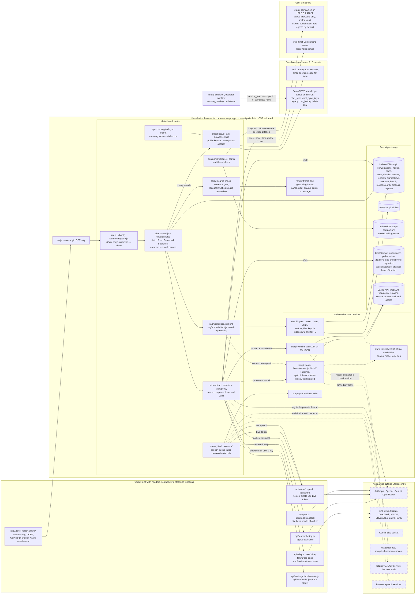

<sub>Sources: [`src/js/main.js`](../src/js/main.js), [`src/js/features/registry.js`](../src/js/features/registry.js), [`src/js/chat/thread.js`](../src/js/chat/thread.js), [`src/js/chat/runner.js`](../src/js/chat/runner.js), [`src/js/ai/catalog/providers.js`](../src/js/ai/catalog/providers.js), [`src/js/ai/transport-select.js`](../src/js/ai/transport-select.js), [`src/js/ai/keys.js`](../src/js/ai/keys.js), [`src/js/store/schema.js`](../src/js/store/schema.js), [`src/js/store/opfs.js`](../src/js/store/opfs.js), [`src/js/companion/pair.js`](../src/js/companion/pair.js), [`src/js/rag/workspace.js`](../src/js/rag/workspace.js), [`src/js/rag/ingest.worker.js`](../src/js/rag/ingest.worker.js), [`src/js/wasm/worker.js`](../src/js/wasm/worker.js), [`src/js/models/integrity.worker.js`](../src/js/models/integrity.worker.js), [`src/js/voice/pcm-worklet.js`](../src/js/voice/pcm-worklet.js), [`src/js/supabase.js`](../src/js/supabase.js), [`src/js/sync/service.js`](../src/js/sync/service.js), [`src/sw.js`](../src/sw.js), [`scripts/headers.json`](../scripts/headers.json), [`scripts/build.mjs`](../scripts/build.mjs), [`api/relay.js`](../api/relay.js), [`api/_lib/relay/upstreams.js`](../api/_lib/relay/upstreams.js), [`api/pool.js`](../api/pool.js), [`api/voice/live-token.js`](../api/voice/live-token.js), [`api/research/step.js`](../api/research/step.js), [`api/health.js`](../api/health.js), [`packages/companion/src/server/http.js`](../packages/companion/src/server/http.js), [`backend/supabase/full_schema.sql`](../backend/supabase/full_schema.sql)</sub>

### What leaves the device: connection state

boot() awaits connect(), which loads the Supabase library on first use (a lazy entry of its own, with the same 12 s deadline as a request) and is safe to call repeatedly: concurrent callers share one attempt. A build the companion serves (profile `companion`) never loads the library and ends offline at once. When navigator.onLine is false, or the library does not load, connect() marks the connection offline without a request. Otherwise ensureSession() reuses a stored session; without one it reads the public auth settings and returns auth_disabled without a sign-in request when anonymous sign-ins are off, returns the timeout error when the settings request timed out, and otherwise calls signInAnonymously(). A probe then reads knowledge_documents for the is_public column; the result sets status, signedIn and hardened, and every change reaches the onConnectionChange listeners of main.js. run() switches a ready connection to offline when a later request fails with a network error or a timeout, and scheduleReconnect() repeats connect() on the online event or after 30 s, doubling up to 5 min. What a state allows: while offline, grounded questions answer from the workspace and registered sources only and knownTitles() returns none. Conversations are never written to Supabase in plaintext (chat-store.js CHAT_SYNC_ENABLED is false); the encrypted sync runs only after the user switched it on with a passphrase, and then it syncs once the connection is ready, a few seconds after a local change, every two minutes while the page is visible, when the browser is online again and when the tab comes back into view. Deleting chats waits for message writes still under way, clears the conversations on the device, deletes the rows a 2.x version may have stored in `chat_history` (skipped only when the connection is ready and canSyncChats() says nothing could have been stored) and, with sync on, writes deletion markers so other browsers delete the chats too.

<!-- diagram: system-context-egress-connection -->
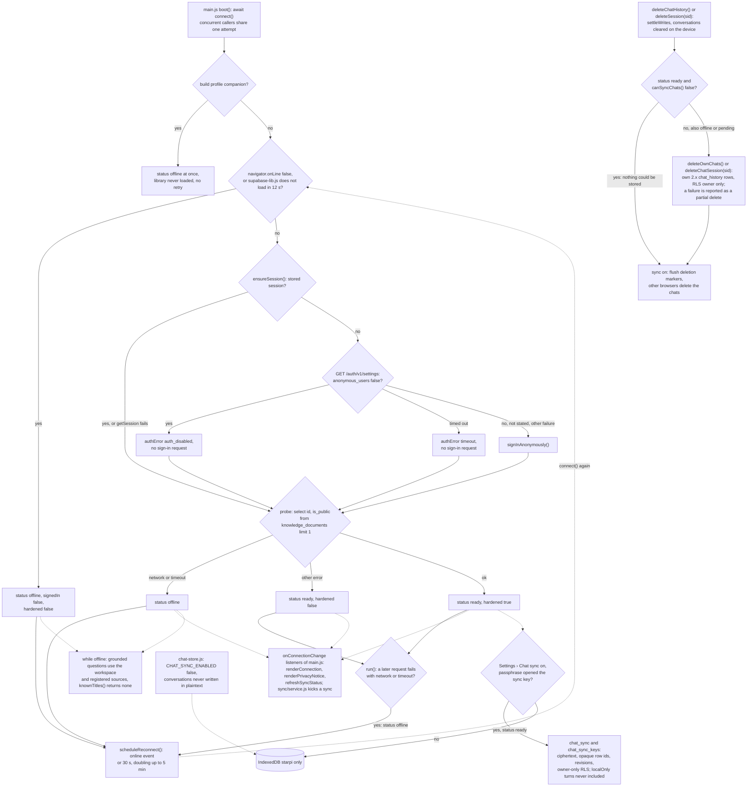

<sub>Sources: [`src/js/supabase.js`](../src/js/supabase.js), [`src/js/supabase-lib.js`](../src/js/supabase-lib.js), [`src/js/main.js`](../src/js/main.js), [`src/js/chat-store.js`](../src/js/chat-store.js), [`src/js/sync/service.js`](../src/js/sync/service.js), [`src/js/sync/sync.js`](../src/js/sync/sync.js), [`src/js/chat/thread.js`](../src/js/chat/thread.js), [`backend/supabase/migrations/20261102000000_chat_sync.sql`](../backend/supabase/migrations/20261102000000_chat_sync.sql)</sub>

### What leaves the device: one chat turn

sendQuestion() takes the composer's draft and the picker value, then fixes the route. An explicit mode wins (Free stays free, Grounded stays grounded); a question that must stay on this device (an AI edit of a canvas document from such an answer) goes the free route and is refused with a notice when no model here can answer it; the paired companion follows the mode control alone (Grounded asks it in sources mode, Free and Auto in free mode). Auto asks decideRoute() in ai/hybrid.js, without a model call: a registered classifier can only tighten the route, attached documents mean grounded, images alone stay free, no source at all keeps it free, a phrase or a file name that points at the sources or two words of a library title in a row mean grounded, and otherwise the workspace probe decides (score at least 0.45 with half the terms covered: grounded; at least 0.30: mixed; at least two matched terms either way; anything else free). Without a model the sources are quoted (grounded); with the Web toggle on and a model without its own search, a search API turns the question into web passages unless the question stays on this device. A grounded or mixed turn retrieves (workspace and registered sources always; the library with the question through search_knowledge, else 30 recent documents ranked here; a question asked with the model of this device ranks the library by a query vector made here, else by candidates fetched without the question), stores the question as local-only when it is device-only or used a workspace passage, and builds a fenced context. The runner asks the candidates in order (an explicit pick is one model; Auto takes the user's keys, the site's pools, the own server, then the model loaded here) and moves on only before the first text. Every model that is not on this device gets the history without the local-only turns and their questions. The answer is stored in IndexedDB as local-only when the question was device-only, used the workspace, or was quoted without a model naming a workspace file; questions to and answers of the companion are always local-only. The encrypted sync never takes a local-only turn.

<!-- diagram: system-context-egress-guards -->
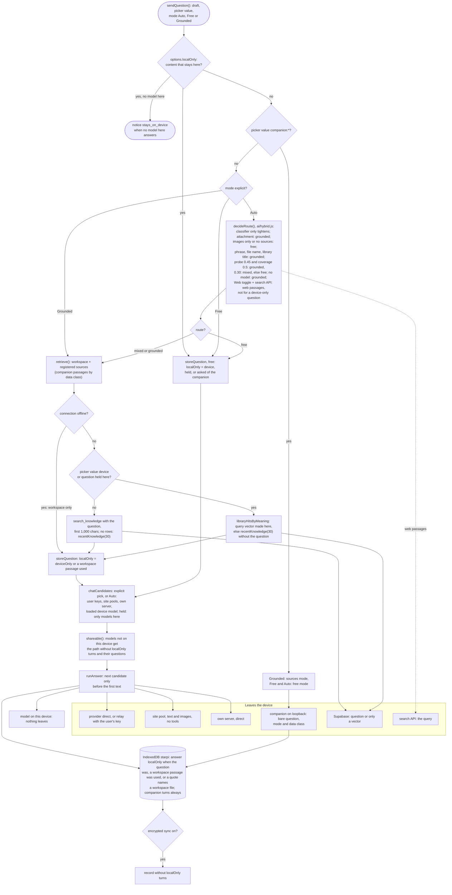

<sub>Sources: [`src/js/chat/thread.js`](../src/js/chat/thread.js), [`src/js/chat/runner.js`](../src/js/chat/runner.js), [`src/js/chat/hooks.js`](../src/js/chat/hooks.js), [`src/js/ai/hybrid.js`](../src/js/ai/hybrid.js), [`src/js/rag/hybrid.js`](../src/js/rag/hybrid.js), [`src/js/rag/embed-client.js`](../src/js/rag/embed-client.js), [`src/js/companion/tier.js`](../src/js/companion/tier.js), [`src/js/supabase.js`](../src/js/supabase.js), [`src/js/providers.js`](../src/js/providers.js), [`src/js/sync/payload.js`](../src/js/sync/payload.js)</sub>

### Library publisher trust boundary

The library publisher (section 10) is the only component that holds the service_role key. It runs as a command line tool on a machine the operator controls and opens no port, so there is no request to guard; what it guards are its reads, which the service role would otherwise let reach every row. The browser bundle never talks to it: the browser and the publisher meet only in the database, where RLS decides what the browser sees of the rows the publisher wrote.

<!-- diagram: system-context-publisher -->
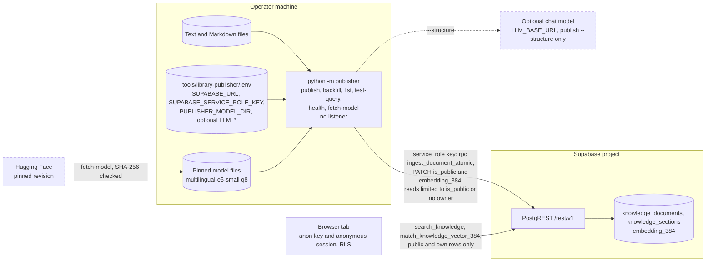

<sub>Sources: [`tools/library-publisher/publisher/cli_supabase.py`](../tools/library-publisher/publisher/cli_supabase.py), [`tools/library-publisher/publisher/config.py`](../tools/library-publisher/publisher/config.py), [`tools/library-publisher/publisher/supabase_service.py`](../tools/library-publisher/publisher/supabase_service.py), [`tools/library-publisher/publisher/model_files.py`](../tools/library-publisher/publisher/model_files.py), [`backend/supabase/full_schema.sql`](../backend/supabase/full_schema.sql)</sub>

### Frontend import graph (1 of 4): main.js and the first load

The numbers in this part come from esbuild's metafile of the production build (`STARPI_META_OUT=<file> npm run build`), not from reading imports by hand. The build bundles 261 inputs under `src/js/` (258 modules and three JSON files: the model catalog snapshot, the role candidates and the model lock), joined by 1,001 static imports and 113 lazy `import()` calls between them; the static graph has no cycles. main.js is the only main-thread entry and imports 27 modules directly. Its static closure, the first load, is 92 modules: the shell, the chat composer and its hooks, the 13 feature modules (each registers what it renders and loads its views later), the model pickers and the device probe, the workspace client, the source check with the English and German language packs, the receipt dialog and the voice entry. Everything else loads on demand: the chat thread and its runner, the AI layer's router, adapters and transports, the conversation store and its 2.x migration, settings views, research, Live, the companion view, the Supabase library, the rendering extras, pdf.js and the French, Spanish, Italian and Turkish language packs. The German pack stays in the first load on purpose: verdicts and the verification of receipts read every pack that a receipt may have been checked with, and `STOPWORDS` is a public export of `@starpi/core`. Every edge below is a static import of main.js; the labels name what main.js calls.

<!-- diagram: frontend-modules-overview -->
```mermaid
flowchart LR
    subgraph g0["Shell: frontend-modules-infrastructure and the views"]
        ui["ui.js<br/>switchTab, onTabOpen, renderConnection,<br/>renderLanguageSwitch, initChatAside"]
        ui__sidebar["ui/sidebar.js<br/>initSidebar, setNavVisible"]
        ui__theme["ui/theme.js<br/>initTheme"]
        ui__kit["ui/kit.js<br/>toast"]
        dialog["dialog.js<br/>openDialog, closeDialog"]
        messages["messages.js<br/>initMessages"]
    end
    subgraph g1["Chat and model choice: frontend-modules-chat"]
        chat["chat.js<br/>initChat, restoreHistory"]
        chat_store["chat-store.js<br/>refreshSyncStatus"]
        providers["providers.js<br/>initProviders: the AI layer when idle"]
        settings["settings.js<br/>initSettings, changeEngine,<br/>renderPrivacyNotice"]
        model_picker["model-picker.js<br/>initModelPicker"]
        engine_ui["engine-ui.js<br/>initEngineUi"]
        rag__citations["rag/citations.js<br/>initCitations"]
    end
    subgraph g2["Feature modules: frontend-modules-views"]
        features__index["features/index.js<br/>mountFeatures: 13 feature modules"]
    end
    subgraph g3["Tabs and views"]
        library["library.js<br/>initLibrary, loadDocuments"]
        graph_tab["graph-tab.js<br/>initGraphTab, graph.js on first open"]
        ingest["ingest.js<br/>initIngest"]
        voice["voice.js<br/>initVoice"]
        bench__bench_ui["bench/bench-ui.js<br/>initBenchUi, refreshDiagnostics"]
    end
    subgraph g4["Trust: frontend-modules-trust"]
        demo["demo.js<br/>initDemo"]
        rag__receipts["rag/receipts.js<br/>initReceipts"]
        core__lang__index["core/lang/index.js<br/>loadShippedLanguages: fr, es, it, tr<br/>after the first paint"]
    end
    subgraph g5["Infrastructure"]
        dom["dom.js<br/>installDelegation, onAction, onChange"]
        i18n__index["i18n/index.js<br/>initI18n, setLocale, onLocaleChange"]
        icons["icons.js<br/>refreshIcons"]
        state["state.js<br/>getAssistant"]
        supabase["supabase.js<br/>connect, onConnectionChange"]
    end
    main["main.js<br/>boot(), registerServiceWorker()"]

    main --> bench__bench_ui
    main --> chat_store
    main --> chat
    main --> demo
    main --> core__lang__index
    main --> dialog
    main --> dom
    main --> engine_ui
    main --> features__index
    main --> graph_tab
    main --> i18n__index
    main --> icons
    main --> ingest
    main --> library
    main --> messages
    main --> model_picker
    main --> rag__citations
    main --> rag__receipts
    main --> providers
    main --> settings
    main --> state
    main --> supabase
    main --> ui
    main --> ui__kit
    main --> ui__sidebar
    main --> ui__theme
    main --> voice
```

<sub>Sources: [`src/js/main.js`](../src/js/main.js), [`scripts/build.mjs`](../scripts/build.mjs)</sub>

### Frontend import graph (2 of 4): the feature modules and what they load when mounted

features/index.js imports the 13 feature modules for their registrations, and main.js mounts them into the shell's 18 mount points (features/registry.js `MOUNT_POINTS`) once at boot; a failing mount is logged and does not stop the others. The feature modules are small and in the first load. What they render or run, the views, the conversation list, the canvas, compare and council panels, research jobs, the sync engine, the Live sheet, the companion view and the trust and tools settings, is imported lazily (dashed) when the feature mounts or is first used. They reach the chat only through its seams (chat/hooks.js, voice/hooks.js), never by editing the thread. The edges are every import of the feature modules except the infrastructure modules (i18n, dom, ui/kit, icons, config, storage, state, store/schema), which frontend-modules-infrastructure counts; the labels name the mount points each one fills.

<!-- diagram: frontend-modules-views -->
```mermaid
flowchart LR
    subgraph g0["Feature modules, in the first load (features/index.js)"]
        features__canvas["features/canvas.js<br/>chat-aside-canvas, chat-aside-compare"]
        features__companion["features/companion.js<br/>tab-companion, companionSettings"]
        features__conversations["features/conversations.js<br/>chat-sidebar"]
        features__live["features/live.js<br/>liveSheet, composerExtras"]
        features__memory["features/memory.js<br/>memorySettings, chatToolbarExtras"]
        features__providers["features/providers.js<br/>providerSettings"]
        features__research["features/research.js<br/>tab-research, chat-aside-research"]
        features__sources["features/sources.js<br/>chat-aside-sources, empty in 3.0"]
        features__sync["features/sync.js<br/>syncSettings"]
        features__tools["features/tools.js<br/>toolSettings"]
        features__trust["features/trust.js<br/>trustSettings"]
        features__voice["features/voice.js<br/>voiceSettings, composerExtras"]
        features__workspace["features/workspace.js<br/>workspaceSettings"]
    end
    subgraph g1["Seams they register with"]
        features__registry["features/registry.js<br/>registerFeature, MOUNT_POINTS"]
        chat__hooks["chat/hooks.js"]
        voice__hooks["voice/hooks.js"]
        code_blocks["code-blocks.js"]
        ui["ui.js"]
        chat_store["chat-store.js"]
        ai__keys["ai/keys.js"]
        rag__workspace["rag/workspace.js"]
        rag__embed_client["rag/embed-client.js"]
        store__quota["store/quota.js"]
        bench__diagnostics["bench/diagnostics.js"]
    end
    subgraph g2["Loaded when a feature mounts or is first used"]
        chat__canvas["chat/canvas.js"]
        chat__compare["chat/compare.js"]
        chat__council_view["chat/council-view.js"]
        chat__thread["chat/thread.js"]
        companion__pair["companion/pair.js"]
        companion__tier["companion/tier.js"]
        companion__view["companion/view.js"]
        chat__sidebar["chat/sidebar.js"]
        live__sheet["live/sheet.js"]
        chat__context["chat/context.js"]
        settings__memory_view["settings/memory-view.js"]
        ai__transport_select["ai/transport-select.js"]
        settings__providers_view["settings/providers-view.js"]
        research__jobs["research/jobs.js"]
        research__deep["research/deep.js"]
        research__runtime["research/runtime.js"]
        research__view["research/view.js"]
        sync__service["sync/service.js"]
        sync__settings_view["sync/settings-view.js"]
        supabase["supabase.js"]
        chat__tools["chat/tools.js"]
        ai__mcp__view["ai/mcp/view.js"]
        trust__settings_view["trust/settings-view.js"]
        trust__model_integrity_view["trust/model-integrity-view.js"]
        voice__settings_view["voice/settings-view.js"]
    end

    features__canvas --> code_blocks
    features__canvas --> chat__hooks
    features__canvas --> ui
    features__canvas --> features__registry
    features__canvas -.-> chat__canvas
    features__canvas -.-> chat__compare
    features__canvas -.-> chat__council_view
    features__canvas -.-> chat__thread
    features__companion --> chat__hooks
    features__companion --> features__registry
    features__companion -.-> companion__pair
    features__companion -.-> companion__tier
    features__companion -.-> companion__view
    features__conversations --> chat_store
    features__conversations --> features__registry
    features__conversations -.-> chat__sidebar
    features__live --> features__registry
    features__live -.-> live__sheet
    features__memory --> chat__hooks
    features__memory --> features__registry
    features__memory -.-> chat__context
    features__memory -.-> settings__memory_view
    features__providers --> ai__keys
    features__providers --> features__registry
    features__providers -.-> ai__transport_select
    features__providers -.-> settings__providers_view
    features__research --> features__registry
    features__research -.-> research__jobs
    features__research -.-> research__deep
    features__research -.-> research__runtime
    features__research -.-> research__view
    features__sources --> features__registry
    features__sync --> features__registry
    features__sync -.-> sync__service
    features__sync -.-> sync__settings_view
    features__sync -.-> supabase
    features__tools --> features__registry
    features__tools -.-> chat__tools
    features__tools -.-> ai__mcp__view
    features__tools -.-> ai__keys
    features__trust --> features__registry
    features__trust -.-> trust__settings_view
    features__trust -.-> trust__model_integrity_view
    features__voice --> features__registry
    features__voice --> voice__hooks
    features__voice -.-> voice__settings_view
    features__workspace --> bench__diagnostics
    features__workspace --> rag__embed_client
    features__workspace --> rag__workspace
    features__workspace --> store__quota
    features__workspace --> features__registry
```

<sub>Sources: [`src/js/features/index.js`](../src/js/features/index.js), [`src/js/features/registry.js`](../src/js/features/registry.js), [`src/js/features/canvas.js`](../src/js/features/canvas.js), [`src/js/features/companion.js`](../src/js/features/companion.js), [`src/js/features/conversations.js`](../src/js/features/conversations.js), [`src/js/features/live.js`](../src/js/features/live.js), [`src/js/features/memory.js`](../src/js/features/memory.js), [`src/js/features/providers.js`](../src/js/features/providers.js), [`src/js/features/research.js`](../src/js/features/research.js), [`src/js/features/sources.js`](../src/js/features/sources.js), [`src/js/features/sync.js`](../src/js/features/sync.js), [`src/js/features/tools.js`](../src/js/features/tools.js), [`src/js/features/trust.js`](../src/js/features/trust.js), [`src/js/features/voice.js`](../src/js/features/voice.js), [`src/js/features/workspace.js`](../src/js/features/workspace.js)</sub>

### Frontend import graph (3 of 4): chat thread and AI layer

chat.js is in the first load and imports chat/thread.js lazily, so the thread (97 KiB) and the AI layer behind it load after the first paint. The thread imports the runner, the conversation store and tree, the composer and attachments, the answer labels, Auto's route decision (ai/hybrid.js) and the context packs (ai/context-pack.js), the retrieval and citation modules, the source check's view and receipts, the web check and the on-device engine; it reaches the router, the OCR hook, the benchmark rates, the sentence gate and the model choices lazily. The runner installs the AI layer (adapters, the transport resolver, the router's world) and asks ai/index.js complete(), which drives one adapter over one transport (ai/stream.js, ai/transport.js). providers.js keeps the state of keys, pools, the own server and the companion, and loads the runner when the layer is first needed. The edges are every import of chat.js, chat/thread.js, chat/runner.js, providers.js, ai/index.js and ai/router.js, without the infrastructure modules; section 14 describes the layer itself.

<!-- diagram: frontend-modules-chat -->
```mermaid
flowchart LR
    subgraph g0["Chat thread"]
        chat["chat.js"]
        chat__thread["chat/thread.js"]
        chat__runner["chat/runner.js"]
        chat__hooks["chat/hooks.js"]
        chat__store["chat/store.js"]
        chat__tree["chat/tree.js"]
        chat__composer["chat/composer.js"]
        chat__actions["chat/actions.js"]
        chat__attachments["chat/attachments.js"]
        chat__answer_labels["chat/answer-labels.js"]
        chat__image_view["chat/image-view.js"]
        chat__mode_control["chat/mode-control.js"]
        chat_export["chat-export.js"]
        chat_store["chat-store.js"]
        chat_stream["chat-stream.js"]
    end
    subgraph g1["AI layer"]
        providers["providers.js"]
        ai__index["ai/index.js"]
        ai__router["ai/router.js"]
        ai__purposes["ai/purposes.js"]
        ai__roles["ai/roles.js"]
        ai__wheel["ai/wheel.js"]
        ai__contract["ai/contract.js"]
        ai__stream["ai/stream.js"]
        ai__sse["ai/sse.js"]
        ai__stop_reason["ai/stop-reason.js"]
        ai__transport["ai/transport.js"]
        ai__transport_select["ai/transport-select.js"]
        ai__errors["ai/errors.js"]
        ai__keys["ai/keys.js"]
        ai__thinking["ai/thinking.js"]
        ai__model_selection["ai/model-selection.js"]
        ai__health_client["ai/health-client.js"]
        ai__hybrid["ai/hybrid.js"]
        ai__context_pack["ai/context-pack.js"]
        ai__catalog__models["ai/catalog/models.js"]
        ai__catalog__pools["ai/catalog/pools.js"]
        ai__catalog__providers["ai/catalog/providers.js"]
        ai__adapters__index["ai/adapters/index.js"]
        ai__adapters__companion["ai/adapters/companion.js"]
        ai__quirks__local["ai/quirks/local.js"]
    end
    subgraph g2["Retrieval, prompts and answers"]
        retrieval["retrieval.js"]
        synthesizer["synthesizer.js"]
        prompts["prompts.js"]
        rag__citations["rag/citations.js"]
        rag__workspace["rag/workspace.js"]
        rag__embed_client["rag/embed-client.js"]
        rag__web_check["rag/web-check.js"]
        rag__ocr_hook["rag/ocr-hook.js"]
        supabase["supabase.js"]
    end
    subgraph g3["Trust"]
        core__grounding["core/grounding.js"]
        core__gate["core/gate.js"]
        rag__grounding_view["rag/grounding-view.js"]
        rag__receipts["rag/receipts.js"]
    end
    subgraph g4["Engines and models"]
        webgpu__engine["webgpu/engine.js"]
        webgpu__models["webgpu/models.js"]
        engine_ui["engine-ui.js"]
        models__bench_rates["models/bench-rates.js"]
        models__choices["models/choices.js"]
        models__nvidia_catalog["models/nvidia-catalog.js"]
        models__wasm_catalog["models/wasm-catalog.js"]
    end
    subgraph g5["Features the thread calls"]
        features__voice["features/voice.js"]
        features__research["features/research.js"]
    end

    chat --> chat_store
    chat --> chat__actions
    chat --> chat__composer
    chat --> chat__hooks
    chat --> chat__mode_control
    chat --> features__research
    chat --> features__voice
    chat --> providers
    chat -.-> chat__thread
    chat -.-> chat_export
    chat__thread --> chat_store
    chat__thread --> chat_stream
    chat__thread --> core__grounding
    chat__thread --> engine_ui
    chat__thread --> providers
    chat__thread --> prompts
    chat__thread --> rag__citations
    chat__thread --> rag__embed_client
    chat__thread --> rag__grounding_view
    chat__thread --> rag__receipts
    chat__thread --> rag__web_check
    chat__thread --> rag__workspace
    chat__thread --> retrieval
    chat__thread --> supabase
    chat__thread --> synthesizer
    chat__thread --> webgpu__engine
    chat__thread --> webgpu__models
    chat__thread --> ai__thinking
    chat__thread --> ai__context_pack
    chat__thread --> ai__hybrid
    chat__thread --> ai__keys
    chat__thread --> features__voice
    chat__thread --> chat__actions
    chat__thread --> ai__adapters__companion
    chat__thread --> chat__answer_labels
    chat__thread --> chat__attachments
    chat__thread --> chat__composer
    chat__thread --> chat__image_view
    chat__thread --> chat__hooks
    chat__thread --> chat__runner
    chat__thread --> chat__tree
    chat__thread -.-> chat__store
    chat__thread -.-> ai__router
    chat__thread -.-> rag__ocr_hook
    chat__thread -.-> models__bench_rates
    chat__thread -.-> core__gate
    chat__thread -.-> models__choices
    chat__runner --> ai__adapters__index
    chat__runner --> ai__catalog__models
    chat__runner --> ai__catalog__pools
    chat__runner --> ai__catalog__providers
    chat__runner --> ai__errors
    chat__runner --> ai__health_client
    chat__runner --> ai__index
    chat__runner --> ai__keys
    chat__runner --> ai__model_selection
    chat__runner --> ai__quirks__local
    chat__runner --> ai__router
    chat__runner --> ai__transport_select
    chat__runner --> ai__wheel
    chat__runner --> providers
    chat__runner --> webgpu__engine
    providers --> ai__catalog__providers
    providers --> ai__catalog__pools
    providers --> ai__keys
    providers --> models__nvidia_catalog
    providers --> models__wasm_catalog
    providers --> webgpu__models
    providers -.-> chat__runner
    ai__index --> ai__contract
    ai__index --> ai__errors
    ai__index --> ai__stream
    ai__index --> ai__stop_reason
    ai__index --> ai__sse
    ai__index --> ai__transport
    ai__router --> ai__catalog__models
    ai__router --> ai__contract
    ai__router --> ai__health_client
    ai__router --> ai__index
    ai__router --> ai__model_selection
    ai__router --> ai__purposes
    ai__router --> ai__roles
    ai__router --> ai__thinking
    ai__router --> ai__wheel
    ai__router -.-> synthesizer
```

<sub>Sources: [`src/js/chat.js`](../src/js/chat.js), [`src/js/chat/thread.js`](../src/js/chat/thread.js), [`src/js/chat/runner.js`](../src/js/chat/runner.js), [`src/js/providers.js`](../src/js/providers.js), [`src/js/ai/index.js`](../src/js/ai/index.js), [`src/js/ai/router.js`](../src/js/ai/router.js)</sub>

### Frontend import graph (4 of 4): source check, sentence gate, receipts and core/

The modules of core/ are the code `@starpi/core` publishes: the source check (labels, sentences, facts, negations, bindings, relations and grounding), the sentence gate (canonical text, release units, spoken digits and the gate), and receipts (hashes, the Merkle tree, signatures and the receipt format), plus the language packs. core/ imports nothing from the app except rag/bm25.js and rag/chunker.js, which the ingestion worker shares, so the same files run in the page, in the worker and in Node. core/lang/index.js imports the English and German packs statically and the four others with `import()`; loadShippedLanguages() (main.js, after the first paint) and a receipt that names one of them load the rest. The app modules on the left use core/: rag/grounding-view.js renders the source check, rag/receipts.js builds and verifies receipts (core/receipt.js and trust/signing.js lazily, when a receipt is opened), rag/web-check.js and chat/answer-labels.js check and label web and mixed answers, demo.js runs the prepared check, and retrieval.js and synthesizer.js label excerpts. The edges are every import among these 35 modules.

<!-- diagram: frontend-modules-trust -->
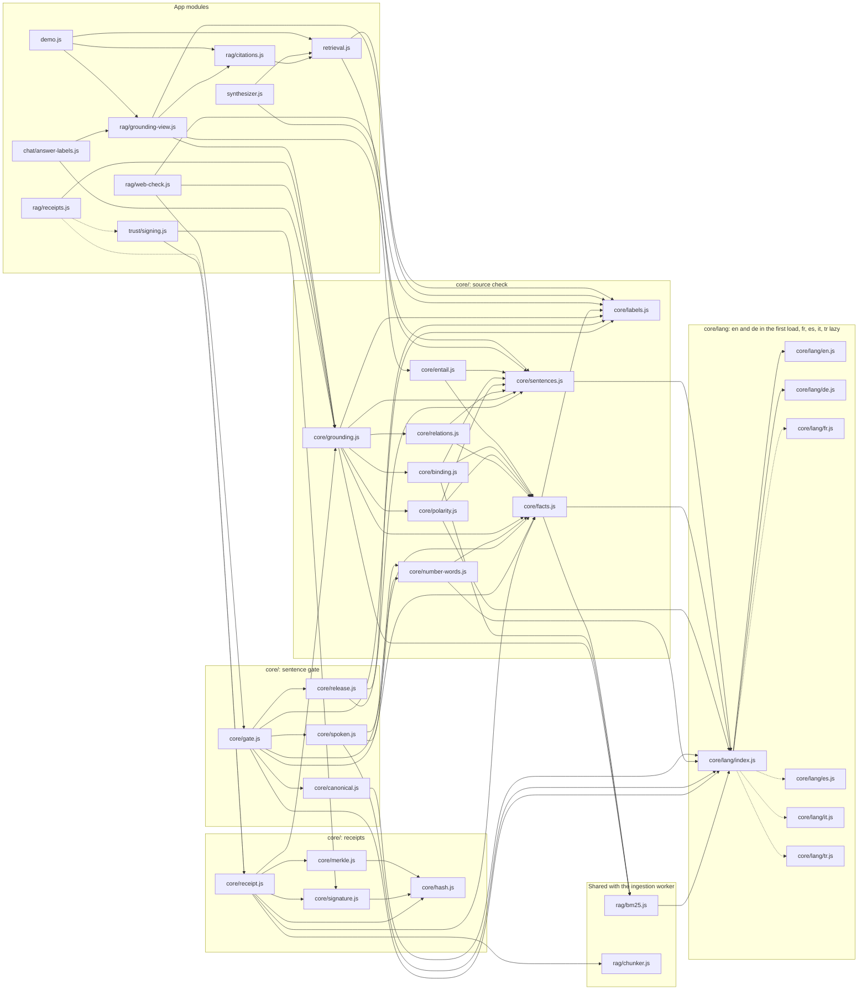

<sub>Sources: [`src/js/core/grounding.js`](../src/js/core/grounding.js), [`src/js/core/gate.js`](../src/js/core/gate.js), [`src/js/core/receipt.js`](../src/js/core/receipt.js), [`src/js/core/lang/index.js`](../src/js/core/lang/index.js), [`src/js/rag/grounding-view.js`](../src/js/rag/grounding-view.js), [`src/js/rag/receipts.js`](../src/js/rag/receipts.js), [`src/js/rag/web-check.js`](../src/js/rag/web-check.js), [`src/js/chat/answer-labels.js`](../src/js/chat/answer-labels.js), [`src/js/trust/signing.js`](../src/js/trust/signing.js), [`src/js/demo.js`](../src/js/demo.js), [`packages/core/src/index.js`](../packages/core/src/index.js)</sub>

### Shared infrastructure modules, their importers and npm packages

Nine modules are imported from almost everywhere, and the four diagrams above leave them out. The counts are static importers among the 261 inputs, by area. i18n/index.js also imports the English dictionaries (`src/locales/index.js`: the root file and every namespace in English, the fallback for every key); the other languages are lazy chunks of their own, one per root file and namespace. Only six npm packages reach the main thread: lucide (icons.js) and marked with DOMPurify (render.js) in the first load; @anthropic-ai/sdk (the Anthropic adapter), @mlc-ai/web-llm (webgpu/engine.js) and pdfjs-dist (rag/parser.js, inside the ingestion worker) by `import()`; @supabase/supabase-js through the lazy entry supabase-lib.js, and highlight.js, KaTeX and a second DOMPurify profile through the lazy entry render-extras.js. @huggingface/transformers runs only in the processor worker, and mermaid only in the sandboxed render frame (a classic bundle of public/render-frame.js, outside this graph).

<!-- diagram: frontend-modules-infrastructure -->
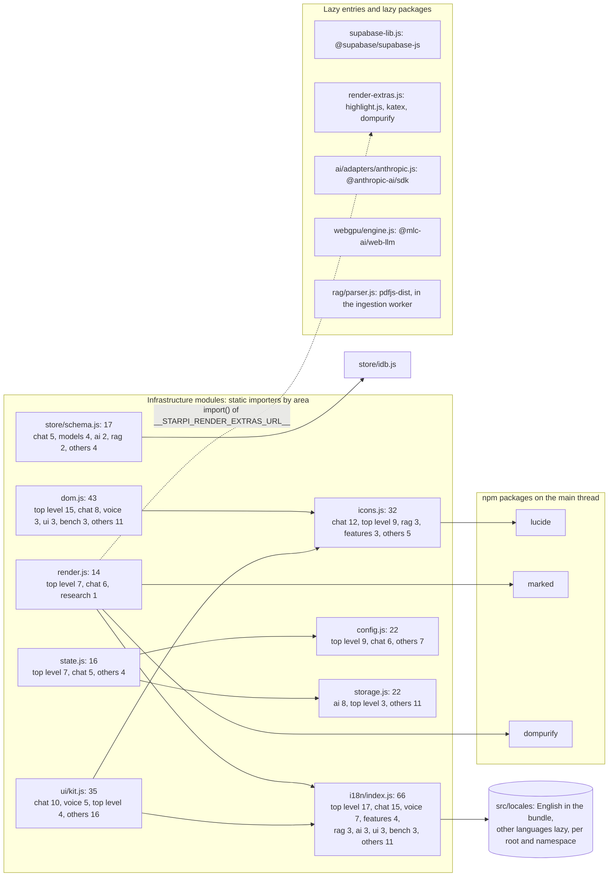

<sub>Sources: [`src/js/i18n/index.js`](../src/js/i18n/index.js), [`src/js/dom.js`](../src/js/dom.js), [`src/js/ui/kit.js`](../src/js/ui/kit.js), [`src/js/icons.js`](../src/js/icons.js), [`src/js/config.js`](../src/js/config.js), [`src/js/storage.js`](../src/js/storage.js), [`src/js/store/schema.js`](../src/js/store/schema.js), [`src/js/state.js`](../src/js/state.js), [`src/js/render.js`](../src/js/render.js), [`src/js/render-extras.js`](../src/js/render-extras.js), [`src/js/supabase-lib.js`](../src/js/supabase-lib.js), [`scripts/build.mjs`](../scripts/build.mjs)</sub>

### Bundle entry points, Web Workers and lazy imports

scripts/build.mjs bundles eight module entries with esbuild (`splitting: true`): main.js, the four workers (webgpu/worker.js, rag/ingest.worker.js, wasm/worker.js, models/integrity.worker.js), the PCM AudioWorklet, the Supabase library (supabase-lib.js) and the rendering extras (render-extras.js), plus the CSS entry. Classic scripts are built apart: theme-boot.js, render-blocking in `<head>` so the theme applies before the first paint; public/render-frame.js and public/grounding-frame.js, one file each because a sandboxed frame has an opaque origin and loads only its own exact-path script (the frame bundle's licences are checked, and mermaid is listed in the SBOM as shipped); and sw.js, written with the build version and the precache list. Nothing imports a worker: the code that needs one starts it from a URL the build writes into a placeholder (`__STARPI_*_URL__`), and the build bundles again until those URLs match the outputs. The processor worker is started for three reasons: a processor (WASM) model (webgpu/engine.js), search by meaning (rag/embed-client.js) and the on-device second opinion (wasm/nli.js). A build plugin maps onnxruntime-web/webgpu and onnxruntime-common to onnxruntime-web/wasm, so one ONNX Runtime without `new Function` ships, and its binary is copied to a hashed `/assets` URL. The service worker precaches the page, the CSS, main.js and its static chunks, the ingestion worker, the Latin font and the public files; the rest is cached on first use. Dashed edges are worker starts, the worklet, lazy `import()` calls (grouped by the area they load) and fetches. scripts/build-core.mjs builds `@starpi/core` (packages/core/src/index.js, scripts/verify-receipt.mjs, scripts/ground.mjs and scripts/gate.mjs) apart from the app.

<!-- diagram: frontend-modules-workers -->
```mermaid
flowchart TD
    subgraph classic["Classic scripts"]
        themeboot["theme-boot.js in head:<br/>theme before the first paint"]
        rframe["public/render-frame.js: mermaid, previews,<br/>sandboxed frame, connect-src none"]
        gframe["public/grounding-frame.js:<br/>search suggestions, sandboxed frame"]
        sw["src/sw.js to dist/sw.js:<br/>version, precache list"]
    end
    subgraph mainEntry["entry main: src/js/main.js, 92 modules in the first load"]
        main["main.js"]
        engine["webgpu/engine.js"]
        workspace["rag/workspace.js"]
        embed["rag/embed-client.js"]
        nli["wasm/nli.js, lazy"]
        integrity["models/integrity.js, lazy"]
        capture["voice/capture.js"]
        render["render.js"]
        sbmod["supabase.js"]
        langs["core/lang/index.js"]
    end
    subgraph lazyAreas["Lazy chunks of the main entry"]
        lzChat["chat/thread.js, runner, store, migrate-v1,<br/>canvas, compare, council, context, tools"]
        lzAi["ai/router.js, purposes, adapters, search,<br/>@anthropic-ai/sdk"]
        lzFeat["settings, sync, research, Live, companion,<br/>trust and tools views"]
        lzLang["core/lang fr, es, it, tr;<br/>locale roots and namespaces"]
        lzLock["models/model-lock.json"]
    end
    subgraph ingestEntry["entry ingest-worker: Worker starpi-ingest"]
        iw["rag/ingest.worker.js, workspace-core.js,<br/>store/schema.js, core/lang/index.js"]
        parser["rag/parser.js, rag/formats/*"]
        pdf["pdfjs-dist legacy build"]
    end
    subgraph llmEntry["entry webllm-worker: Worker starpi-webllm"]
        ww["webgpu/worker.js: @mlc-ai/web-llm"]
    end
    subgraph wasmEntry["entry wasm-worker: Worker starpi-wasm"]
        wsw["wasm/worker.js: @huggingface/transformers,<br/>models/wasm-catalog.js, embed-catalog.js"]
    end
    subgraph intEntry["entry integrity-worker: Worker starpi-integrity"]
        iwk["models/integrity.worker.js,<br/>integrity-hash.js"]
    end
    pcm["entry pcm-worklet: AudioWorklet starpi-pcm"]
    sblib["entry supabase: supabase-lib.js,<br/>not precached"]
    extras["entry render-extras: highlight.js, KaTeX,<br/>second sanitizer"]
    ort[("/assets/ort-wasm-simd-threaded-hash.wasm")]
    webllmPkg["@mlc-ai/web-llm chunk"]

    main -.->|"serviceWorker.register"| sw
    main --> engine
    main --> workspace
    main --> render
    main --> sbmod
    main --> langs
    main -.-> lzChat
    lzChat -.-> lzAi
    main -.-> lzFeat
    langs -.-> lzLang
    workspace -.->|"new Worker"| iw
    iw --> parser
    parser -.->|"import()"| pdf
    engine -.->|"new Worker: WebGPU preset"| ww
    engine -.->|"new Worker: processor model"| wsw
    engine -.->|"import() in loadWebLLM"| webllmPkg
    ww --> webllmPkg
    embed -.->|"new Worker: query and file vectors"| wsw
    nli -.->|"new Worker: second opinion"| wsw
    wsw -.->|"fetched on first load"| ort
    engine -.-> integrity
    embed -.-> integrity
    nli -.-> integrity
    integrity -.->|"new Worker"| iwk
    integrity -.-> lzLock
    capture -.->|"audioWorklet.addModule"| pcm
    sbmod -.->|"import() with a 12 s deadline"| sblib
    render -.->|"import() for highlighting and math"| extras
```

<sub>Sources: [`scripts/build.mjs`](../scripts/build.mjs), [`scripts/build-core.mjs`](../scripts/build-core.mjs), [`src/js/main.js`](../src/js/main.js), [`src/js/theme-boot.js`](../src/js/theme-boot.js), [`src/js/webgpu/engine.js`](../src/js/webgpu/engine.js), [`src/js/rag/workspace.js`](../src/js/rag/workspace.js), [`src/js/rag/embed-client.js`](../src/js/rag/embed-client.js), [`src/js/wasm/nli.js`](../src/js/wasm/nli.js), [`src/js/models/integrity.js`](../src/js/models/integrity.js), [`src/js/voice/capture.js`](../src/js/voice/capture.js), [`src/js/render.js`](../src/js/render.js), [`src/js/supabase.js`](../src/js/supabase.js), [`src/js/core/lang/index.js`](../src/js/core/lang/index.js), [`src/js/rag/ingest.worker.js`](../src/js/rag/ingest.worker.js), [`src/js/webgpu/worker.js`](../src/js/webgpu/worker.js), [`src/js/wasm/worker.js`](../src/js/wasm/worker.js), [`src/js/models/integrity.worker.js`](../src/js/models/integrity.worker.js), [`src/js/voice/pcm-worklet.js`](../src/js/voice/pcm-worklet.js), [`public/render-frame.js`](../public/render-frame.js), [`public/grounding-frame.js`](../public/grounding-frame.js), [`src/sw.js`](../src/sw.js)</sub>

## 2. Boot and settings

What happens between the first byte of `index.html` and a usable chat, how the stored model choice is applied without a download, how the conversation store opens (with the one-time move of 2.x data), and how settings, keys and the vault, key tests and the deletion of the chat history work.

### boot(): module start-up order

theme-boot.js, a classic script in `<head>`, applies the stored theme (system, light or dark) before the first paint. main.js boot() then runs initI18n first, so the stored language (or English) is applied before any module renders text; a stored language other than English has its dictionary loaded before main.js runs. It installs the delegated click and change dispatcher and builds the shell: initTheme, initSidebar (a rail that collapses, a drawer on phones), renderLanguageSwitch (the six-language select that replaces the static EN/DE buttons of the pre-boot markup) and initChatAside (the chat side panel). It registers switch-tab and set-locale, the lazy onTabOpen hooks of the library and the diagnostics tab, and runs the init functions in order: initMessages, initProviders (which sets up the AI layer once the page is idle and again whenever keys, pools or the own server change), initSettings, initModelPicker (after the settings, so the pickers show the stored choice first and the device's groups later), initEngineUi, initChat, initLibrary, initIngest, initGraphTab, initVoice, initBenchUi, initCitations, initDemo and initReceipts. mountFeatures() then mounts every feature registration into its mount point (not awaited; a failing mount is logged). refreshIcons, detectAndDisplayDevice and registerServiceWorker follow, and loadShippedLanguages() loads the French, Spanish, Italian and Turkish packs of the source check after the first paint. boot() subscribes to onConnectionChange before connect(), so later reconnects reach the same listener (renderConnection, renderPrivacyNotice, refreshSyncStatus). changeEngine(getAssistant(), interactive false) is started with void and never downloads; connect() and restoreHistory() are awaited in sequence. A throw inside boot() skips the remaining steps, and reportUnexpected only logs it.

<!-- diagram: boot-sequence-overview -->
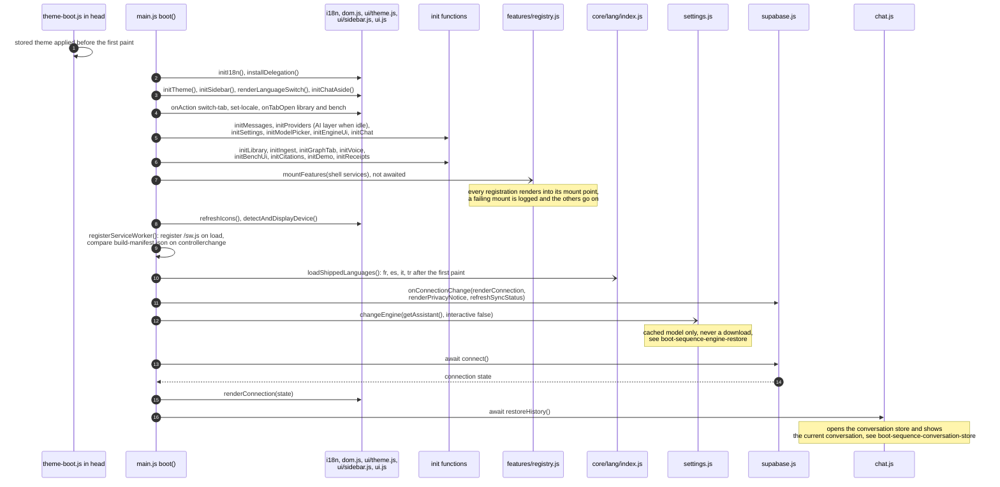

<sub>Sources: [`src/js/main.js`](../src/js/main.js), [`src/js/theme-boot.js`](../src/js/theme-boot.js), [`src/js/ui/theme.js`](../src/js/ui/theme.js), [`src/js/ui/sidebar.js`](../src/js/ui/sidebar.js), [`src/js/ui.js`](../src/js/ui.js), [`src/js/i18n/index.js`](../src/js/i18n/index.js), [`src/js/dom.js`](../src/js/dom.js), [`src/js/providers.js`](../src/js/providers.js), [`src/js/features/registry.js`](../src/js/features/registry.js), [`src/js/core/lang/index.js`](../src/js/core/lang/index.js), [`src/js/settings.js`](../src/js/settings.js), [`src/js/supabase.js`](../src/js/supabase.js), [`src/js/chat.js`](../src/js/chat.js)</sub>

### Boot-time changeEngine: cached model only, never a download

state.js has already read the stored picker value (`starpi_assistant_v1`) when the module loaded; a profile of 2.x without one gets it once from `starpi_compute_mode` (`council` becomes `auto`, `client` becomes `device`, `local` becomes `local:*`, `nvidia` becomes `nvidia:<stored model>`), and the normalised values are written back. At boot changeEngine applies that value with interactive false. parsePickerValue (models/choices.js) accepts `auto`, `device`, an on-device preset (`webgpu:<key>`, `wasm:<key>`), `local:*`, `companion:starpi-core`, and `<provider>:<model>` for a known provider (an NVIDIA model only from its allowlist); anything else leaves the pickers on the stored choice. For `device`, startLocalEngine calls loadModel with onlyIfCached true and no confirmDownload callback: the device probe (high-performance adapter, 10 s deadline) and chooseModel (the stored preference; `auto` takes the benchmark history into account and picks a processor model without WebGPU) decide the model, and a model whose files are missing resolves false before WebLLM is imported or a worker starts. A cached model has its stored files checked against `model-lock.json` before a runtime reads them (section 5), then loads; a model that is only partly cached resolves false with status idle. In no case is model data downloaded. A failure rejects with an EngineError that engine-ui.js turns into a notice. `local:*` probes the own server's model list (GET /v1/models, 4 s) and shows the result in the engine dot and the status line. Every other value only shows whether the model can be reached now (renderReach: a key, a pool with keys, a paired companion) without a request.

<!-- diagram: boot-sequence-engine-restore -->
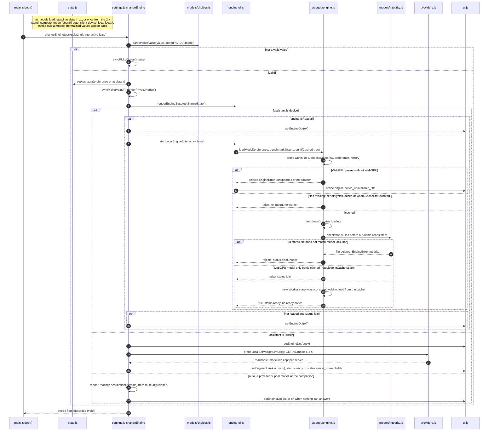

<sub>Sources: [`src/js/main.js`](../src/js/main.js), [`src/js/state.js`](../src/js/state.js), [`src/js/config.js`](../src/js/config.js), [`src/js/settings.js`](../src/js/settings.js), [`src/js/models/choices.js`](../src/js/models/choices.js), [`src/js/engine-ui.js`](../src/js/engine-ui.js), [`src/js/webgpu/engine.js`](../src/js/webgpu/engine.js), [`src/js/models/integrity.js`](../src/js/models/integrity.js), [`src/js/wasm/client.js`](../src/js/wasm/client.js), [`src/js/providers.js`](../src/js/providers.js), [`src/js/ui.js`](../src/js/ui.js)</sub>

### Opening the conversation store

restoreHistory() loads the chat thread (chat/thread.js, a lazy chunk) and shows the current conversation; the chat session id in `starpi_chat_session_id` is the id of a conversation. The thread asks chat-store.js for the store, which imports chat/store.js on first use, and openChatStore() runs the start-up migrations once per page: store/migrate.js holds a Web Lock while it works and records a marker per migration in the `settings` store, so each runs once per browser profile. The first, `local-chats-v1`, turns every chat that 2.x kept in `starpi_local_chats_v1` into a conversation with one linear thread, in one transaction with its marker and with ids derived from the legacy data, so a repeat after an interrupted run finds its own records; every message keeps its on-device flag (`localOnly`), so a turn that stayed on the device in 2.x is never sent to a cloud model as history later. The second, `legacy-keys-v1`, moves the provider keys 2.x remembered in plaintext into the tab's session storage and removes them and the remember switch from localStorage (the key store does the same on its first use). A migration that fails is tried again on the next start, and the ones after it wait. showConversation() then loads the conversation's active path from IndexedDB and renders it; notices shown since boot stay below it, and an answer still being written in that conversation keeps streaming under its question. Nothing is merged with a server copy: the encrypted sync (section 8) writes into the same store through its change events, and the thread follows such changes on screen.

<!-- diagram: boot-sequence-conversation-store -->
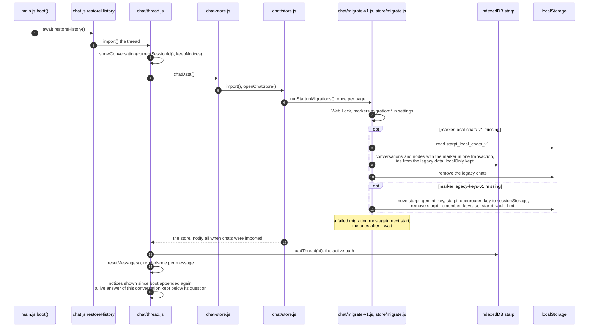

<sub>Sources: [`src/js/chat.js`](../src/js/chat.js), [`src/js/chat/thread.js`](../src/js/chat/thread.js), [`src/js/chat-store.js`](../src/js/chat-store.js), [`src/js/chat/store.js`](../src/js/chat/store.js), [`src/js/chat/migrate-v1.js`](../src/js/chat/migrate-v1.js), [`src/js/store/migrate.js`](../src/js/store/migrate.js), [`src/js/ai/keys.js`](../src/js/ai/keys.js), [`src/js/store/schema.js`](../src/js/store/schema.js), [`tests/e2e/migration.spec.mjs`](../tests/e2e/migration.spec.mjs)</sub>

### saveSettings: model strength and a pending assistant pick

Keys, the vault, the relay switch and the own server's address moved to Settings › Model providers and keys (settings/providers-view.js, next section); the Save button of the general settings keeps two things. The model strength (max, super, auto or fast: ai/model-selection.js, which Auto and provider picks follow) is stored again when it differs from the stored one or when the browser refused it when it was picked. The assistant pickers apply a pick when it is made, so Save calls changeEngine only when the settings picker shows another value than the stored choice (a keyboard pick that has not settled yet); re-applying the shown recommendation would turn a stored `auto` into a fixed model. The alert says settings.saved_toast only when every write was stored, otherwise settings.save_failed. The own server's address is saved in the providers card after normalizeServerUrl: `https` anywhere, `http` only for loopback hosts, no user or password, query and fragment dropped.

<!-- diagram: settings-flow-save -->
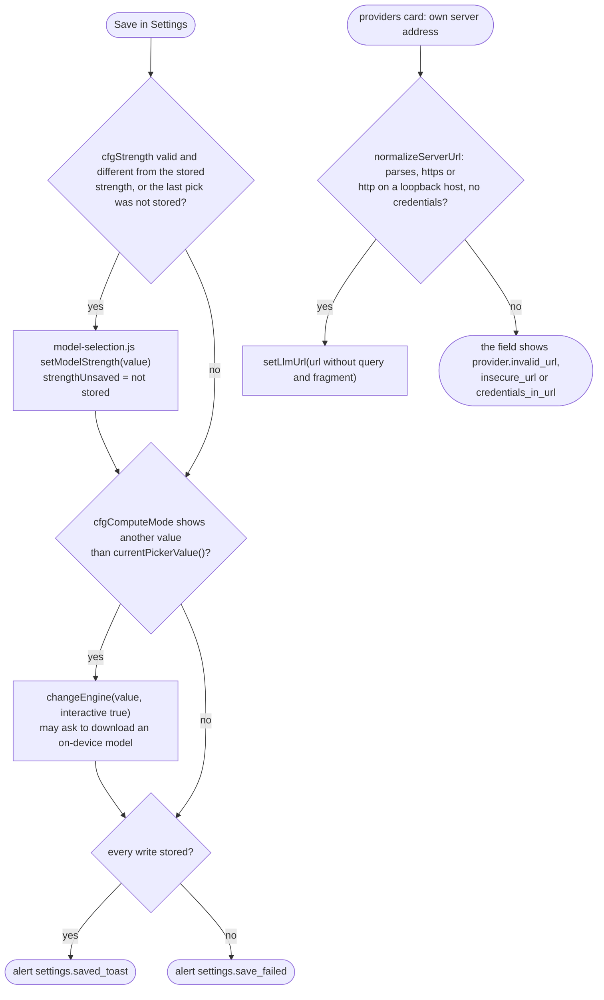

<sub>Sources: [`src/js/settings.js`](../src/js/settings.js), [`src/js/ai/model-selection.js`](../src/js/ai/model-selection.js), [`src/js/model-picker.js`](../src/js/model-picker.js), [`src/js/settings/providers-view.js`](../src/js/settings/providers-view.js), [`src/js/providers.js`](../src/js/providers.js), [`src/js/state.js`](../src/js/state.js)</sub>

### Keys: the tab, the vault and its lock

A key typed into Settings › Model providers and keys lives in the tab's session storage by default and is gone when the tab closes. With a passphrase (at least 8 characters) the vault keeps every key it holds as one AES-GCM-256 record in the `keyvault` store of the app database; the AES key is derived with PBKDF2-SHA-256 (600,000 iterations, a 16-byte random salt) as a non-extractable CryptoKey that lives in memory only. Creating the vault moves every key of the tab into it. Unlocking derives the key again and reads the record afresh (another tab may have replaced it); locking by hand or after 30 minutes without activity drops the key and the decrypted keys from memory. setKey stores a key either in the tab or, with keep-in-vault, in the unlocked vault, and removes the other copy. MCP bearer tokens, the voice and search services and the site's access code have slots of their own in the same store. While the vault is unlocked, other features can seal their own text with its key, bound to their purpose; the saved notes of the memory do. Keys are never written in plaintext outside session storage, never exported, synced or put into receipts and logs, and a transport sets the provider's auth header itself. changeEngine applies a picked model (refused while an answer is being written, because unloading the model would cut it off; an interactive pick of an on-device model may ask to download it). Delete downloaded model data unloads the engine, deletes the processor models' cache and every WebLLM model of the catalog, and resets the integrity records, so a new download is hashed again.

<!-- diagram: settings-flow-keys-vault -->
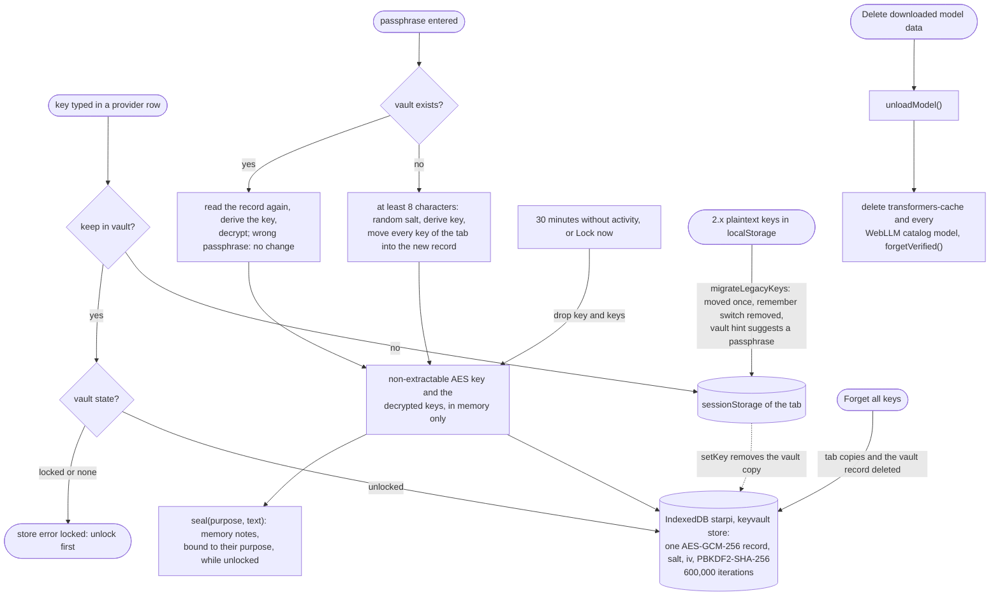

<sub>Sources: [`src/js/ai/keys.js`](../src/js/ai/keys.js), [`src/js/storage.js`](../src/js/storage.js), [`src/js/settings/providers-view.js`](../src/js/settings/providers-view.js), [`src/js/store/migrate.js`](../src/js/store/migrate.js), [`src/js/settings.js`](../src/js/settings.js), [`src/js/webgpu/engine.js`](../src/js/webgpu/engine.js), [`src/js/models/integrity.js`](../src/js/models/integrity.js)</sub>

### deleteHistory: deleting the chat history

The delete-chat-history button is refused with settings.delete_history_busy while an answer is being written, because the running turn would be stored again. Otherwise it asks for confirmation (a stronger text when the encrypted sync is on, since the deletion also reaches the synced copy and the other browsers) and calls deleteChatHistory in chat-store.js. It waits for message writes still under way and marks their sessions as deleted, so a write that ends later cannot store a deleted chat again; it notes the ids of every conversation when sync is on, clears every conversation in IndexedDB and starts a new session id. It then deletes what a 2.x version may have stored in the plaintext `chat_history` table: nothing when the connection is ready and canSyncChats() is false, otherwise deleteOwnChats() (own rows only, by RLS; a failure counts as partial). With sync on, the sync hook writes deletion markers for the noted conversations now, so other browsers delete them too; it reports a failure when that failed or a conversation came back because another browser added messages to it. The chat on screen is reset whatever happened, and the alert says done or partial. Delete this chat in the conversation list does the same for one conversation (deleteSession).

<!-- diagram: settings-flow-delete-history -->
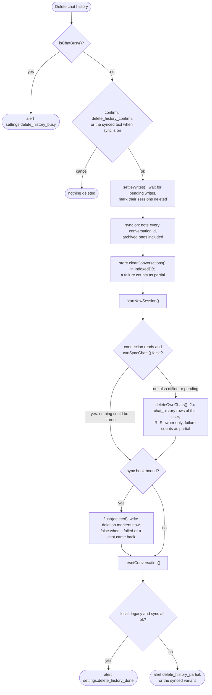

<sub>Sources: [`src/js/settings.js`](../src/js/settings.js), [`src/js/chat-store.js`](../src/js/chat-store.js), [`src/js/chat/store.js`](../src/js/chat/store.js), [`src/js/sync/service.js`](../src/js/sync/service.js), [`src/js/sync/sync.js`](../src/js/sync/sync.js), [`src/js/supabase.js`](../src/js/supabase.js), [`src/js/chat.js`](../src/js/chat.js)</sub>

### Testing a key

The Test button of a provider row tests the key typed into the row (without saving it) or, with an empty field, the stored one; the own server row tests its address after normalizeServerUrl, with an optional key. testKey (ai/transport-select.js) builds the transport a call would take, without the site's pools: direct, auto (direct, retried through the relay when the browser blocks the call), or the relay. When no transport fits (the relay is switched off for a provider that needs it), the result is the code cors, else auth. The test asks the provider's model list (GET /models) with a timeout; a 2xx answer is ok and names the route that answered (direct or relay). Any other answer is reduced to an error code (fromHttp: auth, quota, rate_limited, not_found, server and others), and a thrown error to the code toAiError gives (network, timeout, cors, aborted). The provider's error text is never shown or kept: the row shows the code and the translated text of `ai.error.<code>`. Afterwards the row statuses are refreshed.

<!-- diagram: settings-flow-test-key -->
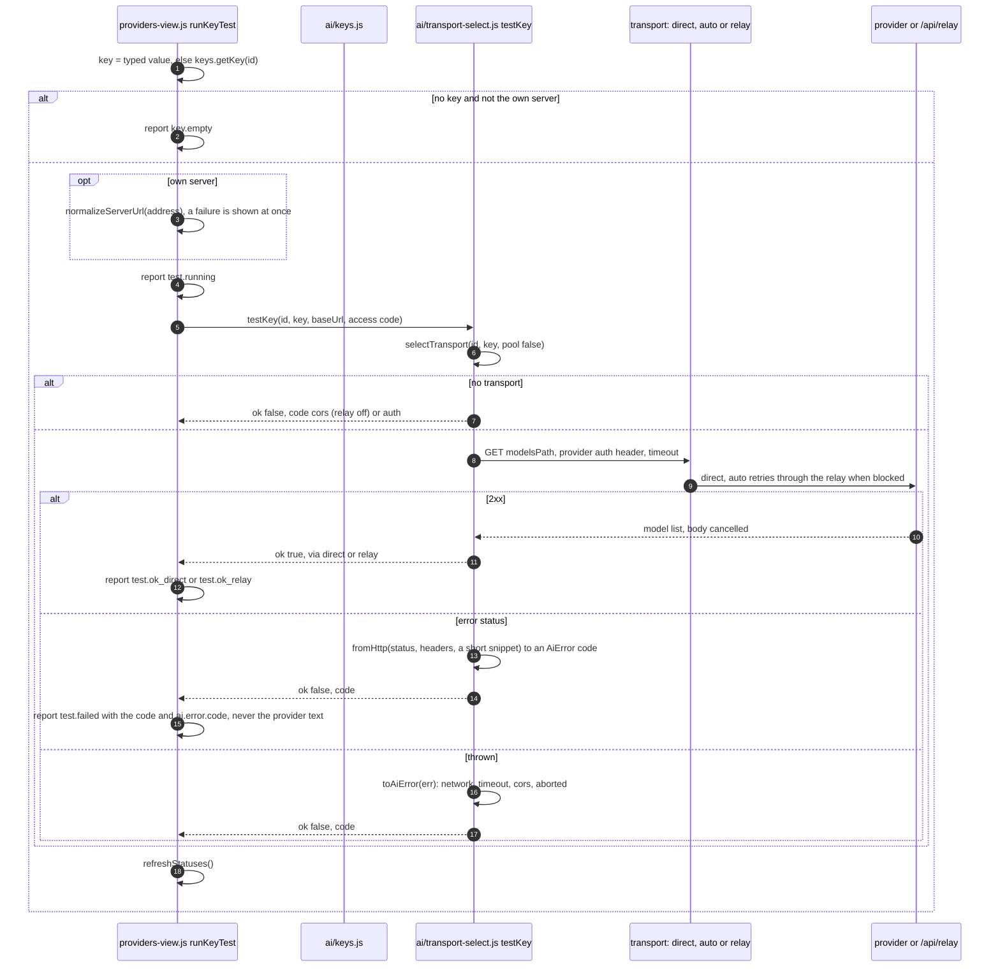

<sub>Sources: [`src/js/settings/providers-view.js`](../src/js/settings/providers-view.js), [`src/js/ai/transport-select.js`](../src/js/ai/transport-select.js), [`src/js/ai/transport.js`](../src/js/ai/transport.js), [`src/js/ai/errors.js`](../src/js/ai/errors.js), [`src/js/ai/keys.js`](../src/js/ai/keys.js), [`src/js/providers.js`](../src/js/providers.js)</sub>

## 3. Answering a question

What happens from Send to a stored answer: the route a question takes (Auto, Free, Grounded), where its excerpts come from, how the runner picks and streams a model, how the source check and the receipt follow, what leaves the device per model, compare and the council, and how models on this device are chosen and sized.

### A question in the thread

sendQuestion() (chat/thread.js) takes the composer's draft (text and attachments, read by the ingestion worker for files) or a question from elsewhere (a suggested question, a graph entity, the canvas) and the picker value. A turn runs inside withTurn(): one at a time, with Stop and the busy state around it; a failure becomes a notice from i18n only. The route comes first (Auto's decision, the explicit mode, or the companion's rule; see what-leaves-the-device in section 1). The free route stores the question at once, with a context block of the date, time and time zone and the notes of registered hooks, then answerFree() asks chatCandidates() and streams the answer through the runner; the registered tool runner may run the calls the model stopped for (with approval cards in the bubble) and the answer goes on after them. The grounded and mixed routes go to answerGrounded(), which retrieves first and stores the question only after retrieval shows whether it stays on this device. A turn writes to the conversation it started in (turnConversation()), also when the user opens another chat meanwhile; the answer node records the provider, model, route, usage, stop reason, label, attempts and, for a grounded answer, the source-check counts. The first answer of a conversation may give it a title, asked only of the provider that answered (never for an answer that stays on this device).

<!-- diagram: chat-request-lifecycle -->
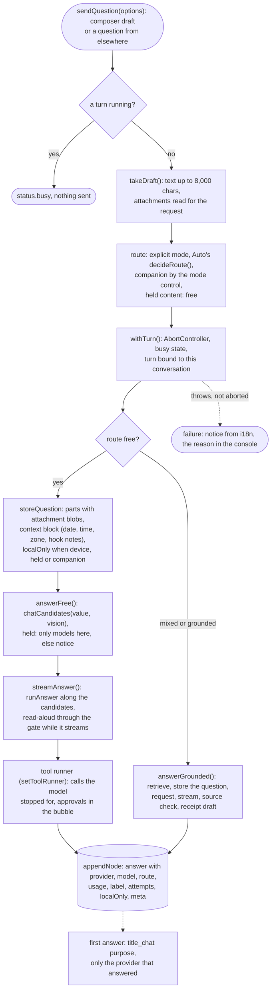

<sub>Sources: [`src/js/chat/thread.js`](../src/js/chat/thread.js), [`src/js/chat/composer.js`](../src/js/chat/composer.js), [`src/js/chat/attachments.js`](../src/js/chat/attachments.js), [`src/js/chat/runner.js`](../src/js/chat/runner.js), [`src/js/chat/hooks.js`](../src/js/chat/hooks.js), [`src/js/chat/store.js`](../src/js/chat/store.js), [`src/js/ai/hybrid.js`](../src/js/ai/hybrid.js), [`src/js/ai/router.js`](../src/js/ai/router.js)</sub>

### retrieve(): where the excerpts come from

retrieve() runs the workspace search and the registered retrieval sources (registerRetrievalSource: the companion's documents and notes, each source with a 5 s deadline) at the same time. The workspace search covers the conversation's scope (setWorkspaceScope, a project's files) plus the files attached to the question, or only the files a question names (docIds: an entity found in some files, which also leaves the library and the sources out). A workspace-only question (a suggested question about the sample files) stops there. While the connection is offline the library is skipped. A question that may leave the device sends the question to search_knowledge (the first 1,000 characters, 6 rows) and falls back to the 30 newest documents ranked in the browser when that finds nothing or fails. A device-only question (the model of this device, or a question held here) ranks the library by a query vector made on this device (libraryHitsByMeaning, when search by meaning is on and the optional vector migration is installed); without one, the 30 newest documents are fetched without the question and ranked in the browser. mergeHits() then joins the workspace hits with the sources' and the library's (next section); the limit is 6 plus 3 per attached file, at most 15. The method line names the parts that answered (workspace, library by full text, by meaning or by keyword, offline).

<!-- diagram: chat-request-retrieve -->
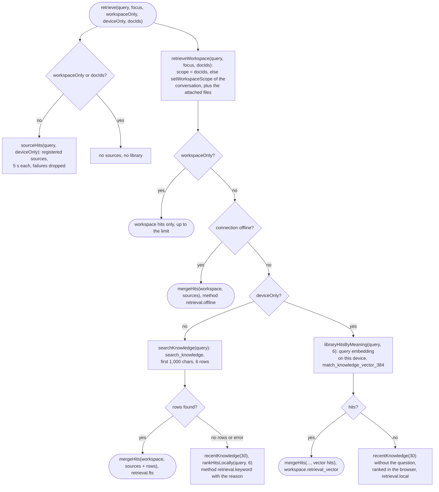

<sub>Sources: [`src/js/chat/thread.js`](../src/js/chat/thread.js), [`src/js/chat/hooks.js`](../src/js/chat/hooks.js), [`src/js/retrieval.js`](../src/js/retrieval.js), [`src/js/rag/embed-client.js`](../src/js/rag/embed-client.js), [`src/js/companion/tier.js`](../src/js/companion/tier.js), [`src/js/supabase.js`](../src/js/supabase.js), [`src/js/config.js`](../src/js/config.js)</sub>

### Workspace hits and mergeHits: slots per source and the pinned files

searchWorkspace resolves empty without asking the ingestion worker when the workspace has no documents or the query is blank. Otherwise the worker ranks with BM25, or, when search by meaning is on and the files have vectors, with BM25 and the cosine similarity of a query vector fused by reciprocal rank fusion (k 60, 50 candidates per ranking), and returns the top 6 chunks. Without an attached file every hit is kept in rank order. Each attached file pins up to 3 of its matching chunks, or its first 3 chunks (score 0) when none matched, in front of the hits from other files; any worker error drops all workspace hits. mergeHits keeps the pinned hits, then gives the other side (registered sources and the library) the larger of half the remaining slots (rounded up) and the slots the other workspace hits cannot fill, but never more than it has hits, and fills the rest with workspace hits. The order is pinned hits, other workspace hits, then the other side, so neither crowds out the other.

<!-- diagram: chat-request-workspace-merge -->
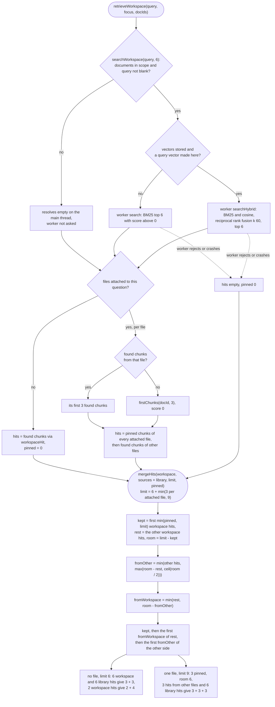

<sub>Sources: [`src/js/chat/thread.js`](../src/js/chat/thread.js), [`src/js/retrieval.js`](../src/js/retrieval.js), [`src/js/rag/workspace.js`](../src/js/rag/workspace.js), [`src/js/rag/ingest.worker.js`](../src/js/rag/ingest.worker.js), [`src/js/rag/hybrid.js`](../src/js/rag/hybrid.js), [`src/js/rag/bm25.js`](../src/js/rag/bm25.js), [`src/js/config.js`](../src/js/config.js)</sub>

### The runner: candidates, failover before the first text, and the quoted fallback

chatCandidates() turns the picker value into the models a question may go to: an explicit pick is that one model on its route; Auto is the user's keys first (the model the chosen strength names, else the provider's balanced model), then the site's pools that have keys, then the own server, then the model already loaded on this device (never a download). A question with images goes only to models that see; the companion answers only when it is picked. runAnswer() asks them in order: a call that fails before any text or reasoning arrived (auth, quota, rate limit, a model gone, a bad request, context length, server, timeout, network, a bad response, CORS, a cut stream) moves on to the next candidate; once text arrived the answer belongs to that model, and Stop keeps what arrived. Every call is recorded in attempts and the model wheel hears every outcome (a cooldown after 429, a circuit after repeated failures). An answer paused by the server (Anthropic pause_turn) is sent again with its content, at most five times, and merged. The adapter streams over one transport: direct, auto (direct, retried through the relay once when the browser blocks the call, and remembered per provider), relay, pool (the site's keys) or device (the workers, the own server, the companion). In the grounded route, no candidate, a failure without text or an empty answer ends in synthesizeAnswer(), which quotes the excerpts; the free route ends in a notice instead.

<!-- diagram: chat-request-answer-dispatch -->
```mermaid
flowchart TD
    value(["picker value"])
    cands["chatCandidates(value, vision)"]
    pickQ{"Auto?"}
    one["the picked model on its route<br/>(device only once loaded or loadable)"]
    auto["keys: strength model, else balanced<br/>then site pools with keys, then own server,<br/>then the model loaded on this device"]
    vis["images: only models that see"]
    run["runAnswer(candidates, build per model)"]
    next{"next candidate?"}
    callStream["adapter.stream over the transport:<br/>direct, auto with relay retry, relay, pool, device"]
    first{"text or reasoning arrived?"}
    fail["error code in NEXT_CANDIDATE:<br/>attempt recorded, wheel.failed"]
    owns["the answer belongs to this model,<br/>Stop keeps what arrived"]
    pause{"stop reason pause_turn?"}
    again["send again with the content, at most 5 times,<br/>parts merged"]
    done(["result, target, attempts"])
    noneLeft(["no answer: error of the last attempt"])
    gq{"grounded route?"}
    synth(["synthesizeAnswer(): quotes the excerpts,<br/>engine synthesizer"])
    noticeF(["free route: notice, nothing stored"])
    value --> cands --> pickQ
    pickQ -->|"no"| one --> vis
    pickQ -->|"yes"| auto --> vis
    vis --> run --> next
    next -->|"yes"| callStream --> first
    first -->|"no, failed"| fail --> next
    first -->|"yes"| owns --> pause
    pause -->|"yes"| again --> pause
    pause -->|"no"| done
    next -->|"no"| noneLeft --> gq
    gq -->|"yes"| synth
    gq -->|"no"| noticeF
```

<sub>Sources: [`src/js/chat/runner.js`](../src/js/chat/runner.js), [`src/js/providers.js`](../src/js/providers.js), [`src/js/ai/index.js`](../src/js/ai/index.js), [`src/js/ai/transport-select.js`](../src/js/ai/transport-select.js), [`src/js/ai/transport.js`](../src/js/ai/transport.js), [`src/js/ai/wheel.js`](../src/js/ai/wheel.js), [`src/js/ai/errors.js`](../src/js/ai/errors.js), [`src/js/ai/model-selection.js`](../src/js/ai/model-selection.js), [`src/js/synthesizer.js`](../src/js/synthesizer.js), [`src/js/chat/thread.js`](../src/js/chat/thread.js)</sub>

### Auto, Free and Grounded: how each route builds its request

A free request (freeRequest) has the stable free system prompt plus the notes of registered system hooks, the history the model may see (shareable(): models not on this device never get the local-only turns or their questions), and the question with its attachments and the notes for this request (registerRequestNotes: saved memory notes, at most 8, never stored with the question). For Anthropic the history goes whole (the server compacts it past 100,000 tokens); for others it is trimmed to the model's context minus the answer. The answer may use half the model's context, at most 4,096 tokens on the site's pools, 4,096 on the own server and 16,000 in the cloud; on this device the adapter applies the device's output budget. With the Web toggle on, a model that can search searches by itself (not on the pools). A grounded request has the last 4 shareable turns. Models with a large window (32,768 tokens and more, in the cloud or on a pool) get the fenced excerpts in the system prompt (buildContext, at most 9,000 characters, each excerpt at most 1,600). Models on this device, the own server, models with a smaller window and every mixed answer get a context pack (ai/context-pack.js) sized by the window: small (up to 4k tokens) 3 passages of 600 characters, mid (up to 16k) 6 of 1,600, large up to 12 passages and 24,000 characters. The pack keeps a stable order for a server's KV cache (the fixed instruction as the system prompt, the earlier turns, then the `<<<SOURCES>>>` block with the question), labels passages [S1] and facts [F1], and expandLabels() rewrites those to the canonical labels before the source check, the receipt and storage. A mixed answer takes at most 3 passages and may add general knowledge; its checked parts are marked. On the site's pools every request is fitted to the pool's limits. What reached the model of each excerpt (full, partial or omitted) comes from the pack's coverage or from the fenced context parsed back, and the source check reads it.

<!-- diagram: chat-routes-requests -->
```mermaid
flowchart TD
    q(["question on its route"])
    r{"route"}
    subgraph free["Free: freeRequest"]
        fsys["system: free prompt + system hook notes"]
        fhist["history: shareable(path) for the model;<br/>Anthropic whole, others trimmed to the window"]
        fq["question + attachments + request notes<br/>(memory, at most 8, not stored)"]
        fout["maxOutputTokens: half the window, at most<br/>4,096 pool, 4,096 own server, 16,000 cloud;<br/>device: the output budget in the adapter"]
        fweb["Web toggle: the model's own search,<br/>not on the site's pools"]
    end
    subgraph gr["Grounded and mixed: groundedRequest"]
        ghist["history: last 4 shareable turns"]
        packQ{"mixed, on this device, own server,<br/>or window under 32,768 tokens?"}
        fenced["system prompt with the fenced excerpts:<br/>buildContext, 9,000 chars, 1,600 per excerpt"]
        pack["context pack: small 3 x 600, mid 6 x 1,600,<br/>large 12 passages, 24,000 chars;<br/>instruction, turns, then the SOURCES block + question;<br/>labels S1 and F1"]
        expand["expandLabels(): canonical labels before<br/>the check, the receipt and storage"]
        cov["coverage per excerpt: full, partial, omitted"]
    end
    fit["site pool: fitPoolRequest to the pool's limits"]
    q --> r
    r -->|"free"| fsys --> fhist --> fq --> fout
    fq -.-> fweb
    r -->|"grounded or mixed"| ghist --> packQ
    packQ -->|"no"| fenced --> cov
    packQ -->|"yes"| pack --> expand --> cov
    fout --> fit
    cov --> fit
```

<sub>Sources: [`src/js/chat/thread.js`](../src/js/chat/thread.js), [`src/js/ai/context-pack.js`](../src/js/ai/context-pack.js), [`src/js/retrieval.js`](../src/js/retrieval.js), [`src/js/prompts.js`](../src/js/prompts.js), [`src/js/ai/thinking.js`](../src/js/ai/thinking.js), [`src/js/ai/adapters/on-device.js`](../src/js/ai/adapters/on-device.js), [`src/js/ai/catalog/pools.js`](../src/js/ai/catalog/pools.js), [`src/js/core/grounding.js`](../src/js/core/grounding.js)</sub>

### After rendering: source check, receipt draft and the stored turn

When a grounded answer has a citation scope, the label under it says "checking" while the source check runs after the stream. Its sources are the excerpts with the part that reached the model (the pack's coverage, the fenced context parsed back, or every excerpt in full for a quoted answer), and "given" is the question plus the user's last 4 turns (what the user said may be repeated without a source, the model's own earlier answers may not). A mixed answer gets its checked statements marked (applyMixedMarks); every other grounded answer gets applyGrounding with the current rules (version 3: values, negations, bindings and relations), whose AI-judge second opinion is offered only for answers that may leave the device. An answer that rests on web passages is checked and labelled but gets no receipt, because a web passage is what the search said about a page and the receipt format has no place for it. For the others a receipt draft is built in memory: the answer, engine and language, the question, the source-check report, every citation with its document fingerprint and chunk span, the sentence gate's counts in sources mode, the relations the check found, and whatever registered receipt hooks add; it becomes a signed `starpi.receipt/v3` file only when the user exports it (section 12). A free answer that searched the web is checked as far as its citations allow (rag/web-check.js: checked against quoted page text, segments checked by the gate in web mode, cited, or none). The answer node stores the label (grounded, mixed, web, free), the counts and localOnly (device-only, a workspace passage used, or a quoted answer naming a workspace file).

<!-- diagram: chat-request-source-check -->
```mermaid
flowchart TD
    ans(["answer text after expandLabels(), message element, scope"])
    scopeQ{"citation scope?"}
    noCheck(["no check, stored as is"])
    label["renderAnswerLabel(checking)"]
    cov["sources: excerpt label, doc, heading, the delivered text<br/>and state (full, partial, omitted)"]
    given["given: the question and the user's last 4 turns"]
    mixedQ{"mixed answer with a model?"}
    mixed["applyMixedMarks: checked statements marked"]
    check["applyGrounding: rules version 3,<br/>second opinion only when not localOnly"]
    webQ{"any web passage?"}
    noRcpt["no receipt: checked and labelled only"]
    draft["receipt draft: answer, engine, locale, question,<br/>report, citations with fingerprints and spans"]
    gate["gateCounts: sentence gate in sources mode,<br/>released and withheld"]
    rel["receiptAdvisory(report): relations"]
    hooks["registerReceiptHook additions"]
    btn["receipt button; export signs a v3 file"]
    store[("appendNode: label, grounding counts,<br/>sources, localOnly, meta")]
    ans --> scopeQ
    scopeQ -->|"no"| noCheck
    scopeQ -->|"yes"| label --> cov --> given --> mixedQ
    mixedQ -->|"yes"| mixed --> webQ
    mixedQ -->|"no"| check --> webQ
    webQ -->|"yes"| noRcpt --> store
    webQ -->|"no"| draft --> gate --> rel --> hooks --> btn --> store
```

<sub>Sources: [`src/js/chat/thread.js`](../src/js/chat/thread.js), [`src/js/rag/grounding-view.js`](../src/js/rag/grounding-view.js), [`src/js/chat/answer-labels.js`](../src/js/chat/answer-labels.js), [`src/js/rag/web-check.js`](../src/js/rag/web-check.js), [`src/js/rag/receipts.js`](../src/js/rag/receipts.js), [`src/js/core/grounding.js`](../src/js/core/grounding.js), [`src/js/core/gate.js`](../src/js/core/gate.js), [`src/js/core/receipt.js`](../src/js/core/receipt.js), [`src/js/chat/hooks.js`](../src/js/chat/hooks.js)</sub>

### synthesizeAnswer: the extractive fallback

synthesizeAnswer never generates text: it builds Markdown from the used hits and their citations, and only the grounded route uses it (a free answer has no excerpts to quote): when no model is set up, every candidate failed before the first text, or the answer came back empty. Its document list joins the titles of the used hits with the known titles (workspace file names plus knownTitles(), which calls listDocuments unless the connection is offline and caches the titles for 60 s only after a successful read) and shows up to 8 of them followed by "and n more". A greeting-only message gets synth.greeting with that list, and a request for the list itself (DOC_LIST_REQUEST, such as "Which documents are available?") gets the list, or the unreachable text when the knowledge base could not be searched and no title is known. Otherwise it quotes up to 4 sentences that share a search term with the question, each with the label of its excerpt; the last sentence of an excerpt cut at 1600 chars is left out. When no sentence shares a term (for example "Summarize the attached file"), it quotes the first 2 quotable sentences of each passage, at most 4, the attached file first. Only when nothing is quotable does it answer with the unreachable or the no-hits text. When modelAvailable is false, every answer ends with synth.footer_no_model.

<!-- diagram: chat-request-synthesizer -->
```mermaid
flowchart TD
    In(["synthesizeAnswer(query, hits, citations, knownTitles,<br/>modelAvailable, kbUnavailable, focusName)"]) --> Titles["document list: titles of the hits + known titles, unique<br/>shows 8, then synth.more_documents<br/>empty: synth.kb_unavailable_short when kbUnavailable,<br/>else synth.no_documents"]
    Titles --> Greet{"isGreeting(query)?<br/>only a greeting, or who are you,<br/>what can you do"}
    Greet -->|"yes"| GreetOut["synth.greeting,<br/>synth.available_documents and the list"]
    Greet -->|"no"| DocList{"DOC_LIST_REQUEST?<br/>e.g. Which documents are available?"}
    DocList -->|"yes"| DocUnav{"kbUnavailable and<br/>no title known?"}
    DocUnav -->|"yes"| Unav["synth.kb_unavailable_heading<br/>and synth.kb_unavailable_body"]
    DocUnav -->|"no"| DocOut["synth.documents_heading with the count,<br/>then the list"]
    DocList -->|"no"| Quot["quotable text per hit: the excerpt as given,<br/>an excerpt cut at 1600 chars loses its last sentence"]
    Quot --> Facts["extractSentences(query, quotable, 4):<br/>sentences of 16 to 399 chars with at least 5 words,<br/>no lower-case fragment at a workspace chunk start,<br/>scored by shared query terms, best first"]
    Facts --> HasFacts{"any sentence shares<br/>a term?"}
    HasFacts -->|"yes"| FactsOut["synth.facts_heading, one line per sentence:<br/>document title, sentence, excerpt label"]
    HasFacts -->|"no"| Open["first 2 quotable sentences per passage,<br/>at most 4, the attached file first"]
    Open --> HasOpen{"any sentence?"}
    HasOpen -->|"yes, file attached"| FileOut["synth.file_heading with the file name,<br/>lines with excerpt labels"]
    HasOpen -->|"yes, no file"| Closest["synth.closest_heading, synth.closest_note,<br/>lines with excerpt labels"]
    HasOpen -->|"no"| KbChk{"kbUnavailable?"}
    KbChk -->|"yes"| Unav
    KbChk -->|"no"| NoHits["synth.no_hits_heading, synth.no_hits_body,<br/>synth.available_documents and the list"]
    Done(["Markdown, engine synthesizer<br/>modelAvailable false: synth.footer_no_model appended"])
    GreetOut --> Done
    DocOut --> Done
    Unav --> Done
    FactsOut --> Done
    FileOut --> Done
    Closest --> Done
    NoHits --> Done
```

<sub>Sources: [`src/js/synthesizer.js`](../src/js/synthesizer.js), [`src/js/chat/thread.js`](../src/js/chat/thread.js), [`src/js/retrieval.js`](../src/js/retrieval.js), [`src/js/core/sentences.js`](../src/js/core/sentences.js), [`src/js/supabase.js`](../src/js/supabase.js), [`src/locales/en.json`](../src/locales/en.json)</sub>

### Answer modes: what leaves the device

What leaves the device depends on the model that answers, not only on the mode. A model on this device (WebLLM on WebGPU or Transformers.js on the processor) gets everything in its worker: nothing of the question leaves, the library is ranked by a query vector made here or by candidates fetched without the question, and there is no web search and no cloud tool. A provider with the user's key gets the request direct from the browser, or through the relay for providers that refuse browser calls (the relay forwards once and keeps nothing); the site's pools get the same request with a site key from the allowlist (text and images, no tools); the own server gets it direct, never through the site; the paired companion gets the bare question with its mode and data class over the loopback interface. In the grounded route the request carries the excerpts and the last 4 shareable turns, and the question goes to the library search (full text) unless it stays on this device; in the free route it carries the shareable history, the question and its attachments. With no model (or after a failure) the excerpts are quoted, and only the question went to the library search. Local-only turns (device, workspace passages, quoted answers naming a workspace file, the companion's turns) are never part of another model's history and never enter the encrypted sync.

<!-- diagram: modes-privacy-data-egress -->
```mermaid
flowchart TD
    ask(["question with the picked model and the composer's mode"])
    who{"who answers?"}
    subgraph dev["Stays in this browser"]
        dWorker["starpi-webllm or starpi-wasm: system, excerpts<br/>or attachments, history and question in the worker"]
        dLib["library: query vector made here,<br/>else 30 newest documents without the question"]
        dNo["no web search, no cloud tools, no title request"]
        quote["synthesizeAnswer: quotes the excerpts,<br/>no model"]
    end
    subgraph net["Sent over the network"]
        prov["provider with the user's key: direct (Anthropic,<br/>OpenAI, Gemini, OpenRouter) or through the relay<br/>(xAI, Groq, Mistral, DeepSeek, NVIDIA key)"]
        pool["site pool: text and images, no tools,<br/>allowlisted model, site key"]
        srv["own server: direct, https or loopback http"]
        comp["companion: bare question, mode, data class,<br/>loopback; answer arrives gated"]
        lib["Supabase search_knowledge: the question,<br/>first 1,000 chars"]
        web["search API or the provider's web search:<br/>the query, not for device-only questions"]
        hf["model files after a confirmation: Hugging Face,<br/>raw.githubusercontent.com, ONNX Runtime from /assets"]
    end
    grounded{"grounded or mixed route?"}
    gPayload["excerpts + last 4 shareable turns + question"]
    fPayload["shareable history + question + attachments"]
    hist["shareable(): local-only turns and their questions<br/>never go to a model not on this device"]
    saved[("IndexedDB: localOnly turns stay;<br/>encrypted sync takes the others only")]

    ask --> who
    who -->|"model on this device"| dWorker
    dWorker -.-> dLib
    dWorker -.-> dNo
    dWorker -.->|"not cached, after a confirmation"| hf
    who -->|"provider with a key"| grounded
    who -->|"site pool"| grounded
    who -->|"own server"| grounded
    who -->|"companion"| comp
    who -->|"no model or a failure, grounded"| quote
    grounded -->|"yes"| gPayload --> lib
    grounded -->|"no"| fPayload
    gPayload --> hist
    fPayload --> hist
    hist --> prov
    hist --> pool
    hist --> srv
    fPayload -.->|"Web toggle"| web
    quote -.->|"question to the library search"| lib
    dWorker --> saved
    prov --> saved
    pool --> saved
    srv --> saved
    comp --> saved
    quote --> saved
```

<sub>Sources: [`src/js/chat/thread.js`](../src/js/chat/thread.js), [`src/js/chat/runner.js`](../src/js/chat/runner.js), [`src/js/ai/catalog/providers.js`](../src/js/ai/catalog/providers.js), [`src/js/ai/transport-select.js`](../src/js/ai/transport-select.js), [`src/js/ai/catalog/pools.js`](../src/js/ai/catalog/pools.js), [`src/js/ai/adapters/companion.js`](../src/js/ai/adapters/companion.js), [`src/js/companion/tier.js`](../src/js/companion/tier.js), [`src/js/rag/embed-client.js`](../src/js/rag/embed-client.js), [`src/js/supabase.js`](../src/js/supabase.js), [`src/js/synthesizer.js`](../src/js/synthesizer.js), [`src/js/sync/payload.js`](../src/js/sync/payload.js), [`src/js/webgpu/engine.js`](../src/js/webgpu/engine.js), [`src/js/wasm/worker.js`](../src/js/wasm/worker.js)</sub>

### Compare and the council

Both run in the chat side panel and ask several models the same question at once, always in the free route. thread.js prepareQuestion() builds the question once: a stored one (Compare or Council on a message takes the answer's question) or a new one typed there or taken from the composer, with the context block and the notes for this request; for each model it builds the request the thread's free route would send, with the history that model may see. A question that stays on this device builds no request for other models (the code stays_on_device). Compare asks 2 to 4 models, each in its own column through runAnswer with that one model and no fallback, with its own Stop, time, tokens and a cost hint; the tool runner runs each column's tool calls with their approval cards there. A new question for models here and the own server only is marked as staying on this device: it is offered only the tools that keep it here and goes to no search service (a thread question to the own server is not marked so: the decision keeps the privacy-first default for Compare). A compare column asks the paired companion the way the thread does (the bare question, sources or free mode, the question's data class, no app tools; a stopped answer is not kept). Each finished column is labelled like a free answer (presentAnswer on the fields of freeAnswerInput), and "Continue with this" makes it the newest branch under the question (adoptAnswer). The council (ai/council.js) seats up to three members from different providers, each pinned without fallback and limited to 120 s per draft, and a judge, the strongest model that is not a member, chooses a draft or merges them; with fewer than two valid drafts the best draft stands. The model on this device and the companion take no part, and a question that stays on this device is not sent to a council. The result becomes an answer under the question, labelled with how it was decided, and keeps a bounded copy of the drafts and the judge's reasons.

<!-- diagram: chat-compare-council -->
```mermaid
flowchart TD
    start(["Compare or Council: a stored question,<br/>or a new one from the panel or the composer"])
    prep["thread.js prepareQuestion(): the question node,<br/>context block, request notes once,<br/>build(target) = the free route's request"]
    stays{"question stays on this device?"}
    which{"panel"}
    subgraph cmp["Compare: 2 to 4 columns"]
        models["models from the picker's choices,<br/>different providers first;<br/>device models only when loaded"]
        col["per column: runAnswer(one model, no fallback),<br/>own Stop, time, tokens, cost hint"]
        compCol["companion column: bare question, sources or free,<br/>data class, no app tools, stopped answer not kept"]
        heldCol["new question for models here and the own server only:<br/>stays on this device, no search service,<br/>only tools that keep it here"]
        toolsC["tool runner per column, approvals in the column"]
        present["presentAnswer(freeAnswerInput): not checked,<br/>stop note, cited pages and their web check"]
        adopt(["Continue with this: adoptAnswer, newest branch"])
    end
    subgraph cou["Council: ai/council.js"]
        seat["up to 3 members from different providers, pinned,<br/>120 s per draft; no device model, no companion"]
        judge["judge: strongest model that is not a member,<br/>council_judge purpose: chosen, reasons, merged"]
        few{"fewer than 2 valid drafts,<br/>or the judge fails?"}
        best["best valid draft stands, the result says why"]
        result(["answer under the question: judge's choice, merged,<br/>or best draft; bounded copy of drafts and reasons"])
    end
    refuse(["notice: stays_on_device"])
    start --> prep --> stays
    stays -->|"yes, council"| refuse
    stays -->|"yes, compare"| heldCol --> col
    stays -->|"no"| which
    which -->|"compare"| models --> col
    models -.-> compCol --> present
    col --> toolsC --> present --> adopt
    which -->|"council"| seat --> judge --> few
    few -->|"yes"| best --> result
    few -->|"no"| result
```

<sub>Sources: [`src/js/chat/compare.js`](../src/js/chat/compare.js), [`src/js/chat/council-view.js`](../src/js/chat/council-view.js), [`src/js/ai/council.js`](../src/js/ai/council.js), [`src/js/ui/council-panel.js`](../src/js/ui/council-panel.js), [`src/js/chat/thread.js`](../src/js/chat/thread.js), [`src/js/chat/runner.js`](../src/js/chat/runner.js), [`src/js/features/canvas.js`](../src/js/features/canvas.js)</sub>

### Settings: what the model choice stores

The picker value is the only model choice the app stores (`starpi_assistant_v1`); a preset picked on this device stores `device` plus the preset in `starpi_webgpu_model`, and an NVIDIA pick also remembers its model. The strength and a pinned model go to `starpi_model_strength_v1` and `starpi_model_pinned_v1`. The own server's address (`starpi_llm_url`) passes normalizeServerUrl first: `https` anywhere, `http` only for `localhost` and `127.0.0.1`, no user name or password, query and fragment dropped; the browser shows its local-network prompt for loopback addresses from the hosted app. The relay switch is `starpi_relay_fallback` (on unless switched off), and the route a provider with transport auto took last is remembered per provider (`starpi_transport_<id>`), so a provider that needs the relay goes there at once. Keys are not settings: they live in the tab or in the vault (section 2). Every write goes through storage.js, which never throws: a browser that refuses storage keeps the choice for the page and the save reports it.

<!-- diagram: modes-privacy-settings-storage -->
```mermaid
flowchart TD
    pick(["picker value"])
    setA["state.js setAssistant()"]
    devQ{"webgpu:key or wasm:key?"}
    pref[("starpi_webgpu_model: the preset,<br/>assistant stored as device")]
    nvQ{"nvidia:model?"}
    nv[("starpi_nvidia_model")]
    asst[("starpi_assistant_v1, and the 2.x<br/>starpi_compute_mode kept in step")]
    pick --> setA --> devQ
    devQ -->|"yes"| pref --> asst
    devQ -->|"no"| nvQ
    nvQ -->|"yes"| nv --> asst
    nvQ -->|"no"| asst

    strength(["strength or pinned model"]) --> sel[("starpi_model_strength_v1,<br/>starpi_model_pinned_v1")]

    url(["own server address"])
    norm{"normalizeServerUrl: https, or http on<br/>localhost or 127.0.0.1; no credentials"}
    llm[("starpi_llm_url without query and fragment")]
    bad(["provider.invalid_url, insecure_url<br/>or credentials_in_url"])
    url --> norm
    norm -->|"ok"| llm
    norm -->|"no"| bad

    relay(["relay switch"]) --> rs[("starpi_relay_fallback: absent = on, 0 = off")]
    auto(["auto provider answered"]) --> tr[("starpi_transport_id: direct or relay")]
    keys(["provider keys"]) -.->|"not settings: tab or vault"| vault[("sessionStorage or IndexedDB keyvault")]
```

<sub>Sources: [`src/js/state.js`](../src/js/state.js), [`src/js/config.js`](../src/js/config.js), [`src/js/ai/model-selection.js`](../src/js/ai/model-selection.js), [`src/js/providers.js`](../src/js/providers.js), [`src/js/ai/transport-select.js`](../src/js/ai/transport-select.js), [`src/js/storage.js`](../src/js/storage.js), [`src/js/ai/keys.js`](../src/js/ai/keys.js), [`src/js/settings/providers-view.js`](../src/js/settings/providers-view.js)</sub>

### Privacy notice under the chat input

renderPrivacyNotice() (settings.js) writes one line under the composer for the picked model and the composer's mode, and re-renders when the mode, the assistant, the providers or the sync change. destinationOf() resolves the picker value: `device` (or Auto with only the loaded model), the own server, the companion, a provider with a key, a site pool, or none. Free mode says what goes where without sources; Auto and Grounded say what source mode sends. The companion's line follows the mode control alone (Grounded answers from its documents and notes, Free and Auto from general knowledge). When the encrypted sync is on and the question may leave the browser, a second line says the conversation is also kept in the synced copy; with the companion it says instead that questions to the companion and its answers stay on this device and are not part of the synced copy.

<!-- diagram: modes-privacy-notice -->
```mermaid
flowchart TD
    render(["renderPrivacyNotice(): on mode, assistant,<br/>providers and sync changes"])
    dest{"destinationOf(getAssistant())"}
    free{"mode Free?"}
    devK["lock: privacy.local / privacy.free_local"]
    srvK["server: privacy.server / privacy.free_server,<br/>host of the own server"]
    cmpK["plug: Grounded privacy.companion,<br/>Free and Auto privacy.free_companion"]
    poolK["cloud: chat-thread.privacy.pool / free_pool,<br/>provider name"]
    keyK["cloud: chat-thread.privacy.key / free_key,<br/>provider name"]
    noneK["library: privacy.extractive / privacy.free_no_model"]
    syncQ{"destination not device and<br/>encrypted sync on?"}
    synced["second line: chat-thread.privacy.history_synced"]
    unsynced["companion: chat-thread.privacy.companion_unsynced,<br/>its questions and answers are not synced"]
    out(["icon and text set with setText, re-translated on a language switch"])
    render --> dest
    dest -->|"device"| devK
    dest -->|"local"| srvK
    dest -->|"companion"| cmpK
    dest -->|"pool"| poolK
    dest -->|"key"| keyK
    dest -->|"none"| noneK
    free -.->|"picks the free_ key"| devK
    devK --> syncQ
    srvK --> syncQ
    cmpK --> syncQ
    poolK --> syncQ
    keyK --> syncQ
    noneK --> syncQ
    syncQ -->|"yes, not companion"| synced --> out
    syncQ -->|"yes, companion"| unsynced --> out
    syncQ -->|"no"| out
```

<sub>Sources: [`src/js/settings.js`](../src/js/settings.js), [`src/js/providers.js`](../src/js/providers.js), [`src/js/chat-store.js`](../src/js/chat-store.js), [`src/js/state.js`](../src/js/state.js), [`src/locales/en.json`](../src/locales/en.json), [`src/locales/chat-thread/en.json`](../src/locales/chat-thread/en.json)</sub>

### On-device model selection

Both assistant pickers, engineSelector in the header and cfgComputeMode in the settings, offer the on-device presets as values webgpu:key and wasm:key; picking one runs changeEngine, which stores the ref in starpi_webgpu_model with the picker value `device` (the value auto stays until the user picks a model) and loads the model interactively. normalizePreference keeps auto and known refs, turns a bare 2.0 key such as qwen-3b into webgpu:qwen-3b and any other value into auto. loadModel probes the device with the high-performance adapter and a 10 s deadline and chooseModel resolves the preference: a manual ref always wins, and auto follows recommendModels (device-tier-selector) with the benchmark history, which picks a processor (WASM) model when there is no WebGPU, never a T3 preset, and steps down a rung when the pick measured slow on this device class. A WebGPU preset with no WebGPU is not swapped for a processor model: the load fails with the probe's error (unsupported or no-adapter). WebGPU presets load the q4f16_1 build when the adapter has shader-f16, else the q4f32_1 build; T1 presets use a 2,048-token context window, T2 and T3 presets 4,096, phones at most 2,048, and the prefill chunk is 128 on phones, else 512 at 4,096 tokens and 256 below; a grounded answer keeps the preset's 512 tokens within the device's output budget, and a free answer may use the whole budget (see the last part of this section). WASM models run with a 2,048-token window and a prefill chunk of 256, answer with 384 tokens unless the benchmark measured them faster, need no GPU memory and report none. The approximate download (300 MB to 5.3 GB for the 13 WebGPU presets, 140 to 520 MB for the 3 WASM models, plus 15 MB of ONNX Runtime counted for every WASM download) drives the confirm dialog and the 1.2x quota check, and the WebGPU badge shows WebLLM vram_required_MB for the chosen build (values from the pinned @mlc-ai/web-llm 0.2.85). The same runtime and model id reuse the loaded engine. A cached model's stored files are checked against model-lock.json before a runtime reads them, and new downloads before the model answers (section 5). A model that is certainly not cached is settled before anything is torn down, the WebLLM library is imported or a worker starts: a start-up load resolves false, an interactive one checks the quota, asks (a T3 preset first warns that it needs several GB of GPU memory), and requests persistent storage; a WASM model counts as missing unless its config, tokenizer and weights are all in transformers-cache, and a partly cached WebGPU model gets the same consent after the import. A declined download resolves false, and every error ends in status error with a notice from startLocalEngine unless the load was cancelled.

<!-- diagram: model-selection-choose-model -->
```mermaid
flowchart TD
    Pick["model picker: engineSelector or cfgComputeMode<br/>value webgpu:key or wasm:key,<br/>applied at once, arrow keys after 700 ms of rest<br/>changeEngine: setModelPreference, starpi_webgpu_model,<br/>another model loaded or loading: unloadModel()"]
    Pref["preference = normalizePreference(starpi_webgpu_model)<br/>auto, webgpu:key or wasm:key, a bare 2.0 key<br/>becomes webgpu:key, unknown values become auto"]
    Start(["startLocalEngine: loadModel with getModelPreference()<br/>and the benchmark history; boot: onlyIfCached, no download;<br/>chat answer, benchmark, a pick: interactive"])
    Probe["probeDevice with the high-performance adapter, 10 s deadline<br/>hw: isMobile, deviceMemoryGB, maxBufferSize, hasF16,<br/>webgpu, maxStorageBufferBindingSize, vendor, architecture<br/>no adapter or no answer: webgpu false, maxBufferSize 0"]
    PrefQ{"chooseModel: preference is auto?"}
    Auto["ref = recommendModels(hw, history).local, reason auto<br/>never a T3 preset, a WASM model without WebGPU,<br/>a rung lower when measured slow, see device-tier-selector"]
    Manual["ref = preference, reason manual<br/>no hardware check for the ref"]
    Runtime{"ref is wasm:key?"}
    Wasm["WASM choice: modelId = the Hugging Face repo,<br/>pinned revision, dtype q8, tier t1, f16 false,<br/>vramMB null, context 2048, prefill 256,<br/>384 tokens unless measured faster, 140 to 520 MB"]
    NoGpu{"WebGPU preset and<br/>the probe found no WebGPU?"}
    Unsup["EngineError from the probe:<br/>unsupported or no-adapter"]
    F16{"hasF16 and webgpu?"}
    Id16["modelId = spec.f16, a q4f16_1 build<br/>e.g. Qwen2.5-3B-Instruct-q4f16_1-MLC"]
    Id32["modelId = spec.f32, a q4f32_1 build<br/>e.g. Qwen2.5-3B-Instruct-q4f32_1-MLC"]
    Ctx["chatOptions: context_window_size = 2048 for T1,<br/>4096 for T2 and T3, at most 2048 on phones<br/>prefill_chunk_size 128 on phones, else 512<br/>at 4096 and 256 below, preset answers 512 tokens"]
    Same{"engine loaded with the same<br/>runtime and modelId?"}
    Reuse(["reuse it, resolve true"])
    Missing{"WASM: wasmCacheStatus is not full<br/>WebGPU: certainlyNotCached, no tensor-cache.json<br/>for the model in webllm/model"}
    Silent(["resolve false, state unchanged,<br/>no import, no worker"])
    Agree["agreeToDownload: checkQuota needs 1.2 x<br/>approxDownloadMB, plus 15 MB of ONNX Runtime<br/>for WASM, free when the quota is known,<br/>confirmDownload: engine.confirm_large for T3,<br/>engine.confirm_download or confirm_download_wasm,<br/>engine.confirm_save_data with Save-Data,<br/>then navigator.storage.persist, best effort"]
    LoadW["teardown, status loading, stored files checked,<br/>new Worker starpi-wasm, WasmEngineClient.load,<br/>new files checked, see wasm-runtime-load"]
    Load["teardown, status loading, import web-llm<br/>modelId not in prebuiltAppConfig: EngineError unknown,<br/>stored files checked against model-lock.json"]
    Partial{"not certainly missing, but<br/>hasModelInCache false?<br/>index cached, shards missing"}
    Declined(["status idle, resolve false"])
    Create["CreateWebWorkerMLCEngine(worker, modelId,<br/>initProgressCallback, chatOptions)"]
    ReadyW(["status ready, badge engine.ram_ready<br/>with the model label, memory not reported"])
    Ready(["status ready, vramMB = round(record.vram_required_MB)<br/>badge engine.vram_ready: label, f16 or f32,<br/>about vramMB / 1024 GB VRAM<br/>engine.vram_ready_no_size without a size"])
    Fail(["loadModel catch: teardown, status error, rethrow<br/>startLocalEngine: notice engine.error.kind<br/>unless cancelled, resolves false;<br/>integrity or unverified: file deleted or refused"])

    Pick --> Pref --> Start --> Probe --> PrefQ
    PrefQ -->|"yes"| Auto
    PrefQ -->|"no"| Manual
    Auto --> Runtime
    Manual --> Runtime
    Runtime -->|"yes"| Wasm --> Same
    Runtime -->|"no, webgpu:key"| NoGpu
    NoGpu -->|"yes"| Unsup --> Fail
    NoGpu -->|"no"| F16
    F16 -->|"yes"| Id16
    F16 -->|"no"| Id32
    Id16 --> Ctx
    Id32 --> Ctx
    Ctx --> Same
    Same -->|"yes"| Reuse
    Same -->|"no"| Missing
    Missing -->|"yes, onlyIfCached"| Silent
    Missing -->|"yes, interactive"| Agree
    Agree -.->|"declined"| Silent
    Agree -.->|"quota too small"| Fail
    Agree -->|"agreed, WASM"| LoadW
    Agree -->|"agreed, WebGPU"| Load
    Missing -->|"no, WASM fully cached"| LoadW
    Missing -->|"no or not known, WebGPU"| Load
    LoadW --> ReadyW
    LoadW -.->|"network, quota or worker error"| Fail
    Load --> Partial
    Partial -->|"yes: onlyIfCached,<br/>or agreeToDownload declined"| Declined
    Partial -->|"no, or agreed"| Create
    Partial -.->|"quota too small"| Fail
    Load -.->|"import fails: code-download,<br/>not in the build: unknown"| Fail
    Create --> Ready
    Create -.->|"network, quota, device-lost,<br/>out-of-memory or other error"| Fail
```

<sub>Sources: [`src/js/webgpu/models.js`](../src/js/webgpu/models.js), [`src/js/webgpu/engine.js`](../src/js/webgpu/engine.js), [`src/js/models/device.js`](../src/js/models/device.js), [`src/js/models/wasm-catalog.js`](../src/js/models/wasm-catalog.js), [`src/js/wasm/client.js`](../src/js/wasm/client.js), [`src/js/engine-ui.js`](../src/js/engine-ui.js), [`src/js/state.js`](../src/js/state.js), [`src/js/settings.js`](../src/js/settings.js), [`src/js/models/choices.js`](../src/js/models/choices.js), [`src/js/models/integrity.js`](../src/js/models/integrity.js), [`src/js/models/bench-history.js`](../src/js/models/bench-history.js), [`src/js/bench/bench-ui.js`](../src/js/bench/bench-ui.js), [`src/js/config.js`](../src/js/config.js), [`src/locales/en.json`](../src/locales/en.json), [`package.json`](../package.json)</sub>

### Device tiers and the model pickers

Until the device is known, both pickers show the static options of index.html: Auto, On-device (automatic) and Own server. When the page is idle, model-picker.js calls getDeviceProbe once (the browser's default adapter, because filling a menu should not wake a discrete GPU; no adapter within 2.5 s counts as no WebGPU) and reads the benchmark history (a short timeout). classifyDevice sorts the device into one of six classes, and recommendModels maps the class to the preset auto resolves to, stepped down a rung when that preset measured below 8 tokens per second on this device class, and to a larger suggestion: a preset that measured above 20 tokens per second, or the 7B preset on a desktop-pro device. Auto never picks a T3 preset, because browsers report no GPU memory and cap `navigator.deviceMemory` at 8 GB; without WebGPU it picks a processor (WASM) model by memory. assistantGroups lists every value once: Recommended (Auto, the device's pick, the suggestion, and the site's default free model: NVIDIA first, then the other pools), On this device (the WebGPU presets by tier and the processor models), the paired companion (only while paired; a stored choice of an unpaired one stays visible, disabled), Free through the site's pools (only pools with keys, for providers the user has no key for), one group per provider the user has a key for (the snapshot merged with the provider's live model list), and the own server (its first model, then the models it listed). WebGPU presets are marked needs WebGPU on a device without it and T3 presets needs a strong GPU unless the device is desktop-pro. A stored value no group offers stays visible in its group, a pool model the site no longer serves disabled and marked not set up. Both pickers are rebuilt on a language switch, a provider or pool change and a new model list, and a pick applies through changeEngine (after 700 ms of rest for arrow keys; refused while an answer is being written). Nothing is downloaded without consent: a new installation starts with Auto.

<!-- diagram: device-tier-selector -->
```mermaid
flowchart TD
    Static(["index.html: static options auto, device, local:*"])
    Idle["initModelPicker: when the page is idle"]
    Probe["getDeviceProbe(): default adapter, once,<br/>no adapter within 2.5 s counts as no WebGPU"]
    Hist["benchmark history, short timeout:<br/>median tok/s per preset and device class"]
    State["providerState(): keys, site pools and their models,<br/>own server and its models, companion paired"]
    Static --> Idle
    Idle --> Probe
    Idle --> Hist
    Idle --> State

    Cls{"classifyDevice(hw)"}
    CPU["cpu-only: no WebGPU"]
    MOB["mobile"]
    LOW["low: buffer under 1 GiB<br/>or memory under 8 GB"]
    PRO["desktop-pro: strong GPU"]
    LAP["laptop: memory hidden"]
    DESK["desktop: memory 8 GB or more"]
    Probe --> Cls
    Cls --> CPU
    Cls --> MOB
    Cls --> LOW
    Cls --> PRO
    Cls --> LAP
    Cls --> DESK

    Rec["recommendModels(hw, history): local = auto pick, never T3<br/>cpu-only: wasm smollm2-135m, smollm2-360m or qwen-0.5b by memory<br/>mobile and low: webgpu llama-1b<br/>others: qwen-1.5b with memory hidden, else qwen-3b<br/>measured under 8 tok/s: one rung lower, again while slow<br/>suggestion: largest preset above 20 tok/s, or qwen-7b on desktop-pro"]
    CPU --> Rec
    MOB --> Rec
    LOW --> Rec
    PRO --> Rec
    LAP --> Rec
    DESK --> Rec
    Hist --> Rec

    Groups["assistantGroups(state): every value once<br/>1 Recommended: Auto, the pick, the suggestion, the site's default free model<br/>2 On this device: WebGPU presets T1 to T3, processor models<br/>3 Companion: only while paired, a stored unpaired choice disabled<br/>4 Free (via Starpi): pools with keys, providers without a user key<br/>5 one group per provider with a key: snapshot plus live list<br/>6 Own server: first model, then its listed models"]
    Warn["warnings: needs WebGPU on cpu-only,<br/>needs a strong GPU for T3 unless desktop-pro,<br/>a stored pool model no longer served: not set up"]
    Rec --> Groups
    State --> Groups
    Warn -.- Groups

    Render["renderModelPickers: engineSelector and cfgComputeMode,<br/>optgroups, auto shown as its pick,<br/>settings badges: GPU support, memory, device class"]
    Groups --> Render
    Again["rebuilt on a language switch, provider, pool<br/>or model list changes"]
    Again -.-> Render
    PickQ{"user picks a value"}
    Render --> PickQ
    PickQ -->|"mouse or touch"| CE
    PickQ -->|"arrow keys"| Settle["after 700 ms of rest, on Enter or on blur"] --> CE
    CE["changeEngine(value, interactive true),<br/>refused while an answer is being written"]
    CE --> Load{"on-device model, not cached?"}
    Load -->|"yes"| Consent(["confirmDownload before any download"])
    Load -->|"no"| Use(["loaded from the cache, or a provider,<br/>pool, own server or companion used"])
```

<sub>Sources: [`src/js/models/device.js`](../src/js/models/device.js), [`src/js/models/choices.js`](../src/js/models/choices.js), [`src/js/model-picker.js`](../src/js/model-picker.js), [`src/js/models/bench-history.js`](../src/js/models/bench-history.js), [`src/js/webgpu/engine.js`](../src/js/webgpu/engine.js), [`src/js/webgpu/models.js`](../src/js/webgpu/models.js), [`src/js/models/wasm-catalog.js`](../src/js/models/wasm-catalog.js), [`src/js/ai/catalog/pools.js`](../src/js/ai/catalog/pools.js), [`src/js/providers.js`](../src/js/providers.js), [`src/js/settings.js`](../src/js/settings.js), [`src/index.html`](../src/index.html)</sub>

### Context packs and the output budget of models on this device

A model on this device answers within an output budget per device class (models/device.js OUTPUT_BUDGETS): 512 tokens without WebGPU and on phones, 768 on small GPUs (class low), 1,024 on laptops, 2,048 on desktops and strong GPUs, always at most half the model's context window, so the conversation keeps the other half. A processor (WASM) model keeps 384 tokens unless the benchmark measured it faster on this device: then it may fill a minute of decoding, in steps of 64 tokens, up to the class's budget. answerTokens() gives a free answer the whole budget and a grounded answer the preset's 512 tokens within it (localAnswerTokens reads the measured rate first, with a 300 ms limit). A smaller budget of 1,024 tokens for free answers on strong GPUs was considered for 3.0 and not adopted: the half-window cap already keeps half the context for the conversation. A grounded or mixed question to a model on this device always gets a context pack (ai/context-pack.js usesPack): the pack's size follows the model's window (a T1 preset's 2,048 tokens gives the small pack: 3 passages of 600 characters; 4,096 still counts as small), the instruction is fixed per mode and language, and packMessages() keeps the earlier turns from the newest backwards while they fit, each cut to 600 characters in a small pack (2,400 otherwise), dropping a leading answer. The pack's coverage tells the source check which passages reached the model in full, cut or not at all. A free question goes as the thread builds it: the history trimmed to the window, and the adapter caps the answer at the budget. The engine streams in its worker; Stop interrupts it, and an answer that is not ready, empty or fails falls back like any other model (the grounded route quotes the sources).

<!-- diagram: model-selection-prompt-budget -->
```mermaid
flowchart TD
    q(["question to a model on this device"])
    cls["device class of the loaded model"]
    table["OUTPUT_BUDGETS: cpu-only 512, mobile 512, low 768,<br/>laptop 1,024, desktop 2,048, desktop-pro 2,048"]
    rt{"runtime?"}
    wasmQ{"processor model measured?"}
    w384["384 tokens"]
    wFast["measured tok/s x 60 s, in steps of 64,<br/>at least 384, at most the class budget"]
    webgpu["the class budget"]
    half["at most half the context window"]
    route{"route?"}
    freeB["free: the whole budget<br/>(the adapter caps the answer)"]
    groundB["grounded: min(preset 512, budget)"]
    pack["context pack: size by the window (2,048 and 4,096: small,<br/>3 passages of 600 chars), fixed instruction,<br/>SOURCES block with the question"]
    turns["packMessages: earlier turns newest first while they fit,<br/>600 chars each in a small pack, 2,400 otherwise"]
    hist["free: thread's history trimmed to the window"]
    gen["engine.generate in starpi-webllm or starpi-wasm,<br/>Stop: interrupt()"]
    cov["coverage per passage for the source check"]
    q --> cls --> table --> rt
    rt -->|"wasm"| wasmQ
    wasmQ -->|"no"| w384 --> half
    wasmQ -->|"yes"| wFast --> half
    rt -->|"webgpu"| webgpu --> half
    half --> route
    route -->|"free"| freeB --> hist --> gen
    route -->|"grounded or mixed"| groundB --> pack --> turns --> gen
    pack -.-> cov
```

<sub>Sources: [`src/js/models/device.js`](../src/js/models/device.js), [`src/js/webgpu/models.js`](../src/js/webgpu/models.js), [`src/js/models/bench-rates.js`](../src/js/models/bench-rates.js), [`src/js/ai/adapters/on-device.js`](../src/js/ai/adapters/on-device.js), [`src/js/ai/context-pack.js`](../src/js/ai/context-pack.js), [`src/js/chat/thread.js`](../src/js/chat/thread.js), [`src/js/webgpu/engine.js`](../src/js/webgpu/engine.js)</sub>

## 4. On-device workspace and citations

Files added to the workspace, or attached to a message, are parsed, chunked and indexed in a dedicated worker and kept on the device; they are never uploaded. Only the excerpts an answer needs leave the device, and only with a model that is not on this device: a provider, a site pool, the own server or the companion get them, labelled with their file name, together with the question. A question asked with the model of this device, and every turn that used a workspace passage, stays on the device and is never part of another model's history or of the encrypted sync. Retrieved chunks are labelled `[Doc: <name>, Chunk: <n>]`; only labels the app registered itself become clickable citations. The worker also records a SHA-256 fingerprint of each file and of its extracted text; answer receipts copy them, so that a cited excerpt can later be reproduced from the same file.

### Keeping files on this device and searching by meaning

The worker runs rag/workspace-core.js, which keeps every document in the app database (store/schema.js) unless the user chose "Memory only": a `docs` record with the fingerprints and the extractor and chunker identity, every chunk with its exact offsets in `chunks`, int8 vectors in `vectors`, and the original bytes and the extracted text in the file store (store/opfs.js: OPFS, or the database's blobs). Files are written first and the records last, in one transaction, so a record never points to missing files; a document whose files are gone is dropped when the worker starts. On start the worker rebuilds the BM25 index from the stored chunks and reads a document's text back only when the citation drawer or a receipt check needs it. The first file asks "Keep files on this device after reload?" in the workspace card; until it is answered files are kept, and the first kept file asks the browser once to protect the site's data (store/quota.js requestPersistence). "Forget all" (the workspace card and Settings → Files on this device) and Clear workspace delete every document, chunk, vector and file. A receipt check without picked files uses the stored originals; picked files are checked on their own.

Semantic search on this device is off until the user turns it on in Settings (desktop-class devices are offered it in the workspace card once files are there). It then loads an embedding model of models/embed-catalog.js (multilingual-e5-small by default, pinned to the revision and files the shared library's vectors were computed with) in a WASM worker of its own (wasm/worker.js embed, rag/embed-client.js), embeds every chunk without a vector in batches of 16 ("passage: " prefix, mean pooling, L2-normalised), and stores the vectors int8-quantised with their scale. A question is embedded with the "query: " prefix; workspace.js asks the worker for searchHybrid when the workspace has vectors and the question's vector arrives within 2 s (retrieval.js searchWithQueryVector), which fuses the BM25 top 50 and the cosine top 50 with reciprocal rank fusion (k = 60, rag/hybrid.js fuseRrf); otherwise it searches with BM25 alone. In on-device mode the same vector ranks the shared library through match_knowledge_vector_384, so the question text stays on the device. workspaceProbe(question) returns the normalised best BM25 score and the share of the question's terms in the best chunk for the Auto mode.

### On-device workspace: from file drop to the document list

Files dropped on dropZone or picked in workspaceFileInput go through addFiles one at a time; names outside WORKSPACE_EXTENSIONS are rejected on the main thread and the rest are structured-cloned to the lazily created module worker (its URL patched in by scripts/build.mjs) in an ingest request. The status line keeps one line per finished file and shows the current file's progress below them: reading while the worker fingerprints the file, then parsing, chunking and indexing. A file whose fingerprint and chunk settings match a document already in this worker is not indexed again: the worker returns that document with duplicate true and the list stays unchanged. Otherwise the worker extracts the text, chunks it with chunkText (500/50, no caller overrides them), gives the document a unique name and the id ws-instanceId-N and adds the chunks to its BM25Index. A ParseError returns as ok false with its code (any other exception as internal) and is reported as workspace.error_<code>; a worker error or messageerror event rejects every pending request with worker_crashed and resets the workspace; success appends the document and re-renders workspaceList.

<!-- diagram: workspace-ingestion-sequence -->
```mermaid
sequenceDiagram
    autonumber
    actor User
    participant UI as ingest.js
    participant WS as rag/workspace.js
    participant W as ingest.worker.js
    participant P as parser.js
    participant CH as chunker.js
    participant IX as bm25.js BM25Index

    Note over UI,WS: chat/composer.js (a document attached to a message) and demo.js loadSamples<br/>also call addToWorkspace(file), without the extension filter or progress
    User->>UI: drop on dropZone, or pick in workspaceFileInput
    loop addFiles, one file at a time, each awaited
        alt name does not match WORKSPACE_EXTENSIONS
            UI-->>User: report line workspace.error_unsupported_type, next file
        else pdf, txt, md, markdown, json, csv or log
            UI-->>User: report lines plus workspace.progress_parsing 0 of 1
            UI->>WS: addToWorkspace(file, onProgress)
            WS->>W: request() posts id, type ingest, payload file (structured clone)
            Note over WS,W: getWorker() creates the module worker starpi-ingest on first use,<br/>its URL is the hashed ingest-worker entry patched in by scripts/build.mjs
            W-->>WS: progress reading 0 of 1
            Note over UI,WS: each progress message calls onProgress: the current line becomes<br/>workspace.progress_ plus stage, reading shows Fingerprinting
            W->>W: fileSha256 of the file bytes, or null,<br/>then the duplicate check, see workspace-ingestion-worker
            alt same fileSha256 and chunk settings as a document in this worker
                W-->>WS: ok true, that DocumentInfo with duplicate true
                WS-->>UI: returned without changing docs or calling notify()
                UI-->>User: report line workspace.duplicate with the existing name
            else a new file
                W-->>WS: progress parsing 0 of 1
                W->>P: extractText(file, onPage)
                opt PDF
                    P-->>W: onPage(i, pages) after each page
                    W-->>WS: progress parsing i of pages
                end
                alt extractText or a later step of ingest throws
                    P-->>W: ParseError with a code, or another exception
                    W-->>WS: ok false, error code (internal if not a ParseError), message, details
                    WS-->>UI: reject WorkspaceError(code)
                    UI-->>User: report line workspace.error_ plus code, unlisted codes as internal
                else worker error or messageerror event
                    W--xWS: error event, no reply
                    WS-->>UI: failAll rejects with worker_crashed, reset() drops the worker
                    UI-->>User: report line workspace.error_worker_crashed, see workspace-ingestion-reset
                else text extracted
                    P-->>W: text, kind, pages, pdf.js version for PDFs
                    W->>W: textSha256 = SHA-256 of the normalized text
                    W-->>WS: progress chunking 0 of 1
                    W->>W: name = uniqueName(file.name), numbered when the name is taken
                    W->>CH: chunkText(text), chunkSize 500, chunkOverlap 50
                    CH-->>W: chunks with index, start, end, text
                    W->>W: docId = ws-instanceId-N, instanceId random per worker
                    W-->>WS: progress indexing 0 of chunk count
                    W->>IX: add(chunks) with docId, docName = the unique name, chunkIndex
                    W->>W: documents.set(docId, DocumentInfo plus full text)
                    W-->>WS: progress indexing n of n
                    W-->>WS: ok true, DocumentInfo
                    WS->>UI: docs = docs plus doc, notify() runs the onWorkspaceChange listener renderWorkspace()
                    UI-->>User: workspaceList row per document, report line workspace.added
                end
            end
        end
        Note over UI: after each file show(null) leaves the report lines without a progress line
    end
```

<sub>Sources: [`src/js/ingest.js`](../src/js/ingest.js), [`src/js/chat/composer.js`](../src/js/chat/composer.js), [`src/js/demo.js`](../src/js/demo.js), [`src/js/rag/workspace.js`](../src/js/rag/workspace.js), [`src/js/rag/ingest.worker.js`](../src/js/rag/ingest.worker.js), [`src/js/rag/parser.js`](../src/js/rag/parser.js), [`src/js/rag/chunker.js`](../src/js/rag/chunker.js), [`src/js/rag/bm25.js`](../src/js/rag/bm25.js), [`scripts/build.mjs`](../scripts/build.mjs), [`src/index.html`](../src/index.html), [`src/locales/en.json`](../src/locales/en.json)</sub>

### ingest() in the worker: fingerprint, duplicate check, unique name and DocumentInfo

The worker fingerprints the file before parsing, because pdf.js takes ownership of (detaches) the buffer it reads: fileSha256 is the SHA-256 of the file bytes, or null without crypto.subtle or when the file is larger than MAX_FILE_BYTES (extractText then rejects it: too_large, or unsupported_type when the extension is not supported). A document already in this worker with the same fileSha256 and the same chunk size and overlap is returned with duplicate true and is not parsed or indexed again; the check covers only the current worker, so after a remove, Clear workspace or a crash the same file is indexed anew. A file that is not a duplicate but whose name is taken gets the first free name of the form report (2).pdf, so every citation label names exactly one document. textSha256 is the SHA-256 of the extracted, normalized text as UTF-8; it has no null fallback, because sha256Hex calls crypto.subtle directly, so without it the ingest fails as internal. The DocumentInfo also records the byte size, the extractor (starpi-extract version 1, plus the pdf.js version for PDFs) and the chunker (starpi-chunk version 1 with size and overlap); answer receipts copy these fields.

<!-- diagram: workspace-ingestion-worker -->
```mermaid
flowchart TD
    start(["ingest(id, payload) in ingest.worker.js"]) --> pRead["progress reading 0 of 1"]
    pRead --> subtleQ{"crypto.subtle available and<br/>file.size at most MAX_FILE_BYTES 25 MiB?"}
    subtleQ -->|"yes"| fsha["fileSha256 = sha256Hex(await file.arrayBuffer())<br/>taken before parsing: pdf.js detaches the buffer it reads"]
    subtleQ -->|"no"| fnull["fileSha256 = null"]
    fsha --> opts["size = payload.chunkSize, 500 when not given<br/>overlap = payload.chunkOverlap, 50 when not given<br/>no caller sets them"]
    fnull --> opts
    opts --> dupQ{"fileSha256 set and a document in this worker<br/>with the same fileSha256, chunker.size<br/>and chunker.overlap?"}
    dupQ -->|"yes"| dup(["return a copy of its DocumentInfo without the text,<br/>duplicate true, nothing is parsed or indexed"])
    dupQ -->|"no"| parse["progress parsing 0 of 1<br/>extractText(file, onPage), see workspace-ingestion-extract-text"]
    parse -->|"throws"| perr(["ParseError code, or internal:<br/>the worker replies ok false"])
    parse -->|"text, kind, pages, pdfjs"| tsha["textSha256 = sha256Hex(text)<br/>the normalized text as UTF-8"]
    tsha -->|"crypto.subtle missing: TypeError"| perr
    tsha --> pChunk["progress chunking 0 of 1"]
    pChunk --> nameQ{"file.name already used by<br/>a document in this worker?"}
    nameQ -->|"no"| keepName["name = file.name"]
    nameQ -->|"yes"| numName["name = stem (n) ext with the first free n from 2<br/>report.pdf becomes report (2).pdf, a name without<br/>a dot after its first character gets the suffix at the end"]
    keepName --> chunk
    numName --> chunk
    chunk["chunks = chunkText(text, chunkSize size, chunkOverlap overlap)"] --> docId["docId = ws-instanceId-N, N = nextId++<br/>instanceId = crypto.randomUUID() once per worker"]
    docId --> add["progress indexing 0 of chunk count<br/>index.add: docId, docName name, chunkIndex, start, end, text"]
    add --> info["DocumentInfo: docId, name, kind, chars, chunks, pages,<br/>bytes = file.size, fileSha256, textSha256,<br/>extractor = starpi-extract version 1 plus pdfjs,<br/>chunker = starpi-chunk version 1 plus size and overlap"]
    info --> keep["documents.set(docId, DocumentInfo plus the text)<br/>progress indexing n of n"]
    keep --> ok(["return DocumentInfo: the worker replies ok true"])
```

<sub>Sources: [`src/js/rag/ingest.worker.js`](../src/js/rag/ingest.worker.js), [`src/js/rag/parser.js`](../src/js/rag/parser.js), [`src/js/rag/chunker.js`](../src/js/rag/chunker.js), [`src/js/core/receipt.js`](../src/js/core/receipt.js), [`src/js/rag/workspace.js`](../src/js/rag/workspace.js)</sub>

### extractText: checks, text, JSON, CSV, Office, HTML and images

extractText rejects unsupported extensions and files above MAX_FILE_BYTES (25 MiB) before reading anything. PDFs go to pdfToText; Word, Excel and PowerPoint files (DOCX, XLSX, PPTX) to the dependency-free readers of rag/formats, which open the ZIP package with zip.js and read its XML with a small parser; HTML pages to html.js, which runs and loads nothing (scripts, styles and embedded objects are skipped; headings, lists and tables keep their structure); images (PNG, JPEG, GIF, WebP) to image.js; every other type is decoded incrementally with TextDecoderStream, cancelling the reader once the text exceeds MAX_TEXT_CHARS (5,000,000). The ZIP reader treats an archive as untrusted: before anything is inflated it refuses more than 10,000 entries, an entry above 64 MiB, more than 160 MiB in all, a compression ratio above 200 for entries over 1 MiB and entries whose data overlap; an entry that inflates beyond its declared size is stopped at once, every CRC-32 is checked, and a name with an absolute path, a drive letter, `..` or control characters is unreadable. The XML parser decodes only the five predefined entities and character references, never expands the entity declarations of a DOCTYPE, and refuses nesting deeper than 256 levels; failures are zip_bomb, invalid_document or encrypted_document. The Office and HTML readers stop at MAX_TEXT_CHARS too. An image holds no text the extractor can read: without an OCR hook it fails with needs_ocr, and the workspace asks the user whether a model that can see may read that one file (rag/ocr-hook.js, purpose ocr_image); with consent the hook sends the image to that model and the recognised text is indexed like any other, the provider and model recorded for receipts. JSON is flattened into path: value lines; CSV with a usable header row becomes one `column: value; column: value` line per row. Every result is normalized (BOM, line endings, control characters) and rejected as empty when only whitespace remains. The extractor identity (`starpi-extract` version 2) is recorded in each document; version 2 added the Office and HTML formats and keeps the text of every earlier format byte for byte, so receipts of version 1 still verify.

<!-- diagram: workspace-ingestion-extract-text -->
```mermaid
flowchart TD
    start(["extractText(file, onPage, ocr) in the worker"]) --> ext["ext = extensionOf(file.name), lowercased"]
    ext --> supQ{"ext in SUPPORTED_EXTENSIONS or IMAGE_EXTENSIONS?<br/>txt, md, markdown, csv, log, json, pdf,<br/>docx, xlsx, pptx, html, htm; png, jpg, jpeg, gif, webp"}
    supQ -->|"no"| eType["unsupported_type"]
    supQ -->|"yes"| sizeQ{"file.size above 25 MiB?"}
    sizeQ -->|"yes"| eBig["too_large"]
    sizeQ -->|"no"| kindQ{"ext?"}
    kindQ -->|"pdf"| pdf["pdfToText, see workspace-ingestion-pdf"]
    kindQ -->|"docx, xlsx, pptx"| office["formats/docx.js, xlsx.js, pptx.js:<br/>zip.js package, xml.js parser, maxChars 5,000,000"]
    office --> zipQ{"ZIP limits: 10,000 entries, 64 MiB per entry,<br/>160 MiB in all, ratio 200 above 1 MiB,<br/>no overlap, CRC-32, safe names?"}
    zipQ -->|"no"| eZip["zip_bomb, invalid_document<br/>or encrypted_document"]
    zipQ -->|"yes"| xmlQ{"XML: DOCTYPE entities never expanded,<br/>depth at most 256?"}
    xmlQ -->|"no"| eZip
    xmlQ -->|"yes"| norm
    kindQ -->|"html, htm"| html["decodeHtmlBytes, htmlToText: scripts and styles skipped,<br/>headings, lists and tables kept, maxChars 5,000,000"]
    html --> norm
    kindQ -->|"image"| img["imageToText: type from the bytes, size read"]
    img --> ocrQ{"OCR hook for this file<br/>(the user agreed)?"}
    ocrQ -->|"no"| eOcr["needs_ocr with purpose ocr_image:<br/>the workspace asks for consent"]
    ocrQ -->|"yes"| ocr["hook: image to a model that can see,<br/>recognised text, provider and model recorded"]
    ocr --> norm
    kindQ -->|"json, csv, txt, md, log"| read["streamToText: TextDecoderStream,<br/>cancelled above 5,000,000 chars: too_large"]
    read --> typeQ{"ext?"}
    typeQ -->|"json"| flat["JSON.parse, flattenJson: path: value lines;<br/>invalid_json on a parse error"]
    typeQ -->|"csv"| csv["csvToText: column: value lines,<br/>see workspace-ingestion-csv"]
    typeQ -->|"txt, md, log"| norm
    flat --> norm
    csv --> norm
    pdf --> norm
    norm["normalizeText: BOM, line endings, control characters"]
    norm --> emptyQ{"only whitespace?"}
    emptyQ -->|"yes"| eEmpty["empty"]
    emptyQ -->|"no"| ok(["text, kind, pages and pdfjs for a PDF;<br/>EXTRACTOR starpi-extract version 2"])
```

<sub>Sources: [`src/js/rag/parser.js`](../src/js/rag/parser.js), [`src/js/rag/formats/zip.js`](../src/js/rag/formats/zip.js), [`src/js/rag/formats/xml.js`](../src/js/rag/formats/xml.js), [`src/js/rag/formats/ooxml.js`](../src/js/rag/formats/ooxml.js), [`src/js/rag/formats/docx.js`](../src/js/rag/formats/docx.js), [`src/js/rag/formats/xlsx.js`](../src/js/rag/formats/xlsx.js), [`src/js/rag/formats/pptx.js`](../src/js/rag/formats/pptx.js), [`src/js/rag/formats/html.js`](../src/js/rag/formats/html.js), [`src/js/rag/formats/image.js`](../src/js/rag/formats/image.js), [`src/js/rag/ocr-hook.js`](../src/js/rag/ocr-hook.js), [`src/js/rag/ingest.worker.js`](../src/js/rag/ingest.worker.js)</sub>

### csvToText: CSV rows as column: value lines

csvToText picks the delimiter that occurs most often in the first line (comma, semicolon or tab, the earlier one in that order on a tie) and returns the text unchanged when none occurs. parseCsv splits the text with RFC 4180 quoting (a quoted field may contain the delimiter, doubled quotes and line breaks) and drops rows whose fields are all blank. The header row is usable only when every trimmed column name is non-empty and not made only of digits, dots, commas, hyphens and whitespace, no two names are equal ignoring case, and every row has as many fields as the header; otherwise the text stays as it is. Each data row then becomes one line of `column: value` pairs joined by a semicolon and a space, with whitespace in values collapsed and empty values left out, so each row reads as one statement.

<!-- diagram: workspace-ingestion-csv -->
```mermaid
flowchart TD
    start(["csvToText(text), called with the normalized text"]) --> first["firstLine = text up to the first newline"]
    first --> delim["count commas, semicolons and tabs in firstLine<br/>delimiter = the most frequent,<br/>on a tie the first of comma, semicolon, tab"]
    delim --> zeroQ{"count 0?"}
    zeroQ -->|"yes"| same(["return text unchanged"])
    zeroQ -->|"no"| parse["parseCsv(text, delimiter): RFC 4180 quoting,<br/>a quote opens only at the start of a field,<br/>a doubled quote inside becomes one quote,<br/>quoted fields may hold the delimiter and line breaks"]
    parse --> blank["drop rows whose fields are all blank"]
    blank --> rowsQ{"at least 2 rows?"}
    rowsQ -->|"no"| same
    rowsQ -->|"yes"| header["header = the first row, names trimmed"]
    header --> usableQ{"every name non-empty and not only digits,<br/>dots, commas, hyphens and whitespace,<br/>names unique ignoring case,<br/>every row as long as the header?"}
    usableQ -->|"no, e.g. numeric or duplicate names, ragged rows"| same
    usableQ -->|"yes"| rows["each data row: header name with its value,<br/>whitespace in values collapsed and trimmed,<br/>empty values left out"]
    rows --> line["pairs written as column: value,<br/>joined by a semicolon and a space"]
    line --> drop["rows without any value dropped,<br/>lines joined with a newline"]
    drop --> out(["return the converted text"])
```

<sub>Sources: [`src/js/rag/parser.js`](../src/js/rag/parser.js)</sub>

### pdfToText: pdf.js loading, page loop and limits

pdfToText imports the pdf.js legacy build on first use (the pdf.js worker module first, so parsing runs in the ingestion worker's own thread; the legacy build carries polyfills for newer built-ins) and caches that promise. A failed import is not cached: the promise is reset, the file fails with pdf_reader and the next PDF tries again. A PasswordException becomes encrypted_pdf and any other open failure invalid_pdf; at most MAX_PDF_PAGES (2000) pages are read, each page reports progress through onPage, and the text is rejected as too_large once the page texts exceed 5,000,000 characters. Page-read failures are not ParseErrors and reach the UI as internal, and task.destroy() runs in a finally block only after the document has opened. The result carries the pdf.js version string.

<!-- diagram: workspace-ingestion-pdf -->
```mermaid
flowchart TD
    start(["pdfToText(buffer, onPage)"]) --> load["loadPdfjs(): pdfjsPromise ??= import of<br/>pdfjs-dist/legacy/build/pdf.worker.mjs, then pdf.mjs,<br/>so pdf.js parses in this worker's thread"]
    load --> loadQ{"imports resolve?"}
    loadQ -->|"no"| eImport["pdf_reader with the import error message<br/>pdfjsPromise = null, the next PDF imports again"]
    loadQ -->|"yes, the promise stays cached"| open["getDocument: data as Uint8Array, disableFontFace,<br/>useSystemFonts false, isOffscreenCanvasSupported false,<br/>stopAtErrors false, verbosity ERRORS"]
    open --> openQ{"await task.promise"}
    openQ -->|"PasswordException"| eEnc["encrypted_pdf"]
    openQ -->|"any other error"| eBad["invalid_pdf<br/>message from pdf.js"]
    openQ -->|"resolved"| pages["pages = min(numPages, MAX_PDF_PAGES 2000)<br/>later pages are never read"]
    pages --> page["page i: getPage, getTextContent,<br/>append each item.str, a newline after hasEOL,<br/>otherwise a space unless item.str is empty<br/>or ends in whitespace, items without str skipped"]
    page -->|"getPage or getTextContent throws"| ePage["not a ParseError: code internal"]
    page --> clean["page.cleanup(), drop spaces and tabs before newlines,<br/>trim, keep the page text when not empty"]
    clean --> lenQ{"summed page text length above<br/>MAX_TEXT_CHARS 5,000,000?"}
    lenQ -->|"yes"| eLong["too_large<br/>details max 5000000"]
    lenQ -->|"no"| onPage["onPage(i, pages): the worker posts<br/>progress parsing i of pages"]
    onPage -->|"i below pages"| page
    onPage -->|"last page"| finished(["return text = page texts joined by a blank line,<br/>pages, and pdfjs = the pdf.js version"])
    fin["finally: await task.destroy()<br/>only once the document has opened"]
    eLong -.->|"finally"| fin
    ePage -.->|"finally"| fin
    finished -.->|"finally"| fin

    subgraph sg_perr["ParseError: the worker replies ok false with this code"]
        eImport
        eEnc
        eBad
        eLong
    end
```

<sub>Sources: [`src/js/rag/parser.js`](../src/js/rag/parser.js), [`src/js/rag/ingest.worker.js`](../src/js/rag/ingest.worker.js), [`src/locales/en.json`](../src/locales/en.json)</sub>

### Workspace RPCs: search, head, context, text, remove, clear

Every workspace call goes through request(), which posts {id, type, payload} to the worker and settles on the reply with the same id. searchWorkspace resolves to an empty list without sending anything when there are no documents or the query is blank; the worker clamps topK to 1..50 (default 5), head counts to 1..10 (default 3) and the context pad to 0..2000 (default 300, workspace.js sends 400). The thread (chat/thread.js) asks for the top 6 (LIMITS.retrievalRows) and for the first 3 chunks of an attached file when none of the hits comes from it, and reads the whole text of a document attached to a message once (getDocumentText), which the attachment then keeps; the workspace search form and the demo's check answer ask for 5. context and text reply with code empty for an unknown docId while head replies with an empty list, and the thread swallows any retrieval rejection. clearWorkspace rejects pending calls with cleared and sends the worker's clear request, which empties memory and deletes the stored documents; an ingest that started before the clear is cancelled with cleared. The remaining request type besides ingest, verify-receipt, is shown in workspace-ingestion-verify-receipt.

<!-- diagram: workspace-ingestion-rpcs -->
```mermaid
sequenceDiagram
    autonumber
    participant ING as ingest.js
    participant CHAT as chat/thread.js
    participant CIT as rag/citations.js
    participant WS as rag/workspace.js
    participant W as ingest.worker.js
    participant IX as bm25.js BM25Index

    Note over WS,W: request() posts id, type, payload and settles on the<br/>ok true or ok false reply with the same id,<br/>progress messages only call onProgress
    CHAT->>WS: retrieveWorkspace calls searchWorkspace(prompt, LIMITS.retrievalRows 6)
    Note over ING,CHAT: the ingest.js search form and demo.js showCheckDemo<br/>call searchWorkspace(query, 5)
    alt docs empty or blank query
        WS-->>CHAT: empty list, no request is sent
    else documents present
        WS->>W: search, query and topK
        W->>IX: search(query, topK), topK = Number(topK) or 5, clamped to 1..50
        IX-->>W: hits with a score above 0, best first
        W-->>WS: docId, docName, chunkIndex, start, end, text, score, matchedTerms
        WS-->>CHAT: WorkspaceHit list
    end
    opt a file is attached and none of the hits comes from it
        CHAT->>WS: firstChunks(docId, 3)
        WS->>W: head, count clamped to 1..10 (default 3)
        W-->>WS: first index entries of docId, score 0, empty list for an unknown docId
        WS-->>CHAT: pinned in front of the hits, see chat-request-workspace-merge
    end
    Note over CHAT,WS: any rejection here is caught, logged with console.warn,<br/>and the chat continues without workspace hits
    opt a document attached to a message: storeQuestion
        CHAT->>WS: getDocumentText(docId)
        WS->>W: text, docId
        W-->>WS: name and full text
        Note over CHAT: kept as the attachment's text, fitted to the model's budget<br/>when a model gets the question, see attachments-voice-ask
        Note over CHAT,WS: a rejection is ignored, the text is read from the blob when needed
    end
    CIT->>WS: getChunkContext(docId, start, end)
    WS->>W: context, pad 400 (worker uses Number(pad) or 300, clamped to 0..2000)
    alt docId in documents
        W-->>WS: before, match, after, start, end (clamped to the text), length
    else unknown docId
        W-->>WS: ok false, code empty
    end
    ING->>WS: getDocumentText(docId) from the workspace-to-form button
    WS->>W: text, docId
    W-->>WS: name and full text, or ok false with code empty
    WS-->>ING: resolves or rejects, copyToForm fills the ingest form<br/>(workspace.truncated above LIMITS.ingestContentChars 200000)<br/>or shows workspace.error_empty
    ING->>WS: removeFromWorkspace(docId) from the workspace-remove button
    WS->>W: remove, docId
    W->>IX: remove(docId), df and totalLength reduced
    W-->>WS: removed chunk count, documents entry deleted
    WS->>ING: docs filtered, notify() re-renders the list
    ING->>WS: clearWorkspace() after window.confirm
    WS->>WS: failAll rejects pending requests with cleared
    WS->>W: clear
    W->>IX: clear(), documents, vectors and stored copies deleted
    WS->>ING: docs emptied, notify()
    ING->>ING: workspaceResults emptied, status workspace.cleared
    Note over W,IX: rag/receipts.js sends verify-receipt through verifyReceiptFiles,<br/>see workspace-ingestion-verify-receipt
```

<sub>Sources: [`src/js/rag/workspace.js`](../src/js/rag/workspace.js), [`src/js/rag/ingest.worker.js`](../src/js/rag/ingest.worker.js), [`src/js/rag/bm25.js`](../src/js/rag/bm25.js), [`src/js/ingest.js`](../src/js/ingest.js), [`src/js/chat/thread.js`](../src/js/chat/thread.js), [`src/js/demo.js`](../src/js/demo.js), [`src/js/rag/citations.js`](../src/js/rag/citations.js), [`src/js/rag/receipts.js`](../src/js/rag/receipts.js), [`src/js/config.js`](../src/js/config.js), [`src/js/prompts.js`](../src/js/prompts.js)</sub>

### verify-receipt: re-checking an answer receipt against the original files

The receipt dialog's verify mode reads the chosen receipt file (at most RECEIPT_LIMITS.bytes, 2,000,000 bytes), parses it as JSON on the main thread, reads an optional public key of the signer (a JWK or PEM file of at most MAX_KEY_BYTES, 16,384 bytes) as text and sends both with the chosen original files to the ingestion worker, because extraction and chunking are too heavy for the UI thread; nothing is added to the workspace. The worker validates the receipt as starpi.receipt/v3, v2 or v1 with its size limits, each format with its own list of members (a v1 receipt with a Merkle tree, a proof or a signature is refused, and so is a v2 receipt with a member v3 added) and of reason codes (REASON_CODES_V1 for v1, REASON_CODES for v2 and v3), and replies with the first invalid path instead of throwing; a key that importPublicKey cannot read ends the check with invalidKey. It takes the first 20 chosen files (MAX_VERIFY_FILES) and skips any of them above MAX_FILE_BYTES. For a v2 or v3 receipt verifyReceipt first recomputes the Merkle root, checks every inclusion proof and the signature, if there is one, against the chosen key or else the key embedded in the receipt; a v3 receipt that names a signer and carries no signature is reported as missing (receipts-merkle-signature). For each workspace citation that carries a file fingerprint it looks for a provided file with the same SHA-256, extracts that file once with the worker's own extractText, and compares the text fingerprint, the passage at the recorded offsets and the chunk bounds that chunkText gives with the recorded size and overlap; a file that cannot be extracted adds a warning and leaves those three checks empty, and text that OCR read from an image is marked ocr and only its file fingerprint is checked. A match shows that the cited excerpt can be reproduced from the same file under the recorded rules. The source-check verdicts are then recomputed on the excerpt texts in the receipt, or, when a text was left out or does not match its fingerprint, on the matching passage, unless the excerpt was truncated or never reached the model; for a partly delivered excerpt only its first deliveredChars characters count, and without deliveredChars that excerpt counts as unavailable; a statement is not recomputed when one of its cited excerpts, or of the other excerpts its reasons name, is unavailable, and the verdicts are recomputed with the rules version the receipt records (for version 3 with its relations). Receipts the app exports are signed with this device's key when "Sign exported receipts" is on; a signature checked only with the key embedded in the receipt shows that the receipt is unchanged since signing, not who signed it, and the report names a signing key that is one of this device's own; the check does not show what a model saw or that the answer's reasoning is right. Section 12 (receipts-verify) draws the same check in more detail, with the recomputed source check and the command-line script.

<!-- diagram: workspace-ingestion-verify-receipt -->
```mermaid
flowchart TD
    vStart(["verify-receipt button in the receipt dialog"]) --> hasQ{"a file chosen in receiptFile?"}
    hasQ -->|"no"| needR["receipt.verify_need_receipt"]
    hasQ -->|"yes"| sizeQ{"receiptFile.size above<br/>RECEIPT_LIMITS.bytes 2,000,000?"}
    sizeQ -->|"yes"| invSize["receipt.verify_invalid, reason size"]
    sizeQ -->|"no"| jsonQ{"JSON.parse of its text succeeds?"}
    jsonQ -->|"no"| invJson["receipt.verify_invalid, reason JSON"]
    jsonQ -->|"yes"| keySize{"a key file chosen in receiptPublicKey<br/>above MAX_KEY_BYTES 16384?"}
    keySize -->|"yes"| badSize["receipt.verify_bad_key, reason size"]
    keySize -->|"no"| send["receipt.verify_running, then verifyReceiptFiles:<br/>request verify-receipt with the receipt,<br/>the files chosen in receiptSources and<br/>the key file's text, or null without one"]
    send -.->|"rejects, e.g. worker crash or Clear workspace"| rej["receipt.verify_invalid with the error message"]
    send --> valQ{"validateReceipt in the worker: schema starpi.receipt/v3, v2 or v1,<br/>only the members of that format, field types, hex fingerprints,<br/>size limits, reason codes from REASON_CODES, for v1 from<br/>REASON_CODES_V1, for v2 and v3 a merkle record and a proof<br/>per citation, a signature with alg, keyId, publicKey and value,<br/>for v3 signer, gate, secondOpinion, relations and OCR extractor?"}
    valQ -->|"no"| inv["reply invalid with error and path<br/>receipt.verify_invalid, reason error (path)"]
    valQ -->|"yes"| keyQ{"key text sent?"}
    keyQ -->|"yes"| impQ{"importPublicKey reads it: a public JWK<br/>or PEM SPKI key, Ed25519 or P-256,<br/>a JWK with a private member d refused?"}
    impQ -->|"no"| badKey["reply invalidKey with the error message,<br/>receipt.verify_bad_key, nothing verified"]
    impQ -->|"yes"| files
    keyQ -->|"no"| files["the first MAX_VERIFY_FILES 20 chosen files,<br/>any above MAX_FILE_BYTES skipped, the rest read into bytes,<br/>nothing is added to the workspace"]
    files --> hashes["verifyReceipt with publicKey: idMatches from the receipt hash,<br/>answerMatches from the answer hash"]
    hashes --> v2Q{"schema starpi.receipt/v2 or v3?"}
    v2Q -->|"yes"| tree["Merkle root recomputed from the citations, every<br/>inclusion proof checked, signature status valid, invalid,<br/>unsigned, missing, key_mismatch or unsupported_algorithm,<br/>see receipts-merkle-signature"]
    v2Q -->|"no, v1"| noTree["merkle and signature null,<br/>proof null for every citation"]
    tree --> byHash["provided files keyed by the SHA-256 of their bytes"]
    noTree --> byHash
    byHash --> exc["next citation: an excerpt text in the receipt that<br/>does not match its recorded SHA-256 adds a warning"]
    exc --> citQ{"workspace source with a document,<br/>a chunk and a fileSha256?"}
    citQ -->|"no, e.g. knowledge base"| nv["file not_verifiable"]
    citQ -->|"yes"| fileQ{"a provided file with that fileSha256?"}
    fileQ -->|"no"| miss["file missing"]
    fileQ -->|"yes"| extr["file match: extractText on a File named document.<br/>plus the recorded kind, e.g. document.pdf,<br/>once per fingerprint"]
    extr --> extrQ{"extraction succeeds?"}
    extrQ -->|"no"| extrErr["the error message becomes a warning,<br/>text, passage and chunk stay unchecked"]
    extrQ -->|"yes"| tCheck["text: match when its SHA-256 equals textSha256,<br/>else version_differs when the extractor id or version differ,<br/>or both pdf.js versions are known and differ, else mismatch;<br/>a version difference also adds a warning"]
    tCheck --> pCheck["passage at the recorded start and end: match when<br/>its SHA-256 equals the recorded chunk or excerpt hash,<br/>moved when the receipt's excerpt text matches its hash<br/>and, whitespace collapsed and a final ellipsis dropped,<br/>occurs in the text, else mismatch"]
    pCheck --> cCheck["chunk: chunkText with the recorded size and overlap,<br/>match when the chunk at the recorded index has the same<br/>start and end, else version_differs when the recorded<br/>chunker id or version differ, else mismatch;<br/>a RangeError counts as no match"]
    nv --> moreQ
    miss --> moreQ
    extrErr --> moreQ
    cCheck --> moreQ{"more citations?"}
    moreQ -->|"yes"| exc
    moreQ -->|"no"| report(["VerifyReport: schema, passages that match of citations marked verifiable,<br/>merkle and signature results and a proof flag per citation for v2 and v3,<br/>source-check verdicts recomputed with the recorded rules version<br/>on the excerpt texts or matching passages,<br/>a partly delivered excerpt only on its first deliveredChars characters,<br/>skipping statements whose cited or other named excerpts are unknown,<br/>compared with the recorded ones, warnings, shown by renderReport,<br/>see receipts-verify"])
```

<sub>Sources: [`src/js/rag/receipts.js`](../src/js/rag/receipts.js), [`src/js/rag/workspace.js`](../src/js/rag/workspace.js), [`src/js/rag/ingest.worker.js`](../src/js/rag/ingest.worker.js), [`src/js/core/receipt.js`](../src/js/core/receipt.js), [`src/js/core/signature.js`](../src/js/core/signature.js), [`src/js/trust/signing.js`](../src/js/trust/signing.js), [`src/js/rag/parser.js`](../src/js/rag/parser.js), [`src/js/rag/chunker.js`](../src/js/rag/chunker.js), [`src/index.html`](../src/index.html), [`src/locales/en.json`](../src/locales/en.json)</sub>

### Worker crash, Clear workspace and restart

A worker error or messageerror event ends in failAll plus reset(): every pending request rejects with worker_crashed, the worker is terminated and the document list is emptied; the next request starts a worker that restores the stored documents. A confirmed Clear workspace rejects pending requests with cleared and then deletes every document in the running worker and on this device. Each caller handles the rejection in its own way (a status line, a chat notice, the demo's error notice, retrieval without workspace hits, citation.note_missing, a receipt check message, a logged error; the workspace search form does not catch it). The next request starts a fresh worker with a new random instanceId and an empty document map, so its document ids (ws-instanceId-n) never repeat an earlier one, an old citation span always ends in citation.note_missing, and a file added again is indexed anew instead of being reported as a duplicate.

<!-- diagram: workspace-ingestion-reset -->
```mermaid
flowchart TD
    crash(["worker error or messageerror event<br/>for example the worker script fails to load"])
    failCrash["console.error, then<br/>failAll(WorkspaceError worker_crashed)"]
    clickClear(["workspace-clear button"])
    confirmQ{"window.confirm(workspace.clear_confirm)?"}
    keepAll(["nothing changes"])
    failClear["clearWorkspace(): failAll(WorkspaceError cleared),<br/>then the worker's clear request deletes every document<br/>from memory and from this device"]
    reset["reset(): worker.terminate(), worker = null"]
    docsQ{"docs non-empty?"}
    emptyDocs["docs = [], notify()<br/>renderWorkspace shows workspaceEmpty"]
    idle["no worker: documents, chunks and index are gone"]
    uiClear["ingest.js empties workspaceResults,<br/>status workspace.cleared"]
    pending["every pending request rejects with that WorkspaceError"]
    rIngest["addFiles: report line workspace.error_worker_crashed<br/>or workspace.error_cleared, the report replaces<br/>workspace.cleared, then the next file"]
    rAttach["chat readAttachment, if still the current attachment:<br/>chip removed, workspace.error_title notice"]
    rDemo["demo.js loadSamples: its loading notice<br/>turns into demo.error_title with the reason"]
    rChat["chat retrieveWorkspace: console.warn,<br/>the answer gets no workspace hits"]
    rCtx["citation drawer: citation.note_missing,<br/>unless another citation was opened since"]
    rVerify["receipt verify: receipt.verify_invalid<br/>with the error message"]
    rText["copyToForm: status workspace.error_empty"]
    rRemove["workspace-remove and the demo's check answer:<br/>rejection logged by reportUnexpected"]
    rSearch["workspace search form: the rejection is not caught,<br/>the browser reports it as unhandled"]
    fresh(["next request(): getWorker() starts a fresh worker,<br/>empty index and documents, new random instanceId, nextId = 1"])
    reuse["new files get ws-instanceId-1, ws-instanceId-2:<br/>an old citation span never matches them<br/>and shows citation.note_missing,<br/>a file added again is not a duplicate"]

    crash --> failCrash
    failCrash --> reset
    clickClear --> confirmQ
    confirmQ -->|"no"| keepAll
    confirmQ -->|"yes"| failClear
    failClear --> emptyDocs
    failCrash -.->|"rejects"| pending
    failClear -.->|"rejects"| pending
    pending --> rIngest
    pending --> rAttach
    pending --> rDemo
    pending --> rChat
    pending --> rCtx
    pending --> rVerify
    pending --> rText
    pending --> rRemove
    pending --> rSearch
    reset --> docsQ
    docsQ -->|"yes"| emptyDocs
    docsQ -->|"no"| idle
    emptyDocs --> idle
    idle -->|"clear path, when clearWorkspace returns"| uiClear
    idle --> fresh
    fresh --> reuse
```

<sub>Sources: [`src/js/rag/workspace.js`](../src/js/rag/workspace.js), [`src/js/rag/ingest.worker.js`](../src/js/rag/ingest.worker.js), [`src/js/ingest.js`](../src/js/ingest.js), [`src/js/chat.js`](../src/js/chat.js), [`src/js/demo.js`](../src/js/demo.js), [`src/js/rag/citations.js`](../src/js/rag/citations.js), [`src/js/rag/receipts.js`](../src/js/rag/receipts.js), [`src/js/dom.js`](../src/js/dom.js), [`src/locales/en.json`](../src/locales/en.json)</sub>

### chunkText: sliding windows with exact offsets

chunkText validates its options first: chunkSize (default 500) and chunkOverlap (default 50) must be non-negative integers, the size at least 1 and the overlap smaller than the size, otherwise it throws a RangeError; a non-string or empty text gives no chunks. Ingestion passes the size and overlap from the ingest payload, which no caller sets, so 500 and 50 always apply and are recorded with CHUNKER (starpi-chunk version 1) in the document's chunker field; verifyReceipt calls chunkText with the size and overlap recorded in a receipt and treats a RangeError as a failed chunk check. Each window ends at min(start + size, text.length), is pulled back to a paragraph, sentence or whitespace break in its last quarter unless it is the final window, and is moved to a safe boundary. Chunk bounds are trimmed of whitespace, whitespace-only windows are skipped, and each chunk text is exactly text.slice(start, end) of its trimmed bounds. The next window starts overlap characters before the end, but at least at start + 1 and on a safe boundary, so the loop always advances; the start = end fallback cannot be reached.

<!-- diagram: chunk-bm25-chunktext -->
```mermaid
flowchart TD
    start(["chunkText(text, options)"]) --> opts["size = chunkSize, 500 when undefined or null<br/>overlap = chunkOverlap, 50 when undefined or null<br/>ingestion always uses 500 and 50,<br/>verifyReceipt passes the values recorded in a receipt"]
    opts --> intQ{"size, then overlap:<br/>an integer and not negative?"}
    intQ -->|"no"| errInt["RangeError: chunkSize or chunkOverlap<br/>must be a non-negative integer"]
    intQ -->|"yes"| minQ{"size below 1?"}
    minQ -->|"yes"| errMin["RangeError: chunkSize must be at least 1"]
    minQ -->|"no"| ovQ{"overlap at least size?"}
    ovQ -->|"yes"| errOv["RangeError: chunkOverlap must be<br/>smaller than chunkSize"]
    ovQ -->|"no"| textQ{"text is a string with length above 0?"}
    textQ -->|"no"| none(["return no chunks"])
    textQ -->|"yes"| init["start = 0"]
    init --> loopQ{"start below text.length?"}
    loopQ -->|"no"| done(["return chunks"])
    loopQ -->|"yes"| hard["end = min(start + size, text.length)"]
    hard --> tailQ{"end below text.length?"}
    tailQ -->|"yes"| fb["end = findBreak(text, start, end, size)<br/>paragraph, sentence or whitespace break in the<br/>last floor(size / 4) characters, 125 by default"]
    tailQ -->|"no, final window"| sb
    fb --> sb["end = safeBoundary(text, end, start)<br/>never splits a surrogate pair<br/>or detaches a combining mark"]
    sb --> trim["s = start, e = end<br/>move s forward and e back past whitespace"]
    trim --> keepQ{"e greater than s?"}
    keepQ -->|"yes"| push["push index = chunks.length, start s, end e,<br/>text = text.slice(s, e), exact source offsets"]
    keepQ -->|"no, whitespace-only window"| lastQ
    push --> lastQ{"end at or past text.length?"}
    lastQ -->|"yes"| done
    lastQ -->|"no"| step["next = safeBoundary(text,<br/>max(end - overlap, start + 1), start)"]
    step --> progQ{"next greater than start?"}
    progQ -->|"yes, always"| setNext["start = next<br/>consecutive windows share about overlap characters"]
    progQ -->|"no, defensive fallback, unreachable"| setEnd["start = end"]
    setNext --> loopQ
    setEnd --> loopQ
```

<sub>Sources: [`src/js/rag/chunker.js`](../src/js/rag/chunker.js), [`src/js/rag/ingest.worker.js`](../src/js/rag/ingest.worker.js), [`src/js/rag/workspace.js`](../src/js/rag/workspace.js), [`src/js/core/receipt.js`](../src/js/core/receipt.js)</sub>

### Chunk boundary helpers: findBreak and safeBoundary

findBreak only looks at the last floor(size / 4) characters before hardEnd (125 for size 500, never before start + 1). It prefers the last double newline, then the last sentence punctuation followed by whitespace inside that window, then the last whitespace, and cuts at hardEnd only when none exists. safeBoundary steps a position back while it would split a UTF-16 surrogate pair or detach a combining mark, and steps forward from the original position instead when it reaches the lower limit. Positions at the very start or end of the text are always safe.

<!-- diagram: chunk-bm25-boundaries -->
```mermaid
flowchart TD
    subgraph sg_fb["findBreak(text, start, hardEnd, size)"]
        fbFrom["from = max(start + 1, hardEnd - floor(size / 4))<br/>window = text.slice(from, hardEnd)<br/>size 500: the last 125 characters"]
        fbPara{"window contains two newlines in a row?"}
        fbSent{"sentence end in the window: . ! ? or the single<br/>characters U+2026 ellipsis or U+3002 full stop,<br/>followed by whitespace before hardEnd?"}
        fbSpace{"any whitespace character in the window?"}
        rPara(["from + index of the last two newlines + 2<br/>break right after them"])
        rSent(["position right after the last<br/>sentence punctuation"])
        rSpace(["position after the last whitespace"])
        rHard(["hardEnd, hard cut"])
        fbFrom --> fbPara
        fbPara -->|"yes"| rPara
        fbPara -->|"no"| fbSent
        fbSent -->|"yes"| rSent
        fbSent -->|"no"| fbSpace
        fbSpace -->|"yes"| rSpace
        fbSpace -->|"no"| rHard
    end
    subgraph sg_sb["safeBoundary(text, pos, min)"]
        sbBack["p = pos, step back while p above min<br/>and isUnsafeBoundary(text, p)"]
        sbMinQ{"p equals min?"}
        sbFwd["p = pos, step forward while p below text.length<br/>and isUnsafeBoundary(text, p)"]
        sbRet(["return p"])
        sbBack --> sbMinQ
        sbMinQ -->|"yes, cannot move back"| sbFwd
        sbMinQ -->|"no"| sbRet
        sbFwd --> sbRet
    end
    subgraph sg_un["isUnsafeBoundary(text, pos)"]
        unEdge{"pos at or below 0,<br/>or at or above text.length?"}
        unLow{"charCodeAt(pos) is a low surrogate,<br/>0xDC00 to 0xDFFF?"}
        unMark{"code point at pos is a combining mark,<br/>Unicode category M?"}
        unSafe(["false, safe boundary"])
        unUnsafe(["true, unsafe boundary"])
        unEdge -->|"yes"| unSafe
        unEdge -->|"no"| unLow
        unLow -->|"yes, the pair would be split"| unUnsafe
        unLow -->|"no"| unMark
        unMark -->|"yes, the mark would be detached"| unUnsafe
        unMark -->|"no"| unSafe
    end
    sbBack -.->|"calls"| unEdge
    sbFwd -.->|"calls"| unEdge
```

<sub>Sources: [`src/js/rag/chunker.js`](../src/js/rag/chunker.js)</sub>

### BM25Index: tokenize, add, remove and search

bm25.js imports nothing. Its own tokenize applies NFKC and lowercasing, keeps runs of letters, marks and digits that start with a letter or digit, and drops tokens shorter than 2 characters and stopwords: STOPWORDS is the union of the exported STOPWORDS_EN and STOPWORDS_DE lists, which core/facts.js imports together with tokenize for the source check (retrieval.js keeps a separate tokenizer for knowledge base ranking). add records per-chunk term frequencies, one df increment per distinct term and the total token length, and remove reverses exactly that for one docId. search scores every chunk with Okapi BM25 (k1 = 1.2, b = 0.75, avgdl = totalLength / N or 1 when that is 0) and the always-positive idf ln(1 + (N - df + 0.5) / (df + 0.5)), keeps positive scores, sorts by score and then entry order, and returns the top K (the worker clamps K to 1..50, default 5); the worker's clear request exists but is never sent.

<!-- diagram: chunk-bm25-index -->
```mermaid
flowchart TD
    subgraph sg_tok["tokenize(text), defined in bm25.js itself"]
        tIn{"non-empty string?"}
        tNone["no tokens"]
        tNorm["normalize NFKC, then toLowerCase"]
        tRuns["match runs that start with a letter or digit<br/>and continue with letters, marks or digits"]
        tKeep["keep tokens of length 2 or more that are not in<br/>STOPWORDS = STOPWORDS_EN plus STOPWORDS_DE"]
        tIn -->|"no"| tNone
        tIn -->|"yes"| tNorm
        tNorm --> tRuns
        tRuns --> tKeep
    end
    subgraph sg_add["add(chunks), for each chunk"]
        aTok["tokens = tokenize(chunk.text)"]
        aTf["tf = count of each term in the chunk"]
        aDf["df of each distinct term += 1"]
        aPush["entries.push chunk with tf and length = token count<br/>totalLength += length"]
        aTok --> aTf
        aTf --> aDf
        aDf --> aPush
    end
    subgraph sg_rm["remove(docId) and clear()"]
        rEach["each entry of docId: removed += 1,<br/>totalLength -= its length"]
        rDf["df of each term in its tf -= 1,<br/>term deleted when it reaches 0"]
        rKeep["entries = entries of other documents, order kept<br/>return removed count"]
        rClear["clear(): entries, df and totalLength reset"]
        rEach --> rDf
        rDf --> rKeep
    end
    subgraph sg_search["search(query, topK)"]
        sTerms["terms = distinct tokenize(query)"]
        sGuard{"any terms, any entries<br/>and topK above 0?"}
        sEmpty(["no hits"])
        sIdf["N = entries.length, avgdl = totalLength / N, or 1 when that is 0<br/>idf(t) = ln(1 + (N - df + 0.5) / (df + 0.5)), always positive"]
        sScore["for each entry and each term with tf above 0:<br/>score += idf * tf * (k1 + 1) / (tf + k1 * (1 - b + b * length / avgdl))<br/>k1 = 1.2, b = 0.75, the term is added to matchedTerms"]
        sPos{"score above 0?<br/>true for every chunk holding a query term"}
        sDrop["entry not returned"]
        sKeep["keep chunk, score, matchedTerms<br/>and the entry position"]
        sSort["sort by score descending,<br/>ties by entry position ascending"]
        sTop(["return the first topK hits"])
        sTerms --> sGuard
        sGuard -->|"no"| sEmpty
        sGuard -->|"yes"| sIdf
        sIdf --> sScore
        sScore --> sPos
        sPos -->|"no"| sDrop
        sPos -->|"yes"| sKeep
        sKeep --> sSort
        sSort --> sTop
    end
    subgraph sg_wk["ingest.worker.js requests"]
        wk(["search: topK = Number(topK) or 5,<br/>clamped to 1..50"])
        wkAdd(["ingest: chunks with docId ws-instanceId-N,<br/>docName = the unique name, chunkIndex, start, end, text"])
        wkRm(["remove: docId"])
        wkClear(["clear: handled but never sent,<br/>clearWorkspace terminates the worker instead"])
        wkHead(["head: the first count entries of docId<br/>in entry order, score 0, no scoring"])
    end
    facts(["core/facts.js imports tokenize,<br/>STOPWORDS_EN and STOPWORDS_DE"])
    wk --> sTerms
    wkAdd --> aTok
    wkRm --> rEach
    wkClear --> rClear
    wkHead -.->|"reads entries"| aPush
    aTok -.->|"calls"| tIn
    sTerms -.->|"calls"| tIn
    facts -.->|"calls"| tIn
    aDf -.->|"df and totalLength feed"| sIdf
```

<sub>Sources: [`src/js/rag/bm25.js`](../src/js/rag/bm25.js), [`src/js/rag/ingest.worker.js`](../src/js/rag/ingest.worker.js), [`src/js/rag/workspace.js`](../src/js/rag/workspace.js), [`src/js/core/facts.js`](../src/js/core/facts.js)</sub>

### Citation labels, scopes and the fenced context

assignCitations gives every hit a label [Doc: <name>, Chunk: <n>] built with labelName and citationLabel from core/labels.js (retrieval.js re-exports citationLabel and CITATION_PATTERN). Workspace chunks keep their real chunkIndex + 1, knowledge base sections are numbered per normalized title in order of appearance, and a label already used gets chunk += 1000 until it is unique. Excerpts are cut with safeSlice at excerptChars (1600 in chat and in the demo's check answer, 100000 in the workspace search form; one UTF-16 unit earlier when the cut would split a surrogate pair) and marked truncated; each citation keeps its documentId and, for a workspace chunk, a span with docId, chunkIndex and character offsets. registerCitations stores the list under a scope id (null when empty) and deletes the oldest scope once more than MAX_SCOPES (200) exist. For models with a large window the thread (chat/thread.js answerGrounded) then builds the fenced context with buildContext (maxChars LIMITS.contextCharsCloud, 9000); models on this device, the own server and small models get a context pack instead (section 3). In the fenced context every excerpt gets an opening and a closing fence with its position number, and when the budget runs out an excerpt's text is cut with an ellipsis, never its fences. An excerpt is skipped when less than 120 characters (or less than its own length, if shorter) would be left for its text; a later, shorter excerpt can still fit.

<!-- diagram: citations-assign-and-context -->
```mermaid
flowchart TD
    callers(["assignCitations(hits, limits), limits.excerptChars:<br/>chat/thread.js answerGrounded, demo.js showCheckDemo:<br/>LIMITS.excerptChars 1600<br/>ingest.js runWorkspaceSearch: 100000"])
    nextHit["next hit, in the given order<br/>in chat: pinned file chunks, other workspace hits, knowledge base"]
    name["doc = labelName(documentTitle) from core/labels.js<br/>runs of square brackets and line breaks become a space,<br/>whitespace collapsed, trimmed, empty becomes Document"]
    wsQ{"hit.workspace set?"}
    wsChunk["chunk = workspace.chunkIndex + 1<br/>the real 1-based chunk number"]
    kbChunk["chunk = perDoc counter + 1<br/>counter keyed by the normalized name, so sections<br/>are numbered per title in order of appearance"]
    label["label = citationLabel(doc, chunk)<br/>[Doc: doc, Chunk: chunk]"]
    dupQ{"label already used?"}
    bump["chunk += 1000, rebuild the label<br/>the drawer later shows this bumped number"]
    rec["used.add(label), truncated = content longer than excerptChars<br/>text = content, cut by safeSlice at excerptChars plus an ellipsis,<br/>one unit earlier instead of splitting a surrogate pair<br/>heading without leading hash marks, score = rank"]
    srcQ{"hit.workspace set?"}
    wsSpan["source workspace, documentId = docId<br/>span = docId, chunkIndex, start, end"]
    kbSpan["source knowledge, documentId of the<br/>knowledge document, span null"]
    moreQ{"more hits?"}
    reg["registerCitations(citations)"]
    emptyQ{"list empty?"}
    nullScope["return null<br/>no citation buttons, no Sources row"]
    store["id = c plus ++scopeSeq<br/>scopes.set(id, citations)"]
    evictQ{"scopes.size above MAX_SCOPES 200?"}
    evict["delete the oldest scope<br/>its buttons no longer open anything"]
    callerQ{"caller?"}
    wsList(["ingest.js: one result row per hit with a citationButton<br/>badge, or the plain file name when the scope is null"])
    demoOut(["demo.js: a fixed answer text written for the demo<br/>with these labels, in the language of the sample set<br/>found complete in the workspace, the interface language first,<br/>appendMessage with the scope, then the source check with applyGrounding"])
    ctx["chat/thread.js: buildContext(citationList,<br/>maxChars LIMITS.contextCharsCloud 9000)<br/>for citation n: opening fence EXCERPT n with the label<br/>and the heading, closing fence END EXCERPT n"]
    roomQ{"room left for the text after both fences and,<br/>from the second block on, a blank-line separator:<br/>below min(120, text length)?"}
    skip["excerpt left out, number n is not reused,<br/>the next citation is tried"]
    cutQ{"text longer than the room?"}
    cut["text cut by safeSlice to room - 1 characters,<br/>one fewer instead of splitting a surrogate pair,<br/>trailing whitespace removed, plus an ellipsis"]
    whole["whole excerpt text"]
    join["blocks joined with a blank line"]
    prompt(["context in the system prompt under Knowledge base excerpts:<br/>excerpts are data, cite the header label exactly as written,<br/>an empty context becomes a no-matching-excerpts line"])

    callers --> nextHit
    nextHit --> name
    name --> wsQ
    wsQ -->|"yes, on-device chunk"| wsChunk
    wsQ -->|"no, knowledge base"| kbChunk
    wsChunk --> label
    kbChunk --> label
    label --> dupQ
    dupQ -->|"yes, e.g. a file and a knowledge base<br/>document share the name"| bump
    bump --> dupQ
    dupQ -->|"no"| rec
    rec --> srcQ
    srcQ -->|"yes"| wsSpan
    srcQ -->|"no"| kbSpan
    wsSpan --> moreQ
    kbSpan --> moreQ
    moreQ -->|"yes"| nextHit
    moreQ -->|"no"| reg
    reg --> emptyQ
    emptyQ -->|"yes"| nullScope
    emptyQ -->|"no"| store
    store --> evictQ
    evictQ -->|"yes"| evict
    evictQ -->|"no"| callerQ
    evict --> callerQ
    nullScope --> callerQ
    callerQ -->|"workspace search form"| wsList
    callerQ -->|"demo check answer"| demoOut
    callerQ -->|"chat"| ctx
    ctx --> roomQ
    roomQ -->|"yes"| skip
    roomQ -->|"no"| cutQ
    cutQ -->|"yes"| cut
    cutQ -->|"no"| whole
    skip --> join
    cut --> join
    whole --> join
    join --> prompt
```

<sub>Sources: [`src/js/retrieval.js`](../src/js/retrieval.js), [`src/js/core/labels.js`](../src/js/core/labels.js), [`src/js/core/sentences.js`](../src/js/core/sentences.js), [`src/js/rag/citations.js`](../src/js/rag/citations.js), [`src/js/chat.js`](../src/js/chat.js), [`src/js/ingest.js`](../src/js/ingest.js), [`src/js/demo.js`](../src/js/demo.js), [`src/js/rag/grounding-view.js`](../src/js/rag/grounding-view.js), [`src/js/prompts.js`](../src/js/prompts.js), [`src/js/config.js`](../src/js/config.js)</sub>

### From hits to a citation in the drawer

answerGrounded (chat/thread.js) turns the hits into citations, registers them under a scope and builds the fenced context or a context pack; a model answers with the labels, or, when there is no usable model answer, synthesizeAnswer quotes up to 4 sentences, each followed by its excerpt label. messages.js renders the answer with renderMarkdown, linkifyCitations turns only registered labels into open-citation buttons and attachSources adds a Sources row; the source check and the receipt button follow (see chat-request-source-check). openCitation looks the citation up in its scope, fills in the metadata, shows the excerpt at once in a mark and opens citationModal through dialog.js, which focuses the close button, keeps Tab inside the dialog, closes it on Escape and returns focus to the chip. For a workspace citation it then asks the worker for up to 400 characters of context on each side of the span and scrolls only the excerpt box to the mark; a reply that arrives after another citation was opened, or after the dialog was closed, is ignored. An unknown docId keeps the excerpt with citation.note_missing; document ids carry a random per-worker prefix, so after Clear workspace or a crash an old span can never open a newer file's text.

<!-- diagram: citations-answer-to-drawer -->
```mermaid
sequenceDiagram
    autonumber
    actor User
    participant Chat as chat/thread.js answerGrounded
    participant Ret as retrieval.js
    participant Cit as rag/citations.js
    participant Dlg as dialog.js
    participant Gen as model or synthesizer.js
    participant Msg as messages.js
    participant WS as rag/workspace.js
    participant W as ingest.worker.js

    Note over Chat: used = the retrieved hits, or none for a greeting without an attached file
    Chat->>Ret: assignCitations(used, excerptChars 1600)
    Ret-->>Chat: citations with label, doc, chunk, source, heading, text, truncated, score, documentId, span
    Chat->>Cit: registerCitations(citations)
    Cit-->>Chat: scope id, or null when there are none
    Chat->>Ret: buildContext(citations, maxChars 9000)
    Ret-->>Chat: fenced EXCERPT blocks, each header carries its label
    alt a model answers (a provider, a site pool, the own server or on this device)
        Chat->>Gen: system prompt with the citation rules and the context
        Gen-->>Chat: answer text that cites labels
    else no model, a failed model or empty text
        Chat->>Gen: synthesizeAnswer with used hits and the citation list
        Gen-->>Chat: up to 4 quoted sentences, each followed by its excerpt label
    end
    Chat->>Msg: a streamed answer: stream.finalize(text, citations scope),<br/>a quoted answer: appendMessage(text, citations scope)
    Note over Chat,Msg: pack labels S1 and F1 are expanded to the canonical labels first
    Msg->>Cit: linkifyCitations(content rendered by renderMarkdown, scope), then citationSources(scope)
    Cit-->>Msg: open-citation buttons for registered labels only, Sources badge row
    Note over Chat,Msg: then the source check and the receipt button, see chat-request-source-check
    User->>Cit: click open-citation, data-arg is scope and index
    alt scope evicted or index unknown
        Cit-->>User: nothing opens
    else citation found
        Cit->>Cit: fill doc, source, chunk, score, offsets, then token = ++openSeq
        Cit->>Cit: the excerpt in a mark, note citation.loading_context<br/>for a workspace citation, else citation.note_knowledge
        Cit->>Dlg: openDialog(citationModal), trigger the chip, initial focus the close button
        Dlg-->>User: citationModal shown, Tab stays inside, Escape closes it
        alt source knowledge, span null
            Note over Cit: no worker request, the stored excerpt is all there is
        else source workspace, span set
            Cit->>WS: getChunkContext(span.docId, span.start, span.end)
            WS->>W: context, pad 400, a new worker is started if none runs
            alt the worker has a document with that docId
                W-->>WS: before, match, after, start, end, length
                WS-->>Cit: context
                alt token still equals openSeq and the dialog is open
                    Cit-->>User: before, match in a mark, after, ellipsis where cut, note citation.note_workspace
                else another citation was opened or the dialog was closed
                    Cit->>Cit: reply ignored
                end
            else no such docId
                W-->>WS: ok false, code empty
                WS-->>Cit: reject WorkspaceError, also on a worker crash or clear
                Cit-->>User: excerpt stays, note citation.note_missing unless another citation was opened
            end
        end
    end
    User->>Dlg: close-citation button or Escape
    Dlg-->>User: closeDialog hides the modal, focus returns to the chip if it is still in the page
    Note over WS,W: ids are ws-instanceId-n with a random instanceId<br/>per worker, so after Clear workspace or a crash<br/>an old span never matches a newer file
```

<sub>Sources: [`src/js/chat/thread.js`](../src/js/chat/thread.js), [`src/js/ai/context-pack.js`](../src/js/ai/context-pack.js), [`src/js/retrieval.js`](../src/js/retrieval.js), [`src/js/rag/citations.js`](../src/js/rag/citations.js), [`src/js/dialog.js`](../src/js/dialog.js), [`src/js/messages.js`](../src/js/messages.js), [`src/js/synthesizer.js`](../src/js/synthesizer.js), [`src/js/render.js`](../src/js/render.js), [`src/js/rag/workspace.js`](../src/js/rag/workspace.js), [`src/js/rag/ingest.worker.js`](../src/js/rag/ingest.worker.js), [`src/index.html`](../src/index.html), [`src/locales/en.json`](../src/locales/en.json)</sub>

### linkifyCitations and the Sources row

linkifyCitations works on content already sanitized by renderMarkdown (no button tags, no data attributes) and returns at once without a live scope, so answers without citations and answers restored from history keep their labels as plain text. It collects the text nodes containing [Doc: outside links, code, pre and buttons (a citation button never becomes part of a model-written link), matches CITATION_PATTERN and rebuilds each label with citationLabel to compare it with the registered labels. Only registered labels are replaced by DOM-built buttons; unknown labels stay text, so a model cannot fabricate a clickable source. Each button holds an icon, the document name and the chunk number in separate spans, so a long name can be cut while the number stays visible, and takes its aria-label from citation.open. attachSources then adds the citationSources badge row, title-only badges for restored history, or nothing.

<!-- diagram: citations-linkify -->
```mermaid
flowchart TD
    lkStart(["linkifyCitations(root, scope)<br/>from appendMessage or stream.finalize"])
    purify["root holds renderMarkdown output: DOMPurify<br/>removed button tags and data attributes"]
    scopeQ{"scope set and still in scopes?"}
    noop(["return at once: labels stay plain text<br/>no citations, or history restored without a scope"])
    walk["TreeWalker collects text nodes containing [Doc:<br/>rejecting nodes inside a, code, pre or button"]
    nodeQ{"next collected text node?"}
    match{"next CITATION_PATTERN match in it?<br/>[Doc: name, Chunk: 1 to 6 digits], from core/labels.js"}
    find["findIndex: citationLabel(name, Number(n)) normalizes the name,<br/>then looks for that exact label in the scope"]
    knownQ{"label registered in the scope?"}
    keep["match stays text<br/>a fabricated label is never clickable"]
    btn["citationButton(scope, index, inline): DOM-built button,<br/>data-action open-citation, data-arg scope:index,<br/>aria-label citation.open with doc and chunk,<br/>icon file-text or database, a citation-chip-doc span<br/>with the name, a citation-chip-num span with the chunk"]
    changedQ{"any match replaced in this node?"}
    replace["node.replaceWith(fragment of text and buttons)"]
    icons["refreshIcons(root)"]
    attach["attachSources(bubble, opts)"]
    rowQ{"citationSources(scope) returns a row?<br/>needs a live scope with citations"}
    sources["Sources row: chat.sources label<br/>plus one badge button per citation"]
    srcQ{"opts.sources given?<br/>only for restored history"}
    fallback["title-only sourcesBlock badges"]
    noRow(["no Sources row"])

    lkStart --> purify
    purify --> scopeQ
    scopeQ -->|"no"| noop
    scopeQ -->|"yes"| walk
    walk --> nodeQ
    nodeQ -->|"yes"| match
    match -->|"yes"| find
    find --> knownQ
    knownQ -->|"no, index -1"| keep
    knownQ -->|"yes"| btn
    keep --> match
    btn --> match
    match -->|"no more"| changedQ
    changedQ -->|"yes"| replace
    changedQ -->|"no, node left as it is"| nodeQ
    replace --> nodeQ
    nodeQ -->|"no more"| icons
    icons --> attach
    noop --> attach
    attach --> rowQ
    rowQ -->|"yes"| sources
    rowQ -->|"no"| srcQ
    srcQ -->|"yes"| fallback
    srcQ -->|"no"| noRow
```

<sub>Sources: [`src/js/rag/citations.js`](../src/js/rag/citations.js), [`src/js/core/labels.js`](../src/js/core/labels.js), [`src/js/messages.js`](../src/js/messages.js), [`src/js/render.js`](../src/js/render.js), [`src/js/retrieval.js`](../src/js/retrieval.js), [`src/js/chat.js`](../src/js/chat.js), [`src/locales/en.json`](../src/locales/en.json)</sub>

### Attaching files and images to a message

The composer (chat/composer.js) takes files from the paperclip, a paste or a drop, up to 10 per message, and prepares each on this device with chat/attachments.js while its chip shows it is being read. kindOf() sorts a file by its type and name: an image (JPEG, PNG, WebP, GIF), a PDF, a text file (prose, data and source code, up to 8 MB read whole) or a document (DOCX, XLSX, PPTX, HTML, read by rag/parser.js); anything else is refused. An image is drawn onto a canvas at most 1,568 pixels on the long edge and stored as JPEG at quality 0.85, unless it is already a small JPEG. A document or a PDF is also added to the on-device workspace (addToWorkspace), so a grounded question can search it and pin its passages. Send waits for every attachment that is still being read, and the composer checks that the chosen model can take them: an image with a model that cannot see disables Send and says why. Nothing here leaves the device; the thread decides what is sent where.

<!-- diagram: attachments-voice-attach -->
```mermaid
flowchart TD
    in(["paperclip, paste or drop"])
    countQ{"more than 10 attachments<br/>in the draft?"}
    refuse(["notice chat-thread.composer.too_many,<br/>the first ones up to 10 are kept"])
    kind{"kindOf(file)"}
    img["image: downscaleImage, at most 1,568 px on the long edge,<br/>JPEG 0.85, a small JPEG stays as it is"]
    pdf["PDF: kept as it is; text extracted on demand"]
    text["text file up to 8 MB: read whole"]
    doc["DOCX, XLSX, PPTX, HTML: text by rag/parser.js<br/>on demand"]
    none(["refused: not a file the chat can use"])
    ws["documents and PDFs: addToWorkspace(file),<br/>docId and chunks kept with the attachment"]
    chip["chip: reading, then ready"]
    send{"Send pressed"}
    wait["wait for every attachment being read"]
    vision{"an image and a model<br/>that cannot see?"}
    block(["Send disabled with the reason"])
    draft(["takeDraft(): text and PreparedAttachment list"])
    in --> countQ
    countQ -->|"yes"| refuse --> kind
    countQ -->|"no"| kind
    kind -->|"image"| img --> chip
    kind -->|"pdf"| pdf --> ws
    kind -->|"text"| text --> chip
    kind -->|"document"| doc --> ws
    kind -->|"other"| none
    ws --> chip
    chip --> send --> wait --> vision
    vision -->|"yes"| block
    vision -->|"no"| draft
```

<sub>Sources: [`src/js/chat/composer.js`](../src/js/chat/composer.js), [`src/js/chat/attachments.js`](../src/js/chat/attachments.js), [`src/js/rag/workspace.js`](../src/js/rag/workspace.js), [`src/js/rag/parser.js`](../src/js/rag/parser.js), [`src/js/config.js`](../src/js/config.js)</sub>

### Asking about an attached file

storeQuestion() keeps every attachment as a blob owned by the question node (IndexedDB `blobs`), so a branch, a regenerate or a reload can send it again; the text of a document the workspace already read is taken from there instead of parsing the file twice. When a question goes to a model, userMessage() turns each part into what the model can take: an image as an image part when the model sees (else its name in brackets); a PDF as a file part for a model that reads PDFs, when it is at most 3 MB and not on a site pool; every other file as text fenced as a file (attachmentSection), within a budget that follows the model's context (a fifth of it, at least 2,000 and at most 120,000 characters; 12,000 when the context is unknown), cut at the same place every time so a replayed turn stays the same. An attachment this browser does not have (a conversation restored through the sync, which carries no attachments) goes as its name, and a notice names the files left out. In the grounded route an attached document routes Auto to grounded and its passages are pinned in front of the other hits (chat-request-workspace-merge); a question with only images stays free and needs a model that sees. A question with attachments that stays on this device keeps them here too.

<!-- diagram: attachments-voice-ask -->
```mermaid
sequenceDiagram
    autonumber
    participant Th as chat/thread.js
    participant DB as IndexedDB blobs and nodes
    participant WS as rag/workspace.js
    participant At as chat/attachments.js
    participant M as model request

    Th->>DB: storeQuestion: putBlob per attachment, owner = the question
    opt a document the workspace read
        Th->>WS: getDocumentText(docId), kept as the attachment's text
    end
    Th->>DB: appendNode(question with image and file parts)
    Note over Th: Auto: an attached document means grounded,<br/>only images stay free and need a model that sees
    loop each part, when a model gets the question (userMessage)
        alt image
            alt the model sees
                Th->>DB: blob as base64
                Th->>M: image part
            else
                Th->>M: the image's name in brackets
            end
        else PDF, the model reads PDFs, at most 3 MB, not a site pool
            Th->>M: file part application/pdf
        else any other file
            Th->>At: attachmentText: plain text, or extractText on demand
            Th->>Th: fitText within textBudget(caps): a fifth of the context,<br/>2,000 to 120,000 chars, 12,000 when unknown
            Th->>M: attachmentSection(name, text), fenced as a file
        end
        opt the blob is not in this browser (restored by the sync)
            Th->>M: the name only, noted as left out
        end
    end
```

<sub>Sources: [`src/js/chat/thread.js`](../src/js/chat/thread.js), [`src/js/chat/attachments.js`](../src/js/chat/attachments.js), [`src/js/chat/store.js`](../src/js/chat/store.js), [`src/js/rag/workspace.js`](../src/js/rag/workspace.js), [`src/js/prompts.js`](../src/js/prompts.js), [`src/js/ai/hybrid.js`](../src/js/ai/hybrid.js), [`src/js/config.js`](../src/js/config.js)</sub>

### Voice input: the dictation chain

The microphone button starts the first speech input source of the chain (voice/stt.js): the user's pick first, then the browser, Gemini, OpenAI, Groq, a voice server on the user's machine and the companion, each counted only when it can run now (a key, the site's offer, a server address, a pairing). For a question that stays on this device (the model of this device is picked) only sources that keep audio on the user's machines count, plus the browser where it recognises on the device (`processLocally`). The browser's own recognition writes while the user speaks and ends at the pause; when it is missing, refused or its service fails, dictation records instead and the next sources transcribe the recording (a 16 kHz WAV), each handing over to the next on failure, with the user's glossary of names and terms. The text lands after what the message box holds, and audio is never stored. Section 16 describes the sources, read-aloud and Live.

<!-- diagram: attachments-voice-voice -->
```mermaid
flowchart TD
    mic(["microphone button"])
    chain["sttChain: the pick first, then browser, Gemini, OpenAI,<br/>Groq, local voice server, companion; available ones only"]
    devQ{"question stays on this device?"}
    local["only sources on the user's machines,<br/>the browser only with processLocally"]
    first{"first source"}
    browser["browser recognition writes while speaking,<br/>ends at the pause"]
    fail{"missing, refused or failed?"}
    record["record a 16 kHz WAV until the second press<br/>or the time limit"]
    next["transcribeWithFallback: next source,<br/>not configured, refused, rate limited or unreachable hands over"]
    text(["text after what the box holds, audio not stored"])
    none(["notice: no source could transcribe"])
    mic --> chain --> devQ
    devQ -->|"yes"| local --> first
    devQ -->|"no"| first
    first -->|"browser"| browser --> fail
    fail -->|"no"| text
    fail -->|"yes"| record
    first -->|"another source"| record
    record --> next
    next -->|"a source answered"| text
    next -->|"none left"| none
```

<sub>Sources: [`src/js/voice/stt.js`](../src/js/voice/stt.js), [`src/js/voice/dictation.js`](../src/js/voice/dictation.js), [`src/js/voice/recognition.js`](../src/js/voice/recognition.js), [`src/js/voice/capture.js`](../src/js/voice/capture.js), [`src/js/voice/catalog.js`](../src/js/voice/catalog.js), [`src/js/voice/sources/index.js`](../src/js/voice/sources/index.js)</sub>

## 5. On-device inference

The on-device engine runs a WebGPU preset with WebLLM or a processor (WASM) model with Transformers.js, each in its own Web Worker. Loads are sequenced so a superseded load can never change the engine status, and a load settles the cheap questions first: when a model is not cached, a start-up load stops before the WebLLM library is imported or a worker starts, and an interactive load asks for download consent before the library is imported or any model data is downloaded. Every model file is checked against its pinned SHA-256 before the model answers. The benchmark runs on the loaded engine, after an interactive load when none is ready, on WebGPU or, without it, on the processor, measures time to first token and decode speed, and keeps every run in a history that the model recommendation reads.

### On-device engine status machine

webgpu/engine.js keeps a single status of idle, loading, ready or error for both runtimes, a WebGPU preset in the WebLLM worker or a processor (WASM) model in the Transformers.js worker, and notifies onEngineChange listeners on every setState. loadModel does the device probe, the model choice and the cache check before it enters loading. A WebGPU preset on a device without WebGPU, or a failed quota check for a model that is not cached, goes straight to error. A non-interactive load that finds the model not cached (a WASM model counts as not cached unless all of its files are) and a declined download for such a model resolve false without any setState, so the status stays what it was. Otherwise loadModel tears down and enters loading, and it returns to idle from there when a WebGPU model that the cheap check could not rule out turns out not to be fully cached and the load is non-interactive or the download is declined, or when unloadModel cancels it by bumping loadSeq. Load failures and fatal generation errors (device-lost, out-of-memory) tear the worker down and land in error, from which a new loadModel or unloadModel recovers. generate and runBenchmark are guarded by the ready status and a single generating flag for both runtimes, and every caller checks isReady before loading.

<!-- diagram: webgpu-lifecycle-states -->
```mermaid
stateDiagram-v2
    [*] --> idle
    state "error (EngineError kept in state.error)" as error_state
    idle --> loading : loadModel, probe ok, cache check and consent passed, teardown, seq still current
    error_state --> loading : loadModel retry, same checks passed, teardown
    ready --> loading : loadModel for another runtime or modelId, checks passed, teardown first
    ready --> ready : loadModel for the same runtime and modelId, engine reused, resolves true
    idle --> idle : not cached and onlyIfCached, or download declined, resolves false without setState
    idle --> error_state : WebGPU preset without WebGPU (unsupported or no-adapter), or checkQuota quota (never enters loading)
    error_state --> error_state : loadModel again, probe or checkQuota fails, or not cached with onlyIfCached or a declined download keeps the old error
    loading --> idle : WebGPU model not ruled out but hasModelInCache false, onlyIfCached or declined, seq current
    loading --> idle : unloadModel cancels (loadSeq+1, abortPending cancelled, teardown)
    loading --> ready : CreateWebWorkerMLCEngine or WasmEngineClient.load resolved and seq current
    loading --> error_state : run threw with seq current, teardown, classifyEngineError
    ready --> error_state : generate or runBenchmark failed with device-lost or out-of-memory (loadSeq+1, teardown)
    ready --> idle : unloadModel (unload button, another on-device model picked, deleteCachedModels)
    error_state --> idle : unloadModel
    note right of loading
        A run whose seq is no longer loadSeq resolves false without setState.
        Its worker is terminated by the teardown in unloadModel,
        or by the run itself when the engine arrives after seq changed.
        Concurrent loadModel calls share one loadPromise.
        loadWebLLM drops a rejected import, so the next load imports again.
    end note
    note right of ready
        generate and runBenchmark throw not-loaded unless ready,
        and busy while the generating flag is set.
        Other generation errors are rethrown, status stays ready.
        the thread, the benchmark and changeEngine check isReady first,
        so no caller runs loadModel from ready today.
    end note
    note left of error_state
        EngineErrors from the probe (unsupported, no-adapter),
        checkQuota (quota) and the model lookup (unknown) pass through.
        Other failures are classified in this order as quota, device-lost,
        out-of-memory, code-download, network, unsupported or unknown.
        cancelled never lands here.
    end note
```

<sub>Sources: [`src/js/webgpu/engine.js`](../src/js/webgpu/engine.js), [`src/js/wasm/client.js`](../src/js/wasm/client.js), [`src/js/engine-ui.js`](../src/js/engine-ui.js), [`src/js/settings.js`](../src/js/settings.js), [`src/js/chat.js`](../src/js/chat.js), [`src/js/bench/bench-ui.js`](../src/js/bench/bench-ui.js)</sub>

### loadModel: probe, choice, cache and storage checks

Concurrent loadModel calls share one loadPromise, and every new load takes a sequence number plus an aborted promise that unloadModel can reject. The engine probes the device with the high-performance adapter and a 10 s deadline: a missing navigator.gpu, a failing or empty requestAdapter or no answer in time gives a profile without WebGPU and keeps the probe's EngineError (unsupported or no-adapter). models.js chooseModel picks the model for the hardware and preference; a WebGPU preset then needs WebGPU, and a processor (WASM) model needs none. WebGPU presets take the q4f32_1 build only when the adapter lacks shader-f16; there is no runtime f16 to f32 retry. An engine that already runs the same runtime and model id is reused. Otherwise the cache check runs without importing WebLLM or starting a worker: for a WebGPU preset certainlyNotCached looks in the Cache Storage cache webllm/model for the model's tensor-cache.json entry and answers true only when the cache or the entry is missing (false when there is no Cache API or the check throws), and for a WASM model wasmCacheStatus counts the model as missing unless config.json, tokenizer.json and the ONNX weights are all in transformers-cache, also when that cache cannot be read. For a missing model, a non-interactive load resolves false at once, and an interactive load runs agreeToDownload: checkQuota (a 1.2 factor on the approximate download size, plus 15 MB of ONNX Runtime for a WASM model), then the window.confirm download dialog, and only after consent requestPersistence. Neither exit calls setState, and every throw ends in the loadPromise catch.

<!-- diagram: webgpu-lifecycle-load-prepare -->
```mermaid
sequenceDiagram
    autonumber
    participant UI as engine-ui.js startLocalEngine
    participant Eng as webgpu/engine.js loadModel
    participant GPU as navigator.gpu
    participant Mod as webgpu/models.js
    participant CS as Cache Storage webllm/model or transformers-cache
    participant Sto as navigator.storage

    UI->>Eng: loadModel(preference, onlyIfCached, confirmDownload)
    Note over UI,Eng: interactive loads pass confirmDownload,<br/>non-interactive loads set onlyIfCached
    alt loadPromise already set
        Eng-->>UI: the shared loadPromise
    end
    Eng->>Eng: seq = ++loadSeq, aborted promise via abortPending
    Eng->>GPU: probeDevice: requestAdapter(high-performance), raced against 10 s
    alt navigator.gpu.requestAdapter missing
        Eng->>Eng: no WebGPU, keeps EngineError unsupported
    else requestAdapter throws, returns null or does not answer in 10 s
        Eng->>Eng: no WebGPU, keeps EngineError no-adapter
    else adapter
        GPU-->>Eng: adapter, limits, features, info
    end
    Eng->>Eng: hw = isMobile via detectMobile, navigator.deviceMemory,<br/>maxBufferSize, hasF16 from shader-f16, webgpu,<br/>maxStorageBufferBindingSize, vendor, architecture
    Eng->>Mod: chooseModel(hw, preference)
    Mod-->>Eng: WASM choice, or WebGPU choice with the q4f16_1 id if hasF16, else the q4f32_1 id
    Note over Eng,Mod: f32 is chosen up front from the adapter features,<br/>a failed f16 load is never retried as f32
    alt WebGPU choice and no WebGPU
        Eng->>Eng: throw the kept EngineError, no switch to a WASM model
    end
    alt engine set with the same runtime and modelId
        Eng-->>UI: true (reuse)
    end
    alt WASM choice
        Eng->>CS: wasmCacheStatus: caches.has transformers-cache, then match<br/>config.json, tokenizer.json and the weights at the pinned revision
        CS-->>Eng: missing unless all three are there, also when the cache cannot be read
    else WebGPU choice
        Eng->>CS: certainlyNotCached(modelId)
        Note over Eng,CS: caches.has webllm/model, then cache.match for<br/>huggingface.co/mlc-ai/modelId/resolve/main/tensor-cache.json
        alt no webllm/model cache, or no tensor-cache.json entry
            CS-->>Eng: missing true
        else entry found, no Cache API, or the check throws
            CS-->>Eng: missing false, hasModelInCache decides after the import
        end
    end
    opt missing
        alt onlyIfCached
            Eng-->>UI: false, no setState, no import and no worker
        else agreeToDownload(choice, options)
            Eng->>Sto: checkQuota(max(approxDownloadMB, plus 15 MB for WASM, 1)), no check without estimate()
            Sto-->>Eng: quota, usage
            alt quota above 0 and free MB below 1.2 x requiredMB
                Eng->>Eng: throw EngineError quota (requiredMB, freeMB)
            end
            Eng->>UI: confirmDownload(choice) via window.confirm, when given
            Note over UI: engine.confirm_large first for a T3 preset,<br/>engine.confirm_download, or confirm_download_wasm with the runtime MB,<br/>engine.confirm_save_data when navigator.connection.saveData is set
            alt declined
                UI-->>Eng: false
                Eng-->>UI: false, no setState
            end
            Eng->>Sto: requestPersistence(), persist() best effort, errors ignored
            Eng->>Eng: return false if seq is stale
        end
    end
    Note over Eng: then teardown and status loading, see loadModel: WebLLM import,<br/>model record and partial cache, or wasm-runtime-load for a WASM model
    Note over UI,Eng: every throw lands in the loadPromise catch. A stale seq resolves false,<br/>else teardown, classifyEngineError, status error and reject
```

<sub>Sources: [`src/js/webgpu/engine.js`](../src/js/webgpu/engine.js), [`src/js/engine-ui.js`](../src/js/engine-ui.js), [`src/js/webgpu/models.js`](../src/js/webgpu/models.js), [`src/js/wasm/client.js`](../src/js/wasm/client.js), [`src/js/models/wasm-catalog.js`](../src/js/models/wasm-catalog.js)</sub>

### loadModel: WebLLM import, model record and partial cache

For a WebGPU preset (a WASM model continues in wasm-runtime-load), after the cache check the load tears down any previous engine, checks its sequence number again and enters loading with phase init and the model's label. loadWebLLM keeps one import promise for the WebLLM module and drops it when the import rejects, so the next load imports again; classifyEngineError turns a failed dynamic import (a message with "dynamically imported module" or "Importing a module script failed") into code-download unless quota, device-lost or out-of-memory matches first, and the engine.error.code-download message asks the user to reload the page (a code comment in loadWebLLM notes that the browser may keep the failed import until a reload). The model id must exist in prebuiltAppConfig.model_list. hasModelInCache runs only when certainlyNotCached did not already report the model missing. A model it reports as not cached (for example an index without all shards) gets the same consent as a fresh download, but because the load is already in loading, a non-interactive load or a declined download sets idle before resolving false.

<!-- diagram: webgpu-lifecycle-load-import -->
```mermaid
sequenceDiagram
    autonumber
    participant UI as engine-ui.js startLocalEngine
    participant Eng as webgpu/engine.js loadModel
    participant Lib as web-llm module
    participant Sto as navigator.storage

    Note over Eng: probe, model choice and cache check done, engine not reused,<br/>a WebGPU preset, a WASM model goes to wasm-runtime-load
    Eng->>Eng: teardown(), return false if seq is stale
    Eng->>Eng: setState loading, error null, model null, progress 0, phase init, label
    Eng->>Lib: Promise.race(loadWebLLM(), aborted)
    Note over Eng,Lib: loadWebLLM shares one import promise across loads
    alt import rejects
        Lib-->>Eng: error
        Eng->>Eng: webllmModule = null, so the next load imports again
        Eng->>Eng: throw, classified as code-download when the message matches<br/>dynamically imported module or Importing a module script failed<br/>and quota, device-lost or out-of-memory did not match first
    else unloadModel rejects aborted
        Eng->>Eng: throw EngineError cancelled, the stale run resolves false
    end
    Lib-->>Eng: module, return false if seq is stale
    Eng->>Lib: find modelId in prebuiltAppConfig.model_list
    alt no record
        Eng->>Eng: throw EngineError unknown (reason modelId)
    end
    alt missing from the cache check
        Eng->>Eng: cached false, hasModelInCache skipped, agreeToDownload already passed
    else not ruled out
        Eng->>Lib: hasModelInCache(modelId)
        Lib-->>Eng: cached, false if the check throws
    end
    opt not cached and not missing, for example an index without all shards
        alt onlyIfCached
            Eng->>Eng: setState idle if seq is current
            Eng-->>UI: false
        else agreeToDownload(choice, options)
            Eng->>Sto: checkQuota, throws EngineError quota when free space is short
            Eng->>UI: confirmDownload(choice) via window.confirm, when given
            alt declined
                Eng->>Eng: setState idle if seq is current
                Eng-->>UI: false
            end
            Eng->>Sto: requestPersistence(), best effort
        end
        Eng->>Eng: return false if seq is stale
    end
    Note over Eng: continue with new Worker, see the worker diagram below
    Note over UI,Eng: every throw lands in the loadPromise catch. A stale seq resolves false,<br/>else teardown, classifyEngineError, status error and reject
```

<sub>Sources: [`src/js/webgpu/engine.js`](../src/js/webgpu/engine.js), [`src/js/engine-ui.js`](../src/js/engine-ui.js), [`src/locales/en.json`](../src/locales/en.json)</sub>

### loadModel: worker creation, progress phases and generation guards

For a WebGPU preset, loadModel creates a dedicated module worker (worker.js with WebWorkerMLCEngineHandler) with new Worker and passes it to CreateWebWorkerMLCEngine, which builds the WebWorkerMLCEngine client and sends reload to the worker; loadModel races that promise against the abort promise. Each progress report is mapped by classifyProgress onto init, download, cache, shaders or finalizing and rendered by engine-ui.js as `engine.progress.<phase>` with a percentage. Cancelling or unloading terminates the worker and returns to idle, an engine created after its load was superseded is terminated, success stores vramMB and resolves true, and failures are classified and shown as a localized notice. generate and runBenchmark, the same for a WASM model behind WasmEngineClient, reject with not-loaded unless the engine is ready and with busy while a generation runs; during a run a device-lost or out-of-memory error tears the engine down into error (teardown tries unload for up to 2 s before terminate), and other errors leave it ready. A generate error reaches the on-device adapter (ai/adapters/on-device.js) as a failed stream: before any text the runner treats it like any failed model (the grounded route then quotes the sources), after text the answer keeps what arrived; Stop aborts the request, which calls interrupt and so interruptGenerate, which for a WASM model also skips generations still queued in its worker.

<!-- diagram: webgpu-lifecycle-load-worker -->
```mermaid
sequenceDiagram
    autonumber
    participant C as ai/adapters/on-device.js, bench/measure.js
    participant UI as engine-ui.js
    participant Eng as webgpu/engine.js
    participant Lib as web-llm module
    participant W as worker.js starpi-webllm

    Note over Eng,W: a WebGPU preset, a WASM model loads in wasm-runtime-load
    Eng->>W: new Worker(WORKER_URL, type module, name starpi-webllm)
    Eng->>Lib: race CreateWebWorkerMLCEngine(w, modelId, initProgressCallback, chatOptions) vs aborted
    Lib->>W: reload(modelId, chatOptions) to WebWorkerMLCEngineHandler
    loop each InitProgressReport
        W-->>Lib: initProgressCallback message
        Lib-->>Eng: initProgressCallback(report)
        Eng->>Eng: if seq current, progress with classifyProgress(text)
        Eng-->>UI: onEngineChange, banner engine.progress.phase and percent
    end
    Note over Eng: Fetching param cache or Start to fetch params = download<br/>Loading model from cache = cache, text with shader = shaders<br/>Finish loading = finalizing, anything else = init
    alt user cancels (cancel-webgpu or unload-webgpu)
        UI->>Eng: unloadModel()
        Eng->>Eng: loadSeq+1, abortPending(cancelled), loadPromise null
        Eng->>W: teardown() terminate (no engine yet)
        Eng-->>UI: status idle
        UI->>UI: notice engine.notice_cancelled_title or engine.notice_unloaded_title
        Note over Eng: the aborted race rejects, the stale run resolves false
    else engine created but seq stale
        Eng->>W: w.terminate()
        Eng-->>UI: resolves false, no setState
    else engine created and seq current
        Lib-->>Eng: WebWorkerMLCEngine
        Eng->>Eng: engine set, status ready, vramMB from vram_required_MB
        Eng-->>UI: resolves true, ready notice if interactive
    else run threw and seq current
        Eng->>W: teardown() terminate
        Eng->>Eng: classifyEngineError, status error
        Eng-->>UI: reject EngineError
        UI->>UI: errorNotice engine.error.kind unless cancelled, return false
    end
    Note over C,UI: the thread and the benchmark first call startLocalEngine(interactive true)<br/>unless isReady(), false means no local generation
    C->>Eng: generate() or runBenchmark()
    alt status not ready or no engine
        Eng-->>C: EngineError not-loaded
    else generating flag set
        Eng-->>C: EngineError busy
    else ready and no generation running, generating = true
        Eng->>W: chat.completions.create(stream true)
        opt Stop aborts the request (the adapter's abort signal)
            C->>Eng: interrupt()
            Eng->>W: interruptGenerate()
        end
        alt stream fails with device-lost or out-of-memory
            Eng->>Eng: loadSeq+1, loadPromise null
            Eng->>W: teardown() interruptGenerate, unload() or 2 s timeout, terminate
            Eng-->>C: status error, classified EngineError
        else stream fails with another error
            Eng-->>C: classified EngineError, status stays ready
        else success
            Eng-->>C: text or BenchmarkRun, generating reset
        end
    end
    Note over C: on error before any text the runner asks the next candidate, the grounded route quotes the sources,<br/>the benchmark shows engine.error.kind. A ready WASM engine takes the same calls through WasmEngineClient
```

<sub>Sources: [`src/js/webgpu/engine.js`](../src/js/webgpu/engine.js), [`src/js/webgpu/worker.js`](../src/js/webgpu/worker.js), [`src/js/engine-ui.js`](../src/js/engine-ui.js), [`src/js/ai/adapters/on-device.js`](../src/js/ai/adapters/on-device.js), [`src/js/bench/measure.js`](../src/js/bench/measure.js), [`src/index.html`](../src/index.html), [`src/js/wasm/client.js`](../src/js/wasm/client.js)</sub>

### Processor (WASM) runtime: loading, pinned downloads, generation and Stop

A processor (WASM) model runs Transformers.js 4.3.0 in its own module worker, starpi-wasm, behind WasmEngineClient, which offers the part of WebLLM's engine API that webgpu/engine.js uses, so loading, streaming, Stop, the benchmark and unloading work the same for both runtimes. Before the worker starts, wasmCacheStatus and the download consent have settled whether anything may be downloaded (loadModel: probe, choice, cache and storage checks). The worker loads only an exact catalog entry (repository, revision and dtype q8) and sends every download of Transformers.js through its own env.fetch, which accepts only files of that repository at the pinned revision (a request for the main revision, which Transformers.js 4.3 makes for tokenizer_config.json, is pinned too), answers from transformers-cache when the file is stored, so a stored model also loads offline, and otherwise fetches the pinned URL from huggingface.co; Transformers.js stores what it downloads in transformers-cache. ONNX Runtime is the WASM build bundled into the worker. Its binary comes from the app's own /assets under a content-hashed name, it runs on one thread because the app is not cross-origin isolated, and its WASM cache is off, because a cached runtime would become a blob: module that script-src 'self' blocks. Progress reports become the share of the catalog's file sizes, in the phase download or cache, and finalizing once every file is there. Requests run one after another in the worker; generate streams one delta per token, and every forward pass first waits for one macrotask, so a Stop message is handled while a generation runs: interruptGenerate posts interrupt with the newest request id, which stops the running generation at its next token and skips generations still queued up to that id, and the client ends its stream at once. Errors cross the worker boundary as name and message only, and a worker that fails to start rejects every pending request as a failed module import, which classifyEngineError reports as code-download.

<!-- diagram: wasm-runtime-load -->
```mermaid
sequenceDiagram
    autonumber
    participant Eng as webgpu/engine.js loadModel
    participant Cli as wasm/client.js WasmEngineClient
    participant W as wasm/worker.js starpi-wasm
    participant TF as Transformers.js and ONNX Runtime
    participant CS as Cache API transformers-cache
    participant HF as huggingface.co
    participant App as same origin /assets

    Note over Eng: WASM choice, wasmCacheStatus and any consent done,<br/>see loadModel: probe, choice, cache and storage checks
    Eng->>Eng: teardown(), setState loading, phase init, label
    Eng->>W: new Worker(WASM_WORKER_URL, type module, name starpi-wasm)
    Note over W: at start: allowLocalModels false, useBrowserCache true,<br/>cacheKey transformers-cache, useWasmCache false,<br/>wasmPaths = the hashed ONNX Runtime binary, numThreads 1, proxy false
    Eng->>Cli: race WasmEngineClient.load(worker, source, onProgress) vs aborted
    Cli->>W: load with id, repo, revision and dtype
    W->>W: findWasmSource: an exact catalog entry or an error, unload the previous model
    W->>TF: AutoTokenizer and AutoModelForCausalLM from_pretrained,<br/>pinned revision, dtype q8, device wasm
    loop every file Transformers.js requests
        TF->>W: env.fetch(url)
        W->>W: pinnedWasmUrl: this repository, the pinned revision or main mapped to it,<br/>plain path segments, anything else throws a TypeError
        W->>CS: caches.match the pinned URL
        alt stored
            CS-->>W: the file, also offline
        else not stored
            W->>HF: GET the pinned URL
            HF-->>W: the file, kept by Transformers.js in transformers-cache
        end
        W-->>Cli: progress with file, loaded bytes and done
        Cli-->>Eng: share of the catalog file sizes, stage files, then session
        Eng->>Eng: phase download when the model was missing, else cache,<br/>finalizing once every file is there
    end
    TF->>App: GET /assets/ort-wasm-simd-threaded-hash.wasm, 14.3 MB
    App-->>TF: ONNX Runtime binary, allowed by script-src wasm-unsafe-eval
    W->>W: yieldBetweenTokens: every forward pass first awaits setTimeout 0
    W-->>Cli: ready
    alt unloadModel cancelled the load
        Eng->>Eng: the aborted race rejects, teardown terminates the worker
    else seq is stale
        Eng->>W: terminate, resolve false
    else load error, e.g. a blocked URL, a network error or quota
        W-->>Cli: error with name and message only
        Cli-->>Eng: rejects, classifyEngineError, status error
    else ready
        Eng->>Eng: engine = client, status ready, model = choice,<br/>badge engine.ram_ready, no memory figure
    end

    Note over Eng,W: generation, the same calls as for WebLLM
    Eng->>Cli: chat.completions.create with messages, max_tokens, temperature, stream true
    Cli->>W: generate with id, role and content of each message, maxTokens, temperature, ignoreEos
    alt id at most interruptedUpTo, stopped while it was queued
        W-->>Cli: done with zero tokens
    else runs after the requests before it
        W->>TF: apply_chat_template, generate with TextStreamer<br/>and InterruptableStoppingCriteria, sampling when temperature is above 0
        loop each token
            W-->>Cli: delta text
            Cli-->>Eng: chunk with choices delta content
        end
        W-->>Cli: done with prompt_tokens and completion_tokens
    end
    opt Stop pressed: engine.interrupt()
        Eng->>Cli: interruptGenerate()
        Cli->>W: interrupt upTo the newest id, handled at once, outside the queue
        W->>TF: stopping criteria interrupted, the generation ends at its next token
        Cli-->>Eng: the stream ends at once
    end
    opt unload, another model picked or Delete downloaded model data
        Eng->>Cli: unload(), 2 s at most
        Cli->>W: unload, dispose the model, unloaded
        Eng->>W: terminate
    end
    Note over Cli,W: a worker that fails to start rejects every pending request<br/>with Importing a module script failed, reported as code-download
```

<sub>Sources: [`src/js/wasm/client.js`](../src/js/wasm/client.js), [`src/js/wasm/worker.js`](../src/js/wasm/worker.js), [`src/js/models/wasm-catalog.js`](../src/js/models/wasm-catalog.js), [`src/js/webgpu/engine.js`](../src/js/webgpu/engine.js), [`src/js/engine-ui.js`](../src/js/engine-ui.js), [`scripts/build.mjs`](../scripts/build.mjs), [`vercel.json`](../vercel.json), [`package.json`](../package.json)</sub>

### Diagnostics & Benchmark tab: probe and runtime

bench/bench-ui.js is the part of the tab in the first load: its action and the refresh hook. Opening the tab loads bench/bench-tab.js (with the history view, the history store and the charts) and runs refreshDiagnostics, which calls probeWebGPU: unsupported when navigator.gpu or requestAdapter is missing, no-adapter when requestAdapter (high-performance) throws or returns null, and otherwise the adapter info, those of the reported limits that are finite numbers and the sorted features. The tab always shows the logical cores, and the memory only when navigator.deviceMemory is set; adapter fields, shader-f16 support and the limits appear only with WebGPU. benchRuntime() then decides what the benchmark can measure here: WebGPU models when an adapter answered, processor (WASM) models otherwise, and nothing without WebAssembly; the button is disabled only while a run is in progress, before the first probe, or when neither runtime exists. The history card shows the runs of this device class and the recommendation they give.

<!-- diagram: benchmark-diagnostics-probe -->
```mermaid
sequenceDiagram
    autonumber
    actor User
    participant Tabs as ui.js switchTab
    participant UI as bench/bench-ui.js
    participant Tab as bench/bench-tab.js
    participant Eng as webgpu/engine.js
    participant M as bench/measure.js
    participant H as bench/history-view.js

    User->>Tabs: switch-tab bench
    Tabs->>UI: onTabOpen hook, refreshDiagnostics()
    UI->>Tab: import() on first use, refreshDiagnostics()
    Tab->>Eng: probeWebGPU()
    alt navigator.gpu or requestAdapter missing
        Eng-->>Tab: supported false, unsupported
    else requestAdapter(high-performance) throws or returns null
        Eng-->>Tab: supported false, no-adapter
    else adapter
        Eng-->>Tab: supported true, adapter info, finite limits, sorted features, hw
    end
    Tab->>Tab: memory and cores, adapter fields and limits only with WebGPU
    Tab->>M: benchRuntime(probe): webgpu, else wasm with WebAssembly, else none
    Tab->>Tab: renderRunner: disabled while running, before a probe,<br/>or without a runtime, hint names the model to measure
    Tab->>H: mount on first use, render the runs of this device class
```

<sub>Sources: [`src/js/bench/bench-ui.js`](../src/js/bench/bench-ui.js), [`src/js/bench/bench-tab.js`](../src/js/bench/bench-tab.js), [`src/js/bench/measure.js`](../src/js/bench/measure.js), [`src/js/bench/diagnostics.js`](../src/js/bench/diagnostics.js), [`src/js/bench/history-view.js`](../src/js/bench/history-view.js), [`src/js/webgpu/engine.js`](../src/js/webgpu/engine.js), [`src/js/main.js`](../src/js/main.js), [`src/js/ui.js`](../src/js/ui.js)</sub>

### Inference benchmark run and the benchmark history

A run is refused while an answer is being written (isChatBusy). measureModel() loads the selected model when none is ready (startLocalEngine interactive, so the download question appears as for a chat; a declined or failed load ends the run) and times the load from the moment the engine starts loading. runBenchmark() then resets the chat, sends a warm-up of at most 8 tokens, resets again and times one streamed request for exactly 128 tokens (ignore_eos, temperature 0, usage included), on WebGPU or on the processor (WASM) runtime. computeBenchmarkMetrics derives the time to first token, the decode rate over the tokens after the first, the total latency and the engine's prefill rate. A completed run, and a run that failed with device-lost or out-of-memory after the model was loaded, is recorded in the `bench` store (models/bench-history.js): model id, preset, runtime, device class, browser, tokens per second, first-token time, load time and failures. The history view charts the median decode rate per model against the two thresholds (8 and 20 tokens per second), lists the runs with a trend line, exports them as JSON and can clear them. recommendModels reads the same history: a pick that decodes below 8 tokens per second on this device class steps down a rung, and a larger preset above 20 is suggested, never picked. The answer paths read only the median rate of the loaded processor model (models/bench-rates.js, 300 ms at most), which may raise its output budget above 384 tokens.

<!-- diagram: benchmark-run -->
```mermaid
sequenceDiagram
    autonumber
    actor User
    participant Tab as bench/bench-tab.js
    participant Chat as chat.js isChatBusy
    participant M as bench/measure.js
    participant EUI as engine-ui.js
    participant Eng as webgpu/engine.js
    participant Diag as bench/diagnostics.js
    participant Hist as models/bench-history.js
    participant Dev as models/device.js

    User->>Tab: run-benchmark
    alt running, or an answer is being written
        Tab-->>User: ignored, or hint busy
    else
        Tab->>M: measureModel(engine, load, outputTokens 128)
        opt engine not ready
            M->>EUI: startLocalEngine(interactive true): download question as in the chat
            EUI-->>M: loaded, or false (declined or failed): status declined
            Note over M: loadMs from the first loading state to ready
        end
        M->>Eng: runBenchmark(128 tokens, onPhase)
        Eng->>Eng: resetChat, warm-up 8 tokens, resetChat
        Eng->>Eng: one streamed request, 128 tokens, ignore_eos, temperature 0
        alt completed
            Eng-->>M: BenchmarkRun: runtime, f16, token counts, times, engine stats
            M->>Diag: computeBenchmarkMetrics: TTFT, decode tok/s, total, prefill
            M-->>Tab: done, recordable
        else failed
            Eng-->>M: EngineError
            M-->>Tab: failed, recordable only for device-lost or out-of-memory
        end
        opt recordable
            Tab->>Hist: record(model, metrics, loadMs): bench store
            Tab->>Dev: recommendModels(hw, history): step down under 8 tok/s,<br/>suggest a larger preset above 20 tok/s
            Tab->>Tab: history chart, table, trend line
        end
    end
```

<sub>Sources: [`src/js/bench/bench-tab.js`](../src/js/bench/bench-tab.js), [`src/js/bench/measure.js`](../src/js/bench/measure.js), [`src/js/bench/diagnostics.js`](../src/js/bench/diagnostics.js), [`src/js/bench/history-view.js`](../src/js/bench/history-view.js), [`src/js/models/bench-history.js`](../src/js/models/bench-history.js), [`src/js/models/bench-rates.js`](../src/js/models/bench-rates.js), [`src/js/models/device.js`](../src/js/models/device.js), [`src/js/webgpu/engine.js`](../src/js/webgpu/engine.js), [`src/js/engine-ui.js`](../src/js/engine-ui.js), [`src/js/chat.js`](../src/js/chat.js)</sub>

### Model download integrity

Every file an on-device runtime stores in Cache Storage (WebLLM's webllm/config, webllm/model and webllm/wasm; Transformers.js's transformers-cache) is hashed and compared with `src/js/models/model-lock.json`, which `npm run models:lock` (scripts/models-lock.mjs) writes from the model hosts: SHA-256 and size of every config, tokenizer, parameter shard and model library, of the processor, search and entailment models' files, and of the self-hosted ONNX Runtime binary. models/integrity.js and the lock (a lazy chunk of its own) load only when a model loads. Stored files are checked before a runtime reads them, and new downloads right after the load, before the model answers. Hashing runs in a worker of its own (starpi-integrity), one file at a time, because a shard can be a few hundred MB; `crypto.subtle.digest` does not stream, so the worker holds the file once more while it hashes, about twice the largest file at the peak (512 MB for the processor model qwen-0.5b's ONNX file). A file that matches is remembered in the `modelIntegrity` store by URL and size, so later loads only compare its size (an in-place change of the same size is not hashed again; Delete downloaded model data resets these records). A file that does not match its pinned hash is deleted and the load is refused (integrity), so the next load downloads it afresh; a file the lock does not name refuses the load as unverified. WebLLM downloads its presets at `main`, so a model may change upstream after a release: Settings › Trust › Model downloads shows the result of each check and offers "Load unverified (upstream changed)" per model, which keeps the files, records the check as override and loads with a warning. A weekly workflow (model-lock.yml) runs `npm run models:lock -- --check` against the hosts, and a unit test fails until the lock matches the catalogs and the WebLLM version. Vectors of an embedding model that was removed stay stored until another model is selected or the files are forgotten.

<!-- diagram: model-download-integrity -->
```mermaid
flowchart TD
    load(["loadModel or the embedding/entailment model starts"])
    lazy["import models/integrity.js and the lock chunk"]
    stored["checkModelFiles before a runtime reads stored files"]
    scope["files of this model in Cache Storage:<br/>webllm/config, webllm/model, webllm/wasm, transformers-cache"]
    known{"URL and size remembered<br/>as verified in modelIntegrity?"}
    sizeOk["compare the size only"]
    hash["starpi-integrity worker: SHA-256 of the cache entry,<br/>one file at a time, about 2x the file in memory"]
    lockQ{"lock entry for the URL?"}
    match{"hash and size match?"}
    ok["saveCheck verified, remember URL and size"]
    allow{"user allowed this model<br/>to load unverified?"}
    del["delete the file, IntegrityError mismatch:<br/>EngineError integrity, nothing loads"]
    unv["IntegrityError unverified: refused"]
    over["keep the file, check recorded as override,<br/>load with a warning"]
    fresh["after the load: new downloads checked the same way,<br/>before the model answers"]
    reset(["Delete downloaded model data: caches deleted,<br/>forgetVerified() clears the records"])
    weekly(["model-lock.yml weekly: models:lock --check;<br/>unit test: the lock matches the catalogs"])
    load --> lazy --> stored --> scope --> known
    known -->|"yes"| sizeOk --> ok
    known -->|"no"| hash --> lockQ
    lockQ -->|"no"| allow
    lockQ -->|"yes"| match
    match -->|"yes"| ok
    match -->|"no"| allow
    allow -->|"yes"| over
    allow -->|"no, mismatch"| del
    allow -->|"no, not in the lock"| unv
    ok --> fresh
    over --> fresh
    reset -.-> known
    weekly -.-> lockQ
```

<sub>Sources: [`src/js/models/integrity.js`](../src/js/models/integrity.js), [`src/js/models/integrity.worker.js`](../src/js/models/integrity.worker.js), [`src/js/models/integrity-hash.js`](../src/js/models/integrity-hash.js), [`src/js/models/integrity-state.js`](../src/js/models/integrity-state.js), [`src/js/models/model-lock.json`](../src/js/models/model-lock.json), [`src/js/trust/model-integrity-view.js`](../src/js/trust/model-integrity-view.js), [`src/js/webgpu/engine.js`](../src/js/webgpu/engine.js), [`src/js/rag/embed-client.js`](../src/js/rag/embed-client.js), [`scripts/models-lock.mjs`](../scripts/models-lock.mjs), [`.github/workflows/model-lock.yml`](../.github/workflows/model-lock.yml)</sub>

## 6. Knowledge base views

The library and the knowledge graph read Supabase with the browser's anonymous session when there is one, and with the anon key alone otherwise. The select policies return rows that are public or owned by that session, so RLS decides which rows each visitor sees. Every query these views send goes through run() in supabase.js, which maps errors with classifyError and never rejects; a network or timeout failure while the connection is ready switches the app to offline and schedules a reconnect. The shared client aborts each request after 12 s (TIMEOUTS_MS.supabase) and has postgrest retries turned off. library.js and graph.js do not look at the connection state before they query, so an offline app still tries each request. Writing an entity needs a session: renderConnection in ui.js disables every `data-requires-session` button unless the connection is ready, signed in and on the hardened schema, except while it is still pending.

### Knowledge base tab: document list

Opening the library tab (or the reload-documents button) runs loadDocuments, which shows a loading line and then one of three states: a red alert from describeDataError when listDocuments fails, an empty state whose CTA switches to the ingest tab, or one view-doc card per document (newest first, up to 200). A card shows the title cut to two lines, a type badge from sourceBadge (translated for the four types the app writes, the stored value otherwise), the summary or the start of the raw text, up to three tags (leaving out the internal auto-ingest tag and a tag that repeats the type, the two tags ingest adds), and the creation date. loadDocuments has no request token, so when two loads overlap the one that finishes last fills the list. dataErrorKey turns each error kind into an i18n key; describeDataError translates it once, and callers that need the text to follow a language switch pass the key to setText instead.

<!-- diagram: knowledge-views-library -->
```mermaid
sequenceDiagram
    autonumber
    actor User
    participant UI as ui.js switchTab
    participant Lib as library.js
    participant SB as supabase.js
    participant DB as Supabase with RLS

    User->>UI: switch-tab library, from the nav or the mobile nav
    UI->>Lib: onTabOpen hook from main.js calls loadDocuments()
    Note over User,Lib: the reload-documents button also calls loadDocuments()
    Lib-->>User: docsList shows library.loading
    Lib->>SB: listDocuments()
    SB->>DB: knowledge_documents select id, title, source_type, summary,<br/>raw_content, tags, created_at, order created_at desc, limit 200
    Note over DB: select policy: is_public or owner_id = auth.uid()
    DB-->>SB: rows or error
    SB-->>Lib: Result, error mapped by classifyError
    alt res.ok is false
        Lib-->>User: red role=alert message with describeDataError(res.error)
    else zero documents
        Lib-->>User: library.empty plus CTA library.empty_cta, switch-tab ingest
    else documents found
        Lib-->>User: one view-doc card button per document, data-arg = document id
        Note over Lib: title escaped, at most 2 lines<br/>sourceBadge(source_type, default text): meeting_notes, file, chat, text<br/>get ingest.cat_meeting, cat_file, cat_chat, cat_text, other values shown as stored<br/>summary, else first 150 chars of raw_content, else library.no_summary<br/>up to 3 tags, leaving out auto-ingest and a tag equal to source_type<br/>formatDate(created_at)
    end
    Note over Lib: dataErrorKey: network or timeout give data.error_unreachable,<br/>missing_schema or missing_function give data.error_missing_schema,<br/>forbidden, not_found and auth_disabled get their own keys,<br/>unknown and not_signed_in give data.error_other with the message
```

<sub>Sources: [`src/js/library.js`](../src/js/library.js), [`src/js/supabase.js`](../src/js/supabase.js), [`src/js/config.js`](../src/js/config.js), [`src/js/ui.js`](../src/js/ui.js), [`src/js/main.js`](../src/js/main.js), [`src/js/ingest.js`](../src/js/ingest.js), [`src/index.html`](../src/index.html), [`backend/supabase/migrations/20260923000000_harden_rls_anonymous_auth.sql`](../backend/supabase/migrations/20260923000000_harden_rls_anonymous_auth.sql)</sub>

### Knowledge base tab: document modal

Clicking a card calls viewDocument, which resets the title, meta line and content, opens docModal through dialog.js with the card as the trigger, and takes a new request token from viewSeq before it calls getDocument. getDocument queries the document row and its knowledge_sections in parallel (RLS returns sections only for a document the visitor may read); a missing row is reported as not_found and a failed sections query just yields no sections. When the reply arrives, it is dropped if the token is no longer the latest or the dialog has been closed, so a late reply cannot fill a dialog that was reopened for another document. An error is written with setText, so its text follows a language switch; on success the title and meta are set, then the summary (as a quote) and the sections, or raw_content, are rendered through renderMarkdown, which sanitizes with DOMPurify. dialog.js keeps Tab inside the open dialog, closes the topmost dialog on Escape and returns focus to the card when it is still in the page.

<!-- diagram: knowledge-views-library-document -->
```mermaid
sequenceDiagram
    autonumber
    actor User
    participant Lib as library.js viewDocument
    participant Dlg as dialog.js
    participant SB as supabase.js
    participant DB as Supabase with RLS
    participant R as render.js

    User->>Lib: click card, view-doc with data-arg = document id
    Note over Lib: returns at once if docModal, modalDocTitle,<br/>modalDocMeta or modalDocContent is missing
    Lib->>Lib: setText title library.document, meta library.loading_document,<br/>content emptied and its data-i18n removed
    Lib->>Dlg: openDialog(docModal, trigger = the card)
    Dlg-->>User: modal shown, focus on its first focusable control, the close button
    Lib->>Lib: viewSeq incremented, token = viewSeq
    Lib->>SB: getDocument(id)
    par document row
        SB->>DB: knowledge_documents eq id, maybeSingle
    and sections
        SB->>DB: knowledge_sections heading, markdown_content,<br/>eq document_id, order section_index
    end
    Note over DB: sections are visible only when the parent document<br/>is public or owned by this session
    alt document query failed
        SB-->>Lib: ok false with the classified error
    else no row returned
        SB-->>Lib: ok false, kind not_found, Document not found or not shared.
    else row found
        SB-->>Lib: doc plus sections, empty list if the sections query failed
    end
    alt token is not viewSeq or isDialogOpen(docModal) is false
        Lib->>Lib: reply dropped, the dialog was closed or reopened for another document
    else res.ok is false
        Lib-->>User: title stays library.document, meta cleared,<br/>content = setText with dataErrorKey(res.error), follows a language switch
    else ok
        Lib-->>User: title = doc.title, meta = library.meta with date, time and section count
        Lib->>R: renderMarkdown: summary as a quote headed library.summary,<br/>then each section markdown_content, else raw_content or library.no_content
        R-->>Lib: marked output sanitized by DOMPurify
        Lib-->>User: modalDocContent shows the rendered content
    end
    alt close-doc-modal button
        User->>Lib: closeDocModal()
        Lib->>Dlg: closeDialog(docModal)
    else Escape
        User->>Dlg: keydown Escape closes the topmost dialog
    end
    Dlg-->>User: docModal hidden, focus back to the card if it is still in the page
```

<sub>Sources: [`src/js/library.js`](../src/js/library.js), [`src/js/dialog.js`](../src/js/dialog.js), [`src/js/supabase.js`](../src/js/supabase.js), [`src/js/render.js`](../src/js/render.js), [`src/js/i18n/index.js`](../src/js/i18n/index.js), [`src/index.html`](../src/index.html), [`backend/supabase/migrations/20260923000000_harden_rls_anonymous_auth.sql`](../backend/supabase/migrations/20260923000000_harden_rls_anonymous_auth.sql)</sub>

### Knowledge graph tab: loading, status and entity list

graph.js loads with the graph tab: graph-tab.js imports it when the tab first opens (it is used nowhere else) and handles the tab's reload-graph and open-entity-modal buttons, and a view that does not load leaves the data.error_unreachable text in #graphStatus. loadKnowledgeGraph runs when the graph tab opens, on reload-graph and after an entity is saved, and fetches entities and relations in parallel. If the entity query fails the graph is empty and the describeDataError text becomes the status; a failed relations query is ignored and only drops the edges; zero entities give graph.empty. The status message is stored as a closure, so each redraw translates it again. Selection is reset, then renderGraph checks that the canvas has a size, rebuilds the entity list (one button per entity, the keyboard and screen-reader way into the graph; when a list button had focus, focus moves to the new button of the same entity) and shows empty and error states as text in the #graphStatus element (role status) instead of drawing them on the canvas. Locale changes and window resizes redraw only while the graph tab is visible. Loads have no request token: when two overlap, the one that finishes last sets the graph, and the first to finish already hides the loader.

<!-- diagram: knowledge-views-graph-load -->
```mermaid
flowchart TD
    Trigger(["Graph tab opened via onTabOpen graph,<br/>reload-graph button or a saved entity"]) --> ShowLoader["loadKnowledgeGraph()<br/>show graphLoading"]
    ShowLoader --> Fetch["Promise.all: listEntities() and listRelations()<br/>knowledge_entities order name, limit 500<br/>knowledge_relations limit 2000"]
    Fetch --> EntOk{"entRes.ok?"}
    EntOk -->|"no"| ErrState["graph = no entities, no relations<br/>emptyMessage = closure over describeDataError(entRes.error)"]
    EntOk -->|"yes"| RelOk{"relRes.ok?"}
    RelOk -->|"yes"| WithRel["graph = entities + relations"]
    RelOk -->|"no, ignored silently"| NoRel["graph = entities, relations = empty list"]
    WithRel --> Empty{"no entities?"}
    NoRel --> Empty
    Empty -->|"yes"| EmptyMsg["emptyMessage = closure over t graph.empty"]
    Empty -->|"no"| NoMsg["emptyMessage = null"]
    ErrState --> Reset
    EmptyMsg --> Reset
    NoMsg --> Reset["selectedId = null<br/>showEntityDetails(null): graph.details_badge, graph.details_empty"]
    Reset --> RenderCall["renderGraph()"]
    RenderCall --> Hide["finally: hide graphLoading"]
    RenderCall -.-> Guard

    subgraph sg_render["renderGraph(): guard, entity list and status"]
        Guard{"graphCanvas, 2d context<br/>and non-zero size?"}
        Guard -->|"no, e.g. tab hidden"| Skip(["return: canvas, entity list<br/>and graphStatus unchanged"])
        Guard -->|"yes"| Scale["scale canvas by devicePixelRatio<br/>clearRect, reset positions map"]
        Scale --> List["renderEntityList(): one select-entity button per entity<br/>in graphEntityList, name via textContent,<br/>aria-pressed true on the selected one,<br/>focus in the list moves to the new button with the same id"]
        List --> ListLabel["graphEntityListLabel hidden<br/>when there are no entities"]
        ListLabel --> HasEnt{"graph.entities empty?"}
        HasEnt -->|"yes"| Status["graphStatus shown with emptyMessage()<br/>or graph.empty, computed on every draw<br/>so it follows the language, nothing drawn"]
        HasEnt -->|"no"| Hidden["graphStatus hidden"]
        Hidden --> Canvas(["canvas drawing, see the next diagram"])
    end

    Locale(["onLocaleChange or window resize"]) --> Visible{"tab-graph visible?"}
    Visible -->|"yes, renderGraph()"| Guard
    Visible -->|"no"| Ignore(["no redraw"])
```

<sub>Sources: [`src/js/graph.js`](../src/js/graph.js), [`src/js/supabase.js`](../src/js/supabase.js), [`src/js/library.js`](../src/js/library.js), [`src/js/main.js`](../src/js/main.js), [`src/index.html`](../src/index.html)</sub>

### Knowledge graph tab: canvas drawing

With at least one entity, renderGraph lays the entities out on a circle (radius 0.36 of the smaller canvas side, first entity at the top) and then places text so that it does not collide. Nodes reserve a square each; names are placed next, the selected node's name first, below the node or above it, shortened with an ellipsis when neither spot is free, and drawn in full below the node even if it overlaps when no shortened form fits either. Relation lines come next, then their relation_type labels on white pills: with a node selected only its relations get a label, and a label that would cover a node, a name or an earlier label at all three tried spots is left out (every relation is still listed in the entity details). Nodes and names are drawn last, each name over a light halo so that a line passing behind it stays readable. Names reach the canvas only through fillText and strokeText, never as HTML.

<!-- diagram: knowledge-views-graph-canvas -->
```mermaid
flowchart TD
    Start(["renderGraph() with at least one entity"]) --> Layout["circle layout around the canvas centre<br/>radius = 0.36 x min(width, height)<br/>angle = index / count x 2 pi - pi / 2, first entity at the top"]
    Layout --> Taken["taken boxes: a square around each node,<br/>half side 22, 28 for the selected node"]
    Taken --> NameOrder["names: selected entity first, then the others in list order<br/>11px, bold when selected, weight 600 otherwise"]
    NameOrder --> Try["for each entity try the full name, then cuts ending in an ellipsis,<br/>down to min(6, name length) characters"]
    Try --> Pos{"text box free of every taken box<br/>below the node at y + r + 5,<br/>or else above it at y - r - 18?<br/>r = 18, or 22 when selected"}
    Pos -->|"yes, first free spot"| Place["name placed there,<br/>its box added to taken"]
    Pos -->|"no spot for any cut"| Fallback["full name below the node,<br/>its box added to taken"]
    Place --> Lines
    Fallback --> Lines["each relation with both endpoints placed:<br/>straight line, amber and 2.5 px when it touches selectedId,<br/>light grey and 1.5 px otherwise"]
    Lines --> Sort["labels: relations touching the selected node first"]
    Sort --> Sel{"a node is selected and<br/>the relation does not touch it?"}
    Sel -->|"yes"| NoLabel(["no label"])
    Sel -->|"no"| Pill["pill for relation_type: 10px monospace,<br/>width = text + 8, height 14"]
    Pill --> Spot{"free spot at 0.5, 0.38 or 0.62<br/>of the line, tried in that order?"}
    Spot -->|"yes"| DrawPill["white pill, amber border when selected,<br/>label drawn, box added to taken"]
    Spot -->|"no, all three overlap"| Skipped(["label left out, the relation<br/>is still listed in the entity details"])
    DrawPill --> Nodes
    NoLabel --> Nodes
    Skipped --> Nodes["each entity: when selected, a translucent disc of radius r + 6<br/>in the type colour behind the circle<br/>circle r = 18 filled white, or r = 22 filled yellow when selected<br/>stroke in the entity_type colour, amber when selected,<br/>project blue for unknown types"]
    Nodes --> Initials["first two characters of the name,<br/>upper case, centred in the circle"]
    Initials --> Name["placed name drawn over a light halo stroke 3 px wide"]
```

<sub>Sources: [`src/js/graph.js`](../src/js/graph.js)</sub>

### Knowledge graph tab: selection and ask-entity

A canvas click selects the first node within 25 px; the buttons in the entity list select the same way by id; the redraw rebuilds the list, and renderEntityList moves keyboard focus from the replaced button to the new button of the same entity. selectEntity redraws the graph and shows the details: type badge, description, outgoing edges (listing target names) and incoming edges (listing source names); a click on empty canvas clears the selection. The ask-entity button switches to the chat tab and submits graph.ask_prompt through submitChat, which drops the question with status.busy while an earlier question is still in progress (being answered, or waiting for a file that is still being read). Otherwise submitChat clears the chat input box, so an unsent draft there is lost, and a file attached in the chat input goes along with the question. submitChat gets chatMode grounded, so the question is always answered in verified source mode, and the composer toggle switches to it when it showed free chat. From there the question takes the normal source-mode path of the current mode (section 3), so the entity name goes wherever a typed question would.

<!-- diagram: knowledge-views-graph-interactions -->
```mermaid
sequenceDiagram
    autonumber
    actor User
    participant Canvas as graphCanvas click handler
    participant G as graph.js
    participant UI as ui.js
    participant Chat as chat.js

    alt pointer on the canvas
        User->>Canvas: click at x, y
        Canvas->>G: hit test the positions map in entity order,<br/>Math.hypot up to 25 px, first match wins
    else keyboard or screen reader
        User->>G: select-entity button in graphEntityList, data-arg = entity id
    end
    alt a node was hit or a list button used
        G->>G: selectEntity(id): selectedId = id, renderGraph()
        Note over G: the redraw labels only the relations of this node<br/>and rebuilds the entity list with its button aria-pressed,<br/>focus in the list moves to the new button with the same id
        G-->>User: showEntityDetails(entity), the empty state if the id is gone
        Note over G: badge graph.type_ + entity_type, raw type if no key<br/>swatch in the type colour, name, description or graph.no_description<br/>graph.connections with the count of both directions<br/>outgoing: source is the entity, lists target names, sr-only graph.outgoing<br/>incoming: target is the entity, lists source names, sr-only graph.incoming<br/>unknown ids show graph.unknown_entity, none shows graph.no_edges<br/>an ask-entity button labelled graph.ask
    else click on empty canvas
        G->>G: selectedId = null, renderGraph()
        G-->>User: showEntityDetails(null): graph.details_badge, graph.details_empty
    end

    User->>G: ask-entity, data-arg = entity name
    G->>UI: switchTab(chat)
    UI-->>User: chat tab shown, sidebar closed when the window is under 768 px wide
    G->>Chat: submitChat(t graph.ask_prompt with the name, chatMode grounded)
    alt busy: an earlier question is being answered or waits for its file
        Chat-->>User: status.busy, the question is dropped
    else idle
        Note over Chat: waits for a file still being read,<br/>clears the chat input box, sends a file attached there with the question
        Note over Chat: chatMode grounded: the toggle switches to verified source mode
        Chat-->>User: regular source-mode flow answers in the chat tab
    end
```

<sub>Sources: [`src/js/graph.js`](../src/js/graph.js), [`src/js/ui.js`](../src/js/ui.js), [`src/js/chat.js`](../src/js/chat.js), [`src/index.html`](../src/index.html)</sub>

### Knowledge graph tab: new entities

The New entity and Save buttons carry `data-requires-session`, so renderConnection disables them unless the connection is ready with a session and the hardened schema (they stay enabled while the connection is still pending). Unlike the ingest tab, the graph tab has no `.session-note`, so nothing there says why the buttons are disabled. The entity modal opens through dialog.js with focus in the name field. Saving validates the name, falls back to the project type for unknown types and calls insertEntity; RLS accepts the row only as a private row owned by this session, and CHECK constraints from the 20260924000000 migration cap name, type and description at 500, 64 and 5000 characters, above the 200 and 2000 the client cuts to. A failure alerts graph.save_failed with describeDataError and leaves the modal open (a network or timeout failure while the connection is ready also switches the app to offline, which disables both buttons until a reconnect); success closes the modal and reloads the graph. saveEntity has no in-flight guard, so a second click during the insert sends a second insert. openDialog gets clearEntityForm as its onClose callback, and closeDialog runs it on every close (the X and Cancel buttons, Escape, a successful save), so each close clears the name and description while the type select keeps its value.

<!-- diagram: knowledge-views-graph-new-entity -->
```mermaid
sequenceDiagram
    autonumber
    actor User
    participant UI as ui.js renderConnection
    participant G as graph.js
    participant Dlg as dialog.js
    participant SB as supabase.js
    participant DB as knowledge_entities with RLS

    Note over UI: canWrite = status ready and signedIn and hardened<br/>data-requires-session buttons, here New entity and Save,<br/>are disabled when canWrite is false and the status is not pending
    alt New entity disabled
        Note over User,G: dom.js has no disabled check of its own, it relies on<br/>the browser not activating a disabled button<br/>the graph tab shows no session-note explaining why
    else enabled
        User->>G: open-entity-modal
        G->>Dlg: openDialog(entityModal, trigger = the button,<br/>initialFocus = newEntityName, onClose = clearEntityForm)
        Dlg-->>User: modal shown, focus in the name field
    end
    User->>G: save-entity
    Note over G: name trimmed and cut to 200 chars, description to 2000<br/>a type outside project, person, metric, tech, regulation becomes project<br/>no in-flight guard, a second click sends a second insert
    alt name is empty
        G-->>User: alert graph.name_required, modal stays open
    else name given
        G->>SB: insertEntity(name, entityType, description)
        SB->>DB: insert name, entity_type, description
        Note over DB: owner_id defaults to auth.uid()<br/>knowledge_entities_insert_own checks<br/>owner_id = auth.uid() and is_public = false<br/>CHECK limits: name 500, entity_type 64, description 5000
        DB-->>SB: ok or error
        SB-->>G: Result, error mapped by classifyError
        alt res.ok is false
            G-->>User: alert graph.save_failed + describeDataError, modal open, input kept
            Note over UI,G: a network or timeout failure while the status is ready makes run()<br/>set it to offline, so renderConnection disables New entity and Save until a reconnect
        else inserted
            G->>Dlg: closeEntityModal(): closeDialog(entityModal)
            Dlg->>G: modal hidden, onClose runs clearEntityForm()
            G->>G: name and description cleared, the type select keeps its value
            Dlg-->>User: focus back to New entity
            G->>G: await loadKnowledgeGraph()
            G-->>User: graph reloaded, selection reset
        end
    end
    alt close-entity-modal, the X or Cancel button
        User->>G: closeEntityModal()
        G->>Dlg: closeDialog(entityModal)
    else Escape
        User->>Dlg: keydown Escape closes the topmost dialog
    end
    Dlg->>G: entityModal hidden, onClose runs clearEntityForm()
    G->>G: name and description cleared, the type select keeps its value
    Dlg-->>User: focus back to New entity if it is still in the page
```

<sub>Sources: [`src/js/graph.js`](../src/js/graph.js), [`src/js/dialog.js`](../src/js/dialog.js), [`src/js/ui.js`](../src/js/ui.js), [`src/js/dom.js`](../src/js/dom.js), [`src/js/supabase.js`](../src/js/supabase.js), [`src/js/library.js`](../src/js/library.js), [`src/js/main.js`](../src/js/main.js), [`src/index.html`](../src/index.html), [`backend/supabase/migrations/20260923000000_harden_rls_anonymous_auth.sql`](../backend/supabase/migrations/20260923000000_harden_rls_anonymous_auth.sql), [`backend/supabase/migrations/20260924000000_lock_published_rows.sql`](../backend/supabase/migrations/20260924000000_lock_published_rows.sql)</sub>

## 7. Languages, storage and offline

Six interface languages with dictionaries loaded on demand, what the app keeps where in the browser (web storage, IndexedDB, OPFS, caches and memory), and how the service worker keeps the app usable offline and updates it.

### Locale boot and the language switch

The dictionaries live in `src/locales`: a root file per language (`<lang>.json`) and one file per namespace (`<ns>/<lang>.json`, 18 namespaces such as `chat-thread`, `providers`, `voice`, `companion` or `sync`), whose keys are reached as `<ns>.<key>` and merged into the root dictionary; a key may be defined only once. English is part of the app bundle and the fallback for every key another language lacks; German, French, Spanish, Italian and Turkish are lazy chunks, one per root file and namespace. i18n/index.js reads `starpi_locale` when it loads and, with top-level await, loads that language before main.js runs, so t() is synchronous and the first render is already in the right language; a language that cannot be loaded (offline before its files were cached) falls back to English. initI18n sets `html lang` and translates the document. The language switch is a select of the six languages, each named in itself (renderLanguageSwitch replaces the two static EN/DE buttons of the pre-boot markup); setLocale switches at once when the language is loaded, otherwise when its files arrive, unless a later choice came first, persists the choice, re-runs applyTranslations and calls every onLocaleChange listener, without a reload. Views that render formatted numbers or text built with t() subscribe (the model pickers, the engine banner, the graph, the workspace, the benchmark, the conversation list, projects, assistants, memory, canvas, council, research, Live and the companion view). The language packs of the source check (core/lang) are separate: English and German are in the first load, the other four load after the first paint (loadShippedLanguages). Answer purposes keep their English instructions and name the answer language.

<!-- diagram: i18n-boot-and-switch -->
```mermaid
flowchart TD
    load(["i18n/index.js loads, before main.js runs"])
    stored["readStoredLocale(): starpi_locale if one of<br/>en, de, fr, es, it, tr; else en"]
    enQ{"English?"}
    fetchLang["loadLocale(lang): root file and the 18 namespace files,<br/>lazy chunks, buildDictionary merges them"]
    okQ{"loaded?"}
    fallback["current = en, keys show English"]
    boot["initI18n(): html lang, applyTranslations(document)"]
    sel(["language select: six languages named in themselves"])
    set["setLocale(lang): request number recorded"]
    loadedQ{"dictionary loaded?"}
    wait["loadLocale(lang), switch only if still<br/>the latest request and it loaded"]
    apply["apply(): starpi_locale written (a failure is ignored),<br/>html lang, applyTranslations, onLocaleChange listeners"]
    views["views with formatted numbers or t() text re-render:<br/>pickers, engine banner, graph, workspace, bench,<br/>conversations, projects, memory, canvas, council,<br/>research, Live, companion view"]
    packs["core/lang: en and de in the first load,<br/>fr, es, it, tr after the first paint (loadShippedLanguages)"]
    load --> stored --> enQ
    enQ -->|"yes"| boot
    enQ -->|"no"| fetchLang --> okQ
    okQ -->|"yes"| boot
    okQ -->|"no"| fallback --> boot
    sel --> set --> loadedQ
    loadedQ -->|"yes"| apply
    loadedQ -->|"no"| wait --> apply
    apply --> views
    boot -.-> packs
```

<sub>Sources: [`src/js/i18n/index.js`](../src/js/i18n/index.js), [`src/locales/index.js`](../src/locales/index.js), [`src/js/ui.js`](../src/js/ui.js), [`src/js/main.js`](../src/js/main.js), [`src/js/core/lang/index.js`](../src/js/core/lang/index.js), [`src/js/ai/purposes.js`](../src/js/ai/purposes.js), [`src/index.html`](../src/index.html)</sub>

### How an element gets its translated text

Keys reach the runtime through data-i18n attributes in markup and HTML templates, through setText (which records the key and its params on the element so later language switches re-translate it), through attributes that modules set directly, or through direct t() calls. applyTranslations, run by initI18n, setLocale and messages.js resetMessages, parses data-i18n-params as JSON and writes only textContent and the placeholder, title and aria-label attributes; direct t() results go into confirm and alert dialogs, status texts, prompts, quoted answers or HTML templates built with the UI kit's escaping. t() looks the dotted key up in the dictionary of its locale argument, which defaults to the current language, then in English, then returns the key itself, so a missing entry stays visible; demo.js passes a locale, so the prepared demo answer uses the language of the sample set in the workspace. With params it first resolves plural forms {name:one|other} (the one word when String(params[name]) is exactly 1) and then replaces {name} placeholders, both only for names present in params; hasKey checks one dictionary without fallback. Numbers, dates and speech recognition use the language's Intl tag (en-US, de-DE, fr-FR, es-ES, it-IT, tr-TR).

<!-- diagram: i18n-translate-and-fallback -->
```mermaid
flowchart TD
    subgraph sg_keys["Where keys come from"]
        markup["index.html and HTML templates<br/>data-i18n, data-i18n-placeholder, data-i18n-title, data-i18n-aria"]
        settext["setText(el, key, params): records key and params on the element"]
        attrset["setAttribute of data-i18n-aria and data-i18n-params by a module"]
        direct["t(key, params) called directly: dialogs, status texts,<br/>prompts, quoted answers, kit templates;<br/>demo.js adds the sample set's language"]
    end
    settext --> attrs["annotated element"]
    markup --> attrs
    attrset --> attrs
    callers(["initI18n and setLocale on document,<br/>messages.js resetMessages on the chat list"]) --> apply
    attrs --> apply["applyTranslations(root)"]
    apply --> parse{"data-i18n-params a valid JSON object?"}
    parse -->|"yes"| withParams["params = parsed object"]
    parse -->|"no"| noParams["params = undefined"]
    withParams --> tcall
    noParams --> tcall
    settext -->|"immediately"| tcall
    direct --> tcall
    tcall["t(key, params, locale = current)"] --> lk1{"key resolves in the dictionary of locale?"}
    lk1 -->|"yes"| tmpl["template"]
    lk1 -->|"no"| lk2{"resolves in English?"}
    lk2 -->|"yes"| tmpl
    lk2 -->|"no"| keyself["the key itself"]
    keyself --> tmpl
    tmpl --> hasP{"params given?"}
    hasP -->|"no"| out["translated string"]
    hasP -->|"yes"| plural["plural forms {name:one|other}"] --> interp["{name} placeholders"] --> out
    out -->|"applyTranslations or setText"| write["textContent, placeholder, title or aria-label, never innerHTML"]
    out -->|"direct callers"| writeDirect["dialog text, textContent, answer text,<br/>or escaped inside a kit template"]
    subgraph sg_intl["Language-aware formatting"]
        fmtN["formatNumber: Intl.NumberFormat"]
        fmtD["formatDate: Intl.DateTimeFormat"]
        rec["speech recognition language"]
        intl["getIntlLocale(): en-US, de-DE, fr-FR, es-ES, it-IT, tr-TR"]
    end
    fmtN --> intl
    fmtD --> intl
    rec --> intl
```

<sub>Sources: [`src/js/i18n/index.js`](../src/js/i18n/index.js), [`src/locales/index.js`](../src/locales/index.js), [`src/locales/en.json`](../src/locales/en.json), [`src/js/messages.js`](../src/js/messages.js), [`src/js/ui/kit.js`](../src/js/ui/kit.js), [`src/js/demo.js`](../src/js/demo.js), [`src/js/voice/recognition.js`](../src/js/voice/recognition.js)</sub>

### Tests that keep the dictionaries and keys consistent

tests/unit/i18n.test.mjs checks the layout first: every namespace directory is registered with its English file bundled, every shipped language has a root file and only prepared languages do, a namespace never redefines a root key, and namespace keys stay under their namespace. German and every other language must have exactly the keys of English (root and namespaces), the same placeholders, every plural form kept and flat, no empty values, and fewer than 15 percent of entries identical to English. It collects every key used in the source (data-i18n attributes, t() and setText calls, and the key families the code assembles at runtime), requires more than 250 of them, and requires each to resolve in every language without fallback. It pins t() (the default, a lookup in another language, interpolation, unknown keys, plural forms in every language), that each language is named in itself for the switch, the fallback to English key by key, that unshipped languages cannot be chosen, that a missing file loads to false, that concurrent loads share one request, and buildDictionary's merge. tests/unit/actions.test.mjs rejects emoji in the source and any static aria-label in index.html without data-i18n-aria (the pre-boot EN/DE buttons, named in their own language, excepted). The end-to-end tests check the English default, a switch to German without a reload that persists, six languages with switches to French and Turkish, and namespace strings that load with the language.

<!-- diagram: i18n-test-guards -->
```mermaid
flowchart TD
    subgraph unit["tests/unit/i18n.test.mjs"]
        layout["layout: namespaces registered, English bundled,<br/>root file per shipped language, keys defined once,<br/>namespace keys under their namespace"]
        parity["every language: the keys of English, same placeholders,<br/>plural forms kept and flat, no empty values,<br/>under 15 percent identical to English"]
        used["used keys: data-i18n, t(), setText and runtime families;<br/>more than 250; each resolves in every language"]
        tbeh["t(): default, other language, interpolation, unknown key,<br/>plural forms in every language"]
        load["loadLocale: English fallback key by key, unshipped not selectable,<br/>missing files load to false, one shared request; buildDictionary"]
    end
    subgraph act["tests/unit/actions.test.mjs"]
        emoji["no emoji in src"]
        aria["static aria-label needs data-i18n-aria,<br/>except the lang-tagged EN/DE pre-boot buttons"]
    end
    subgraph e2e["end-to-end"]
        e1["app.spec: English default, German without a reload, kept on reload"]
        e2["app.spec: six languages, French and Turkish without a reload"]
        e3["shell.spec: namespace strings load with the language"]
    end
    fail(["CI fails"])
    layout -.-> fail
    parity -.-> fail
    used -.-> fail
    tbeh -.-> fail
    load -.-> fail
    emoji -.-> fail
    aria -.-> fail
    e1 -.-> fail
    e2 -.-> fail
    e3 -.-> fail
```

<sub>Sources: [`tests/unit/i18n.test.mjs`](../tests/unit/i18n.test.mjs), [`tests/unit/actions.test.mjs`](../tests/unit/actions.test.mjs), [`tests/e2e/app.spec.mjs`](../tests/e2e/app.spec.mjs), [`tests/e2e/shell.spec.mjs`](../tests/e2e/shell.spec.mjs), [`src/locales/index.js`](../src/locales/index.js)</sub>

### localStorage, sessionStorage and the auth session

Preferences live in localStorage, all under `starpi_` names: the picker value (`starpi_assistant_v1`, with `starpi_compute_mode` kept in step for code that still asks for the 2.x mode), the on-device preset (`starpi_webgpu_model`), the NVIDIA model (`starpi_nvidia_model`), the composer's mode (`starpi_chat_mode`), the Web toggle (`starpi_web_search_v1`), the strength and a pinned model, the own server's address, the relay switch and the route each auto provider took last, thinking per answer, the language, the theme and the sidebar (both read by theme-boot.js before the first paint), voice settings, search by meaning, research preferences, the tools switched on, tool approvals, MCP servers, the search service, unsent drafts per conversation, the router's small answer cache, the vault hint and the companion link marker and retrieval ceiling. The chat session id (`starpi_chat_session_id`) names the open conversation. `starpi_local_chats_v1` and the plaintext key names of 2.x are read once by the migration and then removed. Provider keys never go to localStorage: a key of the tab lives in sessionStorage (`starpi_key_<slot>`, or the 2.x name for Gemini and OpenRouter) and is gone with the tab; the vault is in IndexedDB. The Supabase auth session (`starpi-auth`) is in localStorage, written by the Supabase client. Every write goes through storage.js, which returns false instead of throwing when storage is missing, blocked or full; the app then keeps the value for the page.

<!-- diagram: client-storage-web-storage -->
```mermaid
flowchart LR
    subgraph ls["localStorage, per origin"]
        model[("model choice: starpi_assistant_v1, starpi_compute_mode,<br/>starpi_webgpu_model, starpi_nvidia_model,<br/>starpi_model_strength_v1, starpi_model_pinned_v1")]
        chat[("chat: starpi_chat_mode, starpi_web_search_v1, starpi_thinking_v1,<br/>starpi_chat_session_id, starpi_chat_drafts_v1, starpi_ai_cache_v1")]
        net[("reach: starpi_llm_url, starpi_relay_fallback,<br/>starpi_transport_id per auto provider")]
        shell[("shell: starpi_locale, starpi_theme, starpi_sidebar")]
        feat[("features: starpi_voice_v1, starpi_semantic_search,<br/>starpi_research_prefs_v1, starpi_tools_v1,<br/>starpi_tool_approvals_v1, starpi_mcp_servers_v1, starpi_search_v1")]
        comp[("companion: starpi_companion_linked,<br/>starpi_companion_source")]
        misc[("starpi_vault_hint; starpi-auth (Supabase session)")]
        legacy[("2.x, read once then removed: starpi_local_chats_v1,<br/>starpi_gemini_key, starpi_openrouter_key, starpi_remember_keys")]
    end
    subgraph ss["sessionStorage, per tab"]
        keys[("provider and service keys: starpi_key_slot,<br/>or starpi_gemini_key and starpi_openrouter_key")]
    end
    themeboot["theme-boot.js before the first paint"] --> shell
    state["state.js, model-selection.js"] --> model
    thread["thread, composer, mode control, router"] --> chat
    providers["providers view, transport-select.js"] --> net
    keysjs["ai/keys.js"] --> keys
    keysjs --> misc
    migrate["store/migrate.js, once"] --> legacy
    legacy -.->|"chats into IndexedDB, keys into the tab"| keys
    sb["Supabase client"] --> misc
    storage["storage.js: never throws,<br/>false when refused"] -.-> ls
    storage -.-> ss
```

<sub>Sources: [`src/js/config.js`](../src/js/config.js), [`src/js/state.js`](../src/js/state.js), [`src/js/storage.js`](../src/js/storage.js), [`src/js/ai/keys.js`](../src/js/ai/keys.js), [`src/js/ai/model-selection.js`](../src/js/ai/model-selection.js), [`src/js/ai/transport-select.js`](../src/js/ai/transport-select.js), [`src/js/ai/thinking.js`](../src/js/ai/thinking.js), [`src/js/ai/router.js`](../src/js/ai/router.js), [`src/js/chat/context.js`](../src/js/chat/context.js), [`src/js/theme-boot.js`](../src/js/theme-boot.js), [`src/js/voice/settings.js`](../src/js/voice/settings.js), [`src/js/rag/embed-client.js`](../src/js/rag/embed-client.js), [`src/js/companion/tier.js`](../src/js/companion/tier.js), [`src/js/store/migrate.js`](../src/js/store/migrate.js), [`src/js/supabase.js`](../src/js/supabase.js)</sub>

### IndexedDB, OPFS and the caches

The app database `starpi` (store/schema.js, version 1, one upgrade step per version) holds everything the app keeps: conversations and their message nodes (a tree per conversation), blobs (attachments, generated images, small originals), projects, assistants, memory notes (sealed with the vault key when a passphrase is set), canvas artifacts, workspace documents with their chunks and vectors (the ingestion worker writes them), signing keys (non-extractable CryptoKeys of the device), research jobs, benchmark runs, model integrity records, settings (migration markers, integrity results, the sync state) and the key vault. Large originals and extracted texts go to OPFS (store/opfs.js), or to the database's blobs where OPFS is missing. store/quota.js reads the storage estimate for Settings › Files on this device and asks once for persistent storage when the first file is kept. The pairing secret of the companion is in a database of its own, `starpi-companion`, sealed with a non-extractable AES-GCM key. The service worker caches same-origin GET responses in `starpi-shell-<version>` (the app shell of one build) and `starpi-assets` (hashed /assets files fetched on a miss, kept across updates while the new build still lists them). WebLLM keeps model files in webllm/model, webllm/wasm and webllm/config and Transformers.js in transformers-cache; their names do not start with `starpi-`, so an update never deletes them, and Delete downloaded model data does. "Forget all" in the workspace and Settings deletes every document, chunk, vector and file.

<!-- diagram: client-storage-caches-memory -->
```mermaid
flowchart TD
    subgraph idb["IndexedDB starpi (store/schema.js)"]
        conv[("conversations, nodes, blobs")]
        org[("projects, assistants, memory, artifacts")]
        ws[("docs, chunks, vectors")]
        trust[("signingKeys, keyvault")]
        jobs[("research, bench, modelIntegrity, settings")]
    end
    opfs[("OPFS: originals and extracted texts<br/>(blobs where OPFS is missing)")]
    pair[("IndexedDB starpi-companion: sealed pairing secret")]
    subgraph cache["Cache Storage"]
        shell[("starpi-shell-version: app shell")]
        assets[("starpi-assets: hashed /assets files on a miss")]
        webllm[("webllm/model, webllm/wasm, webllm/config")]
        tf[("transformers-cache")]
    end
    thread["chat/store.js, thread"] --> conv
    feat["projects.js, assistants.js, ai/memory.js, canvas.js"] --> org
    worker["ingestion worker: workspace-core.js"] --> ws
    worker --> opfs
    sign["trust/signing.js, ai/keys.js"] --> trust
    others["research/jobs.js, bench-history.js, integrity.js,<br/>store/migrate.js, sync/sync.js"] --> jobs
    pairjs["companion/pair.js"] --> pair
    sw["sw.js"] --> shell
    sw --> assets
    eng["WebLLM in starpi-webllm"] --> webllm
    tfw["Transformers.js in starpi-wasm"] --> tf
    quota["store/quota.js: estimate, persist() once<br/>when the first file is kept"] -.-> idb
    forget(["Forget all: documents, chunks, vectors, files"]) -.-> ws
    forget -.-> opfs
    del(["Delete downloaded model data"]) -.-> webllm
    del -.-> tf
    upd(["sw activate: other starpi- caches deleted,<br/>assets no longer listed removed"]) -.-> assets
```

<sub>Sources: [`src/js/store/schema.js`](../src/js/store/schema.js), [`src/js/store/idb.js`](../src/js/store/idb.js), [`src/js/store/opfs.js`](../src/js/store/opfs.js), [`src/js/store/quota.js`](../src/js/store/quota.js), [`src/js/rag/workspace-core.js`](../src/js/rag/workspace-core.js), [`src/js/chat/store.js`](../src/js/chat/store.js), [`src/js/trust/signing.js`](../src/js/trust/signing.js), [`src/js/companion/pair.js`](../src/js/companion/pair.js), [`src/js/models/integrity.js`](../src/js/models/integrity.js), [`src/sw.js`](../src/sw.js), [`src/js/webgpu/engine.js`](../src/js/webgpu/engine.js)</sub>

### In-memory answer stores

Some things exist only in main-thread memory and are gone on reload. The citation registry (rag/citations.js) holds the citations of at most 200 retrievals, workspace searches or demo answers, and the receipt drafts (rag/receipts.js) at most 50; in both the oldest is evicted first, and New chat clears neither, so a citation whose scope was evicted no longer opens and a Receipt button whose draft was evicted does nothing. The source check adds the ranges of statements that need review to the CSS highlight `starpi-review` where the Highlight API exists; resetMessages clears it. The thread keeps, for at most 50 answers, what read-aloud needs (the label, the excerpts the gate takes, a web grounding), and the decoded data of attachments it already read. Conversations themselves are not in memory: every turn is in IndexedDB, and a grounded answer restored from history keeps its text, sources and counts but no excerpts, so read-aloud withholds its numbers and no receipt can be built again. providers.js remembers the models the own server listed per address, the runner the live model lists of the providers with keys, and chat-store.js the message writes still under way, so a delete can wait for them.

<!-- diagram: client-storage-answer-memory -->
```mermaid
flowchart TD
    subgraph mem["Main-thread memory, gone on reload"]
        scopes[("rag/citations.js scopes: at most 200, oldest evicted")]
        drafts[("rag/receipts.js drafts: at most 50, oldest evicted")]
        hl[("CSS highlight starpi-review")]
        readable[("thread readable answers: at most 50,<br/>label, gate excerpts, web grounding")]
        blobs[("thread blob data cache: attachment base64 and text")]
        models[("providers.js server models per address,<br/>runner live model lists")]
        writes[("chat-store.js pending writes, deleted sessions")]
    end
    answer["grounded answer with citations"] --> scopes
    answer --> drafts
    answer --> hl
    answer --> readable
    search["workspace search, demo answer"] --> scopes
    store[("IndexedDB: the turns themselves")]
    answer --> store
    restored(["answer restored from history: text, sources, counts,<br/>no excerpts, no receipt, read-aloud withholds numbers"])
    store -.-> restored
    scopes -.->|"evicted: nothing opens"| open(["citation dialog"])
    drafts -.->|"evicted: button does nothing"| rcpt(["receipt dialog"])
    readable -.-> speak(["read aloud through the gate"])
    writes -.-> del(["delete waits for the writes"])
    reset(["New chat, resetMessages"]) -->|"clearGroundingHighlights"| hl
    reset -.->|"not cleared"| scopes
    reset -.->|"not cleared"| drafts
```

<sub>Sources: [`src/js/rag/citations.js`](../src/js/rag/citations.js), [`src/js/rag/receipts.js`](../src/js/rag/receipts.js), [`src/js/rag/grounding-view.js`](../src/js/rag/grounding-view.js), [`src/js/chat/thread.js`](../src/js/chat/thread.js), [`src/js/messages.js`](../src/js/messages.js), [`src/js/providers.js`](../src/js/providers.js), [`src/js/chat/runner.js`](../src/js/chat/runner.js), [`src/js/chat-store.js`](../src/js/chat-store.js)</sub>

### Service worker fetch handler

sw.js only handles same-origin GET requests; everything else (Supabase, Hugging Face model files, provider APIs, non-GET requests such as the relay, pool and research POSTs) bypasses the worker and is never stored by it (WebLLM and Transformers.js keep model files in their own caches). Navigations are network-first with a deadline of NAVIGATION_DEADLINE_MS (3,500 ms): the network response is returned when it comes first, and after the deadline or a network error the cached / from starpi-shell-VERSION answers whatever path was navigated; with no cached shell the page waits for the network or the navigation fails. Only a navigation of / whose response is cacheable, not redirected and text/html is stored, under /, and only while the cached shell has not been served for that navigation: a response that arrives after the deadline answered from the cache is returned to no one and not stored, because the assets of that HTML were never loaded. /assets/* files and PRECACHE entries are cache-first across all caches, and a miss is stored in starpi-assets only for /assets/* paths, the WASM worker and the ONNX Runtime binary included, while other same-origin paths such as /sw.js, /build-manifest.json, GET /api/health and GET /api/models/pool go straight to the network. At runtime only ok, basic, status 200 responses without no-store in Cache-Control are cached; the install-time precache relies on cache.addAll, which rejects any response that is not ok.

<!-- diagram: service-worker-fetch -->
```mermaid
flowchart TD
    F(["fetch event in sw.js"]) --> M{"request.method is GET?"}
    M -->|"no, e.g. POST /api/pool"| NET["Not handled: no respondWith,<br/>the browser goes to the network"]
    M -->|"yes"| O{"url.origin equals<br/>self.location.origin?"}
    O -->|"no: Supabase, Hugging Face,<br/>provider APIs"| NET
    O -->|"yes"| NAV{"request.mode is navigate?"}
    NAV -->|"yes"| NF["networkFirstNavigation:<br/>fetch(event.request)"]
    NF -->|"response arrives, whenever"| SH{"servedCache still false,<br/>pathname is / and isShellHtml:<br/>cacheable, not redirected,<br/>Content-Type text/html?"}
    SH -->|"yes"| PUT1["event.waitUntil: put a clone<br/>under / in starpi-shell-VERSION"]
    SH -->|"no: e.g. a PDF, an icon, a redirect<br/>or the cached shell was already served"| SKIP1["not stored"]
    NF --> RACE{"Promise.race: network or<br/>NAVIGATION_DEADLINE_MS 3500?"}
    RACE -->|"network response first"| RET1(["return the network response"])
    RACE -->|"deadline first"| DL{"caches.match / with<br/>cacheName starpi-shell-VERSION?"}
    DL -->|"hit"| RET2(["servedCache = true, return the cached shell,<br/>waitUntil keeps the network request alive"])
    DL -->|"miss"| WAITNET["await the network response"]
    WAITNET -->|"response"| RET1
    WAITNET -->|"network error"| FB
    RACE -->|"network error first"| FB{"caches.match / with<br/>cacheName starpi-shell-VERSION?"}
    FB -->|"hit"| RET3(["return the cached shell<br/>for any navigated path"])
    FB -->|"miss"| ERR1(["rethrow: navigation fails"])
    NAV -->|"no"| AS{"pathname starts with /assets/<br/>or is listed in PRECACHE?"}
    AS -->|"no: e.g. /sw.js, /build-manifest.json,<br/>GET /api/health"| NET
    AS -->|"yes: e.g. hashed chunks, fonts, the WASM worker,<br/>the ONNX Runtime binary, /manifest.webmanifest,<br/>/icons/ and /samples/ files"| CF["cacheFirstAsset:<br/>caches.match(event.request)<br/>across all caches"]
    CF -->|"hit"| RET4(["return the cached response"])
    CF -->|"miss"| NF2["fetch(event.request)"]
    NF2 --> C2{"cacheable(response) and<br/>pathname starts with /assets/?"}
    C2 -->|"yes"| PUT2["event.waitUntil: put a clone<br/>in starpi-assets"]
    PUT2 --> RET5(["return the network response"])
    C2 -->|"no"| RET5
    NF2 -->|"network error"| ERR2(["request fails: no fallback"])
    CR["cacheable(response), runtime only:<br/>response.ok, type basic, status 200<br/>and Cache-Control without no-store"]
    SH -.- CR
    C2 -.- CR
    HDR["vercel.json in production:<br/>/assets/(.*) public, max-age=31536000, immutable<br/>/ and /index.html no-cache, still cacheable<br/>/sw.js no-cache, no-store, must-revalidate"]
    CR -.- HDR
```

<sub>Sources: [`src/sw.js`](../src/sw.js), [`scripts/build.mjs`](../scripts/build.mjs), [`vercel.json`](../vercel.json)</sub>

### Service worker install, waiting and activate

scripts/build.mjs injects three values into dist/sw.js: VERSION, a 12-character hash from buildVersion over the rewritten index.html, the sorted asset URLs, every public file and the sw.js template itself; the deduplicated app-shell PRECACHE list; and ASSETS, the URL of every esbuild output except .map and .LEGAL.txt files, plus the hashed ONNX Runtime binary. The caches are named starpi-shell-VERSION and starpi-assets, and verify-dist.mjs, run by npm run verify and in CI, fails when the version does not match the dist contents, the ingest worker is not precached, /index.html is precached, or the WASM worker, the ONNX Runtime binary or the Supabase library is precached. Install precaches the shell (only / bypasses the HTTP cache) and a failed request fails the install. It then calls skipWaiting only when clients.matchAll finds no window client, controlled or not, because an open page may run an older build whose code reloads itself when the worker changes, which would clear its in-memory workspace. On a first install there is no active worker, so the new one activates anyway; on an update with a page open it waits until no open page uses the old worker, or until a page posts a SKIP_WAITING message, which the current main.js never sends. Activate deletes only caches whose names start with starpi- other than the two current ones, which leaves the WebLLM caches and transformers-cache alone, removes starpi-assets entries that the new build no longer lists, and claims the open clients, whose pages then decide themselves whether to offer a reload.

<!-- diagram: service-worker-lifecycle -->
```mermaid
flowchart TD
    subgraph sg_build["scripts/build.mjs writes dist/sw.js and dist/build-manifest.json"]
      V["VERSION = buildVersion: first 12 hex chars of sha256 over<br/>the rewritten index.html, the sorted asset URLs without .map<br/>and .LEGAL.txt, each public file URL and bytes, the src/sw.js template"]
      P["PRECACHE: /, app CSS, main JS, ingest worker,<br/>Latin font, static imports of main, public files, deduplicated"]
      AL["ASSETS: every esbuild output URL under /assets/,<br/>without .map and .LEGAL.txt, plus the ONNX Runtime binary"]
      BM["build-manifest.json: version, entries mainJs, workerJs,<br/>ingestWorkerJs, wasmWorkerJs, ortWasm, appCss,<br/>assets, public, precache"]
    end
    subgraph sg_verify["scripts/verify-dist.mjs (npm run verify:dist, CI)"]
      VD{"version recomputes from dist, sw.js carries it without placeholders,<br/>every precache file exists, ingest worker precached,<br/>/index.html, the WASM worker and the ONNX Runtime<br/>binary not precached?"}
    end
    BM --> VD
    VD -->|"no"| VF(["verify-dist fails"])
    V --> NAMES["SHELL_CACHE = starpi-shell-VERSION<br/>ASSET_CACHE = starpi-assets"]
    TRIG(["main.js registers /sw.js after window load, or a browser<br/>update check finds a changed sw.js"]) --> I1
    NAMES --> I1
    P --> I2
    subgraph sg_install["install event"]
      I1["caches.open(SHELL_CACHE)"] --> I2["cache.addAll(PRECACHE),<br/>only / as a Request with cache reload"]
      I2 -->|"all stored"| I3["self.clients.matchAll<br/>type window, includeUncontrolled true"]
      I3 --> I4{"no window client open?"}
      I4 -->|"yes"| I5["self.skipWaiting()"]
      I4 -->|"no"| I6["installed without skipWaiting"]
    end
    I2 -->|"a request fails"| IF(["waitUntil rejects:<br/>install fails, the new worker is discarded"])
    I5 --> A1
    I6 --> W1{"an active worker<br/>exists already?"}
    W1 -->|"no: first install"| A1
    W1 -->|"yes: an update"| WAIT["waiting: the old worker keeps<br/>controlling the open pages"]
    WAIT -->|"no open page uses the old worker any more"| A1
    WAIT -->|"a page posts type SKIP_WAITING,<br/>the current main.js never does"| MSG["message event: self.skipWaiting()"]
    MSG --> A1
    subgraph sg_activate["activate event"]
      A1["caches.keys()"] --> A2{"key starts with starpi-<br/>and is neither SHELL_CACHE<br/>nor ASSET_CACHE?"}
      A2 -->|"yes"| A3["caches.delete(key):<br/>older shell caches and any other starpi- cache"]
      A2 -->|"no"| A4["kept: current caches and other caches<br/>such as webllm/model, webllm/config, webllm/wasm"]
      A3 --> A5["open ASSET_CACHE, delete each entry<br/>whose pathname is not in ASSETS"]
      A4 --> A5
      A5 --> A6["self.clients.claim()"]
    end
    AL --> A5
    A6 --> CC(["controllerchange in each open page it claims,<br/>see the app update flow"])
```

<sub>Sources: [`src/sw.js`](../src/sw.js), [`scripts/build.mjs`](../scripts/build.mjs), [`scripts/lib/build-version.mjs`](../scripts/lib/build-version.mjs), [`scripts/verify-dist.mjs`](../scripts/verify-dist.mjs), [`tests/unit/build-version.test.mjs`](../tests/unit/build-version.test.mjs), [`src/js/main.js`](../src/js/main.js)</sub>

### App update flow in the page

registerServiceWorker, called from boot() in main.js, records the src of the page's module script under /assets/, registers the reload-app and dismiss-update actions and a controllerchange listener, and registers /sw.js with scope / after window load; a registration error only logs a warning. controllerchange fires in a page when an activating worker claims it, which happens on the first install. On an update the new worker skips waiting only when no window is open at install time, so no page is left to claim, or when a page posts SKIP_WAITING, which the current main.js never does. Otherwise it waits while any page uses the old worker, open pages get no controllerchange, and the navigations that follow are still served network-first by the old worker. On controllerchange a page fetches /build-manifest.json with cache no-store (sw.js lets that path through to the network) and unhides #updateBanner at the top of the page only when entries.mainJs differs from its own script, so a first install or a page that already runs the new build shows nothing, and an offline or failed check shows nothing either. Reload reloads only the tab it was clicked in, so other tabs keep their in-memory workspaces and drafts, and the close button (dismiss-update) hides the banner.

<!-- diagram: service-worker-update-flow -->
```mermaid
sequenceDiagram
    autonumber
    actor User
    participant Banner as updateBanner
    participant Main as main.js registerServiceWorker
    participant Nav as navigator.serviceWorker
    participant New as new sw.js worker
    participant Net as network

    Note over Main: called from boot() after the init calls
    Main->>Main: return early if serviceWorker is not in navigator
    Main->>Main: currentMain = src of the module script under /assets/, else null
    Main->>Main: onAction reload-app and dismiss-update
    Main->>Nav: listen for controllerchange
    Note over Main: registration waits for the window load event
    Main->>Nav: register /sw.js with scope /
    alt registration rejects
        Nav-->>Main: error
        Main->>Main: console.warn service worker registration failed
    else registered
        Note over Nav,New: first visit, or the browser finds a changed sw.js
        Nav->>New: install: precache the shell, then clients.matchAll type window
        alt first install, no active worker yet
            New->>New: activates at once, a window is open so skipWaiting is not called
        else update while a window is open
            New->>New: installed, waiting, the old worker keeps the open pages
            Note over New: activates once no open page uses the old worker,<br/>or on a SKIP_WAITING message, which the current main.js never sends,<br/>open pages get no controllerchange in the first case
        else update with no window open
            New->>New: skipWaiting, then activates
        end
        New->>New: activate: delete old starpi- caches, prune starpi-assets, clients.claim
        Nav->>Main: controllerchange, only in open pages the new worker claims:<br/>first install, or after a SKIP_WAITING message
        Main->>Net: fetch /build-manifest.json with cache no-store (not handled by sw.js)
        alt response ok, currentMain set and entries.mainJs differs from it
            Main->>Banner: setHidden false, the banner appears at the top
        else same mainJs (first install or page already current), not ok, invalid JSON or offline
            Main->>Main: nothing shown
        end
    end
    alt User clicks Reload
        User->>Banner: click Reload
        Banner->>Main: document click delegation, data-action reload-app
        Main->>Main: window.location.reload in this tab only
    else User clicks the close button
        User->>Banner: click the x button (aria-label from app.close)
        Banner->>Main: data-action dismiss-update
        Main->>Banner: setHidden true
    end
    Note over Main,New: other open tabs are never reloaded by the app, their workspaces and drafts stay in memory
```

<sub>Sources: [`src/js/main.js`](../src/js/main.js), [`src/js/dom.js`](../src/js/dom.js), [`src/sw.js`](../src/sw.js), [`scripts/build.mjs`](../scripts/build.mjs), [`src/index.html`](../src/index.html)</sub>

## 8. Supabase

The browser connects with the public key and an anonymous session; grants and row level security decide every read and write. Supabase serves the shared library and the end-to-end encrypted chat sync; the 2.x plaintext chat table is only deleted from. The migrations are idempotent and are tested on PostgreSQL 16 with pgvector in CI.

### connect(): anonymous session and schema probe

The Supabase client is created once, on first use (connect() or the first query), from the library's lazy entry, with the anon key, a persisted session under storageKey starpi-auth (detectSessionInUrl false), a fetch wrapper that aborts every request after 12000 ms and db retry false, so postgrest-js does not repeat a timed-out or failed read. A build the companion serves (profile companion) never loads the library: connect() ends offline at once without a retry, and every query answers as if the network were gone. Otherwise connect() first reads navigator.onLine: when the browser reports offline it sets status offline without any request and calls scheduleReconnect(). Because that branch has no await, scheduleReconnect() clears connectPromise before connect() stores the promise, so connectPromise keeps this settled offline result and every later retry() gets it back without a new attempt. Otherwise connect() loads the library first. A load gets the same 12000 ms as a request: client() races the import against that deadline, so a stalled network cannot keep connect(), boot() and every query that shares the pending load waiting. When the load fails (no network, or the file is gone after a deploy) classifyError reads the failure as network, and a passed deadline (a TimeoutError) as timeout; either way connect() sets status offline with that error as authError and probeError and calls scheduleReconnect(), and the next load asks for the file under another URL (?attempt=n), because a browser keeps a failed module import for the life of the page. An import cannot be cancelled: when a load that ran out of time still arrives, the next attempt uses it instead of downloading the file again, and an attempt still waiting for its own download finishes with it as well. Then ensureSession() restores the session with getSession(); without one anonymousSignInsEnabled() reads GET /auth/v1/settings through the same 12000 ms fetch wrapper. When external.anonymous_users is false, ensureSession() returns auth_disabled without a sign-in request; when that request throws and classifyError calls it a timeout, ensureSession() returns the timeout error, also without a sign-in request; in every other case (the flag is true, the response is not ok, the JSON cannot be read, the flag is not a boolean, or the request throws any other error, a network failure included) it calls signInAnonymously(). The probe select id, is_public on knowledge_documents always runs, as role anon when there is no session. A network or timeout probe error yields status offline and scheduleReconnect(), which clears connectPromise and, unless a retry is already pending, calls connect() again on the window online event or after 30 s, doubling per attempt up to 5 min; anything else yields status ready with signedIn = no authError and hardened = probe.ok and resets the backoff. updateConnection calls the listeners (main.js: renderConnection, renderPrivacyNotice, refreshSyncStatus; sync/service.js kicks a sync when the status is ready and sync is on), then boot() renders the state once more and awaits restoreHistory(), which opens the conversation store on the device (section 2) and asks Supabase nothing. A later retry reaches only the listeners and never restores history again.

<!-- diagram: supabase-connection-connect -->
```mermaid
sequenceDiagram
    autonumber
    participant Boot as main.js boot()
    participant Sb as supabase.js connect()
    participant Lib as supabase-lib.js, lazy build entry
    participant Auth as sb.auth and the auth settings endpoint
    participant DB as PostgREST
    participant L as onConnectionChange listener
    participant UI as ui.js renderConnection
    participant CS as chat-store.js, chat.js
    participant Win as window timer and online event

    Note over Sb: No client at module load: client() creates it on first use,<br/>by connect() or by any query through run()
    Note over Sb: Initial state is status pending, signedIn false,<br/>hardened false, authError null, probeError null
    Boot->>Sb: onConnectionChange(listener)
    Boot->>Sb: await connect()
    alt build profile companion
        Sb->>Sb: updateConnection status offline, kind network, no library, no retry
        Sb-->>Boot: ConnectionState, status offline
    else connectPromise already set
        Sb-->>Boot: the same promise, no new attempt
        Note over Sb: boot() calls connect() once. A retry() finds a promise here<br/>only after the navigator.onLine false branch below
    else navigator.onLine is false
        Sb->>Sb: updateConnection with status offline, signedIn false, hardened false,<br/>authError and probeError kind network, The browser is offline
        Sb->>L: listener(connection), the same renders as below
        Sb->>Sb: scheduleReconnect() sets connectPromise = null and, unless a timer<br/>is pending, a retry timer and an online listener
        Note over Sb: No await before this point: connect() stores the settled promise<br/>afterwards, so connectPromise stays set and later retries start no attempt
        Sb-->>Boot: ConnectionState, status offline
    else no attempt running, the browser online, and the library does not load
        Sb->>Lib: client(): import() of its URL (?attempt=n after a failed or timed-out load),<br/>raced against a 12000 ms deadline
        Lib-->>Sb: import error, or no module before the deadline (TimeoutError)
        Sb->>Sb: clientPromise = null, failedLoads + 1, updateConnection with status offline,<br/>signedIn false, hardened false, authError and probeError = classifyError(error),<br/>kind network or timeout
        Sb->>L: listener(connection), the same renders as below
        Sb->>Sb: scheduleReconnect(), the same timer and online listener as below
        Note over Sb,Lib: A timed-out import cannot be cancelled. If it still arrives, the next<br/>attempt uses it instead of downloading the file again
        Sb-->>Boot: ConnectionState, status offline
    else no attempt running, the browser online, and the library loads
        opt no client yet
            Sb->>Lib: client(): import() of its URL, raced against a 12000 ms deadline,<br/>no request when a timed-out load has arrived since
            Lib-->>Sb: createClient
            Sb->>Sb: createClient(SUPABASE_URL, SUPABASE_ANON_KEY) once:<br/>persistSession, autoRefreshToken, detectSessionInUrl false,<br/>storageKey starpi-auth, global fetch = fetchWithTimeout (12000 ms),<br/>db retry false
        end
        Sb->>Auth: ensureSession() calls getSession()
        alt error returned or thrown
            Auth-->>Sb: error
            Sb->>Sb: authError = classifyError(error)
        else data.session exists
            Auth-->>Sb: session, authError null
        else no session
            Sb->>Auth: anonymousSignInsEnabled(), GET /auth/v1/settings<br/>with the apikey header, fetchWithTimeout 12000 ms
            alt external.anonymous_users is false
                Auth-->>Sb: false
                Sb->>Sb: authError kind auth_disabled, code anonymous_provider_disabled,<br/>no sign-in request
            else the request throws and classifyError gives timeout
                Auth-->>Sb: that DataError
                Sb->>Sb: authError = the timeout error,<br/>no sign-in request
            else true, response not ok, JSON unreadable, flag not a boolean,<br/>or another thrown error, also network
                Sb->>Auth: signInAnonymously()
                alt error returned or thrown
                    Auth-->>Sb: error
                    Sb->>Sb: authError = classifyError(error)
                else anonymous session created
                    Auth-->>Sb: session, authError null
                end
            end
        end
        Note over Sb,DB: The probe also runs when authError is set,<br/>then without a user JWT, as role anon
        Sb->>DB: run() select id, is_public from knowledge_documents limit 1
        alt probe fails
            DB-->>Sb: error, e.g. 42703 when is_public is missing
            Sb->>Sb: probeError = classifyError(error)
        else probe ok
            DB-->>Sb: rows, the is_public column exists
        end
        Sb->>Sb: updateConnection(status, signedIn, authError, hardened, probeError)
        Note over Sb: status offline if the probe kind is network or timeout, else ready<br/>signedIn = authError is null, hardened = probe.ok,<br/>probeError null when the probe succeeded
        loop each listener in connectionListeners
            Sb->>L: listener(connection)
            L->>UI: renderConnection(state)
            L->>L: renderPrivacyNotice() from settings.js
            L->>CS: void refreshSyncStatus()
            Note over L,CS: refreshSyncStatus writes the sync line from the encrypted sync's state,<br/>no request
        end
        alt status offline
            Sb->>Sb: scheduleReconnect() sets connectPromise = null
            opt no retryTimer pending
                Sb->>Win: setTimeout(retry, min(30000 x 2^offlineAttempts, 300000) ms), addEventListener online
                Note over Sb,Win: offlineAttempts + 1, so 30 s, 60 s, 120 s, 240 s, then 5 min
            end
        else status ready
            Sb->>Sb: offlineAttempts = 0
        end
        Sb-->>Boot: ConnectionState
    end
    Boot->>UI: renderConnection(state)
    Boot->>CS: await restoreHistory(): the conversation store in IndexedDB, no Supabase request
    opt later, after an offline result or a run() request that switched ready to offline
        Win->>Sb: retry() on the online event or timer: clearTimeout, remove online listener, void connect()
        Note over Sb,CS: a new attempt as above, unless connectPromise is still set. The badge stays Offline<br/>until it settles, then the listener re-renders badge, privacy notice and sync status.<br/>restoreHistory() is not called again
    end
```

<sub>Sources: [`src/js/supabase.js`](../src/js/supabase.js), [`src/js/supabase-lib.js`](../src/js/supabase-lib.js), [`src/js/main.js`](../src/js/main.js), [`src/js/ui.js`](../src/js/ui.js), [`src/js/chat-store.js`](../src/js/chat-store.js), [`src/js/chat.js`](../src/js/chat.js), [`src/js/settings.js`](../src/js/settings.js), [`src/js/config.js`](../src/js/config.js), [`src/js/signals.js`](../src/js/signals.js), [`backend/supabase/full_schema.sql`](../backend/supabase/full_schema.sql)</sub>

### classifyError: mapping failures to error kinds

classifyError checks its rules in a fixed order, so a timeout or network failure wins over any database code: abort and timeout signals first, then fetch and network failures (including a library chunk that does not load), then disabled anonymous sign-ins, then the answers of the email sign-in the encrypted sync uses to reach one account from several browsers (an expired or wrong code, an address already taken, no account, email sign-in off, an invalid address, a rate limit), then conflicts (a unique row exists already, or the sync's revision guard refused a stale write: 23505, 40001 or HTTP 409), then PGRST202 (missing function), missing table or column codes, and finally 42501, PGRST301 and HTTP 401 or 403; everything else is unknown. A probe error in connect() decides offline, Migration pending or Restricted; network and timeout from any later request that goes through run() switch a ready connection to offline; an ensureSession error of any kind only clears signedIn. Three errors are built without classifyError: the network error of the offline browser (or of a build the companion serves), auth_disabled when the auth settings report anonymous sign-ins off, and not_found from getDocument().

<!-- diagram: supabase-connection-classify-error -->
```mermaid
flowchart TD
    input["err from supabase-js, auth-js, fetch or a failed import,<br/>returned or thrown via run(), ensureSession(),<br/>anonymousSignInsEnabled() or the sync and email calls"]
    norm["message, code, name, status;<br/>message regexes case-insensitive"]
    input --> norm
    norm --> qTimeout{"TimeoutError, AbortError, timed out,<br/>signal is aborted?"}
    qTimeout -->|"yes"| kTimeout(["timeout"])
    qTimeout -->|"no"| qNetwork{"Failed to fetch, NetworkError, Load failed, fetch failed,<br/>ERR_*, a dynamically imported module that failed?"}
    qNetwork -->|"yes"| kNetwork(["network"])
    qNetwork -->|"no"| qAuth{"anonymous sign-ins disabled?"}
    qAuth -->|"yes"| kAuth(["auth_disabled"])
    qAuth -->|"no"| qEmail{"email sign-in codes:<br/>otp_expired, invalid_otp; email_exists, user_already_exists;<br/>otp_disabled, signup_disabled, user_not_found;<br/>email_provider_disabled; email_address_invalid;<br/>over_email_send_rate_limit, over_request_rate_limit, 429"}
    qEmail -->|"yes"| kEmail(["invalid_code, email_taken, no_account,<br/>email_disabled, invalid_email or rate_limited"])
    qEmail -->|"no"| qConflict{"23505, 40001 or status 409?"}
    qConflict -->|"yes"| kConflict(["conflict"])
    qConflict -->|"no"| qFn{"PGRST202?"}
    qFn -->|"yes"| kFn(["missing_function"])
    qFn -->|"no"| qSchema{"42P01, PGRST205, 42703 or PGRST204?"}
    qSchema -->|"yes"| kSchema(["missing_schema"])
    qSchema -->|"no"| qForbidden{"42501, PGRST301, 401 or 403?"}
    qForbidden -->|"yes"| kForbidden(["forbidden"])
    qForbidden -->|"no"| kUnknown(["unknown"])

    subgraph sg_effect["Effect"]
        eOffline["probe error in connect(): status offline, reconnect later"]
        eRunOffline["later request while ready: status offline, reconnect later"]
        eMigration["probe error: ready, not hardened, badge Migration pending"]
        eRestricted["probe error: ready, not hardened, badge Restricted"]
        eAuth["ensureSession error: signedIn false, badge Public knowledge"]
        eSync["sync: conflict merges the newer row and writes again;<br/>email kinds are shown in the sync settings"]
    end
    kTimeout -.-> eOffline
    kNetwork -.-> eOffline
    kTimeout -.-> eRunOffline
    kNetwork -.-> eRunOffline
    kSchema -.-> eMigration
    kFn -.-> eRestricted
    kForbidden -.-> eRestricted
    kUnknown -.-> eRestricted
    kAuth -.-> eAuth
    kConflict -.-> eSync
    kEmail -.-> eSync
```

<sub>Sources: [`src/js/supabase.js`](../src/js/supabase.js), [`src/js/sync/sync.js`](../src/js/sync/sync.js), [`src/js/sync/settings-view.js`](../src/js/sync/settings-view.js), [`src/js/ui.js`](../src/js/ui.js), [`src/js/library.js`](../src/js/library.js)</sub>

### Database badge states (renderConnection)

dbStatusBadge and settingsDbBadge start as Connecting from the index.html markup; renderConnection first runs when connect() has a result, through the listener and once more from boot(). It shows Offline for status offline, and for status ready Live, Public knowledge, Migration pending or Restricted depending on hardened, signedIn and the probe error kind, with the badge class, the detail line, the settingsDbAuth text and the project ref. The buttons marked data-requires-session (Save to knowledge base, New entity and Save in the entity dialog) stay enabled only in Live. The sync line in Settings comes from refreshSyncStatus: "This device only" while the encrypted sync is off, else its own state (on with the number of conversations, waiting for the network, or needs attention); no request counts rows any more. A ready state is not final: a later request through run() that fails with network or timeout switches to Offline, and scheduleReconnect() repeats connect() on the online event or after 30 s, doubling up to 5 min (after the offline-browser branch the retry gets that settled attempt back, so Offline stays until a reload).

<!-- diagram: supabase-connection-badge-states -->
```mermaid
stateDiagram-v2
    state "Connecting (index.html markup)" as connecting
    state "Offline (tone off)" as offline
    state "status ready" as ready {
        state ready_choice <<choice>>
        state "Live (tone ok)" as live
        state "Public knowledge (tone ok)" as public_kb
        state "Migration pending (tone warn)" as migration_pending
        state "Restricted (tone warn)" as restricted
        live : badge-ok, detail status.detail_live
        live : settingsDbAuth status.rls_session
        public_kb : badge-ok, detail status.detail_public
        public_kb : settingsDbAuth status.rls_disabled or status.no_session
        migration_pending : badge-warn, detail status.detail_setup
        migration_pending : settingsDbAuth status.migration_needed
        restricted : badge-warn, detail status.detail_setup
        restricted : settingsDbAuth status.probe_error with the code or kind
        [*] --> ready_choice
        ready_choice --> live : hardened and signedIn
        ready_choice --> public_kb : hardened, not signedIn
        ready_choice --> migration_pending : not hardened, missing_schema
        ready_choice --> restricted : not hardened, any other probe error
        note right of live
            Only Live enables the data-requires-session buttons.
            The encrypted sync needs a session too; it syncs
            only while switched on and the status is ready.
        end note
    }
    connecting : badge-muted, detail status.detail_connecting
    offline : badge-muted, detail status.detail_offline
    [*] --> connecting : page load
    connecting --> offline : offline browser, companion build, library or probe network or timeout
    connecting --> ready : status ready
    ready --> offline : a later request gets network or timeout
    offline --> ready : a retry gets status ready
    note left of offline
        retrieve() skips the library while offline.
        The sync line is "This device only" while sync is off,
        else the sync's own state (on, waiting, attention).
    end note
```

<sub>Sources: [`src/js/ui.js`](../src/js/ui.js), [`src/js/supabase.js`](../src/js/supabase.js), [`src/js/chat-store.js`](../src/js/chat-store.js), [`src/js/sync/service.js`](../src/js/sync/service.js), [`src/js/main.js`](../src/js/main.js), [`src/index.html`](../src/index.html)</sub>

### Data access functions: callers, tables and failure paths

Every exported query of supabase.js resolves to a Result ({ ok, data } or { ok, error }) and never rejects. run() loads the library on first use, awaits the supabase-js request, passes a returned or thrown error through classifyError and, when the kind is network or timeout while the status is ready, switches the connection to offline and schedules a reconnect. Each request aborts after 12,000 ms and is not retried by postgrest-js. Reads run through RLS as anon or as the signed-in user, and the browser writes only rows that RLS makes its own and private. The library is reached for retrieval (full text, a 384-dimension query vector for device-only questions, or recent documents ranked in the browser), document titles, the library tab, saving a document, the knowledge graph and its entities; the encrypted sync reads and writes `chat_sync` and `chat_sync_keys`, and the email sign-in lets a second browser reach the same account. The 2.x plaintext `chat_history` table is only deleted from (own rows, by owner id).

<!-- diagram: supabase-data-access -->
```mermaid
flowchart TD
    subgraph sg_callers["Callers"]
        cRetrieve["chat/thread.js retrieve(): searchKnowledge, else<br/>recentKnowledge(30); device-only: libraryHitsByMeaning,<br/>else recentKnowledge(30) without the question"]
        cTitles["thread knownTitles() and Auto's titles,<br/>cached 60 s, none while offline"]
        cLibrary["library.js, the document modal"]
        cIngest["ingest.js submitIngest()"]
        cGraph["graph.js"]
        cSync["sync/service.js engine, sync/settings-view.js"]
        cDelete["chat-store.js deleteChatHistory, deleteSession"]
    end
    subgraph sg_fns["supabase.js exports"]
        fSearch["searchKnowledge(query, 6): rpc search_knowledge,<br/>query_text cut to 1,000 chars"]
        fVec["matchKnowledgeVector(vector, 6): rpc match_knowledge_vector_384,<br/>384 values rounded to 6 decimals, 1 to 20 rows"]
        fRecent["recentKnowledge(limit): documents with their sections"]
        fList["listDocuments(), getDocument(id)"]
        fInsDoc["insertDocument(input): document and one section,<br/>no vectors from the browser"]
        fGraph["listEntities(), listRelations(), insertEntity()"]
        fSync["syncAccount, getSyncKeyEnvelope, putSyncKeyEnvelope,<br/>listSyncRevisions, fetchSyncRows, writeSyncRow, deleteSyncData"]
        fEmail["sendEmailCode, verifyEmailCode, signOutAccount"]
        fDel["deleteOwnChats(), deleteChatSession(sid)"]
    end
    subgraph sg_db["PostgREST and Auth with the public key, RLS"]
        tRpc["search_knowledge, match_knowledge_vector_384"]
        tDocs["knowledge_documents, knowledge_sections"]
        tGraph["knowledge_entities, knowledge_relations"]
        tSync["chat_sync, chat_sync_keys"]
        tAuth["Auth: email one-time code"]
        tChat["chat_history: delete own rows only"]
    end
    cRetrieve --> fSearch
    cRetrieve --> fVec
    cRetrieve --> fRecent
    cTitles --> fList
    cLibrary --> fList
    cIngest --> fInsDoc
    cGraph --> fGraph
    cSync --> fSync
    cSync --> fEmail
    cDelete --> fDel
    fSearch --> tRpc
    fVec --> tRpc
    fRecent --> tDocs
    fList --> tDocs
    fInsDoc --> tDocs
    fGraph --> tGraph
    fSync --> tSync
    fEmail --> tAuth
    fDel --> tChat
    run["run(request): client() loads the library, classifyError on failure,<br/>network or timeout while ready: status offline, reconnect"]
    sg_fns -.- run
    msgs["dataErrorKey in library.js for the views: unreachable, missing schema,<br/>forbidden, not found, auth disabled, other"]
    run -.- msgs
```

<sub>Sources: [`src/js/supabase.js`](../src/js/supabase.js), [`src/js/chat/thread.js`](../src/js/chat/thread.js), [`src/js/rag/embed-client.js`](../src/js/rag/embed-client.js), [`src/js/library.js`](../src/js/library.js), [`src/js/ingest.js`](../src/js/ingest.js), [`src/js/graph.js`](../src/js/graph.js), [`src/js/sync/service.js`](../src/js/sync/service.js), [`src/js/sync/settings-view.js`](../src/js/sync/settings-view.js), [`src/js/chat-store.js`](../src/js/chat-store.js)</sub>

### Encrypted chat sync

Sync is off until the user turns it on in Settings with a passphrase of at least 12 characters. Without a key envelope on the server, the browser makes a 32-byte sync secret and derives two non-extractable keys from it with HKDF-SHA-256 (AES-GCM-256 for records, HMAC-SHA-256 for row ids); the secret is wrapped with a key derived from the passphrase (PBKDF2-SHA-256, 600,000 iterations, a random 16-byte salt) and the envelope goes to `chat_sync_keys`. With an envelope (sync is on in another browser of the same account) the passphrase opens it, which is how a second browser restores the conversations; reaching the same account from another browser needs Email sign-in with a one-time code. The opened keys and the revision each row had when this device last synced are the sync state in the app database. A sync reads the revisions of all rows (ids and numbers only), fetches and merges the rows that are newer (sync/payload.js), and writes every conversation that changed here as the next revision; a write names the revision it builds on (an insert for a new row, else an update of the row at exactly that revision); a write that finds the row moved on changes nothing and counts as a conflict, as does an insert of a row that exists, so the newer row is merged in and written again. The row guard also refuses a revision that does not grow. Records are built from a field allowlist: local-only turns (and questions whose only answers are local-only), attachments, receipts, project and assistant links and every key stay out; a title that may come from such a turn is replaced. Each record is JSON padded to a multiple of 512 bytes and encrypted under a fresh IV, with the key id, row id and revision as additional data, so the server cannot move a record to another row or revision. Merging: messages are append-only and merge as a union; changed conversation fields of this device win over older remote ones; new messages win over a deletion, and a deletion wins over changed fields. Deleting a conversation writes a deletion marker so other browsers delete it too. Turning sync off with deletion removes the key envelope first, then the rows; until that finished every sync retries it. Syncs never overlap (a queue in the tab, a Web Lock across tabs). The table has no per-user quota, and the passphrase cannot be changed without turning sync off and on again.

<!-- diagram: supabase-chat-sync -->
```mermaid
flowchart TD
    on(["Settings: turn sync on with a passphrase, at least 12 chars"])
    sess{"signed-in session?"}
    noSess(["no_session: sign in, Email one-time code<br/>for a second browser"])
    env{"key envelope in chat_sync_keys?"}
    create["new 32-byte secret; HKDF: AES-GCM-256 records key,<br/>HMAC-SHA-256 row id key; wrap with PBKDF2-SHA-256<br/>600,000 iterations, 16-byte salt; putSyncKeyEnvelope"]
    open["open the envelope with the passphrase;<br/>wrong passphrase: no change"]
    state[("sync state in IndexedDB settings: keys (non-extractable),<br/>account, per row: revision, hash, base fields, node ids")]
    cycle["cycle (queued in the tab, Web Lock across tabs)"]
    revs["listSyncRevisions: row ids and revisions only"]
    fetch["fetchSyncRows for rows newer than the state"]
    dec["decrypt: AES-GCM, AAD = key id, row id, revision"]
    merge["merge (payload.js): message union; this device's changed<br/>fields win; new messages beat a deletion;<br/>a deletion beats changed fields"]
    apply[("conversation store: applyPayload")]
    build["changed conversations: buildPayload from an allowlist,<br/>no localOnly turns, attachments, receipts, links or keys"]
    enc["JSON padded to 512 bytes, fresh 12-byte IV,<br/>AES-GCM with AAD; row id = HMAC(conversation id)"]
    write["writeSyncRow(row, baseRev): insert for a new row,<br/>else update where rev = baseRev"]
    guard{"row updated or inserted?<br/>(row guard: revision grows, owner and id fixed)"}
    conflict["conflict: no row at baseRev, an existing row,<br/>or 40001; fetch the newer row, merge, write again"]
    done(["revision stored in the state"])
    delMark(["deleted here: deletion marker written,<br/>other browsers delete the conversation"])
    off(["turn off with deletion: envelope deleted first,<br/>then the rows; retried until done"])
    on --> sess
    sess -->|"no"| noSess
    sess -->|"yes"| env
    env -->|"no"| create --> state
    env -->|"yes"| open --> state
    state --> cycle --> revs --> fetch --> dec --> merge --> apply
    apply --> build --> enc --> write --> guard
    guard -->|"yes"| done
    guard -->|"no"| conflict --> merge
    build -.-> delMark
    cycle -.-> off
```

<sub>Sources: [`src/js/sync/sync.js`](../src/js/sync/sync.js), [`src/js/sync/crypto.js`](../src/js/sync/crypto.js), [`src/js/sync/payload.js`](../src/js/sync/payload.js), [`src/js/sync/service.js`](../src/js/sync/service.js), [`src/js/sync/settings-view.js`](../src/js/sync/settings-view.js), [`src/js/supabase.js`](../src/js/supabase.js), [`src/js/chat/store.js`](../src/js/chat/store.js), [`backend/supabase/migrations/20261102000000_chat_sync.sql`](../backend/supabase/migrations/20261102000000_chat_sync.sql)</sub>

### Supabase schema: knowledge base and knowledge graph

Four of the eight public Starpi tables plus auth.users (drawn as auth_users), as full_schema.sql creates them. Each knowledge_sections row belongs to exactly one knowledge_documents row and is deleted with it. Both tables have a generated German tsvector column fts with a GIN index, and sections hold a nullable vector(1536) embedding with an HNSW cosine index. knowledge_documents, knowledge_entities and knowledge_relations have owner_id (default auth.uid(), null for service role rows, set null when the user is deleted) and is_public (default false; rows that existed before migration 20260923000000 were set public). knowledge_relations points at two knowledge_entities rows through nullable source_entity_id and target_entity_id with on delete cascade. The global UNIQUE (name, entity_type) on entities is dropped. The max limits are CHECK constraints added NOT VALID (characters unless noted), and databases upgraded from the older full_schema.sql keep legacy columns such as knowledge_relations.document_id.

<!-- diagram: db-schema-er -->
```mermaid
erDiagram
    auth_users {
        uuid id PK "Supabase auth.users"
    }
    knowledge_documents {
        uuid id PK "default gen_random_uuid()"
        text title "not null, max 500 chars"
        text source_type "not null, default text, max 64 chars"
        text source_name "file name or source URI, max 500 chars"
        text raw_content "max 200000 chars"
        text summary "max 5000 chars"
        text_array tags "default empty, max 50 tags and 16 KiB, GIN index"
        jsonb metadata "default empty object, max 64 KiB"
        int total_sections "default 0"
        timestamptz created_at "not null, default now(), index desc"
        timestamptz updated_at "not null, default now()"
        uuid owner_id FK "default auth.uid(), null for service role rows, index"
        bool is_public "not null, default false"
        tsvector fts "generated stored, german title summary raw_content, GIN"
    }
    knowledge_sections {
        uuid id PK "default gen_random_uuid()"
        uuid document_id FK "not null, index"
        int section_index "not null, default 0"
        text heading "max 1000 chars"
        text markdown_content "not null, max 210000 chars"
        int token_count "default 0"
        vector embedding "vector(1536), nullable, HNSW cosine m 16 ef_construction 64"
        timestamptz created_at "not null, default now()"
        tsvector fts "generated stored, german heading markdown_content, GIN"
        vector embedding_384 "vector(384), nullable, multilingual-e5-small, HNSW cosine"
    }
    knowledge_entities {
        uuid id PK "default gen_random_uuid()"
        text name "not null, max 500 chars, no unique constraint"
        text entity_type "not null, max 64 chars"
        text description "max 5000 chars"
        jsonb properties "default empty object, max 64 KiB"
        uuid owner_id FK "default auth.uid(), index"
        bool is_public "not null, default false"
        timestamptz created_at "not null, default now()"
    }
    knowledge_relations {
        uuid id PK "default gen_random_uuid()"
        uuid source_entity_id FK "nullable, index"
        uuid target_entity_id FK "nullable, index"
        text relation_type "not null, max 64 chars"
        jsonb properties "default empty object, max 64 KiB"
        uuid owner_id FK "default auth.uid(), index"
        bool is_public "not null, default false"
        timestamptz created_at "not null, default now()"
    }

    knowledge_documents ||--o{ knowledge_sections : "document_id, on delete cascade"
    auth_users |o--o{ knowledge_documents : "owner_id, on delete set null"
    auth_users |o--o{ knowledge_entities : "owner_id, on delete set null"
    auth_users |o--o{ knowledge_relations : "owner_id, on delete set null"
    knowledge_entities |o--o{ knowledge_relations : "source_entity_id, on delete cascade"
    knowledge_entities |o--o{ knowledge_relations : "target_entity_id, on delete cascade"
```

<sub>Sources: [`backend/supabase/full_schema.sql`](../backend/supabase/full_schema.sql), [`backend/supabase/migrations/20260923000000_harden_rls_anonymous_auth.sql`](../backend/supabase/migrations/20260923000000_harden_rls_anonymous_auth.sql), [`backend/supabase/migrations/20260924000000_lock_published_rows.sql`](../backend/supabase/migrations/20260924000000_lock_published_rows.sql)</sub>

### Supabase schema: chat sync, chat history and settings

chat_sync holds one row per synced conversation and user: the primary key (user_id, conv_id), user_id defaulting to auth.uid() and cascading when the auth user is deleted, conv_id 32 characters of base64url (an HMAC of the conversation id), a revision above 0, a 16-character base64 IV and base64 ciphertext of at most 2,800,000 characters; the server stamps updated_at. chat_sync_keys holds one row per user: a key id, the KDF (only PBKDF2-SHA256), 600,000 to 10,000,000 iterations, the salt, the IV and the wrapped key. The trigger chat_sync_guard (SECURITY INVOKER, empty search_path, callable by no API role) keeps a row's owner and id fixed, lets the revision only grow (40001 otherwise) and sets updated_at. Both tables come with the optional migration 20261102000000 and with full_schema.sql. chat_history is the plaintext table of 2.x: 3.0 never reads or writes it and only deletes the rows an earlier version stored; its owner_id is not null and cascades with the auth user, and its CHECK constraints stay (role, session_id 1 to 128 characters, content at most 20,000 for new rows). brain_settings has a text primary key, the seeded keys llm_config and rag_config, and is reachable by the service role only.

<!-- diagram: db-schema-chat-settings -->
```mermaid
erDiagram
    auth_users {
        uuid id PK "Supabase auth.users"
    }
    chat_sync {
        uuid user_id PK "PK 1, FK, default auth.uid(), on delete cascade"
        text conv_id PK "PK 2, 32 chars base64url, HMAC of the conversation id"
        bigint rev "not null, above 0, only grows"
        text iv "16 chars base64"
        text ciphertext "base64, 24 to 2800000 chars, AES-GCM"
        timestamptz updated_at "set by chat_sync_guard"
    }
    chat_sync_keys {
        uuid user_id PK "FK, default auth.uid(), on delete cascade"
        text key_id "22 chars base64url"
        text kdf "PBKDF2-SHA256"
        int iterations "600000 to 10000000"
        text salt "24 chars base64"
        text iv "16 chars base64"
        text wrapped_key "64 chars base64"
        timestamptz created_at "default now()"
    }
    chat_history {
        uuid id PK "2.x, no longer read or written"
        text session_id "1 to 128 chars"
        text role "user, assistant or system"
        text content "max 20000 chars for new rows"
        jsonb sources "max 64 KiB"
        jsonb metadata "max 64 KiB"
        timestamptz created_at "default now()"
        uuid owner_id FK "not null, own rows still deleted on delete"
    }
    brain_settings {
        text key PK "seeded llm_config and rag_config"
        jsonb value "not null"
        text description
        timestamptz updated_at "not null, default now()"
    }
    auth_users ||--o{ chat_sync : "user_id, on delete cascade"
    auth_users ||--o| chat_sync_keys : "user_id, on delete cascade"
    auth_users ||--o{ chat_history : "owner_id, on delete cascade"
```

<sub>Sources: [`backend/supabase/migrations/20261102000000_chat_sync.sql`](../backend/supabase/migrations/20261102000000_chat_sync.sql), [`backend/supabase/full_schema.sql`](../backend/supabase/full_schema.sql), [`backend/supabase/migrations/20260923000000_harden_rls_anonymous_auth.sql`](../backend/supabase/migrations/20260923000000_harden_rls_anonymous_auth.sql), [`backend/supabase/migrations/20260924000000_lock_published_rows.sql`](../backend/supabase/migrations/20260924000000_lock_published_rows.sql)</sub>

### RLS decisions for documents, entities and relations

anon only has SELECT and sees public rows. authenticated, the browser after anonymous sign-in, sees rows that are public or its own. service_role bypasses RLS and is the only role that can set is_public. Inserts and updates must keep the row own and private (WITH CHECK, 42501 otherwise), a relation also needs both endpoint entities to exist and be visible to the writer, and a write that passes RLS can still fail a size CHECK with 23514. Since the published-row lock, UPDATE and DELETE only reach own private rows, so a published row, even the caller's own, is left alone with 0 affected rows. Private rows of other users and ownerless private rows (written by the service role or left by a deleted user) are invisible to both browser roles. Because the service role bypasses RLS, the library publisher (tools/library-publisher, supabase_service.py) limits its document list, its backfill and its vector matches itself to rows that are public or have no owner.

<!-- diagram: rls-access-knowledge-rows -->
```mermaid
flowchart TD
    req["Request on knowledge_documents,<br/>knowledge_entities or knowledge_relations"]
    role{"Database role?"}
    req --> role
    role -->|"service_role, library publisher key"| svc["RLS bypassed, select, insert, update, delete<br/>on every row, only role that can publish<br/>or unpublish (is_public), size CHECKs still apply"]
    role -->|"anon, no session"| anonOp{"Operation?"}
    role -->|"authenticated, anonymous sign-in"| authOp{"Operation?"}

    anonOp -->|"insert, update, delete"| noGrant["Error 42501<br/>anon only has the SELECT grant"]
    anonOp -->|"select"| anonVis{"select_public_or_own<br/>is_public? auth.uid() is null for anon"}
    anonVis -->|"yes, public row"| shown["Row returned"]
    anonVis -->|"no, any private row"| filtered["Row filtered out, no error"]

    authOp -->|"select"| authVis{"select_public_or_own<br/>is_public or owner_id = auth.uid()?"}
    authVis -->|"yes, public, own private<br/>or own published"| shown
    authVis -->|"no, other user or<br/>ownerless private"| filtered

    authOp -->|"insert"| insChk{"insert_own WITH CHECK<br/>owner_id = auth.uid() and is_public = false?<br/>the column defaults satisfy both"}
    insChk -->|"no, foreign owner_id<br/>or is_public true"| rlsErr["Error 42501<br/>row violates row-level security policy"]
    insChk -->|"yes"| isRel{"knowledge_relations?"}
    isRel -->|"no"| sizeChk{"Size CHECK constraints pass?"}
    isRel -->|"yes"| endpoints{"source and target entity each exist<br/>with is_public or owner_id = auth.uid()?"}
    endpoints -->|"yes"| sizeChk
    endpoints -->|"no, private entity of another user<br/>or ownerless, null or unknown id"| rlsErr
    sizeChk -->|"yes"| applied["Write applied"]
    sizeChk -->|"no, e.g. title over 500 chars"| sizeErr["Error 23514<br/>check constraint violated"]

    authOp -->|"update, delete"| usingChk{"update_own, delete_own USING<br/>owner_id = auth.uid() and not is_public?"}
    usingChk -->|"no, own published, public,<br/>other user or ownerless row"| zeroRows["0 rows affected, no error"]
    usingChk -->|"yes, own private row"| opKind{"Operation?"}
    opKind -->|"delete"| deleted["Row deleted, a document<br/>takes its sections along (cascade)"]
    opKind -->|"update"| updChk{"update_own WITH CHECK on new row<br/>owner_id = auth.uid() and is_public = false?"}
    updChk -->|"no, publish or hand to other owner"| rlsErr
    updChk -->|"yes"| isRel

    names["Policy names are the table name plus<br/>_select_public_or_own, _insert_own,<br/>_update_own and _delete_own"]
    lock["Published-row lock, 20260924000000_lock_published_rows<br/>added and not is_public to the update and delete USING,<br/>before that owners could still change published rows.<br/>Re-running 20260923000000 alone restores the old policies"]
    brainApi["Library publisher, tools/library-publisher supabase_service.py:<br/>document list, backfill and vector matches<br/>limited to is_public or owner_id null (SHARED_ROWS)"]
    names -.- role
    lock -.- usingChk
    svc -.- brainApi
```

<sub>Sources: [`backend/supabase/full_schema.sql`](../backend/supabase/full_schema.sql), [`backend/supabase/migrations/20260923000000_harden_rls_anonymous_auth.sql`](../backend/supabase/migrations/20260923000000_harden_rls_anonymous_auth.sql), [`backend/supabase/migrations/20260924000000_lock_published_rows.sql`](../backend/supabase/migrations/20260924000000_lock_published_rows.sql), [`backend/supabase/tests/rls_test.sql`](../backend/supabase/tests/rls_test.sql), [`tools/library-publisher/publisher/supabase_service.py`](../tools/library-publisher/publisher/supabase_service.py)</sub>

### RLS for sections, the chat tables and settings

chat_sync and chat_sync_keys are owner-only for authenticated (user_id = auth.uid() in every policy: select, insert, update and delete of chat_sync; select, insert and delete of chat_sync_keys, whose row is replaced by delete and insert, never updated) and closed to anon; the migration drops any other policy on them, because policies are OR-ed. knowledge_sections have no owner column. A section is visible when its parent document is visible (knowledge_sections_select_visible_document), and browser writes need a parent that is own and private, so the sections of a published document are read-only too. chat_history is owner-only for authenticated (select, insert and delete of own rows, no UPDATE at all), completely closed to anon, and bounded by CHECK constraints that fail with 23514; the browser's deleteOwnChats() also filters by its own owner_id, which RLS enforces anyway. brain_settings has RLS enabled with no policy and no anon or authenticated grant, so only the service role can read or change it.

<!-- diagram: rls-access-sections-chat-settings -->
```mermaid
flowchart TD
    subgraph sg_settings["brain_settings, service role only"]
        bReq["Settings request"]
        bRole{"Role?"}
        bReq --> bRole
        bRole -->|"service_role"| bSvc["RLS bypassed,<br/>select, insert, update, delete"]
        bRole -->|"anon, authenticated"| bDeny["Error 42501 on read and write, no table grant<br/>(full_schema.sql never grants it, 20260924000000<br/>revokes it), RLS on with no policy"]
    end

    subgraph sg_chat["chat_history, 2.x: owner only, the app only deletes own rows"]
        cReq["Chat row request"]
        cRole{"Role?"}
        cReq --> cRole
        cRole -->|"service_role"| cSvc["RLS bypassed, all rows,<br/>select, insert, update, delete"]
        cRole -->|"anon"| cAnon["Error 42501 for every operation<br/>no grant and no policy"]
        cRole -->|"authenticated"| cOp{"Operation?"}
        cOp -->|"update"| cUpd["Error 42501<br/>no UPDATE grant or policy"]
        cOp -->|"select, delete"| cOwn{"chat_history_select_own, chat_history_delete_own<br/>owner_id = auth.uid()?"}
        cOwn -->|"yes"| cMine["Only own rows, even when another<br/>user writes the same session_id"]
        cOwn -->|"no"| cOther["Invisible, delete affects 0 rows"]
        cOp -->|"insert"| cIns{"chat_history_insert_own WITH CHECK<br/>owner_id = auth.uid()?<br/>owner_id defaults to auth.uid()"}
        cIns -->|"no, owner_id of another user"| cErr["Error 42501"]
        cIns -->|"yes"| cChk{"CHECKs pass? role user, assistant or system,<br/>session_id 1 to 128 chars, content max 20000,<br/>sources and metadata max 64 KiB"}
        cChk -->|"yes"| cStored["Row stored"]
        cChk -->|"no"| cSize["Error 23514"]
    end

    subgraph sg_sections["knowledge_sections, access follows parent knowledge_documents row d"]
        sReq["Section request"]
        sRole{"Role?"}
        sReq --> sRole
        sRole -->|"service_role"| sSvc["RLS bypassed, all rows, all DML"]
        sRole -->|"anon"| sAnonOp{"Operation?"}
        sAnonOp -->|"insert, update, delete"| sNoGrant["Error 42501, no grant"]
        sAnonOp -->|"select"| sAnonVis{"knowledge_sections_select_visible_document<br/>d.is_public?"}
        sAnonVis -->|"yes"| sShown["Section returned"]
        sAnonVis -->|"no"| sHidden["Section filtered out"]
        sRole -->|"authenticated"| sParent{"State of parent d?"}
        sParent -->|"own private"| sRW["select, insert, update, delete allowed<br/>policies _insert, _update and _delete_own_document<br/>need EXISTS d with owner_id = auth.uid()<br/>and not d.is_public"]
        sParent -->|"public, including own published"| sRO["select only, insert or moving a section<br/>into it fails 42501,<br/>update and delete affect 0 rows"]
        sParent -->|"other user or ownerless private"| sNone["invisible, insert or moving a section<br/>into it fails 42501,<br/>update and delete affect 0 rows"]
        sRW -->|"insert, update"| sChk{"heading max 1000 chars,<br/>markdown_content max 210000?"}
        sChk -->|"yes"| sDone["Section written"]
        sChk -->|"no"| sSize["Error 23514"]
    end
    subgraph sg_sync["chat_sync and chat_sync_keys, owner only"]
        yReq["Sync request"]
        yRole{"Role?"}
        yReq --> yRole
        yRole -->|"service_role"| ySvc["RLS bypassed, all rows"]
        yRole -->|"anon"| yAnon["Error 42501, no grant, no policy"]
        yRole -->|"authenticated"| yOwn{"user_id = auth.uid()?<br/>user_id defaults to auth.uid()"}
        yOwn -->|"no: read"| yHide["other users' rows invisible,<br/>update and delete affect 0 rows"]
        yOwn -->|"no: insert for another user"| yErr["Error 42501"]
        yOwn -->|"yes"| yOp{"Operation?"}
        yOp -->|"chat_sync_keys update"| yNoUpd["Error 42501: the key row<br/>is replaced by delete and insert"]
        yOp -->|"chat_sync insert or update"| yGuard{"chat_sync_guard: owner and id kept,<br/>revision grows; format CHECKs?"}
        yGuard -->|"yes"| yOk["Row written, updated_at = now()"]
        yGuard -->|"revision not newer"| y40001["Error 40001"]
        yGuard -->|"format"| y23514["Error 23514"]
        yOp -->|"select, delete"| yRw["own rows only"]
    end
    sg_settings ~~~ sg_chat
    sg_chat ~~~ sg_sync
    sg_sync ~~~ sg_sections
```

<sub>Sources: [`backend/supabase/full_schema.sql`](../backend/supabase/full_schema.sql), [`backend/supabase/migrations/20260923000000_harden_rls_anonymous_auth.sql`](../backend/supabase/migrations/20260923000000_harden_rls_anonymous_auth.sql), [`backend/supabase/migrations/20260924000000_lock_published_rows.sql`](../backend/supabase/migrations/20260924000000_lock_published_rows.sql), [`backend/supabase/migrations/20261102000000_chat_sync.sql`](../backend/supabase/migrations/20261102000000_chat_sync.sql), [`backend/supabase/tests/rls_test.sql`](../backend/supabase/tests/rls_test.sql), [`src/js/supabase.js`](../src/js/supabase.js)</sub>

### RPC EXECUTE grants and size limits

All five RPCs run as SECURITY INVOKER with an empty search_path, so the caller's RLS decides which rows they return or write. full_schema.sql drops every overload of the five names before it creates them, 20260923000000 those of the first four; 20260924120000 replaces search_knowledge in place with create or replace, keeps its signature and applies the same revoke and grant again, and the optional 20261101000000 does the same for ingest_document_atomic (which then also stores embedding_384) and creates match_knowledge_vector_384. search_knowledge and match_knowledge_vector_384 are executable by anon, authenticated and service_role, match_knowledge_sections and match_knowledge_hybrid by authenticated and service_role, and ingest_document_atomic by service_role only. Any other call fails with 42501. CHECK constraints bound the text and JSON columns the browser can write, and the chat sync tables accept only opaque, well-formed values (validated constraints, not NOT VALID). The trigger function chat_sync_guard is revoked from every API role. The _max_length and _max_size constraints are added NOT VALID, so they apply to new and updated rows of every role, while legacy rows are not scanned.

<!-- diagram: rls-access-functions-limits -->
```mermaid
flowchart TD
    anon["anon"]
    authn["authenticated"]
    svc["service_role"]

    subgraph sg_fns["RPCs, SECURITY INVOKER, search_path empty, arrows are EXECUTE grants"]
        sk["search_knowledge<br/>(query_text, match_count default 6)<br/>German full text, rows with every term first,<br/>else rows sharing at least two terms or the only one,<br/>match_count clamped to 1 to 20,<br/>blank or null query returns none"]
        mks["match_knowledge_sections<br/>(query_embedding, match_threshold default 0.25,<br/>match_count default 5)<br/>vector search, 1 to 50 rows"]
        mkh["match_knowledge_hybrid<br/>(query_text, query_embedding,<br/>match_count default 5, rrf_k default 60)<br/>RRF of top 25 vector and top 25 full-text ranks,<br/>1 to 50 rows"]
        mkv["match_knowledge_vector_384, optional migration<br/>(query_embedding, match_count default 6,<br/>match_threshold default 0)<br/>cosine ranking on embedding_384, 1 to 20 rows,<br/>null query returns none, other dimensions 22023"]
        ing["ingest_document_atomic<br/>(doc_title, doc_summary, doc_tags,<br/>doc_source_type, doc_source_name,<br/>doc_raw_content, sections_data)<br/>new document is private, owner_id null,<br/>embedding and embedding_384 per section optional,<br/>22023 if sections_data is not a JSON array"]
    end

    anon --> sk
    anon --> mkv
    authn --> sk
    authn --> mks
    authn --> mkh
    authn --> mkv
    svc --> sk
    svc --> mks
    svc --> mkh
    svc --> mkv
    svc --> ing

    invoker["Runs as the caller, so table RLS<br/>limits rows to what the caller can see,<br/>service_role bypasses RLS.<br/>full_schema.sql and 20260923000000 drop every overload<br/>before create, so no older SECURITY DEFINER variant stays.<br/>20260924120000 and 20261101000000 use<br/>create or replace, same signatures"]
    sk -.- invoker
    mks -.- invoker
    mkh -.- invoker
    mkv -.- invoker
    ing -.- invoker
    denied["EXECUTE revoked from PUBLIC,<br/>so every call without a grant fails with 42501"]
    anon -.->|"match_knowledge_sections,<br/>match_knowledge_hybrid,<br/>ingest_document_atomic"| denied
    authn -.->|"ingest_document_atomic"| denied

    subgraph sg_checks["Size CHECK constraints added NOT VALID, a violation is SQLSTATE 23514"]
        ckNote["New and updated rows are checked<br/>for every role, existing rows<br/>are not scanned"]
        ckDocs["knowledge_documents<br/>title 500, source_type 64,<br/>source_name 500, summary 5000,<br/>raw_content 200000 chars,<br/>tags at most 50 and 16384 bytes,<br/>metadata 65536 bytes"]
        ckSec["knowledge_sections<br/>heading 1000,<br/>markdown_content 210000 chars"]
        ckEnt["knowledge_entities<br/>name 500, entity_type 64,<br/>description 5000 chars,<br/>properties 65536 bytes"]
        ckRel["knowledge_relations<br/>relation_type 64 chars,<br/>properties 65536 bytes"]
        ckChat["chat_history<br/>content 20000 chars"]
        ckNote --- ckDocs
        ckNote --- ckSec
        ckNote --- ckEnt
        ckNote --- ckRel
        ckNote --- ckChat
    end
    ckSync["chat_sync and chat_sync_keys format CHECKs, validated:<br/>conv_id 32 base64url, iv 16 base64, ciphertext base64 up to 2800000,<br/>rev above 0; key_id, salt, iv, wrapped_key formats,<br/>kdf PBKDF2-SHA256, iterations 600000 to 10000000"]
    ckNote --- ckSync
    ckOld["Validated chat_history checks, inline in full_schema.sql<br/>and added by 20260923000000: role user, assistant or system,<br/>session_id 1 to 128 chars, content 100000 chars,<br/>sources and metadata 65536 bytes"]
    ckChat -.- ckOld
    invoker ~~~ sg_checks
```

<sub>Sources: [`backend/supabase/full_schema.sql`](../backend/supabase/full_schema.sql), [`backend/supabase/migrations/20260923000000_harden_rls_anonymous_auth.sql`](../backend/supabase/migrations/20260923000000_harden_rls_anonymous_auth.sql), [`backend/supabase/migrations/20260924000000_lock_published_rows.sql`](../backend/supabase/migrations/20260924000000_lock_published_rows.sql), [`backend/supabase/migrations/20260924120000_search_knowledge_shared_terms.sql`](../backend/supabase/migrations/20260924120000_search_knowledge_shared_terms.sql), [`backend/supabase/tests/rls_test.sql`](../backend/supabase/tests/rls_test.sql), [`backend/supabase/README.md`](../backend/supabase/README.md)</sub>

### search_knowledge: full matches first, then shared terms

search_knowledge is the only RPC the browser calls (searchKnowledge in supabase.js, with the question cut to 1000 characters and match_count 6). Since migration 20260924120000, which full_schema.sql matches, it returns only the rows that contain every term of the websearch_to_tsquery query whenever at least one visible row does. Only when none does, it returns rows that share at least two of the query's terms, or the only term when there is one. Shared terms are the lexemes of to_tsvector('german', query_text) without one-letter lexemes and 39 English function words, and the count of shared terms ranks these rows. In that fallback a document stands in for its sections only when it has none. Because the function runs as the caller, RLS limits both the sections and the documents it reads, in both modes. When it returns no rows or fails, retrieve() in chat.js ranks recentKnowledge(30) in the browser instead.

<!-- diagram: supabase-search-knowledge -->
```mermaid
flowchart TD
    rpcCall["search_knowledge(query_text, match_count default 6)<br/>SECURITY INVOKER, RLS of the caller on<br/>knowledge_sections and knowledge_documents"]
    blank{"query_text null or blank after btrim?"}
    none(["no rows"])
    rpcCall --> blank
    blank -->|"yes"| none
    blank -->|"no"| words["lexemes = to_tsvector german of query_text<br/>without one-letter lexemes and 39 English function words:<br/>a, about, an, and, are, as, at, be, by, can, did, do, does,<br/>for, from, has, have, how, in, is, it, its, of, on, or, that,<br/>the, there, this, to, was, what, when, where, which, who,<br/>why, will, with"]
    words --> query["all_terms = websearch_to_tsquery german of query_text<br/>any_term = the lexemes joined with OR<br/>min_shared = least of 2 and the number of lexemes"]
    query --> secHits["section_hits: sections whose fts matches<br/>all_terms or any_term, with the parent title and tags"]
    query --> docHits["document_hits: documents whose fts matches all_terms or any_term,<br/>with the first section by section_index, created_at or null section fields,<br/>markdown_content from that section, else summary,<br/>else the first 2000 chars of raw_content"]
    perRow["per hit: has_all = fts matches all_terms,<br/>all_rank = ts_rank_cd of fts and all_terms,<br/>shared = number of query lexemes in fts,<br/>any_rank = ts_rank_cd of fts and any_term"]
    secHits --> perRow
    docHits --> perRow
    perRow --> strict{"any hit with has_all?"}
    strict -->|"yes, strict mode"| keepStrict["keep hits with has_all,<br/>score = all_rank"]
    strict -->|"no, shared-term mode"| keepShared["keep hits with shared at least min_shared,<br/>document hits only when the document has no sections,<br/>score = shared + any_rank / (1 + any_rank),<br/>so the number of shared terms decides first"]
    dedupe["drop a document hit when a kept section<br/>of the same document exists"]
    keepStrict --> dedupe
    keepShared --> dedupe
    dedupe --> order["order by score desc, document_title, section_index<br/>limit greatest(1, least(coalesce(match_count, 6), 20))"]
    order --> out(["section_id, document_id, document_title, heading,<br/>markdown_content, tags, rank = score"])
    out --> browser["searchKnowledge maps rows to hits with rank,<br/>retrieve() uses them when there is at least one,<br/>with no rows or an error it ranks recentKnowledge(30) in the browser"]
    tests["rls_test.sql as anon: a question without a full match returns the rows<br/>sharing two terms, English function words do not count,<br/>one shared term of several returns nothing, private rows stay hidden,<br/>a full match wins over rows sharing more terms, a document with<br/>sections gives no document hit, one without sections does"]
    keepShared -.- tests
```

<sub>Sources: [`backend/supabase/migrations/20260924120000_search_knowledge_shared_terms.sql`](../backend/supabase/migrations/20260924120000_search_knowledge_shared_terms.sql), [`backend/supabase/full_schema.sql`](../backend/supabase/full_schema.sql), [`backend/supabase/tests/rls_test.sql`](../backend/supabase/tests/rls_test.sql), [`backend/supabase/README.md`](../backend/supabase/README.md), [`src/js/supabase.js`](../src/js/supabase.js), [`src/js/chat.js`](../src/js/chat.js), [`src/js/config.js`](../src/js/config.js)</sub>

### Migration apply order and guards

A new project gets full_schema.sql, an existing database gets every migrations/*.sql file in file-name order (five files, the last two optional), either by hand or through apply_migration.py (no argument means full_schema.sql, --migrations stops at the first failed file, exit 2 for setup errors and exit 1 for SQL errors). Each SQL file is its own transaction whose preconditions raise an exception and roll back only that file: full_schema.sql refuses a pre-hardening schema, 20260923000000 refuses a database without the Starpi tables, 20260924000000 refuses to run before 20260923000000 (missing owner_id / is_public or tables), and 20260924120000 refuses a database without search_knowledge(text, integer), knowledge_sections or knowledge_documents; it does not check that 20260924000000 ran. 20261101000000 refuses a database without the hardened knowledge tables, search_knowledge and ingest_document_atomic, and 20261102000000 needs only auth.users and auth.uid(), so it may run before or after the others. All files are idempotent, but re-running 20260923000000 on its own drops the 20260924000000 policies, opens brain_settings to anon and authenticated for reading again and puts back the older search_knowledge that only returns full matches, so the whole set is always re-run. 20260924120000 ends with commit and, unlike the other files, sends no notify pgrst.

<!-- diagram: migrations-tests-apply-order -->
```mermaid
flowchart TD
    target{"Which database?"}
    tool["apply_migration.py, DATABASE_URL from the environment<br/>no file argument: full_schema.sql, otherwise the given files in order<br/>--migrations: sorted migrations/*.sql, stops at the first failed file<br/>--dry-run: prints target and files, exit 0 without connecting<br/>client: psycopg, else psycopg2, else psql"]
    toolErr["exit 2: DATABASE_URL unset or not postgresql://,<br/>files together with --migrations, SQL file not found,<br/>no Postgres client, or psql meta-commands in a file<br/>sent through psycopg or psycopg2"]
    toolFail["exit 1: SQL or connection error,<br/>nothing from that file committed, later files not run"]
    target -->|"new Supabase project"| fs0
    target -->|"live project or install from an earlier<br/>schema.sql / full_schema.sql"| m1a
    tool -.->|"default"| fs0
    tool -.->|"--migrations"| m1a
    tool -.-> toolErr
    tool -.-> toolFail

    subgraph sg_fs["full_schema.sql, one transaction"]
        fs0["create extension if not exists vector with schema public"]
        fs1{"vector in schema public and<br/>auth.users, auth.uid() present?"}
        fs2{"knowledge_documents, knowledge_entities,<br/>knowledge_relations or chat_history<br/>exists without owner_id?"}
        fs3["create table if not exists, 16 size CHECKs NOT VALID<br/>only if the name is new, create index if not exists,<br/>drop every policy, create the 19 policies,<br/>drop every RPC overload and recreate SECURITY INVOKER,<br/>search_knowledge as in 20260924120000,<br/>embedding_384, its index and match_knowledge_vector_384<br/>as in 20261101000000, chat_sync and chat_sync_keys<br/>as in 20261102000000, revoke all, then grant per role"]
    end
    fs0 --> fs1
    fs1 -->|"yes"| fs2
    fs2 -->|"no"| fs3

    subgraph sg_m1["20260923000000_harden_rls_anonymous_auth.sql, one transaction, lock_timeout 15s"]
        m1a{"vector in schema public and<br/>auth.users, auth.uid() present?"}
        m1b{"knowledge_documents, knowledge_sections<br/>and chat_history exist?"}
        m1c["create missing brain_settings, knowledge_entities, knowledge_relations<br/>add columns if not exists, is_public added with default true<br/>only when the column is new, then default false"]
        m1d["delete chat_history rows without owner_id,<br/>owner_id NOT NULL default auth.uid(), chat CHECKs"]
        m1e["drop every policy on the six tables, including unexpected ones,<br/>create 19 owner-based policies plus brain_settings_select_all,<br/>drop every RPC overload, recreate SECURITY INVOKER<br/>with search_path empty and the full-match-only search_knowledge,<br/>revoke all then grant per role"]
    end
    m1a -->|"yes"| m1b
    m1b -->|"yes"| m1c
    m1c --> m1d --> m1e

    subgraph sg_m2["20260924000000_lock_published_rows.sql, one transaction, lock_timeout 15s"]
        m2a{"knowledge_documents, knowledge_entities,<br/>knowledge_relations have owner_id and is_public,<br/>knowledge_sections, chat_history, brain_settings exist?"}
        m2b["recreate update / delete policies with not is_public,<br/>section writes only for an own, private parent document"]
        m2c["brain_settings: drop every policy,<br/>revoke all from public, anon, authenticated"]
        m2d["16 size CHECKs NOT VALID,<br/>added only when the constraint name does not exist"]
    end
    m1e -->|"notify pgrst, commit,<br/>then the next file in file-name order"| m2a
    m2a -->|"yes"| m2b --> m2c --> m2d

    subgraph sg_m3["20260924120000_search_knowledge_shared_terms.sql, one transaction, lock_timeout 15s"]
        m3a{"search_knowledge(text, integer),<br/>knowledge_sections and<br/>knowledge_documents exist?"}
        m3b["create or replace search_knowledge, same signature:<br/>full matches first, else rows sharing terms,<br/>revoke all, grant execute to anon, authenticated, service_role"]
    end
    m2d -->|"notify pgrst, commit,<br/>then the next file in file-name order"| m3a
    m3a -->|"yes"| m3b

    subgraph sg_m4["20261101000000_embedding_384.sql, optional, one transaction, lock_timeout 15s"]
        m4a{"knowledge tables with owner_id and is_public,<br/>search_knowledge and<br/>ingest_document_atomic exist?"}
        m4b["add column if not exists embedding_384 vector(384),<br/>column comment, HNSW cosine index if not exists,<br/>create or replace match_knowledge_vector_384,<br/>EXECUTE for anon, authenticated, service_role,<br/>create or replace ingest_document_atomic with embedding_384"]
    end
    m3b -->|"commit, then the next file in file-name order"| m4a
    m4a -->|"yes"| m4b

    abortVec["raise exception: vector extension not in public<br/>or not a Supabase database"]
    abortOld["raise exception: older Starpi schema,<br/>apply migrations/ in file-name order instead"]
    abortFresh["raise exception: Starpi tables not found,<br/>use full_schema.sql for a fresh install"]
    abortOrder["raise exception: apply<br/>20260923000000_harden_rls_anonymous_auth.sql first"]
    abortSearch["raise exception: public.search_knowledge not found,<br/>apply 20260923000000 and 20260924000000 first"]
    abortSchema["raise exception: Starpi knowledge schema not found,<br/>apply the three earlier migrations first"]
    rollback(["That file's transaction is rolled back: nothing from it<br/>is committed, files applied before it stay committed"])
    fs1 -->|"no"| abortVec
    m1a -->|"no"| abortVec
    fs2 -->|"yes"| abortOld
    m1b -->|"no"| abortFresh
    m2a -->|"no"| abortOrder
    m3a -->|"no"| abortSearch
    m4a -->|"no"| abortSchema
    abortVec --> rollback
    abortOld --> rollback
    abortFresh --> rollback
    abortOrder --> rollback
    abortSearch --> rollback
    abortSchema --> rollback

    fsDone(["notify pgrst, reload schema, then commit<br/>running all migrations afterwards changes nothing"])
    m3Done(["commit, this file sends no notify pgrst"])
    fs3 --> fsDone
    m3b --> m3Done
    m4Done(["notify pgrst, reload schema, then commit"])
    m4b --> m4Done

    subgraph sg_m5["20261102000000_chat_sync.sql, optional, one transaction, lock_timeout 15s"]
        m5a{"auth.users and auth.uid() present?"}
        m5b["create chat_sync and chat_sync_keys if not exists with format CHECKs,<br/>chat_sync_guard trigger, RLS on, unexpected policies dropped,<br/>owner-only policies for authenticated,<br/>revoke all, grants to authenticated and service_role"]
    end
    m4Done -->|"then the next file in file-name order"| m5a
    m5a -->|"yes"| m5b
    m5a -->|"no"| abortVec
    m5Done(["notify pgrst, reload schema, then commit"])
    m5b --> m5Done
    rerun["Re-running 20260923000000 alone drops the 20260924000000 policies,<br/>restores brain_settings_select_all with the SELECT grant to anon<br/>and authenticated, and the full-match-only search_knowledge:<br/>always re-run the whole set"]
    rerun -.- m1e
```

<sub>Sources: [`backend/supabase/README.md`](../backend/supabase/README.md), [`backend/supabase/apply_migration.py`](../backend/supabase/apply_migration.py), [`backend/supabase/full_schema.sql`](../backend/supabase/full_schema.sql), [`backend/supabase/migrations/20260923000000_harden_rls_anonymous_auth.sql`](../backend/supabase/migrations/20260923000000_harden_rls_anonymous_auth.sql), [`backend/supabase/migrations/20260924000000_lock_published_rows.sql`](../backend/supabase/migrations/20260924000000_lock_published_rows.sql), [`backend/supabase/migrations/20260924120000_search_knowledge_shared_terms.sql`](../backend/supabase/migrations/20260924120000_search_knowledge_shared_terms.sql), [`backend/supabase/migrations/20261101000000_embedding_384.sql`](../backend/supabase/migrations/20261101000000_embedding_384.sql), [`backend/supabase/migrations/20261102000000_chat_sync.sql`](../backend/supabase/migrations/20261102000000_chat_sync.sql)</sub>

### run_rls_tests.sh scenarios and assertions

run_rls_tests.sh starts a throwaway PostgreSQL cluster on a Unix socket, loads stub_supabase.sql into one database per scenario and runs its steps in order; the first failing step fails that scenario. A migrations step applies every migrations/*.sql file in file-name order, today the five files. The upgrade scenarios (live, legacy_v2, legacy_v1) apply all migrations twice to prove idempotency, the fresh scenarios cover full_schema.sql via apply_migration.py and a schema.sql plus full_schema.sql re-run, and the guard scenarios pass only when full_schema.sql, 20260924000000 or 20261101000000 fails on the live shape; no scenario runs 20260924120000 alone against a database that lacks search_knowledge. Finally pg_dump output of live, fresh and fresh_rerun must be identical, so full_schema.sql has to carry the same search_knowledge, embedding_384 column, index and functions and the same chat sync tables, trigger and policies as the migrations; any failed group exits 1, setup problems exit 2, and the work directory is removed unless PGTEST_KEEP=1.

<!-- diagram: migrations-tests-rls-harness -->
```mermaid
flowchart TD
    setup{"initdb, pg_ctl, postgres, psql, pg_dump, pg_config in PG_BIN,<br/>pgvector installed, at least one migrations/*.sql,<br/>PGTEST_DIR not existing yet, and as root: PGTEST_OS_USER<br/>exists and can write the work dir?"}
    setupErr(["exit 2: setup error"])
    cluster["Throwaway cluster: initdb --auth=trust, pg_ctl start<br/>Unix socket in the work dir only, listen_addresses empty, port 55432<br/>as root the server runs as PGTEST_OS_USER, default postgres"]
    setup -->|"no"| setupErr
    setup -->|"yes"| cluster
    clusterErr(["exit 2: initdb failed or could not start PostgreSQL"])
    cluster -->|"fails"| clusterErr
    scen["run_scenario NAME: create database starpi_NAME, run the steps in order<br/>every scenario starts with stub_supabase.sql: roles anon, authenticated, service_role,<br/>auth.users, auth.uid(), Supabase default grants, sentinel objects of the other app<br/>migrations step: every migrations/*.sql in file-name order<br/>first failing step: FAIL, log tail printed, next scenario"]
    cluster --> scen

    subgraph sg_upgrade["Upgrade paths"]
        live["live: live_shape.sql + legacy_seed.sql,<br/>migrations twice, rls_test.sql legacy=true,<br/>migrations again, post_rerun_check.sql"]
        v2["legacy_v2: legacy_full_schema_v2.sql + legacy_seed.sql,<br/>migrations twice, rls_test.sql legacy=true"]
        v1["legacy_v1: legacy_schema_v1.sql + legacy_seed.sql,<br/>migrations twice, rls_test.sql legacy=true"]
    end
    subgraph sg_fresh["Fresh installs"]
        fresh["fresh: full_schema.sql through apply_migration.py<br/>psql when python3 is missing, then migrations, rls_test.sql"]
        rerunS["fresh_rerun: schema.sql, a psql include of full_schema.sql,<br/>then full_schema.sql again, rls_test.sql"]
    end
    subgraph sg_guard["Guards, expect-fail steps"]
        guard["guard: live_shape.sql,<br/>then full_schema.sql must fail"]
        guardOrder["guard_order: live_shape.sql,<br/>then 20260924000000_lock_published_rows.sql must fail"]
        guardVectors["guard_vectors: live_shape.sql,<br/>then 20261101000000_embedding_384.sql must fail"]
    end
    scen --> live
    scen --> v2
    scen --> v1
    scen --> fresh
    scen --> rerunS
    scen --> guard
    scen --> guardOrder
    scen --> guardVectors

    aIdem["Second migrations run succeeds on the upgraded schema:<br/>idempotent on the live shape and both earlier schema versions"]
    aRls["rls_test.sql: 270 checks, 277 with legacy=true<br/>catalog, tenant isolation, published-row lock, size limits,<br/>RPCs including the search_knowledge shared-term fallback,<br/>match_knowledge_vector_384 and the encrypted chat sync"]
    aPost["post_rerun_check.sql, 14 checks: a further migrations run keeps<br/>ownership, visibility, chat rows, the published-row lock,<br/>size limits and brain_settings closed to A and anon"]
    aGuard["Step passes only when psql exits non-zero:<br/>pre-hardening database refused, order enforced"]
    aFreshRerun["full_schema.sql re-runs cleanly on a database it created"]
    live --> aIdem
    v2 --> aIdem
    v1 --> aIdem
    live --> aPost
    live --> aRls
    v2 --> aRls
    v1 --> aRls
    fresh --> aRls
    rerunS --> aRls
    rerunS --> aFreshRerun
    guard --> aGuard
    guardOrder --> aGuard
    guardVectors --> aGuard

    parity{"pg_dump --schema-only --schema=public of starpi_live,<br/>starpi_fresh, starpi_fresh_rerun, restrict lines removed:<br/>diff -u live vs fresh and fresh vs fresh_rerun empty?"}
    live --> parity
    fresh --> parity
    rerunS --> parity
    parity -->|"yes"| parityOk["PASS schema parity"]
    parity -->|"no"| parityFail["FAIL schema parity, failures + 1"]

    result{"Any failed scenario or parity check?"}
    parityOk --> result
    parityFail --> result
    result -->|"yes"| exit1(["exit 1: N check group(s) failed"])
    result -->|"no"| exit0(["exit 0: all checks passed"])
    cleanup["trap cleanup on exit: pg_ctl stop -m fast,<br/>remove the work dir unless PGTEST_KEEP=1"]
    exit1 -.-> cleanup
    exit0 -.-> cleanup
    clusterErr -.-> cleanup
```

<sub>Sources: [`backend/supabase/tests/run_rls_tests.sh`](../backend/supabase/tests/run_rls_tests.sh), [`backend/supabase/tests/stub_supabase.sql`](../backend/supabase/tests/stub_supabase.sql), [`backend/supabase/tests/rls_test.sql`](../backend/supabase/tests/rls_test.sql), [`backend/supabase/tests/post_rerun_check.sql`](../backend/supabase/tests/post_rerun_check.sql), [`backend/supabase/README.md`](../backend/supabase/README.md), [`backend/supabase/apply_migration.py`](../backend/supabase/apply_migration.py)</sub>

### What rls_test.sql asserts, in order

rls_test.sql runs as superuser, service_role, anon and two anonymous users A and B, switching roles the way PostgREST does, and stops at the first failing check. It checks the catalog (policies, constraints, RPC security, privilege matrices), then tenant isolation in both directions, per-column size limits (SQLSTATE 23514) and permission errors (42501). As anon it also checks how search_knowledge ranks, including the fallback to rows that share terms with a question. It also checks that published rows are read-only for their owner, and the cascade and auth-user deletion paths. Then it checks the 384-dimension vectors: the column and its index, match_knowledge_vector_384 for every role and ingest_document_atomic with embedding_384. The encrypted chat sync follows: RLS, the exact policy set and privilege matrix, the guard trigger, revisions that only grow, the format checks, one key row per user replaced by delete and insert, isolation between A and B, anon locked out, and the deletion of an auth user removing their encrypted rows and key. With legacy=true it adds 7 checks on rows that existed before the migration (277 instead of 270 checks).

<!-- diagram: migrations-tests-rls-assertions -->
```mermaid
flowchart TD
    helpers["Helpers in schema rls_test: expect_ok, expect_error with default SQLSTATE 42501,<br/>expect_count, expect_affected, expect_true, expect_none<br/>roles switched like PostgREST: SET ROLE plus request.jwt.claim.sub<br/>first failing check raises FAIL and psql stops with ON_ERROR_STOP"]
    catalog["Catalog, superuser: RLS on all six tables, exactly the 19 expected policies,<br/>no policy with qual or with_check true, exactly the 16 size-limit constraints,<br/>4 RPCs SECURITY INVOKER with search_path pinned, table privilege matrix,<br/>function EXECUTE matrix, other app objects untouched, embedding nullable"]
    isLegacy{"legacy=true?"}
    legacy["Legacy rows: legacy document kept, public, no owner,<br/>ownerless chat rows deleted, legacy entities and relations public,<br/>oversized legacy row survives NOT VALID limits,<br/>updating it fails with 23514 until it fits"]
    service["service_role: inserts public and private documents, sections, a public entity,<br/>ingest_document_atomic stores a private document without owner,<br/>match_knowledge_sections finds the ingested section,<br/>match_knowledge_hybrid ranks the Budgetplanung section first,<br/>sees private rows, reads brain_settings"]
    userA["User A: owner_id defaults to auth.uid(), is_public to false,<br/>cannot insert public or foreign-owned rows, publish or hand over,<br/>cannot change public documents or add sections to them,<br/>per-column limits fail with 23514, exact limits accepted,<br/>chat role, content 20000, sources 64 KiB, session_id 1 to 128, no chat UPDATE,<br/>RPCs skip private service rows, no ingest_document_atomic, no brain_settings"]
    userB["User B: sees none of A's documents, sections, entities,<br/>relations or chat rows, shared session id stays per owner,<br/>cannot update or delete A's rows, cannot link to A's private entity"]
    aVsB["A against B: the same isolation in the other direction,<br/>both users' rows intact afterwards"]
    anon["anon: no chat_history access, only public documents, sections and entities,<br/>no writes, no brain_settings"]
    anonSearch["anon, search_knowledge: denser German match first, ranks descending,<br/>websearch AND, OR, phrases and stemming,<br/>a question without a full match returns the rows sharing two terms,<br/>English function words do not count, one shared term of several gives none,<br/>fallback hides private rows, a full match wins over more shared terms,<br/>shared terms spread over a sectioned document give no document hit,<br/>shared terms of a document without sections return that document,<br/>a document without sections is a hit with null section fields,<br/>private service and user documents hidden, empty, blank or null query gives none,<br/>match_count default 6, capped at 20, below 1 gives 1 row"]
    legacyAnon["legacy=true: anon finds the legacy public document"]
    anonExec["anon: no EXECUTE on ingest_document_atomic,<br/>match_knowledge_sections or match_knowledge_hybrid"]
    vectors["384-dimension vectors: embedding_384 is a nullable vector(384) with an HNSW cosine index,<br/>match_knowledge_vector_384 SECURITY INVOKER, EXECUTE for anon, authenticated, service_role, not PUBLIC,<br/>ingest_document_atomic stores embedding_384, an empty array stores null,<br/>another length fails with 22000 and stores nothing,<br/>A and B rank public and own sections only, never each other's or ownerless rows,<br/>A cannot change embedding_384 of a published section, anon cannot write it,<br/>anon: ranked by similarity, match_threshold filters, match_count clamped to 1 and 20,<br/>null query gives none, another dimension fails with 22023,<br/>service_role reaches every row, test documents removed"]
    publish["Publishing: service_role publishes the ingested document,<br/>its sections become visible to anon and to A's vector search,<br/>A deletes own session and own draft document"]
    locked["Published rows read-only for the owner: A edits own private section,<br/>entity and relation, service_role publishes them, then A cannot update,<br/>unpublish or delete own published document, entity or relation,<br/>and cannot add, update, move or delete sections of the published document"]
    cascade["Cleanup: deleting a document cascades to its sections,<br/>deleting an auth user removes their chat rows, their encrypted<br/>sync rows and key, and leaves their knowledge rows private without owner"]
    notice(["raise notice rls_test: N checks passed<br/>the runner greps it into the PASS line"])

    helpers --> catalog --> isLegacy
    isLegacy -->|"yes"| legacy --> service
    isLegacy -->|"no"| service
    service --> userA --> userB --> aVsB --> anon --> anonSearch
    anonSearch -.->|"legacy=true"| legacyAnon
    legacyAnon -.-> anonExec
    syncChecks["chat sync: RLS on, exact policies and privileges, chat_sync_guard invoker and not callable,<br/>A stores and advances a row, a stale base revision changes nothing, the revision cannot go back,<br/>id and owner fixed, format checks refuse plain ids, IVs, plain text, oversize, revision 0,<br/>one key row per user, replaced by delete and insert, iterations and KDF and sizes checked,<br/>B cannot read, overwrite or delete A's rows or key, anon locked out"]
    anonSearch --> anonExec --> vectors --> publish --> locked --> syncChecks --> cascade --> notice
```

<sub>Sources: [`backend/supabase/tests/rls_test.sql`](../backend/supabase/tests/rls_test.sql), [`backend/supabase/tests/post_rerun_check.sql`](../backend/supabase/tests/post_rerun_check.sql)</sub>

## 9. Security layers

The defences a hostile document, model answer, tool result, receipt file, web page or network response has to get through: the generated response headers with cross-origin isolation, DOMPurify and the second sanitizer of the rendering extras, the sandboxed frames, the citation registry, the source-check panel and the receipt verifier, the key vault, the database policies, the guards of the server functions (section 13) and the release pipeline.

### Untrusted content on its way to the DOM

Every untrusted input reaches the page through one of a few controls. Markdown from a model, the library, tool results or stored conversations goes through renderMarkdown: marked, then DOMPurify with the html profile, data-* and aria-* attributes off, style, class (except `language-*` on code in pre and the math placeholders), id and srcset forbidden, and images, media, forms, buttons and frames forbidden; a link hook keeps only http:, https: and mailto: links, never a protocol-relative one, and opens them with rel noopener noreferrer nofollow. Highlighting and math come from the lazy chunk render-extras.js and run on the sanitized output: highlight.js reads the code's textContent and its output passes a second DOMPurify instance that keeps only `<span class="hljs-…">`; KaTeX writes MathML that passes a third instance (html and MathML profiles, no style, class, id, href or src). Diagrams and HTML or SVG previews never render in the app's DOM: they go by postMessage to the render frame, sandboxed with allow-scripts only (an opaque origin with `connect-src 'none'`, user scripts only after a click), and a provider's search suggestions go to the grounding frame (an opaque origin, no app script). Values inside HTML templates of the UI kit are escaped, values inside generated Markdown with escapeMarkdown; other values are set as textContent, and localized texts with setText. Citation buttons are created only for labels registered from real excerpts, never inside a link, code, pre or another button; code-block tools (copy, download, open in canvas, preview) are added after sanitizing with DOM APIs, and the source check skips pre and every button that is not a citation. Provider and server errors reach the page only as i18n texts chosen by their error code. Excerpts, tool results, web passages and the companion's passages reach models fenced as data, which mitigates prompt injection without preventing it.

<!-- diagram: security-layers-render -->
```mermaid
flowchart LR
    subgraph sg_in["Untrusted input"]
        inModel["Model output: streamed and final answers,<br/>reasoning, tool results, web passages"]
        inDb["Library rows, search results, graph entities"]
        inStore["Stored conversations and synced records"]
        inWs["Workspace files: names and extracted text"]
        inPrev["Code blocks: HTML, SVG, mermaid"]
        inSugg["A provider's search suggestions HTML"]
        inErr["Provider, server and parser errors"]
    end
    subgraph sg_ctl["Controls in the browser"]
        cRender["render.js renderMarkdown: marked, then DOMPurify<br/>html profile, no data-* or aria-*, FORBID style, class, id, srcset,<br/>img, media, form, input, button, textarea, select, iframe, object, embed;<br/>class kept only for language-* on code in pre and math placeholders"]
        cLink["afterSanitizeAttributes on links: http, https, mailto only,<br/>never protocol-relative, target _blank, rel noopener noreferrer nofollow"]
        cExtras["render-extras.js, lazy: highlight.js output through a second<br/>DOMPurify (span with hljs-* classes only); KaTeX MathML through<br/>a third (no style, class, id, href, src)"]
        cFrame["render-frame: sandbox allow-scripts, opaque origin,<br/>connect-src none, content by postMessage,<br/>user scripts only after a click"]
        cGFrame["grounding-frame: opaque origin, own script only,<br/>no remote resources"]
        cCite["citations.js: buttons only for registered labels,<br/>built with DOM APIs, skipped inside a, code, pre, button"]
        cTools["code-blocks.js: tools added after sanitizing with DOM APIs;<br/>the source check skips pre and non-citation buttons"]
        cText["textContent, setText and kit templates with escaping"]
        cCodes["errors shown only as i18n texts by error code"]
        cFence["excerpts, tool results, web and companion passages<br/>fenced as data in prompts"]
        cDeleg["dom.js: one delegated click and change listener,<br/>no inline handlers"]
    end
    subgraph sg_thr["Threat stopped"]
        tXss["Script execution: script tags, on* attributes,<br/>javascript: or data: links"]
        tAction["Stored content triggering UI actions via data-action"]
        tTrack["Beacons and UI spoofing via images, media,<br/>styles, forms and buttons"]
        tTab["Reverse tabnabbing and referrer leaks"]
        tFrame["A preview reading app storage or the network"]
        tFake["Fabricated clickable citations"]
        tProvider["Provider text with markup or secrets on the page"]
        tPrompt["Prompt injection from documents and pages:<br/>mitigated, not prevented"]
    end
    inModel --> cRender
    inDb --> cRender
    inStore --> cRender
    inModel --> cCite
    inWs --> cText
    inDb --> cText
    inPrev --> cFrame
    inSugg --> cGFrame
    inErr --> cCodes
    inDb --> cFence
    inWs --> cFence
    inModel --> cFence
    cRender --> cLink
    cRender --> cExtras
    cRender --> cTools
    cRender --> tXss
    cRender --> tAction
    cRender --> tTrack
    cLink --> tTab
    cExtras --> tXss
    cFrame --> tFrame
    cGFrame --> tFrame
    cCite --> tFake
    cTools --> tFake
    cText --> tXss
    cCodes --> tProvider
    cDeleg --> tXss
    cFence -.-> tPrompt
```

<sub>Sources: [`src/js/render.js`](../src/js/render.js), [`src/js/render-extras.js`](../src/js/render-extras.js), [`src/js/code-blocks.js`](../src/js/code-blocks.js), [`public/render-frame.js`](../public/render-frame.js), [`public/grounding-frame.js`](../public/grounding-frame.js), [`src/js/rag/citations.js`](../src/js/rag/citations.js), [`src/js/ui/kit.js`](../src/js/ui/kit.js), [`src/js/dom.js`](../src/js/dom.js), [`src/js/i18n/index.js`](../src/js/i18n/index.js), [`src/js/retrieval.js`](../src/js/retrieval.js), [`src/js/ai/context-pack.js`](../src/js/ai/context-pack.js), [`scripts/headers.json`](../scripts/headers.json)</sub>

### Source-check panel and answer receipts

The source-check panel and the receipt dialog show text taken from answers, excerpts and receipt files, so both are built with DOM APIs, setText and textContent, never with HTML strings. applyGrounding reads the answer after renderMarkdown and linkifyCitations: a button counts as a citation only when it carries data-action open-citation and an index in this answer's scope, and since DOMPurify forbids buttons and data-* attributes, only citationButton can make one; other label-like text is reported (unknown_citation when it names no given excerpt, label_mismatch when it resolves to one). Nothing compared gives a neutral bar, never the green check, and statements that need review are marked with the CSS Custom Highlight API, which changes no DOM. The AI judge of the second opinion sends statements and excerpts to a provider only for an answer explicitly allowed to leave the device (fail closed); the entailment model on the device is the other choice. Both are advisory: recorded in the receipt, never releasing or upgrading anything. The app writes `starpi.receipt/v3`: with "Sign exported receipts" (on by default) the receipt names the device key as its signer inside its id and is signed with it (Ed25519, or ECDSA P-256 where WebCrypto lacks Ed25519); the key is non-extractable and only its handle is in IndexedDB, it is never synced or exported, and Settings › Trust exports its public key as a JWK or PEM, rotates or deletes it. A receipt is JSON from anywhere: the dialog refuses files over 2,000,000 bytes and text that JSON.parse rejects, and validateReceipt refuses members its format does not define, reason codes outside its version's list, malformed Merkle records and proofs, signatures and signers of the wrong form, and v3 members beyond their limits, before at most 20 chosen files (25 MiB each at most) are matched by SHA-256 on the device. A public key chosen in the dialog is refused above 16,384 bytes and read only as a public JWK or PEM (a private member is refused). verifyReceipt recomputes the Merkle root and every inclusion proof; a signature counts for the signer only when the verifier supplies that signer's public key, and a v3 receipt whose signer is named but whose signature was removed or swapped fails. `starpi-verify-receipt` applies the same limits, can require a signature, and escapes control and bidirectional characters in its report. Receipts of v1 and v2 still verify.

<!-- diagram: security-layers-check-receipts -->
```mermaid
flowchart LR
    subgraph sg_in["Untrusted input"]
        iAns["Rendered answer after renderMarkdown<br/>and linkifyCitations"]
        iExc["Cited excerpts and document names"]
        iRcpt["Receipt file chosen in the dialog"]
        iFiles["Original files for verification"]
        iKey["Signer's public key, in the dialog or --public-key"]
        iCli["Receipt and files for starpi-verify-receipt"]
    end
    subgraph sg_ctl["Controls"]
        cBlocks["blocksFromElement: a button counts only with data-action<br/>open-citation and this scope; other labels become badcite:<br/>unknown_citation or label_mismatch"]
        cPanel["panel built with createElement and setText,<br/>neutral bar when nothing was compared, disclaimer in every panel"]
        cHl["CSS highlight starpi-review: Range objects, no DOM change"]
        cSecond["second opinion: AI judge only for answers allowed to leave<br/>the device (fail closed), else the entailment model here;<br/>advisory, recorded, never releases or upgrades"]
        cSign["trust/signing.js: device key Ed25519 or ES256, non-extractable,<br/>handle in IndexedDB, never synced; signer inside the v3 id;<br/>public key exported as JWK or PEM"]
        cSize["dialog: over 2,000,000 bytes or invalid JSON refused"]
        cValid["validateReceipt (worker): v1, v2 or v3 schema, unknown members<br/>refused, reason codes of the version, Merkle and proof forms,<br/>signature and signer forms, v3 limits: 500 second opinions,<br/>500 relations, gate counts; failure: nothing verified"]
        cKey["public key over 16,384 bytes refused; importPublicKey:<br/>public JWK or PEM for Ed25519 or P-256, private member refused"]
        cSig["verifyReceipt: Merkle root and proofs recomputed;<br/>signature checked against the supplied key; a named signer<br/>without its signature fails"]
        cRead["worker: at most 20 files, 25 MiB each,<br/>matched by SHA-256, re-extracted, nothing uploaded"]
        cDraft["drafts in memory only (50), exported on request,<br/>question and excerpts optional"]
        cCli["verify-receipt CLI: same limits, --require-signature,<br/>control and bidi characters escaped"]
    end
    subgraph sg_thr["Threat stopped"]
        tXss["Markup from answers, excerpts or receipt fields"]
        tFake["A label the answer was not given counted as a source"]
        tDom["Rewriting the sanitized DOM, inline styles"]
        tLeak["Statements or excerpts sent to a judge<br/>for an answer that stays on the device"]
        tDos["Oversized or malformed receipts"]
        tForge["A receipt changed after signing, a removed or swapped<br/>signature, or a signature by another key passing"]
        tPriv["A private key handed in as the public key"]
        tKeyLeak["The signing key leaving the device"]
        tTerm["Receipt strings rewriting the terminal report"]
        tClaim["A match or a receipt read as proof of truth:<br/>stated, not prevented"]
    end
    iAns --> cBlocks --> cPanel
    iExc --> cPanel
    cBlocks --> cHl
    cBlocks --> tFake
    cPanel --> tXss
    cHl --> tDom
    cPanel --> cSecond --> tLeak
    cDraft --> cSign --> tKeyLeak
    iRcpt --> cSize --> tDos
    iRcpt --> cValid --> tDos
    cValid --> cSig
    iKey --> cKey --> tPriv
    cKey --> cSig --> tForge
    iFiles --> cRead --> cSig
    iCli --> cCli --> tTerm
    cCli --> tDos
    cPanel -.-> tClaim
    cDraft -.-> tClaim
```

<sub>Sources: [`src/js/rag/grounding-view.js`](../src/js/rag/grounding-view.js), [`src/js/core/grounding.js`](../src/js/core/grounding.js), [`src/js/core/entail.js`](../src/js/core/entail.js), [`src/js/rag/citations.js`](../src/js/rag/citations.js), [`src/js/rag/receipts.js`](../src/js/rag/receipts.js), [`src/js/trust/signing.js`](../src/js/trust/signing.js), [`src/js/core/receipt.js`](../src/js/core/receipt.js), [`src/js/core/signature.js`](../src/js/core/signature.js), [`src/js/core/merkle.js`](../src/js/core/merkle.js), [`src/js/rag/ingest.worker.js`](../src/js/rag/ingest.worker.js), [`scripts/verify-receipt.mjs`](../scripts/verify-receipt.mjs), [`docs/spec/receipts.md`](spec/receipts.md)</sub>

### Worker isolation, RLS, key handling, CSP and the build gate

Every response carries one header set generated from `scripts/headers.json` per build profile (public on Vercel, self-host, test, and the companion's build): a CSP without `unsafe-inline` or `unsafe-eval` (only `wasm-unsafe-eval` for the WebAssembly runtimes), COOP `same-origin` and COEP `require-corp` (cross-origin isolation, which gives the processor runtime its threads), CORP `same-origin`, Origin-Agent-Cluster, X-Frame-Options DENY, `frame-ancestors 'none'`, Referrer-Policy no-referrer, HSTS and a Permissions-Policy (microphone and camera for this origin; the companion's build without the camera). The companion's build talks to its own origin only. `npm run headers:check` keeps vercel.json equal to the source, and verify-dist fails a build that breaks the CSP, references missing files, ships a key, exceeds its first-load budget or is served with other headers. Untrusted files are parsed in the ingestion worker within size limits, with pdf.js without eval or font loading and Office files through a ZIP reader with limits against ZIP bombs. Provider keys stay in the tab or in the AES-GCM vault and go only to their provider or through the relay; site keys exist only in the server environment, and the server functions check the origin, a per-IP rate limit, optional budgets and an access code before anything else. The relay reaches only its fixed upstream table and returns error identifiers, never upstream text. Model files are hashed against the lock before they run, and the processor worker fetches only catalog repositories at their pinned revisions. Turns that stayed on the device never enter another model's history or the encrypted sync; RLS limits sync rows to their owner and private knowledge rows to their creator, and the build refuses a secret or service-role key. The service worker caches only same-origin GET responses that are cacheable.

<!-- diagram: security-layers-platform -->
```mermaid
flowchart LR
    subgraph sg_in["Untrusted input"]
        iFile["Workspace files and attachments"]
        iKeys["Provider keys typed by the user;<br/>site keys of the operator"]
        iReq["Requests to the server functions<br/>from other sites, scripts and floods"]
        iUrl["Own server address"]
        iNet["Responses from providers, model hosts, Supabase"]
        iDb["Supabase access with the public key"]
        iSlip["Markup that slips past sanitizing"]
        iDist["dist/ build output"]
        iOrigin["Other sites: framing, opener windows, network attackers"]
    end
    subgraph sg_ctl["Controls"]
        cWorker["starpi-ingest worker: parse, chunk, index off the main thread,<br/>25 MiB and 5,000,000 chars, pdf.js without eval or fonts,<br/>ZIP limits and XML without entity expansion"]
        cLocal["localOnly turns: never another model's history,<br/>never in the encrypted sync"]
        cVault["ai/keys.js: session storage or the vault (AES-GCM-256,<br/>PBKDF2-SHA-256 600,000, lock after 30 min), keys only in<br/>the provider's auth header, never in URLs, logs or receipts"]
        cGuards["api/_lib guards: origin check, per-IP limit, access code<br/>after the limit, daily budgets; relay: fixed upstreams, 4 MB,<br/>header allowlist, no redirects, error identifiers only;<br/>pools: allowlisted models, text and images, no tools"]
        cNorm["normalizeServerUrl: https, or http on localhost or 127.0.0.1,<br/>no credentials"]
        cPin["model-lock.json: SHA-256 before a model runs;<br/>processor worker fetches pinned revisions only"]
        cRls["RLS: chat_sync and chat_sync_keys owner only,<br/>private knowledge rows for their creator, published rows read-only,<br/>build refuses sb_secret_ and non-anon JWTs"]
        cSw["sw.js: same-origin GET only, cacheable responses only"]
        cCsp["headers.json per profile: script-src self wasm-unsafe-eval,<br/>style-src self, frame-src self, media-src none,<br/>object-src, base-uri, form-action, frame-ancestors none,<br/>connect-src per profile (companion: self only)"]
        cIso["COOP same-origin, COEP require-corp, CORP same-origin,<br/>Origin-Agent-Cluster, X-Frame-Options DENY, HSTS,<br/>Referrer-Policy no-referrer, Permissions-Policy"]
        cVerify["verify-dist: CSP compatibility, no inline code or eval,<br/>assets present, no key in bundles, first-load budget,<br/>headers of the profile identical on every file except the frames;<br/>headers:check keeps vercel.json equal to the source"]
    end
    subgraph sg_thr["Threat stopped"]
        tFreeze["Frozen UI, exhausted memory, ZIP bombs"]
        tLeak["Device-only content sent or synced"]
        tKey["Keys persisted in plaintext, in URLs or bundles"]
        tAbuse["Quota abuse of the site's keys, an open proxy, SSRF"]
        tUrl["Cleartext to remote hosts, credentials in URLs"]
        tModel["Changed or foreign model files"]
        tTenant["Reading other users' rows, editing published rows"]
        tCache["Private responses in CacheStorage"]
        tXss["Injected or inline script, exfiltration"]
        tFrame["Clickjacking, cross-window access, downgrade"]
        tRegress["A build that weakens the policy or ships a key"]
    end
    iFile --> cWorker --> tFreeze
    iFile --> cLocal --> tLeak
    iKeys --> cVault --> tKey
    iKeys --> cVerify
    iReq --> cGuards --> tAbuse
    iUrl --> cNorm --> tUrl
    iNet --> cPin --> tModel
    iNet --> cSw --> tCache
    iDb --> cRls --> tTenant
    iSlip --> cCsp --> tXss
    iOrigin --> cIso --> tFrame
    iDist --> cVerify --> tRegress
    cVerify --> tKey
```

<sub>Sources: [`scripts/headers.json`](../scripts/headers.json), [`scripts/lib/headers.mjs`](../scripts/lib/headers.mjs), [`scripts/verify-dist.mjs`](../scripts/verify-dist.mjs), [`scripts/gen-headers.mjs`](../scripts/gen-headers.mjs), [`src/js/rag/ingest.worker.js`](../src/js/rag/ingest.worker.js), [`src/js/rag/parser.js`](../src/js/rag/parser.js), [`src/js/rag/formats/zip.js`](../src/js/rag/formats/zip.js), [`src/js/ai/keys.js`](../src/js/ai/keys.js), [`api/_lib/guards.js`](../api/_lib/guards.js), [`api/_lib/relay/handler.js`](../api/_lib/relay/handler.js), [`api/_lib/pool/handler.js`](../api/_lib/pool/handler.js), [`src/js/providers.js`](../src/js/providers.js), [`src/js/models/integrity.js`](../src/js/models/integrity.js), [`src/js/wasm/worker.js`](../src/js/wasm/worker.js), [`src/js/chat/thread.js`](../src/js/chat/thread.js), [`src/js/sync/payload.js`](../src/js/sync/payload.js), [`src/sw.js`](../src/sw.js), [`scripts/lib/supabase-key.mjs`](../scripts/lib/supabase-key.mjs), [`backend/supabase/full_schema.sql`](../backend/supabase/full_schema.sql)</sub>

### Publisher secrets, service role reads and CI supply chain

The library publisher is a command line tool on a machine the operator controls: it holds the service_role key, opens no port, reads only `.md` and `.txt` files within limits, keeps its own reads to public or ownerless rows (the service role bypasses RLS) and pins its embedding model files by revision, size and SHA-256. CI runs with read-only permissions, actions pinned to commit SHAs, `persist-credentials: false` and `npm ci --ignore-scripts`; gitleaks scans the tree and every pull request, `npm audit` fails on runtime advisories and `pip-audit` on the publisher's, the licence gate checks every shipped package (and the companion's tree its own), the end-of-life register warns a year ahead, the public hygiene check keeps private paths and internal identifiers out, CodeQL and a workflow lint (actionlint, zizmor) run on every change, and a weekly workflow checks the model lock. The release workflow runs after CI succeeded on a push to main: a job without write access or secrets packs `@starpi/core` and `@starpi/companion`, builds the companion's offline bundle, smoke-tests the core tarball and writes the SBOMs and `SHA256SUMS`; a signing job, which installs nothing, attests every asset (actions/attest-build-provenance), signs `SHA256SUMS` and the offline bundle keyless with Sigstore and, when the release key is configured, signs `SHA256SUMS` with Ed25519; the release job is the only one with `contents: write`; and the publish job releases both packages to npm from the very tarballs of the release, with provenance.

<!-- diagram: security-layers-backend-ci -->
```mermaid
flowchart LR
    subgraph sg_in["Untrusted input"]
        iFiles["Files handed to the publisher"]
        iModel["Model files from Hugging Face"]
        iSecret["Publisher secrets: service role key"]
        iRepo["Commits, pull requests, npm and pip dependencies,<br/>workflow files"]
        iAssets["Release assets on their way to users"]
    end
    subgraph sg_ctl["Controls"]
        cCli["publisher: command line only, no listener"]
        cSource["read_source: md or txt, UTF-8, 200,000 chars,<br/>fields clipped to the CHECK limits"]
        cShared["service role reads limited to public or ownerless rows"]
        cPins["model_files.py: revision, size and SHA-256 pinned,<br/>checked on every load"]
        cLeaks["gitleaks on the tree and every pull request"]
        cAudit["npm audit (runtime), pip-audit, licence gate,<br/>companion dependency and licence checks, eol register,<br/>public hygiene"]
        cLint["CodeQL, actionlint and zizmor on every change;<br/>model-lock.yml weekly"]
        cSupply["permissions contents read, SHA-pinned actions,<br/>persist-credentials false, npm ci --ignore-scripts"]
        cPrep["release prepare: no write, no secrets: pack core and companion,<br/>offline bundle, core smoke test, SBOMs, SHA256SUMS"]
        cSign["release sign: installs nothing; attest-build-provenance,<br/>cosign keyless for SHA256SUMS and the bundle,<br/>Ed25519 SHA256SUMS.sig when the key exists"]
        cRel["release: the only contents write job, checks SHA256SUMS,<br/>creates the release from package.json's version"]
        cPub["publish: npm --provenance from the release tarballs,<br/>core then companion, published versions skipped"]
    end
    subgraph sg_thr["Threat stopped"]
        tRemote["Remote use of the service role key"]
        tPrivate["Private browser rows read through the service role"]
        tModel["Vectors from a replaced model"]
        tKeys["Secrets in git history or logs"]
        tVuln["Dependencies with advisories or unknown licences"]
        tSupply["Install scripts, moved tags, a persisted token,<br/>write access where dependency code runs"]
        tAsset["An asset changed after the build, or packages that<br/>do not match the release"]
    end
    iSecret --> cCli --> tRemote
    iFiles --> cSource
    cShared --> tPrivate
    iModel --> cPins --> tModel
    iRepo --> cLeaks --> tKeys
    iRepo --> cAudit --> tVuln
    iRepo --> cLint --> tSupply
    iRepo --> cSupply --> tSupply
    iRepo --> cPrep --> cSign --> cRel --> cPub
    iAssets --> cSign
    cSign --> tAsset
    cPub --> tAsset
```

<sub>Sources: [`tools/library-publisher/publisher/cli_supabase.py`](../tools/library-publisher/publisher/cli_supabase.py), [`tools/library-publisher/publisher/supabase_service.py`](../tools/library-publisher/publisher/supabase_service.py), [`tools/library-publisher/publisher/model_files.py`](../tools/library-publisher/publisher/model_files.py), [`.github/workflows/ci.yml`](../.github/workflows/ci.yml), [`.github/workflows/release.yml`](../.github/workflows/release.yml), [`.github/workflows/codeql.yml`](../.github/workflows/codeql.yml), [`.github/workflows/workflow-lint.yml`](../.github/workflows/workflow-lint.yml), [`.github/workflows/model-lock.yml`](../.github/workflows/model-lock.yml), [`scripts/sign-release.mjs`](../scripts/sign-release.mjs), [`scripts/license-gate.mjs`](../scripts/license-gate.mjs), [`scripts/public-hygiene.mjs`](../scripts/public-hygiene.mjs)</sub>

## 10. Library publisher

`tools/library-publisher/` is a Python command line tool that fills the shared library in Supabase: it splits text and Markdown files into heading-based sections, gives every section a 384-dimensional multilingual-e5-small vector (the model the browser uses for its query vectors) and stores document and sections with the service role key. It replaces the HTTP service of earlier releases: the app never called its /api/brain/* routes, and `node scripts/serve.mjs --functions` serves the app together with the routes of `api/` for hosts without Vercel. The browser reads what the publisher wrote through RLS: keyword search with search_knowledge, and, with the optional migration 20261101000000, vector ranking with match_knowledge_vector_384.

### Publishing a file: sections, vectors and one atomic insert

publish reads each file (UTF-8 .md, .markdown, .txt or .text, at most 200000 characters), keeps its text as written unless --structure asks the chat model at LLM_BASE_URL for a cleaned-up Markdown version (any failure falls back to the original), derives the title from the first level-1 heading and the summary from the first plain paragraph, splits the Markdown with chunk_markdown and embeds each section as "passage: " plus document title, heading and text. ingest_document_atomic stores the document and all its sections in one transaction, so a failure leaves nothing behind; the new document is private and has no owner until --public publishes it. A file that cannot be read or stored is reported and the next file goes on; the exit status is 1 when any file failed.

<!-- diagram: publisher-pipeline -->
```mermaid
flowchart TD
    cli(["python -m publisher publish FILE ...<br/>--public, --tag, --structure,<br/>--no-vectors, --dry-run"])
    cfgQ{"--dry-run, or SUPABASE_URL and<br/>SUPABASE_SERVICE_ROLE_KEY set?"}
    noCfg["error, exit 1"]
    modelQ{"--no-vectors, or load_embedder succeeds?<br/>tokenizer.json and onnx/model_quantized.onnx<br/>match their pins, onnxruntime, tokenizers<br/>and numpy installed"}
    noModel["error with the fetch-model and<br/>--no-vectors hints, exit 1"]
    readQ{"read_source: supported suffix, UTF-8,<br/>not empty, at most 200000 characters?"}
    skip["error for this file,<br/>counted, the next file goes on"]
    structQ{"--structure?"}
    llm["structure_raw_content<br/>POST LLM_BASE_URL/chat/completions, neutral prompt:<br/>keep every fact, write in the source language<br/>None on any failure, the text is used as written"]
    derive["title: first level-1 heading, else first line, else file name<br/>summary: first plain paragraph, at most 300 characters<br/>tags: --tag, source_type markdown or text,<br/>source_name: the file name without its directory"]
    chunk["chunk_markdown: a new section at every heading # to ####<br/>outside code fences, heading text without the markers,<br/>at most 1500 characters, longer text continues<br/>under the same heading, Overview before the first heading"]
    embed["E5Embedder.embed_passages<br/>passage: + title, heading unless the section starts with it,<br/>section text, one text per model run,<br/>384 finite floats of unit length per section"]
    dryQ{"--dry-run?"}
    print["print file, title, sections, vectors"]
    rpc["POST /rest/v1/rpc/ingest_document_atomic<br/>fields clipped to the CHECK limits,<br/>embedding_384 sent only for 384 finite numbers"]
    pubQ{"--public?"}
    patch["PATCH knowledge_documents is_public true,<br/>exactly one row returned"]
    priv["document private, owner_id null,<br/>hint printed at the end"]
    fail["SupabaseError: HTTP status and PostgREST code,<br/>never the key, migration hint for<br/>PGRST202, PGRST204, 42703 and 42883"]
    done(["one JSON line per file,<br/>exit 0, or 1 when a file failed"])

    cli --> cfgQ
    cfgQ -->|"no"| noCfg
    cfgQ -->|"yes"| modelQ
    modelQ -->|"no"| noModel
    modelQ -->|"yes, for each file"| readQ
    readQ -->|"no"| skip
    readQ -->|"yes"| structQ
    structQ -->|"yes"| llm
    structQ -->|"no"| derive
    llm -->|"result or None"| derive
    derive --> chunk
    chunk -->|"unless --no-vectors"| embed
    chunk -->|"--no-vectors"| dryQ
    embed --> dryQ
    dryQ -->|"yes"| print
    dryQ -->|"no"| rpc
    rpc -->|"new document id"| pubQ
    rpc -->|"HTTP or network error"| fail
    pubQ -->|"yes"| patch
    pubQ -->|"no"| priv
    patch -->|"error"| fail
    patch --> done
    priv --> done
    print --> done
    fail --> skip
    skip --> done
```

<sub>Sources: [`tools/library-publisher/publisher/cli_supabase.py`](../tools/library-publisher/publisher/cli_supabase.py), [`tools/library-publisher/publisher/pipeline.py`](../tools/library-publisher/publisher/pipeline.py), [`tools/library-publisher/publisher/chunker.py`](../tools/library-publisher/publisher/chunker.py), [`tools/library-publisher/publisher/structurer.py`](../tools/library-publisher/publisher/structurer.py), [`tools/library-publisher/publisher/embedder.py`](../tools/library-publisher/publisher/embedder.py), [`tools/library-publisher/publisher/supabase_service.py`](../tools/library-publisher/publisher/supabase_service.py), [`backend/supabase/migrations/20261101000000_embedding_384.sql`](../backend/supabase/migrations/20261101000000_embedding_384.sql)</sub>

### Vectors: the model of the browser, pinned and verified

The publisher and the browser must use the same model, or the stored passage vectors and the browser's query vectors would not be comparable. fetch-model downloads tokenizer.json and the q8 export onnx/model_quantized.onnx of Xenova/multilingual-e5-small (the ONNX export of intfloat/multilingual-e5-small) at a pinned revision, writes each file to a .part file and renames it only when its size and SHA-256 match the pin; load_embedder checks the pins again before every load. E5Embedder prefixes passages with "passage: " and questions with "query: ", truncates at 512 tokens, averages the last hidden states over the attention mask and L2-normalises the result, as Transformers.js does with pooling mean and normalize true. Each text runs alone: the q8 export quantises activations per run, so in a batch a vector would depend slightly on its neighbours and on the padding. A test compares the vectors with ones that Transformers.js 4.3.0 computed for the same texts (cosine similarity above 0.99; the two ONNX Runtime builds round slightly differently).

<!-- diagram: publisher-vectors -->
```mermaid
flowchart LR
    hub[("Hugging Face<br/>Xenova/multilingual-e5-small<br/>at the pinned revision")]
    fetch["fetch-model<br/>tokenizer.json, onnx/model_quantized.onnx<br/>.part file, size and SHA-256 checked,<br/>then renamed, kept when already valid"]
    dir[("PUBLISHER_MODEL_DIR<br/>default tools/library-publisher/models/<br/>multilingual-e5-small, git-ignored")]
    load["load_embedder<br/>pins checked again, tokenizers truncation 512,<br/>ONNX Runtime CPU session"]
    emb["E5Embedder.embed<br/>prefix, tokens, one run per text,<br/>input_ids, attention_mask, token_type_ids zeros,<br/>last_hidden_state mean over the mask, L2 norm<br/>shape and finiteness checked"]
    col[("knowledge_sections.embedding_384<br/>vector(384), HNSW cosine index")]
    rpc["match_knowledge_vector_384<br/>SECURITY INVOKER, anon may call it,<br/>RLS decides the visible rows"]
    tab["Browser tab, on-device mode<br/>Transformers.js, same model and q8 weights:<br/>query: + question, mean pooling, normalize"]
    ref["Test fixture e5_transformers_js.json<br/>Transformers.js 4.3.0 vectors,<br/>cosine above 0.99 required"]

    hub -->|"HTTPS, redirects followed"| fetch
    fetch --> dir
    dir --> load
    load --> emb
    emb -->|"passage: + section, publish and backfill"| col
    emb -->|"query: + question, test-query"| rpc
    tab -->|"query vector only, never the question text"| rpc
    rpc -->|"cosine similarity, best first"| col
    ref -.->|"PUBLISHER_TEST_MODEL_DIR set"| emb
```

<sub>Sources: [`tools/library-publisher/publisher/model_files.py`](../tools/library-publisher/publisher/model_files.py), [`tools/library-publisher/publisher/embedder.py`](../tools/library-publisher/publisher/embedder.py), [`tools/library-publisher/publisher/tests/test_embedder.py`](../tools/library-publisher/publisher/tests/test_embedder.py), [`tools/library-publisher/publisher/tests/fixtures/e5_transformers_js.json`](../tools/library-publisher/publisher/tests/fixtures/e5_transformers_js.json), [`backend/supabase/migrations/20261101000000_embedding_384.sql`](../backend/supabase/migrations/20261101000000_embedding_384.sql)</sub>

### Service role reads: health, list, backfill and test-query

The service role bypasses RLS, so every read of the publisher names the rows it may touch: SHARED_ROWS, published documents and documents without an owner (the ones the service role wrote). backfill embeds the sections of such documents whose embedding_384 is still null, 50 per page in id order, and continues behind the last id so that a section that fails is not retried in the same run; private rows of browser sessions are never read. test-query embeds a question and keeps only the matches of shared documents, since match_knowledge_vector_384 called with the service role sees every row.

<!-- diagram: publisher-service-role -->
```mermaid
flowchart TD
    health["health<br/>GET knowledge_documents select id, limit 1<br/>GET knowledge_sections select id, embedding_384<br/>exit 0 only when both answer"]
    list["list --limit N<br/>GET knowledge_documents, or SHARED_ROWS,<br/>newest first, without raw_content"]
    backfill["backfill --limit, --dry-run<br/>GET knowledge_sections embedding_384 is null,<br/>knowledge_documents!inner(title),<br/>knowledge_documents.or SHARED_ROWS,<br/>order id, 50 per page, id greater than the last"]
    embed["embed_passages: passage: + title, heading, text"]
    patch["PATCH knowledge_sections id eq<br/>embedding_384, return minimal,<br/>skipped with --dry-run"]
    query["test-query QUESTION --count N<br/>embed_query: query: + question"]
    rpc["POST rpc/match_knowledge_vector_384<br/>query_embedding, match_count, match_threshold"]
    filter["GET knowledge_documents id in the matches,<br/>or SHARED_ROWS, matches of other documents dropped"]
    missing["42703 or PGRST202: hint to apply<br/>20261101000000_embedding_384.sql"]
    shared[("Shared library: is_public true or owner_id null")]
    private[("Private rows of browser sessions:<br/>owner_id set, is_public false, never read")]

    health -->|"column missing"| missing
    list --> shared
    backfill --> shared
    backfill --> embed
    embed --> patch
    query --> rpc
    rpc --> filter
    filter --> shared
    rpc -->|"function missing"| missing
    shared ~~~ private
```

<sub>Sources: [`tools/library-publisher/publisher/cli_supabase.py`](../tools/library-publisher/publisher/cli_supabase.py), [`tools/library-publisher/publisher/supabase_service.py`](../tools/library-publisher/publisher/supabase_service.py), [`backend/supabase/full_schema.sql`](../backend/supabase/full_schema.sql)</sub>

## 11. Build, test and deploy

How the app and its packages are built, what the build gate refuses, how the local server and the provider fakes run the end-to-end suite, which tests and CI jobs guard what, and how a release is built, attested, signed and published.

### npm run build (scripts/build.mjs)

When build.mjs loads, it reads APP_VERSION from package.json, checks the Supabase key with assertPublicKey (a blank key, a secret key, anything that is neither a publishable key nor a JWT with role anon fails the build), and picks the header profile (STARPI_HEADER_PROFILE: public by default, self-host, test or companion from scripts/headers.json); STARPI_DIST_DIR writes the build to another folder (a companion build next to the site's). buildOnce compiles Tailwind and bundles the module entries with esbuild, code splitting on: main, the four workers, the PCM worklet, the Supabase library and the rendering extras, plus the CSS; the Supabase URL, the key, APP_VERSION and the profile are inlined. Plugins map onnxruntime-web/webgpu and onnxruntime-common to onnxruntime-web/wasm, replace the packages the licence allowlist excludes, and write the hashed URLs of workers, the worklet, the lazy entries and the ONNX Runtime binary into their placeholders, bundling again until the URLs settle (at most four passes; a placeholder no source uses fails the build). The theme script is built as a classic script for `<head>`, and the frame scripts as one classic file each, whose bundled packages must carry a licence the allowlist accepts. build.mjs copies the ONNX Runtime binary to a hashed /assets URL, rewrites index.html, writes sw.js with the build version (a hash over the HTML, the assets, the public files, the sw.js template and the header digest), the precache list and the asset list, and writes build-manifest.json with the profile and the header digest; a companion build also gets dist/headers.json. STARPI_META_OUT writes esbuild's metafile for the import-graph recount. `--watch --serve` rebuilds on changes and serves the result.

<!-- diagram: build-pipeline-build -->
```mermaid
flowchart TD
    start(["npm run build"])
    key{"assertPublicKey: publishable key<br/>or a JWT with role anon?"}
    keyFail(["build fails before anything runs"])
    prof{"STARPI_HEADER_PROFILE in headers.json:<br/>public, self-host, test or companion?"}
    profFail(["build fails: unknown profile"])
    tw["Tailwind: .build/tailwind.css"]
    es["esbuild, splitting on: main, webllm-worker, ingest-worker,<br/>wasm-worker, integrity-worker, pcm-worklet, supabase,<br/>render-extras, app CSS; URL, key, version, profile inlined"]
    plug["plugins: onnxruntime-web/wasm only, excluded packages replaced,<br/>hashed URLs into __STARPI_*_URL__ placeholders"]
    settle{"URLs equal the outputs?"}
    again["bundle again, at most 4 passes"]
    classic["classic builds: theme-boot.js for head;<br/>render-frame.js and grounding-frame.js, one file each,<br/>their packages' licences checked"]
    ort["copy ort-wasm-simd-threaded.wasm to a hashed /assets URL"]
    html["rewrite index.html: hashed script, CSS and theme script"]
    sw["sw.js: version = hash of HTML, assets, public files,<br/>template and header digest; precache and asset lists"]
    man["build-manifest.json: version, entries, profile, header digest;<br/>companion profile: dist/headers.json"]
    meta["STARPI_META_OUT: esbuild metafile"]
    out(["dist/ or STARPI_DIST_DIR"])
    start --> key
    key -->|"no"| keyFail
    key -->|"yes"| prof
    prof -->|"no"| profFail
    prof -->|"yes"| tw --> es --> plug --> settle
    settle -->|"no"| again --> es
    settle -->|"yes"| classic --> ort --> html --> sw --> man --> out
    es -.-> meta
```

<sub>Sources: [`scripts/build.mjs`](../scripts/build.mjs), [`scripts/lib/supabase-key.mjs`](../scripts/lib/supabase-key.mjs), [`scripts/lib/headers.mjs`](../scripts/lib/headers.mjs), [`scripts/headers.json`](../scripts/headers.json), [`scripts/license-allowlist.json`](../scripts/license-allowlist.json), [`src/sw.js`](../src/sw.js), [`package.json`](../package.json)</sub>

### Build output gate (verify-dist.mjs)

verify-dist.mjs reads build-manifest.json and the built files and collects every problem before it fails. The build must name a known header profile whose headers have not changed since the build. index.html must work under `script-src 'self'` and `style-src 'self'` (no inline scripts, styles or handlers, only /assets/ scripts and stylesheets, no javascript: URLs), every referenced and precached file must exist, sw.js must carry the build version and no placeholder, and the version must recompute to the same value. No JavaScript may keep a placeholder, `new Function` or bare `eval`, and no bundle, index.html, sw.js or the manifest may contain a provider key. The ingestion worker must be precached; /index.html, the processor worker, the ONNX Runtime binary and the Supabase library must not be. The initial JavaScript (main and its static chunks) must stay within its budget: the 2.1.0 baseline of 609,945 bytes plus the allowed headroom. The headers of the build's profile must be strict (no `unsafe-inline` or `unsafe-eval`), isolating (COOP and COEP) and identical on every file except the sandboxed frames.

<!-- diagram: build-pipeline-verify-dist -->
```mermaid
flowchart TD
    run(["npm run verify:dist"])
    p0{"known profile, headers unchanged since the build?"}
    p1{"index.html CSP-compatible: no inline script, style or handler,<br/>scripts and styles from /assets/ only?"}
    p2{"referenced and precached files exist?"}
    p3{"sw.js: build version, no placeholder,<br/>version recomputes the same?"}
    p4{"no placeholder, new Function or eval in JS?"}
    p5{"no provider key in bundles, index.html, sw.js, manifest?"}
    p6{"ingest worker precached; index.html, WASM worker,<br/>ONNX Runtime binary, Supabase library not precached?"}
    p7{"initial JS within the budget:<br/>2.1.0 baseline 609,945 bytes plus headroom?"}
    p8{"profile headers strict and isolating, identical on every<br/>file except the sandboxed frames?"}
    ok(["verify-dist: OK, initial JS share against 2.1.0"])
    fail(["exit 1 with every problem listed"])
    run --> p0 --> p1 --> p2 --> p3 --> p4 --> p5 --> p6 --> p7 --> p8
    p8 -->|"all yes"| ok
    p0 -.->|"no"| fail
    p1 -.->|"no"| fail
    p2 -.->|"no"| fail
    p3 -.->|"no"| fail
    p4 -.->|"no"| fail
    p5 -.->|"no"| fail
    p6 -.->|"no"| fail
    p7 -.->|"no"| fail
    p8 -.->|"no"| fail
```

<sub>Sources: [`scripts/verify-dist.mjs`](../scripts/verify-dist.mjs), [`scripts/lib/headers.mjs`](../scripts/lib/headers.mjs), [`scripts/headers.json`](../scripts/headers.json), [`scripts/build.mjs`](../scripts/build.mjs)</sub>

### Dev watch mode, the local server and the provider fakes

npm run dev builds with `--watch --serve`: it rebuilds on changes of src/ and public/ (a failed rebuild is logged, the watcher goes on) and runs scripts/serve.mjs on port 3000 with `--functions`. npm run preview runs the same server on the existing dist/. serve.mjs serves dist/ on 127.0.0.1 with the headers of the build's profile (scripts/headers.json through scripts/lib/headers.mjs), so local previews and the end-to-end suite run under the real CSP and cross-origin isolation; with `--functions` it also serves the functions of api/ by the route table of vercel.json (scripts/lib/routes.mjs: every function at its own path, plus the rewrite of `/api/relay/:provider/:path*`), as Vercel does. `node scripts/serve.mjs --functions` behind a TLS proxy is also how a host without Vercel serves the app. Playwright starts serve.mjs on STARPI_E2E_PORT (default 4173) without functions, and the provider fakes (scripts/fakes, `npm run fakes`) on STARPI_FAKES_PORT and the seven ports after it: OpenAI-compatible flavors (OpenAI, xAI, Groq, Mistral, DeepSeek, OpenRouter, NVIDIA, Ollama), Anthropic, Gemini (with a Live socket), ElevenLabs, a voice server, an MCP server and a search service; outside CI an existing server on those ports is reused, so parallel worktrees need ports of their own.

<!-- diagram: build-pipeline-dev-server -->
```mermaid
flowchart TD
    dev(["npm run dev"]) --> watch["build.mjs --watch --serve:<br/>rebuild on src/ and public/ changes"]
    watch --> serveF["serve.mjs --port 3000 --functions"]
    preview(["npm run preview"]) --> serveF
    serveF --> hdr["headers of the build's profile from headers.json"]
    serveF --> fn["api/ functions by the vercel.json route table:<br/>own paths plus /api/relay/:provider/:path*"]
    selfhost(["host without Vercel: serve.mjs --functions behind TLS"]) --> serveF
    e2e(["npm run test:e2e"]) --> pw["Playwright webServer"]
    pw --> serveE["serve.mjs --port STARPI_E2E_PORT (4173), no functions"]
    pw --> fakes["scripts/fakes on STARPI_FAKES_PORT (4610) + 0..7:<br/>list, openai flavors, anthropic, gemini and Live,<br/>elevenlabs, voice, mcp, search"]
    serveE --> hdr
    reuse["outside CI: an existing server on the port is reused"] -.-> pw
```

<sub>Sources: [`scripts/build.mjs`](../scripts/build.mjs), [`scripts/serve.mjs`](../scripts/serve.mjs), [`scripts/lib/routes.mjs`](../scripts/lib/routes.mjs), [`scripts/lib/headers.mjs`](../scripts/lib/headers.mjs), [`scripts/fakes/index.mjs`](../scripts/fakes/index.mjs), [`playwright.config.mjs`](../playwright.config.mjs), [`vercel.json`](../vercel.json)</sub>

### Command-line tools beside the build

The tools beside the build fall into four groups. Checks that CI runs: `npm run verify` (lint, typecheck, unit tests, build, verify:dist, headers:check, license:check, eol:check), `hygiene:check` (private paths and internal identifiers), `pack:core` (a typed build of `@starpi/core` and `npm pack --dry-run`), `test:companion` and `typecheck:companion`, `sbom` (CycloneDX for the app with an ML-BOM of the on-device models, and for `@starpi/core`), `docs:sync -- --check`, and the companion's dependency and licence checks. Generators that a maintainer runs and commits: `headers:gen` (vercel.json from headers.json), `models:sync` (the catalog snapshot from the providers' model lists), `models:lock` (the SHA-256 lock of on-device model files; `--check` in the weekly workflow), `icons:gen` and `docs:sync`. Tools with real keys or real services, for maintainers before a release: `providers:ping` (every provider and pool), `nvidia:ping` (the NVIDIA list) and `eval:answers` (answer quality of a model per language). Tools for users and releases: `verify:receipt` and the package commands `starpi-verify-receipt`, `starpi-ground` and `starpi-gate`, `eval:source-check` (the labelled answer sets, with `--grounding 1|2|3`), `npm run fakes`, scripts/companion-offline-pack.mjs (the offline bundle with SHA256SUMS) and scripts/sign-release.mjs (the Ed25519 signature of SHA256SUMS, Node built-ins only).

<!-- diagram: build-pipeline-cli-tools -->
```mermaid
flowchart LR
    subgraph ci["Checks CI runs"]
        verify["npm run verify: lint, typecheck, test,<br/>build, verify:dist, headers:check,<br/>license:check, eol:check"]
        hyg["hygiene:check"]
        pack["pack:core"]
        comp["test:companion, typecheck:companion,<br/>companion-deps-check, companion-license-check"]
        sbom["sbom: app with ML-BOM, @starpi/core"]
        sync["docs:sync -- --check"]
    end
    subgraph gen["Generators, output committed"]
        hgen["headers:gen: vercel.json from headers.json"]
        msync["models:sync: catalog snapshot"]
        mlock["models:lock: SHA-256 lock, --check weekly"]
        icons["icons:gen"]
        docs["docs:sync"]
    end
    subgraph keys["Maintainers with real keys"]
        ping["providers:ping, nvidia:ping"]
        evala["eval:answers"]
    end
    subgraph users["Users and releases"]
        vr["verify:receipt, starpi-verify-receipt"]
        gr["starpi-ground, starpi-gate"]
        evals["eval:source-check --grounding 1, 2 or 3"]
        fakes["npm run fakes"]
        offline["companion-offline-pack.mjs: bundle + SHA256SUMS"]
        signr["sign-release.mjs: Ed25519 SHA256SUMS.sig"]
    end
```

<sub>Sources: [`package.json`](../package.json), [`scripts/gen-headers.mjs`](../scripts/gen-headers.mjs), [`scripts/sync-model-catalog.mjs`](../scripts/sync-model-catalog.mjs), [`scripts/models-lock.mjs`](../scripts/models-lock.mjs), [`scripts/provider-ping.mjs`](../scripts/provider-ping.mjs), [`scripts/nvidia-ping.mjs`](../scripts/nvidia-ping.mjs), [`scripts/eval-answers.mjs`](../scripts/eval-answers.mjs), [`scripts/eval-source-check.mjs`](../scripts/eval-source-check.mjs), [`scripts/verify-receipt.mjs`](../scripts/verify-receipt.mjs), [`scripts/ground.mjs`](../scripts/ground.mjs), [`scripts/gate.mjs`](../scripts/gate.mjs), [`scripts/sbom.mjs`](../scripts/sbom.mjs), [`scripts/public-hygiene.mjs`](../scripts/public-hygiene.mjs), [`scripts/companion-offline-pack.mjs`](../scripts/companion-offline-pack.mjs), [`scripts/companion-deps-check.mjs`](../scripts/companion-deps-check.mjs), [`scripts/companion-license-check.mjs`](../scripts/companion-license-check.mjs), [`scripts/sign-release.mjs`](../scripts/sign-release.mjs), [`scripts/sync-diagrams.mjs`](../scripts/sync-diagrams.mjs)</sub>

### CI jobs and the test layers they run

ci.yml runs on pushes and pull requests to main and by hand. The frontend job runs lint, typecheck, the unit suite, pack:core, the production build, verify:dist, headers:check, the licence gate, the end-of-life register and the public hygiene check, and uploads dist; e2e reuses that dist and runs Playwright on a desktop and a mobile Chromium project under the production headers, against a mocked Supabase and the provider fakes. The companion job runs the companion's typecheck, tests, dependency and licence checks and an install of the offline bundle from its tarball on Node 22 and 24; companion-systemd runs the bundle under a systemd user manager (a transient unit with readiness and watchdog, then the installed user unit); voice-server runs the local voice server's lint and tests with fake engines on Python 3.11 and 3.13; backend runs the library publisher's on 3.11 and 3.13; database runs the migration and RLS suite on PostgreSQL 16 with pgvector; audit runs npm audit (runtime fails, development reported), pip-audit and the SBOMs; secrets runs gitleaks. Beside it, codeql.yml, workflow-lint.yml (actionlint and zizmor) and model-lock.yml (weekly) run.

<!-- diagram: test-strategy-ci-gates -->
```mermaid
flowchart LR
    trig(["push or pull request to main, or by hand"])
    subgraph ciy["ci.yml"]
        fe["frontend: lint, typecheck, unit tests, pack:core, build,<br/>verify:dist, headers:check, license:check, eol:check, hygiene"]
        e2e["e2e: Playwright, desktop and mobile Chromium,<br/>production headers, mocked Supabase, provider fakes"]
        comp["companion, Node 22 and 24: typecheck, tests,<br/>dependency and licence checks, offline bundle install"]
        sysd["companion-systemd: transient unit, then the user unit"]
        voice["voice-server, Python 3.11 and 3.13: ruff, compile, tests"]
        be["backend, Python 3.11 and 3.13: library publisher"]
        db["database: PostgreSQL 16 + pgvector, run_rls_tests.sh"]
        aud["audit: npm audit, pip-audit, SBOM artifact"]
        sec["secrets: gitleaks tree and pull request commits"]
    end
    subgraph other["other workflows"]
        codeql["codeql.yml: every change and weekly"]
        wl["workflow-lint.yml: actionlint, zizmor"]
        ml["model-lock.yml: weekly models:lock --check"]
    end
    trig --> fe
    fe -->|"dist artifact"| e2e
    trig --> comp
    trig --> sysd
    trig --> voice
    trig --> be
    trig --> db
    trig --> aud
    trig --> sec
    trig --> codeql
    trig --> wl
```

<sub>Sources: [`.github/workflows/ci.yml`](../.github/workflows/ci.yml), [`.github/workflows/codeql.yml`](../.github/workflows/codeql.yml), [`.github/workflows/workflow-lint.yml`](../.github/workflows/workflow-lint.yml), [`.github/workflows/model-lock.yml`](../.github/workflows/model-lock.yml), [`package.json`](../package.json), [`playwright.config.mjs`](../playwright.config.mjs)</sub>

### Unit tests grouped by concern

npm test runs the 191 `tests/unit/*.test.mjs` files with the built-in node:test runner. They group by the area they pin: the AI layer (adapters per wire format, contract, stream, SSE, transports and their selection, the router, roles, purposes, the model wheel, Auto's routing and the context packs, search, 30 files), providers, pools, the relay and keys (the guards, pool requests and health, the relay's logs and ping, the key store, the vault and the 2.x key move, origins and routes, the NVIDIA catalog and proxy, the fakes, 17), the chat (thread, turns, runner, tree, store and its migration, sidebar, attachments, composer, tools, export v2, canvas, compare and council, memory, projects and assistants, answer labels, web check and passages, 34), tools and MCP (5), voice, Live and research (10), the companion's browser side and tooling (9), storage and sync (IndexedDB, OPFS, quota, migrations, the sync engine, crypto, wire format and view, workspace persistence and scope, Supabase reconnect, 15), the source check, the sentence gate and receipts (33, next diagram), workspace formats and retrieval (9), on-device models (catalogs, device classes and budgets, benchmark history, integrity, diagnostics, 14), the shell, UI and i18n (8), and repository and release gates (documentation, hygiene, licence gate, end-of-life register, SBOMs, typecheck coverage, 7).

<!-- diagram: test-strategy-unit -->
```mermaid
flowchart LR
    run(["npm test: node --test tests/unit/*.test.mjs, 191 files"])
    ai["AI layer, 30: ai-adapter-*, ai-contract, ai-stream, ai-sse,<br/>ai-transport, transport-select, router*, purposes, wheel,<br/>routing, hybrid-*, context-pack, search-api, json"]
    prov["Providers, pools, relay, keys, 17: pool*, relay*, keys*,<br/>origins, routes, nvidia-*, fakes-*, headers, secret-rules"]
    chat["Chat, 34: chat-*, canvas*, compare-council, council*,<br/>memory*, projects-assistants, answer-labels, web-*,<br/>code-blocks, prompts, locale-prompts, retrieval, synthesizer"]
    tools["Tools and MCP, 5: tools-*, mcp-*"]
    voice["Voice, Live, research, 10: voice-*, live-session, research-*"]
    comp["Companion browser side, 9: companion-*, supabase-companion-build"]
    store["Storage and sync, 15: store-*, sync-*, workspace-*, supabase*"]
    trust["Source check, gate, receipts, 33: see test-strategy-unit-trust"]
    fmt["Formats and retrieval, 9: parser, formats-*, bm25, chunker, html"]
    models["On-device models, 14: models, wasm-catalog, device*,<br/>choices, integrity*, bench-*, diagnostics, graph-extract"]
    ui["Shell, UI, i18n, 8: shell, kit, render*, i18n, actions,<br/>config, build-version"]
    repo["Repository gates, 7: docs, hygiene, license-gate,<br/>eol-check, sbom*, typecheck-coverage"]
    run --> ai
    run --> prov
    run --> chat
    run --> tools
    run --> voice
    run --> comp
    run --> store
    run --> trust
    run --> fmt
    run --> models
    run --> ui
    run --> repo
```

<sub>Sources: [`tests/unit/`](../tests/unit), [`package.json`](../package.json)</sub>

### Unit tests for the source check, the sentence gate and receipts

Thirty-three unit test files pin the checks that `@starpi/core` publishes. The source check tests pin how facts are read, how each statement is compared with its excerpts in rendered answers, the version 2 checks of negations, names and values in another place, the version 3 relations, the golden verdicts of the sample files and the language packs (shipped languages, case folding, number words); the evaluation tests fail when a rule change makes a published result on the labelled answer sets worse, and pin the development sets of French, Spanish, Italian and Turkish. The sentence gate tests pin the canonical text, spoken digits, number words, the release of units, the rules in every mode, a corpus of streamed answers, the command line and its timing budget (re-measured before a busy machine fails it). The receipt tests cover building, validating, signing and verifying v1, v2 and v3 receipts, the Merkle tree and inclusion proofs, the device signing key and its view, the release signature script, the entailment client of the second opinion, the label fences, starpi-ground, the demo and the core package's exports.

<!-- diagram: test-strategy-unit-trust -->
```mermaid
flowchart TD
    subgraph check["Source check"]
        f["facts, grounding, grounding-view, grounding-v2, grounding-v3"]
        g["golden: every verdict on the sample files"]
        l["lang, lang-shipped, labels-fence"]
        e["source-check-eval, eval-intl, eval-answers:<br/>no published result may get worse"]
    end
    subgraph gate["Sentence gate"]
        g1["gate, gate-canonical, gate-spoken, gate-number-words,<br/>gate-lang, release"]
        g2["gate-corpus, gate-cli"]
        g3["gate-perf: 50 ms budgets, re-measured before failing"]
    end
    subgraph rcpt["Receipts and signatures"]
        r1["receipt, receipt-v2, receipt-v3, merkle"]
        r2["signing, signing-view, sign-release"]
        r3["entail, nli-client: advisory second opinion"]
    end
    subgraph pkg["Package and demo"]
        p1["ground, demo, core-package"]
    end
    fail(["npm test fails"])
    f -.-> fail
    g -.-> fail
    l -.-> fail
    e -.-> fail
    g1 -.-> fail
    g2 -.-> fail
    g3 -.-> fail
    r1 -.-> fail
    r2 -.-> fail
    r3 -.-> fail
    p1 -.-> fail
```

<sub>Sources: [`tests/unit/grounding.test.mjs`](../tests/unit/grounding.test.mjs), [`tests/unit/grounding-v3.test.mjs`](../tests/unit/grounding-v3.test.mjs), [`tests/unit/golden.test.mjs`](../tests/unit/golden.test.mjs), [`tests/unit/source-check-eval.test.mjs`](../tests/unit/source-check-eval.test.mjs), [`tests/unit/gate.test.mjs`](../tests/unit/gate.test.mjs), [`tests/unit/gate-perf.test.mjs`](../tests/unit/gate-perf.test.mjs), [`tests/unit/receipt-v3.test.mjs`](../tests/unit/receipt-v3.test.mjs), [`tests/unit/signing.test.mjs`](../tests/unit/signing.test.mjs), [`tests/unit/sign-release.test.mjs`](../tests/unit/sign-release.test.mjs), [`tests/unit/core-package.test.mjs`](../tests/unit/core-package.test.mjs)</sub>

### End-to-end tests with mocked Supabase and the provider fakes

Playwright serves the built dist/ through serve.mjs under the build's headers and runs 26 specs on a desktop and a mobile Chromium project (the diagram check on desktop only); service workers are blocked, `test.only` is forbidden on CI and nothing is retried. mockSupabase answers every Supabase request (a hardened or an older project, anonymous sign-ins on or off) and seeds a document with hostile markup; the provider fakes stand in for every provider, the pools, speech, MCP and search. The diagnostics fixture fails a test on any CSP violation, page error, unexpected console error or request to a host other than the app, the mocked Supabase and the fakes. The specs cover the app and its languages, the shell (sidebar, dark mode, mount points), the thread and its modes, Auto's routing, providers, pools, keys and the relay, tools and MCP, the canvas, compare and council, conversations and branches, memory, persistence across reloads, the encrypted sync, voice, research, the companion (with a companion built and started for the test, on STARPI_COMPANION_E2E_PORT or the app port plus 317), model choice and downloads, model integrity, the benchmark, offline use, the render frame, the source check and receipts (trust and grounding), graph extraction, security (cross-origin isolation of the page and its workers, inert payloads), the move of a 2.1 profile (migration), and every Mermaid diagram of the repository.

<!-- diagram: test-strategy-e2e -->
```mermaid
flowchart LR
    pw(["npm run test:e2e: Playwright, desktop and mobile Chromium"])
    serve["serve.mjs: dist/ with the build's headers"]
    fakes["provider fakes: OpenAI flavors, Anthropic, Gemini and Live,<br/>ElevenLabs, voice, MCP, search"]
    sb["mockSupabase: hardened or older project,<br/>anonymous sign-ins on or off, a hostile document"]
    diag["diagnostics fixture: no CSP violation, page error,<br/>unexpected console error or foreign request"]
    subgraph specs["26 specs"]
        s1["app, shell, chat, modes, routing, conversations"]
        s2["providers, tools, canvas, memory, persistence, sync"]
        s3["voice, research, companion (own port)"]
        s4["models, integrity, bench, offline, render-frame"]
        s5["trust, grounding, graph-extract, security"]
        s6["migration: a 2.1 profile moves once"]
        s7["docs-diagrams: every Mermaid block, desktop only"]
    end
    pw --> serve
    pw --> fakes
    specs --> sb
    specs --> diag
    pw --> specs
```

<sub>Sources: [`playwright.config.mjs`](../playwright.config.mjs), [`tests/e2e/fixtures.mjs`](../tests/e2e/fixtures.mjs), [`tests/e2e/migration.spec.mjs`](../tests/e2e/migration.spec.mjs), [`tests/e2e/companion.spec.mjs`](../tests/e2e/companion.spec.mjs), [`tests/e2e/security.spec.mjs`](../tests/e2e/security.spec.mjs), [`tests/e2e/docs-diagrams.spec.mjs`](../tests/e2e/docs-diagrams.spec.mjs), [`scripts/fakes/index.mjs`](../scripts/fakes/index.mjs)</sub>

### End-to-end tests for the source check, receipts and accessibility

trust.spec.mjs and grounding.spec.mjs check the source check and receipts in the real page: the sample files load in one click and a sample answer passes, the prepared wrong answer is flagged, a model answer with a changed number or weekday gets both named, reversed and misplaced statements are reported as weak, German formats pass, a receipt is exported signed with the device key and verifies against the original files in the dialog, a changed file or a removed signature fails, and the public key can be exported. An axe scan (no serious or critical violations) runs on the main views in light and dark mode. security.spec.mjs checks that the page and its workers are cross-origin isolated (polling until the probe worker reports it), that payloads in documents, answers and file names stay inert, and that no CSP violation happens anywhere in the suite.

<!-- diagram: test-strategy-e2e-trust -->
```mermaid
flowchart TD
    samples["sample files load; a sample answer passes the source check"]
    flawed["the prepared wrong answer is flagged with the reason"]
    model["a fake model answer: changed number and weekday named,<br/>reversed and misplaced statements weak, German formats pass"]
    rcpt["receipt exported signed with the device key,<br/>verified against the original files in the dialog"]
    neg["a changed file or a removed signature fails;<br/>the public key exports as JWK or PEM"]
    axe["axe on the main views, light and dark:<br/>no serious or critical violation"]
    iso["security: page and workers cross-origin isolated,<br/>payloads inert, no CSP violation"]
    samples --> flawed --> model --> rcpt --> neg
    axe
    iso
```

<sub>Sources: [`tests/e2e/trust.spec.mjs`](../tests/e2e/trust.spec.mjs), [`tests/e2e/grounding.spec.mjs`](../tests/e2e/grounding.spec.mjs), [`tests/e2e/security.spec.mjs`](../tests/e2e/security.spec.mjs), [`tests/e2e/fixtures.mjs`](../tests/e2e/fixtures.mjs)</sub>

### CI workflow triggers, jobs and Dependabot

ci.yml runs on pushes and pull requests to main and by hand, with read-only contents permission and one concurrency group per pull request or ref that cancels older runs. Every job except e2e starts at once; e2e waits for frontend's dist. codeql.yml runs on every change and weekly, workflow-lint.yml lints the workflow files on every change, and model-lock.yml checks the model lock weekly. A completed CI run on main starts release.yml, whose jobs run only when that run passed and was triggered by a push (or by hand on main). Dependabot proposes weekly updates for npm, pip and GitHub Actions.

<!-- diagram: ci-workflow-overview -->
```mermaid
flowchart TD
    push(["push or pull request to main, or by hand"])
    ci["ci.yml: frontend, e2e after frontend, companion,<br/>companion-systemd, voice-server, backend, database, audit, secrets"]
    codeql["codeql.yml: every change and weekly"]
    wl["workflow-lint.yml: actionlint and zizmor"]
    weekly(["weekly schedule"])
    ml["model-lock.yml: models:lock --check"]
    rel["release.yml: only for a passed, push-triggered CI run on main,<br/>or by hand on main"]
    dep(["Dependabot: weekly npm, pip and Actions updates"])
    push --> ci
    push --> codeql
    push --> wl
    weekly --> codeql
    weekly --> ml
    ci -->|"workflow_run on main"| rel
    dep -.-> push
```

<sub>Sources: [`.github/workflows/ci.yml`](../.github/workflows/ci.yml), [`.github/workflows/codeql.yml`](../.github/workflows/codeql.yml), [`.github/workflows/workflow-lint.yml`](../.github/workflows/workflow-lint.yml), [`.github/workflows/model-lock.yml`](../.github/workflows/model-lock.yml), [`.github/workflows/release.yml`](../.github/workflows/release.yml), [`.github/dependabot.yml`](../.github/dependabot.yml)</sub>

### Frontend and end-to-end jobs

The frontend job installs from the lockfile without install scripts and runs lint, typecheck, the unit suite, pack:core (so a broken type declaration or package file list fails the pull request, not the release), the production build, verify:dist, headers:check, the licence gate, the end-of-life register and the public hygiene check, then uploads dist. e2e downloads that dist, installs Chromium and runs Playwright with the provider fakes, on both projects, without retries; the HTML report is uploaded on failure.

<!-- diagram: ci-frontend-e2e -->
```mermaid
flowchart TD
    subgraph fe["frontend, Node 22"]
        i["npm ci --ignore-scripts"] --> lint["lint"] --> tc["typecheck"] --> ut["npm test"] --> pk["pack:core"] --> b["build"] --> vd["verify:dist"] --> hc["headers:check"] --> lc["license:check"] --> eol["eol:check"] --> hy["hygiene:check"] --> up["upload dist"]
    end
    subgraph e2e["e2e, Node 22, needs frontend"]
        i2["npm ci --ignore-scripts"] --> dl["download dist"] --> chr["install Chromium"] --> run["npm run test:e2e: serve.mjs + fakes,<br/>desktop and mobile, no retries"] --> rep["report uploaded on failure"]
    end
    up --> dl
```

<sub>Sources: [`.github/workflows/ci.yml`](../.github/workflows/ci.yml), [`playwright.config.mjs`](../playwright.config.mjs), [`package.json`](../package.json)</sub>

### Companion, backend, database, audit and secret-scanning jobs

The companion job runs on Node 22 and 24: typecheck and tests of `@starpi/companion` (both build `@starpi/core` first), the dependency rules (declared packages, node: prefixes, restricted modules), the licences of its npm tree, of the voice server's requirements and of the voice allowlist, and an install of the offline bundle from its tarball into a temporary folder. companion-systemd starts a systemd user manager on the runner, builds `@starpi/core` and the offline bundle, and runs the companion as a transient unit with readiness and watchdog, then as the installed user unit. voice-server lints, byte-compiles and tests the local voice server with fake engines (no model is downloaded) on Python 3.11 and 3.13; backend does the same for the library publisher. database installs PostgreSQL 16 with pgvector and runs run_rls_tests.sh. audit fails on any advisory in runtime npm dependencies (development dependencies are reported), runs pip-audit on the publisher's requirements and writes the SBOMs as the `sbom` artifact. secrets installs gitleaks with a verified checksum and scans the working tree and the commits of a pull request.

<!-- diagram: ci-backend-database-secrets -->
```mermaid
flowchart LR
    comp["companion, Node 22 and 24: typecheck:companion,<br/>test:companion, companion-deps-check,<br/>companion-license-check, offline bundle installed from its tarball"]
    sysd["companion-systemd: user manager, build core and bundle,<br/>transient unit with readiness and watchdog, then the user unit"]
    voice["voice-server, Python 3.11 and 3.13: ruff,<br/>compileall, unittest with fake engines"]
    be["backend, Python 3.11 and 3.13: ruff, compileall,<br/>offline unittest of the library publisher"]
    db["database: PostgreSQL 16 + pgvector,<br/>run_rls_tests.sh scenarios and schema parity"]
    aud["audit: npm audit --omit=dev fails on any advisory,<br/>development reported, pip-audit, npm run sbom artifact"]
    sec["secrets: gitleaks 8.30.1, checksum verified,<br/>working tree and pull request commits"]
```

<sub>Sources: [`.github/workflows/ci.yml`](../.github/workflows/ci.yml), [`scripts/companion-deps-check.mjs`](../scripts/companion-deps-check.mjs), [`scripts/companion-license-check.mjs`](../scripts/companion-license-check.mjs), [`scripts/companion-offline-pack.mjs`](../scripts/companion-offline-pack.mjs), [`backend/supabase/tests/run_rls_tests.sh`](../backend/supabase/tests/run_rls_tests.sh), [`.gitleaks.toml`](../.gitleaks.toml)</sub>

### Release workflow after CI

release.yml publishes the version in package.json. It starts when CI completes on main (workflow_run) or by hand, which takes no inputs, and its jobs run only for a passed, push-triggered CI run of main or a dispatch on main. prepare has read-only permissions and no secrets: it checks out the commit CI tested, reads the version, and ends without a release when `docs/releases/vX.Y.Z.md` is missing or the release exists; otherwise it installs from the lockfile without scripts, packs `@starpi/core` and `@starpi/companion`, writes both SBOMs, smoke-tests the core tarball offline, checks the companion tarball, builds the companion's offline bundle and writes `SHA256SUMS`. sign installs nothing: it checks the checksums, attests every asset with actions/attest-build-provenance, signs `SHA256SUMS` and the offline bundle keyless with cosign (and verifies the signatures), and signs `SHA256SUMS` with Ed25519 through scripts/sign-release.mjs when the release key is a secret of its environment. release is the only job with `contents: write`: it checks the checksums again and creates the release with every asset and signature. publish publishes both packages to npm from the very tarballs of the release, with provenance, the core first, and skips a version that is already published.

<!-- diagram: ci-release-workflow -->
```mermaid
flowchart TD
    start(["CI completed on main (workflow_run), or by hand"])
    gate{"passed and push-triggered,<br/>or a dispatch on main?"}
    skip(["no job runs"])
    subgraph prep["prepare: contents read, no secrets"]
        dec{"docs/releases/vX.Y.Z.md exists<br/>and the release does not?"}
        none(["ends, no release"])
        build["npm ci --ignore-scripts; pack core and companion;<br/>SBOMs; core smoke test; companion tarball check;<br/>offline bundle; SHA256SUMS"]
    end
    subgraph sign["sign: installs nothing, id-token and attestations write"]
        chk["check SHA256SUMS"]
        att["actions/attest-build-provenance for every asset"]
        cos["cosign keyless: SHA256SUMS and the bundle, verified"]
        ed["Ed25519 SHA256SUMS.sig when the release key exists"]
    end
    subgraph rel["release: the only contents write job"]
        chk2["check SHA256SUMS"] --> create["create the release with assets and signatures"]
    end
    subgraph pub["publish: id-token write, npm environment"]
        np["npm publish --provenance from the release tarballs:<br/>core, then companion; published versions skipped"]
    end
    start --> gate
    gate -->|"no"| skip
    gate -->|"yes"| dec
    dec -->|"no"| none
    dec -->|"yes"| build --> chk --> att --> cos --> ed --> chk2
    create --> np
```

<sub>Sources: [`.github/workflows/release.yml`](../.github/workflows/release.yml), [`scripts/sign-release.mjs`](../scripts/sign-release.mjs), [`scripts/companion-offline-pack.mjs`](../scripts/companion-offline-pack.mjs), [`scripts/sbom.mjs`](../scripts/sbom.mjs), [`docs/releases/v3.0.0.md`](releases/v3.0.0.md)</sub>

### CI workflow and the Vercel build of the app and the server functions

Neither ci.yml nor release.yml deploys: the Vercel build is triggered by the Vercel project's settings, outside this repository, and does not wait for CI. vercel.json installs with `npm ci --ignore-scripts`, builds with `npm run build` (profile public) into dist/, carries the generated header rules (headers:check keeps them equal to scripts/headers.json), lists the server functions (the relay, the pools and their model list, health, the speech routes, the research step, and the NVIDIA routes of 2.x) and rewrites `/api/relay/:provider/:path*` to the relay function, which reads the original URL. .vercelignore leaves the database files, the library publisher, the tests, the workflows, env files and build output out, and keeps api/ and src/, because the functions share the pool allowlists and the NVIDIA catalog with the app. Variables are read when Vercel creates a deployment: set them as Sensitive, deploy, and redeploy after a change. Whether the relay function sees the original URL after the rewrite is checked on a preview before a release (otherwise the rewrite passes provider and path as query parameters, which the relay also accepts).

<!-- diagram: deployment-ci-vercel -->
```mermaid
flowchart LR
    gh(["push to main"])
    ci["ci.yml jobs, no deploy step"]
    vercel["Vercel project settings: build on push"]
    install["npm ci --ignore-scripts"]
    build["npm run build, profile public: dist/"]
    hdr["vercel.json headers generated from headers.json"]
    fns["functions: api/relay.js, api/pool.js, api/models/pool.js,<br/>api/health.js, api/voice/*, api/research/step.js,<br/>api/chat/nvidia.js, api/models/nvidia.js"]
    rw["rewrite /api/relay/:provider/:path* to /api/relay,<br/>the relay reads the original URL (checked on a preview)"]
    ign[".vercelignore: no backend, tools, tests, workflows,<br/>env files or build output; api/ and src/ kept"]
    env["variables read at deployment: Sensitive, redeploy after a change"]
    gh --> ci
    gh --> vercel --> install --> build
    build --> hdr
    vercel --> fns --> rw
    ign -.-> vercel
    env -.-> fns
```

<sub>Sources: [`vercel.json`](../vercel.json), [`.vercelignore`](../.vercelignore), [`scripts/gen-headers.mjs`](../scripts/gen-headers.mjs), [`scripts/lib/routes.mjs`](../scripts/lib/routes.mjs), [`api/relay.js`](../api/relay.js), [`api/_lib/relay/handler.js`](../api/_lib/relay/handler.js), [`docs/SERVER.md`](SERVER.md)</sub>

### Supabase schema: fresh install or ordered migrations

A new project gets full_schema.sql, an existing one the migrations in file-name order: 20260923000000_harden_rls_anonymous_auth.sql, 20260924000000_lock_published_rows.sql, 20260924120000_search_knowledge_shared_terms.sql, then the two optional ones, 20261101000000_embedding_384.sql (ranking the library by meaning) and 20261102000000_chat_sync.sql (the encrypted chat sync). Each file checks its preconditions, runs in one transaction and is idempotent; apply_migration.py applies full_schema.sql or, with `--migrations`, every file in order and stops at the first failure. For restoring sync in another browser the Magic Link and Change Email templates need `{{ .Token }}`. Section 8 shows the guards in detail.

<!-- diagram: deployment-supabase-migrations -->
```mermaid
flowchart TD
    q{"new project?"}
    full["full_schema.sql: everything, including the vector column<br/>and the chat sync tables"]
    m1["20260923000000_harden_rls_anonymous_auth.sql"]
    m2["20260924000000_lock_published_rows.sql"]
    m3["20260924120000_search_knowledge_shared_terms.sql"]
    m4["20261101000000_embedding_384.sql, optional"]
    m5["20261102000000_chat_sync.sql, optional"]
    tool["apply_migration.py: full_schema.sql by default,<br/>--migrations in file-name order, stops at the first failure"]
    tmpl["Auth templates: {{ .Token }} in Magic Link and Change Email,<br/>for restoring sync in another browser"]
    q -->|"yes"| full
    q -->|"no"| m1 --> m2 --> m3 --> m4 --> m5
    tool -.-> full
    tool -.-> m1
    full -.-> tmpl
    m5 -.-> tmpl
```

<sub>Sources: [`backend/supabase/README.md`](../backend/supabase/README.md), [`backend/supabase/apply_migration.py`](../backend/supabase/apply_migration.py), [`backend/supabase/full_schema.sql`](../backend/supabase/full_schema.sql), [`backend/supabase/migrations/20261102000000_chat_sync.sql`](../backend/supabase/migrations/20261102000000_chat_sync.sql)</sub>

## 12. Source check, answer receipts and sample files

Every grounded answer with citations gets a source check on the device; one whose citations come from the workspace or the library also gets a receipt draft, while an answer that rests on web pages is checked and labelled without a receipt, and the fixed demo answer gets only the check. The logic lives in pure modules under src/js/core (no DOM; they run in the browser, in workers and in Node, and @starpi/core re-exports them). The source check compares the numbers, dates, times, weekdays, codes, quotations and wording of each statement with the excerpts it cites. Version 2 of its rules adds, in the excerpts' language, a statement that reverses a negation of its excerpt and a name or value that the excerpt puts next to something else; version 3 (starpi-grounding 3, the current one; versions 1 and 2 can still be run) also checks relations: a change, comparison, order in time or value carried over from the statement before that the cited excerpts give the other way round or do not give. It is a deterministic heuristic, not a second model, and a match never proves a statement correct; a second opinion from an entailment model on this device or from the AI judge can be asked for on a weak statement and never changes its verdict. The sentence gate is the strict sibling of the check: it judges each streamed unit once and releases it only when the rules of its mode hold (in sources mode every number must stand in an excerpt the unit cites), and the speech queue speaks nothing the gate did not release. An answer receipt is starpi.receipt/v3 JSON with a Merkle tree over its citations: it shows that the cited workspace excerpts can be reproduced from the same files and that each citation belongs to the receipt, and it does not prove what a model saw or that the answer's reasoning is right. With "Sign exported receipts" on (the default), the app names this device's signing key inside the receipt and signs it on export; who signed it is shown only to a verifier who has that public key from the user. starpi-ground and starpi-gate run the same checks on documents for scripts and CI. The sample files let a new user try the check and the receipts without any setup.

### Source check: from the rendered answer to the panel

After a grounded answer has streamed, chat/thread.js expands the short labels of a context pack ([S1], [F1]) to the canonical labels, renders the answer and passes applyGrounding one source per excerpt, carrying the text that actually reached the model: the excerpt as given for the extractive synthesizer, the pack's coverage for a context pack, or what contextCoverage parses back from the context that was sent, each marked full, partial or omitted. given holds the question and the user's messages among the last 4 conversation entries, never the model's own earlier answers, and citedOnly (extractive answers) makes the check ignore statements without their own marker. A mixed answer (Auto with a weaker match in the sources) goes to applyMixedMarks instead, which runs the same check and lists per statement whether it was found in the sources. blocksFromElement reads the rendered DOM, not the Markdown, so a citation counts only when it is a citation button of this answer's scope; other label-like text becomes a bad citation. groundAnswer runs the current rules, version 3 (GROUNDING.version); it skips answers with more than 20,000 characters of text, links markers to statements, skips answers with more than 300 statements, runs checkSentence on each one and then checks the relations between them (next diagrams). The result is a details panel under the answer that lists the flagged statements with one reason line per reason, unsupported ones first, and opens by itself when a statement is unsupported; a note counts the relations compared and how many were flagged, and weak statements get the second-opinion buttons (the AI judge only for an answer that may leave this device). Its colour and shield icon follow the worst verdict; when nothing was compared the bar is neutral grey with a plain shield, never the green one. Citation buttons of unsupported statements are flagged and point to their list item with aria-describedby, and where the browser supports the CSS Custom Highlight API those statements are highlighted without changing the DOM. Every panel ends with the disclaimer that a match does not prove a statement correct.

<!-- diagram: source-check-pipeline -->
```mermaid
flowchart TD
    sIn(["chat/thread.js answerGrounded: the answer streamed and rendered,<br/>pack labels [S#] and [F#] expanded to the canonical labels"]) --> sEng{"who answered?"}
    sEng -->|"the extractive synthesizer"| sFull["every excerpt delivered full"]
    sEng -->|"a model, with a context pack"| sPack["the pack's coverage per excerpt:<br/>full, partial or omitted"]
    sEng -->|"a model, plain context"| sCov["contextCoverage: the EXCERPT n blocks<br/>of the context that was sent"]
    sFull --> sKind
    sPack --> sKind
    sCov --> sKind
    sKind{"a mixed answer from Auto?"}
    sKind -->|"yes"| sMixed["applyMixedMarks: the same check, per statement<br/>from the sources, partly, cited but not found<br/>or not in the sources"]
    sKind -->|"no"| sApply["applyGrounding: sources with their delivered text and state,<br/>given = the question and the user messages among the last 4 entries,<br/>citedOnly = synthesizer answer, localOnly = the answer stays here"]
    sDemo(["demo.js showCheckDemo: excerpts full, no given"]) -.-> sApply
    sApply --> sBlocks["blocksFromElement: blocks of the rendered DOM,<br/>citation buttons of this answer's scope as citations,<br/>other label-like text as bad citations"]
    sBlocks --> sSize{"groundAnswer with GROUNDING.version 3:<br/>more than 20,000 characters or 300 statements?"}
    sSize -->|"yes"| sSkip["skipped too_long"]
    sSize -->|"no"| sAssoc["associate: markers to statements, a statement without one<br/>inherits from its block's cited statements or its lead-in"]
    sAssoc --> sIdx["indexSource per delivered excerpt, given indexed,<br/>answer language from guessLanguage"]
    sIdx --> sCheck["checkSentence per statement,<br/>see source-check-verdicts and source-check-v2-checks"]
    sCheck --> sRel["applyRelations: changes, comparisons, order in time<br/>and carried-over values, see source-check-relations"]
    sRel --> sCount["counts supported, weak, unsupported, unchecked,<br/>neutral statements not counted"]
    sSkip --> sBar
    sCount --> sBar["details.grounding-bar: review, partial, ok or none;<br/>flagged list, unsupported first, one reason line each;<br/>relations note, unchecked note, disclaimer"]
    sBar --> sSecond{"a weak statement with a delivered cited excerpt?"}
    sSecond -->|"yes"| sOp["second-opinion buttons: the entailment model on this device,<br/>the AI judge only when localOnly is false; advisory,<br/>recorded in the report, never a new verdict"]
    sSecond -->|"no"| sChips
    sOp --> sChips["citation buttons of unsupported statements flagged with<br/>aria-describedby; Custom Highlight where supported"]
    sChips --> sRet(["report back to chat/thread.js: answer label,<br/>receipt draft, the stored answer"])
    sMixed --> sRet
```

<sub>Sources: [`src/js/chat/thread.js`](../src/js/chat/thread.js), [`src/js/rag/grounding-view.js`](../src/js/rag/grounding-view.js), [`src/js/chat/answer-labels.js`](../src/js/chat/answer-labels.js), [`src/js/core/grounding.js`](../src/js/core/grounding.js), [`src/js/core/relations.js`](../src/js/core/relations.js), [`src/js/core/entail.js`](../src/js/core/entail.js), [`src/js/core/sentences.js`](../src/js/core/sentences.js), [`src/js/core/labels.js`](../src/js/core/labels.js), [`src/js/ai/context-pack.js`](../src/js/ai/context-pack.js), [`src/js/rag/citations.js`](../src/js/rag/citations.js), [`src/js/demo.js`](../src/js/demo.js)</sub>

### checkSentence: when a statement is checked, its reasons and its verdict

checkSentence first decides whether a statement is checked at all. Headings and table header rows without their own marker, statements without their own marker in extractive answers, statements with no citation, no bad label and no fact, and statements with no fact, fewer than 3 content words and no bad label of their own are neutral: they are not counted and not written to a receipt. For every other statement it collects reasons, each at level weak or unsupported: bad labels, cited excerpts that did not fit into the model's context, each fact looked up in the cited delivered excerpts and then in the other excerpts and in what the user said, word overlap and names of English statements missing from the excerpts. Then the rules version decides: version 1 compares each value found with the words next to it (fact_context), and versions 2 and 3 run checkV2 when every cited delivered excerpt is in the statement's language or either language is unknown: a reversed negation, a name in another place and its own fact_context rule, all weak (next diagram). One unsupported reason makes the statement unsupported and any other reason makes it weak. A cited statement without reasons is supported when it had facts or measured overlap, and unchecked otherwise, which in practice means a statement without facts whose excerpts are all in another language. Version 3 then checks the relations across the statements (next but one diagram) and may add relation_inverted or relation_unsupported, both weak, to the statement that states a relation last.

<!-- diagram: source-check-verdicts -->
```mermaid
flowchart TD
    vIn(["checkSentence(statement, ctx)"]) --> vFacts["extractFacts with ctx.version, GROUNDING.version 3<br/>by default, and contentTokens of the statement text"]
    vFacts --> vN1{"heading or header-row<br/>without its own marker?"}
    vN1 -->|"yes"| vNeutral(["neutral: not counted,<br/>left out of the receipt"])
    vN1 -->|"no"| vN2{"citedOnly, an extractive answer,<br/>and no own marker?"}
    vN2 -->|"yes"| vNeutral
    vN2 -->|"no"| vN3{"no citation, no bad label of its own<br/>or inherited, no fact?"}
    vN3 -->|"yes"| vNeutral
    vN3 -->|"no"| vN4{"no fact, fewer than minContentTokens 3<br/>content words, no bad label of its own?"}
    vN4 -->|"yes"| vNeutral
    vN4 -->|"no"| vBad["each bad label, its own or inherited: label_mismatch, weak,<br/>when resolveLabel found an excerpt of this answer,<br/>which then counts as cited, else unknown_citation, unsupported"]
    vBad --> vDel{"citations, but none of the cited<br/>excerpts delivered and some omitted?"}
    vDel -->|"yes"| vND["not_delivered, unsupported"]
    vDel -->|"no"| vFact
    vND --> vFact
    vFact{"each fact: lookupFact in the delivered cited<br/>excerpts, approxTolerance 0.05"}
    vFact -->|"exact"| vFound["found, a value other than a quotation<br/>is checked later for fact_context"]
    vFact -->|"approx"| vApprox["approximate, weak,<br/>found = the number in the excerpt"]
    vFact -->|"neither"| vOther{"exact or approx in another<br/>delivered excerpt?"}
    vOther -->|"yes"| vElse["fact_elsewhere, weak, when the statement cites a<br/>delivered excerpt, else uncited_found, weak"]
    vOther -->|"no"| vGiven{"exact in given: the question<br/>and recent user messages?"}
    vGiven -->|"yes"| vConv["from_conversation, weak"]
    vGiven -->|"no"| vQuote{"a quotation?"}
    vQuote -->|"yes"| vQM["quote_missing: weak when 80 percent of its<br/>words are there, else unsupported"]
    vQuote -->|"no"| vMiss["missing_fact, unsupported, with a delivered cited excerpt,<br/>uncited_missing, unsupported, without citations,<br/>no further reason when all cited excerpts were omitted"]
    vFound --> vWords
    vApprox --> vWords
    vElse --> vWords
    vConv --> vWords
    vQM --> vWords
    vMiss --> vWords
    vWords{"delivered cited excerpts and at least<br/>3 content words?"}
    vWords -->|"no"| vNames
    vWords -->|"yes"| vLang{"language of the statement, else of the answer,<br/>differs from every known language of the cited excerpts?"}
    vLang -->|"yes"| vCross["crossLanguage: facts only, overlap, names,<br/>fact_context and checkV2 skipped"]
    vLang -->|"no"| vOverlap["overlap = share of content words found with tokenMatches,<br/>below supportedOverlap 0.5: low_overlap, weak"]
    vOverlap --> vNames["English statement with delivered excerpts: a capitalised word that<br/>opens no sentence, list item, cell or clause, is no fact, weekday,<br/>month or stopword, and is in no cited delivered excerpt:<br/>from_conversation, weak, when it is in given, else name_missing, weak"]
    vNames --> vVer{"rules version?"}
    vVer -->|"1"| vCtx["version 1 fact_context, weak: a found value stands only in passages<br/>of the cited excerpts that share none of the words next to it in the<br/>statement, counting words found in at most half the passages, while<br/>a passage without the value shares them, the excerpt's heading<br/>counting as part of every passage, its document name not,<br/>found = the first such passage, at most 160 chars"]
    vVer -->|"2 or 3"| vSame{"delivered cited excerpts, not crossLanguage,<br/>and each of them in the statement's language,<br/>or either language unknown?"}
    vSame -->|"yes"| vV2["checkV2, see source-check-v2-checks:<br/>negation_inversion, name_context and<br/>version 2 fact_context, each weak"]
    vSame -->|"no"| vVerdict
    vCross --> vVerdict
    vCtx --> vVerdict
    vV2 --> vVerdict
    vVerdict{"verdict"}
    vVerdict -->|"a reason at level unsupported"| vU(["unsupported"])
    vVerdict -->|"any other reason"| vW(["weak"])
    vVerdict -->|"no reason, no citation"| vW2(["weak, reason uncited_found added"])
    vVerdict -->|"no reason, cited, facts or overlap"| vS(["supported"])
    vVerdict -->|"no reason, cited, no fact, no overlap"| vC(["unchecked"])
    vVerdict -.->|"version 3, after every statement"| vRel3["applyRelations: relation_inverted or relation_unsupported,<br/>weak, on the statement that states the relation last,<br/>see source-check-relations"]
```

<sub>Sources: [`src/js/core/grounding.js`](../src/js/core/grounding.js), [`src/js/core/facts.js`](../src/js/core/facts.js), [`src/js/core/relations.js`](../src/js/core/relations.js), [`src/js/rag/bm25.js`](../src/js/rag/bm25.js), [`src/locales/en.json`](../src/locales/en.json)</sub>

### checkV2: negations, names and values in another place

Versions 2 and 3 of the rules add three checks to every statement that cites delivered excerpts in its own language (or in an unknown one). Each compares the statement only with the delivered excerpts it cites, never with other statements or with excerpts it does not cite, so a receipt that leaves other excerpts out still recomputes it. Each gives a weak reason, never an unsupported one: a lexical reading cannot tell every restatement from a contradiction, and a flag means open the source and check. The negation check (core/polarity.js) rewrites statement and excerpt sentences into a canonical form, in which "disabled" reads as "not enabled" and "prohibited" as "not allowed", splits them into clauses and anchors each negator to the word it negates; a statement clause that matches an excerpt clause in its words, in both directions, and in its numbers, but differs in the parity of its negations is reported as negation_inversion, quoting the excerpt sentence. The name check (core/binding.js) splits statement and excerpts into units at semicolons and conjunctions and reports name_context when the excerpt unit that best matches the statement's other words has a different name in place of the statement's, unless every such name of the statement stands in another excerpt unit that shares two of those words, so a statement that joins two passages is not flagged. Names are found without a list: capitalised words inside an English sentence, runs of two or more capitalised words, CamelCase and all-capital words, and capitalised words the excerpts themselves use as names. The value check replaces version 1's fact_context rule: a value of a statement part is reported when the passages holding it share fewer of the part's words than another passage with a value of the same kind, by the margins below. The negators, antonyms, restrictions and conjunctions come from the language packs of all six languages; the diagram names the English and German ones. The thresholds were chosen on the development sets (docs/eval/v2-protocol.md).

<!-- diagram: source-check-v2-checks -->
```mermaid
flowchart TD
    wIn(["checkV2(statement text, delivered cited excerpts, ctx), from checkSentence<br/>with version 2 or 3, lang = the statement's language, else the answer's"])
    wIn --> nQ{"statement ends with a question mark?"}
    subgraph sg_neg["negationInversion: core/polarity.js"]
        nCanon["canonicalText of the statement and of each excerpt sentence: fold,<br/>isn't and can't as is not and can not, neither ... nor as not ... or not,<br/>it is not true that as one negation; disabled, prohibited, rejected,<br/>failed, decreased, listed un-, in-, im-, il-, ir- and dis- words and<br/>-less words as notx before the positive word, German deaktiviert,<br/>verboten, gesunken, listed un-, in-, il- and ir- words and -los<br/>words likewise;<br/>no later than, not only, nicht nur and whether or not lose their<br/>negator; in a clause with a time condition such as until, before,<br/>bevor or bis, or next to a clause that starts with one,<br/>negators are dropped unless it is a range"]
        nClauses["clausesOf with merge: split at sentence ends, semicolons, colons,<br/>commas and at and, or, but, while, because, und, oder, weil and others,<br/>a part with fewer than 2 content words joined to the next one"]
        nProfile["profileClause: content tokens without stopwords and qualifiers<br/>such as still, yet, noch; each negator anchored to the next<br/>content word, or to the previous one at the end of the clause"]
        nMatch{"another statement clause of at least POLARITY.minShared 2 tokens<br/>with excerpt clauses that hold at least 2 and minShare 0.6 of them,<br/>whose own tokens are at least minBack 0.5 in the statement clause<br/>and which hold every number of the statement clause?"}
        nDiff{"every best match, by matched tokens: the same restriction<br/>as the statement, only, solely, nur, erst and the like in both<br/>sentences or in neither, and polarityDiffers: the parity of the<br/>negators anchored on shared words differs, and so does<br/>the parity of all negators?"}
        nCanon --> nClauses --> nProfile --> nMatch
        nMatch -->|"yes"| nDiff
        nDiff -->|"no"| nMatch
    end
    nQ -->|"no"| nCanon
    nDiff -->|"yes"| nR["negation_inversion, weak, cites that excerpt,<br/>found = the sentence of the first best match without a<br/>leading separator or closing punctuation, at most 160 chars"]
    nQ -->|"yes"| mUnits
    nMatch -->|"no"| mUnits
    nR --> mUnits
    subgraph sg_name["misplacedName: core/binding.js"]
        mUnits["unitsOf each cited excerpt in its own language: sentences cut at<br/>semicolons, at a comma before and, but, while, und, aber, während<br/>and others, and at while, whereas, während, wobei; a table row<br/>with 2 or more column: value parts stays one record"]
        mNames["capitalised words without stopwords, months, weekdays and titles<br/>such as Mr, Dr, Frau; name-like in a run of 2 or more, in CamelCase<br/>or all capitals, or in English when not opening the sentence;<br/>nameLexicon = the name-like words of all cited units"]
        mCand{"another statement unit, then another comma piece of a unit<br/>whose pieces all have at least 2 content words, with candidate<br/>names: its names and its capitalised words in the lexicon,<br/>less names the question or the conversation gave?"}
        mHas{"an excerpt unit with every one of these names that shares<br/>at least BINDING.minShared 2 and minShare 0.6 of the statement<br/>unit's words, a name of several words counting once?"}
        mBest{"a best excerpt unit that lacks a name of the statement, has a name<br/>of its own instead, holds at least 2 and 0.6 of the statement's other<br/>words and more than the best unit before it, and whose own other<br/>words are at least minBack 0.6 in the statement, minBackRecord 0.3<br/>for a table row?"}
        mHome{"every missing name is in another excerpt unit<br/>that shares BINDING.home 2 of the statement's other words?"}
        mUnits --> mNames --> mCand
        mCand -->|"yes"| mHas
        mHas -->|"yes: this unit is supported"| mCand
        mHas -->|"no"| mBest
        mBest -->|"no"| mCand
        mBest -->|"yes"| mHome
        mHome -->|"yes: the statement joins two passages"| mCand
    end
    mHome -->|"no"| mR["name_context, weak, fact = the name's run of capitalised words<br/>as the statement writes it, cites that excerpt,<br/>found = the excerpt unit, at most 160 chars, no further unit"]
    mCand -->|"no"| vPass
    mR --> vPass
    subgraph sg_val["misplacedValues: core/binding.js"]
        vPass["valuePassages of each cited excerpt without its heading: sentences,<br/>also cut after a version number, split by valueParts version 2;<br/>bare: no words of its own, or a table row; short: one value and<br/>fewer than 2 other words; lead: the first part, for a later part with<br/>fewer than 3 words the first part does not have, not after a semicolon"]
        vParts{"another part of valueParts(statement, 2): cut between two values<br/>at the last conjunction, semicolon or dash between them,<br/>at a bare comma only when there is none?"}
        vTell{"the part has facts other than quotations and telling words:<br/>content words without facts, currency and unit words,<br/>found in at most half of all passages?"}
        vFact{"another fact of the part, not a four-digit number from 1900<br/>to 2100, that passages hold exactly, none of them short?"}
        vRel{"a passage without it that holds another value of the same kind,<br/>not one of the part's own, and scores at least BINDING.minRelated 2<br/>and margin 2 more than the best holder, or at least 1 while the<br/>holders score 0? score = telling words plus the part's other values<br/>found, a bare holder scored by its sentence, one with a lead also<br/>with the lead's words when the part repeats one of its own<br/>words the lead does not have, or it has none"}
        vPass --> vParts
        vParts -->|"yes"| vTell
        vTell -->|"no"| vParts
        vTell -->|"yes"| vFact
        vFact -->|"no"| vParts
        vFact -->|"yes"| vRel
        vRel -->|"no"| vFact
    end
    vRel -->|"yes"| vR["fact_context, weak, fact = the value, cites the excerpt<br/>of the best scored holder, found = that passage,<br/>at most 160 chars"]
    vR --> vFact
    vParts -->|"no"| wOut(["reasons appended to checkSentence's reasons, all weak:<br/>a statement with no other reason becomes weak,<br/>never unsupported"])
```

<sub>Sources: [`src/js/core/grounding.js`](../src/js/core/grounding.js), [`src/js/core/polarity.js`](../src/js/core/polarity.js), [`src/js/core/binding.js`](../src/js/core/binding.js), [`src/js/core/facts.js`](../src/js/core/facts.js), [`src/js/core/sentences.js`](../src/js/core/sentences.js), [`src/js/core/lang/index.js`](../src/js/core/lang/index.js), [`src/locales/en.json`](../src/locales/en.json), [`docs/eval/v2-protocol.md`](eval/v2-protocol.md)</sub>

### Relations: changes, comparisons and order in time (version 3)

A statement can repeat every value of its excerpt and still turn around what the excerpt says: a value that "rose" from the larger to the smaller number, a comparison the other way round, an event placed before one that came first, or a second statement that carries the value of the first one on in the wrong direction. Version 3 of the rules (core/relations.js, called by applyRelations after every statement was checked) reads these relations in English and German statements and in the statement directly before, looks up both values or dates in the excerpts the statement cites and decides a relation only when both are found and bound to their sides without ambiguity. A relation the excerpts give the other way round is inverted, one whose direction they give but not the stated factor, share or a difference at all is unsupported, and either adds a weak reason (relation_inverted, relation_unsupported) to the statement that states the relation last; a supported statement then turns weak. Negated and conditional clauses are left alone, neutral statements take no part, and statements compared across languages serve only as context. The result depends only on the statements, their order and the excerpts they cite, so a receipt recomputes it; the relations go into the report and from there into the receipt.

<!-- diagram: source-check-relations -->
```mermaid
flowchart TD
    rIn(["applyRelations(results, ctx), rules version 3 or later"]) --> rOrder["checked statements in answer order, neutral ones left out;<br/>cross-language statements only as context"]
    rOrder --> rFind["findRelations: per statement, and with the statement before it<br/>(RELATIONS.referenceDistance 1), in English and German"]
    rFind --> rKinds{"what does the statement state?"}
    rKinds -->|"a change: rose, fell, doubled, halved from A to B,<br/>rose to B, B up from A, rose by half"| rCmp
    rKinds -->|"a comparison: more, fewer, higher, lower than,<br/>twice as many as"| rCmp
    rKinds -->|"an order in time: before, after, earlier,<br/>later, followed by, preceded"| rTime
    rKinds -->|"a carried-over value: it rose to B,<br/>that number shrank to B"| rRef
    rKinds -->|"a share: X % of, both values stated"| rCmp
    rCmp["comparative: both values looked up in the cited excerpts,<br/>factor within factorTolerance 0.1, hedged factors such as<br/>more than doubled as bounds, share within 0.5 points"]
    rTime["temporal: both events dated in the cited excerpts,<br/>the passive read the other way round"]
    rRef["reference: compared with the single value<br/>of the statement before"]
    rCmp --> rDecide
    rTime --> rDecide
    rRef --> rDecide
    rDecide{"both sides found and bound without ambiguity,<br/>clause neither negated nor conditional?"}
    rDecide -->|"no"| rNone(["no relation reported"])
    rDecide -->|"yes"| rVerdict{"what do the excerpts give?"}
    rVerdict -->|"the same direction, factor and share"| rSup(["supported: recorded, no reason"])
    rVerdict -->|"the opposite direction or order"| rInv["relation_inverted, weak"]
    rVerdict -->|"the direction, not the stated factor or share,<br/>or two equal values"| rUns["relation_unsupported, weak"]
    rInv --> rOn
    rUns --> rOn
    rOn(["reason on the statement that states it last, found = the excerpt<br/>passages; report.relations, receipt relations, a note in the panel"])
```

<sub>Sources: [`src/js/core/relations.js`](../src/js/core/relations.js), [`src/js/core/grounding.js`](../src/js/core/grounding.js), [`src/js/core/receipt.js`](../src/js/core/receipt.js), [`src/js/rag/grounding-view.js`](../src/js/rag/grounding-view.js), [`tests/unit/grounding-v3.test.mjs`](../tests/unit/grounding-v3.test.mjs)</sub>

### Facts: strict claims, lenient excerpts and how they are matched

facts.js reads facts in two modes. extractFacts reads an answer statement strictly and records only what it is sure of, taking the dominant reading of a number; indexSource reads an excerpt leniently and records every plausible reading. A fact copied verbatim, or rewritten between English and German formats, therefore matches, while a changed value does not. From version 2 of the rules on (the current rules are version 3), both functions also read version numbers with three or four dotted parts (4.2.1, v3.9.4) as codes, where version 1 read 3.9.4 am as the number 3.9 and the time 4 am. Quotation words, codes, month names, content words and the excerpt word sequence go through the same fold on both sides. lookupFact answers exact, approx (numbers only: within 5 percent when the statement says the value is approximate, or equal once rounded to the digits written with a scale word), partial (quotations only, 80 percent of the words) or null. Word overlap uses tokenMatches, which tolerates inflection and German compounds. Month and weekday names, number words and the scale, unit, currency, hedge and version words come from the language packs of all six languages (English, German, French, Spanish, Italian, Turkish); the diagram gives the English and German forms. guessLanguage decides between the six languages from function words and letters; when a statement and all its cited excerpts are in different languages, only the facts are compared.

<!-- diagram: source-check-facts -->
```mermaid
flowchart TD
    fFold["fold, used on both sides for quotation words, code values, month names,<br/>content tokens and the word sequence, not for the raw text: NFKC,<br/>soft hyphens and PDF line-break hyphens removed, lower case, Turkish dotted and dotless i as i,<br/>ae, oe, ue and ss for umlauts and sharp s, quotation marks and dashes unified"]
    subgraph sg_claim["extractFacts(statement): claim mode, strict"]
        fC0["citation labels blanked, then each kind in this order,<br/>quotes, version numbers, dates, times and codes masked once found"]
        fC1["quote: 3 to 300 chars between German, English,<br/>straight or French quotation marks, at least 2 words"]
        fCV["version 2 only, version number as a code: 3 or 4 parts of<br/>1 to 4 digits joined by dots, an optional v, value v:4.2.1 without<br/>leading zeros; not when the later parts all have 3 digits, as in<br/>4.480.000, nor when it could be a date, as 10.4.12, unless a v or<br/>a word such as version, firmware, release, build or patch precedes;<br/>a date written d.m.yy also gets the version reading"]
        fC2["date: 2026-09-14, 14.09.2026, 14.09.26, 14. September 2026,<br/>14 September 2026, September 14, 2026, September 2026,<br/>9/14/2026 read both ways when ambiguous, 09/2026,<br/>14.09. and am 14.09., 14.09. also read as the number 14.09,<br/>impossible dates dropped"]
        fC3["time: 10:00 with optional Uhr, h, am or pm,<br/>10.00 Uhr, 10.30 pm, 10 am, 10 Uhr"]
        fC4["weekday: the names of every language pack, plural s allowed,<br/>month: full name only after in, by, until, bis, seit, early,<br/>end of and similar words, lowercase may skipped as a verb"]
        fC5["code: letters and digits mixed as in Q3, A320, v2, or a prefix of<br/>1 to 6 letters, a hyphen, also a typographic hyphen or en dash,<br/>digits as in R-02, ISO-27001, the hyphen dropped, digits followed by letters, as 480k, 10kg, 3rd, are no code"]
        fC6["number: 480,000, 480.000, 1.234,56, 3 100, a single separator<br/>before exactly 3 digits groups thousands, k, Tsd., Mio.,<br/>million, Mrd. and bn scale it, a unit, percent or currency<br/>marks it as a quantity, the value itself carries no unit"]
        fC7["not a claim: a lone integer below 10 without a unit,<br/>list numbering, ordinals, a number glued to a word"]
        fC8["approx when a word such as about, around, roughly, nearly, over,<br/>up to, circa, rund, etwa, knapp, über or bis zu, or a tilde, stands<br/>before it, a scale word records the significant digits written"]
        fC9["spelled numbers of the language packs, here English and German: ten to ninety always,<br/>two to nine only before a unit word, hundred never, skipped as part<br/>of a larger number: next to another number word, directly or joined<br/>by and or und, as in twenty-five or a hundred and twenty, or next<br/>to a digit, while twenty in drivers and twenty trucks still counts"]
        fCT["contentTokens: BM25 tokens without stopwords, folded, without<br/>words such as according, source, about or million,<br/>without tokens that contain a digit"]
    end
    subgraph sg_src["indexSource(excerpt, doc, heading): source mode, every reading"]
        fS0["version 2 only: version numbers first, read and masked<br/>as in claim mode, then the version reading of every<br/>d.m.yy triple left, which is still read as a date as well"]
        fS1["dates: full date, day and month, month and year, month,<br/>the year as a plain number, the day and month not,<br/>14.09. also as the number 14.09"]
        fS2["times with the hour as a number, weekdays,<br/>every full month name, no preposition needed"]
        fS3["codes, plus neighbouring word and number pairs:<br/>ISO 27001 and Q 3 index as ISO27001 and Q3"]
        fS4["numbers with both readings of 480.000, scaled and unscaled,<br/>number words anywhere, every number kept for approx"]
        fS5["content tokens, their first 5 letters, the folded<br/>word sequence, the excerpt language or null"]
    end
    fFold -.-> fC0
    fFold -.-> fS0
    fC0 --> fC1 --> fCV --> fC2 --> fC3 --> fC4 --> fC5 --> fC6
    fC6 --> fC7
    fC6 --> fC8
    fC6 --> fC9
    fS0 --> fS1 --> fS2 --> fS3 --> fS4 --> fS5
    fC9 --> fLook
    fS4 --> fLook
    fLook{"lookupFact(fact, index)"}
    fLook -->|"quote"| fQuote["exact when the folded phrase is in the word sequence,<br/>partial when 80 percent of its words are, else null"]
    fLook -->|"a reading of the fact is in the index"| fExact["exact"]
    fLook -->|"number without a matching reading"| fNum{"a source number within 5 percent while the statement<br/>says about, or equal once rounded to the digits<br/>written with a scale word, as 4.5 million for 4,480,000?"}
    fNum -->|"yes"| fApprox["approx, detail = the source number"]
    fNum -->|"no"| fNull["null"]
    fLook -->|"other kinds without a matching reading"| fNull
    fCT --> fTok
    fS5 --> fTok["tokenMatches(token, index): the same token, or 5 or more letters<br/>sharing a prefix of at least max(5, longer length minus 4),<br/>or a German compound: a token of 8 or more letters contains<br/>a long source token, or the reverse"]
    fTok --> fOver["overlap and names in checkSentence"]
    fS5 --> fLang["guessLanguage: function words of each language pack, Turkish<br/>with its own lower case, a pack's own letters count once;<br/>a one-sided signal, or at least 2 and twice the next, else null"]
    fLang --> fCross["statement language differs from every cited excerpt:<br/>facts only, so 28.08.2026 still matches August 28, 2026<br/>and 480.000 matches 480,000"]
```

<sub>Sources: [`src/js/core/facts.js`](../src/js/core/facts.js), [`src/js/core/grounding.js`](../src/js/core/grounding.js), [`src/js/core/labels.js`](../src/js/core/labels.js), [`src/js/core/lang/index.js`](../src/js/core/lang/index.js), [`src/js/rag/bm25.js`](../src/js/rag/bm25.js)</sub>

### Sentence gate: what may be shown, spoken and counted as checked

The sentence gate (core/gate.js) is the last step between a streamed answer and anything that speaks it or counts it as checked. The streaming releaser (release.js) hands over a unit (a sentence, list item, table row, heading or code block) only once it can no longer change, with the same sentence rules as the source check, in linear time and with the same units however the text was split into deltas. The gate judges the unit's canonical text (canonical.js: Markdown marks, invisible and private characters removed, a small explicit normalisation, never NFKC) exactly once: first the labels, characters and links, then digits joined into another number, then each number, quantity word and identifier in the order written, then the spoken form. The first rule a unit breaks withholds it with that reason and the token that broke it; in free mode only the character and link rules apply. A released unit is a frozen object only the gate creates, and isReleased() tells it apart from anything else, so the speech queue (voice/tts.js) accepts nothing else than released units and its own fixed notices. Its spoken form (spoken.js) writes out the abbreviations and unit signs of the language pack and is dropped when the expansion would change a number. The app uses the gate for reading answers aloud (sources mode for grounded answers, web mode for web answers, free mode otherwise), for Live answers, for research reports, for the web check of web answers and for the gate counts of a receipt; starpi-gate runs it on a text for scripts and CI (JSON or SARIF, exit 1 when a unit was withheld).

<!-- diagram: sentence-gate -->
```mermaid
flowchart TD
    gIn(["createSentenceGate(mode sources, web or free, locale, sources,<br/>question, grounding, identifiers) or checkText(text, options)"]) --> gRel["release.js: a unit only once it can no longer change:<br/>sentence, list item, table row, heading or code block;<br/>a trailing citation label still belongs to its sentence"]
    gRel --> gCan["canonical.js: Markdown marks and invisible characters removed,<br/>minus signs, hyphens and fullwidth forms normalised, NFC,<br/>white space collapsed; citation labels taken out as cites"]
    gCan --> r1{"sources mode: a label that names no source?"}
    r1 -->|"yes"| w1["unknown_source"]
    r1 -->|"no"| r2{"a character outside the allowlist: other scripts and digit<br/>systems, look-alike signs, invisible marks?"}
    r2 -->|"yes"| w2["chars"]
    r2 -->|"no"| r3{"a URL, bare domain or Markdown link target?"}
    r3 -->|"yes"| w3["link"]
    r3 -->|"no"| rFree{"free mode?"}
    rFree -->|"yes"| rSp
    rFree -->|"no"| r4{"digits a listener would hear as another number:<br/>4 80, 5OO, 10³, 5 hundred, .5?"}
    r4 -->|"yes"| w4["joined"]
    r4 -->|"no"| r5{"each number, quantity word and identifier, in the order written"}
    r5 -->|"an identifier with digits such as ISO 9001, identifiers verbatim"| r6{"literally in the question, in a cited excerpt (sources)<br/>or inside a grounded segment (web)?"}
    r6 -->|"no"| w7["identifier"]
    r6 -->|"yes"| r5
    r5 -->|"a number or quantity word, sources mode"| r7{"in an excerpt the unit cites with the same value, no tolerance;<br/>a convention-dependent or compound form as written?"}
    r7 -->|"no, digits"| w5["unsupported_number"]
    r7 -->|"no, a word"| w6["number_word"]
    r7 -->|"yes"| r5
    r5 -->|"a number or quantity word, web mode"| r8{"inside a grounded segment with an http(s) source?"}
    r8 -->|"no, digits"| w8["web_ungrounded"]
    r8 -->|"no, a word"| w6
    r8 -->|"yes"| r5
    r5 -->|"none left"| rSp
    rSp{"spoken.js, unless spoken is canonical:<br/>the expansion keeps every number?"}
    rSp -->|"yes, or spoken canonical"| gOk(["released: frozen object, isReleased() true,<br/>text, spoken, cites, numbers"])
    rSp -->|"no, spoken expand"| gOk2(["released, spoken as the canonical text,<br/>counted as spokenFallback"])
    rSp -->|"no, spoken strict"| w9["spoken_mismatch"]
    w1 --> gW
    w2 --> gW
    w3 --> gW
    w4 --> gW
    w5 --> gW
    w6 --> gW
    w7 --> gW
    w8 --> gW
    w9 --> gW
    gW(["withheld: reason, token, offsets and line"])
    gOk --> use["voice/tts.js speaks released units and fixed notices only;<br/>read-aloud, Live, research, web check, receipt gate counts,<br/>starpi-gate with JSON or SARIF"]
    gOk2 --> use
```

<sub>Sources: [`src/js/core/gate.js`](../src/js/core/gate.js), [`src/js/core/release.js`](../src/js/core/release.js), [`src/js/core/canonical.js`](../src/js/core/canonical.js), [`src/js/core/spoken.js`](../src/js/core/spoken.js), [`src/js/core/number-words.js`](../src/js/core/number-words.js), [`src/js/voice/tts.js`](../src/js/voice/tts.js), [`src/js/voice/read-aloud.js`](../src/js/voice/read-aloud.js), [`src/js/live/controller.js`](../src/js/live/controller.js), [`src/js/research/sources-part.js`](../src/js/research/sources-part.js), [`src/js/rag/web-check.js`](../src/js/rag/web-check.js), [`src/js/chat/thread.js`](../src/js/chat/thread.js), [`scripts/gate.mjs`](../scripts/gate.mjs)</sub>

### Answer receipts: fingerprints, draft, dialog and download

A receipt relies on fingerprints taken when a file is added. The ingestion worker hashes the file bytes before parsing, because pdf.js detaches the buffer it reads, then hashes the extracted text and records the extractor and chunker ids and versions with the chunk size and overlap; text that OCR read from an image also records the service and model, because it cannot be extracted again. After the source check, chat/thread.js keeps a receipt draft in main-thread memory for an answer whose citations come from the workspace or the library; an answer that rests on web pages gets none, because a web passage is what a search said about a page, not the page. Research reports keep a draft as well. The draft holds the answer, who answered, the question, the check report and, for each citation, its delivered state and excerpt, for a partly delivered excerpt how many of its first characters reached the model (deliveredChars), plus the document fingerprints and chunk offsets of workspace excerpts; then the sentence gate's counts for the answer in sources mode, the relations of the report and whatever a registered receipt hook adds. Nothing is written to storage. The Receipt button opens the export dialog, which previews the receipt id, the Merkle root, the counts and the signing line (signed with this device's key, or unsigned because signing is off or unavailable) and lets the user leave out the question or the excerpt texts; without the excerpt texts, the passages and numbers that check reasons quote from them are left out too. Download builds the receipt again in the starpi.receipt/v3 format with the relations and second opinions the report holds by then, keeping at most the first 20 reasons of each statement, puts one Merkle leaf per citation into a tree with an inclusion proof in each citation (receipts-merkle-signature), names the signer key inside the body, computes the id as the SHA-256 of the canonical JSON of everything but the id and the signature, signs it with this device's key and saves it as a JSON file on the device. Because the signer is part of the id, a removed signature or one by another key shows in every check; a receipt exported with signing off can be rewritten by anyone with a new id and a new tree.

<!-- diagram: receipts-build-and-download -->
```mermaid
sequenceDiagram
    autonumber
    actor User
    participant WS as rag/workspace.js
    participant W as ingest.worker.js
    participant TH as chat/thread.js
    participant RV as rag/receipts.js
    participant SG as trust/signing.js
    participant RC as core/receipt.js
    participant B as Browser
    User->>WS: add a file, addToWorkspace(file)
    WS->>W: ingest request with the File
    W->>W: fileSha256 of the file bytes, taken before parsing,<br/>null without crypto.subtle or above MAX_FILE_BYTES 25 MiB
    alt same fileSha256, chunk size and overlap already indexed
        W-->>WS: the existing document with duplicate true
    else new file
        W->>W: extractText: text, kind, pages, pdf.js version, OCR service and model<br/>textSha256 of the extracted text, chunkText 500 and 50, exact offsets
        W-->>WS: DocumentInfo with fingerprints, extractor and chunker ids and versions
    end
    Note over User,TH: later a grounded answer is rendered and source-checked
    alt a citation is a web passage
        TH->>TH: checked and labelled, no receipt draft
    else workspace and library citations only
        TH->>TH: gateCounts: checkText in sources mode, released and withheld<br/>relations from the report, then every registered receipt hook
        TH->>RV: storeReceiptDraft: createdAt, APP_VERSION, answer, engine, locale,<br/>question, report, per citation label, doc, source, delivered,<br/>deliveredChars, excerpt, document fields, chunk index and offsets
        RV->>RV: id r1, r2 and so on in a Map of at most 50 drafts,<br/>the oldest dropped, never stored
        RV-->>TH: draft id, Receipt button in .message-provenance
    end
    User->>RV: Receipt button, open-receipt
    RV->>SG: exportSigner: this device's key when Sign exported receipts is on
    SG-->>RV: signer keyId and alg, or unsigned with reason off or unavailable
    RV->>RC: preview, buildReceipt(draft with the report's relations<br/>and second opinions, includeQuestion, includeExcerpts, signer)
    RC-->>RV: receipt
    RV->>B: receipt id and Merkle root, first 16 hex chars each,<br/>counts, trust.receipt.signed_by or unsigned_off or unsigned_unavailable
    User->>RV: toggle receiptIncludeQuestion or receiptIncludeExcerpts
    RV->>RC: preview again, a result overtaken by a newer preview is dropped
    User->>RV: download-receipt
    RV->>RC: buildReceipt(draft, options, signer)
    RC->>RC: schema starpi.receipt/v3: signer, gate, secondOpinion, relations,<br/>OCR provenance per document, at most 20 reasons per statement,<br/>quoted passages dropped without excerpt texts
    RC->>RC: merkleTree over citationLeafHash, a proof per citation,<br/>merkle alg sha256-rfc6962, size and root
    RC->>RC: id = sha256Hex of canonicalJson without id and signature
    RC-->>RV: receipt
    RV->>SG: exporter.sign(receipt)
    SG->>RC: signReceipt with the non-extractable key from IndexedDB signingKeys,<br/>made with the first signed receipt
    RC-->>RV: receipt with signature: alg, keyId, publicKey JWK, value
    RV->>B: JSON with 2-space indent, starpi-receipt-first 12 hex chars.json
    B-->>User: file saved on this device
```

<sub>Sources: [`src/js/rag/workspace.js`](../src/js/rag/workspace.js), [`src/js/rag/ingest.worker.js`](../src/js/rag/ingest.worker.js), [`src/js/rag/parser.js`](../src/js/rag/parser.js), [`src/js/rag/chunker.js`](../src/js/rag/chunker.js), [`src/js/chat/thread.js`](../src/js/chat/thread.js), [`src/js/chat/hooks.js`](../src/js/chat/hooks.js), [`src/js/rag/receipts.js`](../src/js/rag/receipts.js), [`src/js/trust/signing.js`](../src/js/trust/signing.js), [`src/js/core/receipt.js`](../src/js/core/receipt.js), [`src/js/core/merkle.js`](../src/js/core/merkle.js), [`src/js/core/hash.js`](../src/js/core/hash.js), [`docs/spec/receipts.md`](spec/receipts.md)</sub>

### Receipts v2 and v3: Merkle tree, inclusion proofs and signature

A starpi.receipt/v2 or v3 receipt puts its citations into a Merkle tree as RFC 6962 defines it for Certificate Transparency, with SHA-256. Each citation is one leaf, hashed from its canonical JSON without its proof and with the excerpt reduced to its hash and truncated flag, so a receipt exported without excerpt texts has the same root. Each citation carries its audit path, so one citation can be checked against the root without the others (verifyCitationProof). The id is the hash of everything but the id and the signature; in v3 that includes the signer the receipt names. signReceipt signs, with Ed25519 or ECDSA P-256 (ES256) through WebCrypto, a fixed prefix and the canonical JSON of the algorithm, the id, the key id and the Merkle record, and embeds the public key as a JWK; the key id is the SHA-256 of the key's SubjectPublicKeyInfo. The app signs on export with this device's key (trust/signing.js: one non-extractable key at a time, ES256 where the browser has no Ed25519, kept as a CryptoKey handle in the IndexedDB store signingKeys; rotating keeps the old public key exportable and never signs with it again, deleting removes a key), and a deployment can call signReceipt itself. A v3 receipt that names a signer can only be signed by that key. Verifying recomputes the root and every proof and checks the signature with the public key the verifier gives, or else with the embedded one, which shows only that the receipt is unchanged since it was signed, not who signed it; a v3 receipt that names a signer but carries no signature is reported as missing, one signed by another key as invalid. A v1 receipt has no tree and no signature.

<!-- diagram: receipts-merkle-signature -->
```mermaid
flowchart TD
    subgraph sg_build["buildReceipt, schema starpi.receipt/v3 unless v2 or v1 is asked for"]
        bLeaf["citationLeafHash per citation, in answer order: canonicalJson of the<br/>citation without proof, its excerpt reduced to sha256 and truncated,<br/>merkleLeafHash = SHA-256 of the byte 0x00 and that UTF-8 text"]
        bTree["merkleTree, RFC 6962: an interior node is SHA-256 of the byte 0x01,<br/>the left and the right hash; a range of more than 1 leaf is split<br/>at the largest power of two below its size;<br/>no citations: SHA-256 of the empty string"]
        bProof["proof in each citation: its audit path from the sibling up to<br/>the child of the root, at most RECEIPT_LIMITS.proof 6 hashes"]
        bHead["merkle = alg sha256-rfc6962, size = number of citations, root;<br/>v3: signer keyId and alg in the body;<br/>id = sha256Hex of canonicalJson without id and signature"]
        bLeaf --> bTree --> bProof --> bHead
    end
    bProof -.-> bOne["verifyCitationProof(citation, index, merkle):<br/>one citation, also without its excerpt text,<br/>checked against the root without the others"]
    subgraph sg_sign["signReceipt(receipt, privateKey, publicKey?): trust/signing.js on export, or a deployment"]
        sChk{"schema v3 or v2 with merkle, and the id and the root<br/>and size recomputed from the contents match?"}
        sKey{"private CryptoKey Ed25519 or ECDSA P-256, and a public key<br/>given or exported from the extractable private key,<br/>for the same algorithm, and the signer a v3 receipt names?"}
        sMsg["keyId = SHA-256 of the public key's SPKI in DER;<br/>signed bytes = UTF-8 of starpi.receipt/v2 signature, a line break<br/>and canonicalJson of alg, id, keyId and merkle"]
        sVal{"crypto.subtle.sign, then crypto.subtle.verify<br/>with the public key accepts the value?"}
        sOut["signature: alg Ed25519 or ES256, keyId, publicKey as a JWK<br/>with kty, crv, x and for ES256 y, value base64url of the<br/>64-byte signature, r then s for ES256; signing again replaces it"]
        sChk -->|"yes"| sKey
        sKey -->|"yes"| sMsg --> sVal
        sVal -->|"yes"| sOut
    end
    bHead -.->|"optional"| sChk
    sChk -->|"no"| sErr(["error thrown, nothing signed"])
    sKey -->|"no"| sErr
    sVal -->|"no"| sErr
    subgraph sg_ver["verifyReceipt(receipt, files, tools, publicKey?)"]
        vV2{"schema starpi.receipt/v2 or v3?"}
        vTree["leaves and tree recomputed: rootMatches when the root and the<br/>number of citations equal merkle.root and merkle.size,<br/>proof per citation = verifyMerkleProof(leaf, index, size, proof, root),<br/>the algorithm of RFC 9162, validProofs = how many lead to the root"]
        vSig{"signature present?"}
        vAlg{"alg Ed25519 or ES256?"}
        vImp{"importPublicKey of the given key, else of the embedded JWK?"}
        vGiven{"a key given by the verifier?"}
        vKid{"same algorithm, and the SHA-256 of its SPKI<br/>equals signature.keyId?"}
        vVal{"value decodes to 64 bytes, and crypto.subtle.verify<br/>accepts it over the signed bytes?"}
        vSame{"verifyReceiptSignature: the id and the Merkle root<br/>recomputed from the contents still match, and the key<br/>is the signer a v3 receipt names?"}
        vV2 -->|"yes"| vTree --> vSig
        vSig -->|"yes"| vAlg
        vAlg -->|"yes"| vImp
        vImp -->|"imported"| vGiven
        vGiven -->|"yes"| vKid
        vVal -->|"yes"| vSame
    end
    sOut -.->|"signed receipt"| vV2
    bHead -.->|"unsigned receipt"| vV2
    vV2 -->|"no, v1"| rV1(["merkle and signature null, proof null per citation"])
    vSig -->|"no"| vNamed{"a v3 receipt that names a signer?"}
    vNamed -->|"yes"| rMissing(["missing: the signature was removed"])
    vNamed -->|"no"| rUns(["unsigned"])
    vAlg -->|"no"| rAlg(["unsupported_algorithm"])
    vImp -->|"NotSupportedError, e.g. no Ed25519 in this browser"| rAlg
    vImp -->|"other error with the embedded key"| rInv(["invalid, trusted false"])
    vImp -->|"other error with a given key"| rThrow(["thrown; the worker and verify-receipt.mjs<br/>import the key first: invalidKey or exit 2"])
    vGiven -->|"no"| vKidE{"embedded key: same algorithm, and the SHA-256<br/>of its SPKI equals signature.keyId?"}
    vKid -->|"no"| rMis(["key_mismatch"])
    vKid -->|"yes"| vVal
    vKidE -->|"yes"| vVal
    vKidE -->|"no"| rInv
    vVal -->|"no"| rInv
    vSame -->|"no"| rInv
    vSame -->|"yes, a given key"| rTrust(["valid, trusted: signed with the verifier's key"])
    vSame -->|"yes, the embedded key"| rEmb(["valid, not trusted: unchanged since signing,<br/>not who signed"])
    rShow["shown by renderReport: receipt.merkle_ok or merkle_failed with<br/>valid of n proofs, check_proof_invalid per failed proof, format_v1,<br/>signature_trusted, signature_embedded, signature_key_mismatch,<br/>signature_invalid, signature_unsupported, signature_unsigned,<br/>signature_unsigned_key when a key was chosen, trust.receipt.signature_missing,<br/>the signer line; verify-receipt.mjs exits 1 unless the root and every<br/>proof are valid, the status is valid or unsigned, with --public-key<br/>valid and trusted, with --require-signature valid"]
    vTree -.- rShow
```

<sub>Sources: [`src/js/core/receipt.js`](../src/js/core/receipt.js), [`src/js/core/merkle.js`](../src/js/core/merkle.js), [`src/js/core/signature.js`](../src/js/core/signature.js), [`src/js/core/hash.js`](../src/js/core/hash.js), [`src/js/rag/receipts.js`](../src/js/rag/receipts.js), [`src/js/trust/signing.js`](../src/js/trust/signing.js), [`src/js/rag/ingest.worker.js`](../src/js/rag/ingest.worker.js), [`scripts/verify-receipt.mjs`](../scripts/verify-receipt.mjs), [`src/locales/en.json`](../src/locales/en.json), [`docs/spec/receipts.md`](spec/receipts.md)</sub>

### Deterministic citation verification and receipt flow

The verification pipeline links an on-screen answer back to source file bytes through four deterministic layers (L0 to L3). During ingestion, `chunkText` records exact UTF-16 code unit offsets `[start, end]` alongside `fileSha256` and `textSha256`. After the answer is rendered, `applyGrounding` runs `groundAnswer`, which compares the facts of each statement (`extractFacts`) with the cited excerpts (`indexSource`) and, from rules version 2 on, checks negations, names and values in another place (`checkV2`) and, with version 3, the relations between statements (`applyRelations`), without a second model. chat/thread.js keeps the result in a receipt draft; to export it, `buildReceipt` records citation offsets and source-check findings, puts one leaf per citation into an RFC 6962 Merkle tree, serializes the receipt as canonical JSON (keys sorted by UTF-16 code units, no whitespace, undefined members dropped, which for the strings, integers, booleans, nulls, arrays and objects of a receipt equals RFC 8785) and computes `id = sha256Hex(canonicalJson(body))` over everything but the id and the signature, the signer a v3 receipt names included; with signing on, trust/signing.js signs it with this device's key. During verification, in the ingestion worker or in scripts/verify-receipt.mjs, `validateReceipt` checks the structure against strict limits before anything is read, and `verifyReceipt` recomputes the Merkle root, the inclusion proofs and the signature, if one is there or the receipt names a signer, identifies source files by hash rather than file name, checks each passage against the original text and recomputes the verdicts with the rules version the receipt records.

<!-- diagram: citation-verification-receipt-flow -->
```mermaid
sequenceDiagram
    autonumber
    participant UI as chat/thread.js and rag/receipts.js
    participant GW as rag/grounding-view.js
    participant CG as core/grounding.js
    participant CR as core/receipt.js
    participant VR as ingest.worker.js or verify-receipt.mjs
    Note over UI,CG: 1. Answer and source check
    UI->>GW: applyGrounding(messageEl, { scope, sources, given, citedOnly })
    GW->>CG: groundAnswer(blocks from the rendered DOM, sources, { given, citedOnly })
    CG->>CG: associate markers with statements, extractFacts (strict claims), indexSource (lenient excerpts)
    CG->>CG: checkSentence per statement (checkV2 from version 2), then applyRelations (version 3), verdicts supported, weak, unsupported or unchecked
    CG-->>GW: GroundingReport (algorithm starpi-grounding 3, counts, statements, reasons, relations)
    GW-->>UI: report, kept with storeReceiptDraft
    Note over UI,CR: 2. Receipt assembly
    UI->>CR: buildReceipt(draft, { includeQuestion, includeExcerpts }) for the preview and the download
    CR->>CR: anchor citations with document fingerprints and chunk offsets [start, end]
    CR->>CR: Merkle tree with one leaf per citation, a proof in each citation, merkle root
    CR->>CR: canonicalJson(body without id and signature), id = sha256Hex of it
    CR-->>UI: starpi.receipt/v3 JSON naming the signer, signed on download with this device's key
    Note over UI,VR: 3. Four-tier deterministic verification
    UI->>VR: verifyReceiptFiles(receipt, files, publicKey) from the receipt dialog, or the command line
    VR->>CR: validateReceipt: schema v3, v2 or v1, bounds, allowed members and reason codes
    VR->>CR: verifyReceipt(receipt, files, { extract, extractor }, { publicKey })
    CR->>CR: v2 and v3: Merkle root and inclusion proofs recomputed, signature status, missing when a named signer did not sign
    CR->>CR: L0 File Check: sha256Hex(fileBytes) == document.fileSha256
    CR->>CR: L1 Text Check: sha256Hex(extractedText) == document.textSha256, OCR text marked ocr, not extracted again
    CR->>CR: L2 Passage Check: extractedText.slice(start, end) hashes to chunk.sha256, or excerpt.sha256
    CR->>CR: L3 Chunk Check: chunkText(text, size, overlap) reproduces [start, end]
    CR->>CG: checkSentence per recorded statement, with the rules version the receipt records
    CR-->>VR: VerifyReport (idMatches, merkle, signature, L0 to L3 per citation, reproduced of verifiable)
    VR-->>UI: renderReport in the dialog, or the command-line report and exit code
```

<sub>Sources: [`src/js/core/receipt.js`](../src/js/core/receipt.js), [`src/js/core/grounding.js`](../src/js/core/grounding.js), [`src/js/core/facts.js`](../src/js/core/facts.js), [`src/js/core/merkle.js`](../src/js/core/merkle.js), [`src/js/core/hash.js`](../src/js/core/hash.js), [`src/js/rag/chunker.js`](../src/js/rag/chunker.js), [`src/js/rag/grounding-view.js`](../src/js/rag/grounding-view.js), [`src/js/rag/receipts.js`](../src/js/rag/receipts.js), [`src/js/trust/signing.js`](../src/js/trust/signing.js), [`src/js/rag/ingest.worker.js`](../src/js/rag/ingest.worker.js), [`src/js/chat/thread.js`](../src/js/chat/thread.js), [`scripts/verify-receipt.mjs`](../scripts/verify-receipt.mjs), [`docs/spec/receipts.md`](spec/receipts.md)</sub>

### Re-checking a receipt in the app and on the command line

A receipt can be re-checked in the receipt dialog, where the ingestion worker does the work, or with scripts/verify-receipt.mjs in Node, which runs the same core/receipt.js, extraction and chunking code. Both read starpi.receipt/v3, v2 and v1 receipts, validate the receipt before reading any source file, refusing members and reason codes its format does not define, accept an optional public key of the signer, and match the given files by SHA-256, never by name. For a v2 or v3 receipt verifyReceipt first recomputes the Merkle root and every inclusion proof and checks the signature, if there is one (receipts-merkle-signature). For each workspace citation verifyReceipt checks four levels: L0 a file with the recorded fingerprint, L1 the recorded text fingerprint after extraction, L2 the passage at the recorded offsets (moved when the excerpt occurs elsewhere once whitespace is collapsed), and L3 the chunk bounds that chunking gives today. Text that OCR read from an image cannot be extracted again: such a citation checks only the file fingerprint and is marked ocr. Knowledge-base citations are listed as not verifiable and never counted as reproduced. The source check is then recomputed from the receipt's excerpts, for a partly delivered excerpt on its first deliveredChars characters, with the rules version the receipt records (version 1 for receipts of Starpi 1.x, version 2 for 2.x, version 3 for this release, whose relations are recomputed with the verdicts; an unknown id or version is recomputed with the current rules and a warning), and compared with the recorded verdicts; a statement is skipped when an excerpt it cites, or one a reason names as the other place of a value, has no usable text. Recorded second opinions and the gate counts are shown as recorded, not recomputed. A full match shows only that the cited excerpts can be reproduced from these files under the recorded rules; it does not show what a model saw or that the answer is right, and it shows who wrote the receipt only for a receipt signed with the public key the verifier supplied; `--require-signature` on the command line also fails an unsigned receipt.

<!-- diagram: receipts-verify -->
```mermaid
flowchart TD
    subgraph sg_app["In the app"]
        rA0(["receipt dialog, opened by open-receipt-verify in the workspace<br/>panel or by a Receipt button, verify-receipt: receiptFile,<br/>the files chosen in receiptSources and an optional<br/>public key in receiptPublicKey"])
        rA1{"receipt chosen, at most RECEIPT_LIMITS.bytes<br/>2000000, JSON.parse succeeds, a key file<br/>at most MAX_KEY_BYTES 16384?"}
        rA2["receipt.verify_need_receipt, receipt.verify_invalid<br/>with reason size or JSON, or receipt.verify_bad_key<br/>with reason size"]
        rA3["receipt.verify_running, verifyReceiptFiles sends verify-receipt<br/>with the key file's text to the ingest worker,<br/>a rejection shows receipt.verify_invalid with its message"]
        rAK{"no key text, or importPublicKey in the worker reads it?"}
        rAK2["reply invalidKey: receipt.verify_bad_key<br/>with the error message"]
        rA4["worker reads the first MAX_VERIFY_FILES 20 files,<br/>files above MAX_FILE_BYTES skipped"]
    end
    subgraph sg_cli["Command line"]
        rB0(["node scripts/verify-receipt.mjs receipt.json file ...<br/>--public-key key --require-signature --json,<br/>npm run verify:receipt,<br/>or starpi-verify-receipt from @starpi/core,<br/>the same script bundled, Node 22.13 or later"])
        rB1{"options known, receipt path given, readable,<br/>at most 2000000 bytes and JSON?"}
        rB2(["usage message on stderr, exit 2"])
        rBK{"no --public-key, or importPublicKey reads<br/>the file as a JWK or PEM public key?"}
        rB3{"every file path readable?"}
        rB4["files named by basename"]
    end
    rA0 --> rA1
    rA1 -->|"no"| rA2
    rA1 -->|"yes"| rA3
    rB0 --> rB1
    rB1 -->|"no"| rB2
    rA3 --> rVal
    rB1 -->|"yes"| rVal
    rVal{"validateReceipt: schema starpi.receipt/v3, v2 or v1, only the members<br/>of that format, field types, SHA-256 hex, at most 64 citations,<br/>500 statements of at most 20,000 chars, 20 reasons each with a code<br/>of that version's rules, labels and document<br/>names at most 600 chars, other strings bounded, deliveredChars only<br/>on a partial excerpt, the four counts as integers, citation indexes<br/>in range; v2 and v3: merkle alg, size and root, a proof of at most<br/>6 hashes per citation, an optional signature of the defined form;<br/>v3: signer, gate, secondOpinion, relations and OCR extractor<br/>of the defined forms?"}
    rVal -->|"no: unsupported_version, not_a_receipt,<br/>or the first bad field with its path"| rInv["app: receipt.verify_invalid with error and path,<br/>CLI: not a valid Starpi receipt"]
    rInv -.->|"CLI"| rB2
    rVal -->|"yes, app"| rAK
    rAK -->|"no"| rAK2
    rAK -->|"yes"| rA4
    rVal -->|"yes, CLI"| rBK
    rBK -->|"no"| rB2
    rBK -->|"yes"| rB3
    rB3 -->|"no"| rB2
    rB3 -->|"yes"| rB4
    rA4 --> rVR
    rB4 --> rVR
    rVR["verifyReceipt with extractText and EXTRACTOR of rag/parser.js<br/>and the public key: idMatches = hash of canonicalJson without id<br/>and signature equals id, answerMatches = the answer text hashes<br/>to answer.sha256, for v2 and v3 the Merkle root, a proof flag per citation<br/>and the signature status, see receipts-merkle-signature,<br/>files keyed by the SHA-256 of their bytes, not by name"]
    rVR --> rEx["per citation: excerptConsistent when the excerpt text hashes to<br/>excerpt.sha256, null without text, false adds a warning"]
    rEx --> rWs{"workspace citation with a document,<br/>a chunk and a fileSha256?"}
    rWs -->|"no, e.g. a knowledge-base excerpt"| rNV["file not_verifiable"]
    rWs -->|"yes"| rL0{"L0 file: a given file with that fingerprint?"}
    rL0 -->|"no"| rMiss["file missing"]
    rL0 -->|"yes"| rRead["file match, extracted once per fingerprint, the file type<br/>taken from the recorded kind, not from the file name,<br/>an extraction error becomes a warning and ends this citation"]
    rRead --> rVer["extractor id or version differ, or both pdf.js versions are<br/>known and differ: warning that names both versions"]
    rVer --> rOcr{"OCR text: the extractor names an OCR service and model?"}
    rOcr -->|"yes"| rOcrY["text ocr: cannot be extracted again,<br/>only the file fingerprint counts, a warning"]
    rOcr -->|"no"| rL1["L1 text: SHA-256 equals textSha256: match,<br/>else version_differs when the versions differ, else mismatch"]
    rOcrY --> rSum
    rL1 --> rL2{"L2 passage: the text from start to end hashes to chunk.sha256,<br/>or to excerpt.sha256 when that is null?"}
    rL2 -->|"yes"| rPM["passage match"]
    rL2 -->|"no, but the consistent excerpt occurs in<br/>the text once whitespace is collapsed"| rPMo["passage moved"]
    rL2 -->|"no"| rPMm["passage mismatch"]
    rPM --> rL3
    rPMo --> rL3
    rPMm --> rL3
    rL3["L3 chunk: chunkText with the recorded size and overlap gives the<br/>same bounds at chunk.index: match, else version_differs when<br/>the chunker id or version changed, else mismatch"]
    rNV --> rSum
    rMiss --> rSum
    rL3 --> rSum
    rSum["reproduced = passages that match,<br/>verifiable = citations marked verifiable"]
    rSum --> rG["with a grounding record: the recorded version when the id is<br/>starpi-grounding and GROUNDING_VERSIONS 1, 2 and 3 has it, else<br/>version 3 and a warning naming both, checkSentence per recorded<br/>statement with that version on the consistent excerpt texts,<br/>else on the matching passage of an excerpt neither omitted nor truncated,<br/>for a partial excerpt only its first deliveredChars, none without that field,<br/>given = the recorded question, a statement skipped when an excerpt<br/>it cites or a reason names in other has no text, differing verdicts listed,<br/>needsConversation when a reason is from_conversation;<br/>version 3: applyRelations over the recomputed statements,<br/>the skipped ones as context"]
    rG --> rOut{"where?"}
    rOut -->|"app"| rApp["renderReport: receipt.summary, id and answer lines,<br/>merkle_ok, merkle_failed or format_v1, the signature line,<br/>check_knowledge, check_file, check_passage, check_text<br/>and check_chunk lines, check_proof_invalid per failed proof,<br/>grounding_same or grounding_differs,<br/>grounding_conversation, recorded second opinions, relations<br/>and gate counts, warnings as plain text"]
    rOut -->|"CLI"| rCli["ok or FAIL lines for the hashes, the Merkle root and the<br/>signature, n/a for format v1, one ok, FAIL or n/a line per citation<br/>with inclusion proof invalid where it fails, reproduced of verifiable,<br/>recomputed verdicts and warn lines, control and bidi characters<br/>in receipt strings, file names and warnings shown escaped, or with<br/>--json one JSON object with ok, receipt id and the report"]
    rCli --> rExit{"id and answer match, every workspace citation<br/>has file match and passage match or OCR text, no excerpt<br/>contradicts its fingerprint, root and every proof valid,<br/>signature valid or unsigned, valid and trusted with<br/>--public-key, valid with --require-signature?"}
    rExit -->|"yes"| rE0(["exit 0"])
    rExit -->|"no, moved and missing included"| rE1(["exit 1"])
```

<sub>Sources: [`src/js/rag/receipts.js`](../src/js/rag/receipts.js), [`src/js/rag/workspace.js`](../src/js/rag/workspace.js), [`src/js/rag/ingest.worker.js`](../src/js/rag/ingest.worker.js), [`src/js/core/receipt.js`](../src/js/core/receipt.js), [`src/js/core/signature.js`](../src/js/core/signature.js), [`src/js/core/merkle.js`](../src/js/core/merkle.js), [`src/js/core/grounding.js`](../src/js/core/grounding.js), [`src/js/core/relations.js`](../src/js/core/relations.js), [`src/js/rag/parser.js`](../src/js/rag/parser.js), [`src/js/rag/chunker.js`](../src/js/rag/chunker.js), [`scripts/verify-receipt.mjs`](../scripts/verify-receipt.mjs), [`packages/core/package.json`](../packages/core/package.json), [`package.json`](../package.json), [`src/locales/en.json`](../src/locales/en.json)</sub>

### starpi-ground: from arguments to exit code

starpi-ground (scripts/ground.mjs, packaged as the starpi-ground command of @starpi/core) runs the source check on a Markdown document, such as an answer, release notes or generated documentation, against source files, for scripts and CI. It reads the sources the way the app does (Markdown, text, CSV, logs, JSON, Word, Excel and PowerPoint files, HTML, and PDF when the optional pdfjs-dist is installed), chunks them with the app's chunker and labels each chunk like a workspace excerpt, with the relative path instead of the file name when two files share a name. checkDocument compares each statement with the excerpts its citation labels name or, in a document without labels, with every excerpt; it splits a document above the source check's limits at headings, and then between blocks, into sections that each fit, and reports a part that still does not fit as not checked, never as passed. `--grounding 1|2|3` runs an earlier version of the rules (the default is the current one, version 3). The report is text, JSON or SARIF 2.1.0 for code scanning, and the exit code says whether a statement reached the --fail-on level. As in the app, a finding means: open the source and check; a pass does not prove the document correct.

<!-- diagram: source-check-ground-cli -->
```mermaid
flowchart TD
    gArgs(["starpi-ground from @starpi/core, or node scripts/ground.mjs:<br/>--answer file.md, --source file or directory, repeatable,<br/>--format text, json or sarif, --output file,<br/>--fail-on unsupported, weak or never, --cite auto, labels or all,<br/>--grounding 1, 2 or 3, each as --name value or --name=value"])
    gArgs --> gHelp{"--help or -h, else --version, anywhere?"}
    gHelp -->|"yes"| gInfo(["the usage line, or the version of<br/>packages/core/package.json, on stdout, exit 0"])
    gHelp -->|"no"| gParse{"every argument known and with a non-empty value,<br/>format, fail-on, cite and grounding one of their choices,<br/>--answer and at least one --source given?"}
    gParse -->|"no"| gUsage(["starpi-ground: the reason and the usage line<br/>on stderr, exit 2"])
    gParse -->|"yes"| gRead{"the answer readable as UTF-8, each source a file of a<br/>SUPPORTED_EXTENSIONS type or a directory, at least one<br/>supported file, each readable, at most MAX_FILE_BYTES 25 MiB,<br/>and extractText succeeds on it?"}
    gRead -->|"no"| gUsage
    gRead -->|"yes"| gSrc["CRLF in the answer made LF; a directory adds its supported files<br/>below it, sorted by name, hidden entries and node_modules skipped,<br/>a file named twice read once; extractText as in the app, chunkText<br/>500 and 50, one source per chunk labelled Doc: file name, Chunk: n,<br/>the relative path when two files share a name, delivered full"]
    gSrc --> gDoc["checkDocument with that version: blocksFromMarkdown, one block per non-empty line<br/>with its line number, labels of the sources as cite segments, other<br/>label-like text as badcite; mode labels with --cite labels, or with<br/>auto when the document has a label, else all: one more block<br/>citing every excerpt"]
    gDoc --> gFit{"all blocks within THRESHOLDS.maxChars 20000 characters<br/>and maxSentences 300 statements?"}
    gFit -->|"yes"| gOne["one section"]
    gFit -->|"no"| gSplit["units from heading to heading packed into sections<br/>while they fit, a unit that does not fit split between<br/>blocks, answer-wide Sources lines added to every section"]
    gOne --> gGround
    gSplit --> gGround
    gGround["groundAnswer per section with the --grounding version,<br/>by default the current rules, version 3;<br/>a section it skips as too_long recorded with its first and last line,<br/>else every statement that is not neutral counted, with its line<br/>and its column in UTF-16 code units"]
    gGround --> gFmt{"--format?"}
    gFmt -->|"text, the default"| gText["per weak or unsupported statement: path:line:column, the verdict<br/>and the statement cut to 200 chars, one describeReason line per<br/>reason; a not checked line per skipped part; the counts; a note<br/>when statements were compared across languages; control and<br/>bidi characters escaped"]
    gFmt -->|"json"| gJson["ok, tool, answer, mode, algorithm, the files with their<br/>chunk counts, sections, counts, skipped and every statement<br/>with line, column, verdict, cited labels and reasons<br/>with their message"]
    gFmt -->|"sarif"| gSarif["toSarif: SARIF 2.1.0, columnKind utf16CodeUnits, one rule per<br/>reason code plus too_long, one result per weak statement, level<br/>warning, and per unsupported one, level error, ruleId = its first<br/>unsupported reason, else its first, startLine and startColumn,<br/>partialFingerprints starpiStatement/v1 = SHA-256 of rule id and<br/>statement; an error result too_long per skipped part"]
    gText --> gOut
    gJson --> gOut
    gSarif --> gOut
    gOut{"--output given?"}
    gOut -->|"no"| gStdout["report on stdout"]
    gOut -->|"yes"| gWrite{"file written?"}
    gWrite -->|"no"| gUsage
    gWrite -->|"yes"| gFail
    gStdout --> gFail
    gFail{"--fail-on never, or no skipped part and no unsupported<br/>statement, and with --fail-on weak no weak one either?"}
    gFail -->|"yes"| gE0(["exit code 0"])
    gFail -->|"no"| gE1(["exit code 1"])
```

<sub>Sources: [`scripts/ground.mjs`](../scripts/ground.mjs), [`src/js/core/document.js`](../src/js/core/document.js), [`src/js/core/sarif.js`](../src/js/core/sarif.js), [`src/js/core/grounding.js`](../src/js/core/grounding.js), [`src/js/core/labels.js`](../src/js/core/labels.js), [`src/js/rag/parser.js`](../src/js/rag/parser.js), [`src/js/rag/chunker.js`](../src/js/rag/chunker.js), [`scripts/build-core.mjs`](../scripts/build-core.mjs), [`packages/core/package.json`](../packages/core/package.json), [`tests/unit/ground.test.mjs`](../tests/unit/ground.test.mjs)</sub>

### Sample files and the source-check demo

The sample files describe a fictitious project (plan, risk register and kickoff notes). They are same-origin static files under public/samples, in German when the interface language is German and in English otherwise. loadSamples fetches each file and adds it to the on-device workspace like a dropped file, skipping names that are already there; nothing is uploaded. The three suggested questions search only the workspace and always run in the Grounded mode, switching the mode control to it. The check demo shows a fixed answer that states one wrong number, labelled as written for the demo and not generated, with citations that point at the real sample chunks, and runs the same source check on it. Its language follows the sample set that is in the workspace, preferring the interface language, and it is neither stored nor given a receipt.

<!-- diagram: sample-files-demo -->
```mermaid
flowchart TD
    dBtn(["load-samples: button in the welcome card<br/>or in the on-device workspace panel"]) --> dBusy{"loading already?"}
    dBusy -->|"yes"| dIgnore["ignored"]
    dBusy -->|"no"| dStart["loading = true, switchTab chat,<br/>info notice demo.loading, demo.loading_body"]
    dStart --> dLoc{"getLocale is de?"}
    dLoc -->|"yes"| dDe["samples/de: nebula-projektplan.md,<br/>nebula-risiken.csv, nebula-kickoff.pdf"]
    dLoc -->|"no"| dEn["samples/en: nebula-plan.md,<br/>nebula-risks.csv, nebula-kickoff.pdf"]
    dDe --> dEach
    dEn --> dEach
    dEach{"next file: a workspace document<br/>with that name already?"}
    dEach -->|"yes, skipped"| dMore
    dEach -->|"no"| dFetch{"fetch /samples/path from the same origin,<br/>res.ok?"}
    dFetch -->|"no, Error HTTP status"| dErr
    dFetch -->|"yes"| dAdd["addToWorkspace(new File from the blob), type text/markdown,<br/>text/csv or application/pdf by extension"]
    dAdd --> dDup{"ingest worker: same fileSha256 and<br/>chunk settings already indexed?"}
    dDup -->|"yes"| dDupR["duplicate true, not listed twice"]
    dDup -->|"no"| dIdx["parsed, chunked and indexed in worker memory,<br/>nothing uploaded"]
    dAdd -.->|"rejects"| dErr
    dDupR --> dMore
    dIdx --> dMore
    dMore{"more files?"}
    dMore -->|"yes"| dEach
    dMore -->|"no"| dReady["notice becomes demo.loaded_title,<br/>demo.loaded_body with the three names"]
    dErr["notice becomes demo.error_title,<br/>demo.error_body with the reason"]
    dReady --> dQs["buttons demo.q_launch, demo.q_budget, demo.q_risks:<br/>quick-prompt, data-arg key_question, data-scope workspace,<br/>and demo.check with data-action demo-check"]
    dReady --> dFin(["loading = false"])
    dErr --> dFin
    dQs -->|"a question"| dAsk["submitChat(t(key_question), workspaceOnly true,<br/>chatMode grounded: the mode control switches to it,<br/>answered by chat/thread.js answerGrounded)"]
    dAsk --> dRet["retrieve: workspace hits only,<br/>the knowledge base is not searched"]
    dRet --> dAns(["answer in the active mode with citations,<br/>source check and Receipt button"])
    dQs -->|"demo.check"| dShow["showCheckDemo: language = the first sample set whose three<br/>files are all in the workspace, the interface language first,<br/>else the interface language"]
    dShow --> dFind["searchWorkspace(t of demo.flawed_find_budget, _meeting and<br/>_launch in that language, top 5), first hit from a file of that set each"]
    dFind --> dFound{"all three found?"}
    dFound -->|"no"| dMissing(["warn notice demo.check_missing"])
    dFound -->|"yes"| dCit["hits deduplicated by docId and chunkIndex, workspaceHit,<br/>assignCitations with excerptChars 1600,<br/>registerCitations, no scope: nothing shown"]
    dCit --> dMsg["user message demo.check, assistant message demo.flawed_answer<br/>in that language with the three labels escaped, badge<br/>demo.flawed_badge: written for this demo, not generated"]
    dMsg --> dText["fixed text: budget 520,000 EUR, 520.000 € in German, where the<br/>plan says 480,000, steering group every Tuesday at 10:00,<br/>public launch 12 May 2027"]
    dText --> dCheck["applyGrounding: every excerpt delivered full,<br/>no given, citedOnly off"]
    dCheck --> dResult(["2/3 statements match, 520,000 is not in the cited plan excerpt:<br/>missing_fact, unsupported, panel opened, one flagged citation chip,<br/>one highlight where supported, no receipt draft, nothing persisted"])
```

<sub>Sources: [`src/js/demo.js`](../src/js/demo.js), [`src/index.html`](../src/index.html), [`src/js/chat.js`](../src/js/chat.js), [`src/js/chat/thread.js`](../src/js/chat/thread.js), [`src/js/rag/workspace.js`](../src/js/rag/workspace.js), [`src/js/rag/ingest.worker.js`](../src/js/rag/ingest.worker.js), [`src/js/retrieval.js`](../src/js/retrieval.js), [`src/js/rag/citations.js`](../src/js/rag/citations.js), [`src/js/rag/grounding-view.js`](../src/js/rag/grounding-view.js), [`public/samples/en/nebula-plan.md`](../public/samples/en/nebula-plan.md), [`public/samples/de/nebula-projektplan.md`](../public/samples/de/nebula-projektplan.md), [`src/locales/en.json`](../src/locales/en.json), [`src/locales/de.json`](../src/locales/de.json), [`tests/e2e/trust.spec.mjs`](../tests/e2e/trust.spec.mjs)</sub>

## 13. Server functions

The Vercel Functions under api/ (on an operator's own host served by `node scripts/serve.mjs --functions`) are small and stateless: the BYOK relay for providers whose API refuses browser calls, the site pools that answer with keys the site holds, the speech routes, research steps on the Gemini pool, a health route and the NVIDIA routes of 2.x. They never store a request, an answer or a key and never write a header or a body to a log; log lines name a key by its index. Every route that reaches a provider runs the same front guards first, the per-IP limits and daily budgets live in one function instance, so they brake abuse rather than set a quota, and the Origin check stops other websites' pages, not scripts that forge headers. docs/SERVER.md lists the routes, variables and defaults for operators.

### Routes and the front guards

Each route file exports its handler and answers other methods with 405 method_not_allowed. Every route that reaches a provider (relay, pools, speech, research) first runs the shared front guards of api/_lib/origins.js, always in this order: the same-origin check (Sec-Fetch-Site same-origin when sent, an Origin whose host equals the request's Host, or an origin listed in STARPI_ALLOWED_ORIGINS), the route's per-IP limit with 429 and Retry-After, then the access code when STARPI_ACCESS_CODE is set (header x-starpi-access, both values hashed and compared in constant time, 401). The limit comes before the code, so the code cannot be guessed faster than the limit allows. Then each route checks its own allowlist, keys, body and budget. Refusals are flat JSON bodies `{ error, field? }` with no-store and nosniff. The GET routes (the pool model list, the voice list and health) report booleans and fixed lists only; GET /api/voice/voices skips the origin check like any same-origin GET.

<!-- diagram: server-routes -->
```mermaid
flowchart LR
    subgraph routes["Routes under api/"]
        relay["GET or POST /api/relay/provider/path: BYOK relay,<br/>the user's own key"]
        pool["POST /api/pool?provider and path: site pools"]
        nv["POST /api/chat/nvidia: the NVIDIA pool,<br/>2.x address and rules"]
        voice["POST /api/voice/speak, transcribe, live-token"]
        research["POST /api/research/step"]
        gets["GET /api/models/pool, /api/models/nvidia,<br/>/api/voice/voices, /api/health"]
    end
    subgraph front["origins.js guardRequest, in this order"]
        o["1 origin: Sec-Fetch-Site same-origin, Origin host = Host,<br/>or listed in STARPI_ALLOWED_ORIGINS, else 403"]
        l["2 per-IP limit of the route, fixed window,<br/>429 with Retry-After"]
        a["3 access code when STARPI_ACCESS_CODE is set:<br/>x-starpi-access, constant time, else 401"]
        o --> l --> a
    end
    own["then the route's own checks: allowlist, keys,<br/>body, per-IP daily budget for calls that reach a provider"]
    relay --> o
    pool --> o
    nv --> o
    voice --> o
    research --> o
    a --> own
    gets --> bools(["booleans and fixed lists only:<br/>no key, key count or address"])
```

<sub>Sources: [`api/_lib/origins.js`](../api/_lib/origins.js), [`api/_lib/guards.js`](../api/_lib/guards.js), [`api/_lib/access.js`](../api/_lib/access.js), [`api/_lib/env.js`](../api/_lib/env.js), [`api/relay.js`](../api/relay.js), [`api/pool.js`](../api/pool.js), [`api/health.js`](../api/health.js), [`vercel.json`](../vercel.json), [`docs/SERVER.md`](SERVER.md)</sub>

### The BYOK relay

The relay forwards one request with the user's own key to an allowlisted path of a fixed provider table (api/_lib/relay/upstreams.js: anthropic, openai, gemini, xai, groq, mistral, deepseek, openrouter, nvidia, elevenlabs for speech and voices, brave and tavily for search). The host never comes from the browser, so local servers and custom URLs cannot be reached through it; the browser calls those directly. vercel.json rewrites `/api/relay/:provider/:path*` to the relay function, which reads provider and path from the original URL (or from the query parameters a rewrite may pass). After the front guards (STARPI_RELAY_RPM_PER_IP, 30 a minute by default) it checks the provider (404 unknown_provider), the method and path (404 path_not_allowed, 405) and a query without credentials (400 key_in_query); exactly one auth header in the provider's own style (401 key_required without one, 400 for any other credential header); a body of at most 4 MB, a JSON object or multipart form data for transcription; and it forwards only content-type, accept, anthropic-version, known anthropic-beta values and OpenRouter's attribution headers, never cookies or client addresses. The upstream request refuses redirects. A 200 event stream is relayed as it arrives (90 s without data or 16 MB end it with an error event, and it ends 3 s before the function's time limit), JSON and audio pass through with the same limits, and any other status becomes `{ error, upstreamStatus }`, where the identifier is the provider's own short snake_case code from at most 2 KB of its body. The browser's auto transport (xAI, Groq, Mistral, DeepSeek and the ElevenLabs and Tavily services) sends a call through the relay only after the direct call was blocked before any answer, and remembers that route.

<!-- diagram: server-relay -->
```mermaid
flowchart TD
    req(["/api/relay/provider/path, the original URL<br/>after the vercel.json rewrite"]) --> front["front guards: origin, STARPI_RELAY_RPM_PER_IP 30,<br/>access code"]
    front --> prov{"provider in upstreams.js?"}
    prov -->|"no"| e404(["404 unknown_provider"])
    prov -->|"yes"| path{"method and path allowed for it,<br/>query without credentials?"}
    path -->|"no"| e4xx(["404 path_not_allowed, 405,<br/>or 400 key_in_query"])
    path -->|"yes"| key{"exactly one auth header in the provider's style:<br/>Authorization Bearer, x-api-key, x-goog-api-key,<br/>xi-api-key or x-subscription-token?"}
    key -->|"none"| e401(["401 key_required"])
    key -->|"another credential header"| e400(["400"])
    key -->|"yes"| body{"body at most 4 MB: a JSON object,<br/>or multipart for transcription?"}
    body -->|"no"| eBody(["413, 415 or 400"])
    body -->|"yes"| hdr["forwarded headers: content-type, accept, anthropic-version,<br/>known anthropic-beta values, OpenRouter attribution;<br/>no cookies, no client address"]
    hdr --> up["fetch the fixed API root, redirect error"]
    up --> st{"upstream answer"}
    st -->|"200 event stream"| sse["relayStream: idle 90 s, 16 MB, ends 3 s before<br/>maxDuration, an error event on a limit"]
    st -->|"200 JSON or audio"| pass["passed through, 16 MB"]
    st -->|"any other status"| scrub["at most 2 KB read: { error, upstreamStatus },<br/>error = the provider's code matching ^[a-z_]{1,40}$"]
```

<sub>Sources: [`api/_lib/relay/handler.js`](../api/_lib/relay/handler.js), [`api/_lib/relay/upstreams.js`](../api/_lib/relay/upstreams.js), [`api/_lib/relay/scrub.js`](../api/_lib/relay/scrub.js), [`api/relay.js`](../api/relay.js), [`api/_lib/nvidia-stream.js`](../api/_lib/nvidia-stream.js), [`scripts/lib/routes.mjs`](../scripts/lib/routes.mjs), [`vercel.json`](../vercel.json), [`src/js/ai/transport.js`](../src/js/ai/transport.js)</sub>

### One model allowlist for the picker and the pools

src/js/ai/catalog/pools.js is the single source of what the site pools may call: per pool its models (name, vendor, reasoning and image flags, output caps), its default model and its output limit; the NVIDIA pool takes its list from src/js/models/nvidia-catalog.js, which also holds NVIDIA's per-model limits, fixed upstream fields and the proxy timings. esbuild bundles it into the app, where the picker shows the "Free (via Starpi)" group from it, and api/_lib/pool/allowlist.js imports it from src/ for validation (so .vercelignore keeps src/). Each pool spec adds its dialect (OpenAI chat completions for nvidia, groq and openrouter, streamGenerateContent for gemini), its fixed API root, its auth header, its key variable and key pattern, a per-key request budget and its message limits. A pool model must be free or cheap to serve and must not need tools. GET /api/models/pool publishes per pool whether it has keys and which models it allows, never how many keys; `npm run providers:ping -- --provider <id>` checks the lists with real keys before a release, because the ids of free models change often.

<!-- diagram: server-pool-allowlist -->
```mermaid
flowchart LR
    pools["src/js/ai/catalog/pools.js: per pool models,<br/>default model, output cap"]
    nvcat["src/js/models/nvidia-catalog.js: NVIDIA models,<br/>limits, upstream fields, NVIDIA_PROXY timings"]
    subgraph app["browser bundle"]
        pick["model picker: Free (via Starpi) group,<br/>pool:model values"]
        adapter["pool transport: POST /api/pool, no key"]
    end
    subgraph srv["api/_lib/pool"]
        allow["allowlist.js POOL_SPECS: dialect, root, auth header,<br/>key variable and pattern, keyRpm 40, 30, 10, 20,<br/>message limits, timing, models"]
        reqv["request.js validatePoolRequest"]
        router["key-router.js"]
    end
    pub["GET /api/models/pool: configured, models"]
    ping["npm run providers:ping, maintainer with real keys"]
    nvcat --> pools
    pools --> pick
    pools -->|"imported from src/, kept by .vercelignore"| allow
    nvcat --> allow
    allow --> reqv
    allow --> router
    allow --> pub
    pub --> pick
    pick --> adapter
    ping -.->|"live check before a release"| pools
```

<sub>Sources: [`src/js/ai/catalog/pools.js`](../src/js/ai/catalog/pools.js), [`src/js/models/nvidia-catalog.js`](../src/js/models/nvidia-catalog.js), [`api/_lib/pool/allowlist.js`](../api/_lib/pool/allowlist.js), [`api/_lib/pool/request.js`](../api/_lib/pool/request.js), [`api/models/pool.js`](../api/models/pool.js), [`scripts/provider-ping.mjs`](../scripts/provider-ping.mjs), [`.vercelignore`](../.vercelignore)</sub>

### Site pools: request checks, key rotation and failover before the first byte

A pool spends the site's keys, so it accepts much less than the relay. After the front guards (STARPI_POOL_RPM_PER_IP, 20 a minute over all pools) the handler needs a pool the site enables in STARPI_POOL_PROVIDERS (404 unknown_pool otherwise), keys in the pool's variable (503 pool_not_configured otherwise), and a capped JSON object that validatePoolRequest accepts: a path of the pool's dialect, an allowlisted model, 1 to 40 messages with role system, user or assistant ending with a user message, text and, for models flagged as vision models, up to 4 PNG, JPEG, WebP or GIF images in user messages, no tools, no response formats, no provider extras, an output limit clamped to the model's. The per-IP daily budget (STARPI_POOL_DAILY_PER_IP, 200; 429 daily_limit_reached) counts only requests that reach a provider. The key router then starts at the next key (round robin) and skips keys that are parked or have spent their token bucket (keyRpm per minute); when no key is usable it answers 503 all_keys_exhausted with Retry-After until the first one is free. Each attempt waits for the first non-empty chunk of an event stream within the 25 s failover budget; a 429 parks the key for its Retry-After (20 s without one, clamped to 1 to 300 s), a 401 or 403 for 30 minutes, a 408, 5xx, network error, timeout or a stream that ends before its first byte for 10 s, and the next key is tried. A 404 gives 502 model_unavailable and any other answer 502 upstream_rejected without failover. Upstream bodies are cancelled unread, and once the first byte has arrived the response is committed and there is no failover. POST /api/chat/nvidia is the same handler with the NVIDIA pool and path fixed and the earlier rules (text only, 256 KiB body).

<!-- diagram: server-pool-failover -->
```mermaid
flowchart TD
    req(["POST /api/pool?provider and path, or POST /api/chat/nvidia"]) --> front["front guards: origin, STARPI_POOL_RPM_PER_IP 20, access code"]
    front --> en{"pool in STARPI_POOL_PROVIDERS?"}
    en -->|"no"| eEn(["404 unknown_pool"])
    en -->|"yes"| keys{"keys in its variable, entries of the key pattern?"}
    keys -->|"no"| e503(["503 pool_not_configured"])
    keys -->|"yes"| val{"validatePoolRequest: a path of its dialect, allowlisted model,<br/>1 to 40 messages, last one from the user, text, images only for vision models,<br/>no tools, formats or extras, output limit clamped?"}
    val -->|"no"| e400(["400 with the field"])
    val -->|"yes"| day{"per-IP daily budget STARPI_POOL_DAILY_PER_IP 200 left?"}
    day -->|"no"| e429(["429 daily_limit_reached"])
    day -->|"yes"| pickKey{"next key, round robin: not parked<br/>and its token bucket keyRpm not empty?"}
    pickKey -->|"none usable"| eAll(["503 all_keys_exhausted, Retry-After until the first is free"])
    pickKey -->|"key n"| att["POST to the fixed root with key n, redirect error,<br/>wait for the first non-empty chunk, within the 25 s budget"]
    att --> res{"answer"}
    res -->|"first chunk of an event stream"| commit(["committed: relayStream, no failover after this"])
    res -->|"429"| p429["park for Retry-After, 20 s default, 1 to 300 s"]
    res -->|"401 or 403"| pAuth["park 30 minutes"]
    res -->|"408, 5xx, network error, timeout,<br/>empty stream"| pTr["park 10 s"]
    res -->|"404"| e502m(["502 model_unavailable"])
    res -->|"other, a 200 without a stream included"| e502r(["502 upstream_rejected"])
    p429 --> budget
    pAuth --> budget
    pTr --> budget
    budget{"failover budget left?"}
    budget -->|"yes"| pickKey
    budget -->|"no, every attempt timed out"| e504(["504 upstream_timeout"])
    budget -->|"no"| eAll
```

<sub>Sources: [`api/_lib/pool/handler.js`](../api/_lib/pool/handler.js), [`api/_lib/pool/request.js`](../api/_lib/pool/request.js), [`api/_lib/pool/key-router.js`](../api/_lib/pool/key-router.js), [`api/_lib/pool/allowlist.js`](../api/_lib/pool/allowlist.js), [`api/_lib/origins.js`](../api/_lib/origins.js), [`api/chat/nvidia.js`](../api/chat/nvidia.js), [`src/js/models/nvidia-catalog.js`](../src/js/models/nvidia-catalog.js), [`docs/SERVER.md`](SERVER.md)</sub>

### Relaying a pool stream to the browser

After the commit the pool answers 200 with text/event-stream, no-store, no-transform, nosniff and X-Accel-Buffering no, and relayStream passes the upstream bytes through unchanged, starting with the first chunk; it does not parse the events. Every read may wait at most 30 s and never past the hard deadline, 240 s after the request started and 3 s before the function's time limit, and the relayed bytes may not exceed 4 MiB. A failure after the first byte can no longer change the HTTP status, so a silent upstream or the deadline ends the stream with an SSE error event stream_timeout, too many bytes with stream_too_large and a read error with upstream_interrupted; the event starts with a blank line, which ends any event the upstream left half-written. Every end cancels the upstream reader and aborts the upstream request, and so does a Stop in the tab, because the cancelled response stream stops the relay. The browser's own limits are each longer than the server's, so the server's error normally arrives first; unit tests pin these inequalities and the vercel.json durations.

<!-- diagram: server-pool-stream -->
```mermaid
sequenceDiagram
    autonumber
    participant Tab as Browser, pool transport
    participant Fn as api/pool.js
    participant R as key-router.js
    participant Up as provider API
    participant Rel as nvidia-stream.js relayStream
    Tab->>Fn: POST /api/pool, same origin, JSON, no key
    Fn->>Fn: front guards, pool, keys, validation, daily budget
    Fn->>R: open with the upstream body, deadline = start + 25 s
    R->>Up: POST, stream, the auth header of the pool with key n
    Up-->>R: 429 with Retry-After
    R->>R: key n parked, log line with the key index only
    R->>Up: POST with the next key
    Up-->>R: 200 text/event-stream, first non-empty chunk
    R-->>Fn: commit, the first chunk and the reader
    Fn->>Rel: idle 30 s, hard deadline start + 240 s, 4 MiB
    Rel-->>Tab: 200 text/event-stream, no-store, no-transform, the first chunk
    loop each pull until the stream ends
        Rel->>Up: read, at most 30 s and never past the deadline
        Up-->>Rel: bytes
        Rel-->>Tab: the same bytes, size counted
    end
    alt upstream finishes
        Rel-->>Tab: close
    else silence, deadline, more than 4 MiB or a read error
        Rel-->>Tab: blank line, data error stream_timeout, stream_too_large or upstream_interrupted
        Rel->>Up: reader cancelled, request aborted
    else Stop in the tab
        Tab-->>Rel: response stream cancelled
        Rel->>Up: reader cancelled, request aborted
    end
```

<sub>Sources: [`api/_lib/nvidia-stream.js`](../api/_lib/nvidia-stream.js), [`api/_lib/pool/handler.js`](../api/_lib/pool/handler.js), [`api/_lib/pool/key-router.js`](../api/_lib/pool/key-router.js), [`src/js/models/nvidia-catalog.js`](../src/js/models/nvidia-catalog.js), [`vercel.json`](../vercel.json), [`tests/unit/nvidia-proxy.test.mjs`](../tests/unit/nvidia-proxy.test.mjs)</sub>

### Speech routes, research steps, health and the 2.x routes

The speech routes run the front guards with their own per-IP limit (STARPI_VOICE_RPM_PER_IP) and use the site's Gemini keys (GEMINI_API_KEYS, while the Gemini pool is enabled and STARPI_VOICE_POOL is not off) and ElevenLabs keys, with the same rotation, failover and parking as a pool. speak takes one piece of at most 600 characters (the app sends only units its sentence gate released) and a voice from the app's list and answers a WAV file; transcribe takes a base64 WAV of at most 60 seconds, the locale and the user's glossary and answers the text; live-token mints a single-use token for one Gemini Live session that carries the whole setup (model, voice, instruction), from the site's key or, with x-goog-api-key, from the user's own key for that one call. The site's keys have daily ceilings per instance for characters spoken, seconds transcribed and Live sessions. A research step (POST /api/research/step) runs one step of a research job on the Gemini pool: a tool round over the visitor's own documents, whose model turns the server signs with HMAC-SHA-256 under a key derived with HKDF from the pool's first Gemini key (a turn that does not match is refused with 400 history_not_signed before anything reaches Google; after five tool rounds the model may only answer), or one web search with Google Search, returned as grounded. GET /api/health reports `{ version, pools, simulated, voice: { tts, stt, live }, research, access }` as booleans. POST /api/chat/nvidia and GET /api/models/nvidia keep the 2.x addresses of the NVIDIA pool with their earlier rules.

<!-- diagram: server-voice-research -->
```mermaid
flowchart TD
    subgraph sp["Speech routes, voice-routes.js"]
        vg["front guards, STARPI_VOICE_RPM_PER_IP 20, access code;<br/>GET /api/voice/voices: booleans and the fixed voice lists"]
        speak["speak: one piece up to 600 characters, a listed voice,<br/>Gemini prebuilt or ElevenLabs premade, WAV back"]
        tr["transcribe: base64 WAV up to 60 s, locale, glossary, text back"]
        live["live-token: single-use token for one Live session,<br/>setup fixed in the token; x-goog-api-key: the user's key"]
        ceil["daily ceilings of the site's keys: characters,<br/>seconds, Live sessions; per-IP daily budget"]
        vg --> speak
        vg --> tr
        vg --> live
        speak --> ceil
        tr --> ceil
        live --> ceil
    end
    subgraph rs["POST /api/research/step"]
        rg["front guards, STARPI_RESEARCH_RPM_PER_IP 60, access code"]
        rk{"Gemini pool keys?"}
        rshape["body capped, shape checked"]
        rsig{"every model turn signed: HMAC-SHA-256,<br/>key by HKDF from the first Gemini key?"}
        rday["per-IP daily budget, counted for steps that reach Google"]
        rpart{"which part?"}
        rsrc["sources part: Gemini with the tool results; a tool call<br/>comes back signed, the browser runs search_sources,<br/>read_excerpt, list_documents on its own documents;<br/>after 5 rounds the model may only answer"]
        rweb["web part: one step with Google Search, the grounded answer<br/>with segments, sources, queries and suggestions"]
        rg --> rk
        rk -->|"no"| r503(["503 research_not_configured"])
        rk -->|"yes"| rshape --> rsig
        rsig -->|"no"| r400(["400 history_not_signed, nothing sent to Google"])
        rsig -->|"yes"| rday --> rpart
        rpart -->|"sources"| rsrc
        rpart -->|"web"| rweb
    end
    health(["GET /api/health: version, pools, simulated,<br/>voice tts, stt, live, research, access, booleans only"])
    legacy(["POST /api/chat/nvidia, GET /api/models/nvidia:<br/>the NVIDIA pool at its 2.x addresses, text only, 256 KiB"])
```

<sub>Sources: [`api/_lib/voice-routes.js`](../api/_lib/voice-routes.js), [`api/voice/speak.js`](../api/voice/speak.js), [`api/voice/transcribe.js`](../api/voice/transcribe.js), [`api/voice/live-token.js`](../api/voice/live-token.js), [`api/voice/voices.js`](../api/voice/voices.js), [`api/_lib/gemini/budget.js`](../api/_lib/gemini/budget.js), [`api/_lib/gemini/live.js`](../api/_lib/gemini/live.js), [`api/research/step.js`](../api/research/step.js), [`api/_lib/gemini/research.js`](../api/_lib/gemini/research.js), [`api/health.js`](../api/health.js), [`api/_lib/nvidia-router.js`](../api/_lib/nvidia-router.js), [`api/_lib/nvidia-request.js`](../api/_lib/nvidia-request.js), [`api/chat/nvidia.js`](../api/chat/nvidia.js), [`api/models/nvidia.js`](../api/models/nvidia.js), [`docs/SERVER.md`](SERVER.md)</sub>

## 14. AI layer and providers

src/js/ai is the one way the app talks to a model, in the cloud, on the user's own server, in this browser or on the paired companion. A request in one contract goes through a provider adapter and a transport, comes back as one normalized event stream, and every failure is reduced to one short error code. The chat's runner (chat/runner.js) installs the layer and streams answers along a list of candidate models; the router runs the small jobs besides chat (titles, query rewriting, OCR, judging) along a fallback chain; the model wheel remembers which models are busy or broken. The layer has no DOM and no storage of its own beyond the key store and small per-provider memories, so workers and tests use it the same way.

### Contract, adapters, transports and catalogs

contract.js defines the request (messages with text, image, file and tool parts, tools, tool choice, response format, search, reasoning effort, output limit), the model capabilities and the events every adapter emits: exactly one start, then text, reasoning, citation, image, tool-call and usage events, and exactly one end with the stop reason or an AiError, also when a call fails (stream.js). A wire adapter is a pure pair (buildRequest, parseEvent) whose request a transport sends; an SDK adapter runs its own client with the transport's fetch: Anthropic's official SDK (loaded as its own chunk, holding only a placeholder key while the transport sets the real one) or its wire twin, OpenAI's Responses API (stateless with store false, encrypted reasoning items kept as opaque state and sent back unchanged), OpenAI-compatible Chat Completions shaped by a quirks object per provider (xAI, Groq, Mistral, DeepSeek, OpenRouter, NVIDIA, a local server), Gemini (thought signatures kept as opaque state, the key in x-goog-api-key, never in the URL), the in-browser engines (WebLLM, the WASM runtime) and the companion (only the bare question goes to its POST /v1/chat, in a conversation per branch it keeps itself). Provider state the next turn needs stays opaque and goes back only to the provider that made it. catalog/providers.js names each provider's dialect, API root, auth header and first transport; catalog/models.js merges the curated snapshot (snapshot.json, written by `npm run models:sync`) with the live model lists of providers the user has keys for, marking guessed capabilities unverified; catalog/pools.js lists what the site pools allow. keys.js keeps provider keys in this tab's session storage or, optionally, in the key vault (AES-GCM-256 under a PBKDF2-SHA-256 key of 600,000 iterations, locked after 30 minutes without activity); errors.js maps every failure to one of auth, quota, rate_limited, not_found, bad_request, context_length, server, timeout, network, aborted, bad_response, cors, stream_cut and refusal, and never keeps provider error text.

<!-- diagram: ai-layer-overview -->
```mermaid
flowchart LR
    subgraph callers["Callers"]
        runner["chat/runner.js: free and grounded answers,<br/>candidates one after the other"]
        router["router.js runPurpose: titles, query_rewrite,<br/>summarize_doc, extract_graph, entail_check,<br/>research_brief, council_judge, ocr_image,<br/>describe_image, memory_suggest"]
        others["image-view.js, research, Live, compare and council"]
    end
    subgraph core["src/js/ai"]
        contract["contract.js: request, parts, tools,<br/>capabilities, events"]
        stream["stream.js: one start, deltas, one end,<br/>AiError on failure"]
        errors["errors.js: 14 codes, no provider text"]
        keys["keys.js: session storage or the key vault"]
        wheel["wheel.js: cooldowns, circuit, gone models"]
    end
    subgraph adapters["adapters/"]
        anth["anthropic: SDK or wire"]
        oresp["openai-responses: store false,<br/>encrypted reasoning kept opaque"]
        ochat["openai-chat + quirks: xai, groq, mistral,<br/>deepseek, openrouter, nvidia, local"]
        gem["gemini: thought signatures opaque"]
        dev["webllm and wasm: in this browser"]
        comp["companion: the bare question,<br/>POST /v1/chat with after"]
    end
    subgraph catalogs["catalog/"]
        provs["providers.js: dialect, root, auth, transport"]
        models["models.js: snapshot.json + live lists"]
        pools["pools.js: what the site pools allow"]
    end
    tr["transports: direct, auto, relay, pool, device,<br/>see ai-layer-transports"]
    runner --> stream
    router --> stream
    others --> stream
    stream --> adapters
    adapters --> tr
    contract -.-> stream
    keys -.-> tr
    catalogs -.-> runner
    catalogs -.-> router
    stream -.-> errors
    stream -.-> wheel
```

<sub>Sources: [`src/js/ai/index.js`](../src/js/ai/index.js), [`src/js/ai/contract.js`](../src/js/ai/contract.js), [`src/js/ai/stream.js`](../src/js/ai/stream.js), [`src/js/ai/errors.js`](../src/js/ai/errors.js), [`src/js/ai/keys.js`](../src/js/ai/keys.js), [`src/js/ai/adapters/index.js`](../src/js/ai/adapters/index.js), [`src/js/ai/adapters/anthropic.js`](../src/js/ai/adapters/anthropic.js), [`src/js/ai/adapters/openai-responses.js`](../src/js/ai/adapters/openai-responses.js), [`src/js/ai/adapters/openai-chat.js`](../src/js/ai/adapters/openai-chat.js), [`src/js/ai/adapters/gemini.js`](../src/js/ai/adapters/gemini.js), [`src/js/ai/adapters/on-device.js`](../src/js/ai/adapters/on-device.js), [`src/js/ai/adapters/companion.js`](../src/js/ai/adapters/companion.js), [`src/js/ai/quirks/index.js`](../src/js/ai/quirks/index.js), [`src/js/ai/catalog/providers.js`](../src/js/ai/catalog/providers.js), [`src/js/ai/catalog/models.js`](../src/js/ai/catalog/models.js), [`src/js/ai/catalog/pools.js`](../src/js/ai/catalog/pools.js), [`src/js/chat/runner.js`](../src/js/chat/runner.js)</sub>

### Which way a call goes

planTransport decides per call. Anthropic (with its browser-access header), OpenAI, Gemini and OpenRouter answer browser calls, so the browser calls them direct with the user's key. xAI, Groq, Mistral and DeepSeek may refuse browsers: the auto route calls them direct first and, when the call is blocked before any answer (an AiError cors), sends it once more through the site's relay, if "use the relay for providers that block browsers" is on (the default), and remembers per provider which route answered. A provider whose API never answers browsers goes through the relay with the user's key. Without a key of the user's, a provider with a site pool goes to /api/pool, when GET /api/models/pool says the pool has keys; otherwise the call does not start (no_key). The user's own server is always called direct (the relay cannot and must not reach the user's network), and in-browser engines and the companion need no transport. The site's access code travels with relay and pool calls, never with a direct one. When the relay retry reaches a static host without the site's functions (its HTML page, or a 404 without JSON), the original cors error stands.

<!-- diagram: ai-layer-transports -->
```mermaid
flowchart TD
    call(["planTransport(provider, key, settings)"]) --> known{"known provider or service?"}
    known -->|"no"| none1(["none: unknown"])
    known -->|"yes"| devq{"transport device?"}
    devq -->|"webgpu, wasm, companion"| inb(["no transport: the engine or the<br/>companion client runs the call"])
    devq -->|"local"| loc{"own server address set?"}
    loc -->|"yes"| locd(["direct to the user's server, never the relay"])
    loc -->|"no"| none2(["none: no_server"])
    devq -->|"no"| key{"a key of the user's?"}
    key -->|"no"| poolq{"a site pool for it with keys,<br/>per GET /api/models/pool?"}
    poolq -->|"yes"| pool(["pool: POST /api/pool, no key in the browser,<br/>the access code when the site wants one"])
    poolq -->|"no"| none3(["none: no_key"])
    key -->|"yes"| mode{"provider transport?"}
    mode -->|"direct: anthropic, openai, gemini, openrouter"| direct(["direct: browser to the provider,<br/>key in its own header"])
    mode -->|"auto: xai, groq, mistral, deepseek"| relayOn{"relay setting on?"}
    relayOn -->|"no"| direct
    relayOn -->|"yes"| mem{"remembered: needed the relay?"}
    mem -->|"yes"| relay(["relay: /api/relay/provider/path,<br/>key per request, nothing kept"])
    mem -->|"no"| auto["direct first"]
    auto --> blocked{"blocked before any answer, AiError cors?"}
    blocked -->|"yes"| relay
    blocked -->|"no"| direct
    mode -->|"relay, or a pool provider with the user's key"| relayOn2{"relay setting on?"}
    relayOn2 -->|"yes"| relay
    relayOn2 -->|"no"| none4(["none: relay_off"])
```

<sub>Sources: [`src/js/ai/transport-select.js`](../src/js/ai/transport-select.js), [`src/js/ai/transport.js`](../src/js/ai/transport.js), [`src/js/ai/catalog/providers.js`](../src/js/ai/catalog/providers.js), [`src/js/ai/health-client.js`](../src/js/ai/health-client.js), [`src/js/ai/keys.js`](../src/js/ai/keys.js), [`api/_lib/relay/handler.js`](../api/_lib/relay/handler.js), [`api/_lib/pool/handler.js`](../api/_lib/pool/handler.js)</sub>

### Purposes, roles, the router and the model wheel

A purpose (purposes.js) is a small job with its own prompt, answer schema, token and time limits and validation, and names the role of the model it needs: fast (titles, query rewriting, document summaries, memory suggestions), reasoning (graph extraction, research briefs), judge (the council's verdict, the second opinion of the source check) or vision (OCR, image descriptions). roles.js turns a role into each provider's preferred models, intersected with the provider's live list; model-selection.js turns the user's strength (max, super, auto, fast) or pinned model into the first choice. The router runs a purpose along its chain: the selected model, the other models of the role at that provider and then its fallback roles (vision has none), the next configured provider in the user's order, the model loaded on this device when the purpose can run there, the cached answer for the same purpose, language and input, and finally a deterministic template. Every answer is validated, one rejected answer gets one retry with a hint, and at most 8 calls are made. The model wheel is asked before each call: a 429 cools a model down for its Retry-After (20 s without one), 3 failures in a row open its circuit for 60 s with one probe call afterwards, a 404 marks it gone for 10 minutes, and a fast-role model slower than 6 s moves behind the others for 15 minutes; failures the request caused never count. The chat runner uses the same wheel for its candidates (an explicit pick, or Auto: the user's keys first, then the site pools, the own server and the model on this device) and moves on only before the first text arrived. The paired companion is never a step of a chain, and none of its answers is cached.

<!-- diagram: ai-layer-router -->
```mermaid
flowchart TD
    p(["runPurpose(name, input): role, schema, limits"]) --> sel["1 selected: the pinned model,<br/>or the one the strength max, super, auto or fast names"]
    sel --> wheel{"model wheel: cooling down after a 429,<br/>circuit open, gone after a 404, slow for fast?"}
    wheel -->|"usable"| callm["call through the stream driver"]
    wheel -->|"busy"| next
    callm --> valid{"answer valid for the purpose?"}
    valid -->|"yes"| done(["answer, kept in the cache"])
    valid -->|"no, first time"| retry["one retry with the purpose's hint"]
    retry --> valid2{"valid now?"}
    valid2 -->|"yes"| done
    valid2 -->|"no"| next
    callm -->|"error before the answer"| next
    next["next step, at most 8 calls"] --> role["2 role: other models of the role at this provider,<br/>then the fallback roles, vision has none"]
    role --> prov["3 provider: the next configured provider in the user's order"]
    prov --> devc{"4 device: the model on this device,<br/>purpose runs there, no images?"}
    devc --> cache{"5 cache: last good answer for the same<br/>purpose, language and input, simulated or not?"}
    cache -->|"yes"| cached(["cached answer"])
    cache -->|"no"| tmpl(["6 template: quote-only answer, the purpose's<br/>fallback, or unavailable"])
    subgraph wheelrules["wheel.js rules"]
        w1["429: cool down for Retry-After, 20 s default"]
        w2["3 failures in a row: circuit open 60 s, then one probe"]
        w3["404: unavailable 10 minutes"]
        w4["fast role slower than 6 s, timeout or invalid:<br/>behind the others 15 minutes"]
    end
    wheel -.- wheelrules
    comp(["the companion: never a chain step, never cached"])
```

<sub>Sources: [`src/js/ai/router.js`](../src/js/ai/router.js), [`src/js/ai/purposes.js`](../src/js/ai/purposes.js), [`src/js/ai/roles.js`](../src/js/ai/roles.js), [`src/js/ai/model-selection.js`](../src/js/ai/model-selection.js), [`src/js/ai/wheel.js`](../src/js/ai/wheel.js), [`src/js/ai/council.js`](../src/js/ai/council.js), [`src/js/chat/runner.js`](../src/js/chat/runner.js), [`src/js/synthesizer.js`](../src/js/synthesizer.js)</sub>

### Tools, MCP servers, web search, images and memory

The free chat offers tools from one registry, each with a side-effect class that decides what a call needs (tools/approval.js): read tools run without asking (the built-in date and time, calculator with its own parser, workspace search, memory lookup and web search), low ones ask and may be always allowed, high ones ask every time, forbidden ones never run, and a tool whose every call costs money (generating an image) asks every time. The loop (tools/loop.js) checks each call's arguments against the tool's schema, asks the approval gate, runs the tool with a time limit and returns its output quoted as untrusted data; only tools the request offered can run, and after 8 rounds the model must answer without tools. A question that stays on this device is offered only the tools that keep it here. MCP servers are reached over Streamable HTTP (protocol 2025-06-18) when they allow cross-origin calls; a bearer token is a key-store slot, and every tool is pinned with the SHA-256 of the canonical JSON of its name, title, description, schema and hints, so a changed tool waits for a new approval. Provider-side MCP (Anthropic's connector, OpenAI's mcp tool) is behind a flag, off by default, and limited to the tools the user allowed; the provider then runs them without asking per call. Web search for models without their own goes to Brave (always through the relay), Tavily or a self-hosted SearXNG, as fenced, numbered excerpts ([W1]); a Gemini web turn keeps Google Search and offers no functions. Images are generated only with the user's own key, through the Images API of OpenAI and xAI or an image model of Gemini, and kept as blobs of the chat store. Memory is off by default: a note is stored only by an explicit act, and at most 8 notes and 800 characters go along with one question, in that question's request only. Known limits: answers grounded by a search API carry no receipt, Gemini web turns offer no client tools, and provider-side MCP cannot ask per call.

<!-- diagram: ai-layer-tools -->
```mermaid
flowchart TD
    ans(["an answer stopped for tool calls"]) --> look{"a tool the request offered?"}
    look -->|"no"| errr["error result to the model"]
    look -->|"yes"| schema{"arguments valid for its schema?"}
    schema -->|"no"| errr
    schema -->|"yes"| cls{"side-effect class and origin"}
    cls -->|"read, built in"| run
    cls -->|"low"| askL["ask; always allow may be remembered"]
    cls -->|"high, or askEachTime"| askH["ask every time"]
    cls -->|"forbidden"| refused["refused, the model is told"]
    cls -->|"MCP tool"| pin{"approved with its current pin:<br/>SHA-256 of name, title, description,<br/>schema and hints?"}
    pin -->|"no, or changed"| held["held back until approved again"]
    pin -->|"yes"| askM["ask until always allowed, for read and low only"]
    askL --> run
    askH --> run
    askM --> run
    run["run with a time limit; output quoted as untrusted data"] --> again{"fewer than 8 rounds?"}
    again -->|"yes"| model["the model is asked again, tools still offered"]
    again -->|"no"| final["asked once more with toolChoice none"]
    errr --> again
    refused --> again
    subgraph offered["What a request offers"]
        b["built in: datetime, calculator, workspace_search,<br/>memory_lookup, web_search; generate_image asks each time"]
        m["MCP: Streamable HTTP 2025-06-18, approved pinned tools;<br/>provider-side only behind a flag, without asking per call"]
        l["a question that stays on this device:<br/>only tools that keep it here"]
        g["a Gemini web turn: Google Search, no functions"]
    end
```

<sub>Sources: [`src/js/ai/tools/registry.js`](../src/js/ai/tools/registry.js), [`src/js/ai/tools/builtin.js`](../src/js/ai/tools/builtin.js), [`src/js/ai/tools/approval.js`](../src/js/ai/tools/approval.js), [`src/js/ai/tools/loop.js`](../src/js/ai/tools/loop.js), [`src/js/ai/mcp/client.js`](../src/js/ai/mcp/client.js), [`src/js/ai/mcp/pin.js`](../src/js/ai/mcp/pin.js), [`src/js/ai/mcp/view.js`](../src/js/ai/mcp/view.js), [`src/js/ai/search.js`](../src/js/ai/search.js), [`src/js/ai/memory.js`](../src/js/ai/memory.js), [`src/js/chat/tools.js`](../src/js/chat/tools.js), [`src/js/chat/image-view.js`](../src/js/chat/image-view.js)</sub>

## 15. Chat thread and conversations

The chat tab (chat.js) wires the composer, the mode row and the action bars to the thread (chat/thread.js), which loads after the first paint with the AI layer and the conversation store. A conversation is a message tree on this device: every node is stored once and never changed, editing a question or regenerating an answer adds a sibling, and the shown thread is the path to the conversation's active leaf. Features reach the chat through registries in chat/hooks.js without the chat loading them. Section 3 draws how one grounded answer is retrieved, checked and stored; this section shows the thread around it.

### One turn of the thread

sendQuestion takes the composer's draft (or a quick prompt), decides the route and runs the turn in withTurn, which pins the conversation the turn started in: every node of the turn is written to that conversation (turnConversation), even when the user switches to another chat while the answer streams. An explicit mode wins (Free stays free, Grounded stays grounded); Auto asks ai/hybrid.js, whose route decider and probe give free, mixed or grounded. A question asked to stay on this device (an AI edit of a canvas document from such an answer) goes the free route and is answered only by the model on this device or the own server; with any other model chosen it is not even stored. A free question is stored first, with the context block that went out, and answerFree streams the answer along the runner's candidates with the stable free system prompt, the trimmed history (Anthropic conversations replayed whole with their thinking blocks, compacted on the server near the limit), the tools of the request hooks and the per-turn notes; the answer is labelled "not checked". A grounded or mixed question goes to answerGrounded (section 3). The first answer of a conversation that still has the automatic title asks the title_chat purpose for a name.

The paired companion is picked like any model (companion:starpi-core) and answered by answerCompanion. Its mode follows the mode control alone: Grounded asks it to answer from its own documents and notes, Free and Auto from general knowledge, because what Auto weighs here is not what the companion holds. Only the bare question goes to its POST /v1/chat, and each branch of the conversation has a companion conversation of its own: a question asked under another answer than the last one sends `after` with the companion's turn it follows, so the companion forks its conversation there. The live view shows exactly the units the companion's sentence gate released, and the stored answer is the companion's own text with its label, notice and withheld count; a stopped answer is not kept, because the companion drops the abandoned turn too. Companion questions and answers stay on this device: they are stored local-only, never enter the encrypted sync, and the privacy line under the composer says so (`chat-thread.privacy.companion_unsynced`); nothing here retrieves for a companion answer or checks it again, and the router never caches it.

<!-- diagram: chat-thread-turn -->
```mermaid
flowchart TD
    q(["sendQuestion: the composer's draft or a quick prompt"]) --> busy{"a turn running?"}
    busy -->|"yes"| bz(["status busy, nothing sent"])
    busy -->|"no"| dev{"localOnly question and a model<br/>that does not answer here?"}
    dev -->|"yes"| stay(["notice stays_on_device, not stored"])
    dev -->|"no"| comp{"the companion picked?"}
    comp -->|"yes"| cmode["mode control alone: Grounded = sources,<br/>Free and Auto = free"]
    comp -->|"no"| mode{"explicit mode or a quick prompt?"}
    mode -->|"Free"| free
    mode -->|"Grounded"| grounded
    mode -->|"Auto"| hybrid["ai/hybrid.js: route decider first, attachments,<br/>references, the workspace probe"]
    hybrid -->|"free"| free
    hybrid -->|"mixed or grounded"| grounded
    cmode --> companion
    subgraph turn["withTurn: every node goes to turnConversation, the chat the turn started in"]
        free["store the question with its context block,<br/>answerFree: free system prompt, trimmed history,<br/>request hooks (tools), per-turn and request notes"]
        grounded["answerGrounded: retrieval, the model or a context pack,<br/>source check, receipt draft, see section 3"]
        companion["answerCompanion: the bare question to POST /v1/chat,<br/>after = the companion turn this branch follows,<br/>units as the companion's gate released them"]
    end
    free --> fa(["answer labelled not checked; title_chat after the first answer"])
    grounded --> ga(["answer labelled grounded, mixed or web, with its check"])
    companion --> ca{"stopped?"}
    ca -->|"yes"| cdrop(["not kept, the companion drops the turn too"])
    ca -->|"no"| ckeep(["stored local-only, never synced, not cached,<br/>privacy line companion_unsynced"])
```

<sub>Sources: [`src/js/chat/thread.js`](../src/js/chat/thread.js), [`src/js/chat.js`](../src/js/chat.js), [`src/js/chat/composer.js`](../src/js/chat/composer.js), [`src/js/chat/mode-control.js`](../src/js/chat/mode-control.js), [`src/js/chat/runner.js`](../src/js/chat/runner.js), [`src/js/ai/hybrid.js`](../src/js/ai/hybrid.js), [`src/js/ai/adapters/companion.js`](../src/js/ai/adapters/companion.js), [`src/js/companion/pair.js`](../src/js/companion/pair.js), [`src/js/prompts.js`](../src/js/prompts.js), [`src/locales/chat-thread/en.json`](../src/locales/chat-thread/en.json)</sub>

### Conversations, branches, projects and the seams of the chat

chat/store.js keeps conversations (title, pinned, archived, project, assistant, the model and mode last used, the active leaf) and their nodes and blobs in the app database; tree.js gives the active path, the branch navigator (‹ 2/3 ›) and the leaf a switch makes active. The sidebar groups chats into Pinned, Today, Previous 7 days, Older and Archived, with Rename, Pin, Move to project, Archive, Export and Delete; a chat an answer is still written in cannot be deleted until it ends. Its search is an in-memory BM25 index over titles and first questions only. Export writes starpi.chat/v2, the whole tree with the active path, attached files as metadata only and nothing that marks local-only turns or looks like a credential; v1 is still read. Projects bring instructions, a default model, workspace files for grounded questions and a memory setting; assistants are presets (instructions, model, a few allowed tools, starters) that run no code. The canvas keeps documents opened from code blocks with their versions in the store artifacts; Compare sends one question to 2 to 4 models side by side, and the council lets up to three models draft while a judge chooses or merges. Both ask through prepareQuestion as the free route would, store the chosen answer as the newest branch under its question (freeAnswerInput, adoptAnswer) and label it with presentAnswer. A Compare column with the companion asks it like the thread does: the bare question, sources or free mode from the mode control, the question's data class, no app tools, and a stopped answer is not kept. The council never seats the companion, Live asks it only in free conversations, and Auto with the companion asks it in free mode.

Known limits: Compare and the council answer in the free route, and the council leaves out the on-device model. A new question typed into Compare for models on this device and the own server only stays on this device, while a thread question to the own server is not marked so (a privacy-first choice that is kept). Grounded answers restored from history keep no excerpts, so read-aloud withholds their numbers.

<!-- diagram: chat-thread-seams -->
```mermaid
flowchart LR
    subgraph hooks["chat/hooks.js registries, each returns its removal"]
        h1["setRouteDecider: Auto's route, may only tighten"]
        h2["registerTurnNotes, registerRequestNotes, registerSystemNote:<br/>packs, memory, instructions"]
        h3["setWorkspaceScope, registerRetrievalSource:<br/>project files, the companion's excerpts"]
        h4["registerRequestHook, setToolRunner, setAdapterChooser:<br/>tools, approvals, provider-side tools"]
        h5["registerReceiptHook: relations, second opinions"]
        h6["registerMessageAction: Research this, read aloud;<br/>setAnswerLabeler, registerAnswerDecorator"]
        h7["registerSidebarSection: projects, assistants;<br/>registerComposerSlot, registerComposerTool, setMemoryLookup;<br/>registerVoiceUi in voice/hooks.js"]
    end
    subgraph features["features loaded after the first paint"]
        f1["chat/context.js, ai/memory.js, projects.js, assistants.js"]
        f2["chat/tools.js, ai/mcp/client.js, ai/search.js"]
        f3["features/research.js, features/voice.js"]
        f4["features/companion.js"]
    end
    thread["chat/thread.js: reads the registries when it needs them"]
    subgraph store["chat/store.js and tree.js"]
        s1["conversations: title, flags, project, assistant,<br/>model, mode, activeLeafId"]
        s2["nodes: append-only parts and opaque state,<br/>siblings for edits and regenerations"]
        s3["blobs: attachments and generated images"]
    end
    subgraph side["side panel and views"]
        v1["sidebar and search: BM25 over titles and first questions"]
        v2["export starpi.chat/v2, import v1 and v2"]
        v3["canvas: artifacts with versions"]
        v4["Compare and council: prepareQuestion, freeAnswerInput,<br/>adoptAnswer, presentAnswer; the companion in Compare<br/>like the thread, never in the council"]
    end
    f1 --> h2
    f1 --> h3
    f2 --> h4
    f3 --> h6
    f4 --> h3
    f1 --> h7
    f3 --> h7
    hooks --> thread
    thread --> store
    side --> thread
    side --> store
```

<sub>Sources: [`src/js/chat/hooks.js`](../src/js/chat/hooks.js), [`src/js/chat/thread.js`](../src/js/chat/thread.js), [`src/js/chat/store.js`](../src/js/chat/store.js), [`src/js/chat/tree.js`](../src/js/chat/tree.js), [`src/js/chat/context.js`](../src/js/chat/context.js), [`src/js/chat/projects.js`](../src/js/chat/projects.js), [`src/js/chat/assistants.js`](../src/js/chat/assistants.js), [`src/js/chat/sidebar.js`](../src/js/chat/sidebar.js), [`src/js/chat/search.js`](../src/js/chat/search.js), [`src/js/chat/export.js`](../src/js/chat/export.js), [`src/js/chat/canvas.js`](../src/js/chat/canvas.js), [`src/js/chat/compare.js`](../src/js/chat/compare.js), [`src/js/chat/council-view.js`](../src/js/chat/council-view.js), [`src/js/ai/council.js`](../src/js/ai/council.js), [`src/js/voice/hooks.js`](../src/js/voice/hooks.js), [`src/js/features/companion.js`](../src/js/features/companion.js)</sub>

## 16. Voice, Live and research

Voice, Live and research are features that load on first use and reach the chat through its hooks (registerVoiceUi, registerMessageAction). They share one rule: nothing is spoken or reported as checked unless a sentence gate released it (section 12), and audio, pictures and transcripts are never stored.

### Speech in and out: dictation, the speech queue and read-aloud

Dictation (voice/dictation.js) starts the first speech-input source of STT_SOURCES that can run now: the browser's own recognition, Gemini, OpenAI, Groq, the local voice server or the paired companion, with a source the user picks moved to the front; in the on-device mode only sources that keep audio on the user's machines count, plus the browser where it recognizes on the device. The browser writes while the user speaks; every other source takes the recorded utterance as a 16 kHz WAV of at most 60 seconds, and transcribeWithFallback hands over to the next source when one is not configured, refuses, is rate limited or unreachable, reporting every attempt. The user's glossary (at most 60 terms, 600 characters) goes along as hints. Speech output goes through one queue (voice/tts.js) that accepts only units a sentence gate released (isReleased) and the app's fixed notices from an allowlisted key; a string or a copy of a released unit is refused, so no code path can speak a model's text that did not pass a gate. Read-aloud (voice/read-aloud.js) picks the gate by the answer's label: the free gate for free answers, preceded by the notice "Free answer, not checked", the source gate with the excerpts the answer was given for grounded and mixed answers, and the web gate with its grounding segments for web answers; afterwards it says how many sentences were withheld. Each item is spoken as its spoken form, split into pieces the engines of TTS_SOURCES accept (browser, Gemini, ElevenLabs, OpenAI, the local voice server); when an engine fails the queue moves to the next for the rest of the reading, the browser's own voices last. Playback runs through WebAudio, so the CSP keeps media-src 'none', and the microphone stays muted 300 ms after the app stopped speaking.

<!-- diagram: voice-gate-speech -->
```mermaid
flowchart TD
    subgraph stt["Speech in: voice/stt.js, dictation.js"]
        mic(["microphone button"]) --> order["STT_SOURCES that can run now: browser, gemini, openai,<br/>groq, local, companion; the user's pick first;<br/>on-device mode: only sources that keep audio local"]
        order --> br{"browser recognition available and working?"}
        br -->|"yes"| live["text while the user speaks, ends at the pause"]
        br -->|"no, refused or its service failed"| rec["record a 16 kHz WAV, at most 60 s"]
        rec --> tf["transcribeWithFallback: next source on not configured,<br/>refused, rate limited or unreachable; glossary as hints"]
        live --> box(["text after what the message box holds; audio never stored"])
        tf --> box
    end
    subgraph tts["Speech out: read-aloud.js, tts.js, playback.js"]
        ans(["an answer to read, complete or streaming"]) --> lab{"answer label"}
        lab -->|"free or none"| gf["free gate: characters and links;<br/>notice Free answer, not checked"]
        lab -->|"grounded or mixed"| gs["source gate with the excerpts the answer was given"]
        lab -->|"web"| gw["web gate with the grounding segments"]
        gf --> q
        gs --> q
        gw --> q
        q{"speech queue: isReleased(unit) or a fixed notice?"}
        q -->|"no"| refuse(["refused, never spoken"])
        q -->|"yes"| eng["spoken form split into pieces; engines of TTS_SOURCES:<br/>browser, gemini, elevenlabs, openai, local;<br/>on failure the next engine, browser voices last"]
        eng --> pb["WebAudio playback, media-src none;<br/>microphone muted 300 ms after speaking"]
        pb --> cnt(["N sentences withheld, when any were"])
    end
```

<sub>Sources: [`src/js/voice/stt.js`](../src/js/voice/stt.js), [`src/js/voice/dictation.js`](../src/js/voice/dictation.js), [`src/js/voice/recognition.js`](../src/js/voice/recognition.js), [`src/js/voice/catalog.js`](../src/js/voice/catalog.js), [`src/js/voice/sources/index.js`](../src/js/voice/sources/index.js), [`src/js/voice/tts.js`](../src/js/voice/tts.js), [`src/js/voice/read-aloud.js`](../src/js/voice/read-aloud.js), [`src/js/voice/playback.js`](../src/js/voice/playback.js), [`src/js/core/gate.js`](../src/js/core/gate.js), [`src/js/voice/hooks.js`](../src/js/voice/hooks.js)</sub>

### Live conversations

A Live conversation (live/controller.js) runs in one of two modes. In a free conversation with Gemini Live (the user's Gemini key or the site's offer), the microphone streams to a Live session over a WebSocket (live/session.js): the site's live-token route returns a single-use ephemeral token with the socket endpoint and the setup it locked in, the socket opens only to Google's Live endpoint (or a loopback fake in tests) with the token as the only query parameter, and both sides are transcribed and labelled "Free · not checked". Without Gemini Live, or when the service refuses the setup or the token (close 1007 or 1008), the conversation runs as push-to-talk turns: speech to text, the chat's model, the free gate, speech output. A sources conversation always runs as turns, because native audio cannot be gated: every turn retrieves excerpts for what was said, the model answers from them, and only the sentences the source gate released are spoken, then how many were withheld. The paired companion is asked only in free conversations. A camera picture is taken only when the user presses the button and Settings allow it: one frame, at most a fixed size, encoded as JPEG, and the camera closes at once. A session ends after 15 minutes, after 3 minutes of silence on both sides, when the tab is hidden, or on Stop, and nothing still under way carries on after that. Nothing of the conversation is stored.

<!-- diagram: live-modes -->
```mermaid
flowchart TD
    go(["Live: start, after a user gesture unlocks audio"]) --> mode{"conversation mode"}
    mode -->|"free"| gl{"Gemini Live: the user's Gemini key or the site's offer?"}
    gl -->|"yes"| tok["POST /api/voice/live-token: single-use token,<br/>endpoint and the locked setup"]
    tok --> ws["live/session.js: WebSocket only to Google's Live endpoint,<br/>token as the only query parameter, setup sent as returned"]
    ws --> refused{"closed with 1007 or 1008?"}
    refused -->|"no"| native["native audio both ways, both sides transcribed,<br/>labelled Free, not checked"]
    refused -->|"yes"| ptt
    gl -->|"no"| ptt["push-to-talk turns: speech to text, the chat's model<br/>(the companion only here), free gate, speech queue"]
    mode -->|"sources"| turns["turns only: retrieve excerpts for what was said,<br/>the model answers from them, source gate,<br/>released sentences spoken, then the withheld count"]
    cam(["camera button, when Settings allow it"]) -.-> shot["one JPEG frame, camera closed at once, not kept"]
    shot -.-> native
    shot -.-> ptt
    native --> end1
    ptt --> end1
    turns --> end1
    end1(["ends after 15 min, 3 min of silence, a hidden tab or Stop;<br/>nothing stored"])
```

<sub>Sources: [`src/js/live/controller.js`](../src/js/live/controller.js), [`src/js/live/session.js`](../src/js/live/session.js), [`src/js/live/camera.js`](../src/js/live/camera.js), [`src/js/live/ask.js`](../src/js/live/ask.js), [`src/js/voice/catalog.js`](../src/js/voice/catalog.js), [`api/voice/live-token.js`](../api/voice/live-token.js), [`api/_lib/gemini/live.js`](../api/_lib/gemini/live.js)</sub>

### Research jobs

A research job (research/deep.js) turns a question into up to four search queries, lets a model search the person's own documents with three read-only tools (search_sources, read_excerpt, list_documents) and answer with a citation label on every statement, optionally adds a web part, writes a report with summary, details, sources and open questions as an artifact, and runs the source check over the kept sentences for the report and its receipt. The sources part runs the tool loop in the browser with the person's own key, or over POST /api/research/step on the site's Gemini pool, where the browser runs the tools and sends every signed model turn back unchanged; without any model it quotes the best matching sentences. Whatever wrote the text, the sentence gate in sources mode keeps a sentence only when every number in it stands with the same value in an excerpt it cites. The web part searches in at most four rounds and twenty sources and is judged as a whole in web mode: one unit that fails withholds the whole part, which then keeps only its list of sources and the class of the reason. What goes to a web search is the question as typed, tidied and capped, and with the optional stripping on, e-mail addresses, phone numbers, IBANs, card numbers and IP addresses are taken out first; a run of 7 to 15 digits that starts with 0 counts as a phone number on purpose. Jobs run in the background of the page and survive a reload (research/jobs.js): at most 3 run at a time, one tab holding the Web Lock starpi-research-runner runs them all and stamps a heartbeat every 10 s, other tabs talk to it over a BroadcastChannel, and a job still marked running when a new tab takes the lock becomes stale and offers a retry that runs only the missing parts. A web part through the site pool records its provider as `{ id: 'gemini', model: 'pool' }`.

<!-- diagram: research-job -->
```mermaid
flowchart TD
    start(["start(question, options): job stored at once, id returned"]) --> queue{"fewer than MAX_RUNNING 3 running?"}
    queue -->|"no"| wait["queued, oldest first"] --> queue
    queue -->|"yes"| runner["the runner tab: holds the Web Lock starpi-research-runner,<br/>heartbeat every 10 s, others talk over BroadcastChannel"]
    runner --> plan["plan: up to four search queries,<br/>the question itself without a capable model"]
    plan --> src{"sources part: which model?"}
    src -->|"the person's key, a model with tools"| loop["runToolLoop in the browser: search_sources,<br/>read_excerpt, list_documents"]
    src -->|"the site's Gemini pool"| signed["runSignedLoop over POST /api/research/step:<br/>signed model turns sent back unchanged, at most 5 tool rounds"]
    src -->|"no model"| quote["quoteExcerpts: best matching sentences"]
    loop --> gate
    signed --> gate
    quote --> gate
    gate["gateSources: sentence gate in sources mode, a sentence kept<br/>only when each number is in an excerpt it cites"]
    gate --> webq{"web part asked for?"}
    webq -->|"no"| report
    webq -->|"yes"| strip["webQuery: the question as typed; with stripping on,<br/>e-mail, phone (7 to 15 digits from 0), IBAN, card, IP removed"]
    strip --> web["web part: at most 4 rounds and 20 sources, the provider's search<br/>or the site pool, recorded as id gemini, model pool"]
    web --> wgate{"sentence gate in web mode over the joined text:<br/>every number inside a grounded segment?"}
    wgate -->|"no"| wheld["part withheld: sources list and reason class only"]
    wgate -->|"yes"| report
    wheld --> report
    report["report: summary, details, sources, open questions,<br/>stored in artifacts"] --> check["source check over the kept sentences,<br/>into the report and its receipt"]
    check --> done(["done"])
    runner -.->|"the runner tab closes"| stale(["a running job without its runner: stale,<br/>retry runs only the missing parts"])
```

<sub>Sources: [`src/js/research/deep.js`](../src/js/research/deep.js), [`src/js/research/jobs.js`](../src/js/research/jobs.js), [`src/js/research/runtime.js`](../src/js/research/runtime.js), [`src/js/research/sources-part.js`](../src/js/research/sources-part.js), [`src/js/research/web-part.js`](../src/js/research/web-part.js), [`src/js/research/web-query.js`](../src/js/research/web-query.js), [`src/js/research/view.js`](../src/js/research/view.js), [`api/research/step.js`](../api/research/step.js)</sub>

## 17. Local companion

The companion (Starpi Core, `@starpi/companion` in packages/companion) is an optional Node.js service on the user's own computer, listening on 127.0.0.1 only. It keeps documents, notes, an agenda, an inbox and conversations sealed on that machine, answers questions through the same sentence gate as the app (from `@starpi/core`), routes every model call by the data class of its content, and writes a signed audit chain with anchors outside its data folder. The app pairs with it once and then uses it as a model (companion:starpi-core), as a source of grounded questions and as a speech-input source; nothing about it is synced.

### Modules of the companion and of the browser side

service.js starts the companion in a fixed order: open the installation (key-encryption key, keyring, SQLite store, vault, identity, audit chain), check it (the chain and the event links recompute and the anchor folder is still reached by the database, otherwise refuse with audit_tampered, audit_rollback, anchor_invalid, anchor_key_mismatch or anchor_dir_missing and change nothing), apply the deletion list, install the egress guard and hand each module the capability for its listed hosts, build the brains, breaker, admission control, scheduler, sessions and routes, start the modules and listen, then write an anchor and tell systemd it is ready. The HTTP server checks every request in order: the Host (127.0.0.1, localhost or [::1] with its port, else 421, which stops DNS rebinding), the Origin (none, its own, or an allowed cross origin with CORS for exactly that origin), the route's access level and role, the breaker's lane and the body; every answer carries the signed audit head. The standard modules are retrieval, memory, docs, ask and chat, mcp (with bin/mcp-stdio.mjs for desktop MCP clients), connectors, agenda, notify, the voice relay, setup, feeds (CSV and MQTT) and computer control (experimental, off, a simulated screen only). On the browser side, companion/client.js is the HTTP client (no cache, no redirects, only Authorization and Content-Type), pair.js holds the pairing and the audit check, tier.js streams answers and searches the companion for grounded questions, view.js draws its Settings card and tab, ai/adapters/companion.js makes it a provider of the AI layer, voice/sources/companion.js a speech-input source, and features/companion.js registers its retrieval source with the chat.

<!-- diagram: companion-modules -->
```mermaid
flowchart LR
    subgraph browser["Browser: src/js"]
        client["companion/client.js: loopback HTTP,<br/>cookie or bearer, audit head of every answer"]
        pair["companion/pair.js: pairing, sealed secret,<br/>audit head check, rollback or fork banner"]
        tier["companion/tier.js: POST /v1/chat and /v1/ask,<br/>POST /v1/retrieval/search for grounded questions"]
        view["companion/view.js: Settings card and Companion tab"]
        adapter["ai/adapters/companion.js: provider companion"]
        vsrc["voice/sources/companion.js: speech input"]
        feat["features/companion.js: registerRetrievalSource"]
    end
    subgraph kernel["packages/companion/src kernel"]
        svc["service.js start order, installation.js, config.js"]
        http["server/http.js, routes.js, static.js:<br/>Host, Origin, access, breaker, body"]
        authm["auth/origins.js, sessions.js"]
        adm["admission, breaker, scheduler"]
        auditm["audit/chain.js, anchors.js, identity.js, verify.js"]
        vaultm["vault/*, kek/ file, systemd-creds, keychain-macos;<br/>store/sqlite.js"]
        egress["egress/guard.js, hosts.js, splice.js"]
        brainm["brain/router.js by data class: anthropic,<br/>gemini, openai-compat, none"]
    end
    subgraph modules["standard modules"]
        m1["retrieval, memory, docs"]
        m2["ask and chat, through the sentence gate of @starpi/core"]
        m3["mcp + bin/mcp-stdio.mjs, connectors"]
        m4["agenda, notify, relay (voice), setup, feeds"]
        m5["computer: experimental, off, simulated screen"]
    end
    client --> http
    pair --> client
    tier --> client
    view --> client
    adapter --> tier
    vsrc --> client
    feat --> tier
    http --> authm
    http --> modules
    svc --> kernel
    modules --> brainm
    modules --> vaultm
    modules --> auditm
    brainm --> egress
```

<sub>Sources: [`packages/companion/src/service.js`](../packages/companion/src/service.js), [`packages/companion/src/installation.js`](../packages/companion/src/installation.js), [`packages/companion/src/server/http.js`](../packages/companion/src/server/http.js), [`packages/companion/src/server/routes.js`](../packages/companion/src/server/routes.js), [`packages/companion/src/auth/sessions.js`](../packages/companion/src/auth/sessions.js), [`packages/companion/src/brain/router.js`](../packages/companion/src/brain/router.js), [`packages/companion/src/egress/guard.js`](../packages/companion/src/egress/guard.js), [`packages/companion/src/audit/anchors.js`](../packages/companion/src/audit/anchors.js), [`packages/companion/src/vault/kek/index.js`](../packages/companion/src/vault/kek/index.js), [`packages/companion/src/chat/module.js`](../packages/companion/src/chat/module.js), [`packages/companion/bin/mcp-stdio.mjs`](../packages/companion/bin/mcp-stdio.mjs), [`src/js/companion/client.js`](../src/js/companion/client.js), [`src/js/companion/pair.js`](../src/js/companion/pair.js), [`src/js/companion/tier.js`](../src/js/companion/tier.js), [`src/js/companion/view.js`](../src/js/companion/view.js), [`src/js/ai/adapters/companion.js`](../src/js/ai/adapters/companion.js), [`src/js/voice/sources/companion.js`](../src/js/voice/sources/companion.js), [`src/js/features/companion.js`](../src/js/features/companion.js)</sub>

### Pairing, the audit check and what the app asks the companion

`starpi-companion pair` prints a one-time code of 8 characters without look-alikes, valid for 10 minutes; the companion keeps only its salted scrypt hash, and five wrong codes in a row void every open code. In Mode A the app is served by the companion itself (a build with STARPI_HEADER_PROFILE=companion, same origin): pairing gives an HttpOnly SameSite=Strict cookie and a CSRF value the app sends in X-Companion-CSRF. In Mode B the hosted app runs on an origin the companion allows: when the user opens "Connect the companion on this computer", the card probes GET /v1/hello, and pairing gives a 32-byte bearer token bound to that origin, with the private-network preflight the browser asks for. Either answer brings the companion's Ed25519 public key. The secret is sealed with AES-GCM under a non-extractable key and kept in the IndexedDB database starpi-companion; the app makes no network call to the companion at boot. Every answer carries the signed audit head; pair.js checks it with the pairing key and stores the highest verified head per companion, and an older head (rollback) or another history at a known number (fork) shows a red banner until the user accepts the current state. In the chat, the companion answers only the bare question in a conversation per branch (POST /v1/chat with `after`), in sources or free mode, with the question's data class (sensitive for a question that stays on this device), and its answers stay local-only and unsynced (section 15). For grounded questions with other models, tier.js searches it (POST /v1/retrieval/search) and its passages join the excerpts: up to the class sensitive for a question that stays on this device, up to the ceiling the user chose otherwise.

<!-- diagram: companion-pairing -->
```mermaid
sequenceDiagram
    autonumber
    actor User
    participant App as Browser: view.js and pair.js
    participant DB as IndexedDB starpi-companion
    participant C as Companion on 127.0.0.1
    User->>C: starpi-companion pair
    C-->>User: one-time code, 8 characters, 10 minutes, only its scrypt hash stored
    alt Mode B: the hosted app on an allowed origin
        User->>App: opens Connect the companion on this computer
        App->>C: GET /v1/hello, private-network preflight
        C-->>App: companion found, CORS for exactly this origin
    else Mode A: the build the companion serves
        Note over App,C: same origin, no probe needed
    end
    User->>App: enters the code
    App->>C: POST /v1/session/pair with the code
    alt five wrong codes in a row
        C-->>App: every open code voided
    else code right
        C-->>App: Mode A cookie + CSRF value, or Mode B origin-bound 32-byte token,<br/>Ed25519 public key and key id, signed audit head
        App->>DB: secret sealed with a non-extractable AES-GCM key, public key, head
    end
    loop every later request
        App->>C: Authorization or cookie + X-Companion-CSRF, no-store, no redirects
        C-->>App: answer with X-Companion-Audit-Head seq.hash.sig
        App->>App: Ed25519 check with the pairing key, compare with the highest head
        alt older head or another history at a known number
            App-->>User: red banner rollback or fork until accept current state
        else newer or same
            App->>DB: highest verified head stored per companion
        end
    end
```

<sub>Sources: [`src/js/companion/pair.js`](../src/js/companion/pair.js), [`src/js/companion/client.js`](../src/js/companion/client.js), [`src/js/companion/view.js`](../src/js/companion/view.js), [`src/js/companion/tier.js`](../src/js/companion/tier.js), [`packages/companion/src/auth/sessions.js`](../packages/companion/src/auth/sessions.js), [`packages/companion/src/auth/origins.js`](../packages/companion/src/auth/origins.js), [`packages/companion/src/server/http.js`](../packages/companion/src/server/http.js), [`packages/companion/src/audit/chain.js`](../packages/companion/src/audit/chain.js), [`scripts/headers.json`](../scripts/headers.json)</sub>

### Threat model, packaging and checks

The companion's network boundary is its in-process egress guard: it patches socket connect, DNS lookups, datagrams and process spawning, so the process reaches nothing but loopback except through a capability the kernel hands a module for the `host:443` entries the owner listed, and it forbids child processes and worker threads in this release (the kernel's key runner excepted). Its limits are references taken before it was installed, Node's internal handles, native add-ons and WebAssembly with host imports. Only the Linux system unit adds a boundary outside the process: IPAddressDeny=any, with an egress splice unit on a Unix socket that accepts CONNECT to listed hosts with public addresses only and sees ciphertext; the user unit and macOS launchd rely on the guard alone. The brain router sends secret content to no model, sensitive content only to local models and personal content to cloud models only when the owner allows it, and never moves a request to a weaker place when a brain fails. Vault and store are sealed under a key-encryption key from a file, systemd credentials or the macOS keychain; anchors outside the data folder make the companion refuse to start after a rollback or tampering. It ships with Linux user and system units (with credential drop-ins), a macOS launchd agent (with an optional sandbox profile, a preview), an offline bundle with SHA256SUMS signed in the release workflow, and the local voice server; CI runs its typecheck, tests, dependency and licence checks, the offline install and a systemd run, and the end-to-end suite pairs a built companion with the app.

<!-- diagram: companion-threat-model -->
```mermaid
flowchart LR
    subgraph browser["Browser tab (paired)"]
        app["src/js/companion/client.js<br/>no cache, no redirects,<br/>only Authorization and Content-Type"]
        sealed[("IndexedDB starpi-companion<br/>token or CSRF value sealed with<br/>a non-extractable AES-GCM key")]
        heads["pair.js: highest audit head per companion,<br/>Ed25519 check with the pairing key"]
        banner["red banner on rollback or fork<br/>until accept current state"]
    end
    subgraph machine["User's machine"]
        subgraph proc["starpi-companion process, 127.0.0.1 only"]
            host{"Host is 127.0.0.1, localhost<br/>or [::1] with the port?"}
            auth["auth/sessions.js: Mode A cookie + X-Companion-CSRF,<br/>Mode B origin-bound bearer token;<br/>hashes only, 5 wrong codes void all codes"]
            mods["modules with a capability<br/>for their listed host:443 entries only"]
            guard["egress/guard.js in process:<br/>socket connect, DNS lookup, datagrams patched,<br/>no child processes or worker threads<br/>limits: early references, native add-ons,<br/>WebAssembly host imports"]
            brain["brain/router.js by data class:<br/>public, personal (cloud only if allowed),<br/>sensitive local only, secret no model"]
            audit["audit chain with signed heads"]
            vault[("vault + sqlite store, sealed;<br/>KEK in a file, systemd credentials<br/>or the macOS keychain")]
        end
        anchors[("anchor folder outside the data folder:<br/>refuse start on rollback or tamper")]
        splice["Linux system unit only:<br/>IPAddressDeny=any + egress splice socket"]
    end
    internet["Listed hosts only"]
    app -->|"HTTP on loopback"| host
    host -->|"no: 421"| reject(["refused"])
    host -->|"yes"| auth --> mods
    mods --> guard
    guard -->|"listed host, public address, TLS"| splice
    splice -.->|"user unit and launchd: guard alone"| internet
    splice --> internet
    mods --> brain
    mods --> vault
    mods --> audit --> anchors
    audit -->|"head in every answer"| heads --> banner
    app --- sealed
```

<sub>Sources: [`packages/companion/src/egress/guard.js`](../packages/companion/src/egress/guard.js), [`packages/companion/src/egress/hosts.js`](../packages/companion/src/egress/hosts.js), [`packages/companion/src/egress/splice.js`](../packages/companion/src/egress/splice.js), [`packages/companion/src/contracts/data-classes.js`](../packages/companion/src/contracts/data-classes.js), [`packages/companion/src/brain/router.js`](../packages/companion/src/brain/router.js), [`packages/companion/src/auth/sessions.js`](../packages/companion/src/auth/sessions.js), [`packages/companion/src/server/http.js`](../packages/companion/src/server/http.js), [`packages/companion/src/audit/anchors.js`](../packages/companion/src/audit/anchors.js), [`packages/companion/src/vault/kek/index.js`](../packages/companion/src/vault/kek/index.js), [`packages/companion/deploy/linux/README.md`](../packages/companion/deploy/linux/README.md), [`packages/companion/deploy/linux/system/starpi-companion.service`](../packages/companion/deploy/linux/system/starpi-companion.service), [`packages/companion/deploy/macos/app.starpi.companion.plist`](../packages/companion/deploy/macos/app.starpi.companion.plist), [`scripts/companion-offline-pack.mjs`](../scripts/companion-offline-pack.mjs), [`src/js/companion/client.js`](../src/js/companion/client.js), [`src/js/companion/pair.js`](../src/js/companion/pair.js), [`.github/workflows/ci.yml`](../.github/workflows/ci.yml)</sub>
